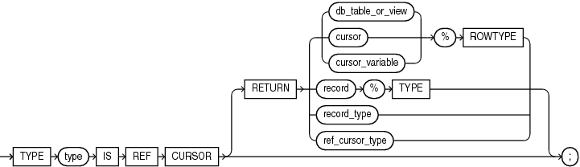
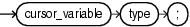

A cursor variable is like an explicit cursor that is not limited to one query.

To create a cursor variable, either declare a variable of the predefined type `SYS_REFCURSOR` or define a `REF` `CURSOR` type and then declare a variable of that type.

Restrictions on Cursor Variables

- You cannot declare a cursor variable in a package specification.
	That is, a package cannot have a public cursor variable (a cursor variable that can be referenced from outside the package).
- You cannot store the value of a cursor variable in a collection or database column.
- You cannot use comparison operators to test cursor variables for equality, inequality, or nullity.
- Using a cursor variable in a server-to-server remote procedure call (RPC) causes an error. However, you can use a cursor variable in a server-to-server RPC if the remote database is a non-Oracle database accessed through a Procedural Gateway.

Topics

Syntax

ref\_cursor\_type\_definition::=



> ```
> TYPE type IS REF CURSOR
>   [ RETURN
>     { {db_table_or_view | cursor | cursor_variable}%ROWTYPE
>     | record%TYPE
>     | record_type
>     | ref_cursor_type
>     }
>   ] ;
> ```
>
> [  
> Copyright © 1996, 2024, Oracle and/or its affiliates.](https://docs.oracle.com/en/database/oracle/oracle-database/dcommon/html/cpyr.htm)


cursor\_variable\_declaration::=



> ```
> cursor_variable type;
> ```
>
> [  
> Copyright © 1996, 2024, Oracle and/or its affiliates.](https://docs.oracle.com/en/database/oracle/oracle-database/dcommon/html/cpyr.htm)


Semantics

ref\_cursor\_type\_definition

type

Name of the `REF` `CURSOR` type that you are defining.

RETURN

Specifies the data type of the value that the cursor variable returns.

Specify `RETURN` to define a strong `REF` `CURSOR` type. Omit `RETURN` to define a weak `REF` `CURSOR` type. For information about strong and weak `REF` `CURSOR` types, see " [Creating Cursor Variables](static-sql.md) ".

db\_table\_or\_view

Name of a database table or view, which must be accessible when the declaration is elaborated.

cursor

Name of a previously declared explicit cursor.

cursor\_variable

Name of a previously declared cursor variable.

record

Name of a user-defined record.

record\_type

Name of a user-defined type that was defined with the data type specifier `RECORD`.

ref\_cursor\_type

Name of a user-defined type that was defined with the data type specifier `REF` `CURSOR`.

cursor\_variable\_declaration

cursor\_variable

Name of the cursor variable that you are declaring.

type

Type of the cursor variable that you are declaring—either `SYS_REFCURSOR` or the name of the `REF` `CURSOR` type that you defined previously.

`SYS_REFCURSOR` is a weak type. For information about strong and weak `REF` `CURSOR` types, see " [Creating Cursor Variables](static-sql.md) ".

Examples

- [Example 7-24](static-sql.md), "Cursor Variable Declarations"
- [Example 7-25](static-sql.md), "Cursor Variable with User-Defined Return Type"
- [Example 7-28](static-sql.md), "Variable in Cursor Variable Query—No Result Set Change"
- [Example 7-29](static-sql.md), "Variable in Cursor Variable Query—Result Set Change"
- [Example 7-30](static-sql.md), "Querying a Collection with Static SQL"
- [Example 7-31](static-sql.md), "Procedure to Open Cursor Variable for One Query"
- [Example 7-32](static-sql.md), "Opening Cursor Variable for Chosen Query (Same Return Type)"
- [Example 7-33](static-sql.md), "Opening Cursor Variable for Chosen Query (Different Return Types)"
- [Example 7-34](static-sql.md), "Cursor Variable as Host Variable in Pro\*C Client Program"

Related Topics

In this chapter:

- " [CLOSE Statement](CLOSE-statement.md) "
- " [Named Cursor Attribute](named-cursor-attribute.md) "
- " [Explicit Cursor Declaration and Definition](explicit-cursor-declaration-and-definition.md) "
- " [FETCH Statement](FETCH-statement.md) "
- " [OPEN FOR Statement](OPEN-FOR-statement.md) "
- " [%ROWTYPE Attribute](ROWTYPE-attribute.md) "
- " [%TYPE Attribute](TYPE-attribute.md) "

In other chapters:

- " [Cursor Variables](static-sql.md) "
- " [Passing CURSOR Expressions to Pipelined Table Functions](plsql-optimization-and-tuning.md) "