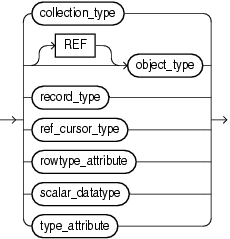

The data type attribute of an ADT element.

A `datatype` allows you to declare the data type of record variables fields, constants, functions return value, collection variables and collection types elements.

Syntax

datatype::=



> ```
> { collection_type
> | [ REF ] object_type
> | record_type
> | ref_cursor_type
> | rowtype_attribute
> | scalar_datatype
> | type_attribute
> }
> ```
>
> [  
> Copyright © 1996, 2024, Oracle and/or its affiliates.](https://docs.oracle.com/en/database/oracle/oracle-database/dcommon/html/cpyr.htm)


([rowtype\_attribute::=](ROWTYPE-attribute.md), [type\_attribute::=](TYPE-attribute.md))

Semantics

datatype

collection\_type

Name of a user-defined varray or nested table type (not the name of an associative array type).

object\_type

Instance of a user-defined type.

record\_type

Name of a user-defined type that was defined with the data type specifier `RECORD`.

ref\_cursor\_type

Name of a user-defined type that was defined with the data type specifier `REF` `CURSOR`.

scalar\_datatype

Name of a scalar data type, including any qualifiers for size, precision, and character or byte semantics.