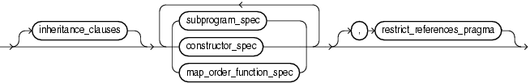
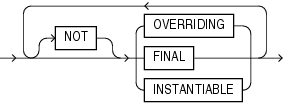
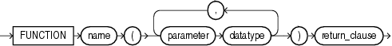
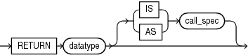
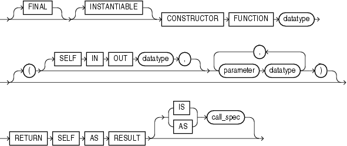
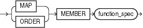

An element specification specifies each attribute of the ADT.

An element specification can appear in the following SQL statements:

- [ALTER TYPE Statement](ALTER-TYPE-statement.md)
- [CREATE TYPE Statement](CREATE-TYPE-statement.md)

Syntax

element\_spec::=



> ```
> [ inheritance_clauses ]
> { subprogram_spec
> | constructor_spec
> | map_order_function_spec
> }... [, restrict_references_pragma ]
> ```
>
> [  
> Copyright © 1996, 2024, Oracle and/or its affiliates.](https://docs.oracle.com/en/database/oracle/oracle-database/dcommon/html/cpyr.htm)


( subprogram\_spec::=, constructor\_spec::=, map\_order\_function\_spec::=, [restrict\_references\_pragma::=](RESTRICT_REFERENCES-pragma.md))

inheritance\_clauses::=



> ```
> { [ NOT ] { OVERRIDING | FINAL | INSTANTIABLE } }...
> ```
>
> [  
> Copyright © 1996, 2024, Oracle and/or its affiliates.](https://docs.oracle.com/en/database/oracle/oracle-database/dcommon/html/cpyr.htm)


subprogram\_spec::=


> ```
> { MEMBER | STATIC } { procedure_spec | function_spec }
> ```
>
> [  
> Copyright © 1996, 2024, Oracle and/or its affiliates.](https://docs.oracle.com/en/database/oracle/oracle-database/dcommon/html/cpyr.htm)


( procedure\_spec::=, function\_spec::= )

procedure\_spec::=


> ```
> PROCEDURE procedure_name
>   (parameter datatype [, parameter datatype ]...)
>   [ { IS | AS } call_spec ]
> ```
>
> [  
> Copyright © 1996, 2024, Oracle and/or its affiliates.](https://docs.oracle.com/en/database/oracle/oracle-database/dcommon/html/cpyr.htm)


([call\_spec::=](call-specification.md))

function\_spec::=



> ```
> FUNCTION name
>    (parameter datatype [, parameter datatype ]...)
>    return_clause
> ```
>
> [  
> Copyright © 1996, 2024, Oracle and/or its affiliates.](https://docs.oracle.com/en/database/oracle/oracle-database/dcommon/html/cpyr.htm)


return\_clause::=



> ```
> { RETURN datatype [ { IS | AS } call_spec ] }
> ```
>
> [  
> Copyright © 1996, 2024, Oracle and/or its affiliates.](https://docs.oracle.com/en/database/oracle/oracle-database/dcommon/html/cpyr.htm)


([call\_spec::=](call-specification.md))

constructor\_spec::=



> ```
> [ FINAL ] [ INSTANTIABLE ]
> CONSTRUCTOR FUNCTION datatype
> [ ([ SELF IN OUT datatype, ]
>    parameter datatype [, parameter datatype ]...
>   )
> ]
> RETURN SELF AS RESULT
> [ { IS | AS } call_spec ]
> ```
>
> [  
> Copyright © 1996, 2024, Oracle and/or its affiliates.](https://docs.oracle.com/en/database/oracle/oracle-database/dcommon/html/cpyr.htm)


([call\_spec::=](call-specification.md))

map\_order\_function\_spec::=



> ```
> { MAP | ORDER } MEMBER function_spec
> ```
>
> [  
> Copyright © 1996, 2024, Oracle and/or its affiliates.](https://docs.oracle.com/en/database/oracle/oracle-database/dcommon/html/cpyr.htm)


(function\_spec::=)

Semantics

element\_spec

inheritance\_clauses

Specifies the relationship between supertypes and subtypes.

\[NOT\] OVERRIDING

Specifies that this method overrides a `MEMBER` method defined in the supertype. This keyword is required if the method redefines a supertype method. Default: `NOT` `OVERRIDING`.

\[NOT\] FINAL

Specifies that this method cannot be overridden by any subtype of this type. Default: `NOT` `FINAL`.

\[NOT\] INSTANTIABLE

Specifies that the type does not provide an implementation for this method. Default: all methods are `INSTANTIABLE`.

Restriction on NOT INSTANTIABLE

If you specify `NOT` `INSTANTIABLE`, then you cannot specify `FINAL` or `STATIC`.

See Also:

constructor\_spec

subprogram\_spec

Specifies a subprogram to be referenced as an ADT attribute. For each such subprogram, you must specify a corresponding method body in the ADT body.

Restriction on subprogram\_spec

You cannot define a `STATIC` method on a subtype that redefines a `MEMBER` method in its supertype, or vice versa.

MEMBER

A subprogram associated with the ADT that is referenced as an attribute. Typically, you invoke `MEMBER` methods in a selfish style, such as `object_expression.method` `()`. This class of method has an implicit first argument referenced as `SELF` in the method body, which represents the object on which the method was invoked.

See Also:

" [Example 15-33](CREATE-TYPE-statement.md) "

STATIC

A subprogram associated with the ADT. Unlike `MEMBER` methods, `STATIC` methods do not have any implicit parameters. You cannot reference `SELF` in their body. They are typically invoked as `type_name.method` `()`.

Restrictions on STATIC

- You cannot map a `MEMBER` method in a Java class to a `STATIC` method in a SQLJ object type.
- For both `MEMBER` and `STATIC` methods, you must specify a corresponding method body in the type body for each procedure or function specification.

See Also:

" [Example 15-34](CREATE-TYPE-statement.md) "

procedure\_spec or function\_spec

Specifies the parameters and data types of the procedure or function. If this subprogram does not include the declaration of the procedure or function, then you must issue a corresponding `CREATE` `TYPE` `BODY` statement.

Restriction on procedure\_spec or function\_spec

If you are creating a subtype, then the name of the procedure or function cannot be the same as the name of any attribute, whether inherited or not, declared in the supertype chain.

return\_clause

The first form of the return\_clause is valid only for a function. The syntax shown is an abbreviated form.

See Also:

" [Collection Method Invocation](collection-method.md) " for information about method invocation and methods

constructor\_spec

Creates a user-defined constructor, which is a function that returns an initialized instance of an ADT. You can declare multiple constructors for a single ADT, if the parameters of each constructor differ in number, order, or data type.

- User-defined constructor functions are always `FINAL` and `INSTANTIABLE`, so these keywords are optional.
- The parameter-passing mode of user-defined constructors is always `SELF` `IN` `OUT`. Therefore you need not specify this clause unless you want to do so for clarity.
- `RETURN` `SELF` `AS` `RESULT` specifies that the runtime type of the value returned by the constructor is runtime type of the `SELF` argument.

See Also:

[Oracle Database Object-Relational Developer's Guide](https://docs.oracle.com/pls/topic/lookup?ctx=en/database/oracle/oracle-database/21/lnpls&id=ADOBJ006) for more information about and examples of user-defined constructors and " [Example 15-32](CREATE-TYPE-statement.md) "

map\_order\_function\_spec

You can declare either one `MAP` method or one `ORDER` method in a type specification, regardless of how many `MEMBER` or `STATIC` methods you declare. If you declare either method, then you can compare object instances in SQL.

If you do not declare either method, then you can compare object instances only for equality or inequality. Instances of the same type definition are equal only if each pair of their corresponding attributes is equal. You must not specify a comparison method to determine the equality of two ADTs.

You cannot declare either `MAP` or `ORDER` methods for subtypes. However, a subtype can override a `MAP` method if the supertype defines a `NOT` `FINAL` `MAP` method. A subtype cannot override an `ORDER` method at all.

You can specify either `MAP` or `ORDER` when mapping a Java class to a SQL type. However, the `MAP` or `ORDER` methods must map to `MEMBER` functions in the Java class.

If neither a `MAP` nor an `ORDER` method is specified, then only comparisons for equality or inequality can be performed. Therefore object instances cannot be ordered. Instances of the same type definition are equal only if each pair of their corresponding attributes is equal. No comparison method must be specified to determine the equality of two ADTs.

Use `MAP` if you are performing extensive sorting or hash join operations on object instances. `MAP` is applied once to map the objects to scalar values, and then the database uses the scalars during sorting and merging. A `MAP` method is more efficient than an `ORDER` method, which must invoke the method for each object comparison. You must use a `MAP` method for hash joins. You cannot use an `ORDER` method because the hash mechanism hashes on the object value.

See Also:

[Oracle Database Object-Relational Developer's Guide](https://docs.oracle.com/pls/topic/lookup?ctx=en/database/oracle/oracle-database/21/lnpls&id=ADOBJ00803) for more information about object value comparisons

MAP MEMBER

Specifies a `MAP` member function (`MAP` method) that returns the relative position of a given instance in the ordering of all instances of the object. A `MAP` method is called implicitly and induces an ordering of object instances by mapping them to values of a predefined scalar type. PL/SQL uses the ordering to evaluate Boolean expressions and to perform comparisons.

If the argument to the `MAP` method is `NULL`, then the `MAP` method returns `NULL` and the method is not invoked.

An object specification can contain only one `MAP` method, which must be a function. The result type must be a predefined SQL scalar type, and the `MAP` method can have no arguments other than the implicit `SELF` argument.

Note:

If `type_name` is to be referenced in queries containing sorts (through an `ORDER` `BY`, `GROUP` `BY`, `DISTINCT`, or `UNION` clause) or containing joins, and you want those queries to be parallelized, then you must specify a `MAP` member function.

A subtype cannot define a new `MAP` method, but it can override an inherited `MAP` method.

ORDER MEMBER

Specifies an `ORDER` member function (`ORDER` method) that takes an instance of an object as an explicit argument and the implicit `SELF` argument and returns either a negative, zero, or positive integer. The negative, positive, or zero indicates that the implicit `SELF` argument is less than, equal to, or greater than the explicit argument.

If either argument to the `ORDER` method is `NULL`, then the `ORDER` method returns `NULL` and the method is not invoked.

When instances of the same ADT definition are compared in an `ORDER` `BY` clause, the `ORDER` method function is invoked.

An object specification can contain only one `ORDER` method, which must be a function having the return type `NUMBER`.

A subtype can neither define nor override an `ORDER` method.

Restriction on map\_order\_function\_spec

You cannot add an `ORDER` method to a subtype.

restrict\_references\_pragma

Deprecated clause, described in " [RESTRICT\_REFERENCES Pragma](RESTRICT_REFERENCES-pragma.md) ".

Restriction on restrict\_references\_pragma

This clause is not valid when dropping a method.