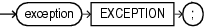

An exception declaration declares the name of a user-defined exception.

You can use the `EXCEPTION_INIT` pragma to assign this name to an internally defined exception.

Topics

Syntax

exception\_declaration::=



> ```
> exception EXCEPTION;
> ```
>
> [  
> Copyright © 1996, 2024, Oracle and/or its affiliates.](https://docs.oracle.com/en/database/oracle/oracle-database/dcommon/html/cpyr.htm)


Semantics

exception\_declaration

exception

Name of the exception that you are declaring.

Restriction on exception

You can use `exception` only in an `EXCEPTION_INIT` pragma, `RAISE` statement, `RAISE_APPLICATION_ERROR` invocation, or exception handler.

Caution:

Oracle recommends against using a predefined exception name for `exception`. For details, see " [Redeclared Predefined Exceptions](plsql-error-handling.md) ". For a list of predefined exception names, see [Table 12-3](plsql-error-handling.md).

Examples