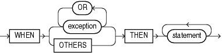

An exception handler processes a raised exception.

Exception handlers appear in the exception-handling parts of anonymous blocks, subprograms, triggers, and packages.

Topics

Syntax

exception\_handler::=



> ```
> WHEN { exception [ OR exception ]... | OTHERS }
>   THEN statement [ statement ]...
> ```
>
> [  
> Copyright © 1996, 2024, Oracle and/or its affiliates.](https://docs.oracle.com/en/database/oracle/oracle-database/dcommon/html/cpyr.htm)


([statement::=](block.md))

Semantics

exception\_handler

exception

Name of either a predefined exception (see [Table 12-3](plsql-error-handling.md)) or a user-defined exception (see " [Exception Declaration](exception-declaration.md) ").

If PL/SQL raises a specified exception, then the associated statements run.

OTHERS

Specifies all exceptions not explicitly specified in the exception handling part of the block. If PL/SQL raises such an exception, then the associated statements run.

Note:

Oracle recommends that the last statement in the `OTHERS` exception handler be either `RAISE` or an invocation of a subroutine marked with pragma `SUPPRESSES_WARNING_6009`.

If you do not follow this practice, and PL/SQL warnings are enabled, you get `PLW-06009`.

In the exception handling part of a block, the `WHEN` `OTHERS` exception handler is optional. It can appear only once, as the last exception handler in the exception handling part of the block.

Examples

- [Example 12-3](plsql-error-handling.md), "Single Exception Handler for Multiple Exceptions"
- [Example 12-4](plsql-error-handling.md), "Locator Variables for Statements that Share Exception Handler"
- [Example 12-6](plsql-error-handling.md), "Anonymous Block Handles ZERO\_DIVIDE"
- [Example 12-7](plsql-error-handling.md), "Anonymous Block Avoids ZERO\_DIVIDE"
- [Example 12-10](plsql-error-handling.md), "Declaring, Raising, and Handling User-Defined Exception"
- [Example 12-14](plsql-error-handling.md), "Exception that Propagates Beyond Scope is Handled"
- [Example 12-24](plsql-error-handling.md), "Exception Handler Runs and Execution Ends"
- [Example 12-25](plsql-error-handling.md), "Exception Handler Runs and Execution Continues"
- [Example 13-12](plsql-optimization-and-tuning.md), "Handling FORALL Exceptions Immediately"
- [Example 13-13](plsql-optimization-and-tuning.md), "Handling FORALL Exceptions After FORALL Statement Completes"

Related Topics

In this chapter:

- " [Block](block.md) "
- " [EXCEPTION\_INIT Pragma](EXCEPTION_INIT-pragma.md) "
- " [Exception Declaration](exception-declaration.md) "
- " [RAISE Statement](RAISE-statement.md) "
- " [SQLCODE Function](SQLCODE-function.md) "
- " [SQLERRM Function](SQLERRM-function.md) "

In other chapters:

- " [Overview of Exception Handling](plsql-error-handling.md) "
- " [Continuing Execution After Handling Exceptions](plsql-error-handling.md) "
- " [Retrying Transactions After Handling Exceptions](plsql-error-handling.md) "
- " [CREATE PACKAGE BODY Statement](CREATE-PACKAGE-BODY-statement.md) "
- " [CREATE TRIGGER Statement](CREATE-TRIGGER-statement.md) "