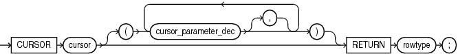
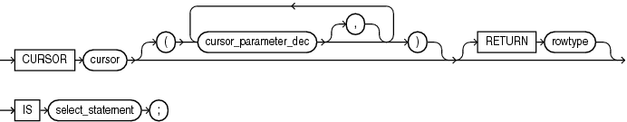
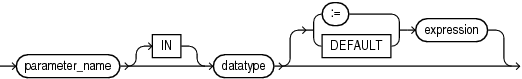
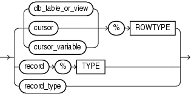

An explicit cursor is a named pointer to a private SQL area that stores information for processing a specific query or DML statement—typically, one that returns or affects multiple rows.

You can use an explicit cursor to retrieve the rows of a result set one at a time.

Before using an explicit cursor, you must declare and define it. You can either declare it first (with cursor\_declaration) and then define it later in the same block, subprogram, or package (with cursor\_definition) or declare and define it at the same time (with cursor\_definition).

An explicit cursor declaration and definition are also called a cursor specification and cursor body, respectively.

Note:

An explicit cursor declared in a package specification is affected by the `AUTHID` clause of the package. For more information, see " [CREATE PACKAGE Statement](CREATE-PACKAGE-statement.md) ".

Topics

Syntax

cursor\_declaration::=



> ```
> CURSOR cursor
>   [( cursor_parameter_dec [, cursor_parameter_dec ]... )]
>     RETURN rowtype;
> ```
>
> [  
> Copyright © 1996, 2024, Oracle and/or its affiliates.](https://docs.oracle.com/en/database/oracle/oracle-database/dcommon/html/cpyr.htm)


cursor\_definition::=



> ```
> CURSOR cursor
>  [ ( cursor_parameter_dec [, cursor_parameter_dec ]... )]
>    [ RETURN rowtype] IS select_statement ;
> ```
>
> [  
> Copyright © 1996, 2024, Oracle and/or its affiliates.](https://docs.oracle.com/en/database/oracle/oracle-database/dcommon/html/cpyr.htm)


cursor\_parameter\_dec::=



> ```
> parameter [IN] datatype [ { := | DEFAULT } expression ]
> ```
>
> [  
> Copyright © 1996, 2024, Oracle and/or its affiliates.](https://docs.oracle.com/en/database/oracle/oracle-database/dcommon/html/cpyr.htm)


rowtype::=



> ```
> { {db_table_or_view | cursor | cursor_variable}%ROWTYPE
>   | record%TYPE
>   | record_type
>   }
> ```
>
> [  
> Copyright © 1996, 2024, Oracle and/or its affiliates.](https://docs.oracle.com/en/database/oracle/oracle-database/dcommon/html/cpyr.htm)


Semantics

cursor\_declaration

cursor

Name of the explicit cursor that you are declaring now and will define later in the same block, subprogram, or package. `cursor` can be any identifier except the reserved word `SQL`. Oracle recommends against giving a cursor the same name as a database table.

Explicit cursor names follow the same scoping rules as variables (see " [Scope and Visibility of Identifiers](plsql-language-fundamentals.md) ").

cursor\_definition

Either defines an explicit cursor that was declared earlier or both declares and defines an explicit cursor.

cursor

Either the name of the explicit cursor that you previously declared and are now defining or the name of the explicit cursor that you are both declaring and defining. `cursor` can be any identifier except the reserved word `SQL`. Oracle recommends against giving a cursor the same name as a database table.

select\_statement

A SQL `SELECT` statement (not a PL/SQL `SELECT` `INTO` statement). If the cursor has formal parameters, each parameter must appear in `select_statement`. The `select_statement` can also reference other PL/SQL variables in its scope.

Restriction on select\_statement

This `select_statement` cannot have a `WITH` clause.

See:

[Oracle Database SQL Language Reference](https://docs.oracle.com/pls/topic/lookup?ctx=en/database/oracle/oracle-database/21/lnpls&id=SQLRF01702) for `SELECT` statement syntax

cursor\_parameter\_dec

A cursor parameter declaration.

parameter

The name of the formal cursor parameter that you are declaring. This name can appear anywhere in `select_statement` that a constant can appear.

IN

Whether or not you specify `IN`, a formal cursor parameter has the characteristics of an `IN` subprogram parameter, which are summarized in [Table 9-1](plsql-subprograms.md). When the cursor opens, the value of the formal parameter is that of either its actual parameter or default value.

datatype

The data type of the parameter.

Restriction on datatype

This `datatype` cannot have constraints (for example, `NOT` `NULL`, or precision and scale for a number, or length for a string).

expression

Specifies the default value for the formal cursor parameter. The data types of `expression` and the formal cursor parameter must be compatible.

If an `OPEN` statement does not specify an actual parameter for the formal cursor parameter, then the statement evaluates `expression` and assigns its value to the formal cursor parameter.

If an `OPEN` statement does specify an actual parameter for the formal cursor parameter, then the statement assigns the value of the actual parameter to the formal cursor parameter and does not evaluate `expression`.

rowtype

Data type of the row that the cursor returns. The columns of this row must match the columns of the row that `select_statement` returns.

db\_table\_or\_view

Name of a database table or view, which must be accessible when the declaration is elaborated.

cursor

Name of a previously declared explicit cursor.

cursor\_variable

Name of a previously declared cursor variable.

record

Name of a previously declared record variable.

record\_type

Name of a user-defined type that was defined with the data type specifier `RECORD`.

Examples

- [Example 7-5](static-sql.md), "Explicit Cursor Declaration and Definition"
- [Example 7-8](static-sql.md), "Variable in Explicit Cursor Query—No Result Set Change"
- [Example 7-9](static-sql.md), "Variable in Explicit Cursor Query—Result Set Change"
- [Example 7-10](static-sql.md), "Explicit Cursor with Virtual Column that Needs Alias"
- [Example 7-11](static-sql.md), "Explicit Cursor that Accepts Parameters"
- [Example 7-12](static-sql.md), "Cursor Parameters with Default Values"
- [Example 7-13](static-sql.md), "Adding Formal Parameter to Existing Cursor"
- [Example 7-22](static-sql.md), "Subquery in FROM Clause of Parent Query"
- [Example 7-23](static-sql.md), "Correlated Subquery"
- [Example 7-35](static-sql.md), "CURSOR Expression"
- [Example 7-41](static-sql.md), "FETCH with FOR UPDATE Cursor After COMMIT Statement"

Related Topics

In this chapter:

- " [CLOSE Statement](CLOSE-statement.md) "
- " [Cursor FOR LOOP Statement](cursor-FOR-LOOP-statement.md) "
- " [Cursor Variable Declaration](cursor-variable-declaration.md) "
- " [FETCH Statement](FETCH-statement.md) "
- " [Named Cursor Attribute](named-cursor-attribute.md) "
- " [OPEN Statement](OPEN-statement.md) "
- " [%ROWTYPE Attribute](ROWTYPE-attribute.md) "
- " [%TYPE Attribute](TYPE-attribute.md) "

In other chapters:

- " [Explicit Cursors](static-sql.md) "
- " [Processing Query Result Sets](static-sql.md) "
- " [SELECT FOR UPDATE and FOR UPDATE Cursors](static-sql.md) "