An expression is an arbitrarily complex combination of operands (variables, constants, literals, operators, function invocations, and placeholders) and operators.

The simplest expression is a single variable.

The PL/SQL compiler determines the data type of an expression from the types of the operands and operators that comprise the expression. Every time the expression is evaluated, a single value of that type results.

Topics

Syntax

expression::=

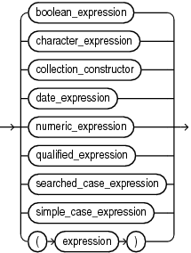

> ```
> { boolean_expression
>   | character_expression
>   | collection_constructor
>   | date_expression
>   | numeric_expression
>   | qualified_expression
>   | searched_case_expression
>   | simple_case_expression
>   | ( expression )
>   }
> ```
>
> [  
> Copyright © 1996, 2024, Oracle and/or its affiliates.](https://docs.oracle.com/en/database/oracle/oracle-database/dcommon/html/cpyr.htm)


(boolean\_expression::=, character\_expression::=, collection\_constructor::=, date\_expression::=, numeric\_expression::=, [qualified\_expression::=](qualified-expression.md), searched\_case\_expression::=, simple\_case\_expression::=)

boolean\_expression::=

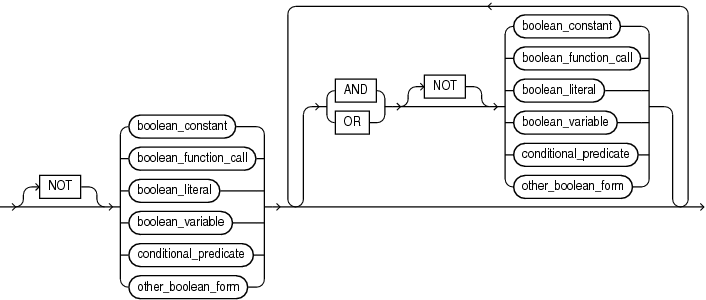

> ```
> [ NOT ] { boolean_constant
>         | boolean_function_call
>         | boolean_literal
>         | boolean_variable
>         | conditional_predicate
>         | other_boolean_form
>         }
>         [ { AND | OR } [ NOT ] { boolean_constant
>                                | boolean_function_call
>                                | boolean_literal
>                                | boolean_variable
>                                | conditional_predicate
>                                | other_boolean_form
>                                }
>         ]...
> ```
>
> [  
> Copyright © 1996, 2024, Oracle and/or its affiliates.](https://docs.oracle.com/en/database/oracle/oracle-database/dcommon/html/cpyr.htm)


(function\_call::=)

boolean\_literal::=

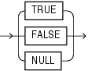

> ```
> { TRUE | FALSE | NULL }
> ```
>
> [  
> Copyright © 1996, 2024, Oracle and/or its affiliates.](https://docs.oracle.com/en/database/oracle/oracle-database/dcommon/html/cpyr.htm)


conditional\_predicate::=

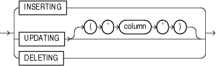

> ```
> { INSERTING | UPDATING [ ( 'column' ) ] | DELETING }
> ```
>
> [  
> Copyright © 1996, 2024, Oracle and/or its affiliates.](https://docs.oracle.com/en/database/oracle/oracle-database/dcommon/html/cpyr.htm)


other\_boolean\_form::=

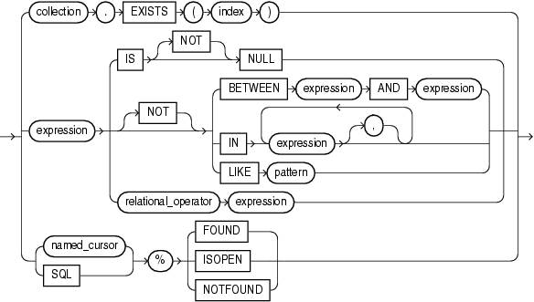

> ```
> { collection.EXISTS ( index )
> | expression { IS [ NOT ] NULL
>              | [ NOT ] { BETWEEN expression AND expression
>                        | IN ( expression [, expression ]... )
>                        | LIKE pattern
>                        }
>              | relational_operator expression
>              }
> | { named_cursor | SQL } % { FOUND | ISOPEN | NOTFOUND }
> }
> ```


(expression::=, [named\_cursor::=](named-cursor-attribute.md))

character\_expression::=

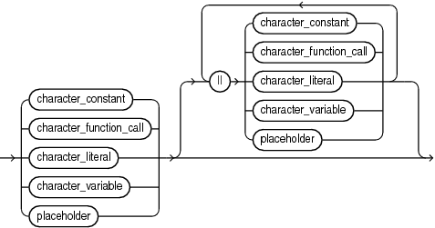

> ```
> { character_constant
>   | character_function_call
>   | character_literal
>   | character_variable
>   | placeholder]
> }
> [|| { character_constant
>       | character_function_call
>       | character_literal
>       | character_variable
>       | placeholder]
>      } 
> [|| { character_constant
>       | character_function_call
>       | character_literal
>       | character_variable
>       | placeholder]
>     } ]...
> ```
>
> [  
> Copyright © 1996, 2024, Oracle and/or its affiliates.](https://docs.oracle.com/en/database/oracle/oracle-database/dcommon/html/cpyr.htm)


(function\_call::=, [placeholder::=](assignment-statement.md))

collection\_constructor::=

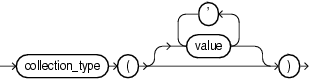

> ```
> collection_type ( [ value [, value]... ])
> ```
>
> [  
> Copyright © 1996, 2024, Oracle and/or its affiliates.](https://docs.oracle.com/en/database/oracle/oracle-database/dcommon/html/cpyr.htm)


date\_expression::=

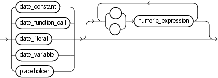

> ```
> { date_constant
> | date_function_call
> | date_literal
> | date_variable
> | placeholder]
> }
>   [ { + | - } numeric_expression ] [ { + | - } numeric_expression ] ]...
> ```
>
> [  
> Copyright © 1996, 2024, Oracle and/or its affiliates.](https://docs.oracle.com/en/database/oracle/oracle-database/dcommon/html/cpyr.htm)


(function\_call::=, [placeholder::=](assignment-statement.md))

numeric\_expression::=

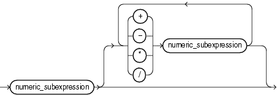

> ```
> numeric_subexpression
> [ { + | - | * | / } numeric_subexpression ]...
> ```
>
> [  
> Copyright © 1996, 2024, Oracle and/or its affiliates.](https://docs.oracle.com/en/database/oracle/oracle-database/dcommon/html/cpyr.htm)


numeric\_subexpression::=

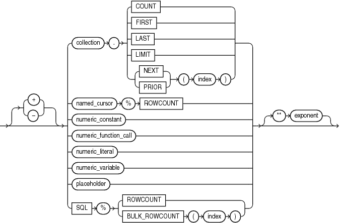

> ```
> [ + | - ] 
> { collection . { COUNT
>                | FIRST
>                | LAST
>                | LIMIT
>                | { NEXT | PRIOR } ( index )
>                }
> | named_cursor%ROWCOUNT
> | numeric_constant
> | numeric_function_call
> | numeric_literal
> | numeric_variable
> | placeholder
> | SQL%{ROWCOUNT | BULK_ROWCOUNT ( index )}
> }
> [ ** exponent ]
> ```


(function\_call::=, [named\_cursor::=](named-cursor-attribute.md), [placeholder::=](assignment-statement.md))

function\_call::=

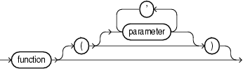

> ```
> function [ ( [ parameter [, parameter ]... ] ) ]
> ```
>
> [  
> Copyright © 1996, 2024, Oracle and/or its affiliates.](https://docs.oracle.com/en/database/oracle/oracle-database/dcommon/html/cpyr.htm)


searched\_case\_expression::=

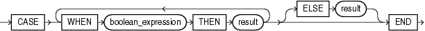

> ```
> CASE
>   WHEN boolean_expression THEN result_value
> [ WHEN boolean_expression THEN result_value]... 
> [ ELSE result_value]
> END
> ```
>
> [  
> Copyright © 1996, 2024, Oracle and/or its affiliates.](https://docs.oracle.com/en/database/oracle/oracle-database/dcommon/html/cpyr.htm)


(boolean\_expression::=)

simple\_case\_expression::=

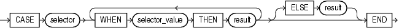

> ```
> CASE case_operand
>   WHEN case_operand_value THEN result_value
> [ WHEN case_operand_value THEN result_value]... 
> [ ELSE result_value]
> END
> ```
>
> [  
> Copyright © 1996, 2024, Oracle and/or its affiliates.](https://docs.oracle.com/en/database/oracle/oracle-database/dcommon/html/cpyr.htm)


Semantics

boolean\_expression

Expression whose value is `TRUE`, `FALSE`, or `NULL`. For more information, see " [BOOLEAN Expressions](plsql-language-fundamentals.md) ".

Restriction on boolean\_expression

Because SQL has no data type equivalent to `BOOLEAN`, you cannot:

- Assign a `BOOLEAN` value to a database table column
- Select or fetch the value of a database table column into a `BOOLEAN` variable
- Use a `BOOLEAN` value in a SQL function
	(However, a SQL query can invoke a PL/SQL function that has a `BOOLEAN` parameter, as in [Example 4-3](plsql-data-types.md).)
- Use a `BOOLEAN` expression in a SQL statement, except as an argument to a PL/SQL function invoked in a SQL query, or in a PL/SQL anonymous block.
	Note:
	An argument to a PL/SQL function invoked in a static SQL query cannot be a `BOOLEAN` literal. The workaround is to assign the literal to a variable and then pass the variable to the function, as in [Example 4-3](plsql-data-types.md).

NOT, AND, OR

See " [Logical Operators](plsql-language-fundamentals.md) ".

boolean\_constant

Name of a constant of type `BOOLEAN`.

boolean\_function\_call

Invocation of a previously defined function that returns a `BOOLEAN` value. For more semantic information, see " function\_call ".

boolean\_variable

Name of a variable of type `BOOLEAN`.

conditional\_predicate

See " [Conditional Predicates for Detecting Triggering DML Statement](plsql-triggers.md) ".

other\_boolean\_form

collection

Name of a collection variable.

EXISTS

Collection method (function) that returns `TRUE` if the `index` th element of `collection` exists and `FALSE` otherwise. For more information, see " [EXISTS Collection Method](plsql-collections-and-records.md) ".

Restriction on EXISTS

You cannot use `EXISTS` if `collection` is an associative array.

index

Numeric expression whose data type either is `PLS_INTEGER` or can be implicitly converted to `PLS_INTEGER` (for information about the latter, see " [Predefined PLS\_INTEGER Subtypes](plsql-data-types.md) ").

IS \[NOT\] NULL

See " [IS \[NOT\] NULL Operator](https://docs.oracle.com/en/database/oracle/oracle-database/21/lnpls/plsql-language-fundamentals.html#GUID-D02FA4D0-0074-4227-9624-F01E3D219BAB "The IS NULL operator returns the BOOLEAN value TRUE if its operand is NULL or FALSE if it is not NULL. The IS NOT NULL operator does the opposite.") ".

BETWEEN expression AND expression

See " [BETWEEN Operator](plsql-language-fundamentals.md) ".

IN expression \[, expression \]...

See " [IN Operator](plsql-language-fundamentals.md) ".

LIKE pattern

See " [LIKE Operator](plsql-language-fundamentals.md) ".

relational\_operator

See " [Relational Operators](plsql-language-fundamentals.md) ".

SQL

Implicit cursor associated with the most recently run `SELECT` or DML statement. For more information, see " [Implicit Cursors](static-sql.md) ".

%FOUND, %ISOPEN, %NOTFOUND

Cursor attributes explained in " [Implicit Cursor Attribute](implicit-cursor-attribute.md) " and " [Named Cursor Attribute](named-cursor-attribute.md) ".

character\_expression

Expression whose value has a character data type (that is, a data type in the `CHAR` family, described in " [CHAR Data Type Family](plsql-predefined-data-types.md) ").

character\_constant

Name of a constant that has a character data type.

character\_function\_call

Invocation of a previously defined function that returns a value that either has a character data type or can be implicitly converted to a character data type. For more semantic information, see " function\_call ".

character\_literal

Literal of a character data type.

character\_variable

Name of a variable that has a character data type.

||

Concatenation operator, which appends one string operand to another. For more information, see " [Concatenation Operator](plsql-language-fundamentals.md) ".

collection\_constructor

Constructs a collection of the specified type with elements that have the specified values.

For more information, see " [Collection Constructors](plsql-collections-and-records.md) ".

collection\_type

Name of a previously declared nested table type or `VARRAY` type (not an associative array type).

value

Valid value for an element of a collection of `collection_type`.

If `collection_type` is a varray type, then it has a maximum size, which the number of values cannot exceed. If `collection_type` is a nested table type, then it has no maximum size.

If you specify no values, then the constructed collection is empty but not null (for the difference between empty and null, see " [Collection Types](plsql-collections-and-records.md) ").

date\_expression

Expression whose value has a date data type (that is, a data type in the `DATE` family, described in " [DATE Data Type Family](plsql-predefined-data-types.md) ").

date\_constant

Name of a constant that has a date data type.

date\_function\_call

Invocation of a previously defined function that returns a value that either has a date data type or can be implicitly converted to a date data type. For more semantic information, see " function\_call ".

date\_literal

Literal whose value either has a date data type or can be implicitly converted to a date data type.

date\_variable

Name of a variable that has a date data type.

+, -

Addition and subtraction operators.

numeric\_expression

Expression whose value has a date numeric type (that is, a data type in the `DATE` family, described in " [NUMBER Data Type Family](plsql-predefined-data-types.md) ").

+, -, /, \*, \*\*

Addition, subtraction, division, multiplication, and exponentiation operators.

numeric\_subexpression

collection

Name of a collection variable.

COUNT, FIRST, LAST, LIMIT, NEXT, PRIOR

Collection methods explained in " [Collection Method Invocation](collection-method.md) ".

named\_cursor%ROWCOUNT

See " [Named Cursor Attribute](named-cursor-attribute.md) ".

numeric\_constant

Name of a constant that has a numeric data type.

numeric\_function\_call

Invocation of a previously defined function that returns a value that either has a numeric data type or can be implicitly converted to a numeric data type. For more semantic information, see " function\_call ".

numeric\_literal

Literal of a numeric data type.

numeric\_variable

Name of variable that has a numeric data type.

SQL%ROWCOUNT

Cursor attribute explained in " [Implicit Cursor Attribute](implicit-cursor-attribute.md) ".

SQL%BULK\_ROWCOUNT\]

Cursor attribute explained in " [SQL%BULK\_ROWCOUNT](implicit-cursor-attribute.md) ".

exponent

Numeric expression.

function\_call

function

Name of a previously defined function.

parameter \[, parameter \]...

List of actual parameters for the function being called. The data type of each actual parameter must be compatible with the data type of the corresponding formal parameter. The mode of the formal parameter determines what the actual parameter can be:

| Formal Parameter Mode | Actual Parameter |
| --- | --- |
| `IN` | Constant, initialized variable, literal, or expression |
| `OUT` | Variable whose data type is not defined as `NOT` `NULL` |
| `IN` `OUT` | Variable (typically, it is a string buffer or numeric accumulator) |

If the function specifies a default value for a parameter, you can omit that parameter from the parameter list. If the function has no parameters, or specifies a default value for every parameter, you can either omit the parameter list or specify an empty parameter list.

See Also:

" [Positional, Named, and Mixed Notation for Actual Parameters](plsql-subprograms.md) "

searched\_case\_expression

WHEN boolean\_expression THEN result

The `boolean_expression` s are evaluated sequentially. If a `boolean_expression` has the value `TRUE`, then the `result` associated with that `boolean_expression` is returned. Subsequent `boolean_expression` s are not evaluated.

ELSE result

The `result` is returned if and only if no `boolean_expression` has the value `TRUE`.

If you omit the `ELSE` clause, the searched case expression returns `NULL`.

See Also:

" [Searched CASE Statement](plsql-control-statements.md) "

simple\_case\_expression

selector

An expression of any PL/SQL type except `BLOB`, `BFILE`, or a user-defined type. The `selector` is evaluated once.

WHEN selector\_value THEN result

The `selector_value` s are evaluated sequentially. If a `selector_value` is the value of `selector`, then the `result` associated with that `selector_value` is returned. Subsequent `selector_value` s are not evaluated.

A `selector_value` can be of any PL/SQL type except `BLOB`, `BFILE`, an ADT, a PL/SQL record, an associative array, a varray, or a nested table.

ELSE result

The `result` is returned if and only if no `selector_value` has the same value as `selector`.

If you omit the `ELSE` clause, the simple case expression returns `NULL`.

Note:

If you specify the literal `NULL` for every `result` (including the `result` in the `ELSE` clause), then error PLS-00617 occurs.

See Also:

" [Simple CASE Statement](plsql-control-statements.md) "

Examples

- [Example 3-28](plsql-language-fundamentals.md), "Concatenation Operator Examples"
- [Example 3-30](plsql-language-fundamentals.md), "Controlling Evaluation Order with Parentheses"
- [Example 3-31](plsql-language-fundamentals.md), "Expression with Nested Parentheses"
- [Example 3-32](plsql-language-fundamentals.md), "Improving Readability with Parentheses"
- [Example 3-33](plsql-language-fundamentals.md), "Operator Precedence"
- [Example 3-43](plsql-language-fundamentals.md), "Relational Operators in Expressions"
- [Example 3-44](plsql-language-fundamentals.md), "LIKE Operator in Expression"
- [Example 3-46](plsql-language-fundamentals.md), "BETWEEN Operator in Expressions"
- [Example 3-47](plsql-language-fundamentals.md), "IN Operator in Expressions"
- [Example 3-50](plsql-language-fundamentals.md), "Simple CASE Expression"
- [Example 3-52](plsql-language-fundamentals.md), "Searched CASE Expression"
- [Example 10-1](plsql-triggers.md), "Trigger Uses Conditional Predicates to Detect Triggering Statement"

Related Topics

In this chapter:

- " [Collection Method Invocation](collection-method.md) "
- " [Constant Declaration](constant-declaration.md) "
- [Qualified Expression](qualified-expression.md)
- " [Scalar Variable Declaration](scalar-variable-declaration.md) "

In other chapters:

- " [Qualified Expressions Overview](plsql-collections-and-records.md) " for more information and examples
- " [Literals](plsql-language-fundamentals.md) "
- " [Expressions](plsql-language-fundamentals.md) "
- " [Operator Precedence](plsql-language-fundamentals.md) "
- " [PL/SQL Data Types](plsql-data-types.md) "
- " [Subprogram Parameters](plsql-subprograms.md) "