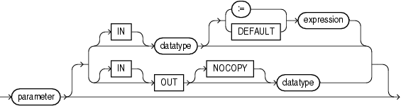

A formal parameter declaration specifies the name and data type of the parameter, and (optionally) its mode and default value.

Topics

Syntax

parameter\_declaration::=



> ```
> parameter [ [ IN ] datatype [ { := | DEFAULT } expression ]
>           | { OUT | IN OUT } [ NOCOPY ] datatype
> ```
>
> [  
> Copyright © 1996, 2024, Oracle and/or its affiliates.](https://docs.oracle.com/en/database/oracle/oracle-database/dcommon/html/cpyr.htm)


Semantics

parameter\_declaration

parameter

Name of the formal parameter that you are declaring, which you can reference in the executable part of the subprogram.

IN, OUT, IN OUT

Mode that determines the behavior of the parameter, explained in " [Subprogram Parameter Modes](plsql-subprograms.md) ". Default: `IN`.

Note:

Avoid using `OUT` and `IN` `OUT` for function parameters. The purpose of a function is to take zero or more parameters and return a single value. Functions must be free from side effects, which change the values of variables not local to the subprogram.

NOCOPY

Requests that the compiler pass the corresponding actual parameter by reference instead of value (for the difference, see " [Subprogram Parameter Passing Methods](plsql-subprograms.md) "). Each time the subprogram is invoked, the optimizer decides, silently, whether to obey or disregard `NOCOPY`.

Caution:

`NOCOPY` increases the likelihood of aliasing. For details, see " [Subprogram Parameter Aliasing with Parameters Passed by Reference](plsql-subprograms.md) ".

The compiler ignores `NOCOPY` in these cases:

- The actual parameter must be implicitly converted to the data type of the formal parameter.
- The actual parameter is the element of a collection.
- The actual parameter is a scalar variable with the `NOT` `NULL` constraint.
- The actual parameter is a scalar numeric variable with a range, size, scale, or precision constraint.
- The actual and formal parameters are records, one or both was declared with `%ROWTYPE` or `%TYPE`, and constraints on corresponding fields differ.
- The actual and formal parameters are records, the actual parameter was declared (implicitly) as the index of a cursor `FOR` `LOOP` statement, and constraints on corresponding fields differ.
- The subprogram is invoked through a database link or as an external subprogram.

Note:

The preceding list might change in a subsequent release.

datatype

Data type of the formal parameter that you are declaring. The data type can be a constrained subtype, but cannot include a constraint (for example, `NUMBER` (`2`) or `VARCHAR2` (`20`).

If `datatype` is a constrained subtype, the corresponding actual parameter inherits the `NOT` `NULL` constraint of the subtype (if it has one), but not the size (see [Example 9-10](plsql-subprograms.md)).

Caution:

The data type `REF` `CURSOR` increases the likelihood of subprogram parameter aliasing, which can have unintended results. For more information, see " [Subprogram Parameter Aliasing with Cursor Variable Parameters](plsql-subprograms.md) ".

expression

Default value of the formal parameter that you are declaring. The data type of `expression` must be compatible with `datatype`.

If a subprogram invocation does not specify an actual parameter for the formal parameter, then that invocation evaluates `expression` and assigns its value to the formal parameter.

If a subprogram invocation does specify an actual parameter for the formal parameter, then that invocation assigns the value of the actual parameter to the formal parameter and does not evaluate `expression`.

Examples

- [Example 3-26](plsql-language-fundamentals.md), "Assigning Value to Variable as IN OUT Subprogram Parameter"
- [Example 9-9](plsql-subprograms.md), "Formal Parameters and Actual Parameters"
- [Example 9-14](plsql-subprograms.md), "Parameter Values Before, During, and After Procedure Invocation"
- [Example 9-15](plsql-subprograms.md), "OUT and IN OUT Parameter Values After Exception Handling"
- [Example 9-20](plsql-subprograms.md), "Procedure with Default Parameter Values"
- [Example 9-21](plsql-subprograms.md), "Function Provides Default Parameter Value"
- [Example 9-22](plsql-subprograms.md), "Adding Subprogram Parameter Without Changing Existing Invocations"