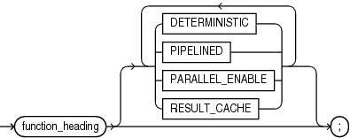
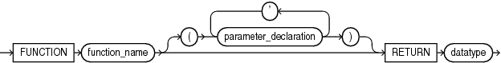
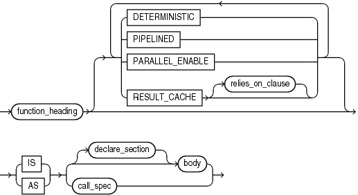

Before invoking a function, you must declare and define it. You can either declare it first (with function\_declaration) and then define it later in the same block, subprogram, or package (with function\_definition) or declare and define it at the same time (with function\_definition).

A function is a subprogram that returns a value. The data type of the value is the data type of the function. A function invocation (or call) is an expression, whose data type is that of the function.

A function declaration is also called a function specification or function spec.

Note:

This topic applies to nested functions.

For information about standalone functions, see " [CREATE FUNCTION Statement](CREATE-FUNCTION-statement.md) ".

For information about package functions, see " [CREATE PACKAGE Statement](CREATE-PACKAGE-statement.md) ".

Topics

Syntax

function\_declaration::=



> ```
> function_heading
> [ DETERMINISTIC | PIPELINED | PARALLEL_ENABLE | RESULT_CACHE ]... ;
> ```
>
> [  
> Copyright © 1996, 2024, Oracle and/or its affiliates.](https://docs.oracle.com/en/database/oracle/oracle-database/dcommon/html/cpyr.htm)


function\_heading::=



> ```
> FUNCTION function_name [ ( parameter_declaration [, parameter_declaration ] ) ]
>   RETURN datatype
> ```
>
> [  
> Copyright © 1996, 2024, Oracle and/or its affiliates.](https://docs.oracle.com/en/database/oracle/oracle-database/dcommon/html/cpyr.htm)


( [datatype::=](datatype-attribute.md), [parameter\_declaration::=](formal-parameter-declaration.md) )

function\_definition::=



> ```
> function_heading [ DETERMINISTIC
>                  | PIPELINED
>                  | PARALLEL_ENABLE
>                  | RESULT_CACHE [ relies_on_clause ]
>                  ]...
>   { IS | AS } { [ declare_section ] body | call_spec }
> ```
>
> [  
> Copyright © 1996, 2024, Oracle and/or its affiliates.](https://docs.oracle.com/en/database/oracle/oracle-database/dcommon/html/cpyr.htm)


( [body::=](block.md), [declare\_section::=](block.md), [pipelined\_clause::=](PIPELINED-clause.md), [deterministic\_clause::=](DETERMINISTIC-clause.md), [parallel\_enable\_clause::=](PARALLEL_ENABLE-clause.md), [result\_cache\_clause::=](RESULT_CACHE-clause.md), [call\_spec::=](call-specification.md) )

Semantics

function\_declaration

Declares a function, but does not define it. The definition must appear later in the same block, subprogram, or package as the declaration.

function\_heading

The function heading specifies the function name and its parameter list.

function\_name

Name of the function that you are declaring or defining.

RETURN datatype

Specifies the data type of the value that the function returns, which can be any PL/SQL data type (see [PL/SQL Data Types](plsql-data-types.md)).

Restriction on datatype

You cannot constrain this data type (with `NOT` `NULL`, for example). If `datatype` is a constrained subtype, then the returned value does not inherit the constraints of the subtype (see " [Formal Parameters of Constrained Subtypes](plsql-subprograms.md) ").

function\_definition

Either defines a function that was declared earlier or both declares and defines a function.

declare\_section

Declares items that are local to the function, can be referenced in `body`, and cease to exist when the function completes execution.

body

Required executable part and optional exception-handling part of the function. In the executable part, at least one execution path must lead to a `RETURN` statement; otherwise, a runtime error occurs.

Examples

- [Example 9-2](plsql-subprograms.md), "Declaring, Defining, and Invoking a Simple PL/SQL Function"