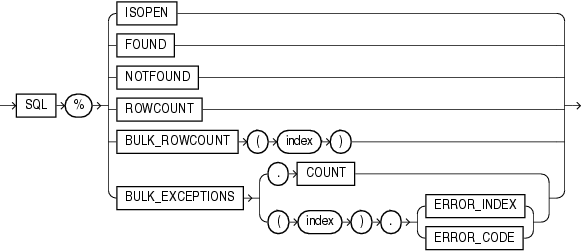

An implicit cursor has attributes that return information about the most recently run `SELECT` or DML statement that is not associated with a named cursor.

Note:

You can use cursor attributes only in procedural statements, not in SQL statements.

Topics

Syntax

implicit\_cursor\_attribute::=



> ```
> SQL% { ISOPEN
>      | FOUND
>      | NOTFOUND
>      | ROWCOUNT
>      | BULK_ROWCOUNT ( index )
>      | BULK_EXCEPTIONS { .COUNT | ( index ).{ ERROR_INDEX | ERROR_CODE } }
>      }
> ```
>
> [  
> Copyright © 1996, 2024, Oracle and/or its affiliates.](https://docs.oracle.com/en/database/oracle/oracle-database/dcommon/html/cpyr.htm)


Semantics

%ISOPEN

`SQL%ISOPEN` always has the value `FALSE`.

%FOUND

`SQL%FOUND` has one of these values:

- If no `SELECT` or DML statement has run, `NULL`.
- If the most recent `SELECT` or DML statement returned a row, `TRUE`.
- If the most recent `SELECT` or DML statement did not return a row, `FALSE`.

%NOTFOUND

`SQL%NOTFOUND` has one of these values:

- If no `SELECT` or DML statement has run, `NULL`.
- If the most recent `SELECT` or DML statement returned a row, `FALSE`.
- If the most recent `SELECT` or DML statement did not return a row, `TRUE`.

%ROWCOUNT

`SQL%ROWCOUNT` has one of these values:

- If no `SELECT` or DML statement has run, `NULL`.
- If a `SELECT` or DML statement has run, the number of rows fetched so far.

SQL%BULK\_ROWCOUNT

Composite attribute that is like an associative array whose ith element is the number of rows affected by the ith DML statement in the most recently completed `FORALL` statement. For more information, see " [Getting Number of Rows Affected by FORALL Statement](plsql-optimization-and-tuning.md) ".

Restriction on SQL%BULK\_ROWCOUNT

You cannot assign the value of `SQL%BULK_ROWCOUNT(``index``)` to another collection.

SQL%BULK\_EXCEPTIONS

Composite attribute that is like an associative array of information about the DML statements that failed during the most recently run `FORALL` statement. `SQL%BULK_EXCEPTIONS`.`COUNT` is the number of DML statements that failed. If `SQL%BULK_EXCEPTIONS`.`COUNT` is not zero, then for each index value i from 1 through `SQL%BULK_EXCEPTIONS`.`COUNT`:

- `SQL%BULK_EXCEPTIONS(``i``)`.`ERROR_INDEX` is the number of the DML statement that failed.
- `SQL%BULK_EXCEPTIONS(``i``)`.`ERROR_CODE` is the Oracle Database error code for the failure.

Typically, this attribute appears in an exception handler for a `FORALL` statement that has a `SAVE` `EXCEPTIONS` clause. For more information, see " [Handling FORALL Exceptions After FORALL Statement Completes](plsql-optimization-and-tuning.md) ".

Examples

- [Example 7-3](static-sql.md), "SQL%FOUND Implicit Cursor Attribute"
- [Example 7-4](static-sql.md), "SQL%ROWCOUNT Implicit Cursor Attribute"
- [Example 7-15](static-sql.md), "%FOUND Explicit Cursor Attribute"
- [Example 7-14](static-sql.md), "%ISOPEN Explicit Cursor Attribute"
- [Example 7-16](static-sql.md), "%NOTFOUND Explicit Cursor Attribute"
- [Example 7-17](static-sql.md), "%ROWCOUNT Explicit Cursor Attribute"
- [Example 13-13](plsql-optimization-and-tuning.md), "Handling FORALL Exceptions After FORALL Statement Completes"
- [Example 13-14](plsql-optimization-and-tuning.md), "Showing Number of Rows Affected by Each DELETE in FORALL"
- [Example 13-15](plsql-optimization-and-tuning.md), "Showing Number of Rows Affected by Each INSERT SELECT in FORALL"