The iterator specifies an iterand and the iteration controls.

An iterator can appear in the following statements:

Syntax

iterator::=

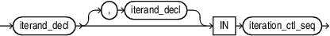

> iterand\_decl \[, iterand\_decl \] IN iteration\_ctl\_seq
>
> [  
> Copyright © 1996, 2024, Oracle and/or its affiliates.](https://docs.oracle.com/en/database/oracle/oracle-database/dcommon/html/cpyr.htm)


(iterand\_decl::=, iteration\_ctl\_seq::= )

iterand\_decl::=

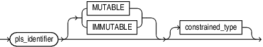

> ```
> pls_identifier [ MUTABLE | IMMUTABLE ] [ constrained_type ]
> ```
>
> [  
> Copyright © 1996, 2024, Oracle and/or its affiliates.](https://docs.oracle.com/en/database/oracle/oracle-database/dcommon/html/cpyr.htm)


iteration\_ctl\_seq::=

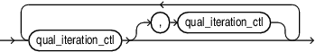

> ```
> qual_iteration_ctl [, qual_iteration_ctl]...
> ```
>
> [  
> Copyright © 1996, 2024, Oracle and/or its affiliates.](https://docs.oracle.com/en/database/oracle/oracle-database/dcommon/html/cpyr.htm)


qual\_iteration\_ctl::=

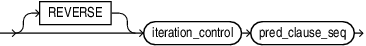

> ```
> [ REVERSE ] iteration_control pred_clause_seq
> ```
>
> [  
> Copyright © 1996, 2024, Oracle and/or its affiliates.](https://docs.oracle.com/en/database/oracle/oracle-database/dcommon/html/cpyr.htm)


(iteration\_control::=, pred\_clause\_seq::=)

iteration\_control::=

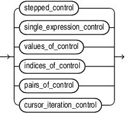

> ```
> ( stepped_control 
>      | single_expression_control
>      | values_of_control 
>      | indices_of_control
>      | pairs_of_control
>      | cursor_iteration_control )
> ```
>
> [  
> Copyright © 1996, 2024, Oracle and/or its affiliates.](https://docs.oracle.com/en/database/oracle/oracle-database/dcommon/html/cpyr.htm)


( stepped\_control::=, single\_expression\_control::=, values\_of\_control::=, indices\_of\_control::=, pairs\_of\_control::=, cursor\_iteration\_control::=)

pred\_clause\_seq::=

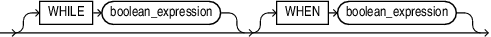

> ```
> [ WHILE boolean_expression ] [WHEN boolean_expression ]
> ```
>
> [  
> Copyright © 1996, 2024, Oracle and/or its affiliates.](https://docs.oracle.com/en/database/oracle/oracle-database/dcommon/html/cpyr.htm)


stepped\_control::=

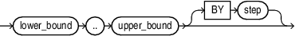

> ```
> lower_bound .. upper_bound [ BY step ]
> ```
>
> [  
> Copyright © 1996, 2024, Oracle and/or its affiliates.](https://docs.oracle.com/en/database/oracle/oracle-database/dcommon/html/cpyr.htm)


single\_expression\_control::=

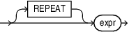

> ```
> [ REPEAT ] expr
> ```
>
> [  
> Copyright © 1996, 2024, Oracle and/or its affiliates.](https://docs.oracle.com/en/database/oracle/oracle-database/dcommon/html/cpyr.htm)


values\_of\_control::=

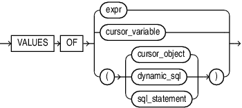

> ```
> VALUES OF { expr  
>          |  cursor_variable              
>          | ( cursor_object )    
>          | ( dynamic_sql )
>          | ( sql_statement ) }
> ```
>
> [  
> Copyright © 1996, 2024, Oracle and/or its affiliates.](https://docs.oracle.com/en/database/oracle/oracle-database/dcommon/html/cpyr.htm)


(dynamic\_sql::=)

indices\_of\_control::=

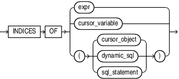

> ```
> INDICES OF { expr     
>               | cursor_variable          
>               | ( cursor_object ) 
>               | ( cursor_variable )
>               | ( dynamic_sql )
>               | ( sql_statement ) }
> ```
>
> [  
> Copyright © 1996, 2024, Oracle and/or its affiliates.](https://docs.oracle.com/en/database/oracle/oracle-database/dcommon/html/cpyr.htm)


(dynamic\_sql::=)

pairs\_of\_control::=

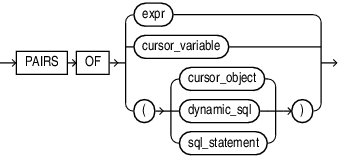

> ```
> PAIRS OF { expr 
>               |  cursor_variable 
>               | ( cursor_object ) 
>               | ( dynamic_sql )
>               | ( sql_statement )
>               }
> ```
>
> [  
> Copyright © 1996, 2024, Oracle and/or its affiliates.](https://docs.oracle.com/en/database/oracle/oracle-database/dcommon/html/cpyr.htm)


(dynamic\_sql::=)

cursor\_iteration\_control::=

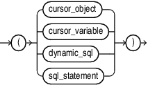

> ```
> ( cursor_object ) | ( cursor_variable ) | ( dynamic_sql ) | ( sql_statement )
> ```
>
> [  
> Copyright © 1996, 2024, Oracle and/or its affiliates.](https://docs.oracle.com/en/database/oracle/oracle-database/dcommon/html/cpyr.htm)


(dynamic\_sql::=)

dynamic\_sql::=

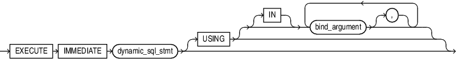

> ```
> EXECUTE IMMEDIATE dynamic_sql_stmt [ USING [IN] bind_argument [,] +... ]
> ```
>
> [  
> Copyright © 1996, 2024, Oracle and/or its affiliates.](https://docs.oracle.com/en/database/oracle/oracle-database/dcommon/html/cpyr.htm)


Semantics

iterator

The iterator specifies an iterand and the iteration controls.

Statements outside the loop cannot reference `iterator`. Statements inside the loop can reference `iterator`, but cannot change its value. After the `FOR` `LOOP` statement runs, `iterator` is undefined.

iterand\_decl

An iterand type can be implicitly or explicitly declared. You cannot explicitly initialize an iterand.

An iterand type is implicitly declared when no type declaration follows the iterand in the loop header. The implicit type is determined by the first iteration control.

Table 14-1 Iterand Implicit Type Defaults

| Iteration Control | Implicit Iterand Type |
| --- | --- |
| stepped control | `PLS_INTEGER` |
| single expression | `PLS_INTEGER` |
| cursor control | `CURSOR%ROWTYPE` |
| `VALUES OF` control | collection element type |
| `INDICES OF` control | collection index type |
| `PAIRS OF` control | The first iterand denotes the index type of collection and the second iterand denotes the element type of collection |

pls\_identifier

The iterand name for the implicitly declared variable that is local to the `FOR` `LOOP` statement.

\[ MUTABLE | IMMUTABLE \]

The mutability property of an iterand determines whether or not it can be assigned in the loop body. If all iteration controls specified in an iterator are cursor controls, the iterand is mutable by default. Otherwise, the iterand is immutable. The default mutability property of an iterand can be changed in the iterand declaration by specifying the `MUTABLE` or `IMMUTABLE` keyword after the iterand variable. The mutability property keywords are not reserved and could be used as type names. Such usage would be ambiguous. Therefore, you must explicitly specify the mutability property of an iterand in the iterand declaration if its type is named mutable or immutable. Iterand for `INDICES OF` iteration control and the index iterand for `PAIRS OF` iteration control cannot be made mutable.

constrained\_type

An iterand is explicitly declared when the iterand type is specified in the loop header. Any constraint defined for a type is considered when assigning values to the iterand. The values generated by the iteration controls must be assignment compatible with the iterand type. Usual conversion rules apply. Exceptions are raised for all constraint violations.

iteration\_ctl\_seq

Multiple iteration controls may be chained together by separating them with commas.

Restriction on iteration\_ctl\_seq:

Because two iterands are required for the pairs of iterand, pairs of iteration controls may not be mixed with other kinds of iteration controls.

qual\_iteration\_ctl

The qualified iteration control specifies the REVERSE option and the optional stopping and skipping predicates clauses.

\[ REVERSE \]

When the optional keyword `REVERSE` is specified, the order of values in the sequence is reversed.

You can use this option with a collection vector value expression. In that case, specifying `REVERSE` generates values from `LAST` to `FIRST` rather than from `FIRST` to `LAST`.

Restrictions on `REVERSE`:
- You cannot use this option when a pipelined function is specified in the iteration control.
- You cannot use this option with single expression iteration control since it generates a single value and therefore the keyword does not have any sensible meaning for this control.
- You cannot use this option when the iteration control specifies a SQL statement. This creates a sequence of records returned by the query. You can specify an `ORDER BY` clause on the SQL statement to sort the rows in the appropriate order.
- You cannot use this option when the collection is a cursor,cursor variable, dynamic SQL, or is an expression that calls a pipelined table function.

iteration\_control

An iteration control provides a sequence of values to the iterand.

pred\_clause\_seq

An iteration control may be modified with an optional stopping predicate clause followed by an optional skipping predicate clause. The expressions in the predicates must have a `BOOLEAN` type.

\[ WHILE boolean\_expression \]

A stopping predicate clause can cause the iteration control to be exhausted. The boolean\_expression is evaluated at the beginning of each iteration of the loop. If it fails to evaluate to `TRUE`, the iteration control is exhausted.

\[ WHEN boolean\_expression \]

A skipping predicate clause can cause the loop body to be skipped for some values. The boolean\_expression is evaluated. If it fails to evaluate to `TRUE`, the iteration control skips to the next value.

stepped\_control

lower\_bound.. upper\_bound \[ BY step \]

Without `REVERSE`, the value of `iterand` starts at `lower_bound` and increases by `step` with each iteration of the loop until it reaches `upper_bound`.

With `REVERSE`, the value of `iterand` starts at `upper_bound` and decreases by `step` with each iteration of the loop until it reaches `lower_bound`. If `upper_bound` is less than `lower_bound`, then the `statements` never run.

The default value for `step` is one if this optional `BY` clause is not specified.

`lower_bound` and `upper_bound` must evaluate to numbers (either numeric literals, numeric variables, or numeric expressions). If a bound does not have a numeric value, then PL/SQL raises the predefined exception `VALUE_ERROR`. PL/SQL evaluates `lower_bound` and `upper_bound` once, when the `FOR` `LOOP` statement is entered, and stores them as temporary `PLS_INTEGER` values, rounding them to the nearest integer if necessary.

If `lower_bound` equals `upper_bound`, the `statements` run only once.

The step value must be greater than zero.

single\_expression\_control

A single expression iteration control generates a single value. If `REPEAT` is specified, the expression will be evaluated repeatedly generating a sequence of values until a stopping clause causes the iteration control to be exhausted.

Restrictions on single\_expression\_control:

`REVERSE` is not allowed for a single expression iteration control.

values\_of\_control

The element type of a collection must be assignment compatible with the iterand.

indices\_of\_control

The index type of a collection must be assignment compatible with the iterand.

The iterand used with an `INDICES OF` iteration control cannot be mutable.

pairs\_of\_control

The `PAIRS OF` iteration control requires two iterands. You cannot mix the `PAIRS OF` iteration control with other kinds of controls. The first iterand is the index iterand and the second is the value iterand. Each iterand may be followed by an explicit type.

The element type of the collection must be assignment compatible with the value iterand. The index type of the collection must be assignment compatible with the index iterand.

The index iterand used with a `PAIRS OF` iteration control cannot be mutable.

cursor\_iteration\_control

Cursor iteration controls generate the sequence of records returned by an explicit or implicit cursor. The cursor definition is the controlling expression.

Restrictions on cursor\_iteration\_control:

You cannot use `REVERSE` with a cursor iteration control.

cursor\_object

A cursor\_object is an explicit PL/SQL cursor object.

sql\_statement

A sql\_statement is an implicit PL/SQL cursor object created for a SQL statement specified directly in the iteration control.

cursor\_variable

Name of a previously declared variable of a `REF CURSOR` object.

dynamic\_sql

EXECUTE IMMEDIATE dynamic\_sql\_stmt \[ USING \[ IN \] (bind\_argument \[,\] )+\]

You can use a dynamic query in place of an implicit cursor definition in a cursor or collection iteration control. Such a construct cannot provide a default type; if it is used as the first iteration control, an explicit type must be specified for the iterand, or for the value iterand for a pairs of control.

The optional `USING` clause is the only clause allowed with the dynamic SQL. It can only possibly have IN one or more bind variable, each separated by a comma.

dynamic\_sql\_stmt

String literal, string variable, or string expression that represents a SQL statement. Its type must be either `CHAR`, `VARCHAR2`, or `CLOB`.

Caution:

When using dynamic SQL, beware of SQL injection, a security risk. For more information about SQL injection, see " [SQL Injection](dynamic-sql.md) ".

Examples

- [Example 5-25](plsql-control-statements.md), "Using Dynamic SQL as an Iteration Control"
- [Example 5-17](plsql-control-statements.md), "Stepped Range Iteration Controls"
- [Example 5-18](plsql-control-statements.md), "STEP Clause in FOR LOOP Statement"
- [Example 5-24](plsql-control-statements.md), "Cursor Iteration Controls"
- [Example 5-21](plsql-control-statements.md), "VALUES OF Iteration Control"
- [Example 5-22](plsql-control-statements.md), "INDICES OF Iteration Control"
- [Example 5-23](plsql-control-statements.md), "PAIRS OF Iteration Control"