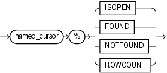
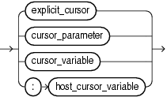

Every named cursor (explicit cursor or cursor variable) has four attributes, each of which returns information about the execution of a DML statement.

Note:

You can use cursor attributes only in procedural statements, not in SQL statements.

Topics

Syntax

named\_cursor\_attribute::=



> ```
> named_cursor%{ ISOPEN | FOUND | NOTFOUND | ROWCOUNT }
> ```
>
> [  
> Copyright © 1996, 2024, Oracle and/or its affiliates.](https://docs.oracle.com/en/database/oracle/oracle-database/dcommon/html/cpyr.htm)


named\_cursor::=



> ```
> { explicit_cursor | cursor_parameter | cursor_variable  | :host_cursor_variable }
> ```
>
> [  
> Copyright © 1996, 2024, Oracle and/or its affiliates.](https://docs.oracle.com/en/database/oracle/oracle-database/dcommon/html/cpyr.htm)


Semantics

named\_cursor\_attribute

%ISOPEN

`named_cursor` `%ISOPEN` has the value `TRUE` if the cursor is open, and `FALSE` if it is not open.

%FOUND

`named_cursor` `%FOUND` has one of these values:

- If the cursor is not open, `INVALID_CURSOR`
- If cursor is open but no fetch was tried, `NULL`.
- If the most recent fetch returned a row, `TRUE`.
- If the most recent fetch did not return a row, `FALSE`.

%NOTFOUND

`named_cursor` `%NOTFOUND` has one of these values:

- If cursor is not open, `INVALID_CURSOR`.
- If cursor is open but no fetch was tried, `NULL`.
- If the most recent fetch returned a row, `FALSE`.
- If the most recent fetch did not return a row, `TRUE`.

%ROWCOUNT

`named_cursor` `%ROWCOUNT` has one of these values:

- If cursor is not open, `INVALID_CURSOR`.
- If cursor is open, the number of rows fetched so far.

named\_cursor

explicit\_cursor

Name of an explicit cursor.

cursor\_parameter

Name of a formal cursor parameter.

cursor\_variable

Name of a cursor variable.

:host\_cursor\_variable

Name of a cursor variable that was declared in a PL/SQL host environment and passed to PL/SQL as a bind variable. Do not put space between the colon (:) and `host_cursor_variable`.