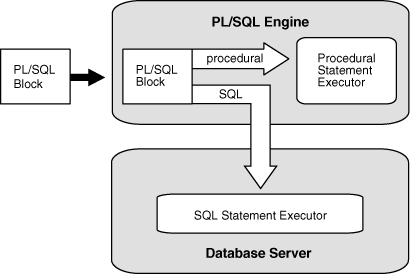

PL/SQL, the Oracle procedural extension of SQL, is a portable, high-performance transaction-processing language. This overview explains its advantages and briefly describes its main features and its architecture.

Topics

### 2.1 Advantages of PL/SQL

#### 2.1.1 Tight Integration with SQL

PL/SQL is tightly integrated with SQL, the most widely used database manipulation language.

For example:

- PL/SQL lets you use all SQL data manipulation, cursor control, and transaction control statements, and all SQL functions, operators, and pseudocolumns.
- PL/SQL fully supports SQL data types.
	You need not convert between PL/SQL and SQL data types. For example, if your PL/SQL program retrieves a value from a column of the SQL type `VARCHAR2`, it can store that value in a PL/SQL variable of the type `VARCHAR2`.
	You can give a PL/SQL data item the data type of a column or row of a database table without explicitly specifying that data type (see " Using the %TYPE Attribute " and " Using the %ROWTYPE Attribute ").
- PL/SQL lets you run a SQL query and process the rows of the result set one at a time (see " Processing a Query Result Set One Row at a Time ").
- PL/SQL functions can be declared and defined in the `WITH` clauses of SQL `SELECT` statements (see [Oracle Database SQL Language Reference](https://docs.oracle.com/pls/topic/lookup?ctx=en/database/oracle/oracle-database/21/lnpls&id=SQLRF01702)).

PL/SQL supports both static and dynamic SQL. Static SQL is SQL whose full text is known at compile time. Dynamic SQL is SQL whose full text is not known until run time. Dynamic SQL lets you make your applications more flexible and versatile. For more information, see [PL/SQL Static SQL](static-sql.md) and [PL/SQL Dynamic SQL](dynamic-sql.md).

#### 2.1.2 High Performance

PL/SQL lets you send a block of statements to the database, significantly reducing traffic between the application and the database.

Bind Variables

When you embed a SQL `INSERT`, `UPDATE`, `DELETE`, `MERGE`, or `SELECT` statement directly in your PL/SQL code, the PL/SQL compiler turns the variables in the `WHERE` and `VALUES` clauses into bind variables (for details, see " [Resolution of Names in Static SQL Statements](plsql-name-resolution.md) "). Oracle Database can reuse these SQL statements each time the same code runs, which improves performance.

PL/SQL does not create bind variables automatically when you use dynamic SQL, but you can use them with dynamic SQL by specifying them explicitly (for details, see " [EXECUTE IMMEDIATE Statement](dynamic-sql.md) ").

Subprograms

PL/SQL subprograms are stored in executable form, which can be invoked repeatedly. Because stored subprograms run in the database server, a single invocation over the network can start a large job. This division of work reduces network traffic and improves response times. Stored subprograms are cached and shared among users, which lowers memory requirements and invocation overhead. For more information about subprograms, see " Subprograms ".

Optimizer

The PL/SQL compiler has an optimizer that can rearrange code for better performance. For more information about the optimizer, see " [PL/SQL Optimizer](plsql-optimization-and-tuning.md) ".

#### 2.1.3 High Productivity

PL/SQL has many features that save designing and debugging time, and it is the same in all environments.

PL/SQL lets you write compact code for manipulating data. Just as a scripting language like PERL can read, transform, and write data in files, PL/SQL can query, transform, and update data in a database.

If you learn to use PL/SQL with one Oracle tool, you can transfer your knowledge to other Oracle tools. For an overview of PL/SQL features, see " Main Features of PL/SQL ".

#### 2.1.4 Portability

PL/SQL is a portable and standard language for Oracle development.

You can run PL/SQL applications on any operating system and platform where Oracle Database runs.

#### 2.1.5 Scalability

PL/SQL stored subprograms increase scalability by centralizing application processing on the database server.

The shared memory facilities of the shared server let Oracle Database support thousands of concurrent users on a single node. For more information about subprograms, see " Subprograms "

For further scalability, you can use Oracle Connection Manager to multiplex network connections. For information about Oracle Connection Manager, see " [Oracle Database Net Services Reference](https://docs.oracle.com/pls/topic/lookup?ctx=en/database/oracle/oracle-database/21/lnpls&id=NETRF-GUID-C74FD877-06D2-44EF-A506-F7CAE9141B36) "

#### 2.1.6 Manageability

PL/SQL stored subprograms increase manageability because you can maintain only one copy of a subprogram, on the database server, rather than one copy on each client system.

Any number of applications can use the subprograms, and you can change the subprograms without affecting the applications that invoke them. For more information about subprograms, see " Subprograms ".

#### 2.1.7 Support for Object-Oriented Programming

PL/SQL allows defining object types that can be used in object-oriented designs.

PL/SQL supports object-oriented programming with " Abstract Data Types ".

### 2.2 Main Features of PL/SQL

PL/SQL combines the data-manipulating power of SQL with the processing power of procedural languages.

When you can solve a problem with SQL, you can issue SQL statements from your PL/SQL program, without learning new APIs.

Like other procedural programming languages, PL/SQL lets you declare constants and variables, control program flow, define subprograms, and trap runtime errors.

You can break complex problems into easily understandable subprograms, which you can reuse in multiple applications.

Topics

#### 2.2.1 Error Handling

PL/SQL makes it easy to detect and handle errors.

When an error occurs, PL/SQL raises an exception. Normal execution stops and control transfers to the exception-handling part of the PL/SQL block. You do not have to check every operation to ensure that it succeeded, as in a C program.

For more information, see [PL/SQL Error Handling](plsql-error-handling.md).

#### 2.2.2 Blocks

The basic unit of a PL/SQL source program is the block, which groups related declarations and statements.

A PL/SQL block is defined by the keywords `DECLARE`, `BEGIN`, `EXCEPTION`, and `END`. These keywords divide the block into a declarative part, an executable part, and an exception-handling part. Only the executable part is required. A block can have a label.

Declarations are local to the block and cease to exist when the block completes execution, helping to avoid cluttered namespaces for variables and subprograms.

Blocks can be nested: Because a block is an executable statement, it can appear in another block wherever an executable statement is allowed.

You can submit a block to an interactive tool (such as SQL\*Plus or Enterprise Manager) or embed it in an Oracle Precompiler or OCI program. The interactive tool or program runs the block one time. The block is not stored in the database, and for that reason, it is called an anonymous block (even if it has a label).

An anonymous block is compiled each time it is loaded into memory, and its compilation has three stages:

1. Syntax checking: PL/SQL syntax is checked, and a parse tree is generated.
2. Semantic checking: Type checking and further processing on the parse tree.
3. Code generation

Note:

An anonymous block is a SQL statement.

For syntax details, see " [Block](block.md) ".

Example 2-1 PL/SQL Block Structure

This example shows the basic structure of a PL/SQL block.

```
<< label >> (optional)
DECLARE    -- Declarative part (optional)
  -- Declarations of local types, variables, & subprograms

BEGIN      -- Executable part (required)
  -- Statements (which can use items declared in declarative part)

[EXCEPTION -- Exception-handling part (optional)
  -- Exception handlers for exceptions (errors) raised in executable part]
END;
```

#### 2.2.3 Variables and Constants

PL/SQL lets you declare variables and constants, and then use them wherever you can use an expression.

As the program runs, the values of variables can change, but the values of constants cannot.

For more information, see " [Declarations](plsql-language-fundamentals.md) " and " [Assigning Values to Variables](plsql-language-fundamentals.md) ".

#### 2.2.4 Subprograms

A PL/SQL subprogram is a named PL/SQL block that can be invoked repeatedly.

If the subprogram has parameters, their values can differ for each invocation. PL/SQL has two types of subprograms, procedures and functions. A function returns a result.

For more information about PL/SQL subprograms, see [PL/SQL Subprograms](plsql-subprograms.md).

PL/SQL also lets you invoke external programs written in other languages.

For more information, see " [External Subprograms](plsql-subprograms.md) ".

#### 2.2.5 Packages

A package is a schema object that groups logically related PL/SQL types, variables, constants, subprograms, cursors, and exceptions.

A package is compiled and stored in the database, where many applications can share its contents. You can think of a package as an application.

You can write your own packages—for details, see [PL/SQL Packages](plsql-packages.md). You can also use the many product-specific packages that Oracle Database supplies. For information about these, see [Oracle Database PL/SQL Packages and Types Reference](https://docs.oracle.com/pls/topic/lookup?ctx=en/database/oracle/oracle-database/21/lnpls&id=ARPLS-GUID-4AA6AA30-CAEE-4DCD-B214-9AD51D0229B4).

#### 2.2.6 Triggers

A trigger is a named PL/SQL unit that is stored in the database and run in response to an event that occurs in the database.

You can specify the event, whether the trigger fires before or after the event, and whether the trigger runs for each event or for each row affected by the event. For example, you can create a trigger that runs every time an `INSERT` statement affects the `EMPLOYEES` table.

For more information about triggers, see [PL/SQL Triggers](plsql-triggers.md).

#### 2.2.7 Input and Output

Most PL/SQL input and output (I/O) is done with SQL statements that store data in database tables or query those tables. All other PL/SQL I/O is done with PL/SQL packages that Oracle Database supplies.

Table 2-1 PL/SQL I/O-Processing Packages

| Package | Description | More Information |
| --- | --- | --- |
| `DBMS_OUTPUT` | Lets PL/SQL blocks, subprograms, packages, and triggers display output. Especially useful for displaying PL/SQL debugging information. | [Oracle Database PL/SQL Packages and Types Reference](https://docs.oracle.com/pls/topic/lookup?ctx=en/database/oracle/oracle-database/21/lnpls&id=ARPLS036) |
| `HTF` | Has hypertext functions that generate HTML tags (for example, the `HTF`.`ANCHOR` function generates the HTML anchor tag `<A>`). | [Oracle Database PL/SQL Packages and Types Reference](https://docs.oracle.com/pls/topic/lookup?ctx=en/database/oracle/oracle-database/21/lnpls&id=ARPLS390) |
| `HTP` | Has hypertext procedures that generate HTML tags. | [Oracle Database PL/SQL Packages and Types Reference](https://docs.oracle.com/pls/topic/lookup?ctx=en/database/oracle/oracle-database/21/lnpls&id=ARPLS391) |
| `DBMS_PIPE` | Lets two or more sessions in the same instance communicate. | [Oracle Database PL/SQL Packages and Types Reference](https://docs.oracle.com/pls/topic/lookup?ctx=en/database/oracle/oracle-database/21/lnpls&id=ARPLS038) |
| `UTL_FILE` | Lets PL/SQL programs read and write operating system files. | [Oracle Database PL/SQL Packages and Types Reference](https://docs.oracle.com/pls/topic/lookup?ctx=en/database/oracle/oracle-database/21/lnpls&id=ARPLS069) |
| `UTL_HTTP` | Lets PL/SQL programs make Hypertext Transfer Protocol (HTTP) callouts, and access data on the Internet over HTTP. | [Oracle Database PL/SQL Packages and Types Reference](https://docs.oracle.com/pls/topic/lookup?ctx=en/database/oracle/oracle-database/21/lnpls&id=ARPLS070) |
| `UTL_SMTP` | Sends electronic mails (emails) over Simple Mail Transfer Protocol (SMTP) as specified by RFC821. | [Oracle Database PL/SQL Packages and Types Reference](https://docs.oracle.com/pls/topic/lookup?ctx=en/database/oracle/oracle-database/21/lnpls&id=ARPLS074) |

To display output passed to `DBMS_OUTPUT`, you need another program, such as SQL\*Plus. To see `DBMS_OUTPUT` output with SQL\*Plus, you must first issue the SQL\*Plus command `SET` `SERVEROUTPUT` `ON`.

Some subprograms in the packages in Table 2-1 can both accept input and display output, but they cannot accept data directly from the keyboard. To accept data directly from the keyboard, use the SQL\*Plus commands `PROMPT` and `ACCEPT`.

See Also:

- [SQL\*Plus User's Guide and Reference](https://docs.oracle.com/pls/topic/lookup?ctx=en/database/oracle/oracle-database/21/lnpls&id=SQPUG099) for information about the SQL\*Plus command `SET` `SERVEROUTPUT` `ON`
- [SQL\*Plus User's Guide and Reference](https://docs.oracle.com/pls/topic/lookup?ctx=en/database/oracle/oracle-database/21/lnpls&id=SQPUG052) for information about the SQL\*Plus command `PROMPT`
- [SQL\*Plus User's Guide and Reference](https://docs.oracle.com/pls/topic/lookup?ctx=en/database/oracle/oracle-database/21/lnpls&id=SQPUG026) for information about the SQL\*Plus command `ACCEPT`
- [Oracle Database SQL Language Reference](https://docs.oracle.com/pls/topic/lookup?ctx=en/database/oracle/oracle-database/21/lnpls&id=SQLRF-GUID-04D8EBB3-583D-4969-8344-E221000E9CD9) for information about SQL statements

#### 2.2.8 Data Abstraction

Data abstraction lets you work with the essential properties of data without being too involved with details.

You can design a data structure first, and then design algorithms that manipulate it.

Topics

##### 2.2.8.1 Cursors

A cursor is a pointer to a private SQL area that stores information about processing a specific SQL statement or PL/SQL `SELECT` `INTO` statement.

You can use the cursor to retrieve the rows of the result set one at a time. You can use cursor attributes to get information about the state of the cursor—for example, how many rows the statement has affected so far.

For more information about cursors, see " [Cursors Overview](static-sql.md) ".

##### 2.2.8.2 Composite Variables

A composite variable has internal components, which you can access individually.

You can pass entire composite variables to subprograms as parameters. PL/SQL has two kinds of composite variables, collections and records.

In a collection, the internal components are always of the same data type, and are called elements. You access each element by its unique index. Lists and arrays are classic examples of collections.

In a record, the internal components can be of different data types, and are called fields. You access each field by its name. A record variable can hold a table row, or some columns from a table row.

For more information about composite variables, see [PL/SQL Collections and Records](plsql-collections-and-records.md).

##### 2.2.8.3 Using the %ROWTYPE Attribute

The `%ROWTYPE` attribute lets you declare a record that represents either a full or partial row of a database table or view.

For every column of the full or partial row, the record has a field with the same name and data type. If the structure of the row changes, then the structure of the record changes accordingly.

For more information about `%ROWTYPE` syntax and semantics, see " [%ROWTYPE Attribute](ROWTYPE-attribute.md) ". For more details about its usage, see " [Declaring Items using the %ROWTYPE Attribute](plsql-collections-and-records.md) ".

##### 2.2.8.4 Using the %TYPE Attribute

The `%TYPE` attribute lets you declare a data item of the same data type as a previously declared variable or column (without knowing what that type is).

If the declaration of the referenced item changes, then the declaration of the referencing item changes accordingly. The `%TYPE` attribute is particularly useful when declaring variables to hold database values. For more information about `%TYPE` syntax and semantics, see " [%TYPE Attribute](TYPE-attribute.md) ". For more details about its usage, see " [Declaring Items using the %TYPE Attribute](plsql-language-fundamentals.md) ".

##### 2.2.8.5 Abstract Data Types

An Abstract Data Type (ADT) consists of a data structure and subprograms that manipulate the data.

The variables that form the data structure are called attributes. The subprograms that manipulate the attributes are called methods.

ADTs are stored in the database. Instances of ADTs can be stored in tables and used as PL/SQL variables.

ADTs let you reduce complexity by separating a large system into logical components, which you can reuse.

In the static data dictionary view `*_OBJECTS`, the `OBJECT_TYPE` of an ADT is `TYPE`. In the static data dictionary view `*_TYPES`, the `TYPECODE` of an ADT is `OBJECT`.

For more information about ADTs, see " [CREATE TYPE Statement](CREATE-TYPE-statement.md) ".

Note:

ADTs are also called user-defined types and object types.

See Also:

[Oracle Database Object-Relational Developer's Guide](https://docs.oracle.com/pls/topic/lookup?ctx=en/database/oracle/oracle-database/21/lnpls&id=ADOBJ001) for information about ADTs (which it calls object types)

#### 2.2.9 Control Statements

Control statements are the most important PL/SQL extension to SQL.

PL/SQL has three categories of control statements:

- Conditional selection statements, which let you run different statements for different data values.
	For more information, see " [Conditional Selection Statements](plsql-control-statements.md) ".
- Loop statements, which let you repeat the same statements with a series of different data values.
	For more information, see " [LOOP Statements](plsql-control-statements.md) ".
- Sequential control statements, which allow you to go to a specified, labeled statement, or to do nothing.
	For more information, see " [Sequential Control Statements](plsql-control-statements.md) ".

#### 2.2.10 Conditional Compilation

Conditional compilation lets you customize the functionality in a PL/SQL application without removing source text.

For example, you can:

- Use new features with the latest database release, and disable them when running the application in an older database release.
- Activate debugging or tracing statements in the development environment, and hide them when running the application at a production site.

For more information, see " [Conditional Compilation](plsql-language-fundamentals.md) ".

#### 2.2.11 Processing a Query Result Set One Row at a Time

PL/SQL lets you issue a SQL query and process the rows of the result set one at a time.

You can use a basic loop, or you can control the process precisely by using individual statements to run the query, retrieve the results, and finish processing.

Example 2-2 Processing Query Result Rows One at a Time

This example uses a basic loop.

```
BEGIN
  FOR someone IN (
    SELECT * FROM employees
    WHERE employee_id < 120
    ORDER BY employee_id
  )
  LOOP
    DBMS_OUTPUT.PUT_LINE('First name = ' || someone.first_name ||
                         ', Last name = ' || someone.last_name);
  END LOOP;
END;
/
```

Result:

```
First name = Steven, Last name = King
First name = Neena, Last name = Kochhar
First name = Lex, Last name = De Haan
First name = Alexander, Last name = Hunold
First name = Bruce, Last name = Ernst
First name = David, Last name = Austin
First name = Valli, Last name = Pataballa
First name = Diana, Last name = Lorentz
First name = Nancy, Last name = Greenberg
First name = Daniel, Last name = Faviet
First name = John, Last name = Chen
First name = Ismael, Last name = Sciarra
First name = Jose Manuel, Last name = Urman
First name = Luis, Last name = Popp
First name = Den, Last name = Raphaely
First name = Alexander, Last name = Khoo
First name = Shelli, Last name = Baida
First name = Sigal, Last name = Tobias
First name = Guy, Last name = Himuro
First name = Karen, Last name = Colmenares
```

### 2.3 Architecture of PL/SQL

Basic understanding of the PL/SQL architecture is beneficial to PL/SQL programmers.

Topics

- PL/SQL Engine
- PL/SQL Units and Compilation Parameters

#### 2.3.1 PL/SQL Engine

The PL/SQL compilation and runtime system is an engine that compiles and runs PL/SQL units.

The engine can be installed in the database or in an application development tool, such as Oracle Forms.

In either environment, the PL/SQL engine accepts as input any valid PL/SQL unit. The engine runs procedural statements, but sends SQL statements to the SQL engine in the database, as shown in Figure 2-1.

Figure 2-1 PL/SQL Engine



> The PL/SQL engine accepts as input any valid PL/SQL unit. It runs procedural statements, but sends SQL statements to the SQL engine in the database.
>
> [  
> Copyright © 1996, 2024, Oracle and/or its affiliates.](https://docs.oracle.com/en/database/oracle/oracle-database/dcommon/html/cpyr.htm)


Typically, the database processes PL/SQL units.

When an application development tool processes PL/SQL units, it passes them to its local PL/SQL engine. If a PL/SQL unit contains no SQL statements, the local engine processes the entire PL/SQL unit. This is useful if the application development tool can benefit from conditional and iterative control.

For example, Oracle Forms applications frequently use SQL statements to test the values of field entries and do simple computations. By using PL/SQL instead of SQL, these applications can avoid calls to the database.

#### 2.3.2 PL/SQL Units and Compilation Parameters

PL/SQL units are affected by PL/SQL compilation parameters (a category of database initialization parameters). Different PL/SQL units—for example, a package specification and its body—can have different compilation parameter settings.

A PL/SQL unit is one of these:

- PL/SQL anonymous block
- `FUNCTION`
- `LIBRARY`
- `PACKAGE`
- `PACKAGE` `BODY`
- `PROCEDURE`
- `TRIGGER`
- `TYPE`
- `TYPE` `BODY`

Table 2-2 summarizes the PL/SQL compilation parameters. To display the values of these parameters for specified or all PL/SQL units, query the static data dictionary view `ALL_PLSQL_OBJECT_SETTINGS`. For information about this view, see [Oracle Database Reference](https://docs.oracle.com/pls/topic/lookup?ctx=en/database/oracle/oracle-database/21/lnpls&id=REFRN20385).

Table 2-2 PL/SQL Compilation Parameters

| Parameter | Description |
| --- | --- |
| [`PLSCOPE_SETTINGS`](https://docs.oracle.com/pls/topic/lookup?ctx=en/database/oracle/oracle-database/21/lnpls&id=REFRN10271) | Controls the compile-time collection, cross-reference, and storage of PL/SQL source text identifier data. Used by the PL/Scope tool (see [Oracle Database Development Guide](https://docs.oracle.com/pls/topic/lookup?ctx=en/database/oracle/oracle-database/21/lnpls&id=ADFNS022)).  For more information about `PLSCOPE_SETTINGS`, see [Oracle Database Reference](https://docs.oracle.com/pls/topic/lookup?ctx=en/database/oracle/oracle-database/21/lnpls&id=REFRN10271). |
| [`PLSQL_CCFLAGS`](https://docs.oracle.com/pls/topic/lookup?ctx=en/database/oracle/oracle-database/21/lnpls&id=REFRN10261) | Lets you control conditional compilation of each PL/SQL unit independently.  For more information about `PLSQL_CCFLAGS`, see " [How Conditional Compilation Works](plsql-language-fundamentals.md) " and [Oracle Database Reference](https://docs.oracle.com/pls/topic/lookup?ctx=en/database/oracle/oracle-database/21/lnpls&id=REFRN10261). |
| [`PLSQL_CODE_TYPE`](https://docs.oracle.com/pls/topic/lookup?ctx=en/database/oracle/oracle-database/21/lnpls&id=REFRN10253) | Specifies the compilation mode for PL/SQL units— `INTERPRETED` (the default) or `NATIVE`. For information about which mode to use, see " [Determining Whether to Use PL/SQL Native Compilation](plsql-optimization-and-tuning.md) ".  If the optimization level (set by `PLSQL_OPTIMIZE_LEVEL`) is less than 2:  - The compiler generates interpreted code, regardless of `PLSQL_CODE_TYPE`. - If you specify `NATIVE`, the compiler warns you that `NATIVE` was ignored.  For more information about `PLSQL_CODE_TYPE`, see [Oracle Database Reference](https://docs.oracle.com/pls/topic/lookup?ctx=en/database/oracle/oracle-database/21/lnpls&id=REFRN10253). |
| [`PLSQL_OPTIMIZE_LEVEL`](https://docs.oracle.com/pls/topic/lookup?ctx=en/database/oracle/oracle-database/21/lnpls&id=REFRN10255) | Specifies the optimization level at which to compile PL/SQL units (the higher the level, the more optimizations the compiler tries to make).  `PLSQL_OPTIMIZE_LEVEL=1` instructs the PL/SQL compiler to generate and store code for use by the PL/SQL debugger.  For more information about `PLSQL_OPTIMIZE_LEVEL`, see " [PL/SQL Optimizer](plsql-optimization-and-tuning.md) " and [Oracle Database Reference](https://docs.oracle.com/pls/topic/lookup?ctx=en/database/oracle/oracle-database/21/lnpls&id=REFRN10254). |
| [`PLSQL_WARNINGS`](https://docs.oracle.com/pls/topic/lookup?ctx=en/database/oracle/oracle-database/21/lnpls&id=REFRN10249) | Enables or disables the reporting of warning messages by the PL/SQL compiler, and specifies which warning messages to show as errors.  For more information about `PLSQL_WARNINGS`, see " [Compile-Time Warnings](plsql-error-handling.md) " and [Oracle Database Reference](https://docs.oracle.com/pls/topic/lookup?ctx=en/database/oracle/oracle-database/21/lnpls&id=REFRN10249). |
| [`NLS_LENGTH_SEMANTICS`](https://docs.oracle.com/pls/topic/lookup?ctx=en/database/oracle/oracle-database/21/lnpls&id=REFRN10124) | Lets you create `CHAR` and `VARCHAR2` columns using either byte-length or character-length semantics.  For more information about byte and character length semantics, see " [CHAR and VARCHAR2 Variables](plsql-data-types.md) ".  For more information about `NLS_LENGTH_SEMANTICS`, see [Oracle Database Reference](https://docs.oracle.com/pls/topic/lookup?ctx=en/database/oracle/oracle-database/21/lnpls&id=REFRN10124). |
| [`PERMIT_92_WRAP_FORMAT`](https://docs.oracle.com/pls/topic/lookup?ctx=en/database/oracle/oracle-database/21/lnpls&id=REFRN10317) | Specifies whether the 12.1 PL/SQL compiler can use wrapped packages that were compiled with the 9.2 PL/SQL compiler. The default value is `TRUE`.  For more information about wrapped packages, see [PL/SQL Source Text Wrapping](plsql-source-text-wrapping.md).  For more information about `PERMIT_92_WRAP_FORMAT`, see [Oracle Database Reference](https://docs.oracle.com/pls/topic/lookup?ctx=en/database/oracle/oracle-database/21/lnpls&id=REFRN10317). |

Note:

The compilation parameter `PLSQL_DEBUG`, which specifies whether to compile PL/SQL units for debugging, is deprecated. To compile PL/SQL units for debugging, specify `PLSQL_OPTIMIZE_LEVEL=1`.

The compile-time values of the parameters in Table 2-2 are stored with the metadata of each stored PL/SQL unit, which means that you can reuse those values when you explicitly recompile the unit. (A stored PL/SQL unit is created with one of the " [CREATE \[ OR REPLACE \] Statements](https://docs.oracle.com/en/database/oracle/oracle-database/21/lnpls/sql-statements-for-stored-plsql-units.html#GUID-C918310F-F1BB-41D7-9466-B558B70DDFFE__BABBEFJD) ". An anonymous block is not a stored PL/SQL unit.)

To explicitly recompile a stored PL/SQL unit and reuse its parameter values, you must use an `ALTER` statement with both the `COMPILE` clause and the `REUSE` `SETTINGS` clause. All `ALTER` statements have this clause. For a list of `ALTER` statements, see " [ALTER Statements](sql-statements-for-stored-plsql-units.md) ".

### 2.4 Protecting Sensitive Information in PL/SQL

Data security should be a top priority during any application development. There are several ways you can mitigate the risk of vulnerabilities while using PL/SQL.

Be aware that the content of a PL/SQL block may be written in its entirety in such places as audit logs and trace files. Similarly, stored procedure code can be accessed through dictionary views, such as `USER_SOURCE`. For this reason, it is strongly recommended that you never include any sensitive information in a literal seen in PL/SQL code.

Bind variables can be used to help protect against SQL injection attacks, however, bind values can be visible in places such as trace files, audit, and `V$SQL` and related views. Access should be strictly managed to ensure that only those who require it have privileges to view this particularly sensitive information. For more information about using bind variables, see " [Bind Variables](dynamic-sql.md) ".