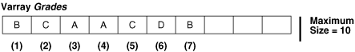
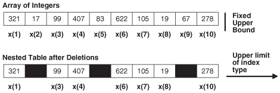

PL/SQL lets you define two kinds of composite data types: collection and record.

A composite data type stores values that have internal components. You can pass entire composite variables to subprograms as parameters, and you can access internal components of composite variables individually. Internal components can be either scalar or composite. You can use scalar components wherever you can use scalar variables. You can use composite components wherever you can use composite variables of the same type.

Note:

If you pass a composite variable as a parameter to a remote subprogram, then you must create a redundant loop-back `DATABASE` `LINK`, so that when the remote subprogram compiles, the type checker that verifies the source uses the same definition of the user-defined composite variable type as the invoker uses.

In a collection, the internal components always have the same data type, and are called elements. You can access each element of a collection variable by its unique index, with this syntax: `variable_name` `(``index``)`. To create a collection variable, you either define a collection type and then create a variable of that type or use `%TYPE`.

In a record, the internal components can have different data types, and are called fields. You can access each field of a record variable by its name, with this syntax: `variable_name.field_name`. To create a record variable, you either define a `RECORD` type and then create a variable of that type or use `%ROWTYPE` or `%TYPE`.

You can create a collection of records, and a record that contains collections.

Collection Topics

See Also:

- [Oracle Database SQL Language Reference](https://docs.oracle.com/pls/topic/lookup?ctx=en/database/oracle/oracle-database/21/lnpls&id=SQLRF01205) for information about the `CREATE` `DATABASE` `LINK` statement
- " [Querying a Collection](static-sql.md) "
- " [BULK COLLECT Clause](plsql-optimization-and-tuning.md) " for information about retrieving query results into a collection
- " [Collection Variable Declaration](collection-variable.md) " for syntax and semantics of collection type definition and collection variable declaration

Record Topics

- Record Variables
- Assigning Values to Record Variables
- Record Comparisons
- Inserting Records into Tables
- Updating Rows with Records
- Restrictions on Record Inserts and Updates

Note:

The components of an explicitly listed composite data structure (such as a collection constructor or record initializer) can be evaluated in any order. If a program determines order of evaluation, then at the point where the program does so, its behavior is undefined.

### 6.1 Collection Types

PL/SQL has three collection types—associative array, `VARRAY` (variable-size array), and nested table.

Table 6-1 summarizes their similarities and differences.

Table 6-1 PL/SQL Collection Types

| Collection Type | Number of Elements | Index Type | Dense or Sparse | Uninitialized Status | Where Defined | Can Be ADT Attribute Data Type |
| --- | --- | --- | --- | --- | --- | --- |
| Associative array (or index-by table) | Unspecified | String or `PLS_INTEGER` | Either | Empty | In PL/SQL block or package | No |
| `VARRAY` (variable-size array) | Specified | Integer | Always dense | Null | In PL/SQL block or package or at schema level | Only if defined at schema level |
| Nested table | Unspecified | Integer | Starts dense, can become sparse | Null | In PL/SQL block or package or at schema level | Only if defined at schema level |

Number of Elements

If the number of elements is specified, it is the maximum number of elements in the collection. If the number of elements is unspecified, the maximum number of elements in the collection is the upper limit of the index type.

Dense or Sparse

A dense collection has no gaps between elements—every element between the first and last element is defined and has a value (the value can be `NULL` unless the element has a `NOT` `NULL` constraint). A sparse collection has gaps between elements.

Uninitialized Status

An empty collection exists but has no elements. To add elements to an empty collection, invoke the `EXTEND` method (described in " EXTEND Collection Method ").

A null collection (also called an atomically null collection) does not exist. To change a null collection to an existing collection, you must initialize it, either by making it empty or by assigning a non- `NULL` value to it (for details, see " Collection Constructors " and " Assigning Values to Collection Variables "). You cannot use the `EXTEND` method to initialize a null collection.

Where Defined

A collection type defined in a PL/SQL block is a local type. It is available only in the block, and is stored in the database only if the block is in a standalone or package subprogram. (Standalone and package subprograms are explained in " [Nested, Package, and Standalone Subprograms](plsql-subprograms.md) ".)

A collection type defined in a package specification is a public item. You can reference it from outside the package by qualifying it with the package name (`package_name.type_name`). It is stored in the database until you drop the package. (Packages are explained in [PL/SQL Packages](plsql-packages.md).)

A collection type defined at schema level is a standalone type. You create it with the " [CREATE TYPE Statement](CREATE-TYPE-statement.md) ". It is stored in the database until you drop it with the " [DROP TYPE Statement](DROP-TYPE-statement.md) ".

Note:

A collection type defined in a package specification is incompatible with an identically defined local or standalone collection type (see Example 6-37 and Example 6-38).

Can Be ADT Attribute Data Type

To be an ADT attribute data type, a collection type must be a standalone collection type. For other restrictions, see [Restrictions on datatype](CREATE-TYPE-statement.md).

Translating Non-PL/SQL Composite Types to PL/SQL Composite Types

If you have code or business logic that uses another language, you can usually translate the array and set types of that language directly to PL/SQL collection types. For example:

| Non-PL/SQL Composite Type | Equivalent PL/SQL Composite Type |
| --- | --- |
| Hash table | Associative array |
| Unordered table | Associative array |
| Set | Nested table |
| Bag | Nested table |
| Array | `VARRAY` |

See Also:

[Oracle Database SQL Language Reference](https://docs.oracle.com/pls/topic/lookup?ctx=en/database/oracle/oracle-database/21/lnpls&id=SQLRF00613) for information about the `CAST` function, which converts one SQL data type or collection-typed value into another SQL data type or collection-typed value.

### 6.2 Associative Arrays

An associative array (formerly called PL/SQL table or index-by table) is a set of key-value pairs. Each key is a unique index, used to locate the associated value with the syntax `variable_name` `(``index``)`.

The data type of `index` can be either a string type (`VARCHAR2`, `VARCHAR`, `STRING`, or `LONG`) or `PLS_INTEGER`. Indexes are stored in sort order, not creation order. For string types, sort order is determined by the initialization parameters `NLS_SORT` and `NLS_COMP`.

Like a database table, an associative array:

- Is empty (but not null) until you populate it
- Can hold an unspecified number of elements, which you can access without knowing their positions

Unlike a database table, an associative array:

- Does not need disk space or network operations
- Cannot be manipulated with DML statements

Topics

- Declaring Associative Array Constants
- NLS Parameter Values Affect Associative Arrays Indexed by String
- Appropriate Uses for Associative Arrays

See Also:

- Table 6-1 for a summary of associative array characteristics
- " [assoc\_array\_type\_def::=](collection-variable.md) " for the syntax of an associative array type definition

Example 6-1 Associative Array Indexed by String

This example defines a type of associative array indexed by string, declares a variable of that type, populates the variable with three elements, changes the value of one element, and prints the values (in sort order, not creation order). (`FIRST` and `NEXT` are collection methods, described in " Collection Methods ".)

Live SQL:

You can view and run this example on Oracle Live SQL at [Associative Array Indexed by String](https://livesql.oracle.com/apex/livesql/docs/lnpls/plsql-collections-and-records/composites1.html)

```
DECLARE
  -- Associative array indexed by string:
  
  TYPE population IS TABLE OF NUMBER  -- Associative array type
    INDEX BY VARCHAR2(64);            --  indexed by string
  
  city_population  population;        -- Associative array variable
  i  VARCHAR2(64);                    -- Scalar variable
  
BEGIN
  -- Add elements (key-value pairs) to associative array:
 
  city_population('Smallville')  := 2000;
  city_population('Midland')     := 750000;
  city_population('Megalopolis') := 1000000;
 
  -- Change value associated with key 'Smallville':
 
  city_population('Smallville') := 2001;
 
  -- Print associative array:
 
  i := city_population.FIRST;  -- Get first element of array
 
  WHILE i IS NOT NULL LOOP
    DBMS_Output.PUT_LINE
      ('Population of ' || i || ' is ' || city_population(i));
    i := city_population.NEXT(i);  -- Get next element of array
  END LOOP;
END;
/
```

Result:

```
Population of Megalopolis is 1000000
Population of Midland is 750000
Population of Smallville is 2001
```

Example 6-2 Function Returns Associative Array Indexed by PLS\_INTEGER

This example defines a type of associative array indexed by `PLS_INTEGER` and a function that returns an associative array of that type.

Live SQL:

You can view and run this example on Oracle Live SQL at [Function Returns Associative Array Indexed by PLS\_INTEGER](https://livesql.oracle.com/apex/livesql/docs/lnpls/plsql-collections-and-records/composites16.html)

```
DECLARE
  TYPE sum_multiples IS TABLE OF PLS_INTEGER INDEX BY PLS_INTEGER;
  n  PLS_INTEGER := 5;   -- number of multiples to sum for display
  sn PLS_INTEGER := 10;  -- number of multiples to sum
  m  PLS_INTEGER := 3;   -- multiple

  FUNCTION get_sum_multiples (
    multiple IN PLS_INTEGER,
    num      IN PLS_INTEGER
  ) RETURN sum_multiples
  IS
    s sum_multiples;
  BEGIN
    FOR i IN 1..num LOOP
      s(i) := multiple * ((i * (i + 1)) / 2);  -- sum of multiples
    END LOOP;
    RETURN s;
  END get_sum_multiples;

BEGIN
  DBMS_OUTPUT.PUT_LINE (
    'Sum of the first ' || TO_CHAR(n) || ' multiples of ' ||
    TO_CHAR(m) || ' is ' || TO_CHAR(get_sum_multiples (m, sn)(n))
  );
END;
/
```

Result:

```
Sum of the first 5 multiples of 3 is 45
```

#### 6.2.1 Declaring Associative Array Constants

When declaring an associative array constant, you can use qualified expressions to initialize the associative array with its initial values in a compact form.

For information about constructors, see " Collection Constructors ".

Example 6-3 Declaring Associative Array Constant

You can use a qualified expression indexed association aggregate to initialize a constant associative array index expression and value expression.

```
DECLARE
  TYPE My_AA IS TABLE OF VARCHAR2(20) INDEX BY PLS_INTEGER;
  v CONSTANT My_AA := My_AA(-10=>'-ten', 0=>'zero', 1=>'one', 2=>'two', 3 => 'three', 4 => 'four', 9 => 'nine');
BEGIN
  DECLARE
    Idx PLS_INTEGER := v.FIRST();
  BEGIN
    WHILE Idx IS NOT NULL LOOP
      DBMS_OUTPUT.PUT_LINE(TO_CHAR(Idx, '999')||LPAD(v(Idx), 7));
      Idx := v.NEXT(Idx);
    END LOOP;
  END;
END;
/
```

Prior to Oracle Database Release 18c, to achieve the same result, you had to create the function for the associative array constructor. You can observe by comparing both examples that qualified expressions improve program clarity and developer productivity by being more compact.

Live SQL:

You can view and run this example on Oracle Live SQL at [Declaring Associative Array Constant](https://livesql.oracle.com/apex/livesql/docs/lnpls/plsql-collections-and-records/composites89.html)

```
CREATE OR REPLACE PACKAGE My_Types AUTHID CURRENT_USER IS
  TYPE My_AA IS TABLE OF VARCHAR2(20) INDEX BY PLS_INTEGER;
  FUNCTION Init_My_AA RETURN My_AA;
END My_Types;
/
CREATE OR REPLACE PACKAGE BODY My_Types IS
  FUNCTION Init_My_AA RETURN My_AA IS
    Ret My_AA;
  BEGIN
    Ret(-10) := '-ten';
    Ret(0) := 'zero';
    Ret(1) := 'one';
    Ret(2) := 'two';
    Ret(3) := 'three';
    Ret(4) := 'four';
    Ret(9) := 'nine';
    RETURN Ret;
  END Init_My_AA;
END My_Types;
/
DECLARE
  v CONSTANT My_Types.My_AA := My_Types.Init_My_AA();
BEGIN
  DECLARE
    Idx PLS_INTEGER := v.FIRST();
  BEGIN
    WHILE Idx IS NOT NULL LOOP
      DBMS_OUTPUT.PUT_LINE(TO_CHAR(Idx, '999')||LPAD(v(Idx), 7));
      Idx := v.NEXT(Idx);
    END LOOP;
  END;
END;
/
```

Result:

```
-10   -ten
0   zero
1    one
2    two
3  three
4   four
9   nine
```

#### 6.2.2 NLS Parameter Values Affect Associative Arrays Indexed by String

National Language Support (NLS) parameters such as `NLS_SORT`, `NLS_COMP`, and `NLS_DATE_FORMAT` affect associative arrays indexed by string.

Topics

- Changing NLS Parameter Values After Populating Associative Arrays
- Indexes of Data Types Other Than VARCHAR2
- Passing Associative Arrays to Remote Databases

See Also:

[Oracle Database Globalization Support Guide](https://docs.oracle.com/pls/topic/lookup?ctx=en/database/oracle/oracle-database/21/lnpls&id=NLSPG229) for information about linguistic sort parameters

##### 6.2.2.1 Changing NLS Parameter Values After Populating Associative Arrays

The initialization parameters `NLS_SORT` and `NLS_COMP` determine the storage order of string indexes of an associative array.

If you change the value of either parameter after populating an associative array indexed by string, then the collection methods `FIRST`, `LAST`, `NEXT`, and `PRIOR` might return unexpected values or raise exceptions. If you must change these parameter values during your session, restore their original values before operating on associative arrays indexed by string.

See Also:

Collection Methods for more information about `FIRST`, `LAST`, `NEXT`, and `PRIOR`

##### 6.2.2.2 Indexes of Data Types Other Than VARCHAR2

In the declaration of an associative array indexed by string, the string type must be `VARCHAR2` or one of its subtypes.

However, you can populate the associative array with indexes of any data type that the `TO_CHAR` function can convert to `VARCHAR2`.

If your indexes have data types other than `VARCHAR2` and its subtypes, ensure that these indexes remain consistent and unique if the values of initialization parameters change. For example:

- Do not use `TO_CHAR(SYSDATE)` as an index.
	If the value of `NLS_DATE_FORMAT` changes, then the value of `(TO_CHAR(SYSDATE))` might also change.
- Do not use different `NVARCHAR2` indexes that might be converted to the same `VARCHAR2` value.
- Do not use `CHAR` or `VARCHAR2` indexes that differ only in case, accented characters, or punctuation characters.
	If the value of `NLS_SORT` ends in `_CI` (case-insensitive comparisons) or `_AI` (accent- and case-insensitive comparisons), then indexes that differ only in case, accented characters, or punctuation characters might be converted to the same value.

See Also:

[Oracle Database SQL Language Reference](https://docs.oracle.com/pls/topic/lookup?ctx=en/database/oracle/oracle-database/21/lnpls&id=SQLRF06128) for more information about `TO_CHAR`

##### 6.2.2.3 Passing Associative Arrays to Remote Databases

If you pass an associative array as a parameter to a remote database, and the local and the remote databases have different `NLS_SORT` or `NLS_COMP` values, then:

- The collection method `FIRST`, `LAST`, `NEXT` or `PRIOR` (described in " Collection Methods ") might return unexpected values or raise exceptions.
- Indexes that are unique on the local database might not be unique on the remote database, raising the predefined exception `VALUE_ERROR`.

#### 6.2.3 Appropriate Uses for Associative Arrays

An associative array is appropriate for:

- A relatively small lookup table, which can be constructed in memory each time you invoke the subprogram or initialize the package that declares it
- Passing collections to and from the database server
	Declare formal subprogram parameters of associative array types. With Oracle Call Interface (OCI) or an Oracle precompiler, bind the host arrays to the corresponding actual parameters. PL/SQL automatically converts between host arrays and associative arrays indexed by `PLS_INTEGER`.
	Note:
	You cannot bind an associative array indexed by `VARCHAR`.
	Note:
	You cannot declare an associative array type at schema level. Therefore, to pass an associative array variable as a parameter to a standalone subprogram, you must declare the type of that variable in a package specification. Doing so makes the type available to both the invoked subprogram (which declares a formal parameter of that type) and the invoking subprogram or anonymous block (which declares and passes the variable of that type). See [Example 11-2](plsql-packages.md).
	Tip:
	The most efficient way to pass collections to and from the database server is to use associative arrays with the `FORALL` statement or `BULK` `COLLECT` clause. For details, see " [FORALL Statement](plsql-optimization-and-tuning.md) " and " [BULK COLLECT Clause](plsql-optimization-and-tuning.md) ".

An associative array is intended for temporary data storage. To make an associative array persistent for the life of a database session, declare it in a package specification and populate it in the package body.

### 6.3 Varrays (Variable-Size Arrays)

A varray (variable-size array) is an array whose number of elements can vary from zero (empty) to the declared maximum size.

To access an element of a varray variable, use the syntax `variable_name` `(``index``)`. The lower bound of `index` is 1; the upper bound is the current number of elements. The upper bound changes as you add or delete elements, but it cannot exceed the maximum size. When you store and retrieve a varray from the database, its indexes and element order remain stable.

Figure 6-1 shows a varray variable named `Grades`, which has maximum size 10 and contains seven elements. `Grades` (`n`) references the nth element of `Grades`. The upper bound of `Grades` is 7, and it cannot exceed 10.

Figure 6-1 Varray of Maximum Size 10 with 7 Elements



> This illustration is described in the text. It shows a varray data structure that holds a certain number of elements, and can be extended until it reaches a fixed upper limit.
>
> [  
> Copyright © 1996, 2024, Oracle and/or its affiliates.](https://docs.oracle.com/en/database/oracle/oracle-database/dcommon/html/cpyr.htm)


The database stores a varray variable as a single object. If a varray variable is less than 4 KB, it resides inside the table of which it is a column; otherwise, it resides outside the table but in the same tablespace.

An uninitialized varray variable is a null collection. You must initialize it, either by making it empty or by assigning a non- `NULL` value to it. For details, see " Collection Constructors " and " Assigning Values to Collection Variables ".

Topics

- Appropriate Uses for Varrays

See Also:

- Table 6-1 for a summary of varray characteristics
- " [varray\_type\_def::=](collection-variable.md) " for the syntax of a `VARRAY` type definition
- " [CREATE TYPE Statement](CREATE-TYPE-statement.md) " for information about creating standalone `VARRAY` types
- [Oracle Database SQL Language Reference](https://docs.oracle.com/pls/topic/lookup?ctx=en/database/oracle/oracle-database/21/lnpls&id=SQLRF51007) for more information about varrays

Example 6-4 Varray (Variable-Size Array)

This example defines a local `VARRAY` type, declares a variable of that type (initializing it with a constructor), and defines a procedure that prints the varray. The example invokes the procedure three times: After initializing the variable, after changing the values of two elements individually, and after using a constructor to the change the values of all elements. (For an example of a procedure that prints a varray that might be null or empty, see Example 6-30.)

```
DECLARE
  TYPE Foursome IS VARRAY(4) OF VARCHAR2(15);  -- VARRAY type
 
  -- varray variable initialized with constructor:
 
  team Foursome := Foursome('John', 'Mary', 'Alberto', 'Juanita');
 
  PROCEDURE print_team (heading VARCHAR2) IS
  BEGIN
    DBMS_OUTPUT.PUT_LINE(heading);
 
    FOR i IN 1..4 LOOP
      DBMS_OUTPUT.PUT_LINE(i || '.' || team(i));
    END LOOP;
 
    DBMS_OUTPUT.PUT_LINE('---'); 
  END;
  
BEGIN 
  print_team('2001 Team:');
 
  team(3) := 'Pierre';  -- Change values of two elements
  team(4) := 'Yvonne';
  print_team('2005 Team:');
 
  -- Invoke constructor to assign new values to varray variable:
 
  team := Foursome('Arun', 'Amitha', 'Allan', 'Mae');
  print_team('2009 Team:');
END;
/
```

Result:

```
2001 Team:
1.John
2.Mary
3.Alberto
4.Juanita
---
2005 Team:
1.John
2.Mary
3.Pierre
4.Yvonne
---
2009 Team:
1.Arun
2.Amitha
3.Allan
4.Mae
---
```

#### 6.3.1 Appropriate Uses for Varrays

A varray is appropriate when:

- You know the maximum number of elements.
- You usually access the elements sequentially.

Because you must store or retrieve all elements at the same time, a varray might be impractical for large numbers of elements.

### 6.4 Nested Tables

In the database, a nested table is a column type that stores an unspecified number of rows in no particular order.

When you retrieve a nested table value from the database into a PL/SQL nested table variable, PL/SQL gives the rows consecutive indexes, starting at 1. Using these indexes, you can access the individual rows of the nested table variable. The syntax is `variable_name` `(``index``)`. The indexes and row order of a nested table might not remain stable as you store and retrieve the nested table from the database.

The amount of memory that a nested table variable occupies can increase or decrease dynamically, as you add or delete elements.

An uninitialized nested table variable is a null collection. You must initialize it, either by making it empty or by assigning a non- `NULL` value to it. For details, see " Collection Constructors " and " Assigning Values to Collection Variables ".

Note:

Example 6-23, Example 6-25, and Example 6-26 reuse `nt_type` and `print_nt`.

Topics

- Important Differences Between Nested Tables and Arrays
- Appropriate Uses for Nested Tables

See Also:

- Table 6-1 for a summary of nested table characteristics
- " [nested\_table\_type\_def::=](collection-variable.md) " for the syntax of a nested table type definition
- " [CREATE TYPE Statement](CREATE-TYPE-statement.md) " for information about creating standalone nested table types
- " [INSTEAD OF DML Triggers](plsql-triggers.md) " for information about triggers that update nested table columns of views
- [Oracle Database SQL Language Reference](https://docs.oracle.com/pls/topic/lookup?ctx=en/database/oracle/oracle-database/21/lnpls&id=SQLRF51008) for more information about nested tables

Example 6-5 Nested Table of Local Type

This example defines a local nested table type, declares a variable of that type (initializing it with a constructor), and defines a procedure that prints the nested table. (The procedure uses the collection methods `FIRST` and `LAST`, described in " Collection Methods ".) The example invokes the procedure three times: After initializing the variable, after changing the value of one element, and after using a constructor to the change the values of all elements. After the second constructor invocation, the nested table has only two elements. Referencing element 3 would raise error ORA-06533.

Live SQL:

You can view and run this example on Oracle Live SQL at [Nested Table of Local Type](https://livesql.oracle.com/apex/livesql/docs/lnpls/plsql-collections-and-records/composites56.html)

```
DECLARE
  TYPE Roster IS TABLE OF VARCHAR2(15);  -- nested table type
 
  -- nested table variable initialized with constructor:
 
  names Roster := Roster('D Caruso', 'J Hamil', 'D Piro', 'R Singh');
 
  PROCEDURE print_names (heading VARCHAR2) IS
  BEGIN
    DBMS_OUTPUT.PUT_LINE(heading);
 
    FOR i IN names.FIRST .. names.LAST LOOP  -- For first to last element
      DBMS_OUTPUT.PUT_LINE(names(i));
    END LOOP;
 
    DBMS_OUTPUT.PUT_LINE('---');
  END;
  
BEGIN 
  print_names('Initial Values:');
 
  names(3) := 'P Perez';  -- Change value of one element
  print_names('Current Values:');
 
  names := Roster('A Jansen', 'B Gupta');  -- Change entire table
  print_names('Current Values:');
END;
/
```

Result:

```
Initial Values:
D Caruso
J Hamil
D Piro
R Singh
---
Current Values:
D Caruso
J Hamil
P Perez
R Singh
---
Current Values:
A Jansen
B Gupta
```

Example 6-6 Nested Table of Standalone Type

This example defines a standalone nested table type, `nt_type`, and a standalone procedure to print a variable of that type, `print_nt`. An anonymous block declares a variable of type `nt_type`, initializing it to empty with a constructor, and invokes `print_nt` twice: After initializing the variable and after using a constructor to the change the values of all elements.

Live SQL:

You can view and run this example on Oracle Live SQL at [Nested Table of Standalone Type](https://livesql.oracle.com/apex/livesql/docs/lnpls/plsql-collections-and-records/composites86.html)

```
CREATE OR REPLACE TYPE nt_type IS TABLE OF NUMBER;
/
CREATE OR REPLACE PROCEDURE print_nt (nt nt_type) AUTHID DEFINER IS
  i  NUMBER;
BEGIN
  i := nt.FIRST;
 
  IF i IS NULL THEN
    DBMS_OUTPUT.PUT_LINE('nt is empty');
  ELSE
    WHILE i IS NOT NULL LOOP
      DBMS_OUTPUT.PUT('nt.(' || i || ') = ');
      DBMS_OUTPUT.PUT_LINE(NVL(TO_CHAR(nt(i)), 'NULL'));
      i := nt.NEXT(i);
    END LOOP;
  END IF;
 
  DBMS_OUTPUT.PUT_LINE('---');
END print_nt;
/
DECLARE
  nt nt_type := nt_type();  -- nested table variable initialized to empty
BEGIN
  print_nt(nt);
  nt := nt_type(90, 9, 29, 58);
  print_nt(nt);
END;
/
```

Result:

```
nt is empty
---
nt.(1) = 90
nt.(2) = 9
nt.(3) = 29
nt.(4) = 58
---
```

#### 6.4.1 Important Differences Between Nested Tables and Arrays

Conceptually, a nested table is like a one-dimensional array with an arbitrary number of elements. However, a nested table differs from an array in these important ways:

- An array has a declared number of elements, but a nested table does not. The size of a nested table can increase dynamically.
- An array is always dense. A nested array is dense initially, but it can become sparse, because you can delete elements from it.

Figure 6-2 shows the important differences between a nested table and an array.

Figure 6-2 Array and Nested Table



> This illustration is described in the text. It shows a varray and a nested table side-by-side. These data structures look similar except for the empty spaces in the nested table where some elements have been deleted. The varray has an upper limit on the number of elements while the nested table can be extended to hold an unlimited number of elements.


#### 6.4.2 Appropriate Uses for Nested Tables

A nested table is appropriate when:

- The number of elements is not set.
- Index values are not consecutive.
- You must delete or update some elements, but not all elements simultaneously.
	Nested table data is stored in a separate store table, a system-generated database table. When you access a nested table, the database joins the nested table with its store table. This makes nested tables suitable for queries and updates that affect only some elements of the collection.
- You would create a separate lookup table, with multiple entries for each row of the main table, and access it through join queries.

### 6.5 Collection Constructors

A collection constructor (constructor) is a system-defined function with the same name as a collection type, which returns a collection of that type.

Note:

This topic applies only to varrays and nested tables. In this topic, collection means varray or nested table. Associative arrays use qualified expressions and aggregates (see Qualified Expressions Overview).

The syntax of a constructor invocation is:

```
collection_type ( [ value [, value ]... ] )
```

If the parameter list is empty, the constructor returns an empty collection. Otherwise, the constructor returns a collection that contains the specified values. For semantic details, see " [collection\_constructor](expression.md) ".

You can assign the returned collection to a collection variable (of the same type) in the variable declaration and in the executable part of a block.

Example 6-7 Initializing Collection (Varray) Variable to Empty

This example invokes a constructor twice: to initialize the varray variable `team` to empty in its declaration, and to give it new values in the executable part of the block. The procedure `print_team` shows the initial and final values of `team`. To determine when `team` is empty, `print_team` uses the collection method `COUNT`, described in " Collection Methods ". (For an example of a procedure that prints a varray that might be null, see Example 6-30.)

Live SQL:

You can view and run this example on Oracle Live SQL at [Initializing Collection (Varray) Variable to Empty](https://livesql.oracle.com/apex/livesql/docs/lnpls/plsql-collections-and-records/composites58.html)

```
DECLARE
  TYPE Foursome IS VARRAY(4) OF VARCHAR2(15);
  team Foursome := Foursome();  -- initialize to empty
 
  PROCEDURE print_team (heading VARCHAR2)
  IS
  BEGIN
    DBMS_OUTPUT.PUT_LINE(heading);
 
    IF team.COUNT = 0 THEN
      DBMS_OUTPUT.PUT_LINE('Empty');
    ELSE 
      FOR i IN 1..4 LOOP
        DBMS_OUTPUT.PUT_LINE(i || '.' || team(i));
      END LOOP;
    END IF;
 
    DBMS_OUTPUT.PUT_LINE('---'); 
  END;
 
BEGIN
  print_team('Team:');
  team := Foursome('John', 'Mary', 'Alberto', 'Juanita');
  print_team('Team:');
END;
/
```

Result:

```
Team:
Empty
---
Team:
1.John
2.Mary
3.Alberto
4.Juanita
---
```

### 6.6 Qualified Expressions Overview

Qualified expressions improve program clarity and developer productivity by providing the ability to declare and define a complex value in a compact form where the value is needed.

A qualified expression combines expression elements to create values of almost any type. They are most useful for records, associative arrays, nested tables, and variable arrays.

Qualified expressions use an explicit type indication to provide the type of the qualified item. This explicit indication is known as a `typemark`.

Qualified expressions have this structure:

```
qualified_expression ::= empty_qualified_expression 
                      | simple_qualified_expression 
                      | aggregate_qualified_expression
typemark ::= type_name
type_name ::= identifier 
              | type_name . identifier
empty_qualified_expression ::= typemark ( )
simple_qualified_expression ::= typemark ( expr )
aggregate_qualified_expression ::= typemark ( aggregate )

aggregate ::= [ positional_choice_list ] [ explicit_choice_list ] [ others_choice ]

positional_choice_list ::= ( expr )+
                          | sequence_iterator_choice

sequence_iterator_choice ::= FOR iterator SEQUENCE => expr

explicit_choice_list ::= named_choice_list 
                       | indexed_choice_list
                       | iterator_choice
                       | index_iterator_choice

named_choice_list ::= identifier => expr [,]+

indexed_choice_list ::= expr => expr [,] +

iterator_choice ::= FOR iterator => expr

index_iterator_choice ::= FOR iterator INDEX expr => expr

others_choice ::= OTHERS => expr
```

See " [qualified\_expression::=](qualified-expression.md) " for more information about the syntax and semantics.

Empty Qualified Expressions

An empty qualified expression has the form typemark ( ). For example, the expression T ( ) where T is a typemark, provides a new value as defined by the declaration of type T. In PL/SQL, all types define an initialization for their values, sometimes, it is simply `NULL`. When the typemark includes constraints, the value of the qualified expression is required to honor those constraints, or an exception is raised.

Simple Qualified Expressions

A simple qualified expression has the form typemark ( expr) where expr is an expression that produces a single value, not necessarily a scalar value.

Aggregate Qualified Expressions

An aggregate qualified expression has the form typemark ( aggregate). For example, given T is a typemark of a compound type, it looks like T(C1, C2,..., Cn) where each of the C’s is a choice that describes some elements of type T.

A positional choice contains only an initializing expression expr. If an aggregate contains positional choices, they must appear before any other choices. Positional choices may only be used with structured types and lower bounded vector types.

A named choice has the form N1 | N2 |... | Nn => expr where there may be only one name and where the names Ni are field names from the structured type T. Named choices may only be used with structured types.

An indexed choice has the form I => expr where index I is a numeric or varchar2 expression. Indexed choices may only be used with vector types.

An iterator choice has the form F..L =>expr where there where F and L are each numeric expressions. The bounds follow the same rules as used for the bounds of a for loop. Iterator choices may only be used with vector types and they may not be used with unbounded vector types that have a varchar2 index type.

Indexed and iterator choices may be intermixed freely, including by alternation as in I1 | F2..L2 |.. | In => expr.

An others choice has the form `OTHERS` => expr and must appear last if it appears at all.. An others choice may only be used with structured types and bounded vector types.

Positional choices must precede explicit choices which must precede the others choice if it appears.

An alternation index or iterator choice has the form I1 | F2..L2 |... | In => expr and has the same effect as the collection of single index and iterator choices I1 => expr, F2..L2 => expr,..., In => expr.

This example shows different methods to assign values to a record with the same results.
```
DECLARE
  TYPE t_rec IS RECORD (
    id   NUMBER,
    val1 VARCHAR2(10),
    val2 VARCHAR2(10),
    val3 VARCHAR2(10)  );

  l_rec t_rec;
BEGIN
  -- Method 1: Direct assignment to record fields (not using aggregate).
  l_rec.id   := 1;
  l_rec.val1 := 'ONE';
  l_rec.val2 := 'TWO';
  l_rec.val3 := 'THREE';

  -- Method 2 : Using aggregate qualified expression positional association
  l_rec := t_rec(1, 'ONE', 'TWO', 'THREE');
 
  -- Method 3 : Using aggregate qualified expression named association
  l_rec := t_rec(id   => 1, val1 => 'ONE', val2 => 'TWO', val3 => 'THREE');
END;
/
```

Iterator Choice Association

The iterator choice association uses the iterand as an index.

For each iterand value, the expression is evaluated and added to the collection using the iterand value as the index.

For each value of iterand generated by the iteration controls:
1. Evaluate the expression producing an expression value.
2. If appropriate for the collection type, extend the collection to the index specified by the iterand.
3. Add the expression value to the collection at the index specified by the iterand value.

Example 6-8 Iterator Choice Association in Qualified Expressions

This example creates a vector of the first N fibonacci numbers.
```
result := vec_t (FOR i IN 1..n => fib(i));
```

This example creates a vector of the first N even numbers.

```
result := vec_t (FOR i IN 1..n => 2*i);
```

Index Iterator Choice Association

The index iterator choice association provides an index expression along with the value expression.

For each iterand value, the index expression and value expression are evaluated. Then the expanded value is added to the collection using the expanded index.

For each value of iterand generated by the iteration controls:
1. Evaluate the expression producing an expression value.
2. Evaluate the index expression producing an index value.
3. If appropriate for the collection type, extend the collection to the index specified by the index value.
4. Add the expression value to the collection at the index specified by the index value.

Example 6-9 Index Iterator Choice Association in Qualified Expressions

This example creates a copy of vec with values incremented by N.

```
result := vec_t (FOR I,j IN PAIRS OF vec INDEX I => j+n);
```

This example creates a vector of the first N even numbers.

```
result := vec_t (FOR i IN 2..n BY 2 INDEX i/2 => i);
```

Sequence Iterator Choice Association

The sequence iterator choice association allows a sequence of values to be added to the end of a collection. In each case, the expressions specified may reference the iterands.

For each iterand value, the value expression is evaluated and added to the end of the collection.

For each value of iterand generated by the iteration controls:
1. Evaluate the expression producing an expression value.
2. If appropriate for the collection type, extend the collection by one.
3. Add the expression value to the collection at its end.

Example 6-10 Sequence Iterator Choice Association in Qualified Expressions

This example concatenates vectors v1 and reversed v2 together.

```
result := vec_t (FOR v IN VALUES OF v1, 
                          REVERSE VALUES OF v2
                   SEQUENCE => v);
```

This example creates a vector of the prime numbers less than or equal to N.

```
result := vec_t (FOR i IN 1..n WHEN is_prime(i)
                   SEQUENCE => i);
```

Example 6-11 Assigning Values to Associative Array Type Variables Using Qualified Expressions

This example uses a function to display the values of a table of `BOOLEAN`.

Live SQL:

You can view and run this example on Oracle Live SQL at " [18c Assigning Values to Associative Array Type Variables Using Qualified Expressions](https://livesql.oracle.com/apex/livesql/docs/lnpls/plsql-collections-and-records/aa-agg.html) "

```
CREATE FUNCTION print_bool (v IN BOOLEAN)
  RETURN VARCHAR2
IS
  v_rtn VARCHAR2(10);
BEGIN
  CASE v
  WHEN TRUE THEN
    v_rtn := 'TRUE';
  WHEN FALSE THEN
    v_rtn := 'FALSE';
  ELSE
    v_rtn := 'NULL';
  END CASE;
  RETURN v_rtn;
END print_bool;
```

The variable v\_aa1 is initialized using index key-value pairs.

```
DECLARE
  TYPE t_aa IS TABLE OF BOOLEAN INDEX BY PLS_INTEGER;
  v_aa1 t_aa := t_aa(1=>FALSE,
                     2=>TRUE,
                     3=>NULL);
BEGIN
  DBMS_OUTPUT.PUT_LINE(print_bool(v_aa1(1)));
  DBMS_OUTPUT.PUT_LINE(print_bool(v_aa1(2)));
  DBMS_OUTPUT.PUT_LINE(print_bool(v_aa1(3)));
END;
```
```
FALSE
TRUE
NULL
```

Example 6-12 Assigning values to a RECORD Type Variables using Qualified Expressions

This example shows a record of values assigned using a qualified expression. The value for rec.a is assigned using the position notation, the value for rec.c uses the named association and rec.b is assigned a value of 2 since it is not defined by the position and named association, it falls in the other notation.

```
DECLARE 
  TYPE r IS RECORD(a PLS_INTEGER, b PLS_INTEGER, c NUMBER);  
  rec r;
BEGIN  
  rec := r(1, c => 3.0, OTHERS => 2);  
-- rec contains [ 1, 2, 3.0 ]
END;
```

Example 6-13 Assigning Values to a VARRAY Type using Qualified Expressions

In this example, the variable array vec contains \[ 1, 3, 2, 3 \].

```
DECLARE 
  TYPE v IS VARRAY(4) OF NUMBER;  
  vec v;
BEGIN 
  vec := v(1, 3 => 2, OTHERS => 3);  
END;
```

### 6.7 Assigning Values to Collection Variables

You can assign a value to a collection variable in these ways:

- Invoke a constructor to create a collection and assign it to the collection variable.
- Use the assignment statement to assign it the value of another existing collection variable.
- Pass it to a subprogram as an `OUT` or `IN` `OUT` parameter, and then assign the value inside the subprogram.
- Use a qualified expression to assign values to an associative array (see Example 6-11).

To assign a value to a scalar element of a collection variable, reference the element as `collection_variable_name` `(``index``)` and assign it a value.

Topics

- Data Type Compatibility
- Assigning Null Values to Varray or Nested Table Variables
- Assigning Set Operation Results to Nested Table Variables

See Also:

- " Collection Constructors "
- " [Assignment Statement](assignment-statement.md) " syntax diagram
- " [Assigning Values to Variables](plsql-language-fundamentals.md) " for instructions on how to assign a value to a scalar element of a collection variable
- " [BULK COLLECT Clause](plsql-optimization-and-tuning.md) "

#### 6.7.1 Data Type Compatibility

You can assign a collection to a collection variable only if they have the same data type. Having the same element type is not enough.

Example 6-14 Data Type Compatibility for Collection Assignment

In this example, `VARRAY` types `triplet` and `trio` have the same element type, `VARCHAR(15)`. Collection variables `group1` and `group2` have the same data type, `triplet`, but collection variable `group3` has the data type `trio`. The assignment of `group1` to `group2` succeeds, but the assignment of `group1` to `group3` fails.

Live SQL:

You can view and run this example on Oracle Live SQL at [Data Type Compatibility for Collection Assignment](https://livesql.oracle.com/apex/livesql/docs/lnpls/plsql-collections-and-records/composites59err.html)

```
DECLARE
  TYPE triplet IS VARRAY(3) OF VARCHAR2(15);
  TYPE trio    IS VARRAY(3) OF VARCHAR2(15);
 
  group1 triplet := triplet('Jones', 'Wong', 'Marceau');
  group2 triplet;
  group3 trio;
BEGIN
  group2 := group1;  -- succeeds
  group3 := group1;  -- fails
END;
/
```

Result:

```
ORA-06550: line 10, column 13:
PLS-00382: expression is of wrong type
```

#### 6.7.2 Assigning Null Values to Varray or Nested Table Variables

To a varray or nested table variable, you can assign the value `NULL` or a null collection of the same data type. Either assignment makes the variable null.

Example 6-15 initializes the nested table variable `dept_names` to a non-null value; assigns a null collection to it, making it null; and re-initializes it to a different non-null value.

Example 6-15 Assigning Null Value to Nested Table Variable

Live SQL:

You can view and run this example on Oracle Live SQL at [Assigning Null Value to Nested Table Variable](https://livesql.oracle.com/apex/livesql/docs/lnpls/plsql-collections-and-records/composites18.html)

```
DECLARE
  TYPE dnames_tab IS TABLE OF VARCHAR2(30);
 
  dept_names dnames_tab := dnames_tab(
    'Shipping','Sales','Finance','Payroll');  -- Initialized to non-null value
 
  empty_set dnames_tab;  -- Not initialized, therefore null
 
  PROCEDURE print_dept_names_status IS
  BEGIN
    IF dept_names IS NULL THEN
      DBMS_OUTPUT.PUT_LINE('dept_names is null.');
    ELSE
      DBMS_OUTPUT.PUT_LINE('dept_names is not null.');
    END IF;
  END  print_dept_names_status;
 
BEGIN
  print_dept_names_status;
  dept_names := empty_set;  -- Assign null collection to dept_names.
  print_dept_names_status;
  dept_names := dnames_tab (
    'Shipping','Sales','Finance','Payroll');  -- Re-initialize dept_names
  print_dept_names_status;
END;
/
```

Result:

```
dept_names is not null.
dept_names is null.
dept_names is not null.
```

#### 6.7.3 Assigning Set Operation Results to Nested Table Variables

To a nested table variable, you can assign the result of a SQL `MULTISET` operation or SQL `SET` function invocation.

The SQL `MULTISET` operators combine two nested tables into a single nested table. The elements of the two nested tables must have comparable data types. For information about the `MULTISET` operators, see [Oracle Database SQL Language Reference](https://docs.oracle.com/pls/topic/lookup?ctx=en/database/oracle/oracle-database/21/lnpls&id=SQLRF0032).

The SQL `SET` function takes a nested table argument and returns a nested table of the same data type whose elements are distinct (the function eliminates duplicate elements). For information about the `SET` function, see [Oracle Database SQL Language Reference](https://docs.oracle.com/pls/topic/lookup?ctx=en/database/oracle/oracle-database/21/lnpls&id=SQLRF06308).

Example 6-16 Assigning Set Operation Results to Nested Table Variable

This example assigns the results of several `MULTISET` operations and one `SET` function invocation of the nested table variable `answer`, using the procedure `print_nested_table` to print `answer` after each assignment. The procedure uses the collection methods `FIRST` and `LAST`, described in " Collection Methods ".

Live SQL:

You can view and run this example on Oracle Live SQL at [Assigning Set Operation Results to Nested Table Variable](https://livesql.oracle.com/apex/livesql/docs/lnpls/plsql-collections-and-records/composites19.html)

```
DECLARE
  TYPE nested_typ IS TABLE OF NUMBER;
 
  nt1    nested_typ := nested_typ(1,2,3);
  nt2    nested_typ := nested_typ(3,2,1);
  nt3    nested_typ := nested_typ(2,3,1,3);
  nt4    nested_typ := nested_typ(1,2,4);
  answer nested_typ;
 
  PROCEDURE print_nested_table (nt nested_typ) IS
    output VARCHAR2(128);
  BEGIN
    IF nt IS NULL THEN
      DBMS_OUTPUT.PUT_LINE('Result: null set');
    ELSIF nt.COUNT = 0 THEN
      DBMS_OUTPUT.PUT_LINE('Result: empty set');
    ELSE
      FOR i IN nt.FIRST .. nt.LAST LOOP  -- For first to last element
        output := output || nt(i) || ' ';
      END LOOP;
      DBMS_OUTPUT.PUT_LINE('Result: ' || output);
    END IF;
  END print_nested_table;
 
BEGIN
  answer := nt1 MULTISET UNION nt4;
  print_nested_table(answer);
  answer := nt1 MULTISET UNION nt3;
  print_nested_table(answer);
  answer := nt1 MULTISET UNION DISTINCT nt3;
  print_nested_table(answer);
  answer := nt2 MULTISET INTERSECT nt3;
  print_nested_table(answer);
  answer := nt2 MULTISET INTERSECT DISTINCT nt3;
  print_nested_table(answer);
  answer := SET(nt3);
  print_nested_table(answer);
  answer := nt3 MULTISET EXCEPT nt2;
  print_nested_table(answer);
  answer := nt3 MULTISET EXCEPT DISTINCT nt2;
  print_nested_table(answer);
END;
/
```

Result:

```
Result: 1 2 3 1 2 4
Result: 1 2 3 2 3 1 3
Result: 1 2 3
Result: 3 2 1
Result: 3 2 1
Result: 2 3 1
Result: 3
Result: empty set
```

### 6.8 Multidimensional Collections

Although a collection has only one dimension, you can model a multidimensional collection with a collection whose elements are collections.

Example 6-17 Two-Dimensional Varray (Varray of Varrays)

In this example, `nva` is a two-dimensional varray—a varray of varrays of integers.

Live SQL:

You can view and run this example on Oracle Live SQL at [Two-Dimensional Varray (Varray of Varrays)](https://livesql.oracle.com/apex/livesql/docs/lnpls/plsql-collections-and-records/composites25.html)

```
DECLARE
  TYPE t1 IS VARRAY(10) OF INTEGER;  -- varray of integer
  va t1 := t1(2,3,5);

  TYPE nt1 IS VARRAY(10) OF t1;      -- varray of varray of integer
  nva nt1 := nt1(va, t1(55,6,73), t1(2,4), va);

  i INTEGER;
  va1 t1;
BEGIN
  i := nva(2)(3);
  DBMS_OUTPUT.PUT_LINE('i = ' || i);

  nva.EXTEND;
  nva(5) := t1(56, 32);          -- replace inner varray elements
  nva(4) := t1(45,43,67,43345);  -- replace an inner integer element
  nva(4)(4) := 1;                -- replace 43345 with 1

  nva(4).EXTEND;    -- add element to 4th varray element
  nva(4)(5) := 89;  -- store integer 89 there
END;
/
```

Result:

```
i = 73
```

Example 6-18 Nested Tables of Nested Tables and Varrays of Integers

In this example, `ntb1` is a nested table of nested tables of strings, and `ntb2` is a nested table of varrays of integers.

Live SQL:

You can view and run this example on Oracle Live SQL at [Nested Tables of Nested Tables and Varrays of Integers](https://livesql.oracle.com/apex/livesql/docs/lnpls/plsql-collections-and-records/composites26.html)

```
DECLARE
  TYPE tb1 IS TABLE OF VARCHAR2(20);  -- nested table of strings
  vtb1 tb1 := tb1('one', 'three');

  TYPE ntb1 IS TABLE OF tb1; -- nested table of nested tables of strings
  vntb1 ntb1 := ntb1(vtb1);

  TYPE tv1 IS VARRAY(10) OF INTEGER;  -- varray of integers
  TYPE ntb2 IS TABLE OF tv1;          -- nested table of varrays of integers
  vntb2 ntb2 := ntb2(tv1(3,5), tv1(5,7,3));

BEGIN
  vntb1.EXTEND;
  vntb1(2) := vntb1(1);
  vntb1.DELETE(1);     -- delete first element of vntb1
  vntb1(2).DELETE(1);  -- delete first string from second table in nested table
END;
/
```

Example 6-19 Nested Tables of Associative Arrays and Varrays of Strings

In this example, `aa1` is an associative array of associative arrays, and `ntb2` is a nested table of varrays of strings.

Live SQL:

You can view and run this example on Oracle Live SQL at [Nested Tables of Associative Arrays and Varrays of Strings](https://livesql.oracle.com/apex/livesql/docs/lnpls/plsql-collections-and-records/composites27.html)

```
DECLARE
  TYPE tb1 IS TABLE OF INTEGER INDEX BY PLS_INTEGER;  -- associative arrays
  v4 tb1;
  v5 tb1;

  TYPE aa1 IS TABLE OF tb1 INDEX BY PLS_INTEGER;  -- associative array of
  v2 aa1;                                         --  associative arrays

  TYPE va1 IS VARRAY(10) OF VARCHAR2(20);  -- varray of strings
  v1 va1 := va1('hello', 'world');

  TYPE ntb2 IS TABLE OF va1 INDEX BY PLS_INTEGER;  -- associative array of varrays
  v3 ntb2;

BEGIN
  v4(1)   := 34;     -- populate associative array
  v4(2)   := 46456;
  v4(456) := 343;

  v2(23) := v4;  -- populate associative array of associative arrays

  v3(34) := va1(33, 456, 656, 343);  -- populate associative array varrays

  v2(35) := v5;      -- assign empty associative array to v2(35)
  v2(35)(2) := 78;
END;
/
```

### 6.9 Collection Comparisons

To determine if one collection variable is less than another (for example), you must define what less than means in that context and write a function that returns `TRUE` or `FALSE`.

You cannot compare associative array variables to the value `NULL` or to each other.

Except for Comparing Nested Tables for Equality and Inequality, you cannot natively compare two collection variables with relational operators. This restriction also applies to implicit comparisons. For example, a collection variable cannot appear in a `DISTINCT`, `GROUP` `BY`, or `ORDER` `BY` clause.

Topics

- Comparing Varray and Nested Table Variables to NULL
- Comparing Nested Tables for Equality and Inequality
- Comparing Nested Tables with SQL Multiset Conditions

See Also:

- [Table 3-5](plsql-language-fundamentals.md)
- [PL/SQL Subprograms](plsql-subprograms.md) for information about writing functions

#### 6.9.1 Comparing Varray and Nested Table Variables to NULL

Use the `IS[NOT] NULL` operator when comparing to the NULL value.

You can compare varray and nested table variables to the value `NULL` with the " [IS \[NOT\] NULL Operator](https://docs.oracle.com/en/database/oracle/oracle-database/21/lnpls/plsql-language-fundamentals.html#GUID-D02FA4D0-0074-4227-9624-F01E3D219BAB "The IS NULL operator returns the BOOLEAN value TRUE if its operand is NULL or FALSE if it is not NULL. The IS NOT NULL operator does the opposite.") ", but not with the relational operators equal (`=`) and not equal (`<>`, `!=`, `~=`, or ` ^=`).

Example 6-20 Comparing Varray and Nested Table Variables to NULL

This example compares a varray variable and a nested table variable to `NULL` correctly.

```
DECLARE  
  TYPE Foursome IS VARRAY(4) OF VARCHAR2(15);  -- VARRAY type
  team Foursome;                               -- varray variable
  
  TYPE Roster IS TABLE OF VARCHAR2(15);        -- nested table type
  names Roster := Roster('Adams', 'Patel');    -- nested table variable
  
BEGIN
  IF team IS NULL THEN
    DBMS_OUTPUT.PUT_LINE('team IS NULL');
  ELSE
    DBMS_OUTPUT.PUT_LINE('team IS NOT NULL');
  END IF;
 
  IF names IS NOT NULL THEN
    DBMS_OUTPUT.PUT_LINE('names IS NOT NULL');
  ELSE
    DBMS_OUTPUT.PUT_LINE('names IS NULL');
  END IF;
END;
/
```

Result:

```
team IS NULL
names IS NOT NULL
```

#### 6.9.2 Comparing Nested Tables for Equality and Inequality

Two nested table variables are equal if and only if they have the same set of elements (in any order).

If two nested table variables have the same nested table type, and that nested table type does not have elements of a record type, then you can compare the two variables for equality or inequality with the relational operators equal (`=`) and not equal (`<>`, `!=`, `~=`, ` ^=`).

See Also:

" Record Comparisons "

Example 6-21 Comparing Nested Tables for Equality and Inequality

This example compares nested table variables for equality and inequality with relational operators.

Live SQL:

You can view and run this example on Oracle Live SQL at [Comparing Nested Tables for Equality and Inequality](https://livesql.oracle.com/apex/livesql/docs/lnpls/plsql-collections-and-records/lnplscomposites95.html)

```
DECLARE
  TYPE dnames_tab IS TABLE OF VARCHAR2(30); -- element type is not record type

  dept_names1 dnames_tab :=
    dnames_tab('Shipping','Sales','Finance','Payroll');

  dept_names2 dnames_tab :=
    dnames_tab('Sales','Finance','Shipping','Payroll');

  dept_names3 dnames_tab :=
    dnames_tab('Sales','Finance','Payroll');

BEGIN
  IF dept_names1 = dept_names2 THEN
    DBMS_OUTPUT.PUT_LINE('dept_names1 = dept_names2');
  END IF;

  IF dept_names2 != dept_names3 THEN
    DBMS_OUTPUT.PUT_LINE('dept_names2 != dept_names3');
  END IF;
END;
/
```

Result:

```
dept_names1 = dept_names2
dept_names2 != dept_names3
```

#### 6.9.3 Comparing Nested Tables with SQL Multiset Conditions

You can compare nested table variables, and test some of their properties, with SQL multiset conditions.

See Also:

- [Oracle Database SQL Language Reference](https://docs.oracle.com/pls/topic/lookup?ctx=en/database/oracle/oracle-database/21/lnpls&id=SQLRF52128) for more information about multiset conditions
- [Oracle Database SQL Language Reference](https://docs.oracle.com/pls/topic/lookup?ctx=en/database/oracle/oracle-database/21/lnpls&id=SQLRF06305) for details about `CARDINALITY` syntax
- [Oracle Database SQL Language Reference](https://docs.oracle.com/pls/topic/lookup?ctx=en/database/oracle/oracle-database/21/lnpls&id=SQLRF06308) for details about `SET` syntax

Example 6-22 Comparing Nested Tables with SQL Multiset Conditions

This example uses the SQL multiset conditions and two SQL functions that take nested table variable arguments, `CARDINALITY` and `SET`.

Live SQL:

You can view and run this example on Oracle Live SQL at [Comparing Nested Tables with SQL Multiset Conditions](https://livesql.oracle.com/apex/livesql/docs/lnpls/plsql-collections-and-records/tdlnplscomposites24.html)

```
DECLARE
  TYPE nested_typ IS TABLE OF NUMBER;
  nt1 nested_typ := nested_typ(1,2,3);
  nt2 nested_typ := nested_typ(3,2,1);
  nt3 nested_typ := nested_typ(2,3,1,3);
  nt4 nested_typ := nested_typ(1,2,4);
 
  PROCEDURE testify (
    truth BOOLEAN := NULL,
    quantity NUMBER := NULL
  ) IS
  BEGIN
    IF truth IS NOT NULL THEN
      DBMS_OUTPUT.PUT_LINE (
        CASE truth
           WHEN TRUE THEN 'True'
           WHEN FALSE THEN 'False'
        END
      );
    END IF;
    IF quantity IS NOT NULL THEN
        DBMS_OUTPUT.PUT_LINE(quantity);
    END IF;
  END;
BEGIN
  testify(truth => (nt1 IN (nt2,nt3,nt4)));        -- condition
  testify(truth => (nt1 SUBMULTISET OF nt3));      -- condition
  testify(truth => (nt1 NOT SUBMULTISET OF nt4));  -- condition
  testify(truth => (4 MEMBER OF nt1));             -- condition
  testify(truth => (nt3 IS A SET));                -- condition
  testify(truth => (nt3 IS NOT A SET));            -- condition
  testify(truth => (nt1 IS EMPTY));                -- condition
  testify(quantity => (CARDINALITY(nt3)));         -- function
  testify(quantity => (CARDINALITY(SET(nt3))));    -- 2 functions
END;
/
```

Result:

```
True
True
True
False
False
True
False
4
3
```

### 6.10 Collection Methods

A collection method is a PL/SQL subprogram—either a function that returns information about a collection or a procedure that operates on a collection. Collection methods make collections easier to use and your applications easier to maintain.

Table 6-2 summarizes the collection methods.

Note:

With a null collection, `EXISTS` is the only collection method that does not raise the predefined exception `COLLECTION_IS_NULL`.

Table 6-2 Collection Methods

| Method | Type | Description |
| --- | --- | --- |
| `DELETE` | Procedure | Deletes elements from collection. |
| `TRIM` | Procedure | Deletes elements from end of varray or nested table. |
| `EXTEND` | Procedure | Adds elements to end of varray or nested table. |
| `EXISTS` | Function | Returns `TRUE` if and only if specified element of varray or nested table exists. |
| `FIRST` | Function | Returns first index in collection. |
| `LAST` | Function | Returns last index in collection. |
| `COUNT` | Function | Returns number of elements in collection. |
| `LIMIT` | Function | Returns maximum number of elements that collection can have. |
| `PRIOR` | Function | Returns index that precedes specified index. |
| `NEXT` | Function | Returns index that succeeds specified index. |

The basic syntax of a collection method invocation is:

```
collection_name.method
```

For detailed syntax, see " [Collection Method Invocation](collection-method.md) ".

A collection method invocation can appear anywhere that an invocation of a PL/SQL subprogram of its type (function or procedure) can appear, except in a SQL statement. (For general information about PL/SQL subprograms, see [PL/SQL Subprograms](plsql-subprograms.md).)

In a subprogram, a collection parameter assumes the properties of the argument bound to it. You can apply collection methods to such parameters. For varray parameters, the value of `LIMIT` is always derived from the parameter type definition, regardless of the parameter mode.

Topics

#### 6.10.1 DELETE Collection Method

`DELETE` is a procedure that deletes elements from a collection.

This method has these forms:

- `DELETE` deletes all elements from a collection of any type.
	This operation immediately frees the memory allocated to the deleted elements.
- From an associative array or nested table (but not a varray):
	- `DELETE(``n``)` deletes the element whose index is n, if that element exists; otherwise, it does nothing.
		- `DELETE(``m,n``)` deletes all elements whose indexes are in the range m..n, if both m and n exist and m <= n; otherwise, it does nothing.
	For these two forms of `DELETE`, PL/SQL keeps placeholders for the deleted elements. Therefore, the deleted elements are included in the internal size of the collection, and you can restore a deleted element by assigning a valid value to it.

Example 6-23 DELETE Method with Nested Table

This example declares a nested table variable, initializing it with six elements; deletes and then restores the second element; deletes a range of elements and then restores one of them; and then deletes all elements. The restored elements occupy the same memory as the corresponding deleted elements. The procedure `print_nt` prints the nested table variable after initialization and after each `DELETE` operation. The type `nt_type` and procedure `print_nt` are defined in Example 6-6.

```
DECLARE
  nt nt_type := nt_type(11, 22, 33, 44, 55, 66);
BEGIN
  print_nt(nt);
 
  nt.DELETE(2);     -- Delete second element
  print_nt(nt);
 
  nt(2) := 2222;    -- Restore second element
  print_nt(nt);
 
  nt.DELETE(2, 4);  -- Delete range of elements
  print_nt(nt);
 
  nt(3) := 3333;    -- Restore third element
  print_nt(nt);
 
  nt.DELETE;        -- Delete all elements
  print_nt(nt);
END;
/
```

Result:

```
nt.(1) = 11
nt.(2) = 22
nt.(3) = 33
nt.(4) = 44
nt.(5) = 55
nt.(6) = 66
---
nt.(1) = 11
nt.(3) = 33
nt.(4) = 44
nt.(5) = 55
nt.(6) = 66
---
nt.(1) = 11
nt.(2) = 2222
nt.(3) = 33
nt.(4) = 44
nt.(5) = 55
nt.(6) = 66
---
nt.(1) = 11
nt.(5) = 55
nt.(6) = 66
---
nt.(1) = 11
nt.(3) = 3333
nt.(5) = 55
nt.(6) = 66
---
nt is empty
---
```

Example 6-24 DELETE Method with Associative Array Indexed by String

This example populates an associative array indexed by string and deletes all elements, which frees the memory allocated to them. Next, the example replaces the deleted elements—that is, adds new elements that have the same indexes as the deleted elements. The new replacement elements do not occupy the same memory as the corresponding deleted elements. Finally, the example deletes one element and then a range of elements. The procedure `print_aa_str` shows the effects of the operations.

```
DECLARE
  TYPE aa_type_str IS TABLE OF INTEGER INDEX BY VARCHAR2(10);
  aa_str  aa_type_str;
 
  PROCEDURE print_aa_str IS
    i  VARCHAR2(10);
  BEGIN
    i := aa_str.FIRST;
 
    IF i IS NULL THEN
      DBMS_OUTPUT.PUT_LINE('aa_str is empty');
    ELSE
      WHILE i IS NOT NULL LOOP
        DBMS_OUTPUT.PUT('aa_str.(' || i || ') = ');
        DBMS_OUTPUT.PUT_LINE(NVL(TO_CHAR(aa_str(i)), 'NULL'));
        i := aa_str.NEXT(i);
      END LOOP;
    END IF;
 
    DBMS_OUTPUT.PUT_LINE('---');
  END print_aa_str;
 
BEGIN
  aa_str('M') := 13;
  aa_str('Z') := 26;
  aa_str('C') := 3;
  print_aa_str;
 
  aa_str.DELETE;  -- Delete all elements
  print_aa_str;
 
  aa_str('M') := 13;   -- Replace deleted element with same value
  aa_str('Z') := 260;  -- Replace deleted element with new value
  aa_str('C') := 30;   -- Replace deleted element with new value
  aa_str('W') := 23;   -- Add new element
  aa_str('J') := 10;   -- Add new element
  aa_str('N') := 14;   -- Add new element
  aa_str('P') := 16;   -- Add new element
  aa_str('W') := 23;   -- Add new element
  aa_str('J') := 10;   -- Add new element
  print_aa_str;
 
  aa_str.DELETE('C');      -- Delete one element
  print_aa_str;
 
  aa_str.DELETE('N','W');  -- Delete range of elements
  print_aa_str;
 
  aa_str.DELETE('Z','M');  -- Does nothing
  print_aa_str;
END;
/
```

Result:

```
aa_str.(C) = 3
aa_str.(M) = 13
aa_str.(Z) = 26
---
aa_str is empty
---
aa_str.(C) = 30
aa_str.(J) = 10
aa_str.(M) = 13
aa_str.(N) = 14
aa_str.(P) = 16
aa_str.(W) = 23
aa_str.(Z) = 260
---
aa_str.(J) = 10
aa_str.(M) = 13
aa_str.(N) = 14
aa_str.(P) = 16
aa_str.(W) = 23
aa_str.(Z) = 260
---
aa_str.(J) = 10
aa_str.(M) = 13
aa_str.(Z) = 260
---
aa_str.(J) = 10
aa_str.(M) = 13
aa_str.(Z) = 260
---
```

#### 6.10.2 TRIM Collection Method

`TRIM` is a procedure that deletes elements from the end of a varray or nested table.

This method has these forms:

- `TRIM` removes one element from the end of the collection, if the collection has at least one element; otherwise, it raises the predefined exception `SUBSCRIPT_BEYOND_COUNT`.
- `TRIM(``n``)` removes n elements from the end of the collection, if there are at least n elements at the end; otherwise, it raises the predefined exception `SUBSCRIPT_BEYOND_COUNT`.

`TRIM` operates on the internal size of a collection. That is, if `DELETE` deletes an element but keeps a placeholder for it, then `TRIM` considers the element to exist. Therefore, `TRIM` can delete a deleted element.

PL/SQL does not keep placeholders for trimmed elements. Therefore, trimmed elements are not included in the internal size of the collection, and you cannot restore a trimmed element by assigning a valid value to it.

Caution:

Do not depend on interaction between `TRIM` and `DELETE`. Treat nested tables like either fixed-size arrays (and use only `DELETE`) or stacks (and use only `TRIM` and `EXTEND`).

Example 6-25 TRIM Method with Nested Table

This example declares a nested table variable, initializing it with six elements; trims the last element; deletes the fourth element; and then trims the last two elements—one of which is the deleted fourth element. The procedure `print_nt` prints the nested table variable after initialization and after the `TRIM` and `DELETE` operations. The type `nt_type` and procedure `print_nt` are defined in Example 6-6.

```
DECLARE
  nt nt_type := nt_type(11, 22, 33, 44, 55, 66);
BEGIN
  print_nt(nt);

  nt.TRIM;       -- Trim last element
  print_nt(nt);

  nt.DELETE(4);  -- Delete fourth element
  print_nt(nt);

  nt.TRIM(2);    -- Trim last two elements
  print_nt(nt);
END;
/
```

Result:

```
nt.(1) = 11
nt.(2) = 22
nt.(3) = 33
nt.(4) = 44
nt.(5) = 55
nt.(6) = 66
---
nt.(1) = 11
nt.(2) = 22
nt.(3) = 33
nt.(4) = 44
nt.(5) = 55
---
nt.(1) = 11
nt.(2) = 22
nt.(3) = 33
nt.(5) = 55
---
nt.(1) = 11
nt.(2) = 22
nt.(3) = 33
---
```

#### 6.10.3 EXTEND Collection Method

`EXTEND` is a procedure that adds elements to the end of a varray or nested table.

The collection can be empty, but not null. (To make a collection empty or add elements to a null collection, use a constructor. For more information, see " Collection Constructors ".)

The `EXTEND` method has these forms:

- `EXTEND` appends one null element to the collection.
- `EXTEND(``n``)` appends n null elements to the collection.
- `EXTEND(``n`,`i``)` appends n copies of the ith element to the collection.
	Note:
	`EXTEND(``n`,`i``)` is the only form that you can use for a collection whose elements have the `NOT` `NULL` constraint.

`EXTEND` operates on the internal size of a collection. That is, if `DELETE` deletes an element but keeps a placeholder for it, then `EXTEND` considers the element to exist.

Example 6-26 EXTEND Method with Nested Table

This example declares a nested table variable, initializing it with three elements; appends two copies of the first element; deletes the fifth (last) element; and then appends one null element. Because `EXTEND` considers the deleted fifth element to exist, the appended null element is the sixth element. The procedure `print_nt` prints the nested table variable after initialization and after the `EXTEND` and `DELETE` operations. The type `nt_type` and procedure `print_nt` are defined in Example 6-6.

```
DECLARE
  nt nt_type := nt_type(11, 22, 33);
BEGIN
  print_nt(nt);
 
  nt.EXTEND(2,1);  -- Append two copies of first element
  print_nt(nt);
 
  nt.DELETE(5);    -- Delete fifth element
  print_nt(nt);
 
  nt.EXTEND;       -- Append one null element
  print_nt(nt);
END;
/
```

Result:

```
nt.(1) = 11
nt.(2) = 22
nt.(3) = 33
---
nt.(1) = 11
nt.(2) = 22
nt.(3) = 33
nt.(4) = 11
nt.(5) = 11
---
nt.(1) = 11
nt.(2) = 22
nt.(3) = 33
nt.(4) = 11
---
nt.(1) = 11
nt.(2) = 22
nt.(3) = 33
nt.(4) = 11
nt.(6) = NULL
---
```

#### 6.10.4 EXISTS Collection Method

`EXISTS` is a function that tells you whether the specified element of a varray or nested table exists.

`EXISTS(``n``)` returns `TRUE` if the nth element of the collection exists and `FALSE` otherwise. If n is out of range, `EXISTS` returns `FALSE` instead of raising the predefined exception `SUBSCRIPT_OUTSIDE_LIMIT`.

For a deleted element, `EXISTS(``n``)` returns `FALSE`, even if `DELETE` kept a placeholder for it.

Example 6-27 EXISTS Method with Nested Table

This example initializes a nested table with four elements, deletes the second element, and prints either the value or status of elements 1 through 6.

```
DECLARE
  TYPE NumList IS TABLE OF INTEGER;
  n NumList := NumList(1,3,5,7);
BEGIN
  n.DELETE(2); -- Delete second element
 
  FOR i IN 1..6 LOOP
    IF n.EXISTS(i) THEN
      DBMS_OUTPUT.PUT_LINE('n(' || i || ') = ' || n(i));
    ELSE
      DBMS_OUTPUT.PUT_LINE('n(' || i || ') does not exist');
    END IF;
  END LOOP;
END;
/
```

Result:

```
n(1) = 1
n(2) does not exist
n(3) = 5
n(4) = 7
n(5) does not exist
n(6) does not exist
```

#### 6.10.5 FIRST and LAST Collection Methods

`FIRST` and `LAST` are functions.

If the collection has at least one element, `FIRST` and `LAST` return the indexes of the first and last elements, respectively (ignoring deleted elements, even if `DELETE` kept placeholders for them). If the collection has only one element, `FIRST` and `LAST` return the same index. If the collection is empty, `FIRST` and `LAST` return `NULL`.

Topics

- FIRST and LAST Methods for Associative Array
- FIRST and LAST Methods for Varray
- FIRST and LAST Methods for Nested Table

##### 6.10.5.1 FIRST and LAST Methods for Associative Array

For an associative array indexed by `PLS_INTEGER`, the first and last elements are those with the smallest and largest indexes, respectively. For an associative array indexed by string, the first and last elements are those with the lowest and highest key values, respectively.

Key values are in sorted order (for more information, see " NLS Parameter Values Affect Associative Arrays Indexed by String ").

Example 6-28 FIRST and LAST Values for Associative Array Indexed by PLS\_INTEGER

This example shows the values of `FIRST` and `LAST` for an associative array indexed by `PLS_INTEGER`, deletes the first and last elements, and shows the values of `FIRST` and `LAST` again.

```
DECLARE
  TYPE aa_type_int IS TABLE OF INTEGER INDEX BY PLS_INTEGER;
  aa_int  aa_type_int;
 
  PROCEDURE print_first_and_last IS
  BEGIN
    DBMS_OUTPUT.PUT_LINE('FIRST = ' || aa_int.FIRST);
    DBMS_OUTPUT.PUT_LINE('LAST = ' || aa_int.LAST);
  END print_first_and_last;
 
BEGIN
  aa_int(1) := 3;
  aa_int(2) := 6;
  aa_int(3) := 9;
  aa_int(4) := 12;
 
  DBMS_OUTPUT.PUT_LINE('Before deletions:');
  print_first_and_last;
 
  aa_int.DELETE(1);
  aa_int.DELETE(4);
 
  DBMS_OUTPUT.PUT_LINE('After deletions:');
  print_first_and_last;
END;
/
```

Result:

```
Before deletions:
FIRST = 1
LAST = 4
After deletions:
FIRST = 2
LAST = 3
```

Example 6-29 FIRST and LAST Values for Associative Array Indexed by String

This example shows the values of `FIRST` and `LAST` for an associative array indexed by string, deletes the first and last elements, and shows the values of `FIRST` and `LAST` again.

```
DECLARE
  TYPE aa_type_str IS TABLE OF INTEGER INDEX BY VARCHAR2(10);
  aa_str  aa_type_str;
 
  PROCEDURE print_first_and_last IS
  BEGIN
    DBMS_OUTPUT.PUT_LINE('FIRST = ' || aa_str.FIRST);
    DBMS_OUTPUT.PUT_LINE('LAST = ' || aa_str.LAST);
  END print_first_and_last;
 
BEGIN
  aa_str('Z') := 26;
  aa_str('A') := 1;
  aa_str('K') := 11;
  aa_str('R') := 18;
 
  DBMS_OUTPUT.PUT_LINE('Before deletions:');
  print_first_and_last;
 
  aa_str.DELETE('A');
  aa_str.DELETE('Z');
 
  DBMS_OUTPUT.PUT_LINE('After deletions:');
  print_first_and_last;
END;
/
```

Result:

```
Before deletions:
FIRST = A
LAST = Z
After deletions:
FIRST = K
LAST = R
```

##### 6.10.5.2 FIRST and LAST Methods for Varray

For a varray that is not empty, `FIRST` always returns 1. For every varray, `LAST` always equals `COUNT`.

Example 6-30 Printing Varray with FIRST and LAST in FOR LOOP

This example prints the varray `team` using a `FOR` `LOOP` statement with the bounds `team`.`FIRST` and `team`.`LAST`. Because a varray is always dense, `team(i)` inside the loop always exists.

```
DECLARE
  TYPE team_type IS VARRAY(4) OF VARCHAR2(15);
  team team_type;
 
  PROCEDURE print_team (heading VARCHAR2)
  IS
  BEGIN
    DBMS_OUTPUT.PUT_LINE(heading);
 
    IF team IS NULL THEN
      DBMS_OUTPUT.PUT_LINE('Does not exist');
    ELSIF team.FIRST IS NULL THEN
      DBMS_OUTPUT.PUT_LINE('Has no members');
    ELSE
      FOR i IN team.FIRST..team.LAST LOOP
        DBMS_OUTPUT.PUT_LINE(i || '. ' || team(i));
      END LOOP;
    END IF;
 
    DBMS_OUTPUT.PUT_LINE('---'); 
  END;
  
BEGIN 
  print_team('Team Status:');
 
  team := team_type();  -- Team is funded, but nobody is on it.
  print_team('Team Status:');
 
  team := team_type('John', 'Mary');  -- Put 2 members on team.
  print_team('Initial Team:');
 
  team := team_type('Arun', 'Amitha', 'Allan', 'Mae');  -- Change team.
  print_team('New Team:');
END;
/
```

Result:

```
Team Status:
Does not exist
---
Team Status:
Has no members
---
Initial Team:
1. John
2. Mary
---
New Team:
1. Arun
2. Amitha
3. Allan
4. Mae
---
```

##### 6.10.5.3 FIRST and LAST Methods for Nested Table

For a nested table, `LAST` equals `COUNT` unless you delete elements from its middle, in which case `LAST` is larger than `COUNT`.

Example 6-31 Printing Nested Table with FIRST and LAST in FOR LOOP

This example prints the nested table `team` using a `FOR` `LOOP` statement with the bounds `team`.`FIRST` and `team`.`LAST`. Because a nested table can be sparse, the `FOR` `LOOP` statement prints `team(i)` only if `team`.`EXISTS(i)` is `TRUE`.

```
DECLARE
  TYPE team_type IS TABLE OF VARCHAR2(15);
  team team_type;
 
  PROCEDURE print_team (heading VARCHAR2) IS
  BEGIN
    DBMS_OUTPUT.PUT_LINE(heading);
 
    IF team IS NULL THEN
      DBMS_OUTPUT.PUT_LINE('Does not exist');
    ELSIF team.FIRST IS NULL THEN
      DBMS_OUTPUT.PUT_LINE('Has no members');
    ELSE
      FOR i IN team.FIRST..team.LAST LOOP
        DBMS_OUTPUT.PUT(i || '. ');
        IF team.EXISTS(i) THEN
          DBMS_OUTPUT.PUT_LINE(team(i));
        ELSE
          DBMS_OUTPUT.PUT_LINE('(to be hired)');
        END IF;
      END LOOP;
    END IF;
 
    DBMS_OUTPUT.PUT_LINE('---'); 
  END;
  
BEGIN 
  print_team('Team Status:');
 
  team := team_type();  -- Team is funded, but nobody is on it.
  print_team('Team Status:');
 
  team := team_type('Arun', 'Amitha', 'Allan', 'Mae');  -- Add members.
  print_team('Initial Team:');
 
  team.DELETE(2,3);  -- Remove 2nd and 3rd members.
  print_team('Current Team:');
END;
/
```

Result:

```
Team Status:
Does not exist
---
Team Status:
Has no members
---
Initial Team:
1. Arun
2. Amitha
3. Allan
4. Mae
---
Current Team:
1. Arun
2. (to be hired)
3. (to be hired)
4. Mae
---
```

#### 6.10.6 COUNT Collection Method

`COUNT` is a function that returns the number of elements in the collection (ignoring deleted elements, even if `DELETE` kept placeholders for them).

Topics

- COUNT Method for Varray
- COUNT Method for Nested Table

##### 6.10.6.1 COUNT Method for Varray

For a varray, `COUNT` always equals `LAST`. If you increase or decrease the size of a varray (with the `EXTEND` or `TRIM` method), the value of `COUNT` changes.

Example 6-32 COUNT and LAST Values for Varray

This example shows the values of `COUNT` and `LAST` for a varray after initialization with four elements, after `EXTEND(3)`, and after `TRIM(5)`.

```
DECLARE
  TYPE NumList IS VARRAY(10) OF INTEGER;
  n NumList := NumList(1,3,5,7);
 
  PROCEDURE print_count_and_last IS
  BEGIN
    DBMS_OUTPUT.PUT('n.COUNT = ' || n.COUNT || ', ');
    DBMS_OUTPUT.PUT_LINE('n.LAST = ' || n.LAST);
  END  print_count_and_last;
 
BEGIN
  print_count_and_last;
 
  n.EXTEND(3);
  print_count_and_last;
 
  n.TRIM(5);
  print_count_and_last;
END;
/
```

Result:

```
n.COUNT = 4, n.LAST = 4
n.COUNT = 7, n.LAST = 7
n.COUNT = 2, n.LAST = 2
```

##### 6.10.6.2 COUNT Method for Nested Table

For a nested table, `COUNT` equals `LAST` unless you delete elements from the middle of the nested table, in which case `COUNT` is smaller than `LAST`.

Example 6-33 COUNT and LAST Values for Nested Table

This example shows the values of `COUNT` and `LAST` for a nested table after initialization with four elements, after deleting the third element, and after adding two null elements to the end. Finally, the example prints the status of elements 1 through 8.

```
DECLARE
  TYPE NumList IS TABLE OF INTEGER;
  n NumList := NumList(1,3,5,7);
 
  PROCEDURE print_count_and_last IS
  BEGIN
    DBMS_OUTPUT.PUT('n.COUNT = ' || n.COUNT || ', ');
    DBMS_OUTPUT.PUT_LINE('n.LAST = ' || n.LAST);
  END  print_count_and_last;
 
BEGIN
  print_count_and_last;
 
  n.DELETE(3);  -- Delete third element
  print_count_and_last;
 
  n.EXTEND(2);  -- Add two null elements to end
  print_count_and_last;
 
  FOR i IN 1..8 LOOP
    IF n.EXISTS(i) THEN
      IF n(i) IS NOT NULL THEN
        DBMS_OUTPUT.PUT_LINE('n(' || i || ') = ' || n(i));
      ELSE
        DBMS_OUTPUT.PUT_LINE('n(' || i || ') = NULL');
      END IF;
    ELSE
      DBMS_OUTPUT.PUT_LINE('n(' || i || ') does not exist');
    END IF;
  END LOOP;
END;
/
```

Result:

```
n.COUNT = 4, n.LAST = 4
n.COUNT = 3, n.LAST = 4
n.COUNT = 5, n.LAST = 6
n(1) = 1
n(2) = 3
n(3) does not exist
n(4) = 7
n(5) = NULL
n(6) = NULL
n(7) does not exist
n(8) does not exist
```

#### 6.10.7 LIMIT Collection Method

`LIMIT` is a function that returns the maximum number of elements that the collection can have. If the collection has no maximum number of elements, `LIMIT` returns `NULL`. Only a varray has a maximum size.

Example 6-34 LIMIT and COUNT Values for Different Collection Types

This example prints the values of `LIMIT` and `COUNT` for an associative array with four elements, a varray with two elements, and a nested table with three elements.

```
DECLARE
  TYPE aa_type IS TABLE OF INTEGER INDEX BY PLS_INTEGER;
  aa aa_type;                          -- associative array
 
  TYPE va_type IS VARRAY(4) OF INTEGER;
  va  va_type := va_type(2,4);   -- varray
 
  TYPE nt_type IS TABLE OF INTEGER;
  nt  nt_type := nt_type(1,3,5);  -- nested table
 
BEGIN
  aa(1):=3; aa(2):=6; aa(3):=9; aa(4):= 12;
 
  DBMS_OUTPUT.PUT('aa.COUNT = ');
  DBMS_OUTPUT.PUT_LINE(NVL(TO_CHAR(aa.COUNT), 'NULL'));
 
  DBMS_OUTPUT.PUT('aa.LIMIT = ');
  DBMS_OUTPUT.PUT_LINE(NVL(TO_CHAR(aa.LIMIT), 'NULL'));
 
  DBMS_OUTPUT.PUT('va.COUNT = ');
  DBMS_OUTPUT.PUT_LINE(NVL(TO_CHAR(va.COUNT), 'NULL'));
 
  DBMS_OUTPUT.PUT('va.LIMIT = ');
  DBMS_OUTPUT.PUT_LINE(NVL(TO_CHAR(va.LIMIT), 'NULL'));
 
  DBMS_OUTPUT.PUT('nt.COUNT = ');
  DBMS_OUTPUT.PUT_LINE(NVL(TO_CHAR(nt.COUNT), 'NULL'));
 
  DBMS_OUTPUT.PUT('nt.LIMIT = ');
  DBMS_OUTPUT.PUT_LINE(NVL(TO_CHAR(nt.LIMIT), 'NULL'));
END;
/
```

Result:

```
aa.COUNT = 4
aa.LIMIT = NULL
va.COUNT = 2
va.LIMIT = 4
nt.COUNT = 3
nt.LIMIT = NULL
```

#### 6.10.8 PRIOR and NEXT Collection Methods

`PRIOR` and `NEXT` are functions that let you move backward and forward in the collection (ignoring deleted elements, even if `DELETE` kept placeholders for them). These methods are useful for traversing sparse collections.

Given an index:

- `PRIOR` returns the index of the preceding existing element of the collection, if one exists. Otherwise, `PRIOR` returns `NULL`.
	For any collection `c`, `c.PRIOR(c.FIRST)` returns `NULL`.
- `NEXT` returns the index of the succeeding existing element of the collection, if one exists. Otherwise, `NEXT` returns `NULL`.
	For any collection `c`, `c.NEXT(c.LAST)` returns `NULL`.

The given index need not exist. However, if the collection `c` is a varray, and the index exceeds `c.LIMIT`, then:

- `c.PRIOR(``index``)` returns `c.LAST`.
- `c.NEXT(``index``)` returns `NULL`.

For example:

```
DECLARE
  TYPE Arr_Type IS VARRAY(10) OF NUMBER;
  v_Numbers Arr_Type := Arr_Type();
BEGIN
  v_Numbers.EXTEND(4);
 
  v_Numbers (1) := 10;
  v_Numbers (2) := 20;
  v_Numbers (3) := 30;
  v_Numbers (4) := 40;
 
  DBMS_OUTPUT.PUT_LINE(NVL(v_Numbers.prior (3400), -1));
  DBMS_OUTPUT.PUT_LINE(NVL(v_Numbers.next (3400), -1));
END;
/
```

Result:

```
4
-1
```

For an associative array indexed by string, the prior and next indexes are determined by key values, which are in sorted order (for more information, see " NLS Parameter Values Affect Associative Arrays Indexed by String "). Example 6-1 uses `FIRST`, `NEXT`, and a `WHILE` `LOOP` statement to print the elements of an associative array.

Example 6-35 PRIOR and NEXT Methods

This example initializes a nested table with six elements, deletes the fourth element, and then shows the values of `PRIOR` and `NEXT` for elements 1 through 7. Elements 4 and 7 do not exist. Element 2 exists, despite its null value.

```
DECLARE
  TYPE nt_type IS TABLE OF NUMBER;
  nt nt_type := nt_type(18, NULL, 36, 45, 54, 63);
 
BEGIN
  nt.DELETE(4);
  DBMS_OUTPUT.PUT_LINE('nt(4) was deleted.');
 
  FOR i IN 1..7 LOOP
    DBMS_OUTPUT.PUT('nt.PRIOR(' || i || ') = ');
    DBMS_OUTPUT.PUT_LINE(NVL(TO_CHAR(nt.PRIOR(i)), 'NULL'));

    DBMS_OUTPUT.PUT('nt.NEXT(' || i || ')  = ');
    DBMS_OUTPUT.PUT_LINE(NVL(TO_CHAR(nt.NEXT(i)), 'NULL'));
  END LOOP;
END;
/
```

Result:

```
nt(4) was deleted.
nt.PRIOR(1) = NULL
nt.NEXT(1)  = 2
nt.PRIOR(2) = 1
nt.NEXT(2)  = 3
nt.PRIOR(3) = 2
nt.NEXT(3)  = 5
nt.PRIOR(4) = 3
nt.NEXT(4)  = 5
nt.PRIOR(5) = 3
nt.NEXT(5)  = 6
nt.PRIOR(6) = 5
nt.NEXT(6)  = NULL
nt.PRIOR(7) = 6
nt.NEXT(7)  = NULL
```

Example 6-36 Printing Elements of Sparse Nested Table

This example prints the elements of a sparse nested table from first to last, using `FIRST` and `NEXT`, and from last to first, using `LAST` and `PRIOR`.

```
DECLARE
  TYPE NumList IS TABLE OF NUMBER;
  n NumList := NumList(1, 2, NULL, NULL, 5, NULL, 7, 8, 9, NULL);
  idx INTEGER;
 
BEGIN
  DBMS_OUTPUT.PUT_LINE('First to last:');
  idx := n.FIRST;
  WHILE idx IS NOT NULL LOOP
    DBMS_OUTPUT.PUT('n(' || idx || ') = ');
    DBMS_OUTPUT.PUT_LINE(NVL(TO_CHAR(n(idx)), 'NULL'));
    idx := n.NEXT(idx);
  END LOOP;
    
  DBMS_OUTPUT.PUT_LINE('--------------');
 
  DBMS_OUTPUT.PUT_LINE('Last to first:');
  idx := n.LAST;
  WHILE idx IS NOT NULL LOOP
    DBMS_OUTPUT.PUT('n(' || idx || ') = ');
    DBMS_OUTPUT.PUT_LINE(NVL(TO_CHAR(n(idx)), 'NULL'));
    idx := n.PRIOR(idx);
  END LOOP;
END;
/
```

Result:

```
First to last:
n(1) = 1
n(2) = 2
n(3) = NULL
n(4) = NULL
n(5) = 5
n(6) = NULL
n(7) = 7
n(8) = 8
n(9) = 9
n(10) = NULL
--------------
Last to first:
n(10) = NULL
n(9) = 9
n(8) = 8
n(7) = 7
n(6) = NULL
n(5) = 5
n(4) = NULL
n(3) = NULL
n(2) = 2
n(1) = 1
```

### 6.11 Collection Types Defined in Package Specifications

A collection type defined in a package specification is incompatible with an identically defined local or standalone collection type.

Note:

The examples in this topic define packages and procedures, which are explained in [PL/SQL Packages](plsql-packages.md) and [PL/SQL Subprograms](plsql-subprograms.md), respectively.

Example 6-37 Identically Defined Package and Local Collection Types

In this example, the package specification and the anonymous block define the collection type `NumList` identically. The package defines a procedure, `print_numlist`, which has a `NumList` parameter. The anonymous block declares the variable `n1` of the type `pkg.NumList` (defined in the package) and the variable `n2` of the type `NumList` (defined in the block). The anonymous block can pass `n1` to `print_numlist`, but it cannot pass `n2` to `print_numlist`.

Live SQL:

You can view and run this example on Oracle Live SQL at [Identically Defined Package and Local Collection Types](https://livesql.oracle.com/apex/livesql/docs/lnpls/plsql-collections-and-records/tdlnplscomposites40err.html)

```
CREATE OR REPLACE PACKAGE pkg AS
  TYPE NumList IS TABLE OF NUMBER;
  PROCEDURE print_numlist (nums NumList);
END pkg;
/
CREATE OR REPLACE PACKAGE BODY pkg AS
  PROCEDURE print_numlist (nums NumList) IS
  BEGIN
    FOR i IN nums.FIRST..nums.LAST LOOP
      DBMS_OUTPUT.PUT_LINE(nums(i));
    END LOOP;
  END;
END pkg;
/
DECLARE
  TYPE NumList IS TABLE OF NUMBER;  -- local type identical to package type
  n1 pkg.NumList := pkg.NumList(2,4);  -- package type
  n2     NumList :=     NumList(6,8);  -- local type
BEGIN
  pkg.print_numlist(n1);  -- succeeds
  pkg.print_numlist(n2);  -- fails
END;
/
```

Result:

```
pkg.print_numlist(n2);  -- fails
  *
ERROR at line 7:
ORA-06550: line 7, column 3:
PLS-00306: wrong number or types of arguments in call to 'PRINT_NUMLIST'
ORA-06550: line 7, column 3:
PL/SQL: Statement ignored
```

Example 6-38 Identically Defined Package and Standalone Collection Types

This example defines a standalone collection type `NumList` that is identical to the collection type `NumList` defined in the package specification in Example 6-37. The anonymous block declares the variable `n1` of the type `pkg.NumList` (defined in the package) and the variable `n2` of the standalone type `NumList`. The anonymous block can pass `n1` to `print_numlist`, but it cannot pass `n2` to `print_numlist`.

Live SQL:

You can view and run this example on Oracle Live SQL at [Identically Defined Package and Standalone Collection Types](https://livesql.oracle.com/apex/livesql/docs/lnpls/plsql-collections-and-records/tdlnplscomposites74err.html)

```
CREATE OR REPLACE TYPE NumList IS TABLE OF NUMBER;
  -- standalone collection type identical to package type
/
DECLARE
  n1 pkg.NumList := pkg.NumList(2,4);  -- package type
  n2     NumList :=     NumList(6,8);  -- standalone type
 
BEGIN
  pkg.print_numlist(n1);  -- succeeds
  pkg.print_numlist(n2);  -- fails
END;
/
```

Result:

```
pkg.print_numlist(n2);  -- fails
  *
ERROR at line 7:
ORA-06550: line 7, column 3:
PLS-00306: wrong number or types of arguments in call to 'PRINT_NUMLIST'
ORA-06550: line 7, column 3:
PL/SQL: Statement ignored
```

### 6.12 Record Variables

You can create a record variable in any of these ways:

- Define a `RECORD` type and then declare a variable of that type.
- Use `%ROWTYPE` to declare a record variable that represents either a full or partial row of a database table or view.
- Use `%TYPE` to declare a record variable of the same type as a previously declared record variable.

For syntax and semantics, see " [Record Variable Declaration](record-variable-declaration.md) ".

Topics

#### 6.12.1 Initial Values of Record Variables

For a record variable of a `RECORD` type, the initial value of each field is `NULL` unless you specify a different initial value for it when you define the type.

For a record variable declared with `%ROWTYPE` or `%TYPE`, the initial value of each field is `NULL`. The variable does not inherit the initial value of the referenced item.

#### 6.12.2 Declaring Record Constants

When declaring a record constant, you can use qualified expressions positional or named association notations to initialize values in a compact form.

Example 6-39 Declaring Record Constant

This example shows the record constant r being initialized with a qualified expression. The values of 0 and 1 are assigned by explicitly indicating the My\_Rec typemark and an aggregate specified using the positional notation.

Live SQL:

You can view and run this example on Oracle Live SQL at [Declaring Record Constant](https://livesql.oracle.com/apex/livesql/docs/lnpls/plsql-collections-and-records/tdlnplscomposites90.html)

```
DECLARE
  TYPE My_Rec IS RECORD (a NUMBER, b NUMBER);
  r CONSTANT My_Rec := My_Rec(0,1);
BEGIN
  DBMS_OUTPUT.PUT_LINE('r.a = ' || r.a);
  DBMS_OUTPUT.PUT_LINE('r.b = ' || r.b);
END;
/
```

Prior to Oracle Database Release 18c, to achieve the same result, you had to declare a record constant using a function that populates the record with its initial value and then invoke the function in the constant declaration. You can observe by comparing both examples that qualified expressions improve program clarity and developer productivity by being more compact.

```
CREATE OR REPLACE PACKAGE My_Types AUTHID CURRENT_USER IS
  TYPE My_Rec IS RECORD (a NUMBER, b NUMBER);
  FUNCTION Init_My_Rec RETURN My_Rec;
END My_Types;
/
CREATE OR REPLACE PACKAGE BODY My_Types IS
  FUNCTION Init_My_Rec RETURN My_Rec IS
    Rec My_Rec;
  BEGIN
    Rec.a := 0;
    Rec.b := 1;
    RETURN Rec;
  END Init_My_Rec;
END My_Types;
/
DECLARE
  r CONSTANT My_Types.My_Rec := My_Types.Init_My_Rec();
BEGIN
  DBMS_OUTPUT.PUT_LINE('r.a = ' || r.a);
  DBMS_OUTPUT.PUT_LINE('r.b = ' || r.b);
END;
/
```

Result:

```
r.a = 0
r.b = 1
```

Example 6-40 Declaring Record Constant

This example shows a record constant c\_small initialized with a qualified expression using the positional notation. The c\_large record constant is initialized with a qualified expression using the named association notation.

```
DECLARE
  TYPE t_size IS RECORD (x NUMBER, y NUMBER);
  c_small  CONSTANT t_size := t_size(32,36);
  c_large  CONSTANT t_size := t_size(x => 192, y => 292);
BEGIN
  DBMS_OUTPUT.PUT_LINE('Small size is ' || c_small.x  || ' by ' || c_small.y);
  DBMS_OUTPUT.PUT_LINE('Large size is ' || c_large.x  || ' by ' || c_large.y);
END;
/
```

Result:

```
Small size is 32 by 36
Large size is 192 by 292
```

#### 6.12.3 RECORD Types

A `RECORD` type defined in a PL/SQL block is a local type. It is available only in the block, and is stored in the database only if the block is in a standalone or package subprogram.

A `RECORD` type defined in a package specification is a public item. You can reference it from outside the package by qualifying it with the package name (`package_name.type_name`). It is stored in the database until you drop the package with the `DROP` `PACKAGE` statement.

You cannot create a `RECORD` type at schema level. Therefore, a `RECORD` type cannot be an ADT attribute data type.

To define a `RECORD` type, specify its name and define its fields. To define a field, specify its name and data type. By default, the initial value of a field is `NULL`. You can specify the `NOT` `NULL` constraint for a field, in which case you must also specify a non- `NULL` initial value. Without the `NOT` `NULL` constraint, a non- `NULL` initial value is optional.

A `RECORD` type defined in a package specification is incompatible with an identically defined local `RECORD` type.

Example 6-41 RECORD Type Definition and Variable Declaration

This example defines a `RECORD` type named `DeptRecTyp`, specifying an initial value for each field. Then it declares a variable of that type named `dept_rec` and prints its fields.

Live SQL:

You can view and run this example on Oracle Live SQL at [RECORD Type Definition and Variable Declaration](https://livesql.oracle.com/apex/livesql/docs/lnpls/plsql-collections-and-records/tdlnplscomposites76.html)

```
DECLARE
  TYPE DeptRecTyp IS RECORD (
    dept_id    NUMBER(4) NOT NULL := 10,
    dept_name  VARCHAR2(30) NOT NULL := 'Administration',
    mgr_id     NUMBER(6) := 200,
    loc_id     NUMBER(4) := 1700
  );
 
  dept_rec DeptRecTyp;
BEGIN
  DBMS_OUTPUT.PUT_LINE('dept_id:   ' || dept_rec.dept_id);
  DBMS_OUTPUT.PUT_LINE('dept_name: ' || dept_rec.dept_name);
  DBMS_OUTPUT.PUT_LINE('mgr_id:    ' || dept_rec.mgr_id);
  DBMS_OUTPUT.PUT_LINE('loc_id:    ' || dept_rec.loc_id);
END;
/
```

Result:

```
dept_id:   10
dept_name: Administration
mgr_id:    200
loc_id:    1700
```

Example 6-42 RECORD Type with RECORD Field (Nested Record)

This example defines two `RECORD` types, `name_rec` and `contact`. The type `contact` has a field of type `name_rec`.

Live SQL:

You can view and run this example on Oracle Live SQL at [RECORD Type with RECORD Field (Nested Record)](https://livesql.oracle.com/apex/livesql/docs/lnpls/plsql-collections-and-records/tdlnplscomposites77.html)

```
DECLARE
  TYPE name_rec IS RECORD (
    first  employees.first_name%TYPE,
    last   employees.last_name%TYPE
  );
 
  TYPE contact IS RECORD (
    name  name_rec,                    -- nested record
    phone employees.phone_number%TYPE
  );
 
  friend contact;
BEGIN
  friend.name.first := 'John';
  friend.name.last := 'Smith';
  friend.phone := '1-650-555-1234';
  
  DBMS_OUTPUT.PUT_LINE (
    friend.name.first  || ' ' ||
    friend.name.last   || ', ' ||
    friend.phone
  );
END;
/
```

Result:

```
John Smith, 1-650-555-1234
```

Example 6-43 RECORD Type with Varray Field

This defines a `VARRAY` type, `full_name`, and a `RECORD` type, `contact`. The type `contact` has a field of type `full_name`.

Live SQL:

You can view and run this example on Oracle Live SQL at [RECORD Type with Varray Field](https://livesql.oracle.com/apex/livesql/docs/lnpls/plsql-collections-and-records/tdlnplscomposites78.html)

```
DECLARE
  TYPE full_name IS VARRAY(2) OF VARCHAR2(20);
 
  TYPE contact IS RECORD (
    name  full_name := full_name('John', 'Smith'),  -- varray field
    phone employees.phone_number%TYPE
  );
 
  friend contact;
BEGIN
  friend.phone := '1-650-555-1234';
  
  DBMS_OUTPUT.PUT_LINE (
    friend.name(1) || ' ' ||
    friend.name(2) || ', ' ||
    friend.phone
  );
END;
/
```

Result:

```
John Smith, 1-650-555-1234
```

Example 6-44 Identically Defined Package and Local RECORD Types

In this example, the package `pkg` and the anonymous block define the `RECORD` type `rec_type` identically. The package defines a procedure, `print_rec_type`, which has a `rec_type` parameter. The anonymous block declares the variable `r1` of the package type (`pkg.rec_type`) and the variable `r2` of the local type (`rec_type`). The anonymous block can pass `r1` to `print_rec_type`, but it cannot pass `r2` to `print_rec_type`.

Live SQL:

You can view and run this example on Oracle Live SQL at [Identically Defined Package and Local RECORD Types](https://livesql.oracle.com/apex/livesql/docs/lnpls/plsql-collections-and-records/tdlnplscomposites75err.html)

```
CREATE OR REPLACE PACKAGE pkg AS
  TYPE rec_type IS RECORD (       -- package RECORD type
    f1 INTEGER,
    f2 VARCHAR2(4)
  );
  PROCEDURE print_rec_type (rec rec_type);
END pkg;
/
CREATE OR REPLACE PACKAGE BODY pkg AS
  PROCEDURE print_rec_type (rec rec_type) IS
  BEGIN
    DBMS_OUTPUT.PUT_LINE(rec.f1);
    DBMS_OUTPUT.PUT_LINE(rec.f2);
  END; 
END pkg;
/
DECLARE
  TYPE rec_type IS RECORD (       -- local RECORD type
    f1 INTEGER,
    f2 VARCHAR2(4)
  );
  r1 pkg.rec_type;                -- package type
  r2     rec_type;                -- local type
 
BEGIN
  r1.f1 := 10; r1.f2 := 'abcd';
  r2.f1 := 25; r2.f2 := 'wxyz';
 
  pkg.print_rec_type(r1);  -- succeeds
  pkg.print_rec_type(r2);  -- fails
END;
/
```

Result:

```
pkg.print_rec_type(r2);  -- fails
  *
ERROR at line 14:
ORA-06550: line 14, column 3:
PLS-00306: wrong number or types of arguments in call to 'PRINT_REC_TYPE'
```

#### 6.12.4 Declaring Items using the %ROWTYPE Attribute

The `%ROWTYPE` attribute lets you declare a record variable that represents either a full or partial row of a database table or view.

For the syntax and semantics details, see [%ROWTYPE Attribute](ROWTYPE-attribute.md).

Topics

##### 6.12.4.1 Declaring a Record Variable that Always Represents Full Row

To declare a record variable that always represents a full row of a database table or view, use this syntax:

```
variable_name table_or_view_name%ROWTYPE;
```

For every column of the table or view, the record has a field with the same name and data type.

See Also:

" [%ROWTYPE Attribute](ROWTYPE-attribute.md) " for more information about `%ROWTYPE`

Example 6-45 %ROWTYPE Variable Represents Full Database Table Row

This example declares a record variable that represents a row of the table `departments`, assigns values to its fields, and prints them. Compare this example to Example 6-41.

Live SQL:

You can view and run this example on Oracle Live SQL at [%ROWTYPE Variable Represents Full Database Table Row](https://livesql.oracle.com/apex/livesql/docs/lnpls/plsql-collections-and-records/tdlnplscomposites80.html)

```
DECLARE
  dept_rec departments%ROWTYPE;
BEGIN
  -- Assign values to fields:
  
  dept_rec.department_id   := 10;
  dept_rec.department_name := 'Administration';
  dept_rec.manager_id      := 200;
  dept_rec.location_id     := 1700;
 
  -- Print fields:
 
  DBMS_OUTPUT.PUT_LINE('dept_id:   ' || dept_rec.department_id);
  DBMS_OUTPUT.PUT_LINE('dept_name: ' || dept_rec.department_name);
  DBMS_OUTPUT.PUT_LINE('mgr_id:    ' || dept_rec.manager_id);
  DBMS_OUTPUT.PUT_LINE('loc_id:    ' || dept_rec.location_id);
END;
/
```

Result:

```
dept_id:   10
dept_name: Administration
mgr_id:    200
loc_id:    1700
```

Example 6-46 %ROWTYPE Variable Does Not Inherit Initial Values or Constraints

This example creates a table with two columns, each with an initial value and a `NOT` `NULL` constraint. Then it declares a record variable that represents a row of the table and prints its fields, showing that they did not inherit the initial values or `NOT` `NULL` constraints.

Live SQL:

You can view and run this example on Oracle Live SQL at [%ROWTYPE Variable Does Not Inherit Initial Values or Constraints](https://livesql.oracle.com/apex/livesql/docs/lnpls/plsql-collections-and-records/tdlnplscomposites79.html)

```
DROP TABLE t1;
CREATE TABLE t1 (
  c1 INTEGER DEFAULT 0 NOT NULL,
  c2 INTEGER DEFAULT 1 NOT NULL
);
 
DECLARE
  t1_row t1%ROWTYPE;
BEGIN
  DBMS_OUTPUT.PUT('t1.c1 = ');
  DBMS_OUTPUT.PUT_LINE(NVL(TO_CHAR(t1_row.c1), 'NULL'));

  DBMS_OUTPUT.PUT('t1.c2 = '); print(t1_row.c2);
  DBMS_OUTPUT.PUT_LINE(NVL(TO_CHAR(t1_row.c2), 'NULL'));
END;
/
```

Result:

```
t1.c1 = NULL
t1.c2 = NULL
```

##### 6.12.4.2 Declaring a Record Variable that Can Represent Partial Row

To declare a record variable that can represent a partial row of a database table or view, use this syntax:

```
variable_name cursor%ROWTYPE;
```

A cursor is associated with a query. For every column that the query selects, the record variable must have a corresponding, type-compatible field. If the query selects every column of the table or view, then the variable represents a full row; otherwise, the variable represents a partial row. The cursor must be either an explicit cursor or a strong cursor variable.

See Also:

- " [FETCH Statement](FETCH-statement.md) " for complete syntax
- " [Cursors Overview](static-sql.md) " for information about cursors
- " [Explicit Cursors](static-sql.md) " for information about explicit cursors
- " [Cursor Variables](static-sql.md) " for information about cursor variables
- [Oracle Database SQL Language Reference](https://docs.oracle.com/pls/topic/lookup?ctx=en/database/oracle/oracle-database/21/lnpls&id=SQLRF30046) for information about joins

Example 6-47 %ROWTYPE Variable Represents Partial Database Table Row

This example defines an explicit cursor whose query selects only the columns `first_name`, `last_name`, and `phone_number` from the `employees` table in the sample schema `HR`. Then the example declares a record variable that has a field for each column that the cursor selects. The variable represents a partial row of `employees`. Compare this example to Example 6-42.

Live SQL:

You can view and run this example on Oracle Live SQL at [%ROWTYPE Variable Represents Partial Database Table Row](https://livesql.oracle.com/apex/livesql/docs/lnpls/plsql-collections-and-records/tdlnplscomposites81.html)

```
DECLARE
  CURSOR c IS
    SELECT first_name, last_name, phone_number
    FROM employees;
 
  friend c%ROWTYPE;
BEGIN
  friend.first_name   := 'John';
  friend.last_name    := 'Smith';
  friend.phone_number := '1-650-555-1234';
  
  DBMS_OUTPUT.PUT_LINE (
    friend.first_name  || ' ' ||
    friend.last_name   || ', ' ||
    friend.phone_number
  );
END;
/
```

Result:

```
John Smith, 1-650-555-1234
```

Example 6-48 %ROWTYPE Variable Represents Join Row

This example defines an explicit cursor whose query is a join and then declares a record variable that has a field for each column that the cursor selects.

Live SQL:

You can view and run this example on Oracle Live SQL at [%ROWTYPE Variable Represents Join Row](https://livesql.oracle.com/apex/livesql/docs/lnpls/plsql-collections-and-records/tdlnplscomposites82.html)

```
DECLARE
  CURSOR c2 IS
    SELECT employee_id, email, employees.manager_id, location_id
    FROM employees, departments
    WHERE employees.department_id = departments.department_id;
  
  join_rec c2%ROWTYPE;  -- includes columns from two tables
  
BEGIN
  NULL;
END;
/
```

##### 6.12.4.3 %ROWTYPE Attribute and Virtual Columns

If you use the `%ROWTYPE` attribute to define a record variable that represents a full row of a table that has a virtual column, then you cannot insert that record into the table. Instead, you must insert the individual record fields into the table, excluding the virtual column.

Example 6-49 Inserting %ROWTYPE Record into Table (Wrong)

This example creates a record variable that represents a full row of a table that has a virtual column, populates the record, and inserts the record into the table, causing ORA-54013.

```
DROP TABLE plch_departure;
 
CREATE TABLE plch_departure (
  destination    VARCHAR2(100),
  departure_time DATE,
  delay          NUMBER(10),
  expected       GENERATED ALWAYS AS (departure_time + delay/24/60/60)
);
 
 
DECLARE
 dep_rec plch_departure%ROWTYPE;
BEGIN
  dep_rec.destination := 'X'; 
  dep_rec.departure_time := SYSDATE;
  dep_rec.delay := 1500;
 
  INSERT INTO plch_departure VALUES dep_rec;
END;
/
```

Result:

```
DECLARE
*
ERROR at line 1:
ORA-54013: INSERT operation disallowed on virtual columns
ORA-06512: at line 8
```

Example 6-50 Inserting %ROWTYPE Record into Table (Right)

This solves the problem in Example 6-49 by inserting the individual record fields into the table, excluding the virtual column.

```
DECLARE
  dep_rec plch_departure%rowtype;
BEGIN
  dep_rec.destination := 'X';
  dep_rec.departure_time := SYSDATE;
  dep_rec.delay := 1500;
 
  INSERT INTO plch_departure (destination, departure_time, delay)
  VALUES (dep_rec.destination, dep_rec.departure_time, dep_rec.delay);
end;
/
```

Result:

```
PL/SQL procedure successfully completed.
```

##### 6.12.4.4 %ROWTYPE Attribute and Invisible Columns

Suppose that you use the `%ROWTYPE` attribute to define a record variable that represents a row of a table that has an invisible column, and then you make the invisible column visible.

If you define the record variable with a cursor, as in " Declaring a Record Variable that Can Represent Partial Row ", then making the invisible column visible does not change the structure of the record variable.

However, if you define the record variable as in " Declaring a Record Variable that Always Represents Full Row " and use a `SELECT` `*` `INTO` statement to assign values to the record, then making the invisible column visible does change the structure of the record—see Example 6-51.

See Also:

[Oracle Database SQL Language Reference](https://docs.oracle.com/pls/topic/lookup?ctx=en/database/oracle/oracle-database/21/lnpls&id=SQLRF55897) for general information about invisible columns

Example 6-51 %ROWTYPE Affected by Making Invisible Column Visible

```
CREATE TABLE t (a INT, b INT, c INT INVISIBLE);
INSERT INTO t (a, b, c) VALUES (1, 2, 3);
COMMIT;

DECLARE
  t_rec t%ROWTYPE;  -- t_rec has fields a and b, but not c
BEGIN
  SELECT * INTO t_rec FROM t WHERE ROWNUM < 2;  -- t_rec(a)=1, t_rec(b)=2
  DBMS_OUTPUT.PUT_LINE('c = ' || t_rec.c);
END;
/
```

Result:

```
DBMS_OUTPUT.PUT_LINE('c = ' || t_rec.c);
                                       *
ERROR at line 5:
ORA-06550: line 5, column 40:
PLS-00302: component 'C' must be declared
ORA-06550: line 5, column 3:
PL/SQL: Statement ignored
```

Make invisible column visible:

```
ALTER TABLE t MODIFY (c VISIBLE);
```

Result:

```
Table altered.
```

Repeat preceding anonymous block:

```
DECLARE
  t_rec t%ROWTYPE;  -- t_rec has fields a, b, and c
BEGIN
  SELECT * INTO t_rec FROM t WHERE ROWNUM < 2;  -- t_rec(a)=1, t_rec(b)=2,
                                                  -- t_rec(c)=3
  DBMS_OUTPUT.PUT_LINE('c = ' || t_rec.c);
END;
/
```

Result:

```
c = 3
 
PL/SQL procedure successfully completed.
```

### 6.13 Assigning Values to Record Variables

A record variable means either a record variable or a record component of a composite variable.

To any record variable, you can assign a value to each field individually.

You can assign values using qualified expressions.

In some cases, you can assign the value of one record variable to another record variable.

If a record variable represents a full or partial row of a database table or view, you can assign the represented row to the record variable.

Topics

#### 6.13.1 Assigning Values to RECORD Type Variables Using Qualified Expressions

You can assign values to `RECORD` type variables using qualified expressions positional association or named association aggregates.

A qualified expression combines expression elements to create values of a `RECORD` type. An aggregate defines a compound type value. You can assign values to a `RECORD` type using qualified expressions. Positional and named associations are allowed for qualified expressions of `RECORD` type. A positional association may not follow a named association in the same construct (and vice versa). A final optional others choice can be specified after the positional and named associations.

A qualified expression is this context has this structure:

```
qualified_expression ::= typemark ( aggregate )

aggregate ::=  ( positional_association  |  named_association ) [ others_choice ]

positional_association ::= ( expr )+
                         
named_association ::= identifier => expr [,]+
```

Example 6-52 Assigning Values to RECORD Type Variables Using Qualified Expressions

This example shows the declaration, initialization, and definition of `RECORD` type variables.

Type rec\_t is defined and partially initialized in package pkg.

Variable v\_rec1 is declared with that type and assigned initial values using a positional aggregate.

Variable v\_rec2 is declared with that type as well and assigned initial values using a named association aggregate.

Variable v\_rec3 is assigned the NULL values.

The procedure print\_rec displays the values of the local variable v\_rec1, followed by the procedure parameter pi\_rec variable values. If no parameter is passed to the procedure, it displays the initial values set in the procedure definition.

Live SQL:

You can view and run this example on Oracle Live SQL at " [18c Assigning Values to RECORD Type Variables Using Qualified Expressions](https://livesql.oracle.com/apex/livesql/docs/lnpls/plsql-collections-and-records/rec-agg.html) "

```
CREATE PACKAGE pkg IS
  TYPE rec_t IS RECORD
   (year PLS_INTEGER := 2,
    name VARCHAR2 (100) );
END;
/
DECLARE
  v_rec1 pkg.rec_t := pkg.rec_t(1847,'ONE EIGHT FOUR SEVEN');
  v_rec2 pkg.rec_t := pkg.rec_t(year => 1, name => 'ONE');
  v_rec3 pkg.rec_t := pkg.rec_t(NULL,NULL);

PROCEDURE print_rec ( pi_rec pkg.rec_t := pkg.rec_t(1847+1,  'a'||'b')) IS
  v_rec1 pkg.rec_t := pkg.rec_t(2847,'TWO EIGHT FOUR SEVEN');
BEGIN
  DBMS_OUTPUT.PUT_LINE(NVL(v_rec1.year,0) ||' ' ||NVL(v_rec1.name,'N/A'));
  DBMS_OUTPUT.PUT_LINE(NVL(pi_rec.year,0) ||' ' ||NVL(pi_rec.name,'N/A'));
END;
BEGIN
  print_rec(v_rec1);
  print_rec(v_rec2);
  print_rec(v_rec3);
  print_rec();
END;
/
```
```
2847 TWO EIGHT FOUR SEVEN
1847 ONE EIGHT FOUR SEVEN
2847 TWO EIGHT FOUR SEVEN
1 ONE
2847 TWO EIGHT FOUR SEVEN
0 N/A
2847 TWO EIGHT FOUR SEVEN
1848 ab
```

#### 6.13.2 Assigning One Record Variable to Another

You can assign the value of one record variable to another record variable only in these cases:

- The two variables have the same `RECORD` type.
- The target variable is declared with a `RECORD` type, the source variable is declared with `%ROWTYPE`, their fields match in number and order, and corresponding fields have the same data type.

For record components of composite variables, the types of the composite variables need not match.

Example 6-53 Assigning Record to Another Record of Same RECORD Type

In this example, name1 and name2 have the same RECORD type, so you can assign the value of name1 to name2.

```
DECLARE
  TYPE name_rec IS RECORD (
    first  employees.first_name%TYPE DEFAULT 'John',
    last   employees.last_name%TYPE DEFAULT 'Doe'
  );
 
  name1 name_rec;
  name2 name_rec;
 
BEGIN
  name1.first := 'Jane'; name1.last := 'Smith'; 
  DBMS_OUTPUT.PUT_LINE('name1: ' || name1.first || ' ' || name1.last);
  name2 := name1;
  DBMS_OUTPUT.PUT_LINE('name2: ' || name2.first || ' ' || name2.last); 
END;
/
```

Result:

```
name1: Jane Smith
name2: Jane Smith
```

Example 6-54 Assigning %ROWTYPE Record to RECORD Type Record

In this example, the target variable is declared with a `RECORD` type, the source variable is declared with `%ROWTYPE`, their fields match in number and order, and corresponding fields have the same data type.

```
DECLARE
  TYPE name_rec IS RECORD (
    first  employees.first_name%TYPE DEFAULT 'John',
    last   employees.last_name%TYPE DEFAULT 'Doe'
  );
 
  CURSOR c IS
    SELECT first_name, last_name
    FROM employees;
 
  target name_rec;
  source c%ROWTYPE;
 
BEGIN
  source.first_name := 'Jane'; source.last_name := 'Smith';
 
  DBMS_OUTPUT.PUT_LINE (
    'source: ' || source.first_name || ' ' || source.last_name
  );
 
 target := source;
 
 DBMS_OUTPUT.PUT_LINE (
   'target: ' || target.first || ' ' || target.last
 );
END;
/
```

Result:

```
source: Jane Smith
target: Jane Smith
```

Example 6-55 Assigning Nested Record to Another Record of Same RECORD Type

This example assigns the value of one nested record to another nested record. The nested records have the same `RECORD` type, but the records in which they are nested do not.

```
DECLARE
  TYPE name_rec IS RECORD (
    first  employees.first_name%TYPE,
    last   employees.last_name%TYPE
  );
 
  TYPE phone_rec IS RECORD (
    name  name_rec,                    -- nested record
    phone employees.phone_number%TYPE
  );
 
  TYPE email_rec IS RECORD (
    name  name_rec,                    -- nested record
    email employees.email%TYPE
  );
 
  phone_contact phone_rec;
  email_contact email_rec;
 
BEGIN
  phone_contact.name.first := 'John';
  phone_contact.name.last := 'Smith';
  phone_contact.phone := '1-650-555-1234';
 
  email_contact.name := phone_contact.name;
  email_contact.email := (
    email_contact.name.first || '.' ||
    email_contact.name.last  || '@' ||
    'example.com' 
  );
 
  DBMS_OUTPUT.PUT_LINE (email_contact.email);
END;
/
```

Result:

```
John.Smith@example.com
```

#### 6.13.3 Assigning Full or Partial Rows to Record Variables

If a record variable represents a full or partial row of a database table or view, you can assign the represented row to the record variable.

Topics

- Using SELECT INTO to Assign a Row to a Record Variable
- Using FETCH to Assign a Row to a Record Variable
- Using SQL Statements to Return Rows in PL/SQL Record Variables

##### 6.13.3.1 Using SELECT INTO to Assign a Row to a Record Variable

The syntax of a simple `SELECT` `INTO` statement is:

```
SELECT select_list INTO record_variable_name FROM table_or_view_name;
```

For each column in `select_list`, the record variable must have a corresponding, type-compatible field. The columns in `select_list` must appear in the same order as the record fields.

See Also:

" [SELECT INTO Statement](SELECT-INTO-statement.md) " for complete syntax

Example 6-56 SELECT INTO Assigns Values to Record Variable

In this example, the record variable `rec1` represents a partial row of the `employees` table—the columns `last_name` and `employee_id`. The `SELECT` `INTO` statement selects from `employees` the row for which `job_id` is `'AD_PRES'` and assigns the values of the columns `last_name` and `employee_id` in that row to the corresponding fields of `rec1`.

```
DECLARE
  TYPE RecordTyp IS RECORD (
    last employees.last_name%TYPE,
    id   employees.employee_id%TYPE
  );
  rec1 RecordTyp;
BEGIN
  SELECT last_name, employee_id INTO rec1
  FROM employees
  WHERE job_id = 'AD_PRES';

  DBMS_OUTPUT.PUT_LINE ('Employee #' || rec1.id || ' = ' || rec1.last);
END;
/
```

Result:

```
Employee #100 = King
```

##### 6.13.3.2 Using FETCH to Assign a Row to a Record Variable

The syntax of a simple `FETCH` statement is:

```
FETCH cursor INTO record_variable_name;
```

A cursor is associated with a query. For every column that the query selects, the record variable must have a corresponding, type-compatible field. The cursor must be either an explicit cursor or a strong cursor variable.

Example 6-57 FETCH Assigns Values to Record that Function Returns

In this example, each variable of `RECORD` type `EmpRecTyp` represents a partial row of the `employees` table—the columns `employee_id` and `salary`. Both the cursor and the function return a value of type `EmpRecTyp`. In the function, a `FETCH` statement assigns the values of the columns `employee_id` and `salary` to the corresponding fields of a local variable of type `EmpRecTyp`.

```
DECLARE
  TYPE EmpRecTyp IS RECORD (
    emp_id  employees.employee_id%TYPE,
    salary  employees.salary%TYPE
  );
 
  CURSOR desc_salary RETURN EmpRecTyp IS
    SELECT employee_id, salary
    FROM employees
    ORDER BY salary DESC;
 
  highest_paid_emp       EmpRecTyp;
  next_highest_paid_emp  EmpRecTyp;
 
  FUNCTION nth_highest_salary (n INTEGER) RETURN EmpRecTyp IS
    emp_rec  EmpRecTyp;
  BEGIN
    OPEN desc_salary;
    FOR i IN 1..n LOOP
      FETCH desc_salary INTO emp_rec;
    END LOOP;
    CLOSE desc_salary;
    RETURN emp_rec;
  END nth_highest_salary;
 
BEGIN
  highest_paid_emp := nth_highest_salary(1);
  next_highest_paid_emp := nth_highest_salary(2);
 
  DBMS_OUTPUT.PUT_LINE(
    'Highest Paid: #' ||
    highest_paid_emp.emp_id || ', $' ||
    highest_paid_emp.salary 
  );
  DBMS_OUTPUT.PUT_LINE(
    'Next Highest Paid: #' ||
    next_highest_paid_emp.emp_id || ', $' ||
    next_highest_paid_emp.salary
  );
END;
/
```

Result:

```
Highest Paid: #100, $24000
Next Highest Paid: #101, $17000
```

##### 6.13.3.3 Using SQL Statements to Return Rows in PL/SQL Record Variables

The SQL statements `INSERT`, `UPDATE`, and `DELETE` have an optional `RETURNING` `INTO` clause that can return the affected row in a PL/SQL record variable.

For information about this clause, see " [RETURNING INTO Clause](RETURNING-INTO-clause.md) ".

Example 6-58 UPDATE Statement Assigns Values to Record Variable

In this example, the `UPDATE` statement updates the salary of an employee and returns the name and new salary of the employee in a record variable.

```
DECLARE
  TYPE EmpRec IS RECORD (
    last_name  employees.last_name%TYPE,
    salary     employees.salary%TYPE
  );
  emp_info    EmpRec;
  old_salary  employees.salary%TYPE;
BEGIN
  SELECT salary INTO old_salary
   FROM employees
   WHERE employee_id = 100;
 
  UPDATE employees
    SET salary = salary * 1.1
    WHERE employee_id = 100
    RETURNING last_name, salary INTO emp_info;
 
  DBMS_OUTPUT.PUT_LINE (
    'Salary of ' || emp_info.last_name || ' raised from ' ||
    old_salary || ' to ' || emp_info.salary
  );
END;
/
```

Result:

```
Salary of King raised from 24000 to 26400
```

#### 6.13.4 Assigning NULL to a Record Variable

Assigning the value `NULL` to a record variable assigns the value `NULL` to each of its fields.

This assignment is recursive; that is, if a field is a record, then its fields are also assigned the value `NULL`.

Example 6-59 Assigning NULL to Record Variable

This example prints the fields of a record variable (one of which is a record) before and after assigning `NULL` to it.

```
DECLARE
  TYPE age_rec IS RECORD (
    years  INTEGER DEFAULT 35,
    months INTEGER DEFAULT 6
  );
 
  TYPE name_rec IS RECORD (
    first  employees.first_name%TYPE DEFAULT 'John',
    last   employees.last_name%TYPE DEFAULT 'Doe',
    age    age_rec
  );
 
  name name_rec;
 
  PROCEDURE print_name AS
  BEGIN
    DBMS_OUTPUT.PUT(NVL(name.first, 'NULL') || ' '); 
    DBMS_OUTPUT.PUT(NVL(name.last,  'NULL') || ', ');
    DBMS_OUTPUT.PUT(NVL(TO_CHAR(name.age.years), 'NULL') || ' yrs ');
    DBMS_OUTPUT.PUT_LINE(NVL(TO_CHAR(name.age.months), 'NULL') || ' mos');
  END;
 
BEGIN
  print_name;
  name := NULL;
  print_name;
END;
/
```

Result:

```
John Doe, 35 yrs 6 mos
NULL NULL, NULL yrs NULL mos
```

### 6.14 Record Comparisons

Records cannot be tested natively for nullity, equality, or inequality.

These `BOOLEAN` expressions are illegal:

- `My_Record IS NULL`
- `My_Record_1 = My_Record_2`
- `My_Record_1 > My_Record_2`

You must write your own functions to implement such tests. For information about writing functions, see [PL/SQL Subprograms](plsql-subprograms.md).

### 6.15 Inserting Records into Tables

The PL/SQL extension to the SQL `INSERT` statement lets you insert a record into a table.

The record must represent a row of the table. For more information, see " [INSERT Statement Extension](INSERT-statement-extension.md) ". For restrictions on inserting records into tables, see " Restrictions on Record Inserts and Updates ".

To efficiently insert a collection of records into a table, put the `INSERT` statement inside a `FORALL` statement. For information about the `FORALL` statement, see " [FORALL Statement](plsql-optimization-and-tuning.md) ".

Example 6-60 Initializing Table by Inserting Record of Default Values

This example creates the table `schedule` and initializes it by putting default values in a record and inserting the record into the table for each week. (The `COLUMN` formatting commands are from SQL\*Plus.)

```
DROP TABLE schedule;
CREATE TABLE schedule (
  week  NUMBER,
  Mon   VARCHAR2(10),
  Tue   VARCHAR2(10),
  Wed   VARCHAR2(10),
  Thu   VARCHAR2(10),
  Fri   VARCHAR2(10),
  Sat   VARCHAR2(10),
  Sun   VARCHAR2(10)
);
 
DECLARE
  default_week  schedule%ROWTYPE;
  i             NUMBER;
BEGIN
  default_week.Mon := '0800-1700';
  default_week.Tue := '0800-1700';
  default_week.Wed := '0800-1700';
  default_week.Thu := '0800-1700';
  default_week.Fri := '0800-1700';
  default_week.Sat := 'Day Off';
  default_week.Sun := 'Day Off';
 
  FOR i IN 1..6 LOOP
    default_week.week    := i;
    
    INSERT INTO schedule VALUES default_week;
  END LOOP;
END;
/
 
COLUMN week FORMAT 99
COLUMN Mon  FORMAT A9
COLUMN Tue  FORMAT A9
COLUMN Wed  FORMAT A9
COLUMN Thu  FORMAT A9
COLUMN Fri  FORMAT A9
COLUMN Sat  FORMAT A9
COLUMN Sun  FORMAT A9
 
SELECT * FROM schedule;
```

Result:

```
WEEK MON       TUE       WED       THU       FRI       SAT       SUN
---- --------- --------- --------- --------- --------- --------- ---------
   1 0800-1700 0800-1700 0800-1700 0800-1700 0800-1700 Day Off   Day Off
   2 0800-1700 0800-1700 0800-1700 0800-1700 0800-1700 Day Off   Day Off
   3 0800-1700 0800-1700 0800-1700 0800-1700 0800-1700 Day Off   Day Off
   4 0800-1700 0800-1700 0800-1700 0800-1700 0800-1700 Day Off   Day Off
   5 0800-1700 0800-1700 0800-1700 0800-1700 0800-1700 Day Off   Day Off
   6 0800-1700 0800-1700 0800-1700 0800-1700 0800-1700 Day Off   Day Off
```

### 6.16 Updating Rows with Records

The PL/SQL extension to the SQL `UPDATE` statement lets you update one or more table rows with a record.

The record must represent a row of the table. For more information, see " [UPDATE Statement Extensions](UPDATE-statement-extensions.md) ".

For restrictions on updating table rows with a record, see " Restrictions on Record Inserts and Updates ".

To efficiently update a set of rows with a collection of records, put the `UPDATE` statement inside a `FORALL` statement. For information about the `FORALL` statement, see " [FORALL Statement](plsql-optimization-and-tuning.md) ".

Example 6-61 Updating Rows with Record

This example updates the first three weeks of the table `schedule` (defined in Example 6-60) by putting the new values in a record and updating the first three rows of the table with that record.

```
DECLARE
  default_week  schedule%ROWTYPE;
BEGIN
  default_week.Mon := 'Day Off';
  default_week.Tue := '0900-1800';
  default_week.Wed := '0900-1800';
  default_week.Thu := '0900-1800';
  default_week.Fri := '0900-1800';
  default_week.Sat := '0900-1800';
  default_week.Sun := 'Day Off';
 
  FOR i IN 1..3 LOOP
    default_week.week    := i;
  
    UPDATE schedule
    SET ROW = default_week
    WHERE week = i;
  END LOOP;
END;
/
 
SELECT * FROM schedule;
```

Result:

```
WEEK MON       TUE       WED       THU       FRI       SAT       SUN
---- --------- --------- --------- --------- --------- --------- ---------
   1 Day Off   0900-1800 0900-1800 0900-1800 0900-1800 0900-1800 Day Off
   2 Day Off   0900-1800 0900-1800 0900-1800 0900-1800 0900-1800 Day Off
   3 Day Off   0900-1800 0900-1800 0900-1800 0900-1800 0900-1800 Day Off
   4 0800-1700 0800-1700 0800-1700 0800-1700 0800-1700 Day Off   Day Off
   5 0800-1700 0800-1700 0800-1700 0800-1700 0800-1700 Day Off   Day Off
   6 0800-1700 0800-1700 0800-1700 0800-1700 0800-1700 Day Off   Day Off
```

### 6.17 Restrictions on Record Inserts and Updates

These restrictions apply to record inserts and updates:

- Record variables are allowed only in these places:
	- On the right side of the `SET` clause in an `UPDATE` statement
		- In the `VALUES` clause of an `INSERT` statement
		- In the `INTO` subclause of a `RETURNING` clause
	Record variables are not allowed in a `SELECT` list, `WHERE` clause, `GROUP` `BY` clause, or `ORDER` `BY` clause.
- The keyword `ROW` is allowed only on the left side of a `SET` clause. Also, you cannot use `ROW` with a subquery.
- In an `UPDATE` statement, only one `SET` clause is allowed if `ROW` is used.
- If the `VALUES` clause of an `INSERT` statement contains a record variable, no other variable or value is allowed in the clause.
- If the `INTO` subclause of a `RETURNING` clause contains a record variable, no other variable or value is allowed in the subclause.
- These are not supported:
	- Nested `RECORD` types
		- Functions that return a `RECORD` type
		- Record inserts and updates using the `EXECUTE` `IMMEDIATE` statement.