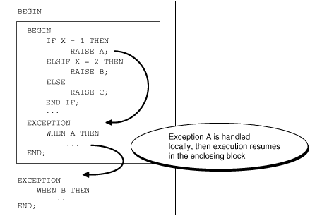
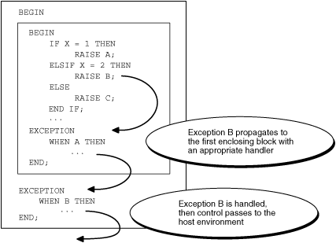
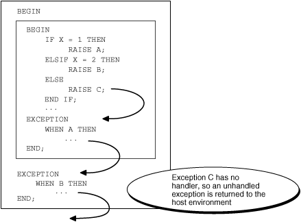

This chapter explains how to handle PL/SQL compile-time warnings and PL/SQL runtime errors. The latter are called exceptions.

Note:

The language of warning and error messages depends on the `NLS_LANGUAGE` parameter. For information about this parameter, see [Oracle Database Globalization Support Guide](https://docs.oracle.com/pls/topic/lookup?ctx=en/database/oracle/oracle-database/21/lnpls&id=NLSPG199).

Topics

See Also:

- " [Exception Handling in Triggers](plsql-triggers.md) "
- " [Handling FORALL Exceptions After FORALL Statement Completes](plsql-optimization-and-tuning.md) "

Tip:

If you have problems creating or running PL/SQL code, check the Oracle Database trace files. The `DIAGNOSTIC_DEST` initialization parameter specifies the current location of the trace files. You can find the value of this parameter by issuing `SHOW` `PARAMETER` `DIAGNOSTIC_DEST` or query the `V$DIAG_INFO` view. For more information about diagnostic data, see [Oracle Database Administrator’s Guide](https://docs.oracle.com/pls/topic/lookup?ctx=en/database/oracle/oracle-database/21/lnpls&id=ADMIN11007).

### 12.1 Compile-Time Warnings

While compiling stored PL/SQL units, the PL/SQL compiler generates warnings for conditions that are not serious enough to cause errors and prevent compilation—for example, using a deprecated PL/SQL feature.

To see warnings (and errors) generated during compilation, either query the static data dictionary view `*_ERRORS` or, in the SQL\*Plus environment, use the command `SHOW` `ERRORS`.

The message code of a PL/SQL warning has the form PLW-nnnnn.

Table 12-1 Compile-Time Warning Categories

| Category | Description | Example |
| --- | --- | --- |
| `SEVERE` | Condition might cause unexpected action or wrong results. | Aliasing problems with parameters |
| `PERFORMANCE` | Condition might cause performance problems. | Passing a `VARCHAR2` value to a `NUMBER` column in an `INSERT` statement |
| `INFORMATIONAL` | Condition does not affect performance or correctness, but you might want to change it to make the code more maintainable. | Code that can never run |

By setting the compilation parameter `PLSQL_WARNINGS`, you can:

- Enable and disable all warnings, one or more categories of warnings, or specific warnings
- Treat specific warnings as errors (so that those conditions must be corrected before you can compile the PL/SQL unit)

You can set the value of `PLSQL_WARNINGS` for:

- Your Oracle database instance
	Use the `ALTER` `SYSTEM` statement, described in [Oracle Database SQL Language Reference](https://docs.oracle.com/pls/topic/lookup?ctx=en/database/oracle/oracle-database/21/lnpls&id=SQLRF00902).
- Your session
	Use the `ALTER` `SESSION` statement, described in [Oracle Database SQL Language Reference](https://docs.oracle.com/pls/topic/lookup?ctx=en/database/oracle/oracle-database/21/lnpls&id=SQLRF00901).
- A stored PL/SQL unit
	Use an `ALTER` statement from " [ALTER Statements](sql-statements-for-stored-plsql-units.md) " with its `compiler_parameters_clause`.

In any of the preceding `ALTER` statements, you set the value of `PLSQL_WARNINGS` with this syntax:

```
PLSQL_WARNINGS = 'value_clause' [, 'value_clause' ] ...
```

For the syntax of `value_clause`, see [Oracle Database Reference](https://docs.oracle.com/pls/topic/lookup?ctx=en/database/oracle/oracle-database/21/lnpls&id=REFRN10249).

To display the current value of `PLSQL_WARNINGS`, query the static data dictionary view `ALL_PLSQL_OBJECT_SETTINGS`.

See Also:

- [Oracle Database Reference](https://docs.oracle.com/pls/topic/lookup?ctx=en/database/oracle/oracle-database/21/lnpls&id=REFRN20385) for more information about the static data dictionary view `ALL_PLSQL_OBJECT_SETTINGS`
- [Oracle Database Error Messages Reference](https://docs.oracle.com/pls/topic/lookup?ctx=en/database/oracle/oracle-database/21/lnpls&id=ERRMG-GUID-CA5A766D-6CBF-4235-982F-86A6F34266CC) for the message codes of all PL/SQL warnings
- [Oracle Database Reference](https://docs.oracle.com/pls/topic/lookup?ctx=en/database/oracle/oracle-database/21/lnpls&id=REFRN20065) for more information about the static data dictionary view `*_ERRORS`
- " [PL/SQL Units and Compilation Parameters](overview.md) " for more information about PL/SQL units and compiler parameters

Example 12-1 Setting Value of PLSQL\_WARNINGS Compilation Parameter

This example shows several `ALTER` statements that set the value of `PLSQL_WARNINGS`.

For the session, enable all warnings—highly recommended during development:

```
ALTER SESSION SET PLSQL_WARNINGS='ENABLE:ALL';
```

For the session, enable `PERFORMANCE` warnings:

```
ALTER SESSION SET PLSQL_WARNINGS='ENABLE:PERFORMANCE';
```

For the procedure `loc_var`, enable `PERFORMANCE` warnings, and reuse settings:

```
ALTER PROCEDURE loc_var
  COMPILE PLSQL_WARNINGS='ENABLE:PERFORMANCE'
  REUSE SETTINGS;
```

For the session, enable `SEVERE` warnings, disable `PERFORMANCE` warnings, and treat PLW-06002 warnings as errors:

```
ALTER SESSION
  SET PLSQL_WARNINGS='ENABLE:SEVERE', 'DISABLE:PERFORMANCE', 'ERROR:06002';
```

For the session, disable all warnings:

```
ALTER SESSION SET PLSQL_WARNINGS='DISABLE:ALL';
```

#### 12.1.1 DBMS\_WARNING Package

If you are writing PL/SQL units in a development environment that compiles them (such as SQL\*Plus), you can display and set the value of `PLSQL_WARNINGS` by invoking subprograms in the `DBMS_WARNING` package.

Example 12-2 uses an `ALTER` `SESSION` statement to disable all warning messages for the session and then compiles a procedure that has unreachable code. The procedure compiles without warnings. Next, the example enables all warnings for the session by invoking `DBMS_WARNING.set_warning_setting_string` and displays the value of `PLSQL_WARNINGS` by invoking `DBMS_WARNING.get_warning_setting_string`. Finally, the example recompiles the procedure, and the compiler generates a warning about the unreachable code.

Note:

Unreachable code could represent a mistake or be intentionally hidden by a debug flag.

`DBMS_WARNING` subprograms are useful when you are compiling a complex application composed of several nested SQL\*Plus scripts, where different subprograms need different `PLSQL_WARNINGS` settings. With `DBMS_WARNING` subprograms, you can save the current `PLSQL_WARNINGS` setting, change the setting to compile a particular set of subprograms, and then restore the setting to its original value.

See Also:

[Oracle Database PL/SQL Packages and Types Reference](https://docs.oracle.com/pls/topic/lookup?ctx=en/database/oracle/oracle-database/21/lnpls&id=ARPLS370) for more information about the `DBMS_WARNING` package

Example 12-2 Displaying and Setting PLSQL\_WARNINGS with DBMS\_WARNING Subprograms

Disable all warning messages for this session:

```
ALTER SESSION SET PLSQL_WARNINGS='DISABLE:ALL';
```

With warnings disabled, this procedure compiles with no warnings:

```
CREATE OR REPLACE PROCEDURE unreachable_code AUTHID DEFINER AS
  x CONSTANT BOOLEAN := TRUE;
BEGIN
  IF x THEN
    DBMS_OUTPUT.PUT_LINE('TRUE');
  ELSE
    DBMS_OUTPUT.PUT_LINE('FALSE');
  END IF;
END unreachable_code;
/
```

Enable all warning messages for this session:

```
CALL DBMS_WARNING.set_warning_setting_string ('ENABLE:ALL', 'SESSION');
```

Check warning setting:

```
SELECT DBMS_WARNING.get_warning_setting_string() FROM DUAL;
```

Result:

```
DBMS_WARNING.GET_WARNING_SETTING_STRING()
-----------------------------------------
 
ENABLE:ALL
 
1 row selected.
```

Recompile procedure:

```
ALTER PROCEDURE unreachable_code COMPILE;
```

Result:

```
SP2-0805: Procedure altered with compilation warnings
```

Show errors:

```
SHOW ERRORS
```

Result:

```
Errors for PROCEDURE UNREACHABLE_CODE:
 
LINE/COL ERROR
-------- -----------------------------------------------------------------
7/5      PLW-06002: Unreachable code
```

### 12.2 Overview of Exception Handling

Exceptions (PL/SQL runtime errors) can arise from design faults, coding mistakes, hardware failures, and many other sources. You cannot anticipate all possible exceptions, but you can write exception handlers that let your program to continue to operate in their presence.

Any PL/SQL block can have an exception-handling part, which can have one or more exception handlers. For example, an exception-handling part could have this syntax:

```
EXCEPTION
  WHEN ex_name_1 THEN statements_1                 -- Exception handler
  WHEN ex_name_2 OR ex_name_3 THEN statements_2  -- Exception handler
  WHEN OTHERS THEN statements_3                      -- Exception handler
END;
```

In the preceding syntax example, `ex_name_` `n` is the name of an exception and `statements_` `n` is one or more statements. (For complete syntax and semantics, see " [Exception Handler](exception-handler.md) ".)

When an exception is raised in the executable part of the block, the executable part stops and control transfers to the exception-handling part. If `ex_name_1` was raised, then `statements_1` run. If either `ex_name_2` or `ex_name_3` was raised, then `statements_2` run. If any other exception was raised, then `statements_3` run.

After an exception handler runs, control transfers to the next statement of the enclosing block. If there is no enclosing block, then:

- If the exception handler is in a subprogram, then control returns to the invoker, at the statement after the invocation.
- If the exception handler is in an anonymous block, then control transfers to the host environment (for example, SQL\*Plus)

If an exception is raised in a block that has no exception handler for it, then the exception propagates. That is, the exception reproduces itself in successive enclosing blocks until a block has a handler for it or there is no enclosing block (for more information, see " Exception Propagation "). If there is no handler for the exception, then PL/SQL returns an unhandled exception error to the invoker or host environment, which determines the outcome (for more information, see " Unhandled Exceptions ").

Topics

- Exception Categories
- Advantages of Exception Handlers
- Guidelines for Avoiding and Handling Exceptions

#### 12.2.1 Exception Categories

The exception categories are:

- Internally defined
	The runtime system raises internally defined exceptions implicitly (automatically). Examples of internally defined exceptions are ORA-00060 (deadlock detected while waiting for resource) and ORA-27102 (out of memory).
	An internally defined exception always has an error code, but does not have a name unless PL/SQL gives it one or you give it one.
	For more information, see " Internally Defined Exceptions ".
- Predefined
	A predefined exception is an internally defined exception that PL/SQL has given a name. For example, ORA-06500 (PL/SQL: storage error) has the predefined name `STORAGE_ERROR`.
	For more information, see " Predefined Exceptions ".
- User-defined
	You can declare your own exceptions in the declarative part of any PL/SQL anonymous block, subprogram, or package. For example, you might declare an exception named `insufficient_funds` to flag overdrawn bank accounts.
	You must raise user-defined exceptions explicitly.
	For more information, see " User-Defined Exceptions ".

Table 12-2 summarizes the exception categories.

Table 12-2 Exception Categories

| Category | Definer | Has Error Code | Has Name | Raised Implicitly | Raised Explicitly |
| --- | --- | --- | --- | --- | --- |
| Internally defined | Runtime system | Always | Only if you assign one | Yes | Optionally <sup>Foot 1</sup> |
| Predefined | Runtime system | Always | Always | Yes | Optionally <sup>Foot 1</sup> |
| User-defined | User | Only if you assign one | Always | No | Always |

<sup>Footnote 1</sup>

For details, see " Raising Internally Defined Exception with RAISE Statement ".

For a named exception, you can write a specific exception handler, instead of handling it with an `OTHERS` exception handler. A specific exception handler is more efficient than an `OTHERS` exception handler, because the latter must invoke a function to determine which exception it is handling. For details, see " Retrieving Error Code and Error Message ".

#### 12.2.2 Advantages of Exception Handlers

Using exception handlers for error-handling makes programs easier to write and understand, and reduces the likelihood of unhandled exceptions.

Without exception handlers, you must check for every possible error, everywhere that it might occur, and then handle it. It is easy to overlook a possible error or a place where it might occur, especially if the error is not immediately detectable (for example, bad data might be undetectable until you use it in a calculation). Error-handling code is scattered throughout the program.

With exception handlers, you need not know every possible error or everywhere that it might occur. You need only include an exception-handling part in each block where errors might occur. In the exception-handling part, you can include exception handlers for both specific and unknown errors. If an error occurs anywhere in the block (including inside a sub-block), then an exception handler handles it. Error-handling code is isolated in the exception-handling parts of the blocks.

In Example 12-3, a procedure uses a single exception handler to handle the predefined exception `NO_DATA_FOUND`, which can occur in either of two `SELECT` `INTO` statements.

If multiple statements use the same exception handler, and you want to know which statement failed, you can use locator variables, as in Example 12-4.

You determine the precision of your error-handling code. You can have a single exception handler for all division-by-zero errors, bad array indexes, and so on. You can also check for errors in a single statement by putting that statement inside a block with its own exception handler.

Example 12-3 Single Exception Handler for Multiple Exceptions

```
CREATE OR REPLACE PROCEDURE select_item (
  t_column VARCHAR2,
  t_name   VARCHAR2
) AUTHID DEFINER
IS
  temp VARCHAR2(30);
BEGIN
  temp := t_column;  -- For error message if next SELECT fails
 
  -- Fails if table t_name does not have column t_column:
 
  SELECT COLUMN_NAME INTO temp
  FROM USER_TAB_COLS 
  WHERE TABLE_NAME = UPPER(t_name)
  AND COLUMN_NAME = UPPER(t_column);
 
  temp := t_name;  -- For error message if next SELECT fails
 
  -- Fails if there is no table named t_name:
 
  SELECT OBJECT_NAME INTO temp
  FROM USER_OBJECTS
  WHERE OBJECT_NAME = UPPER(t_name)
  AND OBJECT_TYPE = 'TABLE';
 
EXCEPTION
  WHEN NO_DATA_FOUND THEN
    DBMS_OUTPUT.PUT_LINE ('No Data found for SELECT on ' || temp);
  WHEN OTHERS THEN
    DBMS_OUTPUT.PUT_LINE ('Unexpected error');
    RAISE;
END;
/
```

Invoke procedure (there is a `DEPARTMENTS` table, but it does not have a `LAST_NAME` column):

```
BEGIN
  select_item('departments', 'last_name');
END;
/
```

Result:

```
No Data found for SELECT on departments
```

Invoke procedure (there is no `EMP` table):

```
BEGIN
  select_item('emp', 'last_name');
END;
/
```

Result:

```
No Data found for SELECT on emp
```

Example 12-4 Locator Variables for Statements that Share Exception Handler

```
CREATE OR REPLACE PROCEDURE loc_var AUTHID DEFINER IS
  stmt_no  POSITIVE;
  name_    VARCHAR2(100);
BEGIN
  stmt_no := 1;

  SELECT table_name INTO name_
  FROM user_tables
  WHERE table_name LIKE 'ABC%';

  stmt_no := 2;

  SELECT table_name INTO name_
  FROM user_tables
  WHERE table_name LIKE 'XYZ%';
EXCEPTION
  WHEN NO_DATA_FOUND THEN
    DBMS_OUTPUT.PUT_LINE ('Table name not found in query ' || stmt_no);
END;
/
CALL loc_var();
```

Result:

```
Table name not found in query 1
```

#### 12.2.3 Guidelines for Avoiding and Handling Exceptions

To make your programs as reliable and safe as possible:

- Use both error-checking code and exception handlers.
	Use error-checking code wherever bad input data can cause an error. Examples of bad input data are incorrect or null actual parameters and queries that return no rows or more rows than you expect. Test your code with different combinations of bad input data to see what potential errors arise.
	Sometimes you can use error-checking code to avoid raising an exception, as in Example 12-7.
- Add exception handlers wherever errors can occur.
	Errors are especially likely during arithmetic calculations, string manipulation, and database operations. Errors can also arise from problems that are independent of your code—for example, disk storage or memory hardware failure—but your code still must take corrective action.
- Design your programs to work when the database is not in the state you expect.
	For example, a table you query might have columns added or deleted, or their types might have changed. You can avoid problems by declaring scalar variables with `%TYPE` qualifiers and record variables to hold query results with `%ROWTYPE` qualifiers.
- Whenever possible, write exception handlers for named exceptions instead of using `OTHERS` exception handlers.
	Learn the names and causes of the predefined exceptions. If you know that your database operations might raise specific internally defined exceptions that do not have names, then give them names so that you can write exception handlers specifically for them.
- Have your exception handlers output debugging information.
	If you store the debugging information in a separate table, do it with an autonomous routine, so that you can commit your debugging information even if you roll back the work that the main subprogram did. For information about autonomous routines, see " [AUTONOMOUS\_TRANSACTION Pragma](AUTONOMOUS_TRANSACTION-pragma.md) ".
- For each exception handler, carefully decide whether to have it commit the transaction, roll it back, or let it continue.
	Regardless of the severity of the error, you want to leave the database in a consistent state and avoid storing bad data.
- Avoid unhandled exceptions by including an `OTHERS` exception handler at the top level of every PL/SQL program.
	Make the last statement in the `OTHERS` exception handler either `RAISE` or an invocation of of a subroutine marked with `SUPPRESSES_WARNING_6009` pragma. (If you do not follow this practice, and PL/SQL warnings are enabled, then you get PLW-06009.) For information about `RAISE` or an invocation of the `RAISE_APPLICATION_ERROR`, see " Raising Exceptions Explicitly ".

### 12.3 Internally Defined Exceptions

Internally defined exceptions (ORA-n errors) are described in [Oracle Database Error Messages Reference](https://docs.oracle.com/pls/topic/lookup?ctx=en/database/oracle/oracle-database/21/lnpls&id=ERRMG-GUID-27437B7F-F0C3-4F1F-9C6E-6780706FB0F6). The runtime system raises them implicitly (automatically).

An internally defined exception does not have a name unless either PL/SQL gives it one (see " Predefined Exceptions ") or you give it one.

If you know that your database operations might raise specific internally defined exceptions that do not have names, then give them names so that you can write exception handlers specifically for them. Otherwise, you can handle them only with `OTHERS` exception handlers.

To give a name to an internally defined exception, do the following in the declarative part of the appropriate anonymous block, subprogram, or package. (To determine the appropriate block, see " Exception Propagation ".)

1. Declare the name.
	An exception name declaration has this syntax:
	```
	exception_name EXCEPTION;
	```
	For semantic information, see " [Exception Declaration](exception-declaration.md) ".
2. Associate the name with the error code of the internally defined exception.
	The syntax is:
	```
	PRAGMA EXCEPTION_INIT (exception_name, error_code)
	```
	For semantic information, see " [EXCEPTION\_INIT Pragma](EXCEPTION_INIT-pragma.md) ".

Note:

An internally defined exception with a user-declared name is still an internally defined exception, not a user-defined exception.

Example 12-5 gives the name `deadlock_detected` to the internally defined exception ORA-00060 (deadlock detected while waiting for resource) and uses the name in an exception handler.

See Also:

" Raising Internally Defined Exception with RAISE Statement "

Example 12-5 Naming Internally Defined Exception

```
DECLARE
  deadlock_detected EXCEPTION;
  PRAGMA EXCEPTION_INIT(deadlock_detected, -60);
BEGIN
  ...
EXCEPTION
  WHEN deadlock_detected THEN
    ...
END;
/
```

### 12.4 Predefined Exceptions

Predefined exceptions are internally defined exceptions that have predefined names, which PL/SQL declares globally in the package `STANDARD`. The runtime system raises predefined exceptions implicitly (automatically). Because predefined exceptions have names, you can write exception handlers specifically for them.

Table 12-3 lists the names and error codes of the predefined exceptions.

Table 12-3 PL/SQL Predefined Exceptions

| Exception Name | Error Code |
| --- | --- |
| `ACCESS_INTO_NULL` | `-6530` |
| `CASE_NOT_FOUND` | `-6592` |
| `COLLECTION_IS_NULL` | `-6531` |
| `CURSOR_ALREADY_OPEN` | `-6511` |
| `DUP_VAL_ON_INDEX` | `-1` |
| `INVALID_CURSOR` | `-1001` |
| `INVALID_NUMBER` | `-1722` |
| `LOGIN_DENIED` | `-1017` |
| `NO_DATA_FOUND` | `+100` |
| `NO_DATA_NEEDED` | `-6548` |
| `NOT_LOGGED_ON` | `-1012` |
| `PROGRAM_ERROR` | `-6501` |
| `ROWTYPE_MISMATCH` | `-6504` |
| `SELF_IS_NULL` | `-30625` |
| `STORAGE_ERROR` | `-6500` |
| `SUBSCRIPT_BEYOND_COUNT` | `-6533` |
| `SUBSCRIPT_OUTSIDE_LIMIT` | `-6532` |
| `SYS_INVALID_ROWID` | `-1410` |
| `TIMEOUT_ON_RESOURCE` | `-51` |
| `TOO_MANY_ROWS` | `-1422` |
| `VALUE_ERROR` | `-6502` |
| `ZERO_DIVIDE` | `-1476` |

Example 12-6 calculates a price-to-earnings ratio for a company. If the company has zero earnings, the division operation raises the predefined exception `ZERO_DIVIDE` and the executable part of the block transfers control to the exception-handling part.

Example 12-7 uses error-checking code to avoid the exception that Example 12-6 handles.

In Example 12-8, the procedure opens a cursor variable for either the `EMPLOYEES` table or the `DEPARTMENTS` table, depending on the value of the parameter `discrim`. The anonymous block invokes the procedure to open the cursor variable for the `EMPLOYEES` table, but fetches from the `DEPARTMENTS` table, which raises the predefined exception `ROWTYPE_MISMATCH`.

See Also:

" Raising Internally Defined Exception with RAISE Statement "

Example 12-6 Anonymous Block Handles ZERO\_DIVIDE

```
DECLARE
  stock_price   NUMBER := 9.73;
  net_earnings  NUMBER := 0;
  pe_ratio      NUMBER;
BEGIN
  pe_ratio := stock_price / net_earnings;  -- raises ZERO_DIVIDE exception
  DBMS_OUTPUT.PUT_LINE('Price/earnings ratio = ' || pe_ratio);
EXCEPTION
  WHEN ZERO_DIVIDE THEN
    DBMS_OUTPUT.PUT_LINE('Company had zero earnings.');
    pe_ratio := NULL;
END;
/
```

Result:

```
Company had zero earnings.
```

Example 12-7 Anonymous Block Avoids ZERO\_DIVIDE

```
DECLARE
  stock_price   NUMBER := 9.73;
  net_earnings  NUMBER := 0;
  pe_ratio      NUMBER;
BEGIN
  pe_ratio :=
    CASE net_earnings
      WHEN 0 THEN NULL
      ELSE stock_price / net_earnings
    END;
END;
/
```

Example 12-8 Anonymous Block Handles ROWTYPE\_MISMATCH

```
CREATE OR REPLACE PACKAGE emp_dept_data AUTHID DEFINER AS
  TYPE cv_type IS REF CURSOR;
  
  PROCEDURE open_cv (
    cv       IN OUT cv_type,
    discrim  IN     POSITIVE
  );
  END emp_dept_data;
/
 
CREATE OR REPLACE PACKAGE BODY emp_dept_data AS
  PROCEDURE open_cv (
    cv      IN OUT cv_type,
    discrim IN     POSITIVE) IS
  BEGIN
    IF discrim = 1 THEN
    OPEN cv FOR
      SELECT * FROM EMPLOYEES ORDER BY employee_id;
    ELSIF discrim = 2 THEN
      OPEN cv FOR
        SELECT * FROM DEPARTMENTS ORDER BY department_id;
    END IF;
  END open_cv;
END emp_dept_data;
/
```

Invoke procedure `open_cv` from anonymous block:

```
DECLARE
  emp_rec   EMPLOYEES%ROWTYPE;
  dept_rec  DEPARTMENTS%ROWTYPE;
  cv        Emp_dept_data.CV_TYPE;
BEGIN
  emp_dept_data.open_cv(cv, 1);  -- Open cv for EMPLOYEES fetch.
  FETCH cv INTO dept_rec;        -- Fetch from DEPARTMENTS.
  DBMS_OUTPUT.PUT(dept_rec.DEPARTMENT_ID);
  DBMS_OUTPUT.PUT_LINE('  ' || dept_rec.LOCATION_ID);
EXCEPTION
  WHEN ROWTYPE_MISMATCH THEN
     BEGIN
       DBMS_OUTPUT.PUT_LINE
         ('Row type mismatch, fetching EMPLOYEES data ...');
       FETCH cv INTO emp_rec;
       DBMS_OUTPUT.PUT(emp_rec.DEPARTMENT_ID);
       DBMS_OUTPUT.PUT_LINE('  ' || emp_rec.LAST_NAME);
     END;
END;
/
```

Result:

```
Row type mismatch, fetching EMPLOYEES data ...
90  King
```

### 12.5 User-Defined Exceptions

You can declare your own exceptions in the declarative part of any PL/SQL anonymous block, subprogram, or package.

An exception name declaration has this syntax:

```
exception_name EXCEPTION;
```

For semantic information, see " [Exception Declaration](exception-declaration.md) ".

You must raise a user-defined exception explicitly. For details, see " Raising Exceptions Explicitly ".

### 12.6 Redeclared Predefined Exceptions

Oracle recommends against redeclaring predefined exceptions—that is, declaring a user-defined exception name that is a predefined exception name. (For a list of predefined exception names, see Table 12-3.)

If you redeclare a predefined exception, your local declaration overrides the global declaration in package `STANDARD`. Exception handlers written for the globally declared exception become unable to handle it—unless you qualify its name with the package name `STANDARD`.

Example 12-9 shows this.

Example 12-9 Redeclared Predefined Identifier

```
DROP TABLE t;
CREATE TABLE t (c NUMBER);
```

In the following block, the `INSERT` statement implicitly raises the predefined exception `INVALID_NUMBER`, which the exception handler handles.

```
DECLARE
  default_number NUMBER := 0;
BEGIN
  INSERT INTO t VALUES(TO_NUMBER('100.00', '9G999'));
EXCEPTION
  WHEN INVALID_NUMBER THEN
    DBMS_OUTPUT.PUT_LINE('Substituting default value for invalid number.');
    INSERT INTO t VALUES(default_number);
END;
/
```

Result:

```
Substituting default value for invalid number.
```

The following block redeclares the predefined exception `INVALID_NUMBER`. When the `INSERT` statement implicitly raises the predefined exception `INVALID_NUMBER`, the exception handler does not handle it.

```
DECLARE
  default_number NUMBER := 0;
  i NUMBER := 5;
  invalid_number EXCEPTION;    -- redeclare predefined exception
BEGIN
  INSERT INTO t VALUES(TO_NUMBER('100.00', '9G999'));
EXCEPTION
  WHEN INVALID_NUMBER THEN
    DBMS_OUTPUT.PUT_LINE('Substituting default value for invalid number.');
    INSERT INTO t VALUES(default_number); 
END;
/
```

Result:

```
DECLARE
*
ERROR at line 1:
ORA-01722: invalid number
ORA-06512: at line 6
```

The exception handler in the preceding block handles the predefined exception `INVALID_NUMBER` if you qualify the exception name in the exception handler:

```
DECLARE
  default_number NUMBER := 0;
  i NUMBER := 5;
  invalid_number EXCEPTION;    -- redeclare predefined exception
BEGIN
  INSERT INTO t VALUES(TO_NUMBER('100.00', '9G999'));
EXCEPTION
  WHEN STANDARD.INVALID_NUMBER THEN
    DBMS_OUTPUT.PUT_LINE('Substituting default value for invalid number.');
    INSERT INTO t VALUES(default_number); 
END;
/
```

Result:

```
Substituting default value for invalid number.
```

### 12.7 Raising Exceptions Explicitly

To raise an exception explicitly, use either the `RAISE` statement or `RAISE_APPLICATION_ERROR` procedure.

Topics

- RAISE Statement
- RAISE\_APPLICATION\_ERROR Procedure

#### 12.7.1 RAISE Statement

The `RAISE` statement explicitly raises an exception. Outside an exception handler, you must specify the exception name. Inside an exception handler, if you omit the exception name, the `RAISE` statement reraises the current exception.

Topics

- Raising User-Defined Exception with RAISE Statement
- Raising Internally Defined Exception with RAISE Statement
- Reraising Current Exception with RAISE Statement

##### 12.7.1.1 Raising User-Defined Exception with RAISE Statement

In Example 12-10, the procedure declares an exception named `past_due`, raises it explicitly with the `RAISE` statement, and handles it with an exception handler.

Example 12-10 Declaring, Raising, and Handling User-Defined Exception

```
CREATE PROCEDURE account_status (
  due_date DATE,
  today    DATE
) AUTHID DEFINER
IS
  past_due  EXCEPTION;  -- declare exception
BEGIN
  IF due_date < today THEN
    RAISE past_due;  -- explicitly raise exception
  END IF;
EXCEPTION
  WHEN past_due THEN  -- handle exception
    DBMS_OUTPUT.PUT_LINE ('Account past due.');
END;
/
 
BEGIN
  account_status (TO_DATE('01-JUL-2010', 'DD-MON-YYYY'),
                  TO_DATE('09-JUL-2010', 'DD-MON-YYYY'));
END;
/
```

Result:

```
Account past due.
```

##### 12.7.1.2 Raising Internally Defined Exception with RAISE Statement

Although the runtime system raises internally defined exceptions implicitly, you can raise them explicitly with the `RAISE` statement if they have names. Table 12-3 lists the internally defined exceptions that have predefined names. " Internally Defined Exceptions " explains how to give user-declared names to internally defined exceptions.

An exception handler for a named internally defined exception handles that exception whether it is raised implicitly or explicitly.

In Example 12-11, the procedure raises the predefined exception `INVALID_NUMBER` either explicitly or implicitly, and the `INVALID_NUMBER` exception handler always handles it.

Example 12-11 Explicitly Raising Predefined Exception

```
DROP TABLE t;
CREATE TABLE t (c NUMBER);
 
CREATE PROCEDURE p (n NUMBER) AUTHID DEFINER IS
  default_number NUMBER := 0;
BEGIN
  IF n < 0 THEN
    RAISE INVALID_NUMBER;  -- raise explicitly
  ELSE
    INSERT INTO t VALUES(TO_NUMBER('100.00', '9G999'));  -- raise implicitly
  END IF;
EXCEPTION
  WHEN INVALID_NUMBER THEN
    DBMS_OUTPUT.PUT_LINE('Substituting default value for invalid number.');
    INSERT INTO t VALUES(default_number);
END;
/
 
BEGIN
  p(-1);
END;
/
```

Result:

```
Substituting default value for invalid number.
 
BEGIN
  p(1);
END;
/
```

Result:

```
Substituting default value for invalid number.
```

##### 12.7.1.3 Reraising Current Exception with RAISE Statement

In an exception handler, you can use the `RAISE` statement to"reraise" the exception being handled. Reraising the exception passes it to the enclosing block, which can handle it further. (If the enclosing block cannot handle the reraised exception, then the exception propagates—see " Exception Propagation ".) When reraising the current exception, you need not specify an exception name.

In Example 12-12, the handling of the exception starts in the inner block and finishes in the outer block. The outer block declares the exception, so the exception name exists in both blocks, and each block has an exception handler specifically for that exception. The inner block raises the exception, and its exception handler does the initial handling and then reraises the exception, passing it to the outer block for further handling.

Example 12-12 Reraising Exception

```
DECLARE
  salary_too_high   EXCEPTION;
  current_salary    NUMBER := 20000;
  max_salary        NUMBER := 10000;
  erroneous_salary  NUMBER;
BEGIN

  BEGIN
    IF current_salary > max_salary THEN
      RAISE salary_too_high;   -- raise exception
    END IF;
  EXCEPTION
    WHEN salary_too_high THEN  -- start handling exception
      erroneous_salary := current_salary;
      DBMS_OUTPUT.PUT_LINE('Salary ' || erroneous_salary ||' is out of range.');
      DBMS_OUTPUT.PUT_LINE ('Maximum salary is ' || max_salary || '.');
      RAISE;  -- reraise current exception (exception name is optional)
  END;

EXCEPTION
  WHEN salary_too_high THEN    -- finish handling exception
    current_salary := max_salary;

    DBMS_OUTPUT.PUT_LINE (
      'Revising salary from ' || erroneous_salary ||
      ' to ' || current_salary || '.'
    );
END;
/
```

Result:

```
Salary 20000 is out of range.
Maximum salary is 10000.
Revising salary from 20000 to 10000.
```

#### 12.7.2 RAISE\_APPLICATION\_ERROR Procedure

You can invoke the `RAISE_APPLICATION_ERROR` procedure (defined in the `DBMS_STANDARD` package) only from a stored subprogram or method. Typically, you invoke this procedure to raise a user-defined exception and return its error code and error message to the invoker.

The `RAISE_APPLICATION_ERROR` procedure is marked with `SUPPRESSES_WARNING_6009` pragma.

For semantic information, see " [SUPPRESSES\_WARNING\_6009 Pragma](Supresses-warning-pragma-6009.md) ".

To invoke `RAISE_APPLICATION_ERROR`, use this syntax:

```
RAISE_APPLICATION_ERROR (error_code, message[, {TRUE | FALSE}]);
```

You must have assigned `error_code` to the user-defined exception with the `EXCEPTION_INIT` pragma. The syntax is:

```
PRAGMA EXCEPTION_INIT (exception_name, error_code)
```

The `error_code` is an integer in the range -20000..-20999 and the `message` is a character string of at most 2048 bytes.

For semantic information, see " [EXCEPTION\_INIT Pragma](EXCEPTION_INIT-pragma.md) ".

The `message` is a character string of at most 2048 bytes.

If you specify `TRUE`, PL/SQL puts `error_code` on top of the error stack. Otherwise, PL/SQL replaces the error stack with `error_code`.

In Example 12-13, an anonymous block declares an exception named `past_due`, assigns the error code -20000 to it, and invokes a stored procedure. The stored procedure invokes the `RAISE_APPLICATION_ERROR` procedure with the error code -20000 and a message, whereupon control returns to the anonymous block, which handles the exception. To retrieve the message associated with the exception, the exception handler in the anonymous block invokes the `SQLERRM` function, described in " Retrieving Error Code and Error Message ".

Example 12-13 Raising User-Defined Exception with RAISE\_APPLICATION\_ERROR

```
CREATE PROCEDURE account_status (
  due_date DATE,
  today    DATE
) AUTHID DEFINER
IS
BEGIN
  IF due_date < today THEN                   -- explicitly raise exception
    RAISE_APPLICATION_ERROR(-20000, 'Account past due.');
  END IF;
END;
/
 
DECLARE
  past_due  EXCEPTION;                       -- declare exception
  PRAGMA EXCEPTION_INIT (past_due, -20000);  -- assign error code to exception
BEGIN
  account_status (TO_DATE('01-JUL-2010', 'DD-MON-YYYY'),
                  TO_DATE('09-JUL-2010', 'DD-MON-YYYY'));   -- invoke procedure

EXCEPTION
  WHEN past_due THEN                         -- handle exception
    DBMS_OUTPUT.PUT_LINE(TO_CHAR(SQLERRM(-20000)));
END;
/
```

Result:

```
ORA-20000: Account past due.
```

### 12.8 Exception Propagation

If an exception is raised in a block that has no exception handler for it, then the exception propagates. That is, the exception reproduces itself in successive enclosing blocks until either a block has a handler for it or there is no enclosing block. If there is no handler for the exception, then PL/SQL returns an unhandled exception error to the invoker or host environment, which determines the outcome (for more information, see " Unhandled Exceptions ").

In Figure 12-1, one block is nested inside another. The inner block raises exception A. The inner block has an exception handler for A, so A does not propagate. After the exception handler runs, control transfers to the next statement of the outer block.

Figure 12-1 Exception Does Not Propagate



> This figure shows the outline of an anonymous block that contains another anonymous block. The inner block has an `IF-ELSIF-ELSE` statement that raises either exception A, B, or C, and an exception-handling part with an exception handler for A. The outer block has, immediately after the inner block, an exception-handling part with an exception handler for B.
>
> Two arrows show the flow of control. The first arrow points from the `RAISE A` statement in the inner block to the exception-handling part of the inner block. The second arrow points from the end of the exception handler for A to the next statement of the outer block (where the exception-handling part of the outer block begins).


In Figure 12-2, the inner block raises exception B. The inner block does not have an exception handler for exception B, so B propagates to the outer block, which does have an exception handler for it. After the exception handler runs, control transfers to the host environment.

Figure 12-2 Exception Propagates from Inner Block to Outer Block



> This figure shows the outline of an anonymous block that contains another anonymous block. The inner block has an `IF-ELSIF-ELSE` statement that raises either exception A, B, or C, and an exception-handling part with an exception handler for A. The outer block has, immediately after the inner block, an exception-handling part with an exception handler for B.
>
> Three arrows show the flow of control. The first arrow points from the `RAISE B` statement in the inner block to the exception-handling part of the inner block. The second arrow points from the end of the exception-handling part of the inner block to the next statement of the outer block, where the exception-handling part of the outer block begins. The third arrow points from the end of the exception handler for B to the host environment.


In Figure 12-3, the inner block raises exception C. The inner block does not have an exception handler for C, so exception C propagates to the outer block. The outer block does not have an exception handler for C, so PL/SQL returns an unhandled exception error to the host environment.

Figure 12-3 PL/SQL Returns Unhandled Exception Error to Host Environment



> This figure shows the outline of an anonymous block that contains another anonymous block. The inner block has an `IF-ELSIF-ELSE` statement that raises either exception A, B, or C, and an exception-handling part with an exception handler for A. The outer block has, immediately after the inner block, an exception-handling part with an exception handler for B.
>
> Three arrows show the flow of control. The first arrow points from the `RAISE C` statement in the inner block to the exception-handling part of the inner block. The second arrow points from the end of the exception-handling part of the inner block to the next statement of the outer block, where the exception-handling part of the outer block begins. The third arrow points from the end of the exception-handling part of the outer block to the host environment.


A user-defined exception can propagate beyond its scope (that is, beyond the block that declares it), but its name does not exist beyond its scope. Therefore, beyond its scope, a user-defined exception can be handled only with an `OTHERS` exception handler.

In Example 12-14, the inner block declares an exception named `past_due`, for which it has no exception handler. When the inner block raises `past_due`, the exception propagates to the outer block, where the name `past_due` does not exist. The outer block handles the exception with an `OTHERS` exception handler.

If the outer block does not handle the user-defined exception, then an error occurs, as in Example 12-15.

Note:

Exceptions cannot propagate across remote subprogram invocations. Therefore, a PL/SQL block cannot handle an exception raised by a remote subprogram.

Topics

- Propagation of Exceptions Raised in Declarations
- Propagation of Exceptions Raised in Exception Handlers

Example 12-14 Exception that Propagates Beyond Scope is Handled

```
CREATE OR REPLACE PROCEDURE p AUTHID DEFINER AS
BEGIN

  DECLARE
    past_due     EXCEPTION;
    PRAGMA EXCEPTION_INIT (past_due, -4910);
    due_date     DATE := trunc(SYSDATE) - 1;
    todays_date  DATE := trunc(SYSDATE);
  BEGIN
    IF due_date < todays_date THEN
      RAISE past_due;
    END IF;
  END;

EXCEPTION
  WHEN OTHERS THEN
    ROLLBACK;
    RAISE;
END;
/
```

Example 12-15 Exception that Propagates Beyond Scope is Not Handled

```
BEGIN

  DECLARE
    past_due     EXCEPTION;
    due_date     DATE := trunc(SYSDATE) - 1;
    todays_date  DATE := trunc(SYSDATE);
  BEGIN
    IF due_date < todays_date THEN
      RAISE past_due;
    END IF;
  END;

END;
/
```

Result:

```
BEGIN
*
ERROR at line 1:
ORA-06510: PL/SQL: unhandled user-defined exception
ORA-06512: at line 9
```

#### 12.8.1 Propagation of Exceptions Raised in Declarations

An exception raised in a declaration propagates immediately to the enclosing block (or to the invoker or host environment if there is no enclosing block). Therefore, the exception handler must be in an enclosing or invoking block, not in the same block as the declaration.

In Example 12-16, the `VALUE_ERROR` exception handler is in the same block as the declaration that raises `VALUE_ERROR`. Because the exception propagates immediately to the host environment, the exception handler does not handle it.

Example 12-17 is like Example 12-16 except that an enclosing block handles the `VALUE_ERROR` exception that the declaration in the inner block raises.

Example 12-16 Exception Raised in Declaration is Not Handled

```
DECLARE
  credit_limit CONSTANT NUMBER(3) := 5000;  -- Maximum value is 999
BEGIN
  NULL;
EXCEPTION
  WHEN VALUE_ERROR THEN
    DBMS_OUTPUT.PUT_LINE('Exception raised in declaration.');
END;
/
```

Result:

```
DECLARE
*
ERROR at line 1:
ORA-06502: PL/SQL: numeric or value error: number precision too large
ORA-06512: at line 2
```

Example 12-17 Exception Raised in Declaration is Handled by Enclosing Block

```
BEGIN
 
  DECLARE
    credit_limit CONSTANT NUMBER(3) := 5000;
  BEGIN
    NULL;
  END;
 
EXCEPTION
  WHEN VALUE_ERROR THEN
    DBMS_OUTPUT.PUT_LINE('Exception raised in declaration.');
END;
/
```

Result:

```
Exception raised in declaration.
```

#### 12.8.2 Propagation of Exceptions Raised in Exception Handlers

An exception raised in an exception handler propagates immediately to the enclosing block (or to the invoker or host environment if there is no enclosing block). Therefore, the exception handler must be in an enclosing or invoking block.

In Example 12-18, when `n` is zero, the calculation `1/n` raises the predefined exception `ZERO_DIVIDE`, and control transfers to the `ZERO_DIVIDE` exception handler in the same block. When the exception handler raises `ZERO_DIVIDE`, the exception propagates immediately to the invoker. The invoker does not handle the exception, so PL/SQL returns an unhandled exception error to the host environment.

Example 12-19 is like Example 12-18 except that when the procedure returns an unhandled exception error to the invoker, the invoker handles it.

Example 12-20 is like Example 12-18 except that an enclosing block handles the exception that the exception handler in the inner block raises.

In Example 12-21, the exception-handling part of the procedure has exception handlers for user-defined exception `i_is_one` and predefined exception `ZERO_DIVIDE`. When the `i_is_one` exception handler raises `ZERO_DIVIDE`, the exception propagates immediately to the invoker (therefore, the `ZERO_DIVIDE` exception handler does not handle it). The invoker does not handle the exception, so PL/SQL returns an unhandled exception error to the host environment.

Example 12-22 is like Example 12-21 except that an enclosing block handles the `ZERO_DIVIDE` exception that the `i_is_one` exception handler raises.

Example 12-18 Exception Raised in Exception Handler is Not Handled

```
CREATE PROCEDURE print_reciprocal (n NUMBER) AUTHID DEFINER IS
BEGIN
  DBMS_OUTPUT.PUT_LINE(1/n);  -- handled
EXCEPTION
  WHEN ZERO_DIVIDE THEN
    DBMS_OUTPUT.PUT_LINE('Error:');
    DBMS_OUTPUT.PUT_LINE(1/n || ' is undefined');  -- not handled
END;
/
 
BEGIN  -- invoking block
  print_reciprocal(0);
END;
```

Result:

```
Error:
BEGIN
*
ERROR at line 1:
ORA-01476: divisor is equal to zero
ORA-06512: at "HR.PRINT_RECIPROCAL", line 7
ORA-01476: divisor is equal to zero
ORA-06512: at line 2
```

Example 12-19 Exception Raised in Exception Handler is Handled by Invoker

```
CREATE PROCEDURE print_reciprocal (n NUMBER) AUTHID DEFINER IS
BEGIN
  DBMS_OUTPUT.PUT_LINE(1/n);
EXCEPTION
  WHEN ZERO_DIVIDE THEN
    DBMS_OUTPUT.PUT_LINE('Error:');
    DBMS_OUTPUT.PUT_LINE(1/n || ' is undefined');
END;
/
 
BEGIN  -- invoking block
  print_reciprocal(0);
EXCEPTION
  WHEN ZERO_DIVIDE THEN  -- handles exception raised in exception handler
    DBMS_OUTPUT.PUT_LINE('1/0 is undefined.');
END;
/
```

Result:

```
Error:
1/0 is undefined.
```

Example 12-20 Exception Raised in Exception Handler is Handled by Enclosing Block

```
CREATE PROCEDURE print_reciprocal (n NUMBER) AUTHID DEFINER IS
BEGIN
 
  BEGIN
    DBMS_OUTPUT.PUT_LINE(1/n);
  EXCEPTION
    WHEN ZERO_DIVIDE THEN
      DBMS_OUTPUT.PUT_LINE('Error in inner block:');
      DBMS_OUTPUT.PUT_LINE(1/n || ' is undefined.');
  END;
 
EXCEPTION
  WHEN ZERO_DIVIDE THEN  -- handles exception raised in exception handler
    DBMS_OUTPUT.PUT('Error in outer block: ');
    DBMS_OUTPUT.PUT_LINE('1/0 is undefined.');
END;
/
 
BEGIN
  print_reciprocal(0);
END;
/
```

Result:

```
Error in inner block:
Error in outer block: 1/0 is undefined.
```

Example 12-21 Exception Raised in Exception Handler is Not Handled

```
CREATE PROCEDURE descending_reciprocals (n INTEGER) AUTHID DEFINER IS
  i INTEGER;
  i_is_one EXCEPTION;
BEGIN
  i := n;
 
  LOOP
    IF i = 1 THEN
      RAISE i_is_one;
    ELSE
      DBMS_OUTPUT.PUT_LINE('Reciprocal of ' || i || ' is ' || 1/i);
    END IF;
 
    i := i - 1;
  END LOOP;
EXCEPTION
  WHEN i_is_one THEN
    DBMS_OUTPUT.PUT_LINE('1 is its own reciprocal.');
    DBMS_OUTPUT.PUT_LINE('Reciprocal of ' || TO_CHAR(i-1) ||
                         ' is ' || TO_CHAR(1/(i-1)));
                           
  WHEN ZERO_DIVIDE THEN
    DBMS_OUTPUT.PUT_LINE('Error:');
    DBMS_OUTPUT.PUT_LINE(1/n || ' is undefined');
END;
/
 
BEGIN
  descending_reciprocals(3);
END;
/
```

Result:

```
Reciprocal of 3 is .3333333333333333333333333333333333333333
Reciprocal of 2 is .5
1 is its own reciprocal.
BEGIN
*
ERROR at line 1:
ORA-01476: divisor is equal to zero
ORA-06512: at "HR.DESCENDING_RECIPROCALS", line 19
ORA-06510: PL/SQL: unhandled user-defined exception
ORA-06512: at line 2
```

Example 12-22 Exception Raised in Exception Handler is Handled by Enclosing Block

```
CREATE PROCEDURE descending_reciprocals (n INTEGER) AUTHID DEFINER IS
  i INTEGER;
  i_is_one EXCEPTION;
BEGIN
 
  BEGIN
    i := n;
 
    LOOP
      IF i = 1 THEN
        RAISE i_is_one;
      ELSE
        DBMS_OUTPUT.PUT_LINE('Reciprocal of ' || i || ' is ' || 1/i);
      END IF;
 
      i := i - 1;
    END LOOP;
  EXCEPTION
    WHEN i_is_one THEN
      DBMS_OUTPUT.PUT_LINE('1 is its own reciprocal.');
      DBMS_OUTPUT.PUT_LINE('Reciprocal of ' || TO_CHAR(i-1) ||
                           ' is ' || TO_CHAR(1/(i-1)));
                           
    WHEN ZERO_DIVIDE THEN
      DBMS_OUTPUT.PUT_LINE('Error:');
      DBMS_OUTPUT.PUT_LINE(1/n || ' is undefined');
  END;
 
EXCEPTION
  WHEN ZERO_DIVIDE THEN  -- handles exception raised in exception handler
    DBMS_OUTPUT.PUT_LINE('Error:');
    DBMS_OUTPUT.PUT_LINE('1/0 is undefined');
END;
/
 
BEGIN
  descending_reciprocals(3);
END;
/
```

Result:

```
Reciprocal of 3 is .3333333333333333333333333333333333333333
Reciprocal of 2 is .5
1 is its own reciprocal.
Error:
1/0 is undefined
```

### 12.9 Unhandled Exceptions

If there is no handler for a raised exception, PL/SQL returns an unhandled exception error to the invoker or host environment, which determines the outcome.

If a stored subprogram exits with an unhandled exception, PL/SQL does not roll back database changes made by the subprogram.

The `FORALL` statement runs one DML statement multiple times, with different values in the `VALUES` and `WHERE` clauses. If one set of values raises an unhandled exception, then PL/SQL rolls back all database changes made earlier in the `FORALL` statement. For more information, see " [Handling FORALL Exceptions Immediately](plsql-optimization-and-tuning.md) " and " [Handling FORALL Exceptions After FORALL Statement Completes](plsql-optimization-and-tuning.md) ".

Tip:

Avoid unhandled exceptions by including an `OTHERS` exception handler at the top level of every PL/SQL program.

### 12.10 Retrieving Error Code and Error Message

In an exception handler, for the exception being handled:

- You can retrieve the error code with the PL/SQL function `SQLCODE`, described in " [SQLCODE Function](SQLCODE-function.md) ".
- You can retrieve the error message with either:
	- The PL/SQL function `SQLERRM`, described in " [SQLERRM Function](SQLERRM-function.md) "
		This function returns a maximum of 512 bytes, which is the maximum length of an Oracle Database error message (including the error code, nested messages, and message inserts such as table and column names).
		- The package function `DBMS_UTILITY`.`FORMAT_ERROR_STACK`, described in [Oracle Database PL/SQL Packages and Types Reference](https://docs.oracle.com/pls/topic/lookup?ctx=en/database/oracle/oracle-database/21/lnpls&id=ARPLS73242)
		This function returns the full error stack, up to 2000 bytes.
	Oracle recommends using `DBMS_UTILITY`.`FORMAT_ERROR_STACK`, except when using the `FORALL` statement with its `SAVE` `EXCEPTIONS` clause, as in [Example 13-13](plsql-optimization-and-tuning.md).

A SQL statement cannot invoke `SQLCODE` or `SQLERRM`. To use their values in a SQL statement, assign them to local variables first, as in Example 12-23.

See Also:

- [Oracle Database PL/SQL Packages and Types Reference](https://docs.oracle.com/pls/topic/lookup?ctx=en/database/oracle/oracle-database/21/lnpls&id=ARPLS73241) for information about the `DBMS_UTILITY`.`FORMAT_ERROR_BACKTRACE` function, which displays the call stack at the point where an exception was raised, even if the subprogram is called from an exception handler in an outer scope
- [Oracle Database PL/SQL Packages and Types Reference](https://docs.oracle.com/pls/topic/lookup?ctx=en/database/oracle/oracle-database/21/lnpls&id=ARPLS74078) for information about the `UTL_CALL_STACK` package, whose subprograms provide information about currently executing subprograms, including subprogram names

Example 12-23 Displaying SQLCODE and SQLERRM Values

```
DROP TABLE errors;
CREATE TABLE errors (
  code      NUMBER,
  message   VARCHAR2(64)
);

CREATE OR REPLACE PROCEDURE p AUTHID DEFINER AS
  name    EMPLOYEES.LAST_NAME%TYPE;
  v_code  NUMBER;
  v_errm  VARCHAR2(64);
BEGIN
  SELECT last_name INTO name
  FROM EMPLOYEES
  WHERE EMPLOYEE_ID = -1;
EXCEPTION
  WHEN OTHERS THEN
    v_code := SQLCODE;
    v_errm := SUBSTR(SQLERRM, 1, 64);
    DBMS_OUTPUT.PUT_LINE
      ('Error code ' || v_code || ': ' || v_errm);
 
    /* Invoke another procedure,
       declared with PRAGMA AUTONOMOUS_TRANSACTION,
       to insert information about errors. */
 
    INSERT INTO errors (code, message)
    VALUES (v_code, v_errm);

    RAISE;
END;
/
```

### 12.11 Continuing Execution After Handling Exceptions

After an exception handler runs, control transfers to the next statement of the enclosing block (or to the invoker or host environment if there is no enclosing block). The exception handler cannot transfer control back to its own block.

For example, in Example 12-24, after the `SELECT` `INTO` statement raises `ZERO_DIVIDE` and the exception handler handles it, execution cannot continue from the `INSERT` statement that follows the `SELECT` `INTO` statement.

If you want execution to resume with the `INSERT` statement that follows the `SELECT` `INTO` statement, then put the `SELECT` `INTO` statement in an inner block with its own `ZERO_DIVIDE` exception handler, as in Example 12-25.

See Also:

[Example 13-13](plsql-optimization-and-tuning.md), where a bulk SQL operation continues despite exceptions

Example 12-24 Exception Handler Runs and Execution Ends

```
DROP TABLE employees_temp;
CREATE TABLE employees_temp AS
  SELECT employee_id, salary, commission_pct
  FROM employees;
 
DECLARE
  sal_calc NUMBER(8,2);
BEGIN
  INSERT INTO employees_temp (employee_id, salary, commission_pct)
  VALUES (301, 2500, 0);
 
  SELECT (salary / commission_pct) INTO sal_calc
  FROM employees_temp
  WHERE employee_id = 301;
 
  INSERT INTO employees_temp VALUES (302, sal_calc/100, .1);
  DBMS_OUTPUT.PUT_LINE('Row inserted.');
EXCEPTION
  WHEN ZERO_DIVIDE THEN
    DBMS_OUTPUT.PUT_LINE('Division by zero.');
END;
/
```

Result:

```
Division by zero.
```

Example 12-25 Exception Handler Runs and Execution Continues

```
DECLARE
  sal_calc NUMBER(8,2);
BEGIN
  INSERT INTO employees_temp (employee_id, salary, commission_pct)
  VALUES (301, 2500, 0);
 
  BEGIN
    SELECT (salary / commission_pct) INTO sal_calc
    FROM employees_temp
    WHERE employee_id = 301;
  EXCEPTION
    WHEN ZERO_DIVIDE THEN
      DBMS_OUTPUT.PUT_LINE('Substituting 2500 for undefined number.');
      sal_calc := 2500;
  END;
 
  INSERT INTO employees_temp VALUES (302, sal_calc/100, .1);
  DBMS_OUTPUT.PUT_LINE('Enclosing block: Row inserted.');
EXCEPTION
  WHEN ZERO_DIVIDE THEN
    DBMS_OUTPUT.PUT_LINE('Enclosing block: Division by zero.');
END;
/
```

Result:

```
Substituting 2500 for undefined number.
Enclosing block: Row inserted.
```

### 12.12 Retrying Transactions After Handling Exceptions

To retry a transaction after handling an exception that it raised, use this technique:

1. Enclose the transaction in a sub-block that has an exception-handling part.
2. In the sub-block, before the transaction starts, mark a savepoint.
3. In the exception-handling part of the sub-block, put an exception handler that rolls back to the savepoint and then tries to correct the problem.
4. Put the sub-block inside a `LOOP` statement.
5. In the sub-block, after the `COMMIT` statement that ends the transaction, put an `EXIT` statement.
	If the transaction succeeds, the `COMMIT` and `EXIT` statements execute.
	If the transaction fails, control transfers to the exception-handling part of the sub-block, and after the exception handler runs, the loop repeats.

Example 12-26 Retrying Transaction After Handling Exception

```
DROP TABLE results;
CREATE TABLE results (
  res_name   VARCHAR(20),
  res_answer VARCHAR2(3)
);
 
CREATE UNIQUE INDEX res_name_ix ON results (res_name);
INSERT INTO results (res_name, res_answer) VALUES ('SMYTHE', 'YES');
INSERT INTO results (res_name, res_answer) VALUES ('JONES', 'NO');
 
DECLARE
  name    VARCHAR2(20) := 'SMYTHE';
  answer  VARCHAR2(3) := 'NO';
  suffix  NUMBER := 1;
BEGIN
  FOR i IN 1..5 LOOP  -- Try transaction at most 5 times.
 
    DBMS_OUTPUT.PUT('Try #' || i);
 
    BEGIN  -- sub-block begins
 
       SAVEPOINT start_transaction;
 
       -- transaction begins
 
       DELETE FROM results WHERE res_answer = 'NO';
 
       INSERT INTO results (res_name, res_answer) VALUES (name, answer);
 
       -- Nonunique name raises DUP_VAL_ON_INDEX.
 
       -- If transaction succeeded:
 
       COMMIT;
       DBMS_OUTPUT.PUT_LINE(' succeeded.');
       EXIT;
 
    EXCEPTION
      WHEN DUP_VAL_ON_INDEX THEN
        DBMS_OUTPUT.PUT_LINE(' failed; trying again.');
        ROLLBACK TO start_transaction;    -- Undo changes.
        suffix := suffix + 1;             -- Try to fix problem.
        name := name || TO_CHAR(suffix);
    END;  -- sub-block ends
 
  END LOOP;
END;
/
```

Result:

```
Try #1 failed; trying again.
Try #2 succeeded.
```

Example 12-26 uses the preceding technique to retry a transaction whose `INSERT` statement raises the predefined exception `DUP_VAL_ON_INDEX` if the value of `res_name` is not unique.

### 12.13 Handling Errors in Distributed Queries

You can use a trigger or a stored subprogram to create a distributed query. This distributed query is decomposed by the local Oracle Database instance into a corresponding number of remote queries, which are sent to the remote nodes for execution. The remote nodes run the queries and send the results back to the local node. The local node then performs any necessary post-processing and returns the results to the user or application.

If a portion of a distributed statement fails, possibly from a constraint violation, then Oracle Database returns ORA-02055. Subsequent statements, or subprogram invocations, return ORA-02067 until a rollback or a rollback to savepoint is entered.

Design your application to check for any returned error messages that indicates that a portion of the distributed update has failed. If you detect a failure, rollback the entire transaction (or rollback to a savepoint) before allowing the application to proceed.