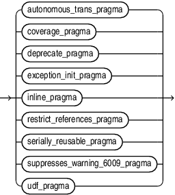

### 3.1 Character Sets

Any character data to be processed by PL/SQL or stored in a database must be represented as a sequence of bytes. The byte representation of a single character is called a character code. A set of character codes is called a character set.

Every Oracle database supports a database character set and a national character set. PL/SQL also supports these character sets. This document explains how PL/SQL uses the database character set and national character set.

Topics

#### 3.1.1 Database Character Set

PL/SQL uses the database character set to represent:

- Stored source text of PL/SQL units
	For information about PL/SQL units, see " [PL/SQL Units and Compilation Parameters](overview.md) ".
- Character values of data types `CHAR`, `VARCHAR2`, `CLOB`, and `LONG`
	For information about these data types, see " [SQL Data Types](plsql-data-types.md) ".

The database character set can be either single-byte, mapping each supported character to one particular byte, or multibyte-varying-width, mapping each supported character to a sequence of one, two, three, or four bytes. The maximum number of bytes in a character code depends on the particular character set.

Every database character set includes these basic characters:

- Latin letters: A through Z and a through z
- Decimal digits: 0 through 9
- Punctuation characters in Table 3-1
- Whitespace characters: space, tab, new line, and carriage return

PL/SQL source text that uses only the basic characters can be stored and compiled in any database. PL/SQL source text that uses nonbasic characters can be stored and compiled only in databases whose database character sets support those nonbasic characters.

Table 3-1 Punctuation Characters in Every Database Character Set

| Symbol | Name |
| --- | --- |
| `(` | Left parenthesis |
| `)` | Right parenthesis |
| `<` | Left angle bracket |
| `>` | Right angle bracket |
| `+` | Plus sign |
| `-` | Hyphen or minus sign |
| `*` | Asterisk |
| `/` | Slash |
| `=` | Equal sign |
| `,` | Comma |
| `;` | Semicolon |
| `:` | Colon |
| `.` | Period |
| `!` | Exclamation point |
| `?` | Question mark |
| `'` | Apostrophe or single quotation mark |
| " | Quotation mark or double quotation mark |
| `@` | At sign |
| `%` | Percent sign |
| `#` | Number sign |
| `$` | Dollar sign |
| `_` | Underscore |
| `\|` | Vertical bar |

See Also:

[Oracle Database Globalization Support Guide](https://docs.oracle.com/pls/topic/lookup?ctx=en/database/oracle/oracle-database/21/lnpls&id=NLSPG171) for more information about the database character set

#### 3.1.2 National Character Set

PL/SQL uses the national character set to represent character values of data types `NCHAR`, `NVARCHAR2` and `NCLOB`.

See Also:

- " [SQL Data Types](plsql-data-types.md) " for information about these data types
- [Oracle Database Globalization Support Guide](https://docs.oracle.com/pls/topic/lookup?ctx=en/database/oracle/oracle-database/21/lnpls&id=NLSPG180) for more information about the national character set

#### 3.1.3 About Data-Bound Collation

Collation (also called sort ordering) is a set of rules that determines if a character string equals, precedes, or follows another string when the two strings are compared and sorted.

Different collations correspond to rules of different spoken languages. Collation-sensitive operations are operations that compare text and need a collation to control the comparison rules. The equality operator and the built-in function `INSTR` are examples of collation-sensitive operations.

Starting with Oracle Database 12c release 2 (12.2), a new architecture provides control of the collation to be applied to operations on character data. In the new architecture, collation becomes an attribute of character data, analogous to a data type. You can now declare collation for a column and this collation is automatically applied by all collation-sensitive SQL operations referencing the column. The data-bound collation feature uses syntax and semantics compatible with the ISO/IEC SQL standard.

The PL/SQL language has limited support for the data-bound collation architecture. All data processed in PL/SQL expressions is assumed to have the compatibility collation `USING_NLS_COMP`. This pseudo-collation instructs collation-sensitive operators to behave in the same way as in previous Oracle Database releases. That is, the values of the session parameters `NLS_COMP` and `NLS_SORT` determine the collation to use. However, all SQL statements embedded or constructed dynamically in PL/SQL fully support the new architecture.

A new property called default collation has been added to tables, views, materialized views, packages, stored procedures, stored functions, triggers, and types. The default collation of a unit determines the collation for data containers, such as columns, variables, parameters, literals, and return values, that do not have their own explicit collation declaration in that unit. The default collation for packages, stored procedures, stored functions, triggers, and types must be `USING_NLS_COMP`.

For syntax and semantics, see the [DEFAULT COLLATION Clause](DEFAULT-COLLATION-clause.md).

To facilitate the creation of PL/SQL units in a schema that has a schema default collation other than `USING_NLS_COMP`, the syntax and semantics for the following statements enable an explicit declaration of the object's default collation to be ` USING_NLS_COMP`:
- [CREATE FUNCTION Statement](CREATE-FUNCTION-statement.md)
- [CREATE PACKAGE Statement](CREATE-PACKAGE-statement.md)
- [CREATE PROCEDURE Statement](CREATE-PROCEDURE-statement.md)
- [CREATE TRIGGER Statement](CREATE-TRIGGER-statement.md)
- [CREATE TYPE Statement](CREATE-TYPE-statement.md)

See Also:

- [Oracle Database Globalization Support Guide](https://docs.oracle.com/pls/topic/lookup?ctx=en/database/oracle/oracle-database/21/lnpls&id=NLSPG-GUID-D67BA73B-805F-429D-BA08-BC7DBF524F64) for more information about specifying data-bound collation for PL/SQL units
- [Oracle Database Globalization Support Guide](https://docs.oracle.com/pls/topic/lookup?ctx=en/database/oracle/oracle-database/21/lnpls&id=NLSPG-GUID-F1F6A1EC-7ABF-45DF-9901-40576313A2EF) for more information about effective schema default collation

### 3.2 Lexical Units

#### 3.2.1 Delimiters

A delimiter is a character, or character combination, that has a special meaning in PL/SQL.

Do not embed any others characters (including whitespace characters) inside a delimiter.

Table 3-2 summarizes the PL/SQL delimiters.

Table 3-2 PL/SQL Delimiters

| Delimiter | Meaning |
| --- | --- |
| `+` | Addition operator |
| `:=` | Assignment operator |
| `=>` | Association operator |
| `%` | Attribute indicator |
| `'` | Character string delimiter |
| `.` | Component indicator |
| `\|\|` | Concatenation operator |
| `/` | Division operator |
| `**` | Exponentiation operator |
| `(` | Expression or list delimiter (begin) |
| `)` | Expression or list delimiter (end) |
| `:` | Host variable indicator |
| `,` | Item separator |
| `<<` | Label delimiter (begin) |
| `>>` | Label delimiter (end) |
| `/*` | Multiline comment delimiter (begin) |
| `*/` | Multiline comment delimiter (end) |
| `*` | Multiplication operator |
| `"` | Quoted identifier delimiter |
| `..` | Range operator |
| `=` | Relational operator (equal) |
| `<>` | Relational operator (not equal) |
| `!=` | Relational operator (not equal) |
| `~=` | Relational operator (not equal) |
| ` ^=` | Relational operator (not equal) |
| `<` | Relational operator (less than) |
| `>` | Relational operator (greater than) |
| `<=` | Relational operator (less than or equal) |
| `>=` | Relational operator (greater than or equal) |
| `@` | Remote access indicator |
| `--` | Single-line comment indicator |
| `;` | Statement terminator |
| `-` | Subtraction or negation operator |

#### 3.2.2 Identifiers

Identifiers name PL/SQL elements, which include:

- Constants
- Cursors
- Exceptions
- Keywords
- Labels
- Packages
- Reserved words
- Subprograms
- Types
- Variables

Every character in an identifier, alphabetic or not, is significant. For example, the identifiers `lastname` and `last_name` are different.

You must separate adjacent identifiers by one or more whitespace characters or a punctuation character.

Except as explained in " Quoted User-Defined Identifiers ", PL/SQL is case-insensitive for identifiers. For example, the identifiers `lastname`, `LastName`, and `LASTNAME` are the same.

Topics

##### 3.2.2.1 Reserved Words and Keywords

Reserved words and keywords are identifiers that have special meaning in PL/SQL.

You cannot use reserved words as ordinary user-defined identifiers. You can use them as quoted user-defined identifiers, but it is not recommended. For more information, see " Quoted User-Defined Identifiers ".

You can use keywords as ordinary user-defined identifiers, but it is not recommended.

For lists of PL/SQL reserved words and keywords, see [Table D-1](plsql-reserved-words-keywords.md) and [Table D-2](plsql-reserved-words-keywords.md), respectively.

##### 3.2.2.2 Predefined Identifiers

Predefined identifiers are declared in the predefined package `STANDARD`.

An example of a predefined identifier is the exception `INVALID_NUMBER`.

For a list of predefined identifiers, connect to Oracle Database as a user who has the DBA role and use this query:

```
SELECT TYPE_NAME FROM ALL_TYPES WHERE PREDEFINED='YES';
```

You can use predefined identifiers as user-defined identifiers, but it is not recommended. Your local declaration overrides the global declaration (see " Scope and Visibility of Identifiers ").

##### 3.2.2.3 User-Defined Identifiers

A user-defined identifier is:

- Composed of characters from the database character set
- Either ordinary or quoted

Tip:

Make user-defined identifiers meaningful. For example, the meaning of `cost_per_thousand` is obvious, but the meaning of `cpt` is not.

Tip:

Avoid using the same user-defined identifier for both a schema and a schema object. This decreases code readability and maintainability and can lead to coding mistakes. Note that local objects have name resolution precedence over schema qualification.

For more information about database object naming rules, see [Oracle Database SQL Language Reference](https://docs.oracle.com/pls/topic/lookup?ctx=en/database/oracle/oracle-database/21/lnpls&id=SQLRF-GUID-3C59E44A-5140-4BCA-B9E1-3039C8050C49).

For more information about PL/SQL-specific name resolution rules, see " [Differences Between PL/SQL and SQL Name Resolution Rules](plsql-name-resolution.md) ".

###### 3.2.2.3.1 Ordinary User-Defined Identifiers

An ordinary user-defined identifier:

- Begins with a letter
- Can include letters, digits, and these symbols:
	- Dollar sign ($)
		- Number sign (#)
		- Underscore (\_)
- Is not a reserved word (listed in [Table D-1](plsql-reserved-words-keywords.md)).

The database character set defines which characters are classified as letters and digits. If COMPATIBLE is set to a value of 12.2 or higher, the representation of the identifier in the database character set cannot exceed 128 bytes. If COMPATIBLE is set to a value of 12.1 or lower, the limit is 30 bytes.

Examples of acceptable ordinary user-defined identifiers:

```
X
t2
phone#
credit_limit
LastName
oracle$number
money$$$tree
SN##
try_again_
```

Examples of unacceptable ordinary user-defined identifiers:

```
mine&yours
debit-amount
on/off
user id
```

###### 3.2.2.3.2 Quoted User-Defined Identifiers

A quoted user-defined identifier is enclosed in double quotation marks.

Between the double quotation marks, any characters from the database character set are allowed except double quotation marks, new line characters, and null characters. For example, these identifiers are acceptable:

```
"X+Y"
"last name"
"on/off switch"
"employee(s)"
"*** header info ***"
```

If COMPATIBLE is set to a value of 12.2 or higher, the representation of the quoted identifier in the database character set cannot exceed 128 bytes (excluding the double quotation marks). If COMPATIBLE is set to a value of 12.1 or lower, the limit is 30 bytes.

A quoted user-defined identifier is case-sensitive, with one exception: If a quoted user-defined identifier, without its enclosing double quotation marks, is a valid ordinary user-defined identifier, then the double quotation marks are optional in references to the identifier, and if you omit them, then the identifier is case-insensitive.

It is not recommended, but you can use a reserved word as a quoted user-defined identifier. Because a reserved word is not a valid ordinary user-defined identifier, you must always enclose the identifier in double quotation marks, and it is always case-sensitive.

Example 3-1 Valid Case-Insensitive Reference to Quoted User-Defined Identifier

In this example, the quoted user-defined identifier `"HELLO"`, without its enclosing double quotation marks, is a valid ordinary user-defined identifier. Therefore, the reference `Hello` is valid.

```
DECLARE
  "HELLO" varchar2(10) := 'hello';
BEGIN
  DBMS_Output.Put_Line(Hello);
END;
/
```

Result:

```
hello
```

Example 3-2 Invalid Case-Insensitive Reference to Quoted User-Defined Identifier

In this example, the reference `"Hello"` is invalid, because the double quotation marks make the identifier case-sensitive.

```
DECLARE
  "HELLO" varchar2(10) := 'hello';
BEGIN
  DBMS_Output.Put_Line("Hello");
END;
/
```

Result:

```
DBMS_Output.Put_Line("Hello");
                        *
ERROR at line 4:
ORA-06550: line 4, column 25:
PLS-00201: identifier 'Hello' must be declared
ORA-06550: line 4, column 3:
PL/SQL: Statement ignored
```

Example 3-3 Reserved Word as Quoted User-Defined Identifier

This example declares quoted user-defined identifiers `"BEGIN"`, `"Begin"`, and `"begin"`. Although `BEGIN`, `Begin`, and `begin` represent the same reserved word, `"BEGIN"`, `"Begin"`, and `"begin"` represent different identifiers.

```
DECLARE
  "BEGIN" varchar2(15) := 'UPPERCASE';
  "Begin" varchar2(15) := 'Initial Capital';
  "begin" varchar2(15) := 'lowercase';
BEGIN
  DBMS_Output.Put_Line("BEGIN");
  DBMS_Output.Put_Line("Begin");
  DBMS_Output.Put_Line("begin");
END;
/
```

Result:

```
UPPERCASE
Initial Capital
lowercase
 
PL/SQL procedure successfully completed.
```

Example 3-4 Neglecting Double Quotation Marks

This example references a quoted user-defined identifier that is a reserved word, neglecting to enclose it in double quotation marks.

```
DECLARE
  "HELLO" varchar2(10) := 'hello';  -- HELLO is not a reserved word
  "BEGIN" varchar2(10) := 'begin';  -- BEGIN is a reserved word
BEGIN
  DBMS_Output.Put_Line(Hello);      -- Double quotation marks are optional
  DBMS_Output.Put_Line(BEGIN);      -- Double quotation marks are required
end;
/
```

Result:

```
DBMS_Output.Put_Line(BEGIN);      -- Double quotation marks are required
                       *
ERROR at line 6:
ORA-06550: line 6, column 24:
PLS-00103: Encountered the symbol "BEGIN" when expecting one of the following:
( ) - + case mod new not null <an identifier>
<a double-quoted delimited-identifier> <a bind variable>
table continue avg count current exists max min prior sql
stddev sum variance execute multiset the both leading
trailing forall merge year month day hour minute second
timezone_hour timezone_minute timezone_region timezone_abbr
time timestamp interval date
<a string literal with character set specificat
```

Example 3-5 Neglecting Case-Sensitivity

This example references a quoted user-defined identifier that is a reserved word, neglecting its case-sensitivity.

```
DECLARE
  "HELLO" varchar2(10) := 'hello';  -- HELLO is not a reserved word
  "BEGIN" varchar2(10) := 'begin';  -- BEGIN is a reserved word
BEGIN
  DBMS_Output.Put_Line(Hello);      -- Identifier is case-insensitive
  DBMS_Output.Put_Line("Begin");    -- Identifier is case-sensitive
END;
/
```

Result:

```
DBMS_Output.Put_Line("Begin");    -- Identifier is case-sensitive
                        *
ERROR at line 6:
ORA-06550: line 6, column 25:
PLS-00201: identifier 'Begin' must be declared
ORA-06550: line 6, column 3:
PL/SQL: Statement ignored
```

#### 3.2.3 Literals

A literal is a value that is neither represented by an identifier nor calculated from other values.

For example, `123` is an integer literal and `'abc'` is a character literal, but `1+2` is not a literal.

PL/SQL literals include all SQL literals (described in [Oracle Database SQL Language Reference](https://docs.oracle.com/pls/topic/lookup?ctx=en/database/oracle/oracle-database/21/lnpls&id=SQLRF00217)) and `BOOLEAN` literals (which SQL does not have). A `BOOLEAN` literal is the predefined logical value `TRUE`, `FALSE`, or `NULL`. `NULL` represents an unknown value.

Note:

Like Oracle Database SQL Language Reference, this document uses the terms character literal and string interchangeably.

When using character literals in PL/SQL, remember:

- Character literals are case-sensitive.
	For example, `'Z'` and `'z'` are different.
- Whitespace characters are significant.
	For example, these literals are different:
	```
	'abc'
	' abc'
	'abc '
	' abc '
	'a b c'
	```
- PL/SQL has no line-continuation character that means "this string continues on the next source line." If you continue a string on the next source line, then the string includes a line-break character.
	For example, this PL/SQL code:
	```
	BEGIN
	  DBMS_OUTPUT.PUT_LINE('This string breaks
	here.');
	END;
	/
	```
	Prints this:
	```
	This string breaks
	here.
	```
	If your string does not fit on a source line and you do not want it to include a line-break character, then construct the string with the concatenation operator (`||`).
	For example, this PL/SQL code:
	```
	BEGIN
	  DBMS_OUTPUT.PUT_LINE('This string ' ||
	                       'contains no line-break character.');
	END;
	/
	```
	Prints this:
	```
	This string contains no line-break character.
	```
	For more information about the concatenation operator, see " Concatenation Operator ".
- `'0'` through `'9'` are not equivalent to the integer literals 0 through 9.
	However, because PL/SQL converts them to integers, you can use them in arithmetic expressions.
- A character literal with zero characters has the value `NULL` and is called a null string.
	However, this `NULL` value is not the `BOOLEAN` value `NULL`.
- An ordinary character literal is composed of characters in the database character set.
	For information about the database character set, see [Oracle Database Globalization Support Guide](https://docs.oracle.com/pls/topic/lookup?ctx=en/database/oracle/oracle-database/21/lnpls&id=NLSPG171).
- A national character literal is composed of characters in the national character set.
	For information about the national character set, see [Oracle Database Globalization Support Guide](https://docs.oracle.com/pls/topic/lookup?ctx=en/database/oracle/oracle-database/21/lnpls&id=NLSPG180).
- You can use `Q` or `q` as part of the character literal syntax to indicate that an alternative quoting mechanism will be used. This mechanism allows a wide range of delimiters for a string as opposed to simply single quotation marks.
	For more information about the alternative quoting mechanism, see [Oracle Database SQL Language Reference](https://docs.oracle.com/pls/topic/lookup?ctx=en/database/oracle/oracle-database/21/lnpls&id=SQLRF-GUID-1824CBAA-6E16-4921-B2A6-112FB02248DA).
	Live SQL:
	You can view and run examples of the `Q` mechanism at [Alternative Quoting Mechanism (''Q'') for String Literals](https://livesql.oracle.com/apex/livesql/file/content_CIREYU9EA54EOKQ7LAMZKRF6P.html)

#### 3.2.4 Pragmas

A pragma is an instruction to the compiler that it processes at compile time.

A pragma begins with the reserved word `PRAGMA` followed by the name of the pragma. Some pragmas have arguments. A pragma may appear before a declaration or a statement. Additional restrictions may apply for specific pragmas. The extent of a pragma’s effect depends on the pragma. A pragma whose name or argument is not recognized by the compiler has no effect.

pragma::=



> ```
> { autonomous_trans_pragma
> | coverage_pragma
> | deprecate_pragma
> | exception_init_pragma
> | inline_pragma
> | restrict_references_pragma
> | serially_reusable_pragma
> | suppresses_warning_6009_pragma
> | udf_pragma
> }
> ```
>
> [  
> Copyright © 1996, 2024, Oracle and/or its affiliates.](https://docs.oracle.com/en/database/oracle/oracle-database/dcommon/html/cpyr.htm)


For information about pragmas syntax and semantics, see:

- " [AUTONOMOUS\_TRANSACTION Pragma](AUTONOMOUS_TRANSACTION-pragma.md) "
- " [COVERAGE Pragma](COVERAGE-pragma.md) "
- " [DEPRECATE Pragma](DEPRECATE-pragma.md) "
- " [EXCEPTION\_INIT Pragma](EXCEPTION_INIT-pragma.md) "
- " [INLINE Pragma](INLINE-pragma.md) "
- " [RESTRICT\_REFERENCES Pragma](RESTRICT_REFERENCES-pragma.md) "
- " [SERIALLY\_REUSABLE Pragma](SERIALLY_REUSABLE-pragma.md) "
- " [SUPPRESSES\_WARNING\_6009 Pragma](Supresses-warning-pragma-6009.md) "
- " [UDF Pragma](UDF-pragma.md) "

#### 3.2.5 Comments

The PL/SQL compiler ignores comments. Their purpose is to help other application developers understand your source text.

Typically, you use comments to describe the purpose and use of each code segment. You can also disable obsolete or unfinished pieces of code by turning them into comments.

Topics

##### 3.2.5.1 Single-Line Comments

A single-line comment begins with `--` and extends to the end of the line.

Caution:

Do not put a single-line comment in a PL/SQL block to be processed dynamically by an Oracle Precompiler program. The Oracle Precompiler program ignores end-of-line characters, which means that a single-line comment ends when the block ends.

While testing or debugging a program, you can disable a line of code by making it a comment. For example:

```
-- DELETE FROM employees WHERE comm_pct IS NULL
```

Example 3-6 Single-Line Comments

This example has three single-line comments.

```
DECLARE
  howmany     NUMBER;
  num_tables  NUMBER;
BEGIN
  -- Begin processing
  SELECT COUNT(*) INTO howmany
  FROM USER_OBJECTS
  WHERE OBJECT_TYPE = 'TABLE'; -- Check number of tables
  num_tables := howmany;       -- Compute another value
END;
/
```

##### 3.2.5.2 Multiline Comments

A multiline comment begins with `/*`, ends with `*/`, and can span multiple lines.

You can use multiline comment delimiters to "comment out" sections of code. When doing so, be careful not to cause nested multiline comments. One multiline comment cannot contain another multiline comment. However, a multiline comment can contain a single-line comment. For example, this causes a syntax error:

```
/*
  IF 2 + 2 = 4 THEN
    some_condition := TRUE;
  /* We expect this THEN to always be performed */
  END IF;
*/
```

This does not cause a syntax error:

```
/*
  IF 2 + 2 = 4 THEN
    some_condition := TRUE;
  -- We expect this THEN to always be performed
  END IF;
*/
```

Example 3-7 Multiline Comments

This example has two multiline comments. (The SQL function `TO_CHAR` returns the character equivalent of its argument. For more information about `TO_CHAR`, see [Oracle Database SQL Language Reference](https://docs.oracle.com/pls/topic/lookup?ctx=en/database/oracle/oracle-database/21/lnpls&id=SQLRF06128).)

```
DECLARE
  some_condition  BOOLEAN;
  pi              NUMBER := 3.1415926;
  radius          NUMBER := 15;
  area            NUMBER;
BEGIN
  /* Perform some simple tests and assignments */
 
  IF 2 + 2 = 4 THEN
    some_condition := TRUE;
  /* We expect this THEN to always be performed */
  END IF;
 
  /* This line computes the area of a circle using pi,
  which is the ratio between the circumference and diameter.
  After the area is computed, the result is displayed. */
 
  area := pi * radius**2;
  DBMS_OUTPUT.PUT_LINE('The area is: ' || TO_CHAR(area));
END;
/
```

Result:

```
The area is: 706.858335
```

#### 3.2.6 Whitespace Characters Between Lexical Units

You can put whitespace characters between lexical units, which often makes your source text easier to read.

Example 3-8 Whitespace Characters Improving Source Text Readability

```
DECLARE
  x    NUMBER := 10;
  y    NUMBER := 5;
  max  NUMBER;
BEGIN
  IF x>y THEN max:=x;ELSE max:=y;END IF;  -- correct but hard to read
  
  -- Easier to read:
  
  IF x > y THEN
    max:=x;
  ELSE
    max:=y;
  END IF;
END;
/
```

### 3.3 Declarations

A declaration allocates storage space for a value of a specified data type, and names the storage location so that you can reference it.

You must declare objects before you can reference them. Declarations can appear in the declarative part of any block, subprogram, or package.

Topics

- Declaring Variables
- Declaring Constants
- Initial Values of Variables and Constants
- NOT NULL Constraint
- Declaring Items using the %TYPE Attribute

For information about declaring objects other than variables and constants, see the syntax of `declare_section` in " [Block](block.md) ".

#### 3.3.1 NOT NULL Constraint

You can impose the `NOT` `NULL` constraint on a scalar variable or constant (or scalar component of a composite variable or constant).

The `NOT` `NULL` constraint prevents assigning a null value to the item. The item can acquire this constraint either implicitly (from its data type) or explicitly.

A scalar variable declaration that specifies `NOT` `NULL`, either implicitly or explicitly, must assign an initial value to the variable (because the default initial value for a scalar variable is `NULL`).

PL/SQL treats any zero-length string as a `NULL` value. This includes values returned by character functions and `BOOLEAN` expressions.

To test for a `NULL` value, use the " [IS \[NOT\] NULL Operator](https://docs.oracle.com/en/database/oracle/oracle-database/21/lnpls/plsql-language-fundamentals.html#GUID-D02FA4D0-0074-4227-9624-F01E3D219BAB "The IS NULL operator returns the BOOLEAN value TRUE if its operand is NULL or FALSE if it is not NULL. The IS NOT NULL operator does the opposite.") ".

Examples

Example 3-9 Variable Declaration with NOT NULL Constraint

In this example, the variable `acct_id` acquires the `NOT` `NULL` constraint explicitly, and the variables `a`, `b`, and `c` acquire it from their data types.

```
DECLARE
  acct_id INTEGER(4) NOT NULL := 9999;
  a NATURALN                  := 9999;
  b POSITIVEN                 := 9999;
  c SIMPLE_INTEGER            := 9999;
BEGIN
  NULL;
END;
/
```

Example 3-10 Variables Initialized to NULL Values

In this example, all variables are initialized to `NULL`.

```
DECLARE
  null_string  VARCHAR2(80) := TO_CHAR('');
  address      VARCHAR2(80);
  zip_code     VARCHAR2(80) := SUBSTR(address, 25, 0);
  name         VARCHAR2(80);
  valid        BOOLEAN      := (name != '');
BEGIN
  NULL;
END;
/
```

#### 3.3.2 Declaring Variables

A variable declaration always specifies the name and data type of the variable.

For most data types, a variable declaration can also specify an initial value.

The variable name must be a valid user-defined identifier.

The data type can be any PL/SQL data type. The PL/SQL data types include the SQL data types. A data type is either scalar (without internal components) or composite (with internal components).

Example

Example 3-11 Scalar Variable Declarations

This example declares several variables with scalar data types.

```
DECLARE
  part_number       NUMBER(6);     -- SQL data type
  part_name         VARCHAR2(20);  -- SQL data type
  in_stock          BOOLEAN;       -- PL/SQL-only data type
  part_price        NUMBER(6,2);   -- SQL data type
  part_description  VARCHAR2(50);  -- SQL data type
BEGIN
  NULL;
END;
/
```

Related Topics

- " User-Defined Identifiers "
- " [Scalar Variable Declaration](scalar-variable-declaration.md) " for scalar variable declaration syntax
- [PL/SQL Data Types](plsql-data-types.md) for information about scalar data types
- [PL/SQL Collections and Records](plsql-collections-and-records.md), for information about composite data types and variables

#### 3.3.3 Declaring Constants

A constant holds a value that does not change.

The information in " Declaring Variables " also applies to constant declarations, but a constant declaration has two more requirements: the keyword `CONSTANT` and the initial value of the constant. (The initial value of a constant is its permanent value.)

Example 3-12 Constant Declarations

This example declares three constants with scalar data types.

```
DECLARE
  credit_limit     CONSTANT REAL    := 5000.00;  -- SQL data type
  max_days_in_year CONSTANT INTEGER := 366;      -- SQL data type
  urban_legend     CONSTANT BOOLEAN := FALSE;    -- PL/SQL-only data type
BEGIN
  NULL;
END;
/
```

#### 3.3.4 Initial Values of Variables and Constants

In a variable declaration, the initial value is optional unless you specify the `NOT` `NULL` constraint. In a constant declaration, the initial value is required.

If the declaration is in a block or subprogram, the initial value is assigned to the variable or constant every time control passes to the block or subprogram. If the declaration is in a package specification, the initial value is assigned to the variable or constant for each session (whether the variable or constant is public or private).

To specify the initial value, use either the assignment operator (`:=`) or the keyword `DEFAULT`, followed by an expression. The expression can include previously declared constants and previously initialized variables.

If you do not specify an initial value for a variable, assign a value to it before using it in any other context.

Examples

Example 3-13 Variable and Constant Declarations with Initial Values

This example assigns initial values to the constant and variables that it declares. The initial value of `area` depends on the previously declared constant `pi` and the previously initialized variable `radius`.

```
DECLARE
  hours_worked    INTEGER := 40;
  employee_count  INTEGER := 0;

  pi     CONSTANT REAL := 3.14159;
  radius          REAL := 1;
  area            REAL := (pi * radius**2);
BEGIN
  NULL;
END;
/
```

Example 3-14 Variable Initialized to NULL by Default

In this example, the variable `counter` has the initial value `NULL`, by default. The example uses the " [IS \[NOT\] NULL Operator](https://docs.oracle.com/en/database/oracle/oracle-database/21/lnpls/plsql-language-fundamentals.html#GUID-D02FA4D0-0074-4227-9624-F01E3D219BAB "The IS NULL operator returns the BOOLEAN value TRUE if its operand is NULL or FALSE if it is not NULL. The IS NOT NULL operator does the opposite.") " to show that `NULL` is different from zero.

```
DECLARE
  counter INTEGER;  -- initial value is NULL by default
BEGIN
  counter := counter + 1;  -- NULL + 1 is still NULL
  
  IF counter IS NULL THEN
    DBMS_OUTPUT.PUT_LINE('counter is NULL.');
  END IF;
END;
/
```

Result:

```
counter is NULL.
```

#### 3.3.5 Declaring Items using the %TYPE Attribute

The `%TYPE` attribute lets you declare a data item of the same data type as a previously declared variable or column (without knowing what that type is). If the declaration of the referenced item changes, then the declaration of the referencing item changes accordingly.

The syntax of the declaration is:

```
referencing_item referenced_item%TYPE;
```

For the kinds of items that can be referencing and referenced items, see " [%TYPE Attribute](TYPE-attribute.md) ".

The referencing item inherits the following from the referenced item:

- Data type and size
- Constraints (unless the referenced item is a column)

The referencing item does not inherit the initial value of the referenced item. Therefore, if the referencing item specifies or inherits the `NOT` `NULL` constraint, you must specify an initial value for it.

The `%TYPE` attribute is particularly useful when declaring variables to hold database values. The syntax for declaring a variable of the same type as a column is:

```
variable_name table_name.column_name%TYPE;
```

See Also:

" [Declaring Items using the %ROWTYPE Attribute](plsql-collections-and-records.md) ", which lets you declare a record variable that represents either a full or partial row of a database table or view

Examples

Example 3-15 Declaring Variable of Same Type as Column

In this example, the variable `surname` inherits the data type and size of the column `employees`.`last_name`, which has a `NOT` `NULL` constraint. Because `surname` does not inherit the `NOT` `NULL` constraint, its declaration does not need an initial value.

```
DECLARE
  surname  employees.last_name%TYPE;
BEGIN
  DBMS_OUTPUT.PUT_LINE('surname=' || surname);
END;
/
```

Result:

```
surname=
```

Example 3-16 Declaring Variable of Same Type as Another Variable

In this example, the variable `surname` inherits the data type, size, and `NOT` `NULL` constraint of the variable `name`. Because `surname` does not inherit the initial value of `name`, its declaration needs an initial value (which cannot exceed 25 characters).

```
DECLARE
  name     VARCHAR(25) NOT NULL := 'Smith';
  surname  name%TYPE := 'Jones';
BEGIN
  DBMS_OUTPUT.PUT_LINE('name=' || name);
  DBMS_OUTPUT.PUT_LINE('surname=' || surname);
END;
/
```

Result:

```
name=Smith
surname=Jones
```

### 3.4 References to Identifiers

When referencing an identifier, you use a name that is either simple, qualified, remote, or both qualified and remote.

The simple name of an identifier is the name in its declaration. For example:

```
DECLARE
  a INTEGER;  -- Declaration
BEGIN
  a := 1;     -- Reference with simple name
END;
/
```

If an identifier is declared in a named PL/SQL unit, you can (and sometimes must) reference it with its qualified name. The syntax (called dot notation) is:

```
unit_name.simple_identifier_name
```

For example, if package `p` declares identifier `a`, you can reference the identifier with the qualified name `p`.`a`. The unit name also can (and sometimes must) be qualified. You must qualify an identifier when it is not visible (see " Scope and Visibility of Identifiers ").

If the identifier names an object on a remote database, you must reference it with its remote name. The syntax is:

```
simple_identifier_name@link_to_remote_database
```

If the identifier is declared in a PL/SQL unit on a remote database, you must reference it with its qualified remote name. The syntax is:

```
unit_name.simple_identifier_name@link_to_remote_database
```

You can create synonyms for remote schema objects, but you cannot create synonyms for objects declared in PL/SQL subprograms or packages. To create a synonym, use the SQL statement `CREATE` `SYNONYM`, explained in [Oracle Database SQL Language Reference](https://docs.oracle.com/pls/topic/lookup?ctx=en/database/oracle/oracle-database/21/lnpls&id=SQLRF01401).

For information about how PL/SQL resolves ambiguous names, see [PL/SQL Name Resolution](plsql-name-resolution.md).

Note:

You can reference identifiers declared in the packages `STANDARD` and `DBMS_STANDARD` without qualifying them with the package names, unless you have declared a local identifier with the same name (see " Scope and Visibility of Identifiers ").

### 3.5 Scope and Visibility of Identifiers

The scope of an identifier is the region of a PL/SQL unit from which you can reference the identifier. The visibility of an identifier is the region of a PL/SQL unit from which you can reference the identifier without qualifying it. An identifier is local to the PL/SQL unit that declares it. If that unit has subunits, the identifier is global to them.

If a subunit redeclares a global identifier, then inside the subunit, both identifiers are in scope, but only the local identifier is visible. To reference the global identifier, the subunit must qualify it with the name of the unit that declared it. If that unit has no name, then the subunit cannot reference the global identifier.

A PL/SQL unit cannot reference identifiers declared in other units at the same level, because those identifiers are neither local nor global to the block.

You cannot declare the same identifier twice in the same PL/SQL unit. If you do, an error occurs when you reference the duplicate identifier.

You can declare the same identifier in two different units. The two objects represented by the identifier are distinct. Changing one does not affect the other.

In the same scope, give labels and subprograms unique names to avoid confusion and unexpected results.

Examples

Example 3-17 Scope and Visibility of Identifiers

This example shows the scope and visibility of several identifiers. The first sub-block redeclares the global identifier `a`. To reference the global variable `a`, the first sub-block would have to qualify it with the name of the outer block—but the outer block has no name. Therefore, the first sub-block cannot reference the global variable `a`; it can reference only its local variable `a`. Because the sub-blocks are at the same level, the first sub-block cannot reference `d`, and the second sub-block cannot reference `c`.

```
-- Outer block:
DECLARE
  a CHAR;  -- Scope of a (CHAR) begins
  b REAL;    -- Scope of b begins
BEGIN
  -- Visible: a (CHAR), b
  
  -- First sub-block:
  DECLARE
    a INTEGER;  -- Scope of a (INTEGER) begins
    c REAL;       -- Scope of c begins
  BEGIN
    -- Visible: a (INTEGER), b, c
    NULL;
  END;          -- Scopes of a (INTEGER) and c end

  -- Second sub-block:
  DECLARE
    d REAL;     -- Scope of d begins
  BEGIN
    -- Visible: a (CHAR), b, d
    NULL;
  END;          -- Scope of d ends

-- Visible: a (CHAR), b
END;            -- Scopes of a (CHAR) and b end
/
```

Example 3-18 Qualifying Redeclared Global Identifier with Block Label

This example labels the outer block with the name `outer`. Therefore, after the sub-block redeclares the global variable `birthdate`, it can reference that global variable by qualifying its name with the block label. The sub-block can also reference its local variable `birthdate`, by its simple name.

```
<<outer>>  -- label
DECLARE
  birthdate DATE := TO_DATE('09-AUG-70', 'DD-MON-YY');
BEGIN
  DECLARE
    birthdate DATE := TO_DATE('29-SEP-70', 'DD-MON-YY');
  BEGIN
    IF birthdate = outer.birthdate THEN
      DBMS_OUTPUT.PUT_LINE ('Same Birthday');
    ELSE
      DBMS_OUTPUT.PUT_LINE ('Different Birthday');
    END IF;
  END;
END;
/
```

Result:

```
Different Birthday
```

Example 3-19 Qualifying Identifier with Subprogram Name

In this example, the procedure `check_credit` declares a variable, `rating`, and a function, `check_rating`. The function redeclares the variable. Then the function references the global variable by qualifying it with the procedure name.

```
CREATE OR REPLACE PROCEDURE check_credit (credit_limit NUMBER) AS
  rating NUMBER := 3;
  
  FUNCTION check_rating RETURN BOOLEAN IS
    rating  NUMBER := 1;
    over_limit  BOOLEAN;
  BEGIN
    IF check_credit.rating <= credit_limit THEN  -- reference global variable
      over_limit := FALSE;
    ELSE
      over_limit := TRUE;
      rating := credit_limit;                    -- reference local variable
    END IF;
    RETURN over_limit;
  END check_rating;
BEGIN
  IF check_rating THEN
    DBMS_OUTPUT.PUT_LINE
      ('Credit rating over limit (' || TO_CHAR(credit_limit) || ').  '
      || 'Rating: ' || TO_CHAR(rating));
  ELSE
    DBMS_OUTPUT.PUT_LINE
      ('Credit rating OK.  ' || 'Rating: ' || TO_CHAR(rating));
  END IF;
END;
/
 
BEGIN
  check_credit(1);
END;
/
```

Result:

```
Credit rating over limit (1).  Rating: 3
```

Example 3-20 Duplicate Identifiers in Same Scope

You cannot declare the same identifier twice in the same PL/SQL unit. If you do, an error occurs when you reference the duplicate identifier, as this example shows.

```
DECLARE
  id  BOOLEAN;
  id  VARCHAR2(5);  -- duplicate identifier
BEGIN
  id := FALSE;
END;
/
```

Result:

```
id := FALSE;
  *
ERROR at line 5:
ORA-06550: line 5, column 3:
PLS-00371: at most one declaration for 'ID' is permitted
ORA-06550: line 5, column 3:
PL/SQL: Statement ignored
```

Example 3-21 Declaring Same Identifier in Different Units

You can declare the same identifier in two different units. The two objects represented by the identifier are distinct. Changing one does not affect the other, as this example shows. In the same scope, give labels and subprograms unique names to avoid confusion and unexpected results.

```
DECLARE
  PROCEDURE p
  IS
    x VARCHAR2(1);
  BEGIN
    x := 'a';  -- Assign the value 'a' to x
    DBMS_OUTPUT.PUT_LINE('In procedure p, x = ' || x);
  END;
 
  PROCEDURE q
  IS
    x VARCHAR2(1);
  BEGIN
    x := 'b';  -- Assign the value 'b' to x
    DBMS_OUTPUT.PUT_LINE('In procedure q, x = ' || x);
  END;
 
BEGIN
  p;
  q;
END;
/
```

Result:

```
In procedure p, x = a
In procedure q, x = b
```

Example 3-22 Label and Subprogram with Same Name in Same Scope

In this example, `echo` is the name of both a block and a subprogram. Both the block and the subprogram declare a variable named `x`. In the subprogram, `echo`.`x` refers to the local variable `x`, not to the global variable `x`.

```
<<echo>>
DECLARE
  x  NUMBER := 5;
  
  PROCEDURE echo AS
    x  NUMBER := 0;
  BEGIN
    DBMS_OUTPUT.PUT_LINE('x = ' || x);
    DBMS_OUTPUT.PUT_LINE('echo.x = ' || echo.x);
  END;
 
BEGIN
  echo;
END;
/
```

Result:

```
x = 0
echo.x = 0
```

Example 3-23 Block with Multiple and Duplicate Labels

This example has two labels for the outer block, `compute_ratio` and `another_label`. The second label appears again in the inner block. In the inner block, `another_label`.`denominator` refers to the local variable `denominator`, not to the global variable `denominator`, which results in the error `ZERO_DIVIDE`.

```
<<compute_ratio>>
<<another_label>>
DECLARE
  numerator   NUMBER := 22;
  denominator NUMBER := 7;
BEGIN
  <<another_label>>
  DECLARE
    denominator NUMBER := 0;
  BEGIN
    DBMS_OUTPUT.PUT_LINE('Ratio with compute_ratio.denominator = ');
    DBMS_OUTPUT.PUT_LINE(numerator/compute_ratio.denominator);
 
    DBMS_OUTPUT.PUT_LINE('Ratio with another_label.denominator = ');
    DBMS_OUTPUT.PUT_LINE(numerator/another_label.denominator);
 
  EXCEPTION
    WHEN ZERO_DIVIDE THEN
      DBMS_OUTPUT.PUT_LINE('Divide-by-zero error: can''t divide '
        || numerator || ' by ' || denominator);
    WHEN OTHERS THEN
      DBMS_OUTPUT.PUT_LINE('Unexpected error.');
  END another_label;
END compute_ratio;
/
```

Result:

```
Ratio with compute_ratio.denominator =
3.14285714285714285714285714285714285714
Ratio with another_label.denominator =
Divide-by-zero error: cannot divide 22 by 0
```

### 3.6 Assigning Values to Variables

After declaring a variable, you can assign a value to it in these ways:

- Use the assignment statement to assign it the value of an expression.
- Use the `SELECT` `INTO` or `FETCH` statement to assign it a value from a table.
- Pass it to a subprogram as an `OUT` or `IN` `OUT` parameter, and then assign the value inside the subprogram.

The variable and the value must have compatible data types. One data type is compatible with another data type if it can be implicitly converted to that type. For information about implicit data conversion, see [Oracle Database SQL Language Reference](https://docs.oracle.com/pls/topic/lookup?ctx=en/database/oracle/oracle-database/21/lnpls&id=SQLRF51047).

Topics

- Assigning Values to Variables with the Assignment Statement
- Assigning Values to Variables with the SELECT INTO Statement
- Assigning Values to Variables as Parameters of a Subprogram
- Assigning Values to BOOLEAN Variables

See Also:

- " [Assigning Values to Collection Variables](plsql-collections-and-records.md) "
- " [Assigning Values to Record Variables](plsql-collections-and-records.md) "
- " [FETCH Statement](FETCH-statement.md) "

#### 3.6.1 Assigning Values to Variables with the Assignment Statement

To assign the value of an expression to a variable, use this form of the assignment statement:

```
variable_name := expression;
```

For the complete syntax of the assignment statement, see " [Assignment Statement](assignment-statement.md) ".

For the syntax of an expression, see " [Expression](expression.md) ".

Example 3-24 Assigning Values to Variables with Assignment Statement

This example declares several variables (specifying initial values for some) and then uses assignment statements to assign the values of expressions to them.

```
DECLARE  -- You can assign initial values here
  wages          NUMBER;
  hours_worked   NUMBER := 40;
  hourly_salary  NUMBER := 22.50;
  bonus          NUMBER := 150;
  country        VARCHAR2(128);
  counter        NUMBER := 0;
  done           BOOLEAN;
  valid_id       BOOLEAN;
  emp_rec1       employees%ROWTYPE;
  emp_rec2       employees%ROWTYPE;
  TYPE commissions IS TABLE OF NUMBER INDEX BY PLS_INTEGER;
  comm_tab       commissions;
 
BEGIN  -- You can assign values here too
  wages := (hours_worked * hourly_salary) + bonus;
  country := 'France';
  country := UPPER('Canada');
  done := (counter > 100);
  valid_id := TRUE;
  emp_rec1.first_name := 'Antonio';
  emp_rec1.last_name := 'Ortiz';
  emp_rec1 := emp_rec2;
  comm_tab(5) := 20000 * 0.15;
END;
/
```

#### 3.6.2 Assigning Values to Variables with the SELECT INTO Statement

A simple form of the `SELECT` `INTO` statement is:

```
SELECT select_item [, select_item ]... 
INTO variable_name [, variable_name ]...
FROM table_name;
```

For each `select_item`, there must be a corresponding, type-compatible `variable_name`. Because SQL does not have a `BOOLEAN` type, `variable_name` cannot be a `BOOLEAN` variable.

For the complete syntax of the `SELECT` `INTO` statement, see " [SELECT INTO Statement](SELECT-INTO-statement.md) ".

Example 3-25 Assigning Value to Variable with SELECT INTO Statement

This example uses a `SELECT` `INTO` statement to assign to the variable `bonus` the value that is 10% of the salary of the employee whose `employee_id` is 100.

```
DECLARE
  bonus   NUMBER(8,2);
BEGIN
  SELECT salary * 0.10 INTO bonus
  FROM employees
  WHERE employee_id = 100;
END;

DBMS_OUTPUT.PUT_LINE('bonus = ' || TO_CHAR(bonus));
/
```

Result:

```
bonus = 2400
```

#### 3.6.3 Assigning Values to Variables as Parameters of a Subprogram

If you pass a variable to a subprogram as an `OUT` or `IN` `OUT` parameter, and the subprogram assigns a value to the parameter, the variable retains that value after the subprogram finishes running. For more information, see " [Subprogram Parameters](plsql-subprograms.md) ".

Example 3-26 Assigning Value to Variable as IN OUT Subprogram Parameter

This example passes the variable `new_sal` to the procedure `adjust_salary`. The procedure assigns a value to the corresponding formal parameter, `sal`. Because `sal` is an `IN` `OUT` parameter, the variable `new_sal` retains the assigned value after the procedure finishes running.

```
DECLARE
  emp_salary  NUMBER(8,2);
 
  PROCEDURE adjust_salary (
    emp        NUMBER, 
    sal IN OUT NUMBER,
    adjustment NUMBER
  ) IS
  BEGIN
    sal := sal + adjustment;
  END;
 
BEGIN
  SELECT salary INTO emp_salary
  FROM employees
  WHERE employee_id = 100;
 
  DBMS_OUTPUT.PUT_LINE
   ('Before invoking procedure, emp_salary: ' || emp_salary);
 
  adjust_salary (100, emp_salary, 1000);
 
  DBMS_OUTPUT.PUT_LINE
   ('After invoking procedure, emp_salary: ' || emp_salary);
END;
/
```

Result:

```
Before invoking procedure, emp_salary: 24000
After invoking procedure, emp_salary: 25000
```

#### 3.6.4 Assigning Values to BOOLEAN Variables

The only values that you can assign to a `BOOLEAN` variable are `TRUE`, `FALSE`, and `NULL`.

For more information about the `BOOLEAN` data type, see " [BOOLEAN Data Type](plsql-data-types.md) ".

Example 3-27 Assigning Value to BOOLEAN Variable

This example initializes the `BOOLEAN` variable `done` to `NULL` by default, assigns it the literal value `FALSE`, compares it to the literal value `TRUE`, and assigns it the value of a `BOOLEAN` expression.

```
DECLARE
  done    BOOLEAN;              -- Initial value is NULL by default
  counter NUMBER := 0;
BEGIN
  done := FALSE;                -- Assign literal value
  WHILE done != TRUE            -- Compare to literal value
    LOOP
      counter := counter + 1;
      done := (counter > 500);  -- Assign value of BOOLEAN expression
    END LOOP;
END;
/
```

### 3.7 Expressions

An expression is a combination of one or more values, operators, and SQL functions that evaluates to a value.

An expression always returns a single value. The simplest expressions, in order of increasing complexity, are:

1. A single constant or variable (for example, `a`)
2. A unary operator and its single operand (for example, `-a`)
3. A binary operator and its two operands (for example, `a+b`)

An operand can be a variable, constant, literal, operator, function invocation, or placeholder—or another expression. Therefore, expressions can be arbitrarily complex. For expression syntax, see [Expression](expression.md).

The data types of the operands determine the data type of the expression. Every time the expression is evaluated, a single value of that data type results. The data type of that result is the data type of the expression.

#### 3.7.1 Concatenation Operator

The concatenation operator (`||`) appends one string operand to another.

The concatenation operator ignores null operands.

For more information about the syntax of the concatenation operator, see " [character\_expression::=](expression.md) ".

Example 3-28 Concatenation Operator

```
DECLARE
  x VARCHAR2(4) := 'suit';
  y VARCHAR2(4) := 'case';
BEGIN
  DBMS_OUTPUT.PUT_LINE (x || y);
END;
/
```

Result:

```
suitcase
```

Example 3-29 Concatenation Operator with NULL Operands

The concatenation operator ignores null operands, as this example shows.

```
BEGIN
  DBMS_OUTPUT.PUT_LINE ('apple' || NULL || NULL || 'sauce');
END;
/
```

Result:

```
applesauce
```

#### 3.7.2 Operator Precedence

An operation is either a unary operator and its single operand or a binary operator and its two operands. The operations in an expression are evaluated in order of operator precedence.

Table 3-3 shows operator precedence from highest to lowest. Operators with equal precedence are evaluated in no particular order.

Table 3-3 Operator Precedence

| Operator | Operation |
| --- | --- |
| `**` | exponentiation |
| `+`, `-` | identity, negation |
| `*`, `/` | multiplication, division |
| `+`, `-`, `\|\|` | addition, subtraction, concatenation |
| `=`, `<`, `>`, `<=`, `>=`, `<>`, `!=`, `~=`, ` ^=`, `IS` `NULL`, `LIKE`, `BETWEEN`, `IN` | comparison |
| `NOT` | negation |
| `AND` | conjunction |
| `OR` | inclusion |

To control the order of evaluation, enclose operations in parentheses, as in Example 3-30.

When parentheses are nested, the most deeply nested operations are evaluated first.

You can also use parentheses to improve readability where the parentheses do not affect evaluation order.

Example 3-30 Controlling Evaluation Order with Parentheses

```
DECLARE
  a INTEGER := 1+2**2;
  b INTEGER := (1+2)**2;
BEGIN
  DBMS_OUTPUT.PUT_LINE('a = ' || TO_CHAR(a));
  DBMS_OUTPUT.PUT_LINE('b = ' || TO_CHAR(b));
END;
/
```

Result:

```
a = 5
b = 9
```

Example 3-31 Expression with Nested Parentheses

In this example, the operations (1+2) and (3+4) are evaluated first, producing the values 3 and 7, respectively. Next, the operation 3\*7 is evaluated, producing the result 21. Finally, the operation 21/7 is evaluated, producing the final value 3.

```
DECLARE
  a INTEGER := ((1+2)*(3+4))/7;
BEGIN
  DBMS_OUTPUT.PUT_LINE('a = ' || TO_CHAR(a));
END;
/
```

Result:

```
a = 3
```

Example 3-32 Improving Readability with Parentheses

In this example, the parentheses do not affect the evaluation order. They only improve readability.

```
DECLARE
  a INTEGER := 2**2*3**2;
  b INTEGER := (2**2)*(3**2);
BEGIN
  DBMS_OUTPUT.PUT_LINE('a = ' || TO_CHAR(a));
  DBMS_OUTPUT.PUT_LINE('b = ' || TO_CHAR(b));
END;
/
```

Result:

```
a = 36
b = 36
```

Example 3-33 Operator Precedence

This example shows the effect of operator precedence and parentheses in several more complex expressions.

```
DECLARE
  salary      NUMBER := 60000;
  commission  NUMBER := 0.10;
BEGIN
  -- Division has higher precedence than addition:
  
  DBMS_OUTPUT.PUT_LINE('5 + 12 / 4 = ' || TO_CHAR(5 + 12 / 4));
  DBMS_OUTPUT.PUT_LINE('12 / 4 + 5 = ' || TO_CHAR(12 / 4 + 5));
  
 -- Parentheses override default operator precedence:
 
  DBMS_OUTPUT.PUT_LINE('8 + 6 / 2 = ' || TO_CHAR(8 + 6 / 2));
  DBMS_OUTPUT.PUT_LINE('(8 + 6) / 2 = ' || TO_CHAR((8 + 6) / 2));
 
  -- Most deeply nested operation is evaluated first:
 
  DBMS_OUTPUT.PUT_LINE('100 + (20 / 5 + (7 - 3)) = '
                      || TO_CHAR(100 + (20 / 5 + (7 - 3))));
 
  -- Parentheses, even when unnecessary, improve readability:
 
  DBMS_OUTPUT.PUT_LINE('(salary * 0.05) + (commission * 0.25) = '
    || TO_CHAR((salary * 0.05) + (commission * 0.25))
  );
 
  DBMS_OUTPUT.PUT_LINE('salary * 0.05 + commission * 0.25 = '
    || TO_CHAR(salary * 0.05 + commission * 0.25)
  );
END;
/
```

Result:

```
5 + 12 / 4 = 8
12 / 4 + 5 = 8
8 + 6 / 2 = 11
(8 + 6) / 2 = 7
100 + (20 / 5 + (7 - 3)) = 108
(salary * 0.05) + (commission * 0.25) = 3000.025
salary * 0.05 + commission * 0.25 = 3000.025
```

#### 3.7.3 Logical Operators

The logical operators `AND`, `OR`, and `NOT` follow a tri-state logic.

`AND` and `OR` are binary operators; `NOT` is a unary operator.

Table 3-4 Logical Truth Table

| x | y | x AND y | x OR y | NOT x |
| --- | --- | --- | --- | --- |
| `TRUE` | `TRUE` | `TRUE` | `TRUE` | `FALSE` |
| `TRUE` | `FALSE` | `FALSE` | `TRUE` | `FALSE` |
| `TRUE` | `NULL` | `NULL` | `TRUE` | `FALSE` |
| `FALSE` | `TRUE` | `FALSE` | `TRUE` | `TRUE` |
| `FALSE` | `FALSE` | `FALSE` | `FALSE` | `TRUE` |
| `FALSE` | `NULL` | `FALSE` | `NULL` | `TRUE` |
| `NULL` | `TRUE` | `NULL` | `TRUE` | `NULL` |
| `NULL` | `FALSE` | `FALSE` | `NULL` | `NULL` |
| `NULL` | `NULL` | `NULL` | `NULL` | `NULL` |

`AND` returns `TRUE` if and only if both operands are `TRUE`.

`OR` returns `TRUE` if either operand is `TRUE`.

`NOT` returns the opposite of its operand, unless the operand is `NULL`. `NOT` `NULL` returns `NULL`, because `NULL` is an indeterminate value.

Example 3-34 Procedure Prints BOOLEAN Variable

This example creates a procedure, `print_boolean`, that prints the value of a `BOOLEAN` variable. The procedure uses the " [IS \[NOT\] NULL Operator](https://docs.oracle.com/en/database/oracle/oracle-database/21/lnpls/plsql-language-fundamentals.html#GUID-D02FA4D0-0074-4227-9624-F01E3D219BAB "The IS NULL operator returns the BOOLEAN value TRUE if its operand is NULL or FALSE if it is not NULL. The IS NOT NULL operator does the opposite.") ". Several examples in this chapter invoke `print_boolean`.

```
CREATE OR REPLACE PROCEDURE print_boolean (
  b_name   VARCHAR2,
  b_value  BOOLEAN
) AUTHID DEFINER IS
BEGIN
  IF b_value IS NULL THEN
    DBMS_OUTPUT.PUT_LINE (b_name || ' = NULL');
  ELSIF b_value = TRUE THEN
    DBMS_OUTPUT.PUT_LINE (b_name || ' = TRUE');
  ELSE
    DBMS_OUTPUT.PUT_LINE (b_name || ' = FALSE');
  END IF;
END;
/
```

Example 3-35 AND Operator

As Table 3-4 and this example show, `AND` returns `TRUE` if and only if both operands are `TRUE`.

```
DECLARE
  PROCEDURE print_x_and_y (
    x  BOOLEAN,
    y  BOOLEAN
  ) IS
  BEGIN
   print_boolean ('x', x);
   print_boolean ('y', y);
   print_boolean ('x AND y', x AND y);
 END print_x_and_y;
 
BEGIN
 print_x_and_y (FALSE, FALSE);
 print_x_and_y (TRUE, FALSE);
 print_x_and_y (FALSE, TRUE);
 print_x_and_y (TRUE, TRUE);
 
 print_x_and_y (TRUE, NULL);
 print_x_and_y (FALSE, NULL);
 print_x_and_y (NULL, TRUE);
 print_x_and_y (NULL, FALSE);
END;
/
```

Result:

```
x = FALSE
y = FALSE
x AND y = FALSE
x = TRUE
y = FALSE
x AND y = FALSE
x = FALSE
y = TRUE
x AND y = FALSE
x = TRUE
y = TRUE
x AND y = TRUE
x = TRUE
y = NULL
x AND y = NULL
x = FALSE
y = NULL
x AND y = FALSE
x = NULL
y = TRUE
x AND y = NULL
x = NULL
y = FALSE
x AND y = FALSE
```

Example 3-36 OR Operator

As Table 3-4 and this example show, `OR` returns `TRUE` if either operand is `TRUE`. (This example invokes the `print_boolean` procedure from Example 3-34.)

```
DECLARE
  PROCEDURE print_x_or_y (
    x  BOOLEAN,
    y  BOOLEAN
  ) IS
  BEGIN
    print_boolean ('x', x);
    print_boolean ('y', y);
    print_boolean ('x OR y', x OR y);
  END print_x_or_y;
 
BEGIN
  print_x_or_y (FALSE, FALSE);
  print_x_or_y (TRUE, FALSE);
  print_x_or_y (FALSE, TRUE);
  print_x_or_y (TRUE, TRUE);
 
  print_x_or_y (TRUE, NULL);
  print_x_or_y (FALSE, NULL);
  print_x_or_y (NULL, TRUE);
  print_x_or_y (NULL, FALSE);
END;
/
```

Result:

```
x = FALSE
y = FALSE
x OR y = FALSE
x = TRUE
y = FALSE
x OR y = TRUE
x = FALSE
y = TRUE
x OR y = TRUE
x = TRUE
y = TRUE
x OR y = TRUE
x = TRUE
y = NULL
x OR y = TRUE
x = FALSE
y = NULL
x OR y = NULL
x = NULL
y = TRUE
x OR y = TRUE
x = NULL
y = FALSE
x OR y = NULL
```

Example 3-37 NOT Operator

As Table 3-4 and this example show, `NOT` returns the opposite of its operand, unless the operand is `NULL`. `NOT` `NULL` returns `NULL`, because `NULL` is an indeterminate value. (This example invokes the `print_boolean` procedure from Example 3-34.)

```
DECLARE
  PROCEDURE print_not_x (
    x  BOOLEAN
  ) IS
  BEGIN
    print_boolean ('x', x);
    print_boolean ('NOT x', NOT x);
  END print_not_x;
 
BEGIN
  print_not_x (TRUE);
  print_not_x (FALSE);
  print_not_x (NULL);
END;
/
```

Result:

```
x = TRUE
NOT x = FALSE
x = FALSE
NOT x = TRUE
x = NULL
NOT x = NULL
```

Example 3-38 NULL Value in Unequal Comparison

In this example, you might expect the sequence of statements to run because `x` and `y` seem unequal. But, `NULL` values are indeterminate. Whether `x` equals `y` is unknown. Therefore, the `IF` condition yields `NULL` and the sequence of statements is bypassed.

```
DECLARE
  x NUMBER := 5;
  y NUMBER := NULL;
BEGIN
  IF x != y THEN  -- yields NULL, not TRUE
    DBMS_OUTPUT.PUT_LINE('x != y');  -- not run
  ELSIF x = y THEN -- also yields NULL
    DBMS_OUTPUT.PUT_LINE('x = y');
  ELSE
    DBMS_OUTPUT.PUT_LINE
      ('Can''t tell if x and y are equal or not.');
  END IF;
END;
/
```

Result:

```
Can't tell if x and y are equal or not.
```

Example 3-39 NULL Value in Equal Comparison

In this example, you might expect the sequence of statements to run because `a` and `b` seem equal. But, again, that is unknown, so the `IF` condition yields `NULL` and the sequence of statements is bypassed.

```
DECLARE
  a NUMBER := NULL;
  b NUMBER := NULL;
BEGIN
  IF a = b THEN  -- yields NULL, not TRUE
    DBMS_OUTPUT.PUT_LINE('a = b');  -- not run
  ELSIF a != b THEN  -- yields NULL, not TRUE
    DBMS_OUTPUT.PUT_LINE('a != b');  -- not run
  ELSE
    DBMS_OUTPUT.PUT_LINE('Can''t tell if two NULLs are equal');
  END IF;
END;
/
```

Result:

```
Can't tell if two NULLs are equal
```

Example 3-40 NOT NULL Equals NULL

In this example, the two `IF` statements appear to be equivalent. However, if either `x` or `y` is `NULL`, then the first `IF` statement assigns the value of `y` to `high` and the second `IF` statement assigns the value of `x` to `high`.

```
DECLARE
  x    INTEGER := 2;
  Y    INTEGER := 5;
  high INTEGER;
BEGIN
  IF (x > y)       -- If x or y is NULL, then (x > y) is NULL
    THEN high := x;  -- run if (x > y) is TRUE
    ELSE high := y;  -- run if (x > y) is FALSE or NULL
  END IF;
  
  IF NOT (x > y)   -- If x or y is NULL, then NOT (x > y) is NULL
    THEN high := y;  -- run if NOT (x > y) is TRUE
    ELSE high := x;  -- run if NOT (x > y) is FALSE or NULL
  END IF;
END;
/
```

Example 3-41 Changing Evaluation Order of Logical Operators

This example invokes the `print_boolean` procedure from Example 3-34 three times. The third and first invocation are logically equivalent—the parentheses in the third invocation only improve readability. The parentheses in the second invocation change the order of operation.

```
DECLARE
  x  BOOLEAN := FALSE;
  y  BOOLEAN := FALSE;
  
BEGIN
  print_boolean ('NOT x AND y', NOT x AND y);
  print_boolean ('NOT (x AND y)', NOT (x AND y));
  print_boolean ('(NOT x) AND y', (NOT x) AND y);
END;
/
```

Result:

```
NOT x AND y = FALSE
NOT (x AND y) = TRUE
(NOT x) AND y = FALSE
```

#### 3.7.4 Short-Circuit Evaluation

When evaluating a logical expression, PL/SQL uses short-circuit evaluation. That is, PL/SQL stops evaluating the expression as soon as it can determine the result.

Therefore, you can write expressions that might otherwise cause errors.

In Example 3-42, short-circuit evaluation prevents the `OR` expression from causing a divide-by-zero error. When the value of `on_hand` is zero, the value of the left operand is `TRUE`, so PL/SQL does not evaluate the right operand. If PL/SQL evaluated both operands before applying the `OR` operator, the right operand would cause a division by zero error.

Example 3-42 Short-Circuit Evaluation

```
DECLARE
  on_hand  INTEGER := 0;
  on_order INTEGER := 100;
BEGIN
  -- Does not cause divide-by-zero error;
  -- evaluation stops after first expression
  
  IF (on_hand = 0) OR ((on_order / on_hand) < 5) THEN
    DBMS_OUTPUT.PUT_LINE('On hand quantity is zero.');
  END IF;
END;
/
```

Result:

```
On hand quantity is zero.
```

#### 3.7.5 Comparison Operators

Comparison operators compare one expression to another. The result is always either `TRUE`, `FALSE`, or `NULL`.

If the value of one expression is `NULL`, then the result of the comparison is also `NULL`.

The comparison operators are:

- [IS \[NOT\] NULL Operator](https://docs.oracle.com/en/database/oracle/oracle-database/21/lnpls/plsql-language-fundamentals.html#GUID-D02FA4D0-0074-4227-9624-F01E3D219BAB "The IS NULL operator returns the BOOLEAN value TRUE if its operand is NULL or FALSE if it is not NULL. The IS NOT NULL operator does the opposite.")
- Relational Operators
- LIKE Operator
- BETWEEN Operator
- IN Operator

Note:

Character comparisons are affected by NLS parameter settings, which can change at runtime. Therefore, character comparisons are evaluated at runtime, and the same character comparison can have different values at different times. For information about NLS parameters that affect character comparisons, see [Oracle Database Globalization Support Guide](https://docs.oracle.com/pls/topic/lookup?ctx=en/database/oracle/oracle-database/21/lnpls&id=NLSPG005).

Note:

Using `CLOB` values with comparison operators can create temporary LOB values. Ensure that your temporary tablespace is large enough to handle them.

##### 3.7.5.1 IS \[NOT\] NULL Operator

The `IS` `NULL` operator returns the `BOOLEAN` value `TRUE` if its operand is `NULL` or `FALSE` if it is not `NULL`. The `IS` `NOT` `NULL` operator does the opposite.

Comparisons involving `NULL` values always yield `NULL`.

To test whether a value is `NULL`, use `IF` `value` `IS` `NULL`, as in these examples:

- Example 3-14, "Variable Initialized to NULL by Default"
- Example 3-34, "Procedure Prints BOOLEAN Variable"
- Example 3-53, "Searched CASE Expression with WHEN... IS NULL"

##### 3.7.5.2 Relational Operators

This table summarizes the relational operators.

Table 3-5 Relational Operators

| Operator | Meaning |
| --- | --- |
| `=` | equal to |
| `<>`, `!=`, `~=`, ` ^=` | not equal to |
| `<` | less than |
| `>` | greater than |
| `<=` | less than or equal to |
| `>=` | greater than or equal to |

Topics

###### 3.7.5.2.1 Arithmetic Comparisons

One number is greater than another if it represents a larger quantity.

Real numbers are stored as approximate values, so Oracle recommends comparing them for equality or inequality.

Example 3-43 Relational Operators in Expressions

This example invokes the `print_boolean` procedure from Example 3-35 to print the values of expressions that use relational operators to compare arithmetic values.

```
BEGIN
  print_boolean ('(2 + 2 =  4)', 2 + 2 = 4);
  
  print_boolean ('(2 + 2 <> 4)', 2 + 2 <> 4);
  print_boolean ('(2 + 2 != 4)', 2 + 2 != 4);
  print_boolean ('(2 + 2 ~= 4)', 2 + 2 ~= 4);
  print_boolean ('(2 + 2 ^= 4)', 2 + 2  ^= 4);
  
  print_boolean ('(1 < 2)', 1 < 2);
 
  print_boolean ('(1 > 2)', 1 > 2);
 
  print_boolean ('(1 <= 2)', 1 <= 2);
 
  print_boolean ('(1 >= 1)', 1 >= 1);
END;
/
```

Result:

```
(2 + 2 =  4) = TRUE
(2 + 2 <> 4) = FALSE
(2 + 2 != 4) = FALSE
(2 + 2 ~= 4) = FALSE
(2 + 2 ^= 4) = FALSE
(1 < 2) = TRUE
(1 > 2) = FALSE
(1 <= 2) = TRUE
(1 >= 1) = TRUE
```

###### 3.7.5.2.2 BOOLEAN Comparisons

By definition, `TRUE` is greater than `FALSE`. Any comparison with `NULL` returns `NULL`.

###### 3.7.5.2.3 Character Comparisons

By default, one character is greater than another if its binary value is larger.

For example, this expression is true:

```
'y' > 'r'
```

Strings are compared character by character. For example, this expression is true:

```
'Kathy' > 'Kathryn'
```

If you set the initialization parameter `NLS_COMP=ANSI`, string comparisons use the collating sequence identified by the `NLS_SORT` initialization parameter.

A collating sequence is an internal ordering of the character set in which a range of numeric codes represents the individual characters. One character value is greater than another if its internal numeric value is larger. Each language might have different rules about where such characters occur in the collating sequence. For example, an accented letter might be sorted differently depending on the database character set, even though the binary value is the same in each case.

By changing the value of the `NLS_SORT` parameter, you can perform comparisons that are case-insensitive and accent-insensitive.

A case-insensitive comparison treats corresponding uppercase and lowercase letters as the same letter. For example, these expressions are true:

```
'a' = 'A'
'Alpha' = 'ALPHA'
```

To make comparisons case-insensitive, append `_CI` to the value of the `NLS_SORT` parameter (for example, `BINARY_CI` or `XGERMAN_CI`).

An accent-insensitive comparison is case-insensitive, and also treats letters that differ only in accents or punctuation characters as the same letter. For example, these expressions are true:

```
'Cooperate' = 'Co-Operate'
'Co-Operate' = 'coöperate'
```

To make comparisons both case-insensitive and accent-insensitive, append `_AI` to the value of the `NLS_SORT` parameter (for example, `BINARY_AI` or `FRENCH_M_AI`).

Semantic differences between the `CHAR` and `VARCHAR2` data types affect character comparisons.

For more information, see " [Value Comparisons](plsql-data-types.md) ".

###### 3.7.5.2.4 Date Comparisons

One date is greater than another if it is more recent.

For example, this expression is true:

```
'01-JAN-91' > '31-DEC-90'
```

##### 3.7.5.3 LIKE Operator

The `LIKE` operator compares a character, string, or `CLOB` value to a pattern and returns `TRUE` if the value matches the pattern and `FALSE` if it does not.

Case is significant.

The pattern can include the two wildcard characters underscore (`_`) and percent sign (%).

Underscore matches exactly one character.

Percent sign (`%`) matches zero or more characters.

To search for the percent sign or underscore, define an escape character and put it before the percent sign or underscore.

Example 3-44 LIKE Operator in Expression

The string `'Johnson'` matches the pattern `'J%s_n'` but not `'J%S_N'`, as this example shows.

```
DECLARE
  PROCEDURE compare (
    value   VARCHAR2,
    pattern VARCHAR2
  ) IS
  BEGIN
    IF value LIKE pattern THEN
      DBMS_OUTPUT.PUT_LINE ('TRUE');
    ELSE
      DBMS_OUTPUT.PUT_LINE ('FALSE');
    END IF;
  END;
BEGIN
  compare('Johnson', 'J%s_n');
  compare('Johnson', 'J%S_N');
END;
/
```

Result:

```
TRUE
FALSE
```

Example 3-45 Escape Character in Pattern

This example uses the backslash as the escape character, so that the percent sign in the string does not act as a wildcard.

```
DECLARE
  PROCEDURE half_off (sale_sign VARCHAR2) IS
  BEGIN
    IF sale_sign LIKE '50\% off!' ESCAPE '\' THEN
      DBMS_OUTPUT.PUT_LINE ('TRUE');
    ELSE
      DBMS_OUTPUT.PUT_LINE ('FALSE');
    END IF;
  END;
BEGIN
  half_off('Going out of business!');
  half_off('50% off!');
END;
/
```

Result:

```
FALSE
TRUE
```

##### 3.7.5.4 BETWEEN Operator

The `BETWEEN` operator tests whether a value lies in a specified range.

The value of the expression `x BETWEEN a AND b` is defined to be the same as the value of the expression `(x>=a) AND (x<=b)`. The expression `x` will only be evaluated once.

See Also:

[Oracle Database SQL Language Reference](https://docs.oracle.com/pls/topic/lookup?ctx=en/database/oracle/oracle-database/21/lnpls&id=SQLRF52164) for more information about `BETWEEN`

Example 3-46 BETWEEN Operator in Expressions

This example invokes the `print_boolean` procedure from Example 3-34 to print the values of expressions that include the `BETWEEN` operator.

```
BEGIN
  print_boolean ('2 BETWEEN 1 AND 3', 2 BETWEEN 1 AND 3);
  print_boolean ('2 BETWEEN 2 AND 3', 2 BETWEEN 2 AND 3);
  print_boolean ('2 BETWEEN 1 AND 2', 2 BETWEEN 1 AND 2);
  print_boolean ('2 BETWEEN 3 AND 4', 2 BETWEEN 3 AND 4);
END;
/
```

Result:

```
2 BETWEEN 1 AND 3 = TRUE
2 BETWEEN 2 AND 3 = TRUE
2 BETWEEN 1 AND 2 = TRUE
2 BETWEEN 3 AND 4 = FALSE
```

##### 3.7.5.5 IN Operator

The `IN` operator tests set membership.

`x` `IN` `(``set``)` returns `TRUE` only if `x` equals a member of `set`.

See Also:

[Oracle Database SQL Language Reference](https://docs.oracle.com/pls/topic/lookup?ctx=en/database/oracle/oracle-database/21/lnpls&id=SQLRF52169) for more information about `IN`

Example 3-47 IN Operator in Expressions

This example invokes the `print_boolean` procedure from Example 3-34 to print the values of expressions that include the `IN` operator.

```
DECLARE
  letter VARCHAR2(1) := 'm';
BEGIN
  print_boolean (
    'letter IN (''a'', ''b'', ''c'')',
    letter IN ('a', 'b', 'c')
  );
  print_boolean (
    'letter IN (''z'', ''m'', ''y'', ''p'')',
    letter IN ('z', 'm', 'y', 'p')
  );
END;
/
```

Result:

```
letter IN ('a', 'b', 'c') = FALSE
letter IN ('z', 'm', 'y', 'p') = TRUE
```

Example 3-48 IN Operator with Sets with NULL Values

This example shows what happens when `set` includes a `NULL` value. This invokes the `print_boolean` procedure from Example 3-34.

```
DECLARE
  a INTEGER; -- Initialized to NULL by default
  b INTEGER := 10;
  c INTEGER := 100;
BEGIN
  print_boolean ('100 IN (a, b, c)', 100 IN (a, b, c));
  print_boolean ('100 NOT IN (a, b, c)', 100 NOT IN (a, b, c));
  
  print_boolean ('100 IN (a, b)', 100 IN (a, b));
  print_boolean ('100 NOT IN (a, b)', 100 NOT IN (a, b));
 
  print_boolean ('a IN (a, b)', a IN (a, b));
  print_boolean ('a NOT IN (a, b)', a NOT IN (a, b));
END;
/
```

Result:

```
100 IN (a, b, c) = TRUE
100 NOT IN (a, b, c) = FALSE
100 IN (a, b) = NULL
100 NOT IN (a, b) = NULL
a IN (a, b) = NULL
a NOT IN (a, b) = NULL
```

#### 3.7.6 BOOLEAN Expressions

A `BOOLEAN` expression is an expression that returns a `BOOLEAN` value— `TRUE`, `FALSE`, or `NULL`.

The simplest `BOOLEAN` expression is a `BOOLEAN` literal, constant, or variable. The following are also `BOOLEAN` expressions:

```
NOT boolean_expression
boolean_expression relational_operator boolean_expression
boolean_expression { AND | OR } boolean_expression
```

For a list of relational operators, see Table 3-5. For the complete syntax of a `BOOLEAN` expression, see " [boolean\_expression::=](expression.md) ".

Typically, you use `BOOLEAN` expressions as conditions in control statements (explained in [PL/SQL Control Statements](plsql-control-statements.md)) and in `WHERE` clauses of DML statements.

You can use a `BOOLEAN` variable itself as a condition; you need not compare it to the value `TRUE` or `FALSE`.

Example 3-49 Equivalent BOOLEAN Expressions

In this example, the conditions in the loops are equivalent.

```
DECLARE
  done BOOLEAN;
BEGIN
  -- These WHILE loops are equivalent
  
  done := FALSE;
  WHILE done = FALSE
    LOOP
      done := TRUE;
    END LOOP;
 
  done := FALSE;
  WHILE NOT (done = TRUE)
    LOOP
      done := TRUE;
    END LOOP;
 
  done := FALSE;
  WHILE NOT done
    LOOP
      done := TRUE;
    END LOOP;
END;
/
```

#### 3.7.7 CASE Expressions

Topics

- Simple CASE Expression
- Searched CASE Expression

##### 3.7.7.1 Simple CASE Expression

For this explanation, assume that a simple `CASE` expression has this syntax:

```
CASE selector
WHEN selector_value_1 THEN result_1
WHEN selector_value_2 THEN result_2
...
WHEN selector_value_n THEN result_n
[ ELSE
  else_result ]
END
```

The `selector` is an expression (typically a single variable). Each `selector_value` and each `result` can be either a literal or an expression. At least one `result` must not be the literal `NULL`.

The simple `CASE` expression returns the first `result` for which `selector_value` matches `selector`. Remaining expressions are not evaluated. If no `selector_value` matches `selector`, the `CASE` expression returns `else_result` if it exists and `NULL` otherwise.

See Also:

" [simple\_case\_expression::=](expression.md) " for the complete syntax

Example 3-50 Simple CASE Expression

This example assigns the value of a simple `CASE` expression to the variable `appraisal`. The `selector` is `grade`.

```
DECLARE
  grade CHAR(1) := 'B';
  appraisal VARCHAR2(20);
BEGIN
  appraisal :=
    CASE grade
      WHEN 'A' THEN 'Excellent'
      WHEN 'B' THEN 'Very Good'
      WHEN 'C' THEN 'Good'
      WHEN 'D' THEN 'Fair'
      WHEN 'F' THEN 'Poor'
      ELSE 'No such grade'
    END;
    DBMS_OUTPUT.PUT_LINE ('Grade ' || grade || ' is ' || appraisal);
END;
/
```

Result:

```
Grade B is Very Good
```

Example 3-51 Simple CASE Expression with WHEN NULL

If `selector` has the value `NULL`, it cannot be matched by `WHEN` `NULL`, as this example shows.

Instead, use a searched `CASE` expression with `WHEN` `boolean_expression` `IS` `NULL`, as in Example 3-53.

```
DECLARE
  grade CHAR(1); -- NULL by default
  appraisal VARCHAR2(20);
BEGIN
  appraisal :=
  CASE grade
    WHEN NULL THEN 'No grade assigned'
    WHEN 'A' THEN 'Excellent'
    WHEN 'B' THEN 'Very Good'
    WHEN 'C' THEN 'Good'
    WHEN 'D' THEN 'Fair'
    WHEN 'F' THEN 'Poor'
    ELSE 'No such grade'
  END;
  DBMS_OUTPUT.PUT_LINE ('Grade ' || grade || ' is ' || appraisal);
END;
/
```

Result:

```
Grade  is No such grade
```

##### 3.7.7.2 Searched CASE Expression

For this explanation, assume that a searched `CASE` expression has this syntax:

```
CASE
WHEN boolean_expression_1 THEN result_1
WHEN boolean_expression_2 THEN result_2
...
WHEN boolean_expression_n THEN result_n
[ ELSE
  else_result ]
END]
```

The searched `CASE` expression returns the first `result` for which `boolean_expression` is `TRUE`. Remaining expressions are not evaluated. If no `boolean_expression` is `TRUE`, the `CASE` expression returns `else_result` if it exists and `NULL` otherwise.

See Also:

" [searched\_case\_expression::=](expression.md) " for the complete syntax

Example 3-52 Searched CASE Expression

This example assigns the value of a searched `CASE` expression to the variable `appraisal`.

```
DECLARE
  grade      CHAR(1) := 'B';
  appraisal  VARCHAR2(120);
  id         NUMBER  := 8429862;
  attendance NUMBER := 150;
  min_days   CONSTANT NUMBER := 200;
  
  FUNCTION attends_this_school (id NUMBER)
    RETURN BOOLEAN IS
  BEGIN
    RETURN TRUE;
  END;
BEGIN
  appraisal :=
  CASE
    WHEN attends_this_school(id) = FALSE
      THEN 'Student not enrolled'
    WHEN grade = 'F' OR attendance < min_days
      THEN 'Poor (poor performance or bad attendance)'
    WHEN grade = 'A' THEN 'Excellent'
    WHEN grade = 'B' THEN 'Very Good'
    WHEN grade = 'C' THEN 'Good'
    WHEN grade = 'D' THEN 'Fair'
    ELSE 'No such grade'
  END;
  DBMS_OUTPUT.PUT_LINE
    ('Result for student ' || id || ' is ' || appraisal);
END;
/
```

Result:

```
Result for student 8429862 is Poor (poor performance or bad attendance)
```

Example 3-53 Searched CASE Expression with WHEN... IS NULL

This example uses a searched `CASE` expression to solve the problem in Example 3-51.

```
DECLARE
  grade CHAR(1); -- NULL by default
  appraisal VARCHAR2(20);
BEGIN
  appraisal :=
    CASE
      WHEN grade IS NULL THEN 'No grade assigned'
      WHEN grade = 'A' THEN 'Excellent'
      WHEN grade = 'B' THEN 'Very Good'
      WHEN grade = 'C' THEN 'Good'
      WHEN grade = 'D' THEN 'Fair'
      WHEN grade = 'F' THEN 'Poor'
      ELSE 'No such grade'
    END;
    DBMS_OUTPUT.PUT_LINE ('Grade ' || grade || ' is ' || appraisal);
END;
/
```

Result:

```
Grade  is No grade assigned
```

#### 3.7.8 SQL Functions in PL/SQL Expressions

In PL/SQL expressions, you can use all SQL functions except:

- Aggregate functions (such as `AVG` and `COUNT`)
- Aggregate function `JSON_ARRAYAGG`
- Aggregate function `JSON_DATAGUIDE`
- Aggregate function `JSON_MERGEPATCH`
- Aggregate function `JSON_OBJECTAGG`
- `JSON_TABLE`
- `JSON_TRANSFORM`
- JSON condition `JSON_TEXTCONTAINS`
- Analytic functions (such as `LAG` and `RATIO_TO_REPORT`)
- Conversion function `BIN_TO_NUM`
- Data mining functions (such as `CLUSTER_ID` and `FEATURE_VALUE`)
- Encoding and decoding functions (such as `DECODE` and `DUMP`)
- Model functions (such as `ITERATION_NUMBER` and `PREVIOUS`)
- Object reference functions (such as `REF` and `VALUE`)
- XML functions
- These collation SQL operators and functions:
	- `COLLATE` operator
		- `COLLATION` function
		- `NLS_COLLATION_ID` function
		- `NLS_COLLATION_NAME` function
- These miscellaneous functions:
	- `CUBE_TABLE`
		- `DATAOBJ_TO_PARTITION`
		- `LNNVL`
		- `SYS_CONNECT_BY_PATH`
		- `SYS_TYPEID`
		- `WIDTH_BUCKET`

PL/SQL supports an overload of `BITAND` for which the arguments and result are `BINARY_INTEGER`.

When used in a PL/SQL expression, the `RAWTOHEX` function accepts an argument of data type `RAW` and returns a `VARCHAR2` value with the hexadecimal representation of bytes that comprise the value of the argument. Arguments of types other than `RAW` can be specified only if they can be implicitly converted to `RAW`. This conversion is possible for `CHAR`, `VARCHAR2`, and `LONG` values that are valid arguments of the `HEXTORAW` function, and for `LONG` `RAW` and `BLOB` values of up to 16380 bytes.

#### 3.7.9 Static Expressions

A static expression is an expression whose value can be determined at compile time—that is, it does not include character comparisons, variables, or function invocations. Static expressions are the only expressions that can appear in conditional compilation directives.

Definition of Static Expression

- An expression is static if it is the NULL literal.
- An expression is static if it is a character, numeric, or boolean literal.
- An expression is static if it is a reference to a static constant.
- An expression is static if it is a reference to a conditional compilation variable begun with $$.
- An expression is static if it is an operator is allowed in static expressions, if all of its operands are static, and if the operator does not raise an exception when it is evaluated on those operands.

Table 3-6 Operators Allowed in Static Expressions

<table><thead><tr align="left"><th align="left" width="20%">Operators</th><th align="left" width="20%">Operators Category</th></tr></thead><tbody><tr align="left"><td align="left" width="20%" headers="d12731e10378 ">()</td><td align="left" width="20%" headers="d12731e10386 d12731e10381 "><p>Expression delimiter</p></td></tr><tr align="left"><td rowspan="1" colspan="1" align="left" headers="d12731e10378 "><p>**</p></td><td rowspan="1" colspan="1" align="left" headers="d12731e10392 d12731e10381 "><p>exponentiation</p></td></tr><tr align="left"><td rowspan="1" colspan="1" align="left" headers="d12731e10378 "><p>*, /,+, -</p></td><td rowspan="1" colspan="1" align="left" headers="d12731e10399 d12731e10381 "><p>Arithmetic operators for multiplication, division, addition or positive, subtraction or negative</p></td></tr><tr align="left"><td rowspan="1" colspan="1" align="left" headers="d12731e10378 "><p>=,!=, <, <=, >=, > IS [NOT] NULL</p></td><td rowspan="1" colspan="1" align="left" headers="d12731e10406 d12731e10381 "><p>Comparison operators</p></td></tr><tr align="left"><td align="left" width="20%" headers="d12731e10378 "><p>NOT</p></td><td align="left" width="20%" headers="d12731e10413 d12731e10381 "><p>Logical operator</p></td></tr><tr align="left"><td align="left" width="20%" headers="d12731e10378 "><p>[NOT] LIKE, [NOT] LIKE2, [NOT] LIKE4, [NOT] LIKEC</p></td><td align="left" width="20%" headers="d12731e10420 d12731e10381 "><p>Pattern matching operators</p></td></tr><tr align="left"><td rowspan="1" colspan="1" align="left" headers="d12731e10378 "><p>XOR</p></td><td rowspan="1" colspan="1" align="left" headers="d12731e10427 d12731e10381 "><p>Binary operator</p></td></tr></tbody></table>

This list shows functions allowed in static expressions.

- ABS
- ACOS
- ASCII
- ASCIISTR
- ASIN
- ATAN
- ATAN2
- BITAND
- CEIL
- CHR
- COMPOSE
- CONVERT
- COS
- COSH
- DECOMPOSE
- EXP
- FLOOR
- HEXTORAW
- INSTR
- INSTRB
- INSTRC
- INSTR2
- INSTR4
- IS \[NOT\] INFINITE
- IS \[NOT\] NAN
- LENGTH
- LENGTH2
- LENGTH4
- LENGTHB
- LENGTHC
- LN
- LOG
- LOWER
- LPAD
- LTRIM
- MOD
- NVL
- POWER
- RAWTOHEX
- REM
- REMAINDER
- REPLACE
- ROUND
- RPAD
- RTRIM
- SIGN
- SIN
- SINH
- SQRT
- SUBSTR
- SUBSTR2
- SUBSTR4
- SUBSTRB
- SUBSTRC
- TAN
- TANH
- TO\_BINARY\_DOUBLE
- TO\_BINARY\_FLOAT
- TO\_CHAR
- TO\_NUMBER
- TRIM
- TRUNC
- UPPER

Static expressions can be used in the following subtype declarations:

- Length of string types (`VARCHAR2, NCHAR, CHAR, NVARCHAR2, RAW`, and the ANSI equivalents)
- Scale and precision of `NUMBER` types and subtypes such as `FLOAT`
- Interval type precision (year, month,second)
- Time and Timestamp precision
- `VARRAY` bounds
- Bounds of ranges in type declarations

In each case, the resulting type of the static expression must be the same as the declared item subtype and must be in the correct range for the context.

##### 3.7.9.1 PLS\_INTEGER Static Expressions

`PLS_INTEGER` static expressions are:

- `PLS_INTEGER` literals
	For information about literals, see " Literals ".
- `PLS_INTEGER` static constants
	For information about static constants, see " Static Constants ".
- `NULL`

See Also:

" [PLS\_INTEGER and BINARY\_INTEGER Data Types](plsql-data-types.md) " for information about the `PLS_INTEGER` data type

##### 3.7.9.2 BOOLEAN Static Expressions

`BOOLEAN` static expressions are:

- `BOOLEAN` literals (`TRUE`, `FALSE`, or `NULL`)
- `BOOLEAN` static constants
	For information about static constants, see " Static Constants ".
- Where `x` and `y` are `PLS_INTEGER` static expressions:
	- `x` `>` `y`
		- `x` `<` `y`
		- `x` `>=` `y`
		- `x` `<=` `y`
		- `x` `=` `y`
		- `x` `<>` `y`
	For information about `PLS_INTEGER` static expressions, see " PLS\_INTEGER Static Expressions ".
- Where `x` and `y` are `BOOLEAN` expressions:
	- `NOT` `y`
		- `x` `AND` `y`
		- `x` `OR` `y`
		- `x` `>` `y`
		- `x` `>=` `y`
		- `x` `=` `y`
		- `x` `<=` `y`
		- `x` `<>` `y`
	For information about `BOOLEAN` expressions, see " BOOLEAN Expressions ".
- Where `x` is a static expression:
	- `x` `IS` `NULL`
		- `x` `IS` `NOT` `NULL`
	For information about static expressions, see " Static Expressions ".

See Also:

" [BOOLEAN Data Type](plsql-data-types.md) " for information about the `BOOLEAN` data type

##### 3.7.9.3 VARCHAR2 Static Expressions

`VARCHAR2` static expressions are:

- String literal with maximum size of 32,767 bytes
	For information about literals, see " Literals ".
- `NULL`
- `TO_CHAR(x)`, where `x` is a `PLS_INTEGER` static expression
	For information about the `TO_CHAR` function, see [Oracle Database SQL Language Reference](https://docs.oracle.com/pls/topic/lookup?ctx=en/database/oracle/oracle-database/21/lnpls&id=SQLRF06128).
- `TO_CHAR(x`, `f`, `n)` where `x` is a `PLS_INTEGER` static expression and `f` and `n` are `VARCHAR2` static expressions
	For information about the `TO_CHAR` function, see [Oracle Database SQL Language Reference](https://docs.oracle.com/pls/topic/lookup?ctx=en/database/oracle/oracle-database/21/lnpls&id=SQLRF06130).
- `x` `||` `y` where `x` and `y` are `VARCHAR2` or `PLS_INTEGER` static expressions
	For information about `PLS_INTEGER` static expressions, see " PLS\_INTEGER Static Expressions ".

See Also:

" [CHAR and VARCHAR2 Variables](plsql-data-types.md) " for information about the `VARCHAR2` data type

##### 3.7.9.4 Static Constants

A static constant is declared in a package specification with this syntax:

```
constant_name CONSTANT data_type := static_expression;
```

The type of `static_expression` must be the same as `data_type` (either `BOOLEAN` or `PLS_INTEGER`).

The static constant must always be referenced as `package_name`.`constant_name`, even in the body of the `package_name` package.

If you use `constant_name` in the `BOOLEAN` expression in a conditional compilation directive in a PL/SQL unit, then the PL/SQL unit depends on the package `package_name`. If you alter the package specification, the dependent PL/SQL unit might become invalid and need recompilation (for information about the invalidation of dependent objects, see [Oracle Database Development Guide](https://docs.oracle.com/pls/topic/lookup?ctx=en/database/oracle/oracle-database/21/lnpls&id=ADFNS99992)).

If you use a package with static constants to control conditional compilation in multiple PL/SQL units, Oracle recommends that you create only the package specification, and dedicate it exclusively to controlling conditional compilation. This practice minimizes invalidations caused by altering the package specification.

To control conditional compilation in a single PL/SQL unit, you can set flags in the `PLSQL_CCFLAGS` compilation parameter. For information about this parameter, see " Assigning Values to Inquiry Directives " and [Oracle Database Reference](https://docs.oracle.com/pls/topic/lookup?ctx=en/database/oracle/oracle-database/21/lnpls&id=REFRN10261).

Example 3-54 Static Constants

In this example, the package `my_debug` defines the static constants `debug` and `trace` to control debugging and tracing in multiple PL/SQL units. The procedure `my_proc1` uses only `debug`, and the procedure `my_proc2` uses only `trace`, but both procedures depend on the package. However, the recompiled code might not be different. For example, if you only change the value of `debug` to `FALSE` and then recompile the two procedures, the compiled code for `my_proc1` changes, but the compiled code for `my_proc2` does not.

```
CREATE PACKAGE my_debug IS
  debug CONSTANT BOOLEAN := TRUE;
  trace CONSTANT BOOLEAN := TRUE;
END my_debug;
/
 
CREATE PROCEDURE my_proc1 AUTHID DEFINER IS
BEGIN
  $IF my_debug.debug $THEN
    DBMS_OUTPUT.put_line('Debugging ON');
  $ELSE
    DBMS_OUTPUT.put_line('Debugging OFF');
  $END
END my_proc1;
/
 
CREATE PROCEDURE my_proc2 AUTHID DEFINER IS
BEGIN
  $IF my_debug.trace $THEN
    DBMS_OUTPUT.put_line('Tracing ON');
  $ELSE
    DBMS_OUTPUT.put_line('Tracing OFF');
  $END
END my_proc2;
/
```

### 3.8 Error-Reporting Functions

PL/SQL has two error-reporting functions, `SQLCODE` and `SQLERRM`, for use in PL/SQL exception-handling code.

For their descriptions, see " [SQLCODE Function](SQLCODE-function.md) " and " [SQLERRM Function](SQLERRM-function.md) ".

You cannot use the `SQLCODE` and `SQLERRM` functions in SQL statements.

### 3.9 Conditional Compilation

Conditional compilation lets you customize the functionality of a PL/SQL application without removing source text.

For example, you can:

- Use new features with the latest database release and disable them when running the application in an older database release.
- Activate debugging or tracing statements in the development environment and hide them when running the application at a production site.

Topics

#### 3.9.1 How Conditional Compilation Works

Conditional compilation uses selection directives, which are similar to `IF` statements, to select source text for compilation.

The condition in a selection directive usually includes an inquiry directive. Error directives raise user-defined errors. All conditional compilation directives are built from preprocessor control tokens and PL/SQL text.

Topics

See Also:

" Static Expressions "

##### 3.9.1.1 Preprocessor Control Tokens

A preprocessor control token identifies code that is processed before the PL/SQL unit is compiled.

Syntax

```
$plsql_identifier
```

There cannot be space between `$` and `plsql_identifier`.

The character `$` can also appear inside `plsql_identifier`, but it has no special meaning there.

These preprocessor control tokens are reserved:

- `$IF`
- `$THEN`
- `$ELSE`
- `$ELSIF`
- `$ERROR`

For information about `plsql_identifier`, see " Identifiers ".

##### 3.9.1.2 Selection Directives

A selection directive selects source text to compile.

Syntax

```
$IF boolean_static_expression $THEN
   text
[ $ELSIF boolean_static_expression $THEN
   text
]...
[ $ELSE
   text
$END
]
```

For the syntax of `boolean_static_expression`, see " BOOLEAN Static Expressions ". The `text` can be anything, but typically, it is either a statement (see " [statement::=](block.md) ") or an error directive (explained in " Error Directives ").

The selection directive evaluates the `BOOLEAN` static expressions in the order that they appear until either one expression has the value `TRUE` or the list of expressions is exhausted. If one expression has the value `TRUE`, its text is compiled, the remaining expressions are not evaluated, and their text is not analyzed. If no expression has the value `TRUE`, then if `$ELSE` is present, its text is compiled; otherwise, no text is compiled.

For examples of selection directives, see " Conditional Compilation Examples ".

See Also:

" [Conditional Selection Statements](plsql-control-statements.md) " for information about the `IF` statement, which has the same logic as the selection directive

##### 3.9.1.3 Error Directives

An error directive produces a user-defined error message during compilation.

Syntax

```
$ERROR varchar2_static_expression $END
```

It produces this compile-time error message, where `string` is the value of `varchar2_static_expression`:

```
PLS-00179: $ERROR: string
```

For the syntax of `varchar2_static_expression`, see " VARCHAR2 Static Expressions ".

For an example of an error directive, see Example 3-58.

##### 3.9.1.4 Inquiry Directives

An inquiry directive provides information about the compilation environment.

Syntax

```
$$name
```

For information about `name`, which is an unquoted PL/SQL identifier, see " Identifiers ".

An inquiry directive typically appears in the `boolean_static_expression` of a selection directive, but it can appear anywhere that a variable or literal of its type can appear. Moreover, it can appear where regular PL/SQL allows only a literal (not a variable)—for example, to specify the size of a `VARCHAR2` variable.

Topics

- Predefined Inquiry Directives
- Assigning Values to Inquiry Directives
- Unresolvable Inquiry Directives

###### 3.9.1.4.1 Predefined Inquiry Directives

The predefined inquiry directives are:

- `$$PLSQL_LINE`
	A `PLS_INTEGER` literal whose value is the number of the source line on which the directive appears in the current PL/SQL unit. An example of `$$PLSQL_LINE` in a selection directive is:
	```
	$IF $$PLSQL_LINE = 32 $THEN ...
	```
- `$$PLSQL_UNIT`
	A `VARCHAR2` literal that contains the name of the current PL/SQL unit. If the current PL/SQL unit is an anonymous block, then `$$PLSQL_UNIT` contains a `NULL` value.
- `$$PLSQL_UNIT_OWNER`
	A `VARCHAR2` literal that contains the name of the owner of the current PL/SQL unit. If the current PL/SQL unit is an anonymous block, then `$$PLSQL_UNIT_OWNER` contains a `NULL` value.
- `$$PLSQL_UNIT_TYPE`
	A `VARCHAR2` literal that contains the type of the current PL/SQL unit— `ANONYMOUS` `BLOCK`, `FUNCTION`, `PACKAGE`, `PACKAGE` `BODY`, `PROCEDURE`, `TRIGGER`, `TYPE`, or `TYPE` `BODY`. Inside an anonymous block or non-DML trigger, `$$PLSQL_UNIT_TYPE` has the value `ANONYMOUS BLOCK`.
- `$$` `plsql_compilation_parameter`
	The name `plsql_compilation_parameter` is a PL/SQL compilation parameter (for example, `PLSCOPE_SETTINGS`). For descriptions of these parameters, see [Table 2-2](overview.md).

Because a selection directive needs a `BOOLEAN` static expression, you cannot use `$$PLSQL_UNIT`, `$$PLSQL_UNIT_OWNER`, or `$$PLSQL_UNIT_TYPE` in a `VARCHAR2` comparison such as:

```
$IF $$PLSQL_UNIT = 'AWARD_BONUS' $THEN ...
$IF $$PLSQL_UNIT_OWNER IS HR $THEN ...
$IF $$PLSQL_UNIT_TYPE IS FUNCTION $THEN ...
```

However, you can compare the preceding directives to `NULL`. For example:

```
$IF $$PLSQL_UNIT IS NULL $THEN ...
$IF $$PLSQL_UNIT_OWNER IS NOT NULL $THEN ...
$IF $$PLSQL_UNIT_TYPE IS NULL $THEN ...
```

Example 3-55 Predefined Inquiry Directives

In this example, a SQL\*Plus script, uses several predefined inquiry directives as `PLS_INTEGER` and `VARCHAR2` literals to show how their values are assigned.

```
SQL> CREATE OR REPLACE PROCEDURE p
  2  AUTHID DEFINER IS
  3    i PLS_INTEGER;
  4  BEGIN
  5    DBMS_OUTPUT.PUT_LINE('Inside p');
  6    i := $$PLSQL_LINE;
  7    DBMS_OUTPUT.PUT_LINE('i = ' || i);
  8    DBMS_OUTPUT.PUT_LINE('$$PLSQL_LINE = ' || $$PLSQL_LINE);
  9    DBMS_OUTPUT.PUT_LINE('$$PLSQL_UNIT = ' || $$PLSQL_UNIT);
 10    DBMS_OUTPUT.PUT_LINE('$$PLSQL_UNIT_OWNER = ' || $$PLSQL_UNIT_OWNER);
 11    DBMS_OUTPUT.PUT_LINE('$$PLSQL_UNIT_TYPE = ' || $$PLSQL_UNIT_TYPE);
 12  END;
 13  /
 
Procedure created.
 
SQL> BEGIN
  2    p;
  3    DBMS_OUTPUT.PUT_LINE('Outside p');
  4    DBMS_OUTPUT.PUT_LINE('$$PLSQL_LINE = ' || $$PLSQL_LINE);
  5    DBMS_OUTPUT.PUT_LINE('$$PLSQL_UNIT = ' || $$PLSQL_UNIT);
  6    DBMS_OUTPUT.PUT_LINE('$$PLSQL_UNIT_OWNER = ' || $$PLSQL_UNIT_OWNER);
  7    DBMS_OUTPUT.PUT_LINE('$$PLSQL_UNIT_TYPE = ' || $$PLSQL_UNIT_TYPE);
  8  END;
  9  /
```

Result:

```
Inside p
i = 6
$$PLSQL_LINE = 8
$$PLSQL_UNIT = P
$$PLSQL_UNIT_OWNER = HR
$$PLSQL_UNIT_TYPE = PROCEDURE
Outside p
$$PLSQL_LINE = 4
$$PLSQL_UNIT =
$$PLSQL_UNIT_OWNER =
$$PLSQL_UNIT_TYPE = ANONYMOUS BLOCK
 
PL/SQL procedure successfully completed.
```

Example 3-56 Displaying Values of PL/SQL Compilation Parameters

This example displays the current values of PL/SQL the compilation parameters.

Note:

In the SQL\*Plus environment, you can display the current values of initialization parameters, including the PL/SQL compilation parameters, with the command `SHOW` `PARAMETERS`. For more information about the `SHOW` command and its `PARAMETERS` option, see [SQL\*Plus User's Guide and Reference](https://docs.oracle.com/pls/topic/lookup?ctx=en/database/oracle/oracle-database/21/lnpls&id=SQPUG123).

```
BEGIN
  DBMS_OUTPUT.PUT_LINE('$$PLSCOPE_SETTINGS = '     || $$PLSCOPE_SETTINGS);
  DBMS_OUTPUT.PUT_LINE('$$PLSQL_CCFLAGS = '        || $$PLSQL_CCFLAGS);
  DBMS_OUTPUT.PUT_LINE('$$PLSQL_CODE_TYPE = '      || $$PLSQL_CODE_TYPE);
  DBMS_OUTPUT.PUT_LINE('$$PLSQL_OPTIMIZE_LEVEL = ' || $$PLSQL_OPTIMIZE_LEVEL);
  DBMS_OUTPUT.PUT_LINE('$$PLSQL_WARNINGS = '       || $$PLSQL_WARNINGS);
  DBMS_OUTPUT.PUT_LINE('$$NLS_LENGTH_SEMANTICS = ' || $$NLS_LENGTH_SEMANTICS);
END;
/
```

Result:

```
$$PLSCOPE_SETTINGS = IDENTIFIERS:NONE
$$PLSQL_CCFLAGS =
$$PLSQL_CODE_TYPE = INTERPRETED
$$PLSQL_OPTIMIZE_LEVEL = 2
$$PLSQL_WARNINGS = ENABLE:ALL
$$NLS_LENGTH_SEMANTICS = BYTE
```

###### 3.9.1.4.2 Assigning Values to Inquiry Directives

You can assign values to inquiry directives with the `PLSQL_CCFLAGS` compilation parameter.

For example:

```
ALTER SESSION SET PLSQL_CCFLAGS = 
  'name1:value1, name2:value2, ... namen:valuen'
```

Each `value` must be either a `BOOLEAN` literal (`TRUE`, `FALSE`, or `NULL`) or `PLS_INTEGER` literal. The data type of `value` determines the data type of `name`.

The same `name` can appear multiple times, with values of the same or different data types. Later assignments override earlier assignments. For example, this command sets the value of `$$flag` to 5 and its data type to `PLS_INTEGER`:

```
ALTER SESSION SET PLSQL_CCFLAGS = 'flag:TRUE, flag:5'
```

Oracle recommends against using `PLSQL_CCFLAGS` to assign values to predefined inquiry directives, including compilation parameters. To assign values to compilation parameters, Oracle recommends using the `ALTER` `SESSION` statement.

For more information about the `ALTER` `SESSION` statement, see [Oracle Database SQL Language Reference](https://docs.oracle.com/pls/topic/lookup?ctx=en/database/oracle/oracle-database/21/lnpls&id=SQLRF00901).

Note:

The compile-time value of `PLSQL_CCFLAGS` is stored with the metadata of stored PL/SQL units, which means that you can reuse the value when you explicitly recompile the units. For more information, see " [PL/SQL Units and Compilation Parameters](overview.md) ".

For more information about `PLSQL_CCFLAGS`, see [Oracle Database Reference](https://docs.oracle.com/pls/topic/lookup?ctx=en/database/oracle/oracle-database/21/lnpls&id=REFRN10261).

Example 3-57 PLSQL\_CCFLAGS Assigns Value to Itself

This example uses `PLSQL_CCFLAGS` to assign a value to the user-defined inquiry directive `$$Some_Flag` and (though not recommended) to itself. Because later assignments override earlier assignments, the resulting value of `$$Some_Flag` is 2 and the resulting value of `PLSQL_CCFLAGS` is the value that it assigns to itself (99), not the value that the `ALTER` `SESSION` statement assigns to it (`'Some_Flag:1, Some_Flag:2, PLSQL_CCFlags:99'`).

```
ALTER SESSION SET
PLSQL_CCFlags = 'Some_Flag:1, Some_Flag:2, PLSQL_CCFlags:99'
/
BEGIN
  DBMS_OUTPUT.PUT_LINE($$Some_Flag);
  DBMS_OUTPUT.PUT_LINE($$PLSQL_CCFlags);
END;
/
```

Result:

```
2
99
```

###### 3.9.1.4.3 Unresolvable Inquiry Directives

If the source text is not wrapped, PL/SQL issues a warning if the value of an inquiry directive cannot be determined.

If an inquiry directive (`$$` `name`) cannot be resolved, and the source text is not wrapped, then PL/SQL issues the warning `PLW-6003` and substitutes `NULL` for the value of the unresolved inquiry directive. If the source text is wrapped, the warning message is disabled, so that the unresolved inquiry directive is not revealed.

For information about wrapping PL/SQL source text, see [PL/SQL Source Text Wrapping](plsql-source-text-wrapping.md).

##### 3.9.1.5 DBMS\_DB\_VERSION Package

The `DBMS_DB_VERSION` package specifies the Oracle version numbers and other information useful for simple conditional compilation selections based on Oracle versions.

The `DBMS_DB_VERSION` package provides these static constants:

- The `PLS_INTEGER` constant `VERSION` identifies the current Oracle Database version.
- The `PLS_INTEGER` constant `RELEASE` identifies the current Oracle Database release number.
- Each `BOOLEAN` constant of the form `VER_LE_` `v` has the value `TRUE` if the database version is less than or equal to `v`; otherwise, it has the value `FALSE`.
- Each `BOOLEAN` constant of the form `VER_LE_` `v_r` has the value `TRUE` if the database version is less than or equal to `v` and release is less than or equal to `r`; otherwise, it has the value `FALSE`.

For more information about the `DBMS_DB_VERSION` package, see [Oracle Database PL/SQL Packages and Types Reference](https://docs.oracle.com/pls/topic/lookup?ctx=en/database/oracle/oracle-database/21/lnpls&id=ARPLS223).

#### 3.9.2 Conditional Compilation Examples

Examples of conditional compilation using selection and user-defined inquiry directives.

Example 3-58 Code for Checking Database Version

This example generates an error message if the database version and release is less than Oracle Database 10g release 2; otherwise, it displays a message saying that the version and release are supported and uses a `COMMIT` statement that became available at Oracle Database 10g release 2.

```
BEGIN
  $IF DBMS_DB_VERSION.VER_LE_10_1 $THEN  -- selection directive begins
    $ERROR 'unsupported database release' $END  -- error directive
  $ELSE
    DBMS_OUTPUT.PUT_LINE (
      'Release ' || DBMS_DB_VERSION.VERSION || '.' ||
      DBMS_DB_VERSION.RELEASE || ' is supported.'
    );
  -- This COMMIT syntax is newly supported in 10.2:
  COMMIT WRITE IMMEDIATE NOWAIT;
  $END  -- selection directive ends
END;
/
```

Result:

```
Release 12.1 is supported.
```

Example 3-59 Compiling Different Code for Different Database Versions

This example sets the values of the user-defined inquiry directives `$$my_debug` and `$$my_tracing` and then uses conditional compilation:

- In the specification of package `my_pkg`, to determine the base type of the subtype `my_real` (`BINARY_DOUBLE` is available only for Oracle Database versions 10g and later.)
- In the body of package `my_pkg`, to compute the values of `my_pi` and `my_e` differently for different database versions
- In the procedure `circle_area`, to compile some code only if the inquiry directive `$$my_debug` has the value `TRUE`.
```
ALTER SESSION SET PLSQL_CCFLAGS = 'my_debug:FALSE, my_tracing:FALSE';
 
CREATE OR REPLACE PACKAGE my_pkg AUTHID DEFINER AS
  SUBTYPE my_real IS
    $IF DBMS_DB_VERSION.VERSION < 10 $THEN
      NUMBER;
    $ELSE
      BINARY_DOUBLE;
    $END
  
  my_pi my_real;
  my_e  my_real;
END my_pkg;
/
 
CREATE OR REPLACE PACKAGE BODY my_pkg AS
BEGIN
  $IF DBMS_DB_VERSION.VERSION < 10 $THEN
    my_pi := 3.14159265358979323846264338327950288420;
    my_e  := 2.71828182845904523536028747135266249775;
  $ELSE
    my_pi := 3.14159265358979323846264338327950288420d;
    my_e  := 2.71828182845904523536028747135266249775d;
  $END
END my_pkg;
/
 
CREATE OR REPLACE PROCEDURE circle_area(radius my_pkg.my_real) AUTHID DEFINER IS
  my_area       my_pkg.my_real;
  my_data_type  VARCHAR2(30);
BEGIN
  my_area := my_pkg.my_pi * (radius**2);
  
  DBMS_OUTPUT.PUT_LINE
    ('Radius: ' || TO_CHAR(radius) || ' Area: ' || TO_CHAR(my_area));
  
  $IF $$my_debug $THEN
    SELECT DATA_TYPE INTO my_data_type
    FROM USER_ARGUMENTS
    WHERE OBJECT_NAME = 'CIRCLE_AREA'
    AND ARGUMENT_NAME = 'RADIUS';
 
    DBMS_OUTPUT.PUT_LINE
      ('Data type of the RADIUS argument is: ' || my_data_type);
  $END
END;
/

CALL DBMS_PREPROCESSOR.PRINT_POST_PROCESSED_SOURCE
 ('PACKAGE', 'HR', 'MY_PKG');
```

Result:

```
PACKAGE my_pkg AUTHID DEFINER AS
SUBTYPE my_real IS
BINARY_DOUBLE;
my_pi my_real;
my_e my_real;
END my_pkg;
 
Call completed.
```

#### 3.9.3 Retrieving and Printing Post-Processed Source Text

The `DBMS_PREPROCESSOR` package provides subprograms that retrieve and print the source text of a PL/SQL unit in its post-processed form.

For information about the `DBMS_PREPROCESSOR` package, see [Oracle Database PL/SQL Packages and Types Reference](https://docs.oracle.com/pls/topic/lookup?ctx=en/database/oracle/oracle-database/21/lnpls&id=ARPLS222).

Example 3-60 Displaying Post-Processed Source Textsource text

This example invokes the procedure `DBMS_PREPROCESSOR`.`PRINT_POST_PROCESSED_SOURCE` to print the post-processed form of `my_pkg` (from " Example 3-59 "). Lines of code in " Example 3-59 " that are not included in the post-processed text appear as blank lines.

```
CALL DBMS_PREPROCESSOR.PRINT_POST_PROCESSED_SOURCE (
  'PACKAGE', 'HR', 'MY_PKG'
);
```

Result:

```
PACKAGE my_pkg AUTHID DEFINERs AS
SUBTYPE my_real IS
BINARY_DOUBLE;
my_pi my_real;
my_e my_real;
END my_pkg;
```

#### 3.9.4 Conditional Compilation Directive Restrictions

Conditional compilation directives are subject to these semantic restrictions.

A conditional compilation directive cannot appear in the specification of a schema-level user-defined type (created with the " [CREATE TYPE Statement](CREATE-TYPE-statement.md) "). This type specification specifies the attribute structure of the type, which determines the attribute structure of dependent types and the column structure of dependent tables.

Caution:

Using a conditional compilation directive to change the attribute structure of a type can cause dependent objects to "go out of sync" or dependent tables to become inaccessible. Oracle recommends that you change the attribute structure of a type only with the " [ALTER TYPE Statement](ALTER-TYPE-statement.md) ". The `ALTER` `TYPE` statement propagates changes to dependent objects.

If a conditional compilation directive is used in a schema-level type specification, the compiler raises the error `PLS-00180: preprocessor directives are not supported in this context.`

As all conditional compiler constructs are processed by the PL/SQL preprocessor, the SQL Parser imposes the following restrictions on the location of the first conditional compilation directive in a stored PL/SQL unit or anonymous block:

- In a package specification, a package body, a type body, a schema-level function and in a schema-level procedure, at least one nonwhitespace PL/SQL token must appear after the identifier of the unit name before a conditional compilation directive is valid.
	Note:
	- The PL/SQL comments, "--" or "/\*", are counted as whitespace tokens.
	- If the token is invalid in PL/SQL, then a PLS-00103 error is issued. But if a conditional compilation directive is used in violation of this rule, then an ORA error is produced.
	Example 3-61 and Example 3-62, show that the first conditional compilation directive appears after the first PL/SQL token that follows the identifier of the unit being defined.
- In a trigger or an anonymous block, the first conditional compilation directive cannot appear before the keyword `DECLARE` or `BEGIN`, whichever comes first.

The SQL parser also imposes this restriction: If an anonymous block uses a placeholder, the placeholder cannot appear in a conditional compilation directive. For example:

```
BEGIN
  :n := 1; -- valid use of placeholder
  $IF ... $THEN
    :n := 1; -- invalid use of placeholder
$END
```

Example 3-61 Using Conditional Compilation Directive in the Definition of a Package Specification

This example shows the placement of the first conditional compilation directive after an `AUTHID` clause, but before the keyword `IS`, in the definition of the package specification.

```
CREATE OR REPLACE PACKAGE cc_pkg
AUTHID DEFINER
$IF $$XFLAG $THEN ACCESSIBLE BY(p1_pkg) $END
IS
    i NUMBER := 10;
    trace CONSTANT BOOLEAN := TRUE;
END cc_pkg;
```

Result:

```
Package created.
```

Example 3-62 Using Conditional Compilation Directive in the Formal Parameter List of a Subprogram

This example shows the placement of the first conditional compilation directive after the left parenthesis, in the formal parameter list of a PL/SQL procedure definition.

```
CREATE OR REPLACE PROCEDURE my_proc (
  $IF $$xxx $THEN i IN PLS_INTEGER $ELSE i IN INTEGER $END
) IS 
BEGIN 
      NULL; 
END my_proc;
```

Result:

```
Procedure created.
```