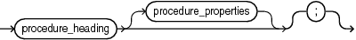
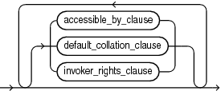
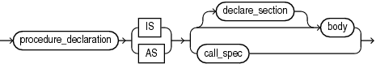

Before invoking a procedure, you must declare and define it. You can either declare it first (with procedure\_declaration) and then define it later in the same block, subprogram, or package (with procedure\_definition) or declare and define it at the same time (with procedure\_definition).

A procedure is a subprogram that performs a specific action. A procedure invocation (or call) is a statement.

A procedure declaration is also called a procedure specification or procedure spec.

Note:

For more information about standalone procedures, see " [CREATE PROCEDURE Statement](CREATE-PROCEDURE-statement.md) ". For more information about package procedures, see " [CREATE PACKAGE Statement](CREATE-PACKAGE-statement.md) ".

Topics

Syntax

procedure\_declaration::=



> ```
> procedure_heading [ procedure_properties ] [ ; ]
> ```
>
> [  
> Copyright © 1996, 2024, Oracle and/or its affiliates.](https://docs.oracle.com/en/database/oracle/oracle-database/dcommon/html/cpyr.htm)


( procedure\_properties::= )

procedure\_heading::=


> ```
> PROCEDURE procedure [ ( parameter_declaration [, parameter_declaration ]... ) ]
> ```
>
> [  
> Copyright © 1996, 2024, Oracle and/or its affiliates.](https://docs.oracle.com/en/database/oracle/oracle-database/dcommon/html/cpyr.htm)


See " [parameter\_declaration::=](formal-parameter-declaration.md) ".

procedure\_properties::=



> ```
> [ { accessible_by_clause | default_collation_clause | invoker_rights_clause }... ]
> ```
>
> [  
> Copyright © 1996, 2024, Oracle and/or its affiliates.](https://docs.oracle.com/en/database/oracle/oracle-database/dcommon/html/cpyr.htm)


( [accessible\_by\_clause::=](ACCESSIBLE-BY-clause.md), [default\_collation\_clause::=](DEFAULT-COLLATION-clause.md), [invoker\_rights\_clause::=](invokers_rights_clause.md) )

procedure\_definition::=



> ```
> procedure_declaration { IS | AS } 
>   { [ declare_section ] body | call_spec }
> ```
>
> [  
> Copyright © 1996, 2024, Oracle and/or its affiliates.](https://docs.oracle.com/en/database/oracle/oracle-database/dcommon/html/cpyr.htm)


( [body::=](block.md), [declare\_section::=](block.md), [call\_spec::=](call-specification.md) )

Semantics

procedure\_declaration

Declares a procedure, but does not define it. The definition must appear later in the same block, subprogram, or package as the declaration.

procedure\_heading

procedure

Name of the procedure that you are declaring or defining.

procedure\_properties

Each procedure property can appear only once in the procedure declaration. The properties can appear in any order. Properties appear before the `IS` or `AS` keyword in the heading. The properties cannot appear in nested procedures. Only the `ACCESSIBLE BY` property can appear in package procedures.

Standalone procedures may have the following properties in their declaration.

- [ACCESSIBLE BY Clause](ACCESSIBLE-BY-clause.md)
- [DEFAULT COLLATION Clause](DEFAULT-COLLATION-clause.md)
- [Invoker's Rights and Definer's Rights (AUTHID Property)](plsql-subprograms.md)

procedure\_definition

Either defines a procedure that was declared earlier or both declares and defines a procedure.

declare\_section

Declares items that are local to the procedure, can be referenced in `body`, and cease to exist when the procedure completes execution.

body

Required executable part and optional exception-handling part of the procedure.

Examples

- [Example 9-1](plsql-subprograms.md), "Declaring, Defining, and Invoking a Simple PL/SQL Procedure"