Using qualified expressions, you can declare and define a complex value in a compact form where the value is needed.

Qualified expressions appear in:

Syntax

qualified\_expression::=

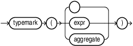

> ```
> typemark ( ) | typemark (expr) | typemark ( aggregate )
> ```
>
> [  
> Copyright © 1996, 2024, Oracle and/or its affiliates.](https://docs.oracle.com/en/database/oracle/oracle-database/dcommon/html/cpyr.htm)


(typemark::=, aggregate::=)

typemark::=

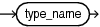

> ```
> type_name
> ```
>
> [  
> Copyright © 1996, 2024, Oracle and/or its affiliates.](https://docs.oracle.com/en/database/oracle/oracle-database/dcommon/html/cpyr.htm)


type\_name::=

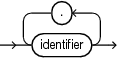

> ```
> identifier [.] +...
> ```
>
> [  
> Copyright © 1996, 2024, Oracle and/or its affiliates.](https://docs.oracle.com/en/database/oracle/oracle-database/dcommon/html/cpyr.htm)


aggregate::=

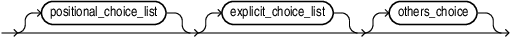

> ```
> [positional_choice_list] [explicit_choice_list ] [others_choice]
> ```
>
> [  
> Copyright © 1996, 2024, Oracle and/or its affiliates.](https://docs.oracle.com/en/database/oracle/oracle-database/dcommon/html/cpyr.htm)


(positional\_choice\_list::=, explicit\_choice\_list::= others\_choice::=)

positional\_choice\_list::=

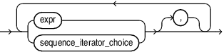

> ```
> { expr | sequence_iterator_choice } [,] ...
> ```
>
> [  
> Copyright © 1996, 2024, Oracle and/or its affiliates.](https://docs.oracle.com/en/database/oracle/oracle-database/dcommon/html/cpyr.htm)


sequence\_iterator\_choice::=

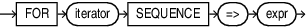

> FOR iterator SEQUENCE => expr
>
> [  
> Copyright © 1996, 2024, Oracle and/or its affiliates.](https://docs.oracle.com/en/database/oracle/oracle-database/dcommon/html/cpyr.htm)


explicit\_choice\_list::=

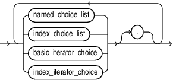

> ```
> { named_choice_list | indexed_choice_list | basic_iterator_choice | index_iterator_choice } [ , ]...
> ```
>
> [  
> Copyright © 1996, 2024, Oracle and/or its affiliates.](https://docs.oracle.com/en/database/oracle/oracle-database/dcommon/html/cpyr.htm)


(named\_choice\_list::=, indexed\_choice\_list::=, basic\_iterator\_choice::=, index\_iterator\_choice::=)

named\_choice\_list::=

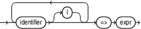

> ```
> identifier [ | ] ... => expr
> ```
>
> [  
> Copyright © 1996, 2024, Oracle and/or its affiliates.](https://docs.oracle.com/en/database/oracle/oracle-database/dcommon/html/cpyr.htm)


indexed\_choice\_list::=

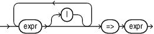

> ```
> expr [ | ] ... => expr
> ```
>
> [  
> Copyright © 1996, 2024, Oracle and/or its affiliates.](https://docs.oracle.com/en/database/oracle/oracle-database/dcommon/html/cpyr.htm)


basic\_iterator\_choice::=

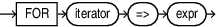

> FOR iterator => expr
>
> [  
> Copyright © 1996, 2024, Oracle and/or its affiliates.](https://docs.oracle.com/en/database/oracle/oracle-database/dcommon/html/cpyr.htm)


([iterator::=](iterator.md))

index\_iterator\_choice::=

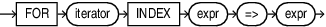

> FOR iterator INDEX expr => expr
>
> [  
> Copyright © 1996, 2024, Oracle and/or its affiliates.](https://docs.oracle.com/en/database/oracle/oracle-database/dcommon/html/cpyr.htm)


([iterator::=](iterator.md))

others\_choice::=

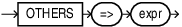

> OTHERS => expr
>
> [  
> Copyright © 1996, 2024, Oracle and/or its affiliates.](https://docs.oracle.com/en/database/oracle/oracle-database/dcommon/html/cpyr.htm)


Semantics

qualified\_expression

Qualified expressions for `RECORD` types are allowed in any context where an expression of `RECORD` type is allowed.

Qualified expressions for associative array types are allowed in any context where an expression of associative array type is allowed.

typemark ( aggregate )

Specifies explicitly the type of the aggregate (qualified items).

typemark

type\_name

Qualified expressions use an explicit type indication to provide the type of the qualified item. This explicit indication is known as a typemark.

\[identifier. \]identifier

Indicates the type of the qualified item.

aggregate

A qualified expression combines expression elements to create values of a `RECORD` type, or associative array type.

positional\_choice\_list

expr \[, \]

Positional association is allowed for qualified expressions of `RECORD` type.

A positional association may not follow a named association in the same construct (and vice versa).

sequence\_iterator\_choice

FOR iterator SEQUENCE => expr

The sequence iterator choice association is a positional argument and may be intermixed freely with other positional arguments. All positional arguments must precede any non-positional arguments. Sequence iteration is not allowed for INDEX BY VARCHAR2 arrays.

explicit\_choice\_list

named\_choice\_list | indexed\_choice\_list | basic\_iterator\_choice | index\_iterator\_choice

Named choices must use names of fields from the qualifying structure type. Index key values must be compatible with the index type for the qualifying vector type.

named\_choice\_list

A named choice applies only to structured types

identifier => expr \[, \]

Named association is allowed for qualified expressions of `RECORD` type.

indexed\_choice\_list

An index choice applies only to vector types.

expr => expr \[, \]

Indexed choices (key-value pairs) is allowed for qualified expressions of associative array types. Both the key and the value may be expressions.

Using `NULL` as an index key value is not permitted with associative array type constructs.

basic\_iterator\_choice

FOR iterator => expr

The basic iterator choice association uses the iterand as an index.

Restrictions:

The `PAIRS OF` iteration control may not be used with the basic iterator choice association.

index\_iterator\_choice

FOR iterator INDEX expr => expr

The index iterator choice association provides an index expression along with the value expression.

others\_choice

You can use the OTHERS selector in aggregates for record types and aggregates for varrays. The OTHERS choice must be your final choice.

Examples

- [Assigning Values to RECORD Type Variables Using Qualified Expressions](plsql-collections-and-records.md), "Assigning Values to RECORD Type Variables Using Qualified Expressions"
- [Example 6-11](plsql-collections-and-records.md), "Assigning Values to Associative Array Type Variables Using Qualified Expressions"
- [Example 6-8](plsql-collections-and-records.md), "Iterator Choice Association in Qualified Expressions"
- [Example 6-9](plsql-collections-and-records.md), "Index Iterator Choice Association in Qualified Expressions"
- [Example 6-10](plsql-collections-and-records.md), "Sequence Iterator Choice Association in Qualified Expressions"
- [Example 5-26](plsql-control-statements.md), "Using Dynamic SQL As An Iteration In A Qualified Expression"