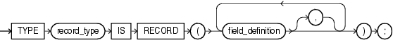
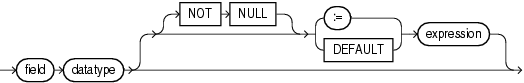
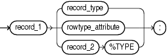

A record variable is a composite variable whose internal components, called fields, can have different data types. The value of a record variable and the values of its fields can change.

You reference an entire record variable by its name. You reference a record field with the syntax `record.field`.

You can create a record variable in any of these ways:

- Define a record type and then declare a variable of that type.
- Use `%ROWTYPE` to declare a record variable that represents either a full or partial row of a database table or view.
- Use `%TYPE` to declare a record variable of the same type as a previously declared record variable.

Topics

Syntax

record\_type\_definition::=



> ```
> TYPE record_type IS RECORD  ( field_definition [, field_definition]... ) ;
> ```
>
> [  
> Copyright © 1996, 2024, Oracle and/or its affiliates.](https://docs.oracle.com/en/database/oracle/oracle-database/dcommon/html/cpyr.htm)


field\_definition::=



> ```
> field datatype [ [ NOT NULL ] { := | DEFAULT } expression ]
> ```
>
> [  
> Copyright © 1996, 2024, Oracle and/or its affiliates.](https://docs.oracle.com/en/database/oracle/oracle-database/dcommon/html/cpyr.htm)


( [datatype::=](datatype-attribute.md), [expression::=](expression.md) )

record\_variable\_declaration::=



> ```
> record_1 { record_type | rowtype_attribute | record_2%TYPE };
> ```
>
> [  
> Copyright © 1996, 2024, Oracle and/or its affiliates.](https://docs.oracle.com/en/database/oracle/oracle-database/dcommon/html/cpyr.htm)


( [rowtype\_attribute::=](ROWTYPE-attribute.md))

Semantics

record\_type\_definition

record\_type

Name of the record type that you are defining.

field\_definition

field

Name of the field that you are defining.

datatype

Data type of the field that you are defining.

NOT NULL

Imposes the `NOT` `NULL` constraint on the field that you are defining.

For information about this constraint, see " [NOT NULL Constraint](plsql-language-fundamentals.md) ".

expression

Expression whose data type is compatible with `datatype`. When `record_variable_declaration` is elaborated, the value of `expression` is assigned to `record`.`field`. This value is the initial value of the field.

record\_variable\_declaration

record\_1

Name of the record variable that you are declaring.

record\_type

Name of a previously defined record type. `record_type` is the data type of `record_1`.

rowtype\_attribute

See " [%ROWTYPE Attribute](ROWTYPE-attribute.md) ".

record\_2

Name of a previously declared record variable.

%TYPE

See " [%TYPE Attribute](TYPE-attribute.md) ".

Examples

- [Example 6-41](plsql-collections-and-records.md), "RECORD Type Definition and Variable Declaration"
- [Example 6-42](plsql-collections-and-records.md), "RECORD Type with RECORD Field (Nested Record)"
- [Example 6-43](plsql-collections-and-records.md), "RECORD Type with Varray Field"