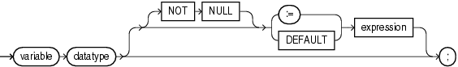

A scalar variable stores a value with no internal components. The value can change. A scalar variable declaration specifies the name and data type of the variable and allocates storage for it.

The declaration can also assign an initial value and impose the `NOT` `NULL` constraint.

You reference a scalar variable by its name.

Topics

Syntax

variable\_declaration::=



> ```
> variable datatype [ [ NOT NULL] {:= | DEFAULT} expression ] ;
> ```
>
> [  
> Copyright © 1996, 2024, Oracle and/or its affiliates.](https://docs.oracle.com/en/database/oracle/oracle-database/dcommon/html/cpyr.htm)


( [expression::=](expression.md) )

Semantics

variable\_declaration

variable

Name of the variable that you are declaring.

datatype

Name of a scalar data type, including any qualifiers for size, precision, and character or byte semantics.

For information about scalar data types, see " [PL/SQL Data Types](plsql-data-types.md) ".

NOT NULL

Imposes the `NOT` `NULL` constraint on the variable. For information about this constraint, see " [NOT NULL Constraint](plsql-language-fundamentals.md) ".

expression

Value to be assigned to the variable when the declaration is elaborated. `expression` and `variable` must have compatible data types.

Examples

- [Example 3-11](plsql-language-fundamentals.md), "Scalar Variable Declarations"
- [Example 3-13](plsql-language-fundamentals.md), "Variable and Constant Declarations with Initial Values"
- [Example 3-14](plsql-language-fundamentals.md), "Variable Initialized to NULL by Default"
- [Example 3-9](plsql-language-fundamentals.md), "Variable Declaration with NOT NULL Constraint"