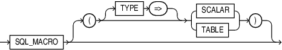

The `SQL_MACRO` clause marks a function as a SQL macro which can be used as either a scalar expression or a table expression.

A `TABLE` macro is a function annotated as a `SQL_MACRO` and defined as a `TABLE` type.

A `SCALAR` macro is a function annotated as a `SQL_MACRO` and defined as a `SCALAR` type.

A SQL macro referenced in a view is always executed with the view owner's privileges.

The `AUTHID` property cannot be specified. When a SQL macro is invoked, the function body executes with definer's rights to construct the text to return. The resulting expression is evaluated with invoker's rights. The SQL macro owner must grant inherit privileges to the invoking function.

When a macro annotated function is used in PL/SQL, it works like a regular function returning character or `CLOB` type with no macro expansion.

The SQL\_MACRO annotation can appear in the following SQL statement:

- [CREATE FUNCTION Statement](CREATE-FUNCTION-statement.md)

SQL Macro Usage Restrictions:
- A `TABLE` macro can only appear in `FROM` clause of a query table expression.
- A `SCALAR` macro cannot appear in `FROM` clause of a query table expression. It can appear in the select list or the `WHERE` clause.
- A scalar macro cannot have table arguments.
- A SQL macro cannot appear in a virtual column expression, functional index, editioning view or materialized view.
- Type methods cannot be annotated with `SQL_MACRO`.

Syntax

sql\_macro\_clause::=



> SQL\_MACRO { ( { TYPE => } ( SCALAR | TABLE ) ) }
>
> [  
> Copyright © 1996, 2024, Oracle and/or its affiliates.](https://docs.oracle.com/en/database/oracle/oracle-database/dcommon/html/cpyr.htm)


Semantics

sql\_macro\_clause

The sql\_macro\_clause can appear only once in the function. To make a SQL macro function, include the sql\_macro\_clause in the function definition. If you declare the SQL macro function before defining it, you must specify the sql\_macro\_clause in the function declaration.

If `SCALAR` or `TABLE` is not specified, `TABLE` is the default.

SCALAR

Specify `SCALAR` if the macro function can be used in scalar expressions.

TABLE (Default)

Specify `TABLE` if the macro function can be used in table expressions.

Restrictions on sql\_macro\_clause

The `SQL_MACRO` annotation is disallowed with `RESULT_CACHE`, `PARALLEL_ENABLE`, and `PIPELINED`. Although the `DETERMINISTIC` property cannot be specified, a SQL macro is always implicitly deterministic.

The SQL macro function must have a return type of `VARCHAR2`, `CHAR`, or `CLOB`.

Examples

Example 14-36 Emp\_doc: Using a Scalar Macro to Convert Columns into a JSON or XML Document

The emp\_doc SQL macro converts employee fields into a document string (JSON or XML).
```
The macro is implemented as a tree of nested macros with the following call graph structure.
emp_doc()
   ==> emp_json()
          ==> name_string()
          ==> email_string()
                ==> name_string()
          ==> date_string()
   ==> emp_xml 
          ==> name_string()
          ==> email_string()
                ==> name_string()
          ==> date_string()
```

The date\_string function converts a date in a string formatted as a four digits year, month (01-12) and day of the month (1-31).
```
CREATE FUNCTION date_string(dat DATE) 
                    RETURN VARCHAR2 SQL_MACRO(SCALAR) IS
BEGIN
   RETURN q'{
             TO_CHAR(dat, 'YYYY-MM-DD')
          }';
END;
/
```

The name\_string function sets the first letter of each words in the first\_name and last\_name in uppercase and all other letters in lowercase. It concatenates the formatted first name with a space and the formatted last name, and removes leading and trailing spaces from the resulting string.
```
CREATE FUNCTION name_string(first_name VARCHAR2,
                                 last_name VARCHAR2)
                     RETURN VARCHAR2 SQL_MACRO(SCALAR) IS
BEGIN
   RETURN q'{
          TRIM(INITCAP(first_name) || ' ' || INITCAP(last_name))
          }';
END;
/
```

The email\_string sets the email address using the name\_string function with the first\_name and last\_name and replacing all spaces with a period, and appending a default domain name of example.com.
```
CREATE FUNCTION email_string(first_name VARCHAR2,
                                  last_name VARCHAR2,
                                  host_name VARCHAR2 DEFAULT 'example.com')
                    RETURN VARCHAR2 SQL_MACRO(SCALAR) IS
BEGIN
   RETURN q'{
          REPLACE(LOWER(name_string(first_name, last_name)),' ','.') || '@' || host_name
          }';
END;
/
```

The emp\_json SQL macro returns a JSON document string.
```
CREATE FUNCTION emp_json(first_name VARCHAR2 DEFAULT NULL,
                              last_name VARCHAR2 DEFAULT NULL,
                              hire_date DATE DEFAULT NULL,
                              phone_num VARCHAR2 DEFAULT NULL)
                    RETURN VARCHAR2 SQL_MACRO(SCALAR) IS
BEGIN
   RETURN q'{
          JSON_OBJECT(
             'name'      : name_string(first_name, last_name),
             'email'     : email_string(first_name, last_name),
             'phone'     : phone_num,
             'hire_date' : date_string(hire_date)
             ABSENT ON NULL)
          }';
END;
/
```

The emp\_xml SQL macro returns an XML document string.
```
CREATE FUNCTION emp_xml(first_name VARCHAR2 DEFAULT NULL,
                             last_name VARCHAR2 DEFAULT NULL,
                             hire_date DATE DEFAULT NULL,
                             phone_num VARCHAR2 DEFAULT NULL)
                    RETURN VARCHAR2 SQL_MACRO(SCALAR) IS
BEGIN
   RETURN q'{
       XMLELEMENT("xml",
                  CASE WHEN first_name || last_name IS NOT NULL THEN
                     XMLELEMENT("name", name_string(first_name, last_name))
                  END,
                  CASE WHEN first_name || last_name IS NOT NULL THEN
                     XMLELEMENT("email", email_string(first_name, last_name))
                  END,
                  CASE WHEN hire_date IS NOT NULL THEN
                     XMLELEMENT("hire_date", date_string(hire_date))
                  END,
                  CASE WHEN phone_num IS NOT NULL THEN
                     XMLELEMENT("phone", phone_num)
                  END)
           }';
END;
/
```

The emp\_doc SQL macro returns employee fields into a JSON (default) or XML document string.
```
CREATE FUNCTION emp_doc(first_name VARCHAR2 DEFAULT NULL,
                             last_name VARCHAR2 DEFAULT NULL,
                             hire_date DATE DEFAULT NULL,
                             phone_num VARCHAR2 DEFAULT NULL,
                             doc_type VARCHAR2 DEFAULT 'json')
                    RETURN VARCHAR2 SQL_MACRO(SCALAR) IS
BEGIN
   RETURN q'{
     DECODE(LOWER(doc_type),
            'json', emp_json(first_name, last_name, hire_date, phone_num),
            'xml', emp_xml(first_name, last_name, hire_date, phone_num))
         }';
END;
/
```

This query shows the emp\_doc SQL macro used in a scalar expression to list all employees in a JSON document string in department 30.
```
SELECT department_id,
            emp_doc(first_name => e.first_name, hire_date => e.hire_date) doc
FROM hr.employees e
WHERE department_id = 30
ORDER BY last_name;
```
Result:
```
30 {"name":"Shelli","email":"shelli@example.com","hire_date":"2005-12-24"}
30 {"name":"Karen","email":"karen@example.com","hire_date":"2007-08-10"}
30 {"name":"Guy","email":"guy@example.com","hire_date":"2006-11-15"}
30 {"name":"Alexander","email":"alexander@example.com","hire_date":"2003-05-19"} 
30 {"name":"Den","email":"den@example.com","hire_date":"2002-12-07"}
30 {"name":"Sigal","email":"sigal@example.com","hire_date":"2005-07-24"}
```

This query shows the emp\_doc SQL macro used in a scalar expression to list all employees in a XML document string.
```
SELECT deptno,
            emp_doc(first_name => ename, hire_date => hiredate, doc_type => 'xml') doc
FROM scott.emp
ORDER BY ename;
```

Result:
```
20 <xml><name>Adams</name><email>adams@example.com</email><hire_date>1987-05-23</hire_date></xml>
30 <xml><name>Allen</name><email>allen@example.com</email><hire_date>1981-02-20</hire_date></xml>
30 <xml><name>Blake</name><email>blake@example.com</email><hire_date>1981-05-01</hire_date></xml> 
10 <xml><name>Clark</name><email>clark@example.com</email><hire_date>1981-06-09</hire_date></xml> 
20 <xml><name>Ford</name><email>ford@example.com</email><hire_date>1981-12-03</hire_date></xml> 
...
30 <xml><name>Ward</name><email>ward@example.com</email><hire_date>1981-02-22</hire_date></xml>
```

```
VARIABLE surname VARCHAR2(100)
EXEC :surname := 'ellison'
WITH e AS (SELECT emp.*, :surname lname FROM emp WHERE deptno IN (10,20))
SELECT deptno,
       emp_doc(first_name => ename, last_name => lname, hire_date => hiredate) doc
FROM e
ORDER BY ename;
```

Result:
```
10 {"name":"Clark Ellison","email":"clark.ellison@example.com","hire_date":"1981-06-09"} 
20 {"name":"Ford Ellison","email":"ford.ellison@example.com","hire_date":"1981-12-03"}
20 {"name":"Jones Ellison","email":"jones.ellison@example.com","hire_date":"1981-04-02"}
10 {"name":"King Ellison","email":"king.ellison@example.com","hire_date":"1981-11-17"}
10 {"name":"Miller Ellison","email":"miller.ellison@example.com","hire_date":"1982-01-23"}
20 {"name":"Scott Ellison","email":"scott.ellison@example.com","hire_date":"1987-04-19"}
20 {"name":"Smith Ellison","email":"smith.ellison@example.com","hire_date":"1980-12-17"}
```

Example 14-37 Env: Using a Scalar Macro in a Scalar Expression

The env SQL macro provides a wrapper for the value of the parameter associated with the context namespace USERENV which describes the current session.

```
CREATE PACKAGE env AS
   FUNCTION current_user RETURN VARCHAR2 SQL_MACRO(SCALAR);
   FUNCTION current_edition_name RETURN VARCHAR2 SQL_MACRO(SCALAR);
   FUNCTION module RETURN VARCHAR2 SQL_MACRO(SCALAR);
   FUNCTION action RETURN VARCHAR2 SQL_MACRO(SCALAR);
END;
/
CREATE PACKAGE BODY env AS
   FUNCTION current_user RETURN VARCHAR2 SQL_MACRO(SCALAR) IS
     BEGIN
        RETURN q'{SYS_CONTEXT('userenv','SESSION_USER')}';
     END;
   FUNCTION current_edition_name RETURN VARCHAR2 SQL_MACRO(SCALAR) IS
     BEGIN
        RETURN q'{SYS_CONTEXT('userenv','CURRENT_EDITION_NAME')}';
     END;
   FUNCTION module RETURN VARCHAR2 SQL_MACRO(SCALAR) IS
     BEGIN
        RETURN q'{SYS_CONTEXT('userenv','MODULE')}';
     END;
   FUNCTION action RETURN VARCHAR2 SQL_MACRO(SCALAR) IS
     BEGIN
        RETURN q'{SYS_CONTEXT('userenv','ACTION')}';
     END;
END;
/
```

Select the current user info.

```
SELECT env.current_user, env.module, env.action FROM DUAL;
```

Result:
```
SCOTT   SQL*PLUS
```

Example 14-38 Budget: Using a Table Macro in a Table Expression

This example shows the SQL macro named budget used in a table expression to return the total salary in each department for employees for a given job title.

```
CREATE FUNCTION budget(job VARCHAR2) RETURN VARCHAR2 SQL_MACRO IS
BEGIN
   RETURN q'{SELECT deptno, SUM(sal) budget 
             FROM scott.emp
             WHERE job = budget.job
             GROUP BY deptno}';
END;
```

This query shows the SQL macro budget used in a table expression.

```
SELECT * FROM budget('MANAGER');
```

Result:

```
DEPTNO     BUDGET 
---------- ----------   
        20       2975  
        30       2850 
        10       2450
```

Example 14-39 Take: Using a Table Macro with a Polymorphic View

This example creates a table macro named take which returns the first n rows from table t.
```
CREATE FUNCTION take (n NUMBER, t DBMS_TF.table_t) 
                      RETURN VARCHAR2 SQL_MACRO IS
BEGIN
   RETURN 'SELECT * FROM t FETCH FIRST take.n ROWS ONLY';
END;
/
```
The query returns the first two rows from table dept.
```
SELECT * FROM take(2, dept);
```

Result:
```
DEPTNO DNAME          LOC   
---------- -------------- -------------   
        10 ACCOUNTING     NEW YORK       
        20 RESEARCH       DALLAS
```

```
VAR row_count NUMBER
EXEC :row_count := 5

WITH t AS (SELECT * FROM emp NATURAL JOIN dept ORDER BY ename)
SELECT ename, dname FROM take(:row_count, t);
```

Result:
```
ENAME      DNAME  
---------- --------------    
ADAMS      RESEARCH     
ALLEN      SALES     
BLAKE      SALES   
CLARK      ACCOUNTING   
FORD       RESEARCH
```

Example 14-40 Range: Using a Table Macro in a Table Expression

This example creates a SQL macro that generates an arithmetic progression of rows in the range \[first, stop\]. The first row start with the value first, and each subsequent row's value will be step more than the previous row's value.

The following combination of arguments will produce zero rows:
- step < 0 and first < stop
- step = 0
- step > 0 and first > stop

```
/*  PACKAGE NAME: GEN
 *  SQL TABLE MACROS:
 *     range(stop  : number to generate starting from zero)
 *     range(first : starting number of the sequence (default=0), 
 *           stop  : generate numbers up to, but not including this number, 
 *           step  : difference between each number in the sequence (default=1) )
*/
CREATE PACKAGE gen IS 
   FUNCTION range(stop NUMBER)
            RETURN VARCHAR2 SQL_MACRO(TABLE);

   FUNCTION range(first NUMBER DEFAULT 0, stop NUMBER, step NUMBER DEFAULT 1)
            RETURN VARCHAR2 SQL_MACRO(TABLE);

   FUNCTION tab(tab TABLE, replication_factor NATURAL)
            RETURN TABLE PIPELINED ROW POLYMORPHIC USING gen;

   FUNCTION describe(tab IN OUT DBMS_TF.TABLE_T, replication_factor NATURAL)
            RETURN DBMS_TF.DESCRIBE_T;

   PROCEDURE fetch_rows(replication_factor NATURALN);
END gen;
/
CREATE PACKAGE BODY gen IS 
   FUNCTION range(stop NUMBER)
            RETURN VARCHAR2 SQL_MACRO(TABLE) IS
   BEGIN 
      RETURN q'{SELECT ROWNUM-1 n FROM gen.tab(DUAL, stop)}'; 
   END;

   FUNCTION range(first NUMBER DEFAULT 0, stop NUMBER, step NUMBER DEFAULT 1)
           RETURN VARCHAR2 SQL_MACRO(TABLE) IS
   BEGIN
      RETURN q'{
             SELECT first+n*step n FROM gen.range(ROUND((stop-first)/NULLIF(step,0)))
             }';
   END;
 
   FUNCTION describe(tab IN OUT DBMS_TF.TABLE_T, replication_factor NATURAL) 
            RETURN DBMS_TF.DESCRIBE_T AS
   BEGIN 
      RETURN DBMS_TF.DESCRIBE_T(row_replication => true);
   END;

  PROCEDURE fetch_rows(replication_factor NATURALN) as
  BEGIN 
    DBMS_TF.ROW_REPLICATION(replication_factor); 
  END;
END gen;
/
```

The gen.get\_range SQL macro is used in table expressions.

This query returns a sequence of 5 rows starting at zero.
```
SELECT * FROM gen.range(5);
```

Result:
```
0 
1 
2 
3 
4
```

This query returns a sequence starting at 5, stopping at 10 (not included).
```
SELECT * FROM gen.range(5, 10);
```

Result:
```
5  
6  
7  
8   
9
```

This query returns a sequence starting at 0, stopping at 1, by increment of 0.1.
```
SELECT * FROM gen.range(0, 1, step=>0.1);
```

Result:
```
0  
.1  
.2  
.3  
.4  
.5  
.6  
.7   
.8   
.9
```

This query returns a sequence starting at 5, stopping at -6 (not included) by decrement of 2.
```
SELECT * FROM gen.range(+5,-6,-2);
```

Result:
```
5 
 3   
 1   
-1 
-3 
-5
```

Related Topics

- [Overview of Polymorphic Table Functions](plsql-optimization-and-tuning.md)
- [Oracle Database PL/SQL Packages and Types Reference](https://docs.oracle.com/pls/topic/lookup?ctx=en/database/oracle/oracle-database/21/lnpls&id=ARPLS-GUID-47E8026F-B66B-4F8D-A2E2-D4324AAB2CED) for more information about how to specify the PTF implementation package and use the `DBMS_TF` utilities
- [Oracle Database Reference](https://docs.oracle.com/pls/topic/lookup?ctx=en/database/oracle/oracle-database/21/lnpls&id=REFRN-GUID-3DED0AD5-4220-4C77-AE16-07060A19E6DF) for more information about the SQL\_MACRO column in the ALL\_PROCEDURES view