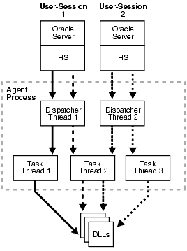
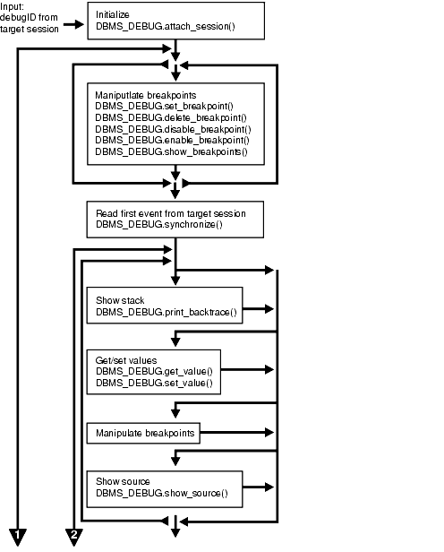
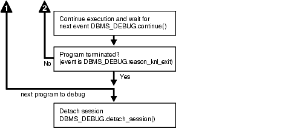

## 62 DBMS\_DEBUG

See [DBMS\_DEBUG\_JDWP](DBMS_DEBUG_JDWP.md) for more information.

`DBMS_DEBUG` is a PL/SQL interface to the PL/SQL debugger layer, Probe, in the Oracle server.

This package is primarily intended to implement server-side debuggers and it provides a way to debug server-side PL/SQL program units.

Note:

The term program unit refers to a PL/SQL program of any type (procedure, function, package, package body, trigger, anonymous block, object type, or object type body).

This chapter contains the following topics:

### 62.1 DBMS\_DEBUG Overview

To debug server-side code, you must have two database sessions: one session to run the code in debug mode (the target session), and a second session to supervise the target session (the debug session).

The target session becomes available for debugging by making initializing calls with `DBMS_DEBUG`. This marks the session so that the PL/SQL interpreter runs in debug mode and generates debug events. As debug events are generated, they are posted from the session. In most cases, debug events require return notification: the interpreter pauses awaiting a reply.

Meanwhile, the debug session must also initialize itself using `DBMS_DEBUG`: This tells it which target session to supervise. The debug session may then call entry points in `DBMS_DEBUG` to read events that were posted from the target session and to communicate with the target session.

The following subprograms are run in the target session (the session that is to be debugged):

- SYNCHRONIZE Function
- DEBUG\_ON Procedure
- DEBUG\_OFF Procedure

`DBMS_DEBUG` does not provide an interface to the PL/SQL compiler, but it does depend on debug information optionally generated by the compiler. Without debug information, it is not possible to examine or modify the values of parameters or variables.

### 62.2 DBMS\_DEBUG Constants

A breakpoint status may have the following value: `breakpoint_status_unused` —breakpoint is not in use.

Otherwise, the status is a mask of the following values:

- `breakpoint_status_active` —a line breakpoint
- `breakpoint_status_disabled` —breakpoint is currently disabled
- `breakpoint_status_remote` —a shadow breakpoint (a local representation of a remote breakpoint)

### 62.3 DBMS\_DEBUG Variables

The `DBMS_DEBUG` uses the variables shown in the following table.

Table 62-1 DBMS\_DEBUG Variables

| Variable | Description |
| --- | --- |
| `default_timeout` | The timeout value (used by both sessions).The smallest possible timeout is 1 second. If this value is set to 0, then a large value (3600) is used. |

### 62.4 DBMS\_DEBUG Exceptions

These values are returned by the various functions called in the debug session (`SYNCHRONIZE`, `CONTINUE`, `SET_BREAKPOINT`, and so on). If PL/SQL exceptions worked across client/server and server/server boundaries, then these would all be exceptions rather than error codes.

Table 62-2 DBMS\_DEBUG Exceptions

| Status | Description |
| --- | --- |
| `success` | Normal termination |

Statuses returned by `GET_VALUE` and `SET_VALUE`:

Table 62-3 DBMS\_DEBUG Exceptions Returned by GET\_VALUE and SET\_VALUE

| Status | Description |
| --- | --- |
| `error_bogus_frame` | No such entrypoint on the stack |
| `error_no_debug_info` | Program was compiled without debug symbols |
| `error_no_such_object` | No such variable or parameter |
| `error_unknown_type` | Debug information is unreadable |
| `error_indexed_table` | Returned by `GET_VALUE` if the object is a table, but no index was provided |
| `error_illegal_index` | No such element exists in the collection |
| `error_nullcollection` | Table is atomically `NULL` |
| `error_nullvalue` | Value is `NULL` |

Statuses returned by `SET_VALUE`:

Table 62-4 DBMS\_DEBUG Exceptions Returned by SET\_VALUE

| Status | Description |
| --- | --- |
| `error_illegal_value` | Constraint violation |
| `error_illegal_null` | Constraint violation |
| `error_value_malformed` | Unable to decipher the given value |
| `error_other` | Some other error |
| `error_name_incomplete` | Name did not resolve to a scalar |

Statuses returned by the breakpoint functions:

Table 62-5 Statuses Returned by the Breakpoint Functions

| Status | Description |
| --- | --- |
| `error_no_such_breakpt` | No such breakpoint |
| `error_idle_breakpt` | Cannot enable or disable an unused breakpoint |
| `error_bad_handle` | Unable to set breakpoint in given program (nonexistent or security violation) |

General error codes (returned by many of the `DBMS_DEBUG` subprograms):

Table 62-6 DBMS\_DEBUG Subprograms Error Codes

| Status | Description |
| --- | --- |
| `error_unimplemented` | Functionality is not yet implemented |
| `error_deferred` | No program running; operation deferred |
| `error_exception` | An exception was raised in the `DBMS_DEBUG` or Probe packages on the server |
| `error_communication` | Some error other than a timeout occurred |
| `error_timeout` | Timout occurred |

Table 62-7 illegal\_init Exceptions

| Exception | Description |
| --- | --- |
| i `llegal_init` | `DEBUG_ON` was called prior to `INITIALIZE` |

The following exceptions are raised by procedure `SELF_CHECK`:

Table 62-8 SELF\_CHECK Procedure Exceptions

| Exception | Description |
| --- | --- |
| `pipe_creation_failure` | Could not create a pipe |
| `pipe_send_failure` | Could not write data to the pipe |
| `pipe_receive_failure` | Could not read data from the pipe |
| `pipe_datatype_mismatch` | Datatype in the pipe was wrong |
| `pipe_data_error` | Data got garbled in the pipe |

### 62.5 DBMS\_DEBUG Operational Notes

There are two ways to ensure that debug information is generated: through a session switch, or through individual recompilation.

To set the session switch, enter the following statement:

```
ALTER SESSION SET PLSQL_DEBUG = true;
```

This instructs the compiler to generate debug information for the remainder of the session. It does not recompile any existing PL/SQL.

To generate debug information for existing PL/SQL code, use one of the following statements (the second recompiles a package or type body):

```
ALTER [PROCEDURE | FUNCTION | PACKAGE | TRIGGER | TYPE] <name> COMPILE DEBUG;
ALTER [PACKAGE | TYPE] <name> COMPILE DEBUG BODY;
```

Figure 62-1 and Figure 62-2 illustrate the flow of operations in the session to be debugged and in the debugging session.

Figure 62-1 Target Session



> This illustration shows the first steps in the target session.
>
> First, initialize the session for debugging, and generate or specify the unique debugID. DBMS\_DEBUG.initialize()
>
> Then, start debugging using DBMS\_DEBUG.debug\_on() or stop debugging using DBMS\_DEBUG.debug\_off(). Then, execute the PL/SQL program.
>
> [  
> Copyright © 1996, 2025, Oracle and/or its affiliates.](https://docs.oracle.com/en/database/oracle/oracle-database/dcommon/html/cpyr.htm)


Figure 62-2 Debug Session



> This illustration shows the continuation of steps in the target session.
>
> The steps are:
>
> - Initialize using DBMS\_DEBUG.attach\_session()
> - Manipulate the breakpoints using:
> 	- DBMS\_DEBUG.set\_breakpoint()
> 		- DBMS\_DEBUG.delete\_breakpoint()
> 		- DBMS\_DEBUG.disable\_breakpoint()
> 		- DBMS\_DEBUG.enable\_breakpoint()
> 		- DBMS\_DEBUG.show\_breakpoint()
> - Read first event from the target session using DBMS\_DEBUG.synchronize()
> - Show the stack using DBMS\_DEBUG.print\_backtrace()
> - Get/set values using:
> 	- DBMS\_DEBUG.get\_value()
> 		- DBMS\_DEBUG.set\_value()
> - Manipulate the breakpoints
> - Show the source by using DBMS\_DEBUG.show\_source().


Figure 62-3 Debug Session (Cont.)



> This illustration shows the final steps in the target session.
>
> The steps are:
>
> - Continue execution and wait for the next event DBMS\_DEBUG.continue()
> - If the program terminated, detach the session using DBMS\_DEBUG.detach\_session()
> - If it did not terminate, resume the process by showing the stack.
>
> [  
> Copyright © 1996, 2025, Oracle and/or its affiliates.](https://docs.oracle.com/en/database/oracle/oracle-database/dcommon/html/cpyr.htm)


Control of the Interpreter

The interpreter pauses execution at the following times:

1. At startup of the interpreter so any deferred breakpoints may be installed prior to execution.
2. At any line containing an enabled breakpoint.
3. At any line where an interesting event occurs. The set of interesting events is specified by the flags passed to `DBMS_DEBUG`.`CONTINUE` in the `breakflags` parameter.

Session Termination

There is no event for session termination. Therefore, it is the responsibility of the debug session to check and make sure that the target session has not ended. A call to `DBMS_DEBUG`.`SYNCHRONIZE` after the target session has ended causes the debug session to hang until it times out.

Deferred Operations

The diagram suggests that it is possible to set breakpoints prior to having a target session. This is true. In this case, Probe caches the breakpoint request and transmits it to the target session at first synchronization. However, if a breakpoint request is deferred in this fashion, then:

- `SET_BREAKPOINT` does not set the breakpoint number (it can be obtained later from `SHOW_BREAKPOINTS` if necessary).
- `SET_BREAKPOINT` does not validate the breakpoint request. If the requested source line does not exist, then an error silently occurs at synchronization, and no breakpoint is set.

Diagnostic Output

To debug Probe, there are diagnostics parameters to some of the calls in `DBMS_DEBUG`. These parameters specify whether to place diagnostic output in the RDBMS tracefile. If output to the RDBMS tracefile is disabled, these parameters have no effect.

Common Debug Session Sections

- Common Section
- Target Session
- Debug Session Section

Common Section

The following subprograms may be called in either the target or the debug session:

- PROBE\_VERSION Procedure
- SELF\_CHECK Procedure
- SET\_TIMEOUT Function

Target Session

The following subprograms may be called only in the target session:

- INITIALIZE Function
- DEBUG\_ON Procedure
- SET\_TIMEOUT\_BEHAVIOUR Procedure
- GET\_TIMEOUT\_BEHAVIOUR Function

Debug Session Section

The following subprograms should be run in the debug session only:

- ATTACH\_SESSION Procedure
- SYNCHRONIZE Function
- SHOW\_FRAME\_SOURCE Procedure
- SHOW\_SOURCE Procedures
- GET\_MORE\_SOURCE Procedure
- PRINT\_BACKTRACE Procedure
- CONTINUE Function
- SET\_BREAKPOINT Function
- DELETE\_BREAKPOINT Function
- SET\_OER\_BREAKPOINT Function
- DELETE\_OER\_BREAKPOINT Function
- ENABLE\_BREAKPOINT Function
- DISABLE\_BREAKPOINT Function
- SHOW\_BREAKPOINTS Procedures
- SET\_VALUE Function n
- GET\_VALUE Function
- TARGET\_PROGRAM\_RUNNING Procedure
- DETACH\_SESSION Procedure
- GET\_RUNTIME\_INFO Function
- PRINT\_INSTANTIATIONS Procedure
- PING Procedure
- GET\_LINE\_MAP Function
- GET\_RUNTIME\_INFO Function
- GET\_INDEXES Function
- EXECUTE Procedure

OER Breakpoints

Exceptions that are declared in PL/SQL programs are known as user-defined exceptions. In addition, there are Oracle Errors (OERs) that are returned from the Oracle kernel. To tie the two mechanisms together, PL/SQL provides the `exception_init` pragma that turns a user-defined exception into an OER, so that a PL/SQL handler may be used for it, and so that the PL/SQL engine can return OERs to the Oracle kernel. As of the current release, the only information available about an OER is its number. If two user-defined exceptions are exception\_init'd to the same OER, they are indistinguishable.

Namespaces

Program units on the server reside in different namespaces. When setting a breakpoint, specify the desired namespace.

1. `Namespace_cursor` contains cursors (anonymous blocks).
2. `Namespace_pgkspec_or_toplevel` contains:
	- Package specifications.
		- Procedures and functions that are not nested inside other packages, procedures, or functions.
		- Object types.
3. `Namespace_pkg_body` contains package bodies and type bodies.
4. `Namespace_trigger` contains triggers.

Libunit Types

These values are used to disambiguate among objects in a given namespace. These constants are used in `PROGRAM_INFO` when Probe is giving a stack backtrace.

- `LibunitType_cursor`
- `LibunitType_procedure`
- `LibunitType_function`
- `LibunitType_package`
- `LibunitType_package_body`
- `LibunitType_trigger`
- `LibunitType_Unknown`

Breakflags

These are values to use for the `breakflags` parameter to `CONTINUE`, in order to tell Probe what events are of interest to the client. These flags may be combined.

| Value | Description |
| --- | --- |
| `break_next_line` | Break at next source line (step over calls) |
| `break_any_call` | Break at next source line (step into calls) |
| `break_any_return` | Break after returning from current entrypoint (skip over any entrypoints called from the current routine) |
| `break_return` | Break the next time an entrypoint gets ready to return. (This includes entrypoints called from the current one. If interpreter is running `Proc1`, which calls `Proc2`, then `break_return` stops at the end of `Proc2`.) |
| `break_exception` | Break when an exception is raised |
| `break_handler` | Break when an exception handler is executed |
| `abort_execution` | Stop execution and force an 'exit' event as soon as `DBMS_DEBUG`.`CONTINUE` is called. |

Information Flags

These are flags which may be passed as the `info_requested` parameter to `SYNCHRONIZE`, `CONTINUE`, and `GET_RUNTIME_INFO`.

| Flag | Description |
| --- | --- |
| `info_getStackDepth` | Get the current depth of the stack |
| `info_getBreakpoint` | Get the breakpoint number |
| `info_getLineinfo` | Get program unit information |

Reasons for Suspension

After `CONTINUE` is run, the program either runs to completion or breaks on some line.

| Reason | Description |
| --- | --- |
| `reason_none` | \- |
| `reason_interpreter_starting` | Interpreter is starting |
| `reason_breakpoint` | Hit a breakpoint |
| `reason_enter` | Procedure entry |
| `reason_return` | Procedure is about to return |
| `reason_finish` | Procedure is finished |
| `reason_line` | Reached a new line |
| `reason_interrupt` | An interrupt occurred |
| `reason_exception` | An exception was raised |
| `reason_exit` | Interpreter is exiting (old form) |
| `reason_knl_exit` | Kernel is exiting |
| `reason_handler` | Start exception-handler |
| `reason_timeout` | A timeout occurred |
| `reason_instantiate` | Instantiation block |
| `reason_abort` | Interpreter is aborting |

### 62.6 DBMS\_DEBUG Data Structures

The `DBMS_DEBUG` package defines `RECORD` types and `TABLE` types.

RECORD Types

- BREAKPOINT\_INFO Record Type
- PROGRAM\_INFO Record Type
- RUNTIME\_INFO Record Type

#### 62.6.1 BREAKPOINT\_INFO Record Type

This type gives information about a breakpoint, such as its current status and the program unit in which it was placed.

Syntax

```
TYPE breakpoint_info IS RECORD (
   name        VARCHAR2(30),
   owner       VARCHAR2(30),
   dblink      VARCHAR2(30),
   line#       BINARY_INTEGER,
   libunittype BINARY_INTEGER,
   status      BINARY_INTEGER);
```

Fields

Table 62-9 BREAKPOINT\_INFO Fields

| Field | Description |
| --- | --- |
| `name` | Name of the program unit |
| `owner` | Owner of the program unit |
| `dblink` | Database link, if remote |
| `line#` | Line number |
| `libunittype` | `NULL`, unless this is a nested procedure or function |
| `status` | See Constants for values of `breakpoint_status_*` |

#### 62.6.2 PROGRAM\_INFO Record Type

The `PROGRAM_INFO` record type of the `DBMS_DEBG` package specifies a program location. It is a line number in a program unit.

This is used for stack backtraces and for setting and examining breakpoints. The read-only fields are currently ignored by Probe for breakpoint operations. They are set by Probe only for stack backtraces.

Syntax

```
TYPE program_info IS RECORD(
    -- The following fields are used when setting a breakpoint
    namespace        BINARY_INTEGER, 
    name             VARCHAR2(30),
    owner            VARCHAR2(30),
    dblink           VARCHAR2(30),
    line#            BINARY_INTEGER,
    -- Read-only fields (set by Probe when doing a stack backtrace)
    libunittype      BINARY_INTEGER, 
    entrypointname   VARCHAR2(30));
```

Fields

Table 62-10 PROGRAM\_INFO Fields

| Field | Description |
| --- | --- |
| `namespace` | See DBMS\_DEBUG Operational Notes for more information about namespaces. |
| `name` | Name of the program unit |
| `owner` | Owner of the program unit |
| `dblink` | Database link, if remote |
| `line#` | Line number |
| `libunittype` | `A read-only field, NULL`, unless this is a nested procedure or function |
| `entrypointname` | A read-only field, to disambiguate among objects that share the same namespace (for example, procedure and package specifications).  See DBMS\_DEBUG Operational Notes for more information about the libunit types. |

#### 62.6.3 RUNTIME\_INFO Record Type

This type gives context information about the running program.

Syntax

```
TYPE runtime_info IS RECORD(
    line#            BINARY_INTEGER,
    terminated       binary_integer,
    breakpoint       binary_integer,
    stackdepth       BINARY_INTEGER,
    interpreterdepth BINARY_INTEGER,
    reason           BINARY_INTEGER, 
    program          program_info);
```

Fields

Table 62-11 RUNTIME\_INFO Fields

| Field | Description |
| --- | --- |
| `line#` | Duplicate of `program.line#` |
| `terminated` | Whether the program has terminated |
| `breakpoint` | Breakpoint number |
| `stackdepth` | Number of frames on the stack |
| `interpreterdepth` | \[A reserved field\] |
| `reason` | Reason for suspension |
| `program` | Source location |

#### 62.6.4 BACKTRACE\_TABLE Table Type

This type is used by `PRINT_BACKTRACE`.

Syntax

```
TYPE backtrace_table IS TABLE OF program_info INDEX BY BINARY_INTEGER;
```

#### 62.6.5 BREAKPOINT\_TABLE Table Type

This type is used by `SHOW_BREAKPOINTS`.

Syntax

```
TYPE breakpoint_table IS TABLE OF breakpoint_info INDEX BY BINARY_INTEGER;
```

#### 62.6.6 INDEX\_TABLE Table Type

This type is used by `GET_INDEXES` to return the available indexes for an indexed table.

Syntax

```
TYPE index_table IS table of BINARY_INTEGER INDEX BY BINARY_INTEGER;
```

#### 62.6.7 VC2\_TABLE Table Type

This type is used by `SHOW_SOURCE`.

Syntax

```
TYPE vc2_table IS TABLE OF VARCHAR2(90) INDEX BY BINARY_INTEGER;
```

### 62.7 Summary of DBMS\_DEBUG Subprograms

This table lists the `DBMS_DEBUG` subprograms in alphabetical order and briefly describes them.

Table 62-12 DBMS\_DEBUG Package Subprograms

| Subprogram | Description |
| --- | --- |
| ATTACH\_SESSION Procedure | Notifies the debug session about the target debugID |
| CONTINUE Function | Continues execution of the target program |
| DEBUG\_OFF Procedure | Turns debug-mode off |
| DEBUG\_ON Procedure | Turns debug-mode on |
| DELETE\_BREAKPOINT Function | Deletes a breakpoint |
| DELETE\_OER\_BREAKPOINT Function | Deletes an OER breakpoint |
| DETACH\_SESSION Procedure | Stops debugging the target program |
| DISABLE\_BREAKPOINT Function | Disables a breakpoint |
| ENABLE\_BREAKPOINT Function | Activates an existing breakpoint |
| EXECUTE Procedure | Executes SQL or PL/SQL in the target session |
| GET\_INDEXES Function | Returns the set of indexes for an indexed table |
| GET\_MORE\_SOURCE Procedure | Provides additional source in the event of buffer overflow when using SHOW\_SOURCE |
| GET\_LINE\_MAP Function | Returns information about line numbers in a program unit |
| GET\_RUNTIME\_INFO Function | Returns information about the current program |
| GET\_TIMEOUT\_BEHAVIOUR Function | Returns the current timeout behavior |
| GET\_VALUE Function | Gets a value from the currently-running program |
| INITIALIZE Function | Sets debugID in target session |
| PING Procedure | Pings the target session to prevent it from timing out |
| PRINT\_BACKTRACE Procedure | Prints a stack backtrace |
| PRINT\_INSTANTIATIONS Procedure | Prints a stack backtrace |
| PROBE\_VERSION Procedure | Returns the version number of `DBMS_DEBUG` on the server |
| SELF\_CHECK Procedure | Performs an internal consistency check |
| SET\_BREAKPOINT Function | Sets a breakpoint in a program unit |
| SET\_OER\_BREAKPOINT Function | Sets an OER breakpoint |
| SET\_TIMEOUT Function | Sets the timeout value |
| SET\_TIMEOUT\_BEHAVIOUR Procedure | Tells Probe what to do with the target session when a timeout occurs |
| SET\_VALUE Function | Sets a value in the currently-running program |
| SHOW\_BREAKPOINTS Procedures | Returns a listing of the current breakpoints |
| SHOW\_FRAME\_SOURCE Procedure | Fetches the frame source |
| SHOW\_SOURCE Procedures | Fetches program source |
| SYNCHRONIZE Function | Waits for program to start running |
| TARGET\_PROGRAM\_RUNNING Procedure | Returns `TRUE` if the target session is currently executing a stored procedure, or `FALSE` if it is not |

#### 62.7.1 ATTACH\_SESSION Procedure

This procedure notifies the debug session about the target program.

Syntax

```
DBMS_DEBUG.ATTACH_SESSION (
   debug_session_id  IN VARCHAR2,
   diagnostics       IN BINARY_INTEGER := 0);
```

Parameters

Table 62-13 ATTACH\_SESSION Procedure Parameters

| Parameter | Description |
| --- | --- |
| `debug_session_id` | Debug ID from a call to `INITIALIZE` in target session |
| `diagnostics` | Generate diagnostic output if nonzero |

#### 62.7.2 CONTINUE Function

This function passes the given breakflags (a mask of the events that are of interest) to Probe in the target process. It tells Probe to continue execution of the target process, and it waits until the target process runs to completion or signals an event.

If `info_requested` is not `NULL`, then calls `GET_RUNTIME_INFO`.

Syntax

```
DBMS_DEBUG.CONTINUE (
   run_info       IN OUT runtime_info,
   breakflags     IN     BINARY_INTEGER,
   info_requested IN     BINARY_INTEGER := NULL)
  RETURN BINARY_INTEGER;
```

Parameters

Table 62-14 CONTINUE Function Parameters

| Parameter | Description |
| --- | --- |
| `run_info` | Information about the state of the program |
| `breakflags` | Mask of events that are of interest (see the discussion about break flags under DBMS\_DEBUG Operational Notes) |
| `info_requested` | Which information should be returned in `run_info` when the program stops (see the discussion of information flags under DBMS\_DEBUG Operational Notes) |

Return Values

Table 62-15 CONTINUE Function Return Values

| Return | Description |
| --- | --- |
| `success` |  |
| `error_timeout` | Timed out before the program started running |
| `error_communication` | Other communication error |

#### 62.7.3 DEBUG\_OFF Procedure

This procedure notifies the target session that debugging should no longer take place in that session. It is not necessary to call this function before ending the session.

WARNING:

There must be a debug session waiting if immediate is `TRUE`.

Syntax

```
DBMS_DEBUG.DEBUG_OFF;
```

Usage Notes

The server does not handle this entrypoint specially. Therefore, it attempts to debug this entrypoint.

#### 62.7.4 DEBUG\_ON Procedure

This procedure marks the target session so that all PL/SQL is run in debug mode. This must be done before any debugging can take place.

Syntax

```
DBMS_DEBUG.DEBUG_ON (
   no_client_side_plsql_engine BOOLEAN := TRUE,
   immediate                   BOOLEAN := FALSE);
```

Parameters

Table 62-16 DEBUG\_ON Procedure Parameters

| Parameter | Description |
| --- | --- |
| `no_client_side_plsql_engine` | Should be left to its default value unless the debugging session is taking place from a client-side PL/SQL engine |
| `immediate` | If this is `TRUE`, then the interpreter immediately switches itself into debug-mode, instead of continuing in regular mode for the duration of the call. |

#### 62.7.5 DELETE\_BREAKPOINT Function

This function deletes a breakpoint.

Syntax

```
DBMS_DEBUG.DELETE_BREAKPOINT (
   breakpoint IN BINARY_INTEGER)
  RETURN BINARY_INTEGER;
```

Parameters

Table 62-17 DELETE\_BREAKPOINT Function Parameters

| Parameter | Description |
| --- | --- |
| `breakpoint` | Breakpoint number from a previous call to `SET_BREAKPOINT` |

Return Values

Table 62-18 DELETE\_BREAKPOINT Function Return Values

| Return | Description |
| --- | --- |
| `success` |  |
| `error_no_such_breakpt` | No such breakpoint exists |
| `error_idle_breakpt` | Cannot delete an unused breakpoint |
| `error_stale_breakpt` | The program unit was redefined since the breakpoint was set |

#### 62.7.6 DELETE\_OER\_BREAKPOINT Function

This function deletes an OER breakpoint.

Syntax

```
DBMS_DEBUG.DELETE_OER_BREAKPOINT (
   oer  IN PLS_INTEGER) 
RETURN PLS_INTEGER;
```

Parameters

Table 62-19 DELETE\_OER\_BREAKPOINT Function Parameters

| Parameter | Description |
| --- | --- |
| `oer` | The OER (positive 4-byte number) to delete |

#### 62.7.7 DETACH\_SESSION Procedure

This procedure stops debugging the target program.

This procedure may be called at any time, but it does not notify the target session that the debug session is detaching itself, and it does not terminate execution of the target session. Therefore, care should be taken to ensure that the target session does not hang itself.

Syntax

```
DBMS_DEBUG.DETACH_SESSION;
```

#### 62.7.8 DISABLE\_BREAKPOINT Function

This function makes an existing breakpoint inactive but leaves it in place.

Syntax

```
DBMS_DEBUG.DISABLE_BREAKPOINT (
   breakpoint IN BINARY_INTEGER)
  RETURN BINARY_INTEGER;
```

Parameters

Table 62-20 DISABLE\_BREAKPOINT Function Parameters

| Parameter | Description |
| --- | --- |
| `breakpoint` | Breakpoint number from a previous call to `SET_BREAKPOINT` |

Return Values

Table 62-21 DISABLE\_BREAKPOINT Function Return Values

| Returns | Description |
| --- | --- |
| `success` |  |
| `error_no_such_breakpt` | No such breakpoint exists |
| `error_idle_breakpt` | Cannot disable an unused breakpoint |

#### 62.7.9 ENABLE\_BREAKPOINT Function

This function is the reverse of disabling. This enables a previously disabled breakpoint.

Syntax

```
DBMS_DEBUG.ENABLE_BREAKPOINT (
   breakpoint IN BINARY_INTEGER)
  RETURN BINARY_INTEGER;
```

Parameters

Table 62-22 ENABLE\_BREAKPOINT Function Parameters

| Parameter | Description |
| --- | --- |
| `breakpoint` | Breakpoint number from a previous call to `SET_BREAKPOINT` |

Return Values

Table 62-23 ENABLE\_BREAKPOINT Function Return Values

| Return | Description |
| --- | --- |
| `success` | Success |
| `error_no_such_breakpt` | No such breakpoint exists |
| `error_idle_breakpt` | Cannot enable an unused breakpoint |

#### 62.7.10 EXECUTE Procedure

This procedure executes SQL or PL/SQL code in the target session. The target session is assumed to be waiting at a breakpoint (or other event). The call to `DBMS_DEBUG`.`EXECUTE` occurs in the debug session, which then asks the target session to execute the code.

Syntax

```
DBMS_DEBUG.EXECUTE (
   what         IN VARCHAR2,
   frame#       IN BINARY_INTEGER,
   bind_results IN BINARY_INTEGER,
   results      IN OUT NOCOPY dbms_debug_vc2coll,
   errm         IN OUT NOCOPY VARCHAR2);
```

Parameters

Table 62-24 EXECUTE Procedure Parameters

| Parameter | Description |
| --- | --- |
| `what` | SQL or PL/SQL source to execute |
| `frame#` | The context in which to execute the code. Only -1 (global context) is supported at this time. |
| `bind_results` | Whether the source wants to bind to `results` in order to return values from the target session:  0 = No  1 = Yes |
| `results` | Collection in which to place results, if `bind_results` is not 0 |
| `errm` | Error message, if an error occurred; otherwise, `NULL` |

Examples

Example 1

This example executes a SQL statement. It returns no results.

```
DECLARE
   coll sys.dbms_debug_vc2coll; -- results (unused)
   errm VARCHAR2(100);          
BEGIN
   dbms_debug.execute('insert into emp(ename,empno,deptno) ' ||
                      'values(''LJE'', 1, 1)',
                      -1, 0, coll, errm);
END;
```

Example 2

This example executes a PL/SQL block, and it returns no results. The block is an autonomous transaction, which means that the value inserted into the table becomes visible in the debug session.

```
DECLARE
   coll sys.dbms_debug_vc2coll;
   errm VARCHAR2(100);
BEGIN
   dbms_debug.execute(
       'DECLARE PRAGMA autonomous_transaction; ' ||
       'BEGIN ' ||
       '   insert into emp(ename, empno, deptno) ' ||
       '   values(''LJE'', 1, 1); ' ||
       ' COMMIT; ' ||
       'END;',
       -1, 0, coll, errm);
END;
```

Example 3

This example executes a PL/SQL block, and it returns some results.

```
DECLARE
   coll sys.dbms_debug_vc2coll;
   errm VARCHAR2(100);
BEGIN
   dbms_debug.execute(
      'DECLARE ' ||
      '   pp SYS.dbms_debug_vc2coll := SYS.dbms_debug_vc2coll(); ' ||
      '   x  PLS_INTEGER; ' ||
      '   i  PLS_INTEGER := 1; ' ||
      'BEGIN ' ||
      '   SELECT COUNT(*) INTO x FROM emp; ' ||
      '   pp.EXTEND(x * 6); ' ||
      '   FOR c IN (SELECT * FROM emp) LOOP ' ||
      '      pp(i) := ''Ename: '' || c.ename; i := i+1; ' ||
      '      pp(i) := ''Empno: '' || c.empno; i := i+1; ' ||
      '      pp(i) := ''Job:   '' || c.job;   i := i+1; ' ||
      '      pp(i) := ''Mgr:   '' || c.mgr;   i := i+1; ' ||
      '      pp(i) := ''Sal:   '' || c.sal;   i := i+1; ' ||
      '      pp(i) := null;                   i := i+1; ' ||
      '   END LOOP; ' ||
      '   :1 := pp;' ||
      'END;',
       -1, 1, coll, errm);
   each := coll.FIRST;
   WHILE (each IS NOT NULL) LOOP
      dosomething(coll(each));
      each := coll.NEXT(each);
   END LOOP;
END;
```

#### 62.7.11 GET\_INDEXES Function

Given a name of a variable or parameter, this function returns the set of its indexes, if it is an indexed table. An error is returned if it is not an indexed table.

Syntax

```
DBMS_DEBUG.GET_INDEXES (
   varname   IN  VARCHAR2,
   frame#    IN  BINARY_INTEGER,
   handle    IN  program_info,
   entries   OUT index_table) 
RETURN BINARY_INTEGER;
```

Parameters

Table 62-25 GET\_INDEXES Function Parameters

| Parameter | Description |
| --- | --- |
| `varname` | Name of the variable to get index information about |
| `frame#` | Number of frame in which the variable or parameter resides; `NULL` for a package variable |
| `handle` | Package description, if object is a package variable |
| `entries` | 1-based table of the indexes: if non- `NULL`, then `entries` (1) contains the first index of the table, `entries` (2) contains the second index, and so on. |

Return Values

Table 62-26 GET\_INDEXES Function Return Values

| Return | Description |
| --- | --- |
| `error_no_such_object` | One of the following:  \- The package does not exist  \- The package is not instantiated  \- The user does not have privileges to debug the package  \- The object does not exist in the package |

#### 62.7.12 GET\_MORE\_SOURCE Procedure

When the source does not fit in the buffer provided by the SHOW\_SOURCE Procedure version which produced a formatted buffer, this procedure provides additional source.

Syntax

```
DBMS_DEBUG.GET_MORE_SOURCE (
   buffer          IN OUT VARCHAR2,
   buflen          IN BINARY_INTEGER,
   piece#          IN BINARY_INTEGER);
```

Parameters

Table 62-27 GET\_MORE\_SOURCE Procedure Parameters

| Parameter | Description |
| --- | --- |
| `buffer` | The buffer |
| `buflen` | The length of the buffer |
| `piece#` | A value between 2 and the value returned in the parameter pieces from the call to the relevant version of the SHOW\_SOURCE Procedures |

Usage Notes

This procedure should be called only after the version of SHOW\_SOURCE that returns a formatted buffer.

#### 62.7.13 GET\_LINE\_MAP Function

This function finds line and entrypoint information about a program so that a debugger can determine the source lines at which it is possible to place breakpoints.

Syntax

```
DBMS_DEBUG.GET_LINE_MAP (
   program                IN   program_info,
   maxline                OUT  BINARY_INTEGER,
   number_of_entry_points OUT  BINARY_INTEGER,
   linemap                OUT  RAW)
  RETURN BINARY_INTEGER;
```

Parameters

Table 62-28 GET\_LINE\_MAP Function Parameters

| Parameter | Description |
| --- | --- |
| `program` | A top-level program unit (procedure / package / function / package body, and so on). Its `Namespace`, `Name`, and `Owner` fields must be initialized, the remaining fields are ignored. |
| `maxline` | The largest source code line number in 'program' |
| `number_of_entry_points` | The number of subprograms in 'program' |
| `linemap` | A bitmap representing the executable lines of 'program'. If line number N is executable, bit number N MOD 8 will be set to 1 at linemap position N / 8. The length of returned linemap is either `maxline` divided by 8 (plus one if `maxline` MOD 8 is not zero) or 32767 in the unlikely case of `maxline` being larger than 32767 \* 8. |

Return Values

Table 62-29 GET\_LINE\_MAP Function Return Values

| Return | Description |
| --- | --- |
| `success` | A successful completion |
| `error_no_debug_info` | The program unit exists, but has no debug info |
| `error_bad_handle` | No such program unit exists |

#### 62.7.14 GET\_RUNTIME\_INFO Function

This function returns information about the current program. It is only needed if the `info_requested` parameter to `SYNCHRONIZE` or `CONTINUE` was set to `0`.

Note:

This is currently only used by client-side PL/SQL.

Syntax

```
DBMS_DEBUG.GET_RUNTIME_INFO (
   info_requested  IN  BINARY_INTEGER,
   run_info        OUT runtime_info)
  RETURN BINARY_INTEGER;
```

Parameters

Table 62-30 GET\_RUNTIME\_INFO Function Parameters

| Parameter | Description |
| --- | --- |
| `info_requested` | Which information should be returned in `run_info` when the program stops (see DBMS\_DEBUG Operational Notes for information about information flags) |
| `run_info` | Information about the state of the program |

#### 62.7.15 GET\_TIMEOUT\_BEHAVIOUR Function

This procedure returns the current timeout behavior. This call is made in the target session.

Syntax

```
DBMS_DEBUG.GET_TIMEOUT_BEHAVIOUR
 RETURN BINARY_INTEGER;
```

Parameters

Table 62-31 GET\_TIMEOUT\_BEHAVIOUR Function Parameters

| Parameter | Description |
| --- | --- |
| `oer` | The OER (a 4-byte positive number) |

Return Values

Table 62-32 GET\_TIMEOUT\_BEHAVIOUR Function Return Values

| Return | Description |
| --- | --- |
| `success` | A successful completion |

Information Flags

```
info_getOerInfo CONSTANT PLS_INTEGER:= 32;
```

Usage Notes

Less functionality is supported on OER breakpoints than on code breakpoints. In particular, note that:

- No "breakpoint number" is returned - the number of the OER is used instead. Thus it is impossible to set duplicate breakpoints on a given OER (it is a no-op).
- It is not possible to disable an OER breakpoint (although clients are free to simulate this by deleting it).
- OER breakpoints are deleted using `delete_oer_breakpoint.`

#### 62.7.16 GET\_VALUE Function

This function gets a value from the currently-running program. There are two overloaded `GET_VALUE` functions.

Syntax

```
DBMS_DEBUG.GET_VALUE (
   variable_name  IN  VARCHAR2,
   frame#         IN  BINARY_INTEGER,
   scalar_value   OUT VARCHAR2,
   format         IN  VARCHAR2 := NULL)
RETURN BINARY_INTEGER;
```

Parameters

Table 62-33 GET\_VALUE Function Parameters

| Parameter | Description |
| --- | --- |
| `variable_name` | Name of the variable or parameter |
| `frame#` | Frame in which it lives; 0 means the current procedure |
| `scalar_value` | Value |
| `format` | Optional date format to use, if meaningful |

Return Values

Table 62-34 GET\_VALUE Function Return Values

| Return | Description |
| --- | --- |
| `success` | A successful completion |
| `error_bogus_frame` | Frame does not exist |
| `error_no_debug_info` | Entrypoint has no debug information |
| `error_no_such_object` | `variable_name` does not exist in `frame#` |
| `error_unknown_type` | The type information in the debug information is illegible |
| `error_nullvalue` | Value is `NULL` |
| `error_indexed_table` | The object is a table, but no index was provided |

This form of `GET_VALUE` is for fetching package variables. Instead of a frame#, it takes a handle, which describes the package containing the variable.

Syntax

```
DBMS_DEBUG.GET_VALUE (
   variable_name  IN  VARCHAR2,
   handle         IN  program_info,
   scalar_value   OUT VARCHAR2,
   format         IN  VARCHAR2 := NULL)
RETURN BINARY_INTEGER;
```

Parameters

Table 62-35 GET\_VALUE Function Parameters

| Parameter | Description |
| --- | --- |
| `variable_name` | Name of the variable or parameter |
| `handle` | Description of the package containing the variable |
| `scalar_value` | Value |
| `format` | Optional date format to use, if meaningful |

Return Values

Table 62-36 GET\_VALUE Function Return Values

| Return | Description |
| --- | --- |
| `error_no_such_object` | One of the following:  \- Package does not exist  \- Package is not instantiated  \- User does not have privileges to debug the package  \- Object does not exist in the package |
| `error_indexed_table` | The object is a table, but no index was provided |

Examples

This example illustrates how to get the value with a given package `PACK` in schema `SCOTT`, containing variable `VAR`:

```
DECLARE
   handle     dbms_debug.program_info;
   resultbuf  VARCHAR2(500);
   retval     BINARY_INTEGER;
BEGIN
   handle.Owner     := 'SCOTT';
   handle.Name      := 'PACK';
   handle.namespace := dbms_debug.namespace_pkgspec_or_toplevel;
   retval           := dbms_debug.get_value('VAR', handle, resultbuf, NULL);
END;
```

#### 62.7.17 INITIALIZE Function

This function initializes the target session for debugging.

Syntax

```
DBMS_DEBUG.INITIALIZE (
   debug_session_id  IN VARCHAR2       := NULL, 
   diagnostics       IN BINARY_INTEGER := 0)
  RETURN VARCHAR2;
```

Parameters

Table 62-37 INITIALIZE Function Parameters

| Parameter | Description |
| --- | --- |
| `debug_session_id` | Name of session ID. If `NULL`, then a unique ID is generated. |
| `diagnostics` | Indicates whether to dump diagnostic output to the tracefile:  0 = (default) no diagnostics  1 = print diagnostics |

Return Values

The newly-registered debug session ID (debugID)

Usage Notes

You cannot use `DBMS_DEBUG` and the JDWP-based debugging interface simultaneously. This call will either fail with an ORA-30677 error if the session is currently being debugged with the JDWP-based debugging interface or, if the call succeeds, any further use of the JDWP-based interface to debug this session will be disallowed.

Calls to `DBMS_DEBUG` will succeed only if either the caller or the specified debug role carries the `DEBUG` `CONNECT` `SESSION` privilege. Failing that, an ORA-1031 error will be raised. Other exceptions are also possible if a debug role is specified but the password does not match, or if the calling user has not been granted the role, or the role is application-enabled and this call does not originate from within the role-enabling package.

The `CREATE` `ANY` `PROCEDURE` privilege does not affect the visibility of routines through the debugger. A privilege `DEBUG` for each object has been introduced with a corresponding `DEBUG` `ANY` `PROCEDURE` variant. These are required in order to see routines owned by users other than the session's login user.

Authentication of the debug role and the check for `DEBUG` `CONNECT` `SESSION` privilege will be done in the context of the caller to this routine. If the caller is a definer's rights routine or has been called from one, only privileges granted to the defining user, the debug role, or `PUBLIC` will be used to check for `DEBUG` `CONNECT` `SESSION`. If this call is from within a definer's rights routine, the debug role, if specified, must be one that has been granted to that definer, but it need not also have been granted to the session login user or be enabled in the calling session at the time the call is made.

The checks made by the debugger after this call is made looking for the `DEBUG` privilege on individual procedures will be done in the context of the session's login user, the roles that were enabled at session level at the moment this call was made (even if those roles were not available within a definer's rights environment of the call), and the debug role.

#### 62.7.18 PING Procedure

This procedure pings the target session to prevent it from timing out. Use this procedure when execution is suspended in the target session, for example at a breakpoint.

If the `timeout_behaviour` is set to `retry_on_timeout` then this procedure is not necessary.

Syntax

```
DBMS_DEBUG.PING;
```

Exceptions

Oracle will display the `no_target_program` exception if there is no target program or if the target session is not currently waiting for input from the debug session.

Usage Notes

Timeout options for the target session are registered with the target session by calling `set_timeout_behaviour:`

- `retry_on_timeout` - Retry. Timeout has no effect. This is like setting the timeout to an infinitely large value.
- `continue_on_timeout` - Continue execution, using same event flags.
- `nodebug_on_timeout ` - Turn debug-mode OFF (in other words, call debug\_off) and then continue execution. No more events will be generated by this target session unless it is re-initialized by calling debug\_on.
- `abort_on_timeout` - Continue execution, using the abort\_execution flag, which should cause the program to terminate immediately. The session remains in debug-mode.

`retry_on_timeout CONSTANT BINARY_INTEGER:= 0; `

`continue_on_timeout CONSTANT BINARY_INTEGER:= 1; `

`nodebug_on_timeout CONSTANT BINARY_INTEGER:= 2; `

`abort_on_timeout CONSTANT BINARY_INTEGER:= 3; `

#### 62.7.19 PRINT\_BACKTRACE Procedure

This procedure prints a backtrace listing of the current execution stack. This should only be called if a program is currently running.

There are two overloaded `PRINT_BACKTRACE` procedures.

Syntax

```
DBMS_DEBUG.PRINT_BACKTRACE (
  listing IN OUT VARCHAR2); 

DBMS_DEBUG.PRINT_BACKTRACE (
  backtrace OUT backtrace_table);
```

Parameters

Table 62-38 PRINT\_BACKTRACE Procedure Parameters

| Parameter | Description |
| --- | --- |
| `listing` | A formatted character buffer with embedded newlines |
| `backtrace` | 1-based indexed table of backtrace entries. The currently-running procedure is the last entry in the table (that is, the frame numbering is the same as that used by `GET_VALUE`). Entry 1 is the oldest procedure on the stack. |

#### 62.7.20 PRINT\_INSTANTIATIONS Procedure

This procedure returns a list of the packages that have been instantiated in the current session.

Syntax

```
DBMS_DEBUG.PRINT_INSTANTIATIONS (
   pkgs   IN OUT NOCOPY backtrace_table, 
   flags  IN BINARY_INTEGER);
```

Parameters

Table 62-39 PRINT\_INSTANTIATIONS Procedure Parameters

| Parameter | Description |
| --- | --- |
| `pkgs` | The instantiated packages |
| `flags` | Bitmask of options:  - 1 - show specs - 2 - show bodies - 4 - show local instantiations - 8 - show remote instantiations (NYI) - 16 - do a fast job. The routine does not test whether debug information exists or whether the libunit is shrink-wrapped. |

Exceptions

`no_target_program` - target session is not currently executing

Usage Notes

On return, `pkgs` contains a `program_info` for each instantiation. The valid fields are: `Namespace, Name, Owner,` and `LibunitType. `

In addition, Line# contains a bitmask of:

- 1 - the libunit contains debug info
- 2 - the libunit is shrink-wrapped

#### 62.7.21 PROBE\_VERSION Procedure

This procedure returns the version number of `DBMS_DEBUG` on the server.

Syntax

```
DBMS_DEBUG.PROBE_VERSION (
   major out BINARY_INTEGER,
   minor out BINARY_INTEGER);
```

Parameters

Table 62-40 PROBE\_VERSION Procedure Parameters

| Parameter | Description |
| --- | --- |
| `major` | Major version number |
| `minor` | Minor version number: increments as functionality is added |

#### 62.7.22 SELF\_CHECK Procedure

This procedure performs an internal consistency check. `SELF_CHECK` also runs a communications test to ensure that the Probe processes are able to communicate.

If `SELF_CHECK` does not return successfully, then an incorrect version of `DBMS_DEBUG` was probably installed on this server. The solution is to install the correct version (`pbload`.`sql` loads `DBMS_DEBUG` and the other relevant packages).

Syntax

```
DBMS_DEBUG.SELF_CHECK (
   timeout IN binary_integer := 60);
```

Parameters

Table 62-41 SELF\_CHECK Procedure Parameters

| Parameter | Description |
| --- | --- |
| `timeout` | The timeout to use for the communication test. Default is 60 seconds. |

Exceptions

Table 62-42 SELF\_CHECK Procedure Exceptions

| Exception | Description |
| --- | --- |
| `OER-6516` | Probe version is inconsistent |
| `pipe_creation_failure` | Could not create a pipe |
| `pipe_send_failure` | Could not write data to the pipe |
| `pipe_receive_failure` | Could not read data from the pipe |
| `pipe_datatype_mismatch` | Datatype in the pipe was wrong |
| `pipe_data_error` | Data got garbled in the pipe |

All of these exceptions are fatal. They indicate a serious problem with Probe that prevents it from working correctly.

#### 62.7.23 SET\_BREAKPOINT Function

This function sets a breakpoint in a program unit, which persists for the current session.

Syntax

Execution pauses if the target program reaches the breakpoint.

```
DBMS_DEBUG.SET_BREAKPOINT (
   program     IN  program_info,
   line#       IN  BINARY_INTEGER,
   breakpoint# OUT BINARY_INTEGER,
   fuzzy       IN  BINARY_INTEGER := 0,
   iterations  IN  BINARY_INTEGER := 0)
  RETURN BINARY_INTEGER;
```

Parameters

Table 62-43 SET\_BREAKPOINT Function Parameters

| Parameter | Description |
| --- | --- |
| `program` | Information about the program unit in which the breakpoint is to be set. (In version 2.1 and later, the namespace, name, owner, and dblink may be set to `NULL`, in which case the breakpoint is placed in the currently-running program unit.) |
| `line#` | Line at which the breakpoint is to be set |
| `breakpoint#` | On successful completion, contains the unique breakpoint number by which to refer to the breakpoint |
| `fuzzy` | Only applicable if there is no executable code at the specified line:  0 means return `error_illegal_line`  1 means search forward for an adjacent line at which to place the breakpoint  \-1 means search backward for an adjacent line at which to place the breakpoint |
| `iterations` | Number of times to wait before signalling this breakpoint |

Return Values

Note:

The `fuzzy` and `iterations` parameters are not yet implemented

Table 62-44 SET\_BREAKPOINT Function Return Values

| Return | Description |
| --- | --- |
| `success` | A successful completion |
| `error_illegal_line` | Cannot set a breakpoint at that line |
| `error_bad_handle` | No such program unit exists |

#### 62.7.24 SET\_OER\_BREAKPOINT Function

This function sets an OER breakpoint.

Syntax

```
DBMS_DEBUG.SET_OER_BREAKPOINT (
   oer  IN PLS_INTEGER) 
RETURN PLS_INTEGER;
```

Parameters

Table 62-45 SET\_OER\_BREAKPOINT Function Parameters

| Parameter | Description |
| --- | --- |
| `oer` | The OER (positive 4-byte number) to set |

Return Values

Table 62-46 SET\_OER\_BREAKPOINT Function Return Values

| Return | Description |
| --- | --- |
| `success` | A successful completion |
| `error_no_such_breakpt` | No such OER breakpoint exists |

#### 62.7.25 SET\_TIMEOUT Function

This function sets the timeout value and returns the new timeout value.

Syntax

```
DBMS_DEBUG.SET_TIMEOUT (
   timeout BINARY_INTEGER) 
  RETURN BINARY_INTEGER;
```

Parameters

Table 62-47 SET\_TIMEOUT Function Parameters

| Parameter | Description |
| --- | --- |
| `timeout` | The timeout to use for communication between the target and debug sessions |

#### 62.7.26 SET\_TIMEOUT\_BEHAVIOUR Procedure

This procedure tells Probe what to do with the target session when a timeout occurs. This call is made in the target session.

Syntax

```
DBMS_DEBUG.SET_TIMEOUT_BEHAVIOUR (
   behaviour IN PLS_INTEGER);
```

Parameters

Table 62-48 SET\_TIMEOUT\_BEHAVIOUR Procedure Parameters

| Parameter | Description |
| --- | --- |
| `behaviour - One of the following:` |  |
| `retry_on_timeout` | Retry. Timeout has no effect. This is like setting the timeout to an infinitely large value. |
| `continue_on_timeout` | Continue execution, using same event flags |
| `nodebug_on_timeout ` | Turn debug-mode OFF (in other words, call `debug_off`) and continue execution. No more events will be generated by this target session unless it is re-initialized by calling `debug_on.` |
| `abort_on_timeout` | Continue execution, using the `abort_execution` flag, which should cause the program to terminate immediately. The session remains in debug-mode. |

Exceptions

unimplemented - the requested behavior is not recognized

Usage Notes

The default behavior (if this procedure is not called) is `continue_on_timeout,` since it allows a debugger client to reestablish control (at the next event) but does not cause the target session to hang indefinitely.

#### 62.7.27 SET\_VALUE Function

This function sets a value in the currently-running program. There are two overloaded `SET_VALUE` functions.

Syntax

```
DBMS_DEBUG.SET_VALUE (
   frame#               IN binary_integer,
   assignment_statement IN varchar2) 
  RETURN BINARY_INTEGER;

DBMS_DEBUG.SET_VALUE (
   handle               IN program_info,
   assignment_statement IN VARCHAR2) 
  RETURN BINARY_INTEGER;
```

Parameters

Table 62-49 SET\_VALUE Function Parameters

| Parameter | Description |
| --- | --- |
| `frame#` | Frame in which the value is to be set; 0 means the currently executing frame. |
| `handle` | Description of the package containing the variable |
| `assignment_statement` | An assignment statement (which must be legal PL/SQL) to run in order to set the value. For example, 'x:= 3;'.  Only scalar values are supported in this release. The right side of the assignment statement must be a scalar. |

Return Values

Table 62-50 SET\_VALUE Function Return Values

| Return | Description |
| --- | --- |
| `success` | \- |
| `error_illegal_value` | Not possible to set it to that value |
| `error_illegal_null` | Cannot set to `NULL` because object type specifies it as 'not `NULL` ' |
| `error_value_malformed` | Value is not a scalar |
| `error_name_incomplete` | The assignment statement does not resolve to a scalar. For example, 'x:= 3;', if x is a record. |
| `error_no_such_object` | One of the following:  \- Package does not exist  \- Package is not instantiated  \- User does not have privileges to debug the package  \- Object does not exist in the package |

Usage Notes

In some cases, the PL/SQL compiler uses temporaries to access package variables, and does not guarantee to update such temporaries. It is possible, although unlikely, that modification to a package variable using `SET_VALUE` might not take effect for a line or two.

Examples

To set the value of `SCOTT`.`PACK`.`var` to 6:

```
DECLARE
   handle  dbms_debug.program_info;
   retval  BINARY_INTEGER;
BEGIN
   handle.Owner     := 'SCOTT';
   handle.Name      := 'PACK';
   handle.namespace := dbms_debug.namespace_pkgspec_or_toplevel;
   retval           := dbms_debug.set_value(handle, 'var := 6;');
END;
```

#### 62.7.28 SHOW\_BREAKPOINTS Procedures

There are two overloaded procedures that return a listing of the current breakpoints. There are three overloaded `SHOW_BREAKPOINTS` procedures.

Syntax

```
DBMS_DEBUG.SHOW_BREAKPOINTS (
   listing    IN OUT VARCHAR2);

DBMS_DEBUG.SHOW_BREAKPOINTS (
   listing    OUT breakpoint_table);

DBMS_DEBUG.SHOW_BREAKPOINTS (
   code_breakpoints  OUT breakpoint_table, 
   oer_breakpoints   OUT oer_table);
```

Parameters

Table 62-51 SHOW\_BREAKPOINTS Procedure Parameters

| Parameter | Description |
| --- | --- |
| `listing` | A formatted buffer (including newlines) of the breakpoints.  Indexed table of breakpoint entries. The breakpoint number is indicated by the index into the table. Breakpoint numbers start at 1 and are reused when deleted. |
| `code_breakpoints` | The indexed table of breakpoint entries, indexed by breakpoint number |
| `oer_breakpoints` | The indexed table of OER breakpoints, indexed by OER |

#### 62.7.29 SHOW\_FRAME\_SOURCE Procedure

The procedure gets the source code. There are two overloaded `SHOW_SOURCE` procedures.

Syntax

```
DBMS_DEBUG.SHOW_FRAME_SOURCE (
   first_line  IN            BINARY_INTEGER,
   last_line   IN            BINARY_INTEGER,
   source      IN OUT NOCOPY vc2_table,
   frame_num   IN            BINARY_INTEGER);
```

Parameters

Table 62-52 SHOW\_FRAME\_SOURCE Procedure Parameters

| Parameter | Description |
| --- | --- |
| `first_line` | Line number of first line to fetch (PL/SQL programs always start at line 1 and have no holes) |
| `last_line` | Line number of last line to fetch. No lines are fetched past the end of the program. |
| `source` | The resulting table, which may be indexed by line# |
| `frame_num` | 1-based frame number |

Usage Notes

- You use this function only when backtrace shows an anonymous unit is executing at a given frame position and you need to view the source in order to set a breakpoint.
- If frame number is top of the stack and it's an anonymous block then `SHOW_SOURCE` can also be used.
- If it's a stored PL/SQL package/function/procedure then use SQL as described in the Usage Notes to SHOW\_SOURCE Procedures.

#### 62.7.30 SHOW\_SOURCE Procedures

The procedure gets the source code. There are two overloaded `SHOW_SOURCE` procedures.

Syntax

```
DBMS_DEBUG.SHOW_SOURCE (
   first_line  IN   BINARY_INTEGER,
   last_line   IN   BINARY_INTEGER,
   source      OUT  vc2_table);

DBMS_DEBUG.SHOW_SOURCE (
   first_line   IN     BINARY_INTEGER,
   last_line    IN     BINARY_INTEGER,
   window       IN     BINARY_INTEGER,
   print_arrow  IN     BINARY_INTEGER,
   buffer       IN OUT VARCHAR2,
   buflen       IN     BINARY_INTEGER,
   pieces       OUT    BINARY_INTEGER);
```

Parameters

Table 62-53 SHOW\_SOURCE Procedure Parameters

| Parameter | Description |
| --- | --- |
| `first_line` | Line number of first line to fetch (PL/SQL programs always start at line 1 and have no holes) |
| `last_line` | Line number of last line to fetch. No lines are fetched past the end of the program. |
| `source` | The resulting table, which may be indexed by line# |
| `window` | 'Window' of lines (the number of lines around the current source line) |
| `print_arrow` | Nonzero means to print an arrow before the current line |
| `buffer` | Buffer in which to place the source listing |
| `buflen` | Length of buffer |
| `pieces` | Set to nonzero if not all the source could be placed into the given buffer |

Return Values

An indexed table of source-lines. The source lines are stored starting at `first_line`. If any error occurs, then the table is empty.

Usage Notes

The best way to get the source code (for a program that is being run) is to use SQL. For example:

```
DECLARE
    info DBMS_DEBUG.runtime_info;
BEGIN
   -- call DBMS_DEBUG.SYNCHRONIZE, CONTINUE,
   -- or GET_RUNTIME_INFO to fill in 'info'
   SELECT text INTO <buffer> FROM all_source
   WHERE owner = info.Program.Owner
     AND name  = info.Program.Name
     AND line  = info.Line#;
END;
```

However, this does not work for nonpersistent programs (for example, anonymous blocks and trigger invocation blocks). For nonpersistent programs, call `SHOW_SOURCE`. There are two flavors: one returns an indexed table of source lines, and the other returns a packed (and formatted) buffer.

The second overloading of `SHOW_SOURCE` returns the source in a formatted buffer, complete with line-numbers. It is faster than the indexed table version, but it does not guarantee to fetch all the source.

If the source does not fit in bufferlength (`buflen`), then additional pieces can be retrieved using the `GET_MORE_SOURCE` procedure (`pieces` returns the number of additional pieces that need to be retrieved).

#### 62.7.31 SYNCHRONIZE Function

This function waits until the target program signals an event. If `info_requested` is not `NULL`, then it calls `GET_RUNTIME_INFO`.

Syntax

```
DBMS_DEBUG.SYNCHRONIZE (
   run_info       OUT  runtime_info,
   info_requested IN   BINARY_INTEGER := NULL)
  RETURN BINARY_INTEGER;
```

Parameters

Table 62-54 SYNCHRONIZE Function Parameters

| Parameter | Description |
| --- | --- |
| `run_info` | Structure in which to write information about the program. By default, this includes information about what program is running and at which line execution has paused. |
| `info_requested` | Optional bit-field in which to request information other than the default (which is `info_getStackDepth` + `info_getLineInfo`). 0 means that no information is requested at all (see DBMS\_DEBUG Operational Notes for more about information flags). |

Return Values

Table 62-55 SYNCHRONIZE Function Return Values

| Return | Description |
| --- | --- |
| `success` | A successful completion |
| `error_timeout` | Timed out before the program started execution |
| `error_communication` | Other communication error |

#### 62.7.32 TARGET\_PROGRAM\_RUNNING Procedure

This procedure returns `TRUE` if the target session is currently executing a stored procedure, or `FALSE` if it is not.

Syntax

```
DBMS_DEBUG.TARGET_PROGRAM_RUNNING 
  RETURN BOOLEAN;
```