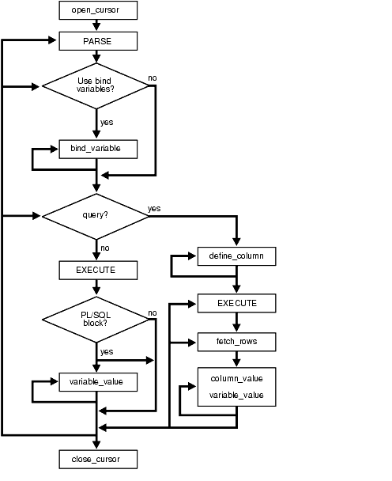

## 168 DBMS\_SQL

The `DBMS_SQL` package provides an interface to use dynamic SQL to parse any data manipulation language (DML) or data definition language (DDL) statement using PL/SQL.

For example, you can enter a `DROP` `TABLE` statement from within a stored procedure by using the PARSE Procedures supplied with the `DBMS_SQL` package.

This chapter contains the following topics:

See Also:

For more information on native dynamic SQL, see [Oracle Database PL/SQL Language Reference.](https://docs.oracle.com/pls/topic/lookup?ctx=en/database/oracle/oracle-database/21/arpls&id=LNPLS-GUID-D2613968-6660-4AA2-9057-28E425A3040D)

### 168.1 DBMS\_SQL Overview

Oracle lets you write stored procedures and anonymous PL/SQL blocks that use dynamic SQL. Dynamic SQL statements are not embedded in your source program; rather, they are stored in character strings that are input to, or built by, the program at runtime. This enables you to create more general-purpose procedures. For example, dynamic SQL lets you create a procedure that operates on a table whose name is not known until runtime.

Native Dynamic SQL is an alternative to `DBMS_SQL` that lets you place dynamic SQL statements directly into PL/SQL blocks. In most situations, Native Dynamic SQL is easier to use and performs better than `DBMS_SQL`. However, Native Dynamic SQL itself has certain limitations:

- There is no support for so-called Method 4 (for dynamic SQL statements with an unknown number of inputs or outputs)
- There are some tasks that can only be performed using `DBMS_SQL. `For tasks that require `DBMS_SQL`, see [Oracle Database PL/SQL Language Reference](https://docs.oracle.com/pls/topic/lookup?ctx=en/database/oracle/oracle-database/21/arpls&id=LNPLS01108).

The ability to use dynamic SQL from within stored procedures generally follows the model of the Oracle Call Interface (OCI).

See Also:

[Oracle Call Interface Programmer's Guide](https://docs.oracle.com/pls/topic/lookup?ctx=en/database/oracle/oracle-database/21/arpls&id=LNOCI16176)

PL/SQL differs somewhat from other common programming languages, such as C. For example, addresses (also called pointers) are not user-visible in PL/SQL. As a result, there are some differences between the Oracle Call Interface and the `DBMS_SQL` package. These differences include the following:

- The OCI binds by address and the `DBMS_SQL` package binds by value.
- With `DBMS_SQL` you must call `VARIABLE_VALUE` to retrieve the value of an `OUT` parameter for an anonymous block, and you must call `COLUMN_VALUE` after fetching rows to retrieve the values of the columns in the rows into your program.
- The current release of the `DBMS_SQL` package does not provide `CANCEL` cursor procedures.
- Indicator variables are not required, because `NULLs` are fully supported as values of a PL/SQL variable.

### 168.2 DBMS\_SQL Security Model

`DBMS_SQL` is a `SYS` -owned package compiled with `AUTHID` `CURRENT_USER`. Any `DBMS_SQL` subprogram called from an anonymous PL/SQL block runs with the privileges of the current user.

See Also:

[Oracle Database PL/SQL Language Reference](https://docs.oracle.com/pls/topic/lookup?ctx=en/database/oracle/oracle-database/21/arpls&id=LNPLS00809) for more information about using Invoker Rights or Definer Rights

Preventing Malicious or Accidental Access of Open Cursor Numbers

An error, `ORA-29471`, is raised when any `DBMS_SQL` subprogram is called with a cursor number that does not denote an open cursor. When the error is raised, an alert is issued to the alert log and DBMS\_SQL becomes inoperable for the life of the session.

If the actual value for the cursor number in a call to the IS\_OPEN Function denotes a cursor currently open in the session, the return value is `TRUE`. If the actual value is `NULL`, then the return value is `FALSE`. Otherwise, this raises an `ORA-29471` error.

Preventing Inappropriate Use of a Cursor

Cursors are protected from security breaches that subvert known existing cursors.

Checks are made when binding and executing. Optionally, checks may be performed for every single DBMS\_SQL subprogram call. The check is:

- The `current_user` is the same on calling the subprogram as it was on calling the most recent parse.
- The enabled roles on calling the subprogram must be identical to the enabled roles on calling the most recent parse.
- The container is the same on calling the subprogram as it was on calling the most recent parse.

Consistent with the use of definer's rights subprograms, roles do not apply.

If either check fails, then an `ORA-29470` error is raised.

The mechanism for defining when checks are performed is a new overload for the `OPEN_CURSOR` subprogram, which takes a formal parameter, `security_level`, with allowed values `NULL`, `1` and `2`.

- When `security_level` = `1` (or is `NULL`), the checks are made only when binding and executing.
- When `security_level` = `2`, the checks are always made.

Upgrade Considerations

This security regime is stricter than those in the previous releases. As a consequence, users of `DBMS_SQL` may encounter runtime errors on upgrade.

### 168.3 DBMS\_SQL Constants

The `DBMS_SQL Constants` package provides constants that are used with the `language_flag` parameter of the `PARSE Procedures`.

These constants are described in the following table.

Table 168-1 DBMS\_SQL Constants

| Name | Type | Value | Description |
| --- | --- | --- | --- |
| `V6` | `INTEGER` | `0` | Specifies Oracle database version 6 behavior |
| `NATIVE` | `INTEGER` | `1` | Specifies normal behavior for the database to which the program is connected |
| `V7` | `INTEGER` | 2 | Specifies Oracle database version 7 behavior |
| `FOREIGN_SYNTAX` | `INTEGER` | 4294967295 | Specifies a non-Oracle database syntax and behavior. The SQL statement to be parsed needs to be translated first using the SQL translation profile set in the database session. The SQL translation profile is a database schema object that directs how SQL statements are translated to Oracle. An error is raised if a profile is not set. |

### 168.4 DBMS\_SQL Operational Notes

These operational notes describe processing queries, processing updates, inserts, and deletes, and locating errors.

Processing Queries

If you are using dynamic SQL to process a query, then you must perform the following steps:

1. Specify the variables that are to receive the values returned by the `SELECT` statement by calling the DEFINE\_COLUMN Procedures, the DEFINE\_COLUMN\_LONG Procedure, or the DEFINE\_ARRAY Procedure.
2. Run your `SELECT` statement by calling the EXECUTE Function.
3. Call the FETCH\_ROWS Function (or `EXECUTE_AND_FETCH`) to retrieve the rows that satisfied your query.
4. Call COLUMN\_VALUE Procedure or COLUMN\_VALUE\_LONG Procedure to determine the value of a column retrieved by the FETCH\_ROWS Function for your query. If you used anonymous blocks containing calls to PL/SQL procedures, then you must call the VARIABLE\_VALUE Procedures to retrieve the values assigned to the output variables of these procedures.

Processing Updates, Inserts, and Deletes

If you are using dynamic SQL to process an `INSERT`, `UPDATE`, or `DELETE`, then you must perform the following steps:

1. Run your `INSERT`, `UPDATE`, or `DELETE` statement by calling the EXECUTE Function.
2. If statements have the `returning` clause, then you must call the VARIABLE\_VALUE Procedures to retrieve the values assigned to the output variables.

Locating Errors

The `DBMS_SQL` package has additional functions for obtaining information about the last referenced cursor in the session. The values returned by these functions are meaningful only immediately after a SQL statement is run. In addition, some error-locating functions are meaningful only after certain `DBMS_SQL` calls. For example, you call the LAST\_ERROR\_POSITION Function immediately after calling one of the PARSE Procedures.

### 168.5 DBMS\_SQL Execution Flow

#### 168.5.1 OPEN\_CURSOR

To process a SQL statement, you must have an open cursor. When you call the OPEN\_CURSOR Functions, you receive a cursor `ID` number for the data structure representing a valid cursor maintained by Oracle.

These cursors are distinct from cursors defined at the precompiler, OCI, or PL/SQL level, and are used only by the `DBMS_SQL` package.

#### 168.5.2 PARSE

Every SQL statement must be parsed by calling the PARSE procedures. Parsing the statement checks the statement's syntax and associates it with the cursor in your program.

You can parse any DML or DDL statement. DDL statements are run on the parse, which performs the implied commit.

The execution flow of `DBMS_SQL` is shown in Figure 168-1.

Figure 168-1 DBMS\_SQL Execution Flow



> This illustration describes execution flow in DBMS\_SQL that begins with "open\_cursor" and ends with "close\_cursor".
>
> The key to the symbols used:
>
> - ... -> denotes "continue to next step", for example "open cursor" -> "PARSE"
> - ... material enclosed in double quotation marks denotes an action, for example "PARSE"
> - ... material enclosed in single quotation marks denotes a choice point, for example 'Use bind variables': Yes/No
>
> \-------------------------------------------------------------------------------------------------------------
>
> "open\_cursor" -> "PARSE" -> Choice point: 'Use bind variables': Yes/No
>
> - 'Use bind variables': Yes/No...Yes -> "bind variable" (option to repeat) -> Choice point: 'query' ->
> - 'Use bind variables': Yes/No...No -> Choice point: 'query' ->
>
> Choice point: 'query': Yes/No
>
> - Choice point: 'query': Yes/No...Yes -> " `DEFINE_COLUMN` " (option to repeat) -> "EXECUTE" -> " `FETCH_ROWS` " -> "column\_value, variable\_value" (option to repeat) -> option to loop back to "EXECUTE", option to loop back to "fetch\_rows", option to loop back to "PARSE", option to loop back to 'Use bind variables', option to loop back to 'query' -> "close\_cursor"
> - Choice point: query Yes/No...No -> "EXECUTE" -> Choice point: pl/sql block(s): Yes/No
> 	- Choice point: pl/sql block(s): Yes/No...Yes -> Choice point: 'Use variable values': Yes/No
> 		- Choice point: 'Use variable values': Yes/No... Yes -> "variable\_value" (option to repeat) -> option to loop back to "PARSE", option to loop back to 'Use bind variables', option to loop back to 'query' -> close\_cursor
> 				- Choice point: 'Use variable values': Yes/No... No -> option to loop back to "PARSE", option to loop back to 'Use bind variables', option to loop back to 'query' -> close\_cursor
> 		- Choice point: pl/sql block(s): Yes/No...No -> option to loop back to "PARSE", option to loop back to 'Use bind variables', option to loop back to 'query' -> close\_cursor


#### 168.5.3 BIND\_VARIABLE, BIND\_VARIABLE\_PKG or BIND\_ARRAY

Many DML statements require that data in your program be input to Oracle. When you define a SQL statement that contains input data to be supplied at runtime, you must use placeholders in the SQL statement to mark where data must be supplied.

For each placeholder in the SQL statement, you must call one of the BIND\_ARRAY Procedures, or BIND\_VARIABLE Procedures, or the BIND\_VARIABLE\_PKG Procedure to supply the value of a variable in your program (or the values of an array) to the placeholder. When the SQL statement is subsequently run, Oracle uses the data that your program has placed in the output and input, or bind variables.

`DBMS_SQL` can run a DML statement multiple times — each time with a different bind variable. The `BIND_ARRAY` procedure lets you bind a collection of scalars, each value of which is used as an input variable once for each `EXECUTE`. This is similar to the array interface supported by the OCI.

Note that the datatype of the values bound to placeholders cannot be PL/SQL-only datatypes.

#### 168.5.4 DEFINE\_COLUMN, DEFINE\_COLUMN\_LONG, or DEFINE\_ARRAY

The `DEFINE_COLUMN`, `DEFINE_COLUMN_LONG`, and `DEFINE_ARRAY` procedures specify the variables that receive `SELECT` values on a query.

The columns of the row being selected in a `SELECT` statement are identified by their relative positions as they appear in the select list, from left to right. For a query, you must call one of the define procedures (DEFINE\_COLUMN Procedures, DEFINE\_COLUMN\_LONG Procedure, or DEFINE\_ARRAY Procedure) to specify the variables that are to receive the `SELECT` values, much the way an `INTO` clause does for a static query.

Use the `DEFINE_COLUMN_LONG` procedure to define `LONG` columns, in the same way that `DEFINE_COLUMN` is used to define non- `LONG` columns. You must call `DEFINE_COLUMN_LONG` before using the COLUMN\_VALUE\_LONG Procedure to fetch from the `LONG` column.

Use the `DEFINE_ARRAY` procedure to define a PL/SQL collection into which you want to fetch rows in a single `SELECT` statement. `DEFINE_ARRAY` provides an interface to fetch multiple rows at one fetch. You must call `DEFINE_ARRAY` before using the `COLUMN_VALUE` procedure to fetch the rows.

#### 168.5.6 FETCH\_ROWS or EXECUTE\_AND\_FETCH

The FETCH\_ROWS Function retrieves the rows that satisfy the query. Each successive fetch retrieves another set of rows, until the fetch is unable to retrieve any more rows. Instead of calling EXECUTE Function and then `FETCH_ROWS`, you may find it more efficient to call EXECUTE\_AND\_FETCH Function if you are calling `EXECUTE` for a single execution.

#### 168.5.7 VARIABLE\_VALUE, VARIABLE\_VALUE\_PKG, COLUMN\_VALUE, or COLUMN\_VALUE\_LONG

The type of call determines which procedure or function to use.

For queries, call the COLUMN\_VALUE Procedure to determine the value of a column retrieved by the FETCH\_ROWS Function.

For anonymous blocks containing calls to `PL` / `SQL` procedures or DML statements with `returning` clause, call the VARIABLE\_VALUE Procedures or the VARIABLE\_VALUE\_PKG Procedure to retrieve the values assigned to the output variables when statements were run.

To fetch only part of a `LONG` database column (which can be up to two gigabytes in size), use the DEFINE\_COLUMN\_LONG Procedure. You can specify the offset (in bytes) into the column value, and the number of bytes to fetch.

#### 168.5.8 CLOSE\_CURSOR

When you no longer need a cursor for a session, close the cursor by calling the CLOSE\_CURSOR Procedure. If you are using an Oracle Open Gateway, then you may need to close cursors at other times as well. Consult your Oracle Open Gateway documentation for additional information.

### 168.6 DBMS\_SQL Exceptions

This exception is raised by the `COLUMN_VALUE Procedure` or the `VARIABLE_VALUE Procedures` when the type of the given `OUT` parameter (for where to put the requested value) is different from the type of the value.

```
inconsistent_type EXCEPTION;
  pragma exception_init(inconsistent_type, -6562);
```

### 168.7 DBMS\_SQL Examples

These example procedures use the `DBMS_SQL` package.

Example: Using DBMS\_SQL Demo

This example does not need dynamic SQL because the text of the statement is known at compile time, but it illustrates the basic concept underlying the package.

The `DEMO` procedure deletes all of the employees from the `EMP` table whose salaries are greater than the salary that you specify when you run `DEMO`.

```
CREATE OR REPLACE PROCEDURE demo(salary IN NUMBER) AS
    cursor_name INTEGER;
    rows_processed INTEGER;
BEGIN
    cursor_name := dbms_sql.open_cursor;
    DBMS_SQL.PARSE(cursor_name, 'DELETE FROM emp WHERE sal > :x',
                   DBMS_SQL.NATIVE);
    DBMS_SQL.BIND_VARIABLE(cursor_name, ':x', salary);
    rows_processed := DBMS_SQL.EXECUTE(cursor_name);
    DBMS_SQL.CLOSE_CURSOR(cursor_name);
EXCEPTION
WHEN OTHERS THEN
    DBMS_SQL.CLOSE_CURSOR(cursor_name);
END;
```

Example 2

The following sample procedure is passed a SQL statement, which it then parses and runs:

```
CREATE OR REPLACE PROCEDURE exec(STRING IN varchar2) AS
    cursor_name INTEGER;
    ret INTEGER;
BEGIN
   cursor_name := DBMS_SQL.OPEN_CURSOR;
```

DDL statements are run by the parse call, which performs the implied commit.

```
DBMS_SQL.PARSE(cursor_name, string, DBMS_SQL.NATIVE);
   ret := DBMS_SQL.EXECUTE(cursor_name);
   DBMS_SQL.CLOSE_CURSOR(cursor_name);
END;
```

Creating such a procedure enables you to perform the following operations:

- The SQL statement can be dynamically generated at runtime by the calling program.
- The SQL statement can be a DDL statement or a DML without binds.

For example, after creating this procedure, you could make the following call:

```
exec('create table acct(c1 integer)');
```

You could even call this procedure remotely, as shown in the following example. This lets you perform remote DDL.

```
exec@domain.com('CREATE TABLE acct(c1 INTEGER)');
```

Example 3

The following sample procedure is passed the names of a source and a destination table, and copies the rows from the source table to the destination table. This sample procedure assumes that both the source and destination tables have the following columns:

```
id        of type NUMBER
name      of type VARCHAR2(30)
birthdate of type DATE
```

This procedure does not need the use of dynamic SQL; however, it illustrates the concepts of this package.

```
CREATE OR REPLACE PROCEDURE copy ( 
     source      IN VARCHAR2, 
     destination IN VARCHAR2) IS 
     id_var             NUMBER; 
     name_var           VARCHAR2(30); 
     birthdate_var      DATE; 
     source_cursor      INTEGER; 
     destination_cursor INTEGER; 
     ignore             INTEGER; 
  BEGIN 
 
  -- Prepare a cursor to select from the source table: 
     source_cursor := dbms_sql.open_cursor; 
     DBMS_SQL.PARSE(source_cursor, 
         'SELECT id, name, birthdate FROM ' || source, 
          DBMS_SQL.NATIVE); 
     DBMS_SQL.DEFINE_COLUMN(source_cursor, 1, id_var); 
     DBMS_SQL.DEFINE_COLUMN(source_cursor, 2, name_var, 30); 
     DBMS_SQL.DEFINE_COLUMN(source_cursor, 3, birthdate_var); 
     ignore := DBMS_SQL.EXECUTE(source_cursor); 
 
  -- Prepare a cursor to insert into the destination table: 
     destination_cursor := DBMS_SQL.OPEN_CURSOR; 
     DBMS_SQL.PARSE(destination_cursor, 
                  'INSERT INTO ' || destination || 
                  ' VALUES (:id_bind, :name_bind, :birthdate_bind)', 
                   DBMS_SQL.NATIVE); 
 
  -- Fetch a row from the source table and insert it into the destination table: 
     LOOP 
       IF DBMS_SQL.FETCH_ROWS(source_cursor)>0 THEN 
         -- get column values of the row 
         DBMS_SQL.COLUMN_VALUE(source_cursor, 1, id_var); 
         DBMS_SQL.COLUMN_VALUE(source_cursor, 2, name_var); 
         DBMS_SQL.COLUMN_VALUE(source_cursor, 3, birthdate_var); 
 
  -- Bind the row into the cursor that inserts into the destination table. You 
  -- could alter this example to require the use of dynamic SQL by inserting an 
  -- if condition before the bind. 
        DBMS_SQL.BIND_VARIABLE(destination_cursor, ':id_bind', id_var); 
        DBMS_SQL.BIND_VARIABLE(destination_cursor, ':name_bind', name_var); 
        DBMS_SQL.BIND_VARIABLE(destination_cursor, ':birthdate_bind', 
                                                                   birthdate_var); 
        ignore := DBMS_SQL.EXECUTE(destination_cursor); 
      ELSE 
 
  -- No more rows to copy: 
        EXIT; 
      END IF; 
    END LOOP; 
 
  -- Commit and close all cursors: 
     COMMIT; 
     DBMS_SQL.CLOSE_CURSOR(source_cursor); 
     DBMS_SQL.CLOSE_CURSOR(destination_cursor); 
   EXCEPTION 
     WHEN OTHERS THEN 
       IF DBMS_SQL.IS_OPEN(source_cursor) THEN 
         DBMS_SQL.CLOSE_CURSOR(source_cursor); 
       END IF; 
       IF DBMS_SQL.IS_OPEN(destination_cursor) THEN 
         DBMS_SQL.CLOSE_CURSOR(destination_cursor); 
       END IF; 
       RAISE; 
  END; 
/
```

Example 4: RETURNING clause

With this clause, `INSERT`, `UPDATE`, and `DELETE` statements can return values of expressions in bind variables.

If a single row is inserted, updated, or deleted, then use `DBMS_SQL`.`BIND_VARIABLE` to bind these outbinds. To get the values in these bind variables, call `DBMS_SQL`.`VARIABLE_VALUE`

Note:

This process is similar to `DBMS_SQL`.`VARIABLE_VALUE`, which must be called after running a PL/SQL block with an outbind inside `DBMS_SQL`.

i) Single-row insert

```
CREATE OR REPLACE PROCEDURE single_Row_insert
      (c1 NUMBER, c2 NUMBER, r OUT NUMBER) is
 c NUMBER;
 n NUMBER;
 begin
   c := DBMS_SQL.OPEN_CURSOR;
   DBMS_SQL.PARSE(c, 'INSERT INTO tab VALUES (:bnd1, :bnd2) ' ||
                     'RETURNING c1*c2 INTO :bnd3', DBMS_SQL.NATIVE);
DBMS_SQL.BIND_VARIABLE(c, 'bnd1', c1);
   DBMS_SQL.BIND_VARIABLE(c, 'bnd2', c2);
   DBMS_SQL.BIND_VARIABLE(c, 'bnd3', r);
   n := DBMS_SQL.EXECUTE(c); 
   DBMS_SQL.VARIABLE_VALUE(c, 'bnd3', r); -- get value of outbind variable
   DBMS_SQL.CLOSE_CURSOR(c);
 END;
 /
```

ii) Single-row update

```
CREATE OR REPLACE PROCEDURE single_Row_update
     (c1 NUMBER, c2 NUMBER, r out NUMBER) IS
c NUMBER;
n NUMBER;
BEGIN
  c := DBMS_SQL.OPEN_CURSOR;
  DBMS_SQL.PARSE(c, 'UPDATE tab SET c1 = :bnd1, c2 = :bnd2 ' ||
                    'WHERE rownum < 2 ' || 
                    'RETURNING c1*c2 INTO :bnd3', DBMS_SQL.NATIVE);
  DBMS_SQL.BIND_VARIABLE(c, 'bnd1', c1);
  DBMS_SQL.BIND_VARIABLE(c, 'bnd2', c2);
  DBMS_SQL.BIND_VARIABLE(c, 'bnd3', r);
  n := DBMS_SQL.EXECUTE(c); 
  DBMS_SQL.VARIABLE_VALUE(c, 'bnd3', r);-- get value of outbind variable
  DBMS_SQL.CLOSE_CURSOR(c);
END;
/
```

iii) Single-row delete

```
CREATE OR REPLACE PROCEDURE single_Row_Delete
     (c1 NUMBER, r OUT NUMBER) is
c NUMBER;
n number;
BEGIN
  c := DBMS_SQL.OPEN_CURSOR;
  DBMS_SQL.PARSE(c, 'DELETE FROM tab WHERE ROWNUM = :bnd1 ' ||
                'RETURNING c1*c2 INTO :bnd2', DBMS_SQL.NATIVE);
  DBMS_SQL.BIND_VARIABLE(c, 'bnd1', c1);
  DBMS_SQL.BIND_VARIABLE(c, 'bnd2', r);
  n := DBMS_SQL.EXECUTE(c); 
  DBMS_SQL.VARIABLE_VALUE(c, 'bnd2', r);-- get value of outbind variable
  DBMS_SQL.CLOSE_CURSOR(c);
END;
/
```

iv) Multiple-row insert

```
CREATE OR REPLACE PROCEDURE multi_Row_insert
     (c1 DBMS_SQL.NUMBER_TABLE, c2 DBMS_SQL.NUMBER_TABLE, 
      r OUT DBMS_SQL.NUMBER_TABLE) is
c NUMBER;
n NUMBER;
BEGIN
  c := DBMS_SQL.OPEN_CURSOR;
  DBMS_SQL.PARSE(c, 'insert into tab VALUES (:bnd1, :bnd2) ' ||
                    'RETURNING c1*c2 INTO :bnd3', DBMS_SQL.NATIVE);
  DBMS_SQL.BIND_ARRAY(c, 'bnd1', c1);
  DBMS_SQL.BIND_ARRAY(c, 'bnd2', c2);
  DBMS_SQL.BIND_ARRAY(c, 'bnd3', r);
  n := DBMS_SQL.EXECUTE(c); 
  DBMS_SQL.VARIABLE_VALUE(c, 'bnd3', r);-- get value of outbind variable
  DBMS_SQL.CLOSE_CURSOR(c);
END;
/
```

v) Multiple-row update.

```
CREATE OR REPLACE PROCEDURE multi_Row_update
      (c1 NUMBER, c2 NUMBER, r OUT DBMS_SQL.NUMBER_TABLE) IS
 c NUMBER;
 n NUMBER;
BEGIN
   c := DBMS_SQL.OPEN_CURSOR;
   DBMS_SQL.PARSE(c, 'UPDATE tab SET c1 = :bnd1 WHERE c2 = :bnd2 ' ||
                     'RETURNING c1*c2 INTO :bnd3', DBMS_SQL.NATIVE);
   DBMS_SQL.BIND_VARIABLE(c, 'bnd1', c1);
   DBMS_SQL.BIND_VARIABLE(c, 'bnd2', c2);
   DBMS_SQL.BIND_ARRAY(c, 'bnd3', r);
   n := DBMS_SQL.EXECUTE(c); 
   DBMS_SQL.VARIABLE_VALUE(c, 'bnd3', r);-- get value of outbind variable
   DBMS_SQL.CLOSE_CURSOR(c);
 END;
 /
```

Note:

bnd1 and bnd2 can be arrays too. The value of the expression for all the rows updated will be in bnd3. There is no way to determine which rows were updated for each value of bnd1 and bnd2.

vi) Multiple-row delete

```
CREATE OR REPLACE PROCEDURE multi_row_delete
     (c1 DBMS_SQL.NUMBER_TABLE,
      r OUT DBMS_SQL.NUMBER_TABLE) is
c NUMBER;
n NUMBER;
BEGIN
  c := DBMS_SQL.OPEN_CURSOR;
  DBMS_SQL.PARSE(c, 'DELETE FROM tab WHERE c1 = :bnd1' ||
                    'RETURNING c1*c2 INTO :bnd2', DBMS_SQL.NATIVE);
  DBMS_SQL.BIND_ARRAY(c, 'bnd1', c1);
  DBMS_SQL.BIND_ARRAY(c, 'bnd2', r);
  n := DBMS_SQL.EXECUTE(c); 
  DBMS_SQL.VARIABLE_VALUE(c, 'bnd2', r);-- get value of outbind variable
  DBMS_SQL.CLOSE_CURSOR(c);
END;
/
```

vii) outbind in bulk PL/SQL

```
CREATE OR REPLACE PROCEDURE foo (n NUMBER, square OUT NUMBER) IS
 BEGIN square := n * n; END;/

 CREATE OR REPLACE PROCEDURE bulk_plsql 
    (n DBMS_SQL.NUMBER_TABLE, square OUT DBMS_SQL.NUMBER_TABLE) IS
 c NUMBER;
 r NUMBER;
 BEGIN
   c := DBMS_SQL.OPEN_CURSOR;
   DBMS_SQL.PARSE(c, 'BEGIN foo(:bnd1, :bnd2); END;', DBMS_SQL.NATIVE);
   DBMS_SQL.BIND_ARRAY(c, 'bnd1', n);
   DBMS_SQL.BIND_ARRAY(c, 'bnd2', square);
   r := DBMS_SQL.EXECUTE(c);
   DBMS_SQL.VARIABLE_VALUE(c, 'bnd2', square);
END;
/
```

Note:

`DBMS_SQL`.`BIND_ARRAY` of `number_Table` internally binds a number. The number of times statement is run depends on the number of elements in an inbind array.

Example 5: Binds and Defines of User-defined Types in DBMS\_SQL

```
CREATE TYPE dnames_var IS VARRAY(7) OF VARCHAR2(30)
/
 
CREATE TABLE depts (region VARCHAR2(25), dept_names dnames_var)
/
INSERT INTO depts VALUES('Europe', dnames_var('Shipping','Sales','Finance'))
/
INSERT INTO depts VALUES('Americas', dnames_var('Sales','Finance','Shipping'))
/
INSERT INTO depts VALUES('Asia', dnames_var('Finance','Payroll','Shipping','Sales'))
/
 
CREATE OR REPLACE PROCEDURE update_depts(new_dnames dnames_var, region VARCHAR2) IS
   some_dnames dnames_var;
   c      NUMBER;
   r      NUMBER;
   sql_stmt VARCHAR2(32767) :=
    'UPDATE depts SET dept_names = :b1 WHERE region = :b2 RETURNING dept_names INTO :b3';
 
BEGIN
 
   c := DBMS_SQL.OPEN_CURSOR;
 
   DBMS_SQL.PARSE(c, sql_stmt, dbms_sql.native);
 
   DBMS_SQL.BIND_VARIABLE(c, 'b1', new_dnames);
   DBMS_SQL.BIND_VARIABLE(c, 'b2', region);
   DBMS_SQL.BIND_VARIABLE(c, 'b3', some_dnames);
 
   r := DBMS_SQL.EXECUTE(c);
 
   -- Get value of outbind variable
   DBMS_SQL.VARIABLE_VALUE(c, 'b3', some_dnames);
 
   DBMS_SQL.CLOSE_CURSOR(c);
 
   -- select dept_names
   sql_stmt := 'SELECT dept_names FROM depts WHERE region = :b1';
 
   c := DBMS_SQL.OPEN_CURSOR;
   DBMS_SQL.PARSE(c, sql_stmt, dbms_sql.native);
 
   DBMS_SQL.DEFINE_COLUMN(c, 1, some_dnames);
   DBMS_SQL.BIND_VARIABLE(c, 'b1', region);
 
   r := DBMS_SQL.EXECUTE_AND_FETCH(c);
 
   DBMS_SQL.COLUMN_VALUE(c, 1, some_dnames);
 
   DBMS_SQL.CLOSE_CURSOR(c);
 
    -- loop through some_dnames collections
    FOR i IN some_dnames.FIRST .. some_dnames.LAST  LOOP
        DBMS_OUTPUT.PUT_LINE('Dept. Name = ' || some_dnames(i) || ' Updated!');
    END LOOP;
END;
/
 
DECLARE
  new_dnames dnames_var;
BEGIN
  new_dnames := dnames_var('Benefits', 'Advertising', 'Contracting', 
                           'Executive', 'Marketing');
  update_depts(new_dnames, 'Asia');
END;
/
```

### 168.8 DBMS\_SQL Data Structures

The `DBMS_SQL` package defines `RECORD` type and `TABLE` type data structures.

TABLE Types For Scalar and LOB Collections

DBMS\_SQL bulk operations are only supported with these predefined DBMS\_SQL TABLE types.

- DBMS\_SQL BFILE\_TABLE Table Type
- DBMS\_SQL BINARY\_DOUBLE\_TABLE Table Type
- DBMS\_SQL BINARY\_FLOAT\_TABLE Table Type
- DBMS\_SQL BLOB\_TABLE Table Type
- DBMS\_SQL CLOB\_TABLE Table Type
- DBMS\_SQL DATE\_TABLE Table Type
- DBMS\_SQL INTERVAL\_DAY\_TO\_SECOND\_TABLE Table Type
- DBMS\_SQL INTERVAL\_YEAR\_TO\_MONTH\_TABLE Table Type
- DBMS\_SQL JSON\_TABLE Table Type
- DBMS\_SQL NUMBER\_TABLE Table Type
- DBMS\_SQL TIME\_TABLE Table Type
- DBMS\_SQL TIME\_WITH\_TIME\_ZONE\_TABLE Table Type
- DBMS\_SQL TIMESTAMP\_TABLE Table Type
- DBMS\_SQL TIMESTAMP\_WITH\_LTZ\_TABLE Table Type
- DBMS\_SQL TIMESTAMP\_WITH\_TIME\_ZONE\_TABLE Table Type
- DBMS\_SQL UROWID\_TABLE Table Type
- DBMS\_SQL VARCHAR2\_TABLE Table Type
- DBMS\_SQL VARCHAR2A Table Type
- DBMS\_SQL VARCHAR2S Table Type

#### 168.8.1 DBMS\_SQL DESC\_REC Record Type

This record type holds the describe information for a single column in a dynamic query.

Note:

This type has been deprecated in favor of the DESC\_REC2 Record Type.

It is the element type of the `DESC_TAB` table type and the DESCRIBE\_COLUMNS Procedure.

Syntax

```
TYPE desc_rec IS RECORD (
      col_type            BINARY_INTEGER := 0,
      col_max_len         BINARY_INTEGER := 0,
      col_name            VARCHAR2(32)   := '',
      col_name_len        BINARY_INTEGER := 0,
      col_schema_name     VARCHAR2(32)   := '',
      col_schema_name_len BINARY_INTEGER := 0,
      col_precision       BINARY_INTEGER := 0,
      col_scale           BINARY_INTEGER := 0,
      col_charsetid       BINARY_INTEGER := 0,
      col_charsetform     BINARY_INTEGER := 0,
      col_null_ok         BOOLEAN        := TRUE);
TYPE desc_tab IS TABLE OF desc_rec INDEX BY BINARY_INTEGER;
```

Fields

Table 168-2 DESC\_REC Fields

| Field | Description |
| --- | --- |
| `col_type` | Type of column |
| `col_max_len` | Maximum column length |
| `col_name` | Name of column |
| `col_name_len` | Length of column name |
| `col_schema_name` | Column schema name |
| `col_schema_name_len` | Length of column schema name |
| `col_precision` | Precision of column |
| `col_scale` | Scale of column |
| `col_charsetid` | Column character set id |
| `col_charsetform` | Column character set form |
| `col_null_ok` | `NULL` column flag; `TRUE`, if `NULL` possible |

#### 168.8.2 DBMS\_SQL DESC\_REC2 Record Type

`DESC_REC2` is the element type of the `DESC_TAB2` table type and the `DESCRIBE_COLUMNS2` Procedure.

This record type is identical to `DESC_REC` except for the `col_name` field, which has been expanded to the maximum possible size for `VARCHAR2`. It is therefore preferred to `DESC_REC` because column name values can be greater than 32 characters. `DESC_REC` is deprecated as a result.

Syntax

```
TYPE desc_rec2 IS RECORD (
   col_type            binary_integer := 0,
   col_max_len         binary_integer := 0,
   col_name            varchar2(32767) := '',
   col_name_len        binary_integer := 0,
   col_schema_name     varchar2(32)   := '',
   col_schema_name_len binary_integer := 0,
   col_precision       binary_integer := 0,
   col_scale           binary_integer := 0,
   col_charsetid       binary_integer := 0,
   col_charsetform     binary_integer := 0,
   col_null_ok         boolean        := TRUE);
```

Fields

Table 168-3 DESC\_REC2 Fields

| Field | Description |
| --- | --- |
| `col_type` | Type of column |
| `col_max_len` | Maximum column length |
| `col_name` | Name of column |
| `col_name_len` | Length of column name |
| `col_schema_name` | Column schema name |
| `col_schema_name_len` | Length of column schema name |
| `col_precision` | Precision of column |
| `col_scale` | Scale of column |
| `col_charsetid` | Column character set id |
| `col_charsetform` | Column character set form |
| `col_null_ok` | `NULL` column flag; `TRUE`, if `NULL` possible |

#### 168.8.3 DBMS\_SQL DESC\_REC3 Record Type

`DESC_REC3` is the element type of the `DESC_TAB3` table type and the `DESCRIBE_COLUMNS3 Procedure`.

`DESC_REC3` is identical to `DESC_REC2` except for two additional fields to hold the type name (`type_name`) and type name len (`type_name_len`) of a column in a dynamic query. These two fields hold the type name and type name length when the column is a user-defined type (a collection or object type). The `col_type_name` and `col_type_name_len` fields are only populated when the `col_type` field's value is 109, the Oracle type number for user-defined types.

Syntax

```
TYPE desc_rec3 IS RECORD (
   col_type               binary_integer := 0,
   col_max_len            binary_integer := 0,
   col_name               varchar2(32767) := '',
   col_name_len           binary_integer := 0,
   col_schema_name        varchar2(32) := '',
   col_schema_name_len    binary_integer := 0,
   col_precision          binary_integer := 0,
   col_scale              binary_integer := 0,
   col_charsetid          binary_integer := 0,
   col_charsetform        binary_integer := 0,
   col_null_ok            boolean := TRUE,
   col_type_name          varchar2(32767)   := '',
   col_type_name_len      binary_integer := 0);
```

Fields

Table 168-4 DESC\_REC3 Fields

| Field | Description |
| --- | --- |
| `col_type` | Type of column |
| `col_max_len` | Maximum column length |
| `col_name` | Name of column |
| `col_name_len` | Length of column name |
| `col_schema_name` | Column schema name |
| `col_schema_name_len` | Length of column schema name |
| `col_precision` | Precision of column |
| `col_scale` | Scale of column |
| `col_charsetid` | Column character set ID |
| `col_charsetform` | Column character set form |
| `col_null_ok` | `NULL` column flag; `TRUE`, if `NULL` possible |
| `col_type_name` | User-define type column type name, this field is valid when `col_type` is 109 |
| `col_type_name_len` | Length of user-define type column type name, this field is valid when `col_type` is 109 |

#### 168.8.4 DBMS\_SQL DESC\_REC4 Record Type

`DESC_REC4` is the element type of the `DESC_TAB4` table type and the DESCRIBE\_COLUMNS3 Procedure.

`DESC_REC4` is identical to `DESC_REC3` except that it supports longer identifiers in the fields that hold the schema name (`col_schema_name`) and type name (`col_type_name`) of a column in a dynamic query.

Syntax

```
TYPE desc_rec4 IS RECORD (
   col_type               binary_integer := 0,
   col_max_len            binary_integer := 0,
   col_name               varchar2(32767) := '',
   col_name_len           binary_integer := 0,
   col_schema_name        DBMS_ID := '',
   col_schema_name_len    binary_integer := 0,
   col_precision          binary_integer := 0,
   col_scale              binary_integer := 0,
   col_charsetid          binary_integer := 0,
   col_charsetform        binary_integer := 0,
   col_null_ok            boolean := TRUE,
   col_type_name          DBMS_ID   := '',
   col_type_name_len      binary_integer := 0);
```

See Also:

[Oracle Database PL/SQL Language Reference](https://docs.oracle.com/pls/topic/lookup?ctx=en/database/oracle/oracle-database/21/arpls&id=LNPLS-GUID-1D28B7B6-15AE-454A-8134-F8724551AE8B) for more information about the predefined subtype DBMS\_ID.

Fields

Table 168-5 DESC\_REC4 Fields

| Field | Description |
| --- | --- |
| `col_type` | Type of column |
| `col_max_len` | Maximum column length |
| `col_name` | Name of column |
| `col_name_len` | Length of column name |
| `col_schema_name` | Column schema name |
| `col_schema_name_len` | Length of column schema name |
| `col_precision` | Precision of column |
| `col_scale` | Scale of column |
| `col_charsetid` | Column character set ID |
| `col_charsetform` | Column character set form |
| `col_null_ok` | `NULL` column flag; `TRUE`, if `NULL` possible |
| `col_type_name` | User-define type column type name, this field is valid when `col_type` is 109 |
| `col_type_name_len` | Length of user-define type column type name, this field is valid when `col_type` is 109 |

#### 168.8.5 DBMS\_SQL BFILE\_TABLE Table Type

This is a table of `BFILE`.

Syntax

```
TYPE bfile_table IS TABLE OF BFILE INDEX BY BINARY_INTEGER;
```

#### 168.8.6 DBMS\_SQL BINARY\_DOUBLE\_TABLE Table Type

This is a table of `BINARY_DOUBLE`.

Syntax

```
TYPE binary_double_table IS TABLE OF BINARY_DOUBLE INDEX BY BINARY_INTEGER;
```

#### 168.8.7 DBMS\_SQL BINARY\_FLOAT\_TABLE Table Type

This is a table of `BINARY_FLOAT`.

Syntax

```
TYPE binary_float_table IS TABLE OF BINARY_FLOAT INDEX BY BINARY_INTEGER;
```

#### 168.8.8 DBMS\_SQL BLOB\_TABLE Table Type

This is a table of `BLOB`.

Syntax

```
TYPE blob_table IS TABLE OF BLOB INDEX BY BINARY_INTEGER;
```

#### 168.8.9 DBMS\_SQL CLOB\_TABLE Table Type

This is a table of `CLOB`.

Syntax

```
TYPE clob_table IS TABLE OF CLOB INDEX BY BINARY_INTEGER;
```

#### 168.8.10 DBMS\_SQL DATE\_TABLE Table Type

This is a table of `DATE`.

Syntax

```
type date_table IS TABLE OF DATE INDEX BY BINARY_INTEGER;
```

#### 168.8.11 DBMS\_SQL DESC\_TAB Table Type

This is a table of `DESC_REC Record Type`.

Syntax

```
TYPE desc_tab IS TABLE OF desc_rec INDEX BY BINARY_INTEGER;
```

#### 168.8.12 DBMS\_SQL DESC\_TAB2 Table Type

This is a table of `DESC_REC2 Record Type`.

Syntax

```
TYPE desc_tab2 IS TABLE OF desc_rec2 INDEX BY BINARY_INTEGER;
```

#### 168.8.13 DBMS\_SQL DESC\_TAB3 Table Type

This is a table of `DESC_REC3` Record Type.

Syntax

```
TYPE desc_tab3 IS TABLE OF desc_rec3 INDEX BY BINARY_INTEGER;
```

#### 168.8.14 DBMS\_SQL DESC\_TAB4 Table Type

This is a table of DBMS\_SQL DESC\_REC4 Record Type.

Syntax

```
TYPE DESC_TAB4 IS TABLE OF DESC_REC4 INDEX BY BINARY_INTEGER;
```

#### 168.8.15 DBMS\_SQL INTERVAL\_DAY\_TO\_SECOND\_TABLE Table Type

This is a table of `DSINTERVAL_UNCONSTRAINED`.

Syntax

```
TYPE interval_day_to_second_Table IS TABLE OF
   DSINTERVAL_UNCONSTRAINED INDEX BY binary_integer;
```

#### 168.8.16 DBMS\_SQL INTERVAL\_YEAR\_TO\_MONTH\_TABLE Table Type

This is a table of `YMINTERVAL_UNCONSTRAINED`.

Syntax

```
TYPE interval_year_to_month_table IS TABLE OF YMINTERVAL_UNCONSTRAINED 
   INDEX BY BINARY_INTEGER;
```

#### 168.8.17 DBMS\_SQL JSON\_TABLE Table Type

This is a table of JSON.

Syntax

```
TYPE JSON_TABLE IS TABLE OF JSON INDEX BY BINARY_INTEGER;
```

#### 168.8.18 DBMS\_SQL NUMBER\_TABLE Table Type

This is a table of `NUMBER`.

Syntax

```
TYPE number_table IS TABLE OF NUMBER INDEX BY BINARY_INTEGER;
```

#### 168.8.19 DBMS\_SQL TIME\_TABLE Table Type

This is a table of `TIME_UNCONSTRAINED`.

Syntax

```
TYPE time_table IS TABLE OF TIME_UNCONSTRAINED INDEX BY BINARY_INTEGER;
```

#### 168.8.20 DBMS\_SQL TIME\_WITH\_TIME\_ZONE\_TABLE Table Type

This is a table of `TIME_TZ_UNCONSTRAINED`.

Syntax

```
TYPE time_with_time_zone_table IS TABLE OF TIME_TZ_UNCONSTRAINED 
   INDEX BY BINARY_INTEGER;;
```

#### 168.8.21 DBMS\_SQL TIMESTAMP\_TABLE Table Type

This is a table of `TIMESTAMP_UNCONSTRAINED`.

Syntax

```
TYPE timestamp_table IS TABLE OF TIMESTAMP_UNCONSTRAINED INDEX BY BINARY_INTEGER;
```

#### 168.8.22 DBMS\_SQL TIMESTAMP\_WITH\_LTZ\_TABLE Table Type

This is a table of TIMESTAMP\_LTZ\_UNCONSTRAINED

Syntax

```
TYPE timestamp_with_ltz_table IS TABLE OF
    TIMESTAMP_LTZ_UNCONSTRAINED INDEX BY binary_integer;
```

#### 168.8.23 DBMS\_SQL TIMESTAMP\_WITH\_TIME\_ZONE\_TABLE Table Type

This is a table of `TIMESTAMP_TZ_UNCONSTRAINED`.

Syntax

```
TYPE timestamp_with_time_zone_Table IS TABLE OF 
    TIMESTAMP_TZ_UNCONSTRAINED INDEX BY binary_integer;
```

#### 168.8.24 DBMS\_SQL UROWID\_TABLE Table Type

This is a table of `UROWID`.

Syntax

```
TYPE urowid_table IS TABLE OF UROWID INDEX BY BINARY_INTEGER;
```

#### 168.8.25 DBMS\_SQL VARCHAR2\_TABLE Table Type

This is table of `VARCHAR2(2000)`.

Syntax

```
TYPE varchar2_table IS TABLE OF VARCHAR2(2000) INDEX BY BINARY_INTEGER;
```

#### 168.8.26 DBMS\_SQL VARCHAR2A Table Type

This is table of `VARCHAR2(32767)`.

Syntax

```
TYPE varchar2a IS TABLE OF VARCHAR2(32767) INDEX BY BINARY_INTEGER;
```

#### 168.8.27 DBMS\_SQL VARCHAR2S Table Type

This is table of `VARCHAR2(256)`.

Note:

This type has been superseded by the VARCHAR2A Table Type. Although it is currently retained for backward compatibility of legacy code, it is in the process of deprecation and will be de-supported in a future release.

Syntax

```
TYPE varchar2s IS TABLE OF VARCHAR2(256) INDEX BY BINARY_INTEGER;
```

### 168.9 Summary of DBMS\_SQL Subprograms

This table lists the `DBMS_SQL` subprograms and briefly describes them.

Table 168-6 DBMS\_SQL Package Subprograms

| Subprogram | Description |
| --- | --- |
| BIND\_ARRAY Procedures | Binds a given value to a given collection. |
| BIND\_VARIABLE Procedures | Binds a given value to a given variable. |
| BIND\_VARIABLE\_PKG Procedure | Binds a given value to a given package variable. |
| CLOSE\_CURSOR Procedure | Closes given cursor and frees memory. |
| COLUMN\_VALUE Procedure | Returns value of the cursor element for a given position in a cursor. |
| COLUMN\_VALUE\_LONG Procedure | Returns a selected part of a `LONG` column, that has been defined using `DEFINE_COLUMN_LONG`. |
| DEFINE\_ARRAY Procedure | Defines a collection to be selected from the given cursor, used only with `SELECT` statements. |
| DEFINE\_COLUMN Procedures | Defines a column to be selected from the given cursor, used only with `SELECT` statements. |
| DEFINE\_COLUMN\_CHAR Procedure | Defines a column of type `CHAR` to be selected from the given cursor, used only with `SELECT` statements. |
| DEFINE\_COLUMN\_LONG Procedure | Defines a `LONG` column to be selected from the given cursor, used only with `SELECT` statements. |
| DEFINE\_COLUMN\_RAW Procedure | Defines a column of type `RAW` to be selected from the given cursor, used only with `SELECT` statements. |
| DEFINE\_COLUMN\_ROWID Procedure | Defines a column of type `ROWID` to be selected from the given cursor, used only with `SELECT` statements. |
| DESCRIBE\_COLUMNS Procedure | Describes the columns for a cursor opened and parsed through `DBMS_SQL`. |
| DESCRIBE\_COLUMNS2 Procedure | Describes the specified column, an alternative to DESCRIBE\_COLUMNS Procedure. |
| DESCRIBE\_COLUMNS3 Procedure | Describes the specified column, an alternative to DESCRIBE\_COLUMNS Procedure. |
| EXECUTE Function | Executes a given cursor. |
| EXECUTE\_AND\_FETCH Function | Executes a given cursor and fetch rows. |
| FETCH\_ROWS Function | Fetches a row from a given cursor. |
| GET\_NEXT\_RESULT Procedures | Gets the statement of the next result returned to the caller of the recursive statement or, if this caller sets itself as the client for the recursive statement, the next result returned to this caller as client. |
| IS\_OPEN Function | Returns `TRUE` if given cursor is open. |
| LAST\_ERROR\_POSITION Function | Returns byte offset in the SQL statement text where the error occurred. |
| LAST\_ROW\_COUNT Function | Returns cumulative count of the number of rows fetched |
| LAST\_ROW\_ID Function | Returns `ROWID` of last row processed. |
| LAST\_SQL\_FUNCTION\_CODE Function | Returns SQL function code for statement. |
| OPEN\_CURSOR Functions | Returns cursor ID number of new cursor. |
| PARSE Procedures | Parses given statement. |
| RETURN\_RESULT Procedures | Returns the result of an executed statement to the client application. |
| TO\_CURSOR\_NUMBER Function | Takes an `OPEN` ed strongly or weakly-typed ref cursor and transforms it into a `DBMS_SQL` cursor number. |
| TO\_REFCURSOR Function | Takes an `OPEN` ed, `PARSE` d, and `EXECUTE` d cursor and transforms/migrates it into a PL/SQL manageable `REF` `CURSOR` (a weakly-typed cursor) that can be consumed by PL/SQL native dynamic SQL switched to use native dynamic SQL. |
| VARIABLE\_VALUE Procedures | Returns value of named variable for given cursor. |
| VARIABLE\_VALUE\_PKG Procedure | Returns value of named variable for given cursor. It is used to return the values of bind variables inside PL/SQL blocks or DML statements with returning clause for a declared package. The type of the variable must be declared in the package specification. |

#### 168.9.1 BIND\_ARRAY Procedures

This procedure binds a given value or set of values to a given variable in a cursor, based on the name of the variable in the statement.

Syntax

```
DBMS_SQL.BIND_ARRAY ( 
   c                   IN INTEGER, 
   name                IN VARCHAR2, 
   <table_variable>    IN <datatype> 
 [,index1              IN INTEGER, 
   index2              IN INTEGER)] );
```

Where the < `table_variable` > and its corresponding < `datatype` > can be any one of the following matching pairs:

```
clob_tab     Clob_Table
bflt_tab     Binary_Float_Table
bdbl_tab     Binary_Double_Table
blob_tab     Blob_Table
bfile_tab    Bfile_Table
date_tab     Date_Table
j_tab        Json_Table
num_tab      Number_Table
urowid_tab   Urowid_Table
vchr2_tab    Varchar2_Table
tm_tab       Time_Table
ttz_tab      Time_With_Time_Zone_Table
tms_tab      Timestamp_Table
tstz_tab     Timestamp_With_ltz_Table
tstz_tab     Timestamp_With_Time_Zone_Table
ids_tab      Interval_Day_To_Second_Table
iym_tab      Interval_Year_To_Month_Table
```

Notice that the `BIND_ARRAY` procedure is overloaded to accept different datatype.

Parameters

Table 168-7 BIND\_ARRAY Procedure Parameters

| Parameter | Description |
| --- | --- |
| `c` | ID number of the cursor to which you want to bind a value. |
| `name` | Name of the collection in the statement. |
| `table_variable` | Local variable that has been declared as < `datatype` >. |
| `index1` | Index for the table element that marks the lower bound of the range. |
| `index2` | Index for the table element that marks the upper bound of the range. |

Usage Notes

For binding a range, the table must contain the elements that specify the range — tab(index1) and tab(index2) — but the range does not have to be dense. Index1 must be less than or equal to index2. All elements between tab(index1) and tab(index2) are used in the bind.

If you do not specify indexes in the bind call, and two different binds in a statement specify tables that contain a different number of elements, then the number of elements actually used is the minimum number between all tables. This is also the case if you specify indexes — the minimum range is selected between the two indexes for all tables.

Not all bind variables in a query have to be array binds. Some can be regular binds and the same value are used for each element of the collections in expression evaluations (and so forth).

Bulk Array Binds

Bulk selects, inserts, updates, and deletes can enhance the performance of applications by bundling many calls into one. The `DBMS_SQL` package lets you work on collections of data using the PL/SQL table type.

Table items are unbounded homogeneous collections. In persistent storage, they are like other relational tables and have no intrinsic ordering. But when a table item is brought into the workspace (either by querying or by navigational access of persistent data), or when it is created as the value of a PL/SQL variable or parameter, its elements are given subscripts that can be used with array-style syntax to get and set the values of elements.

The subscripts of these elements need not be dense, and can be any number including negative numbers. For example, a table item can contain elements at locations -10, 2, and 7 only.

When a table item is moved from transient workspace to persistent storage, the subscripts are not stored; the table item is unordered in persistent storage.

At bind time the table is copied out from the PL/SQL buffers into local `DBMS_SQL` buffers (the same as for all scalar types) and then the table is manipulated from the local `DBMS_SQL` buffers. Therefore, if you change the table after the bind call, then that change does not affect the way the execute acts.

Types for Scalar and LOB Collections

You can declare a local variable as one of the following table-item types, which are defined as public types in `DBMS_SQL`.

```
TYPE binary_double_table 
                    IS TABLE OF BINARY_DOUBLE  INDEX BY BINARY_INTEGER;
TYPE binary_float_table 
                    IS TABLE OF BINARY_FLOAT   INDEX BY BINARY_INTEGER;
TYPE bfile_table    IS TABLE OF BFILE          INDEX BY BINARY_INTEGER;
TYPE blob_table     IS TABLE OF BLOB           INDEX BY BINARY_INTEGER;
TYPE clob_table     IS TABLE OF CLOB           INDEX BY BINARY_INTEGER;
TYPE date_table     IS TABLE OF DATE           INDEX BY BINARY_INTEGER;
TYPE interval_day_to_second_Table 
                    IS TABLE OF dsinterval_unconstrained 
                                               INDEX BY BINARY_INTEGER;
TYPE interval_year_to_MONTH_Table 
                    IS TABLE OF yminterval_unconstrained 
                                               INDEX BY BINARY_INTEGER;
TYPE json_table     IS TABLE OF JSON           INDEX BY BINARY_INTEGER;
TYPE number_table   IS TABLE OF NUMBER         INDEX BY BINARY_INTEGER;
TYPE time_table     IS TABLE OF time_unconstrained           
                                               INDEX BY BINARY_INTEGER;
TYPE time_with_time_zone_table 
                    IS TABLE OF time_tz_unconstrained 
                                               INDEX BY BINARY_INTEGER;
TYPE timestamp_table 
                    IS TABLE OF timestamp_unconstrained   
                                               INDEX BY BINARY_INTEGER;
TYPE timestamp_with_ltz_Table 
                    IS TABLE OF timestamp_ltz_unconstrained 
                                               INDEX BY BINARY_INTEGER;
TYPE timestamp_with_time_zone_Table 
                    IS TABLE OF timestamp_tz_unconstrained 
                                               INDEX BY BINARY_INTEGER;
TYPE urowid_table   IS TABLE OF UROWID         INDEX BY BINARY_INTEGER;
TYPE varchar2_table IS TABLE OF VARCHAR2(2000) INDEX BY BINARY_INTEGER;
```

Example 168-1 Examples Using Bulk DML

This series of examples shows how to use bulk array binds (table items) in the SQL DML statements `INSERT`, `UPDATE` and `DELETE`.

Here is an example of a bulk `INSERT` statement that demonstrates adding seven new employees to the `emp` table:

```
DECLARE
  stmt VARCHAR2(200);
  empno_array      DBMS_SQL.NUMBER_TABLE;
  empname_array    DBMS_SQL.VARCHAR2_TABLE;
  jobs_array       DBMS_SQL.VARCHAR2_TABLE;
  mgr_array        DBMS_SQL.NUMBER_TABLE;
  hiredate_array   DBMS_SQL.VARCHAR2_TABLE;
  sal_array        DBMS_SQL.NUMBER_TABLE;
  comm_array       DBMS_SQL.NUMBER_TABLE;
  deptno_array     DBMS_SQL.NUMBER_TABLE;
  c                NUMBER;
  dummy            NUMBER;
BEGIN
  empno_array(1):= 9001;
  empno_array(2):= 9002;
  empno_array(3):= 9003;
  empno_array(4):= 9004;
  empno_array(5):= 9005;
  empno_array(6):= 9006;
  empno_array(7):= 9007;

  empname_array(1) := 'Dopey';
  empname_array(2) := 'Grumpy';
  empname_array(3) := 'Doc';
  empname_array(4) := 'Happy';
  empname_array(5) := 'Bashful';
  empname_array(6) := 'Sneezy';
  empname_array(7) := 'Sleepy';

  jobs_array(1) := 'Miner';
  jobs_array(2) := 'Miner';
  jobs_array(3) := 'Miner';
  jobs_array(4) := 'Miner';
  jobs_array(5) := 'Miner';
  jobs_array(6) := 'Miner';
  jobs_array(7) := 'Miner';

  mgr_array(1) := 9003;
  mgr_array(2) := 9003;
  mgr_array(3) := 9003;
  mgr_array(4) := 9003;
  mgr_array(5) := 9003;
  mgr_array(6) := 9003;
  mgr_array(7) := 9003;

  hiredate_array(1) := '06-DEC-2006';
  hiredate_array(2) := '06-DEC-2006';
  hiredate_array(3) := '06-DEC-2006';
  hiredate_array(4) := '06-DEC-2006';
  hiredate_array(5) := '06-DEC-2006';
  hiredate_array(6) := '06-DEC-2006';
  hiredate_array(7) := '06-DEC-2006';

  sal_array(1):= 1000;
  sal_array(2):= 1000;
  sal_array(3):= 1000;
  sal_array(4):= 1000;
  sal_array(5):= 1000;
  sal_array(6):= 1000;
  sal_array(7):= 1000;

  comm_array(1):= 0;
  comm_array(2):= 0;
  comm_array(3):= 0;
  comm_array(4):= 0;
  comm_array(5):= 0;
  comm_array(6):= 0;
  comm_array(7):= 0;

  deptno_array(1):= 11;
  deptno_array(2):= 11;
  deptno_array(3):= 11;
  deptno_array(4):= 11;
  deptno_array(5):= 11;
  deptno_array(6):= 11;
  deptno_array(7):= 11;

  stmt := 'INSERT INTO emp VALUES(
     :num_array, :name_array, :jobs_array, :mgr_array, :hiredate_array, 
     :sal_array, :comm_array, :deptno_array)';
  c := DBMS_SQL.OPEN_CURSOR;
  DBMS_SQL.PARSE(c, stmt, DBMS_SQL.NATIVE);
  DBMS_SQL.BIND_ARRAY(c, ':num_array', empno_array);
  DBMS_SQL.BIND_ARRAY(c, ':name_array', empname_array);
  DBMS_SQL.BIND_ARRAY(c, ':jobs_array', jobs_array);
  DBMS_SQL.BIND_ARRAY(c, ':mgr_array', mgr_array);
  DBMS_SQL.BIND_ARRAY(c, ':hiredate_array', hiredate_array);
  DBMS_SQL.BIND_ARRAY(c, ':sal_array', sal_array);
  DBMS_SQL.BIND_ARRAY(c, ':comm_array', comm_array);
  DBMS_SQL.BIND_ARRAY(c, ':deptno_array', deptno_array);

  dummy := DBMS_SQL.EXECUTE(c);
  DBMS_SQL.CLOSE_CURSOR(c);
  EXCEPTION WHEN OTHERS THEN
    IF DBMS_SQL.IS_OPEN(c) THEN
      DBMS_SQL.CLOSE_CURSOR(c);
    END IF;
    RAISE;
END;
/
SHOW ERRORS;
```

Here is an example of a bulk `UPDATE` statement that demonstrates updating salaries for four existing employees in the `emp` table:

```
DECLARE
  stmt VARCHAR2(200);
  empno_array     DBMS_SQL.NUMBER_TABLE;
  salary_array    DBMS_SQL.NUMBER_TABLE;
  c               NUMBER;
  dummy           NUMBER;
BEGIN
 
  empno_array(1):= 7369;
  empno_array(2):= 7876;
  empno_array(3):= 7900;
  empno_array(4):= 7934;
 
  salary_array(1) := 10000;
  salary_array(2) := 10000;
  salary_array(3) := 10000;
  salary_array(4) := 10000;
 
  stmt := 'update emp set sal = :salary_array
    WHERE empno = :num_array';
  c := DBMS_SQL.OPEN_CURSOR;
  DBMS_SQL.PARSE(c, stmt, DBMS_SQL.NATIVE);
  DBMS_SQL.BIND_ARRAY(c, ':num_array', empno_array);
  DBMS_SQL.BIND_ARRAY(c, ':salary_array', salary_array);
  dummy := DBMS_SQL.EXECUTE(c);
  DBMS_SQL.CLOSE_CURSOR(c);
 
  EXCEPTION WHEN OTHERS THEN
    IF DBMS_SQL.IS_OPEN(c) THEN
      DBMS_SQL.CLOSE_CURSOR(c);
    END IF;
    RAISE;
END;
/
```

In a `DELETE` statement, for example, you could bind an array in the `WHERE` clause and have the statement be run for each element in the array:

```
DECLARE
  stmt VARCHAR2(200);
  dept_no_array DBMS_SQL.NUMBER_TABLE;
  c NUMBER;
  dummy NUMBER;
begin
  dept_no_array(1) := 10; dept_no_array(2) := 20;
  dept_no_array(3) := 30; dept_no_array(4) := 40;
  dept_no_array(5) := 30; dept_no_array(6) := 40;
  stmt := 'delete from emp where deptno = :dept_array';
  c := DBMS_SQL.OPEN_CURSOR;
  DBMS_SQL.PARSE(c, stmt, DBMS_SQL.NATIVE);
  DBMS_SQL.BIND_ARRAY(c, ':dept_array', dept_no_array, 1, 4);
  dummy := DBMS_SQL.EXECUTE(c);
  DBMS_SQL.CLOSE_CURSOR(c); 

  EXCEPTION WHEN OTHERS THEN
    IF DBMS_SQL.IS_OPEN(c) THEN
      DBMS_SQL.CLOSE_CURSOR(c);
    END IF;
    RAISE;
END;
/
```

In the preceding example, only elements 1 through 4 are used as specified by the `BIND_ARRAY` call. Each element of the array potentially deletes a large number of employees from the database.

#### 168.9.2 BIND\_VARIABLE Procedures

These procedures bind a given value or set of values to a given variable in a cursor, based on the name of the variable in the statement.

Syntax

```
DBMS_SQL.BIND_VARIABLE (
   c              IN INTEGER,
   name           IN VARCHAR2,
   value          IN <datatype>);
```

Where \<datatype> can be any one of the following types:

```
ADT (user-defined object types)
BINARY_DOUBLE
BINARY_FLOAT
BFILE
BLOB
BOOLEAN
CLOB CHARACTER SET ANY_CS
DATE
DSINTERVAL_UNCONSTRAINED
NESTED table
NUMBER
OPAQUE types
REF
TIME_UNCONSTRAINED
TIME_TZ_UNCONSTRAINED
TIMESTAMP_LTZ_UNCONSTRAINED
TIMESTAMP_TZ_UNCONSTRAINED
TIMESTAMP_UNCONSTRAINED
UROWID
VARCHAR2 CHARACTER SET ANY_CS
VARRAY
YMINTERVAL_UNCONSTRAINED
```

Notice that `BIND_VARIABLE` is overloaded to accept different datatype.

The following syntax is also supported for `BIND_VARIABLE`. The square brackets \[\] indicate an optional parameter for the `BIND_VARIABLE` procedure.

```
DBMS_SQL.BIND_VARIABLE (
   c              IN INTEGER,
   name           IN VARCHAR2,
   value          IN VARCHAR2 CHARACTER SET ANY_CS [,out_value_size IN INTEGER]);
```

To bind `CHAR`, `RAW`, and `ROWID` data, you can use the following variations on the syntax:

```
DBMS_SQL.BIND_VARIABLE_CHAR (
   c              IN INTEGER,
   name           IN VARCHAR2,
   value          IN CHAR CHARACTER SET ANY_CS [,out_value_size IN INTEGER]);

DBMS_SQL.BIND_VARIABLE_RAW (
   c              IN INTEGER,
   name           IN VARCHAR2,
   value          IN RAW [,out_value_size IN INTEGER]);

DBMS_SQL.BIND_VARIABLE_ROWID (
   c              IN INTEGER,
   name           IN VARCHAR2,
   value          IN ROWID);
```

Pragmas

```
pragma restrict_references(bind_variable,WNDS);
```

Parameters

Table 168-8 BIND\_VARIABLE Procedures Parameters

| Parameter | Description |
| --- | --- |
| `c` | ID number of the cursor to which you want to bind a value. |
| `name` | Name of the variable in the statement.  The length of the bind variable name must be <=30 bytes. |
| `value` | Value that you want to bind to the variable in the cursor.  For `IN` and `IN` / `OUT` variables, the value has the same type as the type of the value being passed in for this parameter. |
| `out_value_size` | Maximum expected `OUT` value size, in bytes, for the `VARCHAR2`, `RAW`, `CHAR` `OUT` or `IN` / `OUT` variable.  If no size is given, then the length of the current value is used. This parameter must be specified if the `value` parameter is not initialized. |

Usage Notes

If the variable is an `IN` or `IN` / `OUT` variable or an `IN` collection, then the given bind value must be valid for the variable or array type. Bind values for `OUT` variables are ignored.

The bind variables or collections of a SQL statement are identified by their names. When binding a value to a bind variable or bind array, the string identifying it in the statement must contain a leading colon, as shown in the following example:

```
SELECT emp_name FROM emp WHERE SAL > :X;
```

For this example, the corresponding bind call would look similar to

```
BIND_VARIABLE(cursor_name, ':X', 3500); 

or

BIND_VARIABLE (cursor_name, 'X', 3500);
```

#### 168.9.3 BIND\_VARIABLE\_PKG Procedure

This procedures binds a variable given value or set of values to a given variable in a cursor, based on the name of the variable in the statement. The type of the variable must be declared in the package specification. Bulk operations are not supported for these types.

Syntax

```
DBMS_SQL.BIND_VARIABLE_PKG (
   c              IN INTEGER,
   name           IN VARCHAR2,
   value          IN <datatype>);
```

Where \<datatype> can be any one of the following data types:

- RECORD
- VARRAY
- NESTED TABLE
- INDEX BY PLS\_INTEGER TABLE
- INDEX BY BINARY\_INTEGER TABLE

Table 168-9 BIND\_VARIABLE\_PKG Parameters

| Parameter | Description |
| --- | --- |
| `c` | ID number of the cursor from which to get the values. |
| `name` | Name of the variable in the statement for which you are retrieving the value. |
| `value` | - Single row option: Returns the value of the variable for the specified position. Oracle raises the exception ` ORA-06562`, `inconsistent_type`, if the type of this output parameter differs from the actual type of the value, as defined by the call to `BIND_VARIABLE_PKG`. - Array option: Local variable that has been declared < `table_type` > |

Example 168-2 Dynamic SQL using DBMS\_SQL.BIND\_VARIABLE\_PKG to Bind a Package Variable

The variables types are declared in the package specification. The `BIND_VARIABLE_PKG` is used to bind the variable v1 in the cursor SQL statement.

```
CREATE OR REPLACE PACKAGE ty_pkg AS 
   TYPE rec IS RECORD ( n1 NUMBER, n2 NUMBER); 
   TYPE trec IS TABLE OF REC INDEX BY BINARY_INTEGER; 
   TYPE trect IS TABLE OF NUMBER;
   TYPE trecv IS VARRAY(100) OF NUMBER;
END ty_pkg; 
/
CREATE OR REPLACE PROCEDURE dyn_sql_ibbi AS 
  dummy NUMBER; 
  cur   NUMBER; 
  v1 ty_pkg.trec; 
  str VARCHAR2(3000); 
  n1 NUMBER;
  n2 NUMBER;
BEGIN 
  FOR i in 1..3 LOOP
     v1(i).n1 := i*10; 
     v1(i).n2 := i*20;
  END LOOP; 
  str := 'SELECT * FROM TABLE(:v1)' ; 
  cur := DBMS_SQL.OPEN_CURSOR(); 
  DBMS_SQL.PARSE(cur, str, DBMS_SQL.NATIVE); 
  DBMS_SQL.BIND_VARIABLE_PKG(cur, ':v1', v1); 
  dummy := DBMS_SQL.EXECUTE(cur); 
  DBMS_SQL.DEFINE_COLUMN(cur, 1, n1);   
  DBMS_SQL.DEFINE_COLUMN(cur, 2, n2);   

  LOOP 
    IF DBMS_SQL.FETCH_ROWS(cur) > 0 THEN 
      -- get column values of the row 
       DBMS_SQL.COLUMN_VALUE(cur, 1, n1); 
       DBMS_SQL.COLUMN_VALUE(cur, 2, n2); 
       DBMS_OUTPUT.PUT_LINE('n1 = '||n1||' n2 = '||n2); 
    ELSE 
      -- No more rows 
       EXIT; 
    END IF; 
  END LOOP; 
  DBMS_SQL.CLOSE_CURSOR(cur); 
END dyn_sql_ibbi;
/
EXEC dyn_sql_ibbi;

n1 = 10 n2 = 20
n1 = 20 n2 = 40
n1 = 30 n2 = 60
```

#### 168.9.4 CLOSE\_CURSOR Procedure

This procedure closes a given cursor.

Syntax

```
DBMS_SQL.CLOSE_CURSOR (
   c    IN OUT INTEGER);
```

Pragmas

```
pragma restrict_references(close_cursor,RNDS,WNDS);
```

Parameters

Table 168-10 CLOSE\_CURSOR Procedure Parameters

| Parameter | Mode | Description |
| --- | --- | --- |
| `c` | `IN` | ID number of the cursor that you want to close. |
| `c` | `OUT` | Cursor is set to null.  After you call `CLOSE_CURSOR`, the memory allocated to the cursor is released and you can no longer fetch from that cursor. |

#### 168.9.5 COLUMN\_VALUE Procedure

This procedure returns the value of the cursor element for a given position in a given cursor. This procedure is used to access the data fetched by calling `FETCH_ROWS`.

Syntax

```
DBMS_SQL.COLUMN_VALUE (
   c                 IN  INTEGER,
   position          IN  INTEGER,
   value             OUT <datatype> 
 [,column_error      OUT NUMBER] 
 [,actual_length     OUT INTEGER]);
```

Where square brackets \[ \] indicate optional parameters and < `datatype` > can be any one of the following types:

```
BINARY_DOUBLE
BINARY_FLOAT
BFILE
BLOB
CLOB CHARACTER SET ANY_CS
DATE
DSINTERVAL_UNCONSTRAINED
NUMBER
TIME_TZ_UNCONSTRAINED
TIME_UNCONSTRAINED
TIMESTAMP_LTZ_UNCONSTRAINED
TIMESTAMP_TZ_UNCONSTRAINED
TIMESTAMP_UNCONSTRAINED
UROWID
VARCHAR2 CHARACTER SET ANY_CS
YMINTERVAL_UNCONSTRAINED
user-defined object types
collections (VARRAYs and nested tables)
REFs
Opaque types
```

For variables containing `CHAR`, `RAW`, and `ROWID` data, you can use the following variations on the syntax:

```
DBMS_SQL.COLUMN_VALUE_CHAR (
   c               IN  INTEGER,
   position        IN  INTEGER,
   value           OUT CHAR CHARACTER SET ANY_CS
 [,column_error    OUT NUMBER]
 [,actual_length   OUT INTEGER]);
 
DBMS_SQL.COLUMN_VALUE_RAW (
   c               IN  INTEGER,
   position        IN  INTEGER,
   value           OUT RAW
 [,column_error    OUT NUMBER]
 [,actual_length   OUT INTEGER]);

DBMS_SQL.COLUMN_VALUE_ROWID (
   c               IN  INTEGER,
   position        IN  INTEGER,
   value           OUT ROWID
 [,column_error    OUT NUMBER]
 [,actual_length   OUT INTEGER]);
```

The following syntax enables the `COLUMN_VALUE` procedure to accommodate bulk operations:

```
DBMS_SQL.COLUMN_VALUE( 
   c                 IN             INTEGER, 
   position          IN             INTEGER, 
   <param_name>      IN OUT NOCOPY  <table_type>);
```

Where the < `param_name` > and its corresponding < `table_type` > can be any one of these matching pairs:

```
bdbl_tab     Binary_Double_Table
bflt_tab     Binary_Float_Table
bf_tab       Bfile_Table
bl_tab       Blob_Table
cl_tab       Clob_Table
d_tab        Date_Table
ids_tab      Interval_Day_To_Second_Table
iym_tab      Interval_Year_To_Month_Table
j_tab        Json_table
n_tab        Number_Table
tm_tab       Time_Table
ttz_tab      Time_With_Time_Zone_Table
tms_tab      Timestamp_Table
tstz_tab     Timestamp_With_ltz_Table
tstz_tab     Timestamp_With_Time_Zone_Table
ur_tab       Urowid_Table
c_tab        Varchar2_Table
```

Pragmas

```
pragma restrict_references(column_value,RNDS,WNDS);
```

Parameters

Table 168-11 COLUMN\_VALUE Procedure Parameters (Single Row)

| Parameter | Description |
| --- | --- |
| `c` | ID number of the cursor from which you are fetching the values. |
| `position` | Relative position of the column in the cursor.  The first column in a statement has position 1. |
| `value` | Returns the value at the specified column.  Oracle raises exception `ORA-06562`, `inconsistent_type`, if the type of this output parameter differs from the actual type of the value, as defined by the call to `DEFINE_COLUMN`. |
| `column_error` | Returns any error code for the specified column value. |
| `actual_length` | The actual length, before any truncation, of the value in the specified column. |

Table 168-12 COLUMN\_VALUE Procedure Parameters (Bulk)

| Parameter | Description |
| --- | --- |
| `c` | ID number of the cursor from which you are fetching the values. |
| `position` | Relative position of the column in the cursor.  The first column in a statement has position 1. |
| `<param_name>` | Local variable that has been declared < `table_type` >. < `param_name` > is an `IN` `OUT` `NOCOPY` parameter for bulk operations.  For bulk operations, the subprogram appends the new elements at the appropriate (implicitly maintained) index. For instance if on utilizing the DEFINE\_ARRAY Procedure a batch size (the `cnt` parameter) of 10 rows was specified and a start index (`lower_bound`) of 1 was specified, then the first call to this subprogram after calling the FETCH\_ROWS Function will populate elements at index 1..10, and the next call will populate elements 11..20, and so on. |

Exceptions

`INCONSISTENT_TYPE` (`ORA` - `06562`) is raised if the type of the given `OUT` parameter `value` is different from the actual type of the value. This type was the given type when the column was defined by calling procedure `DEFINE_COLUMN`.

#### 168.9.6 COLUMN\_VALUE\_LONG Procedure

This procedure gets part of the value of a long column.

Syntax

```
DBMS_SQL.COLUMN_VALUE_LONG (
   c            IN  INTEGER, 
   position     IN  INTEGER, 
   length       IN  INTEGER, 
   offset       IN  INTEGER,
   value        OUT VARCHAR2,
   value_length OUT INTEGER);
```

Pragmas

```
pragma restrict_references(column_value_long,RNDS,WNDS);
```

Parameters

Table 168-13 COLUMN\_VALUE\_LONG Procedure Parameters

| Parameter | Description |
| --- | --- |
| `c` | Cursor ID number of the cursor from which to get the value. |
| `position` | Position of the column of which to get the value. |
| `length` | Number of bytes of the long value to fetch. |
| `offset` | Offset into the long field for start of fetch. |
| `value` | Value of the column as a `VARCHAR2`. |
| `value_length` | Number of bytes actually returned in value. |

#### 168.9.7 DEFINE\_ARRAY Procedure

This procedure defines the collection for column into which you want to fetch rows (with a `FETCH_ROWS` call). This procedure lets you do batch fetching of rows from a single `SELECT` statement. A single fetch call brings over a number of rows into the PL/SQL aggregate object.

When you fetch the rows, they are copied into `DBMS_SQL` buffers until you run a `COLUMN_VALUE` call, at which time the rows are copied into the table that was passed as an argument to the `COLUMN_VALUE` call.

Scalar and LOB Types for Collections

You can declare a local variable as one of the following table-item types, and then fetch any number of rows into it using `DBMS_SQL`. (These are the same types as you can specify for the `BIND_ARRAY` procedure.)

```
TYPE binary_double_table 
                    IS TABLE OF BINARY_DOUBLE  INDEX BY BINARY_INTEGER;
TYPE binary_float_table 
                    IS TABLE OF BINARY_FLOAT   INDEX BY BINARY_INTEGER;
TYPE bfile_table    IS TABLE OF BFILE          INDEX BY BINARY_INTEGER;
TYPE blob_table     IS TABLE OF BLOB           INDEX BY BINARY_INTEGER;
TYPE clob_table     IS TABLE OF CLOB           INDEX BY BINARY_INTEGER;
TYPE date_table     IS TABLE OF DATE           INDEX BY BINARY_INTEGER;
TYPE interval_day_to_second_Table 
                    IS TABLE OF dsinterval_unconstrained 
                                               INDEX BY BINARY_INTEGER;
TYPE interval_year_to_MONTH_Table 
                    IS TABLE OF yminterval_unconstrained 
                                               INDEX BY BINARY_INTEGER;
TYPE json_table     IS TABLE OF JSON           INDEX BY BINARY_INTEGER;
TYPE number_table   IS TABLE OF NUMBER         INDEX BY BINARY_INTEGER;
TYPE time_table     IS TABLE OF time_unconstrained           
                                               INDEX BY BINARY_INTEGER;
TYPE time_with_time_zone_table 
                    IS TABLE OF time_tz_unconstrained 
                                               INDEX BY BINARY_INTEGER;
TYPE timestamp_table 
                    IS TABLE OF timestamp_unconstrained   
                                               INDEX BY BINARY_INTEGER;
TYPE timestamp_with_ltz_Table 
                    IS TABLE OF timestamp_ltz_unconstrained 
                                               INDEX BY BINARY_INTEGER;
TYPE timestamp_with_time_zone_Table 
                    IS TABLE OF timestamp_tz_unconstrained 
                                               INDEX BY BINARY_INTEGER;
TYPE urowid_table   IS TABLE OF UROWID         INDEX BY BINARY_INTEGER;
TYPE varchar2_table IS TABLE OF VARCHAR2(2000) INDEX BY BINARY_INTEGER;
```

Syntax

```
DBMS_SQL.DEFINE_ARRAY (
   c           IN INTEGER, 
   position    IN INTEGER,
   <table_variable>    IN <datatype> 
   cnt         IN INTEGER, 
   lower_bnd   IN INTEGER);
```

Where < `table_variable` > and its corresponding \<datatype> can be any one of the following matching pairs, `DEFINE_ARRAY` being overloaded to accept different datatypes:

```
clob_tab     Clob_Table
bflt_tab     Binary_Float_Table
bdbl_tab     Binary_Double_Table
blob_tab     Blob_Table
bfile_tab    Bfile_Table
date_tab     Date_Table
j_tab        Json_Table
num_tab      Number_Table
urowid_tab   Urowid_Table
vchr2_tab    Varchar2_Table
tm_tab       Time_Table
ttz_tab      Time_With_Time_Zone_Table
tms_tab      Timestamp_Table
tstz_tab     Timestamp_With_ltz_Table
tstz_tab     Timestamp_With_Time_Zone_Table
ids_tab      Interval_Day_To_Second_Table
iym_tab      Interval_Year_To_Month_Table
```

Pragmas

```
pragma restrict_references(define_array,RNDS,WNDS);
```

The subsequent `FETCH_ROWS` call fetch "count" rows. When the `COLUMN_VALUE` call is made, these rows are placed in positions `lower_bnd`, `lower_bnd` +1, `lower_bnd` +2, and so on. While there are still rows coming, the user keeps issuing `FETCH_ROWS` / `COLUMN_VALUE` calls. The rows keep accumulating in the table specified as an argument in the `COLUMN_VALUE` call.

Parameters

Table 168-14 DEFINE\_ARRAY Procedure Parameters

| Parameter | Description |
| --- | --- |
| `c` | ID number of the cursor to which you want to bind an array. |
| `position` | Relative position of the column in the array being defined.  The first column in a statement has position 1. |
| `table_variable` | Local variable that has been declared as < `datatype` >. |
| `cnt` | Number of rows that must be fetched. |
| `lower_bnd` | Results are copied into the collection, starting at this lower bound index. |

Usage Notes

The count `(cnt)` must be an integer greater than zero; otherwise an exception is raised. The `lower_bnd` can be positive, negative, or zero. A query on which a `DEFINE_ARRAY` call was issued cannot contain array binds.

Examples

```
PROCEDURE BULK_PLSQL(deptid NUMBER)
    TYPE namelist IS TABLE OF employees.last_name%TYPE;
    TYPE sallist IS TABLE OF employees.salary%TYPE;
    names    namelist;
    sals     sallist;
    c        NUMBER;
    r        NUMBER;
    sql_stmt VARCHAR2(32767) :=
        'SELECT last_name, salary FROM employees WHERE department_id = :b1';
 
BEGIN
    c := DBMS_SQL.OPEN_CURSOR;
    DBMS_SQL.PARSE(c, sql_stmt, dbms_sql.native);
 
    DBMS_SQL.BIND_VARIABLE(c, 'b1', deptid);
 
    DBMS_SQL.DEFINE_ARRAY(c, 1, names, 5);
    DBMS_SQL.DEFINE_ARRAY(c, 2, sals, 5);
 
    r := DBMS_SQL.EXECUTE(c);
 
    LOOP
      r := DBMS_SQL.FETCH_ROWS(c);
      DBMS_SQL.COLUMN_VALUE(c, 1, names);
      DBMS_SQL.COLUMN_VALUE(c, 2, sals);
      EXIT WHEN r != 5;
    END LOOP;
 
    DBMS_SQL.CLOSE_CURSOR(c);
 
    -- loop through the names and sals collections
    FOR i IN names.FIRST .. names.LAST  LOOP
      DBMS_OUTPUT.PUT_LINE('Name = ' || names(i) || ', salary = ' || sals(i));
    END LOOP;
END;
/
```

Example 168-3 Example: Defining an Array

The following examples show how to use the `DEFINE_ARRAY` procedure:

```
declare
  c       NUMBER;
  d       NUMBER;
  n_tab   DBMS_SQL.NUMBER_TABLE;
  indx    NUMBER := -10;
BEGIN
  c := DBMS_SQL.OPEN_CURSOR;
  dBMS_SQL.PARSE(c, 'select n from t order by 1', DBMS_SQL.NATIVE);

  DBMS_SQL.DEFINE_ARRAY(c, 1, n_tab, 10, indx);

  d := DBMS_SQL.EXECUTE(c);
  loop
    d := DBMS_SQL.FETCH_ROWS(c);

    DBMS_SQL.COLUMN_VALUE(c, 1, n_tab);

    EXIT WHEN d != 10;
  END LOOP;

  DBMS_SQL.CLOSE_CURSOR(c);

  EXCEPTION WHEN OTHERS THEN
    IF DBMS_SQL.IS_OPEN(c) THEN
      DBMS_SQL.CLOSE_CURSOR(c);
    END IF;
    RAISE;
END;
/
```

Each time the preceding example calls FETCH\_ROWS Function, it fetches 10 rows that are kept in `DBMS_SQL` buffers. When the COLUMN\_VALUE Procedure is called, those rows move into the PL/SQL table specified (in this case `n_tab`), at positions -10 to -1, as specified in the `DEFINE` statements. When the second batch is fetched in the loop, the rows go to positions 0 to 9; and so on.

A current index into each array is maintained automatically. This index is initialized to "indx" at `EXECUTE` time and is updated every time `COLUMN_VALUE` is called. If you reexecute at any point, then the current index for each `DEFINE` is reinitialized to "indx".

In this way the entire result of the query is fetched into the table. When `FETCH_ROWS` cannot fetch 10 rows, it returns the number of rows actually fetched (if no rows could be fetched, then it returns zero) and exits the loop.

Here is another example of using the `DEFINE_ARRAY` procedure:

Consider a table `MULTI_TAB` defined as:

```
CREATE TABLE multi_tab (num NUMBER, 
                        dat1 DATE, 
                        var VARCHAR2(24), 
                        dat2 DATE)
```

To select everything from this table and move it into four PL/SQL tables, you could use the following simple program:

```
DECLARE
  c       NUMBER;
  d       NUMBER;
  n_tab  DBMS_SQL.NUMBER_TABLE;
  d_tab1 DBMS_SQL.DATE_TABLE;
  v_tab  DBMS_SQL.VARCHAR2_TABLE;
  d_tab2 DBMS_SQL.DATE_TABLE;
  indx NUMBER := 10;
BEGIN

  c := DBMS_SQL.OPEN_CURSOR;
  DBMS_SQL.PARSE(c, 'select * from multi_tab order by 1', DBMS_SQL.NATIVE);

  DBMS_SQL.DEFINE_ARRAY(c, 1, n_tab,  5, indx);
  DBMS_SQL.DEFINE_ARRAY(c, 2, d_tab1, 5, indx);
  DBMS_SQL.DEFINE_ARRAY(c, 3, v_tab,  5, indx);
  DBMS_SQL.DEFINE_ARRAY(c, 4, d_tab2, 5, indx);

  d := DBMS_SQL.EXECUTE(c);

  LOOP
    d := DBMS_SQL.FETCH_ROWS(c);

    DBMS_SQL.COLUMN_VALUE(c, 1, n_tab);
    DBMS_SQL.COLUMN_VALUE(c, 2, d_tab1);
    DBMS_SQL.COLUMN_VALUE(c, 3, v_tab);
    DBMS_SQL.COLUMN_VALUE(c, 4, d_tab2);
  
    EXIT WHEN d != 5;
  END LOOP;

  DBMS_SQL.CLOSE_CURSOR(c);

/*
```

The four tables can be used for anything. One usage might be to use `BIND_ARRAY` to move the rows to another table by using a statement such as ' `INSERT` into `SOME_T` values (:a,:b,:c,:d);

```
*/

EXCEPTION WHEN OTHERS THEN
    IF DBMS_SQL.IS_OPEN(c) THEN
      DBMS_SQL.CLOSE_CURSOR(c);
    END IF;
    RAISE;
END;
/
```

#### 168.9.8 DEFINE\_COLUMN Procedures

This procedure defines a column to be selected from the given cursor. This procedure is only used with `SELECT` cursors.

The column being defined is identified by its relative position in the `SELECT` list of the statement in the given cursor. The type of the `COLUMN` value determines the type of the column being defined.

See also the DEFINE\_COLUMN\_CHAR Procedure, DEFINE\_COLUMN\_LONG Procedure, DEFINE\_COLUMN\_RAW Procedure and DEFINE\_COLUMN\_ROWID Procedure.

Syntax

```
DBMS_SQL.DEFINE_COLUMN (
   c              IN INTEGER,
   position       IN INTEGER,
   column         IN <datatype>);
```

Where < `datatype` > can be any one of the following types:

```
BINARY_DOUBLE
BINARY_FLOAT
BFILE
BLOB
CLOB CHARACTER SET ANY_CS
DATE
DSINTERVAL_UNCONSTRAINED
NUMBER
TIME_UNCONSTRAINED
TIME_TZ_UNCONSTRAINED
TIMESTAMP_LTZ_UNCONSTRAINED
TIMESTAMP_TZ_UNCONSTRAINED
TIMESTAMP_UNCONSTRAINED
UROWID
YMINTERVAL_UNCONSTRAINED
user-defined object types
collections (VARRAYs and nested tables)
REFs
Opaque types
```

Note that `DEFINE_COLUMN` is overloaded to accept different datatypes.

The following syntax is also supported for the `DEFINE_COLUMN` procedure:

```
DBMS_SQL.DEFINE_COLUMN (
   c              IN INTEGER,
   position       IN INTEGER,
   column         IN VARCHAR2 CHARACTER SET ANY_CS,
   column_size    IN INTEGER);
```

Pragmas

```
pragma restrict_references(define_column,RNDS,WNDS);
```

Parameters

Table 168-15 DEFINE\_COLUMN Procedure Parameters

| Parameter | Description |
| --- | --- |
| `c` | ID number of the cursor for the row being defined to be selected |
| `position` | Relative position of the column in the row being defined.The first column in a statement has position 1. |
| `column` | Value of the column being defined. The type of this value determines the type for the column being defined. |
| `column_size` | Maximum expected size of the column value in bytes for columns of type `VARCHAR2`. |

Usage Notes

When using character length semantics the maximum number of bytes that can be returned for a column value of type `VARCHAR2` is calculated as: `column_size` `*` maximum character byte size for the current character set. For example, specifying the `column_size` as 10 means that a maximum of 30 (10\*3) bytes can be returned when using character length semantics with a UTF8 character set regardless of the number of characters this represents.

#### 168.9.9 DEFINE\_COLUMN\_CHAR Procedure

This procedure defines a column with `CHAR` data to be selected from the given cursor. This procedure is only used with `SELECT` cursors.

The column being defined is identified by its relative position in the `SELECT` list of the statement in the given cursor. The type of the `COLUMN` value determines the type of the column being defined.

See also the DEFINE\_COLUMN Procedures, DEFINE\_COLUMN\_LONG Procedure, DEFINE\_COLUMN\_RAW Procedure and DEFINE\_COLUMN\_ROWID Procedure.

Syntax

```
DBMS_SQL.DEFINE_COLUMN_CHAR (
   c              IN INTEGER,
   position       IN INTEGER,
   column         IN CHAR CHARACTER SET ANY_CS,
   column_size    IN INTEGER);
```

Pragmas

```
pragma restrict_references(define_column,RNDS,WNDS);
```

Parameters

Table 168-16 DEFINE\_COLUMN\_CHAR Procedure Parameters

| Parameter | Description |
| --- | --- |
| `c` | ID number of the cursor for the row being defined to be selected |
| `position` | Relative position of the column in the row being defined.The first column in a statement has position 1. |
| `column` | Value of the column being defined. The type of this value determines the type for the column being defined. |
| `column_size` | Maximum expected size of the column value in characters for columns of type `CHAR`. |

#### 168.9.10 DEFINE\_COLUMN\_LONG Procedure

This procedure defines a `LONG` column for a `SELECT` cursor. The column being defined is identified by its relative position in the `SELECT` list of the statement for the given cursor. The type of the `COLUMN` value determines the type of the column being defined.

See also the DEFINE\_COLUMN Procedures, DEFINE\_COLUMN\_CHAR Procedure, DEFINE\_COLUMN\_RAW Procedure and DEFINE\_COLUMN\_ROWID Procedure.

Syntax

```
DBMS_SQL.DEFINE_COLUMN_LONG (
   c              IN INTEGER,
   position       IN INTEGER);
```

Parameters

Table 168-17 DEFINE\_COLUMN\_LONG Procedure Parameters

| Parameter | Description |
| --- | --- |
| `c` | ID number of the cursor for the row being defined to be selected. |
| `position` | Relative position of the column in the row being defined.  The first column in a statement has position 1. |

#### 168.9.11 DEFINE\_COLUMN\_RAW Procedure

This procedure defines a column of type `RAW` to be selected from the given cursor.

This procedure is only used with `SELECT` cursors.

The column being defined is identified by its relative position in the `SELECT` list of the statement in the given cursor. The type of the `COLUMN` value determines the type of the column being defined.

See also the DEFINE\_COLUMN Procedures, DEFINE\_COLUMN\_CHAR Procedure, DEFINE\_COLUMN\_LONG Procedure and DEFINE\_COLUMN\_ROWID Procedure.

Syntax

```
DBMS_SQL.DEFINE_COLUMN_RAW (
   c              IN INTEGER,
   position       IN INTEGER,
   column         IN RAW,
   column_size    IN INTEGER);
```

Pragmas

```
pragma restrict_references(define_column,RNDS,WNDS);
```

Parameters

Table 168-18 DEFINE\_COLUMN\_RAW Procedure Parameters

| Parameter | Description |
| --- | --- |
| `c` | ID number of the cursor for the row being defined to be selected. |
| `position` | Relative position of the column in the row being defined.The first column in a statement has position 1. |
| `column` | Value of the column being defined. The type of this value determines the type for the column being defined. |
| `column_size` | Maximum expected size of the column value in bytes for columns of `RAW` type. |

#### 168.9.12 DEFINE\_COLUMN\_ROWID Procedure

This procedure defines a column of type `ROWID` to be selected from the given cursor. This procedure is only used with `SELECT` cursors.

The column being defined is identified by its relative position in the `SELECT` list of the statement in the given cursor. The type of the `COLUMN` value determines the type of the column being defined.

See also the DEFINE\_COLUMN Procedures, DEFINE\_COLUMN\_CHAR Procedure, DEFINE\_COLUMN\_LONG Procedure and DEFINE\_COLUMN\_RAW Procedure.

Syntax

```
DBMS_SQL.DEFINE_COLUMN_ROWID (
   c              IN INTEGER,
   position       IN INTEGER,
   column         IN ROWID);
```

Pragmas

```
pragma restrict_references(define_column,RNDS,WNDS);
```

Parameters

Table 168-19 DEFINE\_COLUMN\_ROWID Procedure Parameters

| Parameter | Description |
| --- | --- |
| `c` | ID number of the cursor for the row being defined to be selected |
| `position` | Relative position of the column in the row being defined.The first column in a statement has position 1. |
| `column` | Value of the column being defined. The type of this value determines the type for the column being defined. |

#### 168.9.13 DESCRIBE\_COLUMNS Procedure

This procedure describes the columns for a cursor opened and parsed through `DBMS_SQL`.

Syntax

```
DBMS_SQL.DESCRIBE_COLUMNS ( 
   c              IN  INTEGER, 
   col_cnt        OUT INTEGER, 
   desc_t         OUT DESC_TAB);
```

Parameters

Table 168-20 DESCRIBE\_COLUMNS Procedure Parameters

| Parameter | Description |
| --- | --- |
| `c` | ID number of the cursor for the columns being described |
| `col_cnt` | Number of columns in the select list of the query |
| `desc_t` | Describe table to fill in with the description of each of the columns of the query |

Example 168-4 Describe Columns

This code can be used as a substitute to the SQL\*Plus `DESCRIBE` call by using a `SELECT` \* query on the table that you want to describe.

```
DECLARE
  c           NUMBER;
  d           NUMBER;
  col_cnt     INTEGER;
  f           BOOLEAN;
  rec_tab     DBMS_SQL.DESC_TAB;
  col_num    NUMBER;
  PROCEDURE print_rec(rec in DBMS_SQL.DESC_REC) IS
  BEGIN
    DBMS_OUTPUT.NEW_LINE;
    DBMS_OUTPUT.PUT_LINE('col_type            =    ' || rec.col_type);
    DBMS_OUTPUT.PUT_LINE('col_maxlen          =    ' || rec.col_max_len);
    DBMS_OUTPUT.PUT_LINE('col_name            =    ' || rec.col_name);
    DBMS_OUTPUT.PUT_LINE('col_name_len        =    ' || rec.col_name_len);
    DBMS_OUTPUT.PUT_LINE('col_schema_name     =    ' || rec.col_schema_name);
    DBMS_OUTPUT.PUT_LINE('col_schema_name_len =    ' || rec.col_schema_name_len);
    DBMS_OUTPUT.PUT_LINE('col_precision       =    ' || rec.col_precision);
    DBMS_OUTPUT.PUT_LINE('col_scale           =    ' || rec.col_scale);
    DBMS_OUTPUT.PUT('col_null_ok         =    ');
    IF (rec.col_null_ok) THEN
      DBMS_OUTPUT.PUT_LINE('true');
    ELSE
      DBMS_OUTPUT.PUT_LINE('false');
    END IF;
  END;
BEGIN
  c := DBMS_SQL.OPEN_CURSOR;

  DBMS_SQL.PARSE(c, 'SELECT * FROM scott.bonus', DBMS_SQL.NATIVE);
 
  d := DBMS_SQL.EXECUTE(c);
 
  DBMS_SQL.DESCRIBE_COLUMNS(c, col_cnt, rec_tab);

/*
 * Following loop could simply be for j in 1..col_cnt loop.
 * Here we are simply illustrating some of the PL/SQL table
 * features.
 */
  col_num := rec_tab.first;
  IF (col_num IS NOT NULL) THEN
    LOOP
      print_rec(rec_tab(col_num));
      col_num := rec_tab.next(col_num);
      EXIT WHEN (col_num IS NULL);
    END LOOP;
  END IF;
 
  DBMS_SQL.CLOSE_CURSOR(c);
END;
/
```

#### 168.9.14 DESCRIBE\_COLUMNS2 Procedure

This procedure describes the specified column. This is an alternative to DESCRIBE\_COLUMNS Procedure.

Syntax

```
DBMS_SQL.DESCRIBE_COLUMNS2 ( 
   c              IN  INTEGER, 
   col_cnt        OUT INTEGER, 
   desc_t         OUT DESC_TAB2);
```

Pragmas

```
PRAGMA RESTRICT_REFERENCES(describe_columns2,WNDS);
```

Parameters

Table 168-21 DESCRIBE\_COLUMNS2 Procedure Parameters

| Parameter | Description |
| --- | --- |
| `c` | ID number of the cursor for the columns being described. |
| `col_cnt` | Number of columns in the select list of the query. |
| `desc_t` | Describe table to fill in with the description of each of the columns of the query. This table is indexed from one to the number of elements in the select list of the query. |

#### 168.9.15 DESCRIBE\_COLUMNS3 Procedure

This procedure describes the specified column. This is an alternative to DESCRIBE\_COLUMNS Procedure.

Syntax

```
DBMS_SQL.DESCRIBE_COLUMNS3 ( 
   c              IN  INTEGER, 
   col_cnt        OUT INTEGER, 
   desc_t         OUT DESC_TAB3);

BMS_SQL.DESCRIBE_COLUMNS3 ( 
   c              IN  INTEGER, 
   col_cnt        OUT INTEGER, 
   desc_t         OUT DESC_TAB4);
```

Pragmas

```
PRAGMA RESTRICT_REFERENCES(describe_columns3,WNDS);
```

Parameters

Table 168-22 DESCRIBE\_COLUMNS3 Procedure Parameters

| Parameter | Description |
| --- | --- |
| `c` | ID number of the cursor for the columns being described. |
| `col_cnt` | Number of columns in the select list of the query. |
| `desc_t` | Describe table to fill in with the description of each of the columns of the query. This table is indexed from one to the number of elements in the select list of the query. |

Usage Notes

The cursor passed in by the cursor ID has to be `OPEN` ed and `PARSE` d, otherwise an "invalid cursor id" error is raised.

Examples

```
CREATE TYPE PROJECT_T AS OBJECT
      ( projname          VARCHAR2(20),
        mgr               VARCHAR2(20))
/
 
CREATE TABLE projecttab(deptno NUMBER, project HR.PROJECT_T)
/
 
DECLARE
  curid      NUMBER;
  desctab    DBMS_SQL.DESC_TAB3;
  colcnt     NUMBER;
  sql_stmt   VARCHAR2(200) := 'select * from projecttab';
BEGIN
 
    curid := DBMS_SQL.OPEN_CURSOR;
 
    DBMS_SQL.PARSE(curid, sql_stmt, DBMS_SQL.NATIVE);
 
    DBMS_SQL.DESCRIBE_COLUMNS3(curid, colcnt, desctab);
 
    FOR i IN 1 .. colcnt LOOP
      IF desctab(i).col_type = 109 THEN
        DBMS_OUTPUT.PUT(desctab(i).col_name || ' is user-defined type: ');
        DBMS_OUTPUT.PUT_LINE(desctab(i).col_schema_name || '.' ||
                             desctab(i).col_type_name);
      END IF;
    END LOOP;
 
    DBMS_SQL.CLOSE_CURSOR(curid);
END;
/
 
Output:
 
PROJECT is user-defined type: HR.PROJECT_T
```

#### 168.9.16 EXECUTE Function

This function executes a given cursor. This function accepts the `ID` number of the cursor and returns the number of rows processed.

The return value is only valid for `INSERT`, `UPDATE`, and `DELETE` statements; for other types of statements, including DDL, the return value is undefined and must be ignored.

Syntax

```
DBMS_SQL.EXECUTE (
   c   IN INTEGER)
  RETURN INTEGER;
```

Parameters

Table 168-23 EXECUTE Function Parameters

| Parameter | Description |
| --- | --- |
| `c` | Cursor ID number of the cursor to execute. |

Return Values

Returns number of rows processed

Usage Notes

The `DBMS_SQL` cursor that is returned by the TO\_CURSOR\_NUMBER Function performs in the same way as a `DBMS_SQL` cursor that has already been executed. Consequently, calling `EXECUTE` for this cursor will cause an error.

#### 168.9.17 EXECUTE\_AND\_FETCH Function

This function executes the given cursor and fetches rows.

This function provides the same functionality as calling `EXECUTE` and then calling `FETCH_ROWS`. Calling `EXECUTE_AND_FETCH` instead, however, may reduce the number of network round-trips when used against a remote database.

The `EXECUTE_AND_FETCH` function returns the number of rows actually fetched.

Syntax

```
DBMS_SQL.EXECUTE_AND_FETCH (
   c              IN INTEGER,
   exact          IN BOOLEAN DEFAULT FALSE)
  RETURN INTEGER;
```

Pragmas

```
pragma restrict_references(execute_and_fetch,WNDS);
```

Parameters

Table 168-24 EXECUTE\_AND\_FETCH Function Parameters

| Parameter | Description |
| --- | --- |
| `c` | ID number of the cursor to execute and fetch. |
| `exact` | Set to `TRUE` to raise an exception if the number of rows actually matching the query differs from one.  Note: Oracle does not support the exact fetch TRUE option with LONG columns.  Even if an exception is raised, the rows are still fetched and available. |

Return Values

Returns designated rows

#### 168.9.18 FETCH\_ROWS Function

This function fetches a row from a given cursor.

You can call `FETCH_ROWS` repeatedly as long as there are rows remaining to be fetched. These rows are retrieved into a buffer, and must be read by calling `COLUMN_VALUE`, for each column, after each call to `FETCH_ROWS`.

The `FETCH_ROWS` function accepts the ID number of the cursor to fetch, and returns the number of rows actually fetched.

Syntax

```
DBMS_SQL.FETCH_ROWS (
   c              IN INTEGER)
  RETURN INTEGER;
```

Pragmas

```
pragma restrict_references(fetch_rows,WNDS);
```

Parameters

Table 168-25 FETCH\_ROWS Function Parameters

| Parameter | Description |
| --- | --- |
| `c` | ID number. |

Return Values

Returns a row from a given cursor

#### 168.9.19 GET\_NEXT\_RESULT Procedures

This procedure gets the statement of the next result returned to the caller of the recursive statement or, if this caller sets itself as the client for the recursive statement, the next result returned to this caller as client.

The statements are returned in same order as they are returned by the RETURN\_RESULT Procedures.

Syntax

```
DBMS_SQL.GET_NEXT_RESULT(
   c            IN          INTEGER,
   rc           OUT         SYS_REFCURSOR);

DBMS_SQL.GET_NEXT_RESULT(
   c            IN          INTEGER,
   rc           OUT         INTEGER);
```

Parameters

Table 168-26 GET\_NEXT\_RESULT Procedure Parameters

| Parameter | Description |
| --- | --- |
| `c` | Recursive statement cursor |
| `rc` | Cursor or ref cursor of the statement of the next returned result |

Exceptions

`ORA-01403 no_data_found:` This is raised when there is no further returned statement result.

Usage Notes

- After the cursor of a statement result is retrieved, the caller must close the cursor properly when it is no longer needed.
- The cursors for all unretrieved returned statements will be closed after the cursor of the recursive statement is closed.

Examples

```
DECLARE
  c  INTEGER;
  rc SYS_REFCURSOR;
BEGIN
  c := DBMS_SQL.OPEN_CURSOR(treat_as_client_for_results => TRUE);
  DBMS_SQL.PARSE(c                  => c,
                 statement          => 'begin proc; end;');
  DBMS_SQL.EXECUTE(c);
  LOOP
    BEGIN
      DBMS_SQL.GET_NEXT_RESULT(c, rc);
    EXCEPTIONS
      WHEN no_data_found THEN
        EXIT;
    END;
    LOOP
      FETCH rc INTO ...
      ...
    END LOOP;
  END LOOP;
END;
```

#### 168.9.20 IS\_OPEN Function

This function checks to see if the given cursor is currently open.

Syntax

```
DBMS_SQL.IS_OPEN (
   c              IN INTEGER)
  RETURN BOOLEAN;
```

Pragmas

```
pragma restrict_references(is_open,RNDS,WNDS);
```

Parameters

Table 168-27 IS\_OPEN Function Parameters

| Parameter | Description |
| --- | --- |
| `c` | Cursor ID number of the cursor to check. |

Return Values

Returns `TRUE` for any cursor number that has been opened but not closed, and `FALSE` for a `NULL` cursor number. Note that the CLOSE\_CURSOR Procedure Procedure `NULL` s out the cursor variable passed to it.

Exceptions

`ORA-29471 DBMS_SQL access denied:` This is raised if an invalid cursor ID number is detected. Once a session has encountered and reported this error, every subsequent DBMS\_SQL call in the same session will raise this error, meaning that DBMS\_SQL is non-operational for this session.

#### 168.9.21 LAST\_ERROR\_POSITION Function

This function returns the byte offset in the SQL statement text where the error occurred. The first character in the SQL statement is at position 0.

Syntax

```
DBMS_SQL.LAST_ERROR_POSITION 
   RETURN INTEGER;
```

Pragmas

```
pragma restrict_references(last_error_position,RNDS,WNDS);
```

Return Values

Returns the byte offset in the SQL statement text where the error occurred

Usage Notes

Call this function after a `PARSE` call, before any other `DBMS_SQL` procedures or functions are called.

#### 168.9.22 LAST\_ROW\_COUNT Function

This function returns the cumulative count of the number of rows fetched.

Syntax

```
DBMS_SQL.LAST_ROW_COUNT 
   RETURN INTEGER;
```

Pragmas

```
pragma restrict_references(last_row_count,RNDS,WNDS);
```

Return Values

Returns the cumulative count of the number of rows fetched

Usage Notes

Call this function after a `FETCH_ROWS` or an `EXECUTE_AND_FETCH` call. If called after an `EXECUTE` call, then the value returned is zero.

#### 168.9.23 LAST\_ROW\_ID Function

This function returns the `ROWID` of the last row processed.

Syntax

```
DBMS_SQL.LAST_ROW_ID 
   RETURN ROWID;
```

Pragmas

```
pragma restrict_references(last_row_id,RNDS,WNDS);
```

Return Values

Returns the `ROWID` of the last row processed

Usage Notes

Call this function after a `FETCH_ROWS` or an `EXECUTE_AND_FETCH` call.

#### 168.9.24 LAST\_SQL\_FUNCTION\_CODE Function

This function returns the SQL function code for the statement.

These codes are listed in the [Oracle Call Interface Programmer's Guide.](https://docs.oracle.com/pls/topic/lookup?ctx=en/database/oracle/oracle-database/21/arpls&id=LNOCI-GUID-A251CF91-EB9F-4DBC-8BB8-FB5EA92C20DE__CACEIFFF)

Syntax

```
DBMS_SQL.LAST_SQL_FUNCTION_CODE 
   RETURN INTEGER;
```

Pragmas

```
pragma restrict_references(last_sql_function_code,RNDS,WNDS);
```

Return Values

Returns the SQL function code for the statement

Usage Notes

You must call this function immediately after the SQL statement is run; otherwise, the return value is undefined.

#### 168.9.25 OPEN\_CURSOR Functions

This function opens a new cursor.

The `security_level` parameter allows for application of fine-grained control to the security of the opened cursor.

Syntax

```
DBMS_SQL.OPEN_CURSOR (
   treat_as_client_for_results    IN     BOOLEAN    DEFAULT FALSE) 
  RETURN INTEGER;

DBMS_SQL.OPEN_CURSOR (
   security_level                 IN     INTEGER,
   treat_as_client_for_results    IN     BOOLEAN    DEFAULT FALSE) 
  RETURN INTEGER;
```

Parameters

Table 168-28 OPEN\_CURSOR Function Parameters

| Parameter | Description |
| --- | --- |
| `security_level` | Specifies the level of security protection to enforce on the opened cursor. Valid security level values are `0`, `1`, and `2`. When a `NULL` argument value is provided to this overload, as well as for cursors opened using the overload of open\_cursor without the `security_level` parameter, the default security level value `1` will be enforced on the opened cursor.  - `Level` `0` - allows all `DBMS_SQL` operations on the cursor without any security checks. The cursor may be fetched from, and even re-bound and re-executed, by code running with a different effective userid or roles than those in effect at the time the cursor was parsed. This level of security is off by default. - `Level` `1` - requires that the referenced container, effective userid, and roles of the caller to `DBMS_SQL` for bind and execute operations on this cursor must be the same as those of the caller of the most recent parse operation on this cursor. - `Level` `2` - requires that the referenced container, effective userid, and roles of the caller to `DBMS_SQL` for all bind, execute, define, describe, and fetch operations on this cursor must be the same as those of the caller of the most recent parse operation on this cursor. |
| `treat_as_client_for results` | Allows the caller of the recursive statement to set itself as the client to receive the statement results returned from the recursive statement to client. The statement results returned may be retrieved by the GET\_NEXT\_RESULT Procedures. |

Pragmas

```
pragma restrict_references(open_cursor,RNDS,WNDS);
```

Return Values

Returns the cursor ID number of the new cursor

Usage Notes

- When you no longer need this cursor, you must close it explicitly by calling the CLOSE\_CURSOR Procedure.
- You can use cursors to run the same SQL statement repeatedly or to run a new SQL statement. When a cursor is reused, the contents of the corresponding cursor data area are reset when the new SQL statement is parsed. It is never necessary to close and reopen a cursor before reusing it.

#### 168.9.26 PARSE Procedures

This procedure parses the given statement in the given cursor. All statements are parsed immediately. In addition, DDL statements are run immediately when parsed.

There are multiple versions of the `PARSE` procedure:

- Taking a `VARCHAR2` statement as an argument
- Taking a segmented string, one taking `VARCHAR2A`, a `TABLE OF VARCHAR2(32767)`, and another, taking `VARCHAR2S`, a `TABLE OF VARCHAR2(256)`, as argument. These overloads concatenate elements of a PL/SQL table statement and parse the resulting string. You can use these procedures to parse a statement that is longer than the limit for a single `VARCHAR2` variable by splitting up the statement.
- Taking a `CLOB` statement as an argument. You can use the `CLOB` overload version of the parse procedure to parse a SQL statement larger than 32K bytes.

Syntax

Each version has multiple overloads.

```
DBMS_SQL.PARSE (
   c                           IN   INTEGER,
   statement                   IN   VARCHAR2,
   language_flag               IN   INTEGER[
 [,edition                     IN   VARCHAR2 DEFAULT NULL],
   apply_crossedition_trigger  IN   VARCHAR2 DEFAULT NULL,
   fire_apply_trigger          IN   BOOLEAN DEFAULT TRUE]
 [,schema                      IN   VARCHAR2 DEFAULT NULL]
 [,container                   IN   VARCHAR2)];
```
```
DBMS_SQL.PARSE (
   c                           IN   INTEGER,
   statement                   IN   CLOB,
   language_flag               IN   INTEGER[
 [,edition                     IN   VARCHAR2 DEFAULT NULL],
   apply_crossedition_trigger  IN   VARCHAR2 DEFAULT NULL,
   fire_apply_trigger          IN   BOOLEAN DEFAULT TRUE]
 [,schema                      IN   VARCHAR2 DEFAULT NULL]
 [,container                   IN   VARCHAR2)];
```
```
DBMS_SQL.PARSE (
   c                           IN   INTEGER, 
   statement                   IN   VARCHAR2A,
   lb                          IN   INTEGER, 
   ub                          IN   INTEGER,
   lfflg                       IN   BOOLEAN, 
   language_flag               IN   INTEGER[
 [,edition                     IN   VARCHAR2 DEFAULT NULL],
   apply_crossedition_trigger  IN   VARCHAR2 DEFAULT NULL,
   fire_apply_trigger          IN   BOOLEAN DEFAULT TRUE]
 [,schema                      IN   VARCHAR2 DEFAULT NULL]
 [,container                   IN   VARCHAR2)];
 
DBMS_SQL.PARSE (
   c                           IN   INTEGER, 
   statement                   IN   VARCHAR2s,
   lb                          IN   INTEGER, 
   ub                          IN   INTEGER,
   lfflg                       IN   BOOLEAN, 
   language_flag               IN   INTEGER[
 [,edition                     IN   VARCHAR2 DEFAULT NULL],
   apply_crossedition_trigger  IN   VARCHAR2 DEFAULT NULL,
   fire_apply_trigger          IN   BOOLEAN DEFAULT TRUE]
 [,schema                      IN   VARCHAR2 DEFAULT NULL]
 [,container                   IN   VARCHAR2)];
```

Parameters

Table 168-29 PARSE Procedure Parameters

| Parameter | Description |
| --- | --- |
| `c` | ID number of the cursor in which to parse the statement. |
| `statement` | SQL statement to be parsed. SQL statements larger than 32K that may be stored in `CLOB` s.  Unlike a PL/SQL statement, your SQL statement must not include a final semicolon. For example:  `DBMS_SQL.PARSE` (cursor1, ' `BEGIN` proc; `END`;', 2);  `DBMS_SQL.PARSE` (cursor1, ' `INSERT` `INTO` tab `VALUES` (1)', 2); |
| `lb` | Lower bound for elements in the statement |
| `ub` | Upper bound for elements in the statement |
| `lfflg` | If `TRUE`, then insert a linefeed after each element on concatenation. |
| `language_flag` | Specifies the behavior for the SQL statement. For more information about the possible values and its corresponding behaviors, see DBMS\_SQL Constants |
| `edition` | Specifies the edition in which to run the statement under the following conditions:  - If `NULL` and `container` is `NULL`, the statement will be run in the current edition. - If a valid container is specified, passing `NULL` indicates the statement is to run in the target container's default edition. - Given the user and the edition with which the statement is to be executed, the user must have `USE` privilege on the edition.  The following general conditions apply. The contents of the string are processed as a SQL identifier; double quotation marks must surround the remainder of the string if special characters or lowercase characters are present in the edition's actual name, and if double quotation marks are not used the contents will be uppercased. |
| `apply_crossedition_trigger` | Specifies the unqualified name of a forward crossedition trigger that is to be applied to the specified SQL. The name is resolved using the edition and `current_schema` setting in which the statement is to be executed. The trigger must be owned by the user that will execute the statement.If a non- `NULL` value is specified, the specified crossedition trigger will be executed assuming `fire_apply_trigger` is `TRUE`, the trigger is enabled, the trigger is defined on the table which is the target of the statement, the type of the statement matches the trigger's `dml_event_clause`, any effective `WHEN` and `UPDATE` `OF` restrictions are satisfied, and so on. Other forward crossedition triggers may also be executed, selected using the "crossedition trigger DML rules" applied as if the specified trigger was doing a further DML to the table that is the target of the statement. Non-crossedition triggers and reverse crossedition triggers will not be executed.The contents of the string are processed as a SQL identifier; double quotation marks must surround the remainder of the string if special characters or lowercase characters are present in the trigger's actual name, and if double quotation marks are not used, the contents will be uppercased. |
| `fire_apply_trigger` | Indicates whether the specified `apply_crossedition_trigger` is itself to be executed, or must only be a guide used in selecting other triggers. This is typically set `FALSE` when the statement is a replacement for the actions the `apply_crossedition_trigger` would itself perform. If `FALSE`, the specified trigger is not executed, but other triggers are still selected for firing as if the specified trigger was doing a DML to the table that is the target of the statement. The `apply_crossedition_trigger` and `fire_apply_trigger` parameters are ignored if the statement is not a DML. |
| `schema` | Specifies the schema in which to resolve unqualified object names. If `NULL`, the current schema is the effective user's schema. |
| `container` | Name of the target container in which the cursor is to run. If `NULL` or unspecified, the name of the target container is that of the calling container and no container switch is performed. If a valid container name is specified, the current user must be a common user with `SET` `CONTAINER` privilege to switch to the target container. If a container switch completes, the effective user will have its default roles. |

Usage Notes

- Using `DBMS_SQL` to dynamically run DDL statements can cause the program to stop responding. For example, a call to a procedure in a package results in the package being locked until the execution returns to the user side. Any operation that results in a conflicting lock, such as dynamically trying to drop the package before the first lock is released, stops the program from running.
- Because client-side code cannot reference remote package variables or constants, you must explicitly use the values of the constants.
	For example, the following code does not compile on the client:
	`DBMS_SQL.PARSE` (`cur_hdl`, `stmt_str`, `DBMS_SQL`.`NATIVE`); -- uses constant `DBMS_SQL.NATIVE`
	The following code works on the client, because the argument is explicitly provided:
	`DBMS_SQL`.`PARSE` (`cur_hdl`, `stmt_str`, `1`); -- compiles on the client
- The `VARCHAR2S` type is currently supported for backward compatibility of legacy code. However, you are advised to use `VARCHAR2A` both for its superior capability and because `VARCHAR2S` will be deprecated in a future release.
- To parse SQL statements larger than 32 KB, the new `CLOB` overload version of the PARSE procedure can be used instead of the `VARCHAR2A` overload.
- If the `container` parameter value is the same as the calling container, a container switch will not occur. However, the default roles of the current user will be in effect.

Exceptions

If you create a type, procedure, function, or package using `DBMS_SQL` that has compilation warnings, an `ORA-24344` exception is raised, and the PL/SQL unit is still created.

#### 168.9.27 RETURN\_RESULT Procedures

This procedure returns the result of an executed statement to the client application.

The result can be retrieved later by the client. Alternatively, it can return the statement result to and be retrieved later by the immediate caller that executes a recursive statement in which this statement result will be returned.

The caller can be:

- A PL/SQL stored procedure executing the recursive statement using `DBMS_SQL`
- A Java stored procedure using JDBC
- A`.NET` stored procedure using `ADO.NET`
- An external procedure using the Oracle Call Interface (OCI)

Syntax

```
DBMS_SQL.RETURN_RESULT(
   rc           IN OUT      SYS_REFCURSOR, 
   to_client    IN          BOOLEAN           DEFAULT TRUE);

DBMS_SQL.RETURN_RESULT(
   rc           IN OUT      INTEGER, 
   to_client    IN          BOOLEAN           DEFAULT TRUE);
```

Parameters

Table 168-30 RETURN\_RESULT Procedure Parameters

| Parameter | Description |
| --- | --- |
| `rc` | Statement cursor or ref cursor |
| `to_client` | Returns (or does not return) the statement result to the client. If not, it is returned to the immediate caller. |

Usage Notes

- Currently only a SQL query can be returned, and the return of statement results over remote procedure calls is not supported.
- Once the statement is returned, it is no longer accessible except by the client or the immediate caller to which it is returned.
- Statement results cannot be returned when the statement being executed by the client or any intermediate recursive statement is a SQL query and an error is raised.
- A ref cursor being returned can be strongly or weakly-typed.
- A query being returned can be partially fetched.
- Because `EXECUTE` `IMMEDIATE` statement provides no interface to retrieve the statement results returned from its recursive statement, the cursors of the statement results returned to the caller of the `EXECUTE` `IMMEDIATE` statement will be closed when the statement completes. To retrieve the returned statement results from a recursive statement in PL/SQL, use `DBMS_SQL` to execute the recursive statement.

Examples

```
CREATE PROCEDURE proc AS
  rc1 sys_refcursor;
  rc2 sys_refcursor;
BEGIN
  OPEN rc1 FOR SELECT * FROM t1;
  DBMS_SQL.RETURN_RESULT(rc1);
  OPEN rc2 FOR SELECT * FROM t2;
  DBMS_SQL.RETURN_RESULT(rc2);
END;
/
```

#### 168.9.28 TO\_CURSOR\_NUMBER Function

This function takes an `OPEN` ed strongly or weakly-typed ref cursor and transforms it into a `DBMS_SQL` cursor number.

Syntax

```
DBMS_SQL.TO_CURSOR_NUMBER(
   rc IN OUT SYS_REFCURSOR)
  RETURN INTEGER;
```

Parameters

Table 168-31 TO\_CURSOR\_NUMBER Function Parameters

| Parameter | Description |
| --- | --- |
| `rc` | `REF` `CURSOR` to be transformed into a cursor number |

Return Values

Returns a DBMS\_SQL manageable cursor number transformed from a `REF` `CURSOR`

Usage Notes

- The `REF` `CURSOR` passed in has to be `OPEN` ed, otherwise an error is raised.
- Once the `REF` `CURSOR` is transformed into a `DBMS_SQL` cursor number, the `REF` `CURSOR` is no longer accessible by any native dynamic SQL operations.
- The `DBMS_SQL` cursor that is returned by this subprogram performs in the same way as a `DBMS_SQL` cursor that has already been executed.

Examples

```
CREATE OR REPLACE PROCEDURE DO_QUERY(sql_stmt VARCHAR2) IS
  TYPE CurType IS REF CURSOR;
  src_cur         CurType;
  curid           NUMBER;
  desctab         DBMS_SQL.DESC_TAB;
  colcnt          NUMBER;
  namevar         VARCHAR2(50);
  numvar          NUMBER;
  datevar         DATE;
  empno           NUMBER := 100;
BEGIN
 
 
    -- sql_stmt := 'select ...... from employees where employee_id = :b1';
    OPEN src_cur FOR sql_stmt USING empno;
 
    -- Switch from native dynamic SQL to DBMS_SQL
    curid := DBMS_SQL.TO_CURSOR_NUMBER (src_cur);
 
    DBMS_SQL.DESCRIBE_COLUMNS(curid, colcnt, desctab);
 
    -- Define columns
    FOR i IN 1 .. colcnt LOOP
        IF desctab(i).col_type = 2 THEN
           DBMS_SQL.DEFINE_COLUMN(curid, i, numvar);
        ELSIF desctab(i).col_type = 12 THEN
            DBMS_SQL.DEFINE_COLUMN(curid, i, datevar);
.......
         ELSE
            DBMS_SQL.DEFINE_COLUMN(curid, i, namevar, 25);
         END IF;
    END LOOP;
 
  -- Fetch Rows
    WHILE DBMS_SQL.FETCH_ROWS(curid) > 0 LOOP
        FOR i IN 1 .. colcnt LOOP
          IF (desctab(i).col_type = 1) THEN
            DBMS_SQL.COLUMN_VALUE(curid, i, namevar);
         ELSIF (desctab(i).col_type = 2) THEN
            DBMS_SQL.COLUMN_VALUE(curid, i, numvar);
          ELSIF (desctab(i).col_type = 12) THEN
            DBMS_SQL.COLUMN_VALUE(curid, i, datevar);
....
          END IF;
        END LOOP;
    END LOOP;
 
    DBMS_SQL.CLOSE_CURSOR(curid);
END;
/
```

#### 168.9.29 TO\_REFCURSOR Function

This function takes an `OPEN` ed, `PARSE` d, and `EXECUTE` d cursor and transforms/migrates it into a PL/SQL manageable `REF CURSOR` (a weakly-typed cursor) that can be consumed by PL/SQL native dynamic SQL switched to use native dynamic SQL.

This subprogram is only used with `SELECT` cursors.

Syntax

```
DBMS_SQL.TO_REFCURSOR(
   cursor_number IN OUT INTEGER)
  RETURN SYS_REFCURSOR;
```

Parameters

Table 168-32 TO\_REFCURSOR Function Parameters

| Parameter | Description |
| --- | --- |
| `cursor_number` | Cursor number of the cursor to be transformed into `REF` `CURSOR` |

Return Values

Returns a PL/SQL `REF` `CURSOR` transformed from a `DBMS_SQL` cursor number

Usage Notes

- The cursor passed in by the `cursor_number` has to be `OPEN` ed, `PARSE` d, and `EXECUTE` d; otherwise an error is raised.
- Once the cursor\_number is transformed into a `REF` `CURSOR`, the `cursor_number` is no longer accessible by any `DBMS_SQL` operations.
- After a cursor\_number is transformed into a `REF` `CURSOR`, using `DBMS_SQL`.`IS_OPEN` to check to see if the `cursor_number` is still open results in an error.
- If the cursor number was last parsed with a valid container parameter, it cannot be converted to a `REF CURSOR`.

Examples

```
CREATE OR REPLACE PROCEDURE DO_QUERY(mgr_id NUMBER) IS
  TYPE CurType IS REF CURSOR;
  src_cur         CurType;
  curid           NUMBER;
  sql_stmt        VARCHAR2(200);
  ret             INTEGER;
  empnos          DBMS_SQL.Number_Table;
  depts           DBMS_SQL.Number_Table;
BEGIN

  -- DBMS_SQL.OPEN_CURSOR
  curid := DBMS_SQL.OPEN_CURSOR;
 
  sql_stmt :=    'SELECT EMPLOYEE_ID, DEPARTMENT_ID from employees where MANAGER_ID = :b1';

  DBMS_SQL.PARSE(curid, sql_stmt, DBMS_SQL.NATIVE);
  DBMS_SQL.BIND_VARIABLE(curid, 'b1', mgr_id);
  ret := DBMS_SQL.EXECUTE(curid);

  -- Switch from DBMS_SQL to native dynamic SQL
  src_cur := DBMS_SQL.TO_REFCURSOR(curid);

  -- Fetch with native dynamic SQL
  FETCH src_cur BULK COLLECT INTO empnos, depts;

  IF empnos.COUNT > 0 THEN
    DBMS_OUTPUT.PUT_LINE('EMPNO DEPTNO');
    DBMS_OUTPUT.PUT_LINE('----- ------');
    -- Loop through the empnos and depts collections
    FOR i IN 1 .. empnos.COUNT LOOP
      DBMS_OUTPUT.PUT_LINE(empnos(i) || '   ' || depts(i));
    END LOOP;
  END IF;
   -- Close cursor
  CLOSE src_cur;
END;
/
```

#### 168.9.30 VARIABLE\_VALUE Procedures

This procedure returns the value of the named variable for a given cursor. It is used to return the values of bind variables inside PL/SQL blocks or DML statements with `returning` clause.

Syntax

```
DBMS_SQL.VARIABLE_VALUE (
   c               IN  INTEGER,
   name            IN  VARCHAR2,
   value           OUT NOCOPY <datatype>);
```

Where \<datatype> can be any one of the following types:

```
ADT (user-defined object types)
BINARY_DOUBLE
BINARY_FLOAT
BFILE
BLOB
BOOLEAN
CLOB CHARACTER SET ANY_CS
DATE
DSINTERVAL_UNCONSTRAINED
NESTED table
NUMBER
OPAQUE types
REF
TIME_UNCONSTRAINED
TIME_TZ_UNCONSTRAINED
TIMESTAMP_LTZ_UNCONSTRAINED
TIMESTAMP_TZ_UNCONSTRAINED
TIMESTAMP_UNCONSTRAINED
UROWID
VARCHAR2 CHARACTER SET ANY_CS
VARRAY
YMINTERVAL_UNCONSTRAINED
```

For variables containing `CHAR`, `RAW`, and `ROWID` data, you can use the following variations on the syntax:

```
DBMS_SQL.VARIABLE_VALUE_CHAR (
   c               IN  INTEGER,
   name            IN  VARCHAR2,
   value           OUT CHAR CHARACTER SET ANY_CS);

DBMS_SQL.VARIABLE_VALUE_RAW (
   c               IN  INTEGER,
   name            IN  VARCHAR2,
   value           OUT RAW);

DBMS_SQL.VARIABLE_VALUE_ROWID (
   c               IN  INTEGER,
   name            IN  VARCHAR2,
   value           OUT ROWID);
```

The following syntax enables the `VARIABLE_VALUE` procedure to accommodate bulk operations:

```
DBMS_SQL.VARIABLE_VALUE ( 
   c                 IN   INTEGER, 
   name              IN   VARCHAR2,
   value             OUT NOCOPY <table_type>);
```

For bulk operations, < `table_type` > must be a supported DBMS\_SQL predefined TABLE type.

See DBMS\_SQL Data Structures

Pragmas

```
pragma restrict_references(variable_value,RNDS,WNDS);
```

Parameters

Table 168-33 VARIABLE\_VALUE Procedure Parameters

| Parameter | Description |
| --- | --- |
| `c` | ID number of the cursor from which to get the values. |
| `name` | Name of the variable for which you are retrieving the value. |
| `value` | - Single row option: Returns the value of the variable for the specified position. Oracle raises the exception ` ORA-06562`, `inconsistent_type`, if the type of this output parameter differs from the actual type of the value, as defined by the call to `BIND_VARIABLE`. - Array option: Local variable that has been declared < `table_type` >. For bulk operations, `value` is an `OUT` `NOCOPY` parameter. |

#### 168.9.31 VARIABLE\_VALUE\_PKG Procedure

This procedure returns the value of the named variable for a given cursor.

It is used to return the values of bind variables of collection or record types inside PL/SQL blocks or DML statements with `returning` clause for a declared package. The type of the variable must be declared in the package specification. Bulk operations are not supported for these types.

Syntax

```
DBMS_SQL.VARIABLE_VALUE_PKG ( 
   c                 IN   INTEGER, 
   name              IN   VARCHAR2,
   value             OUT NOCOPY <table_type>);
```

Where \<datatype> can be any one of the following data types:

- RECORD
- VARRAY
- NESTED TABLE
- INDEX BY PLS\_INTEGER TABLE
- INDEX BY BINARY\_INTEGER TABLE

Parameters

Table 168-34 VARIABLE\_VALUE\_PKG Parameters

| Parameter | Description |
| --- | --- |
| `c` | ID number of the cursor from which to get the values. |
| `name` | Name of the variable for which you are retrieving the value. |
| `value` | - Single row option: Returns the value of the variable for the specified position. Oracle raises the exception ` ORA-06562`, `inconsistent_type`, if the type of this output parameter differs from the actual type of the value, as defined by the call to `BIND_VARIABLE_PKG`. - Array option: Local variable that has been declared < `table_type` >. |

Example 168-5 Dynamic SQL using DBMS\_SQL.VARIABLE\_VALUE\_PKG to Get the Value of a Bind Variable

The data types are declared in the package specification. The `VARIABLE_VALUE_PKG` is used to get the value of the bind variable v2 in the cursor SQL statement.

```
CREATE OR REPLACE PACKAGE ty_pkg AS 
TYPE rec IS RECORD 
   ( n1 NUMBER, 
    n2 NUMBER); 
TYPE trect IS TABLE OF NUMBER; 
END ty_pkg; 
/
CREATE OR REPLACE PROCEDURE dyn_sql_nt  AS 
  dummy NUMBER; 
  cur   NUMBER; 
  v1 ty_pkg.trect; 
  v2 ty_pkg.trect; 
  str VARCHAR2(3000); 
BEGIN 
  v1 := ty_pkg.trect(1000); 
  str := 'declare v1 ty_pkg.trect;  begin v1:=:v1;  v1(1) := 2000; :v2 := v1; end;' ; 
  cur := DBMS_SQL.OPEN_CURSOR(); 
  DBMS_SQL.PARSE(cur, str, DBMS_SQL.NATIVE); 
  DBMS_SQL.BIND_VARIABLE_PKG(cur, ':v1', v1); 
  DBMS_SQL.BIND_VARIABLE_PKG(cur, ':v2', v2); 
  dummy := DBMS_SQL.EXECUTE(cur); 
  DBMS_SQL.VARIABLE_VALUE_PKG(cur, ':v2', v2); 
  DBMS_OUTPUT.PUT_LINE('n =  ' 
  || V2(1)); 
  DBMS_SQL.CLOSE_CURSOR(cur); 
END dyn_sql_nt;
/
EXEC dyn_sql_nt;

n =  2000
```