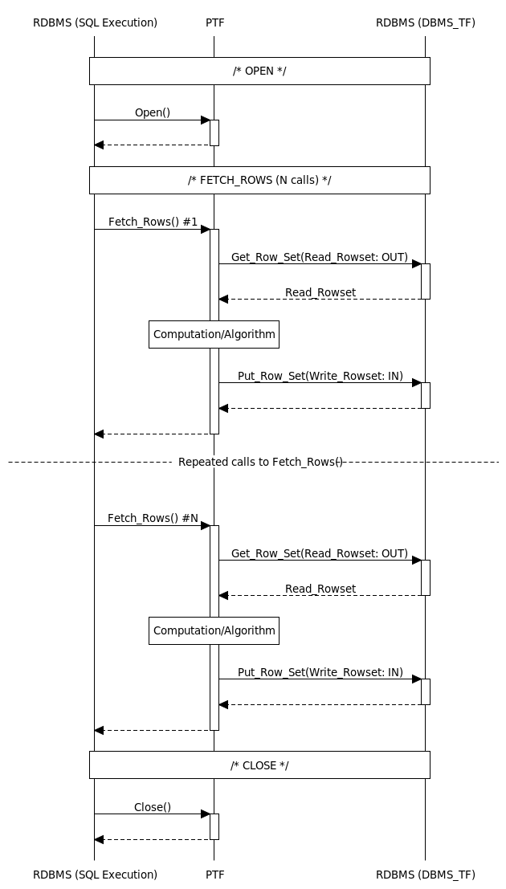

## 182 DBMS\_TF

The DBMS\_TF package contains utilities for Polymorphic Table Functions (PTF) implementation. You can use DBMS\_TF subprograms to consume and produce data, and get information about its execution environment.

You must be familiar with the Polymorphic Table Function (PTF) concepts, syntax and semantics.

See Also:

- [Oracle Database PL/SQL Language Reference](https://docs.oracle.com/pls/topic/lookup?ctx=en/database/oracle/oracle-database/21/arpls&id=LNPLS-GUID-981102A8-5204-4931-B10A-93486304B184) for an overview of Polymorphic Table Function (PTF) concepts
- [Oracle Database PL/SQL Language Reference](https://docs.oracle.com/pls/topic/lookup?ctx=en/database/oracle/oracle-database/21/arpls&id=LNPLS-GUID-FA182210-C68D-4E03-85B9-A6C681099705) for more information about `CREATE` `FUNCTION` `PIPELINED` clause syntax and semantics

### 182.1 DBMS\_TF Overview

The DBMS\_TF package contains types, constants, and subprograms that can be used by Polymorphic Table Functions (PTFs).

Polymorphic Table Functions (PTFs) need various services from the database to implement their functionality. PTFs need a mechanism to get rows from the database and send back new rows, for instance. The DBMS\_TF package provides these server and client interfaces utilities.

### 182.2 DBMS\_TF Security Model

PUBLIC is granted the EXECUTE privilege on package DBMS\_TF. Its subprograms execute with invoker's rights privileges.

### 182.3 DBMS\_TF Constants

This topic describes useful constants defined in the DBMS\_TF package.

The `DBMS_TF` package defines several enumerated constants that should be used for specifying parameter values or types. Enumerated constants must be prefixed with the package name, for example, `DBMS_TF`.`TYPE_DATE`.

Table 182-1 DBMS\_TF Supported Types

| Name | Description |
| --- | --- |
| `TYPE_BINARY_DOUBLE` | Type code for `BINARY_DOUBLE` |
| `TYPE_BINARY_FLOAT` | Type code for `BINARY_FLOAT` |
| `TYPE_BLOB` | Type code for `BLOB` |
| `TYPE_CHAR` | Type code for `CHAR` |
| `TYPE_CLOB` | Type code for `CLOB` |
| `TYPE_DATE` | Type code for `DATE` |
| `TYPE_INTERVAL_DS` | Type code for `INTERVAL_DS` |
| `TYPE_INTERVAL_YM` | Type code for `INTERVAL_YM` |
| `TYPE_NUMBER` | Type code for `NUMBER` |
| `TYPE_ROWID` | Type code for `ROWID` |
| `TYPE_RAW` | Type code for `RAW` |
| `TYPE_TIMESTAMP` | Type code for `TIMESTAMP` |
| `TYPE_TIMESTAMP_TZ` | Type code for `TIMESTAMP_TZ` |
| `TYPE_VARCHAR2` | Type code for `VARCHAR2` |

Additional constants are defined for use with specific subprograms.

See Also:

### 182.4 DBMS\_TF Operational Notes

These operational notes describe the client and the server-side interfaces, and detail the compilation and execution statement management of Polymorphic Table Functions (PTF).

#### 182.4.1 PTF Client Interface

The Polymorphic Table Function (PTF) implementation client interface is a set of subprograms with fixed names that every PTF must provide.

The PTF client interface can have up to four subprograms as follow:

- `DESCRIBE` function (Required)
- `OPEN` procedure (Optional)
- `FETCH_ROWS` procedure (Optional)
- `CLOSE` procedure (Optional)

The function `DESCRIBE` is invoked during SQL cursor compilation.

The procedures `OPEN`, `FETCH_ROWS`, and `CLOSE` are invoked during query execution.

The arguments to the implementation functions must match the PTF function with the following modifications:

1. Arguments of the type `TABLE` and `COLUMNS` are skipped for the execution procedures `OPEN`,` FETCH_ROWS`, and ` CLOSE`.
2. The `TABLE` and `COLUMNS` arguments have descriptor types for the `DESCRIBE` function.
3. Scalar arguments that are not available during compilation are passed as NULL values (when using bind variables for instance). During execution, the actual values are passed in.

DESCRIBE Function

The `DESCRIBE` function is invoked to determine the type of rows (row shape) produced by the Polymorphic Table Function (PTF). It returns a `DBMS_TF.DESCRIBE_T` table.

The function `DESCRIBE` is invoked during SQL cursor compilation when a SQL query references a PTF. The SQL compiler locates the `DESCRIBE` function defined in the PTF implementation package. All the argument values from the query calling the PTF are passed to the `DESCRIBE` function. Like any PLSQL function, the `DESCRIBE` function can be overloaded and can have arguments default values.

The arguments of the PTF function and `DESCRIBE` function must match, but with the type of any `TABLE` argument replaced with the `DBMS_TF.TABLE_T` descriptor type, and the type of any `COLUMNS` argument replaced with `DBMS_TF.COLUMN_T` descriptor.

The `DESCRIBE` function indicates which columns must be kept by the database and passed unchanged as the PTF output (Pass-Through columns). In addition, the `DESCRIBE` function indicates any input columns that the PTF will use for its computation (Read columns).

Finally, the `DESCRIBE` function returns the list of any new columns that the PTF will create (or `NULL` if no new columns are being produced) using the `DBMS_TF.DESCRIBE_T` descriptor.

OPEN Procedure

The `OPEN` procedure purpose is to initialize and allocate any execution specific state. The `OPEN` procedure is most useful when you implement a Table Semantics PTF. The function typically calls the `GET_XID` function to get a unique ID for managing the execution state.

`OPEN` procedure is generally invoked before calling the `FETCH_ROWS` procedure.

FETCH\_ROWS Procedure

The `FETCH_ROWS` procedure produces an output rowset that it sends to the database. The number of invocations of this function and the size of each rowset are data dependent and determined during query execution.

CLOSE Procedure

The `CLOSE` procedure is called at the end of the PTF execution. The procedure releases resources associated with the PTF execution state.

Example 182-1 Noop Polymorphic Table Function Example

This example creates a PTF called noop. This PTF returns the input rows as the output rows without any modification or filtering. Noop is one of the smallest PTF you can write.

Live SQL:

You can view and run this example on Oracle Live SQL at [Noop Polymorphic Table Function](https://livesql.oracle.com/apex/livesql/docs/arpls/ptf/ptfnoop.html)

To implement the noop PTF, you first create the implementation package noop\_package.

```
CREATE PACKAGE noop_package AS
   FUNCTION describe(t IN OUT DBMS_TF.TABLE_T)
     RETURN DBMS_TF.DESCRIBE_T;

   PROCEDURE fetch_rows;
END noop_package;
```

The `DESCRIBE` function does not produce any new columns and hence, returns `NULL`. Executing `FETCH_ROWS` also results in `NULL`.

```
CREATE PACKAGE BODY noop_package AS
   FUNCTION describe(t IN OUT DBMS_TF.TABLE_T)
     RETURN DBMS_TF.DESCRIBE_T AS
     BEGIN
       RETURN NULL;
     END;

   PROCEDURE fetch_rows AS
   BEGIN
     RETURN;
   END;
END noop_package;
```

The noop PTF is defined to execute the noop\_package when it is invoked.

```
CREATE FUNCTION noop (t TABLE)
  RETURN TABLE PIPELINED ROW POLYMORPHIC USING noop_package;
```

The PTF can be invoked in queries. For example:

```
SELECT *
FROM   NOOP(emp)
WHERE deptno = 10;
```
```
7782 CLARK      MANAGER         7839 09-JUN-81       2450        10
7839 KING       PRESIDENT            17-NOV-81       5000        10
7934 MILLER     CLERK           7782 23-JAN-82       1300        10
```
```
WITH e
     AS (SELECT *
         FROM   emp
                NATURAL JOIN dept
         WHERE dname = 'SALES')
SELECT t.*
FROM   NOOP(e) t;
```
```
30       7499 ALLEN      SALESMAN        7698 20-FEB-81       1600       300 SALES          CHICAGO
30       7521 WARD       SALESMAN        7698 22-FEB-81       1250       500 SALES          CHICAGO
30       7654 MARTIN     SALESMAN        7698 28-SEP-81       1250      1400 SALES          CHICAGO
30       7698 BLAKE      MANAGER         7839 01-MAY-81       2850           SALES          CHICAGO
30       7844 TURNER     SALESMAN        7698 08-SEP-81       1500         0 SALES          CHICAGO
30       7900 JAMES      CLERK           7698 03-DEC-81        950           SALES          CHICAGO
```

##### 182.4.1.1 DESCRIBE Only Polymorphic Table Function

A Polymorphic Table Function (PTF) can have a DESCRIBE function only.

A PTF which does not have any runtime methods (Open/Fetch\_Rows/Close) is used only at cursor compilation time with no runtime row source allocated. The explain plan output of a Describe-Only PTF will not show any rows for the PTF.

#### 182.4.2 PTF Server Side Interface

The `DBMS_TF` package provides the server side interface needed for Polymorphic Table Functions (PTFs) implementation to read and write information in the database.

This topic contains a partial list of types and subprograms used for the PTF server side implementation.

Table 182-2 Summary of Commonly Used Types and Subprograms in PTF Server Side Interface

| NAME | DESCRIPTION |
| --- | --- |
| `COLUMN_METADATA_T` | Column metadata record |
| `COLUMN_T` | Column descriptor record |
| `TABLE_T` | Table descriptor record |
| `COLUMNS_T` | Collection containing column names |
| `COLUMNS_NEW_T` | Collection for new columns |
| `TAB_<typ>_T` | Collection for each supported types, where \<typ> is described in " Supported Types Collections " |
| `ROW_SET_T` | Data for a rowset record |
| `GET_COL` Procedure | Fetches data for a specified (input) column |
| `PUT_COL` Procedure | Returns data for a specified (new) column |
| `GET_ROW_SET` Procedure | Fetches the input rowset of column values |
| `PUT_ROW_SET` Procedure | Returns data for ALL (new) columns |
| `SUPPORTED_TYPE` Function | Verifies if a type is supported by `DBMS_TF` subprograms |
| `GET_XID` Function | Returns a unique execution ID to index PTF state in a session |

See Also:

- DBMS\_TF Data Structures for the complete list of types
- Summary of DBMS\_TF Subprograms for the complete list of subprograms

#### 182.4.3 Read Columns

Read columns are a set of table columns that the Polymorphic Table Function (PTF) processes when executing the `FETCH_ROWS` procedure.

The PTF indicates the read columns inside `DESCRIBE` by annotating them in the input table descriptor, `TABLE_T`. Only the indicated read columns will be fetched and thus available for processing during `FETCH_ROWS`.

The PTF invocation in a query will typically use the `COLUMNS` operator to indicate which columns the query wants the PTF to read, and this information is passed to the `DESCRIBE` function which then in turn sets the `COLUMN_T`.`FOR_READ` boolean flag.

Only scalar SQL data types are allowed for the read columns.

The Echo Polymorphic Table Function Example takes a table and a list of columns and produces new columns with the same values.

#### 182.4.4 Pass-Through Columns

Pass-through columns are passed from the input table of the Polymorphic Table Function (PTF) to the output, without any modifications.

The `DESCRIBE` function indicates the pass-through columns by setting the `COLUMN_T.PASS_THROUGH` boolean flag on the input table descriptor, `DBMS_TF.TABLE_T`.

All columns in the `Row Semantics` PTF are marked as pass-through by default. For `Table Semantics` PTF, the default value for pass-through is set to false. For the `Table Semantics` PTF, the partitioning columns are always pass-through and this cannot be changed by the DESCRIBE function.

Note, the notions of Pass-Through and Read are orthogonal, and indicating a column as one has no implication for the other.

#### 182.4.5 State Management

The database manages the compilation and execution states of the polymorphic table functions (PTF).

The database fulfills the PTF conductor role. As such, it is responsible for the PTF compilation state and execution state.

1. Compilation State: This is the immutable state that is generated by `DESCRIBE` which is needed before execution.
2. Execution State: This is the state used by the execution time procedures (`OPEN`, `FETCH_ROWS`, and `CLOSE`) of a `Table semantics` PTF.

The most common use of compilation state is to keep track of the columns to be read and the new columns that are to be produced. The PTF Server interface provides functions that can be used to achieve this: `GET_ENV`, and `GET_ROW_SET`. The PTF author who defines, documents, and implements the PTF can rely on the database to manage the PTF states. The PTF author should not attempt to use the session state (such as PL/SQL package global variables) to store any compilation state. Problems can arise because in a given session all cursors using the PTF will share that state, and other sessions executing the PTF cursor will not see the original compilation state.

Since the execution state is session and cursor private, a `Table Semantics` PTF can use package globals for storing execution state, but with the provision that the PTF uses the database provided unique execution ID to identify that state. The `GET_XID` function guarantees to provide an execution unique ID for the PTF's execution procedures, where this ID remains constant for all the execution functions of a PTF.

##### 182.4.5.1 CSTORE Compilation State Management

The CSTORE is the PTF compilation state management interface.

The CSTORE enables Polymorphic Table Functions (PTF) to store the compilation state in the SQL cursor.

The CSTORE interface is used to store key-value pairs during cursor compilation through the `DBMS_TF.DESCRIBE_T` record.

The compilation state information is retrieved during execution procedures such as `OPEN`, `FETCH_ROWS` and `CLOSE`.

CSTORE Subprograms

The CSTORE interface consists of the following subprograms.

| Name | Description |
| --- | --- |
| `CSTORE_GET` procedure | Fetches item of specified type. If not found, the OUT value remains unchanged. |
| `CSTORE_EXISTS` function | If an item with the given key exists in the CSTORE, this function returns TRUE. |

CSTORE Supported Types

The `DBMS_TF.DESCRIBE_T` supports specifying key-value pairs for these scalar types: `VARCHAR2`, `NUMBER`, `DATE`, `BOOLEAN`.

Table 182-3 DBMS\_TF CSTORE Scalar Supported Types

| Name | Description |
| --- | --- |
| `CSTORE_TYPE_VARCHAR2` | CSTORE `VARCHAR2` type code |
| `CSTORE_TYPE_NUMBER` | CSTORE `NUMBER` type code |
| `CSTORE_TYPE_DATE` | CSTORE `DATE` type code |
| `CSTORE_TYPE_BOOLEAN` | CSTORE `BOOLEAN` type code |

Collections For Compilation Storage

These predefined collection types are used for compilation state management.

```
TYPE CSTORE_CHR_T IS TABLE OF VARCHAR2(32767)  INDEX BY VARCHAR2(32767);
TYPE CSTORE_NUM_T IS TABLE OF NUMBER           INDEX BY VARCHAR2(32767);
TYPE CSTORE_BOL_T IS TABLE OF BOOLEAN          INDEX BY VARCHAR2(32767);
TYPE CSTORE_DAT_T IS TABLE OF DATE             INDEX BY VARCHAR2(32767);
```

DBMS\_TF Method Names

The method names are also stored in the `DBMS_TF.DESCRIBE_T` record. These predefined values for the method names can be customized by the PTF author.

See Method Name Overrides for more information about changing the default method names

Table 182-4 DBMS\_TF Method Names Constants

| Name | Type | Value | Description |
| --- | --- | --- | --- |
| `CLOSE` | `DBMS_QUOTED_ID` | ‘CLOSE’ | Predefined index value for the method named CLOSE |
| `FETCH_ROWS` | `DBMS_QUOTED_ID` | ‘FETCH\_ROWS’ | Predefined index value for the method named FETCH\_ROWS |
| `OPEN` | `DBMS_QUOTED_ID` | ‘OPEN’ | Predefined index value for the method named OPEN |

##### 182.4.5.2 XSTORE Execution State Management

XSTORE is the PTF execution state management interface.

The `XSTORE` key-value interface simplifies the implementation of `Table Semantics` PTFs by providing automatic state management capabilities when the keys are strings and values are of commonly used scalar types.

The database automatically manages the deletion of all execution states allocated using this interface.

XSTORE Subprograms

The execution state management interface consists of the following subprograms.

Table 182-5 DBMS\_TF XSTORE Subprograms

| Name | Description |
| --- | --- |
| `XSTORE_CLEAR` procedure | Removes all key-value pairs from the XSTORE execution state |
| `XSTORE_EXISTS` function | Returns TRUE if an item with a given key exists in the XSTORE |
| `XSTORE_GET` procedure | Gets the associated value for a given key stored in the XSTORE |
| `XSTORE_REMOVE` procedure | Removes an item associated with the given key and key\_type |
| `XSTORE_SET` procedure | Sets the value for the given key for PTF Execution State Management |

XSTORE Predefined Types

The XSTORE supports specifying key-value pairs for these scalar types:` VARCHAR2`, `NUMBER`, `DATE`, and ` BOOLEAN`.

Table 182-6 DBMS\_TF XSTORE Scalar Supported Types

| Name | Description |
| --- | --- |
| `XSTORE_TYPE_VARCHAR2` | XSTORE `VARCHAR2` type code |
| `XSTORE_TYPE_NUMBER` | XSTORE `NUMBER` type code |
| `XSTORE_TYPE_DATE` | XSTORE `DATE` type code |
| `XSTORE_TYPE_BOOLEAN` | XSTORE `BOOLEAN` type code |

#### 182.4.6 Method Name Overrides

When multiple polymorphic table function (PTF) implementations are in the same package, you can override the default runtime method names (`OPEN`, `FETCH_ROWS`, and `CLOSE`) with your PTF specific names.

To override a method name, the application can specify the new method names using `DBMS_TF` `METHOD_NAMES` collection ( see DESCRIBE\_T Record Type).

See Also:

Table 182-4

Example 182-2 DBMS\_TF Method Name Overrides

This example shows how to change the default method name of the noop\_p PTF fetch\_rows method to noop\_fetch.

Live SQL:

You can view and run this example on Oracle Live SQL at [DBMS\_TF Method Name Overrides](https://livesql.oracle.com/apex/livesql/docs/arpls/ptf/noop_method_overrides.html)

Create the PTF implementation package noop\_p.

```
CREATE PACKAGE noop_p AS
   FUNCTION describe(tab IN OUT DBMS_TF.table_t)
               RETURN DBMS_TF.describe_t;
   PROCEDURE noop_fetch;
END noop_p;
```

To provide a method name override, you can specify the new method names using DBMS\_TF.Method\_Names collection. The FETCH\_ROWS method name is changed to 'Noop\_Fetch'. The procedure noop\_fetch to implement this method is defined in the package.

```
CREATE OR replace PACKAGE BODY noop_p 
AS
   FUNCTION describe(tab IN OUT DBMS_TF.table_t)
               RETURN DBMS_TF.describe_t AS
      methods DBMS_TF.methods_t := DBMS_TF.methods_t(DBMS_TF.fetch_rows => 'Noop_Fetch');
     BEGIN
          RETURN DBMS_TF.describe_t(method_names => methods);
   END;
   PROCEDURE noop_fetch AS 
     BEGIN 
         RETURN; 
   END;
END noop_p;
```

The noop PTF is defined to execute the noop\_p when it is invoked.

```
CREATE FUNCTION noop (t TABLE) RETURN TABLE PIPELINED ROW POLYMORPHIC USING noop_p;
```

The PTF is invoked in the FROM clause of a query block.

```
SELECT *  
FROM noop(scott.emp) 
WHERE deptno =10;
```

#### 182.4.7 Using the COLUMNS Pseudo-Operator

The `COLUMNS` pseudo-operator is an addition to the SQL expression language.

Use the `COLUMNS` pseudo-operator to specify the arguments when invoking a Polymorphic Table Function (PTF) in the `FROM` clause. The `COLUMNS` pseudo-operator arguments specify the list of column names, or the list of column names with associated types.

See Also:

[Oracle Database PL/SQL Language Reference](https://docs.oracle.com/pls/topic/lookup?ctx=en/database/oracle/oracle-database/21/arpls&id=LNPLS-GUID-AB520C25-6735-4E5D-AC01-6237CD32BE17) for more information about the COLUMNS pseudo-operator syntax and semantics

#### 182.4.8 Query Transformations

About predicate, projection and partitioning.

The pass-through columns of a `Row Semantics` PTF, and the `PARTITION BY` key columns of a `Table Semantics` PTF can be used for projection and predicate pushdown.

Example 182-3 Query Transformations

This example illustrates the predicate and projection pushdown for a `Row Semantics` PTF.

This query calls the echo PTF created in Echo Polymorphic Table Function Example.
```
SELECT empno, ename, sal, comm, echo_sal
FROM echo(emp, COLUMNS(sal,comm))
WHERE deptno = 30 
  AND echo_sal > 1000;
```
```
EMPNO ENAME             SAL       COMM   ECHO_SAL
---------- ---------- ---------- ---------- ----------
      7499 ALLEN            1600        300       1600
      7521 WARD             1250        500       1250
      7654 MARTIN           1250       1400       1250
      7698 BLAKE            2850                  2850
      7844 TURNER           1500          0       1500
```
Conceptually, this query will get rewritten as:

```
WITH t AS (SELECT empno, ename, sal, comm
FROM emp
WHERE deptno=30)
SELECT empno, ename, sal, comm, echo_sal
FROM echo(t, COLUMNS(sal, comm))
WHERE echo_sal > 1000;
```

#### 182.4.9 Parallel Execution

A key benefit of Polymorphic Table Functions (PTFs) is that their execution can be parallelized.

Row and table semantic PTFs execute in parallel differently.

Row Semantics PTF

Under `Row Semantics` PTF, the parallel query executes with the same degree of parallelism (DOP) as it would if the PTF were not present. The DOP is driven by the child row source.

Provided that the DOP on table emp has been set to 5, the following is an example that shows this parallelization:

```
EXPLAIN PLAN FOR
SELECT * FROM echo(emp, COLUMNS(ename, job))
WHERE deptno != 20;
---------------------------------------------------
| Id | Operation                        | Name     |
---------------------------------------------------
| 0 | SELECT STATEMENT                  |          |
| 1 | PX COORDINATOR                    |          |
| 2 | PX SEND QC (RANDOM)               | :TQ10000 |
| 3 | POLYMORPHIC TABLE FUNCTION        | ECHO     |
| 6 | PX BLOCK ITERATOR                 |          |
|* 7 | TABLE ACCESS FULL                | EMP      |
---------------------------------------------------
Predicate Information (identified by operation id):
---------------------------------------------------
5 - filter("EMP"."DEPTNO"<>20)
```

Table Semantics PTF

`Table Semantics` PTF requires its input table rows to be redistributed using the `PARTITION BY` key. The parallel execution is determined by the `PARTITION BY` clause specified in the query.

### 182.5 DBMS\_TF Execution Flow

Query executions invoking Polymorphic Table Functions (PTF) follow this execution model and data transfers flow.

The PTF execution procedures (`OPEN`, `FETCH_ROWS` and `CLOSE`) are called by the database during query execution.

The PTF execution follows this flow:
1. `OPEN` (if present)
2. `FETCH_ROWS` (can be invoked multiple times)
3. `CLOSE` (if present)



> The figure is fully described in the topic.
>
> [  
> Copyright © 1996, 2025, Oracle and/or its affiliates.](https://docs.oracle.com/en/database/oracle/oracle-database/dcommon/html/cpyr.htm)


The `FETCH_ROWS` procedure reads the data for a rowset (collection of rows), and produces an output rowset.

Each call to `FETCH_ROWS` is associated with a rowset which is a data collection of input rows that is expected to be processed by the PTF.

The `GET_ROW_SET` or `GET_COL` is used to read the input rowset.

The `PUT_ROW_SET` or `PUT_COL` is used to produce an output rowset, that is written back to the database.

`PUT_ROW_SET` is used to set all the new columns in a single call.

The `ROWSET_T` record holds data for multiple columns. When the PTF algorithm is more suited toward producing a single output column at a time, you can use `PUT_COL` to produce a single column. A given column can only be produced once within a call to `FETCH_ROWS`.

For a `Row Semantics` PTF, the `FETCH_ROWS` procedure will return the new rows using the PTF Server interface before returning back to the database.

### 182.6 DBMS\_TF Restrictions

These restrictions apply to Polymorphic Table Functions (PTFs) and using the DBMS\_TF package.

Type Restrictions

A Polymorphic Table Function (PTF) can operate on a table with columns of any SQL types. However, read and new columns are restricted to scalar types. The read and new columns are used in the `PUT_ROW_SET`, `PUT_COL`, `GET_ROW_SET` and `GET_COL` procedures. All SQL types can be used with pass-through columns. The `DESCRIBE` function can determine the supported types using the `DBMS_TF.SUPPORTED_TYPE` function.

PTF Invocation and Execution Restrictions

Polymorphic table functions cannot be nested in the `FROM` clause of a query. Nesting PTF is only allowed using `WITH` clause.

Nesting table function with polymorphic table function is only allowed using `CURSOR` expressions. A PTF cannot be specified as an argument of a table function.

You cannot select a rowid from a Polymorphic Table Function (PTF).

The `PARTITION BY` and the `ORDER BY` clause can only be specified on an argument of a `Table Semantics` PTF.

The PTF execution methods `OPEN`, `FETCH_ROWS`, and `CLOSE` must be invoked in the polymorphic table function execution context only.

You cannot invoke the `DESCRIBE` method directly.

This example shows ten PTF nested invocation.

```
WITH t0
     AS (SELECT /*+ parallel */ *
         FROM   noop(dept)),
     t1
     AS (SELECT *
         FROM   noop(t0)),
     t2
     AS (SELECT *
         FROM   noop(t1)),
     t3
     AS (SELECT *
         FROM   noop(t2)),
     t4
     AS (SELECT *
         FROM   noop(t3)),
     t5
     AS (SELECT *
         FROM   noop(t4)),
     t6
     AS (SELECT *
         FROM   noop(t5)),
     t7
     AS (SELECT *
         FROM   noop(t6)),
     t8
     AS (SELECT *
         FROM   noop(t7)),
     t9
     AS (SELECT *
         FROM   noop(t8))
SELECT *
FROM   noop(t9)
WHERE  deptno = 10;
```
```
10 ACCOUNTING     NEW YORK
```

### 182.7 DBMS\_TF Examples

These examples use DBMS\_TF subprograms.

Summary of DBMS\_TF Examples

These examples are incomplete and for demonstration purpose only.

- Example 182-1, "Noop Polymorphic Table Function"
- Echo Polymorphic Table Function Example
- Example 182-2, "DBMS\_TF Method Name Overrides"
- Example 182-3, "Query Transformations"
- Example 182-5, "DBMS\_TF.COLUMN\_TYPE\_NAME Example"
- Example 182-6, "DBMS\_TF.COL\_TO\_CHAR Example"
- Example 182-7, "DBMS\_TF.CSTORE\_EXISTS Example"
- Example 182-8, "DBMS\_TF.GET\_COL Example"
- Example 182-9, "DBMS\_TF.GET\_ENV Example"
- Example 182-10, "DBMS\_TF.GET\_ROW\_SET Example"
- Example 182-12, "DBMS\_TF.GET\_XID Example"
- Rand\_col Polymorphic Table Function Example, ( DBMS\_TF.PUT\_COL Example)
- Stack Polymorphic Table Function Example
- Split Polymorphic Table Function Example, (DBMS\_TF.GET\_ROW\_SET and PUT\_ROW\_SET Example)
- Example 182-14, "DBMS\_TF.PUT\_ROW\_SET Example"
- Example 182-16, "Replicate: DBMS\_TF.ROW\_REPLICATION Example"
- Example 182-17, "DBMS\_TF.ROW\_TO\_CHAR Example"
- Example 182-18, "DBMS\_TF.TRACE Example"
- Row\_num Polymorphic Table Function Example, (DBMS\_TF.XSTORE\_GET and XSTORE\_SET Example)

In other books:

- [Oracle PL/SQL Language Reference](https://docs.oracle.com/pls/topic/lookup?ctx=en/database/oracle/oracle-database/21/arpls&id=LNPLS-GUID-695FBA1A-89EA-45B4-9C81-CA99F6C794A5), "Skip\_col Polymorphic Table Function Example"
	[Oracle PL/SQL Language Reference](https://docs.oracle.com/pls/topic/lookup?ctx=en/database/oracle/oracle-database/21/arpls&id=LNPLS-GUID-F8E13DDD-710D-4626-824E-B344849C5AFE), "To\_doc Polymorphic Table Function Example"

#### 182.7.1 Echo Polymorphic Table Function Example

The echo PTF takes in a table and a list of columns and produces new columns with same values.

This PTF returns all the columns in the input table tab, and adds to it the columns listed in cols but with the column names prefixed with "ECHO\_".

Live SQL:

You can view and run this example on Oracle Live SQL at [Echo Polymorphic Table Function](https://livesql.oracle.com/apex/livesql/docs/arpls/ptf/ptfecho.html)

The echo PTF can appear in the FROM clause of the query. The COLUMNS operator is used to specify columns, for example:

```
SELECT *
FROM echo(scott.dept, COLUMNS(dname, loc)); 
  
   DEPTNO DNAME          LOC           ECHO_DNAME     ECHO_LOC
---------- -------------- ------------- -------------- -------------
        10 ACCOUNTING     NEW YORK      ACCOUNTING     NEW YORK
        20 RESEARCH       DALLAS        RESEARCH       DALLAS
        30 SALES          CHICAGO       SALES          CHICAGO
        40 OPERATIONS     BOSTON        OPERATIONS     BOSTON
```

A PTF consists of the following:
- PTF implementation package specification: The specification must have the DESCRIBE method. The OPEN, FETCH\_ROWS and CLOSE methods are optional.
- PTF implementation package body: The DESCRIBE method may have a new-columns parameter (the additional columns created by this PTF), which is followed by the PTF functions parameters.
- PTF Function: The PTF function has a reference to the implementation package.

The echo\_package package specification defines the DESCRIBE and FETCH\_ROWS methods.

```
CREATE PACKAGE echo_package
AS
  prefix DBMS_ID := 'ECHO_';
  FUNCTION describe(
    tab  IN OUT DBMS_TF.TABLE_T,
    cols IN DBMS_TF.COLUMNS_T)
  RETURN DBMS_TF.DESCRIBE_T;
  PROCEDURE fetch_rows;
END echo_package;
```

The echo\_package package body contains the PTF implementation.

```
CREATE PACKAGE BODY echo_package
AS
  FUNCTION describe(tab  IN OUT DBMS_TF.TABLE_T,
                    cols IN DBMS_TF.COLUMNS_T)
  RETURN DBMS_TF.DESCRIBE_T
  AS
    new_cols DBMS_TF.COLUMNS_NEW_T;
    col_id   PLS_INTEGER := 1;
  BEGIN
      FOR I IN 1 .. tab.COLUMN.COUNT LOOP
          FOR J IN 1 .. cols.COUNT LOOP
              IF ( tab.COLUMN(i).description.name = cols(j) ) THEN
                IF ( NOT DBMS_TF.SUPPORTED_TYPE(tab.COLUMN(i).description.TYPE) )
                THEN
                  RAISE_APPLICATION_ERROR(-20102, 'Unsupported column type [' ||
                  TAB.COLUMN(i).description.TYPE||']');
                END IF;

                TAB.COLUMN(i).for_read := TRUE;
                NEW_COLS(col_id) := TAB.COLUMN(i).description;
                NEW_COLS(col_id).name := prefix || TAB.COLUMN(i).description.name;
                col_id := col_id + 1;

                EXIT;
              END IF;
          END LOOP;
      END LOOP;

      /* Verify all columns were found */
      IF ( col_id - 1 != cols.COUNT ) THEN
        RAISE_APPLICATION_ERROR(-20101, 'Column mismatch ['||col_id - 1||'], ['||cols.COUNT||']');
      END IF;

      RETURN DBMS_TF.DESCRIBE_T(new_columns => new_cols);
  END;
  PROCEDURE FETCH_ROWS
  AS
    ROWSET DBMS_TF.ROW_SET_T;
  BEGIN
      DBMS_TF.GET_ROW_SET(rowset);
      DBMS_TF.PUT_ROW_SET(rowset);
  END;
END echo_package;
```

The PTF echo references the implementation package echo\_package.

```
CREATE FUNCTION echo(tab TABLE,
                     cols COLUMNS)
  RETURN TABLE 
  PIPELINED ROW POLYMORPHIC USING echo_package;
```

Example 182-4 Using the Echo PTF in Queries

This example selects all employees in department 20. The resulting rows have three new columns `ECHO_ENAME`, `ECHO_HIREDATE`, and `ECHO_SAL`.

```
SELECT *
FROM   echo(scott.emp, COLUMNS(ename, sal, hiredate))
WHERE  deptno = 20;
```
```
EMPNO ENAME JOB      MGR  HIREDATE  SAL  COMM DEPTNO ECHO_ENAME ECHO_HIRE ECHO_SAL 
----- ----- -------- ---- --------- ---- ---- ------ ---------- --------- -------- 
7369  SMITH CLERK    7902 17-DEC-80  800          20 SMITH      17-DEC-80      800
7566  JONES MANAGER  7839 02-APR-81 2975          20 JONES      02-APR-81     2975
7788  SCOTT ANALYST  7566 19-APR-87 3000          20 SCOTT      19-APR-87     3000
7876  ADAMS CLERK    7788 23-MAY-87 1100          20 ADAMS      23-MAY-87     1100
7902  FORD  ANALYST  7566 03-DEC-81 3000          20 FORD       03-DEC-81     3000
```

Using subquery `W`, display `ENAME`, `ECHO_LOC` and `DNAME` columns for all employees in department 30 with a salary greater than 1000.

```
WITH w
     AS (SELECT e.*,
                dname,
                loc
         FROM   scott.emp e,
                scott.dept d
         WHERE  e.deptno = d.deptno)
SELECT ename,
       echo_loc,
       dname
FROM   echo(w, COLUMNS(sal, dname, loc, hiredate))
WHERE  deptno = 30
       AND echo_sal > 1000;
```
```
ENAME      ECHO_LOC        DNAME   
---------- --------------- -------- 
ALLEN      CHICAGO         SALES 
WARD       CHICAGO         SALES  
MARTIN     CHICAGO         SALES 
BLAKE      CHICAGO         SALES 
TURNER     CHICAGO         SALES
```

Using subquery `W`, display `ENAME` and `DNAME` columns for all employees with a salary greater than 1000.

```
WITH w
     AS (SELECT e.*,
                dname,
                loc
         FROM   scott.emp e,
                scott.dept d
         WHERE  e.deptno = d.deptno)
SELECT echo_ename,
       dname
FROM   echo(w, COLUMNS(loc, deptno, dname, ename)) e
WHERE  ename IN (SELECT echo_ename
                 FROM   echo(scott.emp, COLUMNS(sal, deptno, ename, hiredate))
                 WHERE  deptno = e.echo_deptno
                        AND sal > 1000);
```
```
ECHO_ENAME DNAME   
---------- ---------- 
ALLEN      SALES
MILLER     ACCOUNTING
CLARK      ACCOUNTING
WARD       SALES
ADAMS      RESEARCH
TURNER     SALES
SCOTT      RESEARCH
BLAKE      SALES
JONES      RESEARCH
KING       ACCOUNTING
FORD       RESEARCH
MARTIN     SALES
```

### 182.8 DBMS\_TF Data Structures

The DBMS\_TF package defines these RECORD types, TABLE types and subtype.

Types

- XID\_T Subtype

CSTORE and XSTORE Data Structures

The compilation and execution state management interfaces use data structures internally.

See Collections For Compilation Storage for more information.

#### 182.8.1 Supported Types Collections

Each supported type has a corresponding predefined collection defined.

Syntax

```
TYPE TAB_BOOLEAN_T       IS TABLE OF BOOLEAN       INDEX BY PLS_INTEGER;

TYPE TAB_BINARY_FLOAT_T  IS TABLE OF BINARY_FLOAT  INDEX BY PLS_INTEGER;

TYPE TAB_BINARY_DOUBLE_T IS TABLE OF BINARY_DOUBLE INDEX BY PLS_INTEGER;

TYPE TAB_BLOB_T          IS TABLE OF BLOB          INDEX BY PLS_INTEGER;

TYPE TAB_CHAR_T          IS TABLE OF CHAR(32767)   INDEX BY PLS_INTEGER;

TYPE TAB_CLOB_T          IS TABLE OF CLOB          INDEX BY PLS_INTEGER;

TYPE TAB_DATE_T          IS TABLE OF DATE          INDEX BY PLS_INTEGER;

TYPE TAB_INTERVAL_YM_T   IS TABLE OF YMINTERVAL_UNCONSTRAINED   INDEX BY PLS_INTEGER;

TYPE TAB_INTERVAL_DS_T   IS TABLE OF DSINTERVAL_UNCONSTRAINED   INDEX BY PLS_INTEGER;

TYPE TAB_NATURALN_T      IS TABLE OF NATURALN      INDEX BY PLS_INTEGER; 

TYPE TAB_NUMBER_T        IS TABLE OF NUMBER        INDEX BY PLS_INTEGER;

TYPE TAB_RAW_T           IS TABLE OF RAW(32767)    INDEX BY PLS_INTEGER;

TYPE TAB_ROWID_T         IS TABLE OF ROWID         INDEX BY PLS_INTEGER;

TYPE TAB_VARCHAR2_T      IS TABLE OF VARCHAR2(32767) INDEX BY PLS_INTEGER;

TYPE TAB_TIMESTAMP_T     IS TABLE OF TIMESTAMP_UNCONSTRAINED INDEX BY PLS_INTEGER;

TYPE TAB_TIMESTAMP_TZ_T  IS TABLE OF TIMESTAMP_TZ_UNCONSTRAINED INDEX BY PLS_INTEGER;

TYPE TAB_TIMESTAMP_LTZ_T IS TABLE OF TIMESTAMP_LTZ_UNCONSTRAINED INDEX BY PLS_INTEGER;
```

See Also:

Table 182-1 for more information about the DBMS\_TF supported types

#### 182.8.2 COLUMN\_DATA\_T Record Type

Data for a single column (variant record).

Exactly one variant field is active in the record. The description includes information about the column type that is active.

See Table 182-1 for the list of supported types.

Syntax

```
TYPE COLUMN_DATA_T IS RECORD
 ( description            COLUMN_METADATA_T, 
   tab_varchar2           TAB_VARCHAR2_T,
   tab_number             TAB_NUMBER_T,
   tab_date               TAB_DATE_T,
   tab_binary_float       TAB_BINARY_FLOAT_T,
   tab_binary_double      TAB_BINARY_DOUBLE_T,
   tab_raw                TAB_RAW_T,
   tab_char               TAB_CHAR_T,
   tab_clob               TAB_CLOB_T,
   tab_blob               TAB_BLOB_T,
   tab_timestamp          TAB_TIMESTAMP_T,
   tab_timestamp_tz       TAB_TIMESTAMP_TZ_T,
   tab_interval_ym        TAB_INTERVAL_YM_T,
   tab_interval_ds        TAB_INTERVAL_DS_T,    
   tab_timestamp_ltz      TAB_TIMESTAMP_LTZ_T,
   tab_rowid              TAB_ROWID_T);
```

Fields

Table 182-7 COLUMN\_DATA\_T Fields

| Field | Description |
| --- | --- |
| `description` | The tag defines the metadata for the column indicating which variant field is active. |
| `tab_varchar2` | Variant field |
| `tab_number` | Variant field |
| `tab_date ` | Variant field |
| `tab_binary_float` | Variant field |
| `tab_binary_double` | Variant field |
| `tab_raw` | Variant field |
| `tab_char` | Variant field |
| `tab_clob` | Variant field |
| `tab_blob` | Variant field |
| `tab_timestamp` | Variant field |
| `tab_timestamp_tz` | Variant field |
| `tab_interval_ym` | Variant field |
| `tab_interval_ds` | Variant field |
| `tab_timestamp_ltz` | Variant field |
| `tab_rowid` | Variant field |

#### 182.8.3 COLUMN\_METADATA\_T Record Type

This type contains metadata about an existing table column or a new column produced by PTF.

Syntax

```
TYPE COLUMN_METADATA_T IS RECORD 
  ( type               PLS_INTEGER,
    max_len            PLS_integer DEFAULT -1,
    name               VARCHAR2(32767),
    name_len           PLS_INTEGER,
    precision          PLS_INTEGER,
    scale              PLS_INTEGER,
    charsetid          PLS_INTEGER,
    charsetform        PLS_INTEGER,
    collation          PLS_INTEGER );
```

Fields

Table 182-8 COLUMN\_METADATA\_T Fields

| Field | Description |
| --- | --- |
| `type` | Internal Oracle typecode for the column's type |
| `max_len` | Maximum length of a column. If it is less than the maximum allowed length then that value will be used, if it is NULL or zero, zero will be used. If it is less than zero, then maximum allowed length will be used. If types (like date,float), does not care about length, then this value will be ignored. |
| `name` | Name of the column |
| `name_len` | Length of the name |
| ` precision` | The precision, or the maximum number of significant decimal digits (for numeric data types) |
| `scale` | Scale, or the number of digits from the decimal point to the least significant digit (for numeric data types) |
| `charsetid` | Character set id (internal Oracle code, applies to string types) |
| `charsetform` | Character set form (internal Oracle code, applies to string types) |
| `collation` | Collation id (internal Oracle code, applies to string types) |

#### 182.8.4 COLUMN\_T Record Type

The column descriptor record for the type COLUMN\_METADATA\_T that contains PTF specific attributes.

Syntax

```
TYPE column_t IS RECORD (
    description            COLUMN_METADATA_T, 
    pass_through           BOOLEAN,      
    for_read               BOOLEAN);
```

Fields

Table 182-9 COLUMN\_T Fields

| Field | Description |
| --- | --- |
| `description` | Column metadata |
| `pass_through` | Is this a pass through column |
| `for_read` | Is this column read by the PTF |

#### 182.8.5 DESCRIBE\_T Record Type

The return type from the DESCRIBE method of PTF.

Syntax

```
TYPE DESCRIBE_T          IS RECORD 
  ( NEW_COLUMNS        COLUMNS_NEW_T DEFAULT COLUMNS_NEW_T(),
    CSTORE_CHR         CSTORE_CHR_T  DEFAULT CSTORE_CHR_T(), 
    CSTORE_NUM         CSTORE_NUM_T  DEFAULT CSTORE_NUM_T(), 
    CSTORE_BOL         CSTORE_BOL_T  DEFAULT CSTORE_BOL_T(),     
    CSTORE_DAT         CSTORE_DAT_T  DEFAULT CSTORE_DAT_T(),   
    METHOD_NAMES       METHODS_T     DEFAULT METHODS_T());
```

Fields

Table 182-10 DESCRIBE\_T Fields

| Field | Description |
| --- | --- |
| `NEW_COLUMNS` | New columns description that will be produced by the PTF |
| `CSTORE_CHR` | CStore array key type: `VARCHAR2` (optional) |
| `CSTORE_NUM` | CStore array key type: `NUMBER` (optional) |
| `CSTORE_BOL` | CStore array key type: `BOOLEAN` (optional) |
| `CSTORE_DAT ` | CStore array key type: `DATE` (optional) |
| `METHOD_NAMES` | Method names, if user wants to override `OPEN`, `FETCH_ROWS`, `CLOSE` methods |

#### 182.8.6 ENV\_T Record Type

This record contains metadata about the polymorphic table function execution state.

Syntax

```
TYPE ENV_T IS RECORD (
  get_columns      TABLE_METADATA_T,
  put_columns      TABLE_METADATA_T,
  ref_put_col      REFERENCED_COLS_T,
  parallel_env     PARALLEL_ENV_T,
  query_optim      BOOLEAN, 
  row_count        PLS_INTEGER,
  row_replication  BOOLEAN, 
  row_insertion    BOOLEAN);
```

Fields

Table 182-11 ENV\_T Fields

| Field | Description |
| --- | --- |
| `get_columns` | Metadata about the columns read by PTF `GET_COL` procedure |
| `put_columns` | Metadata about columns sent back to database by `PUT_COL` procedure |
| `ref_put_col` | TRUE if the put column was referenced in the query |
| `parallel_env` | Parallel execution information (when a query runs in parallel) |
| `query_optim` | Is this execution for query optimization?  TRUE, if the query was running on behalf of optimizer |
| `row_count` | Number of rows in current row set |
| `row_replication` | Is Row Replication Enabled? |
| `row_insertion` | Is Row Insertion Enabled? |

#### 182.8.7 PARALLEL\_ENV\_T Record Type

The record contains metadata specific to polymorphic table functions parallel execution.

Syntax

```
TYPE PARALLEL_ENV_T         IS RECORD
  ( instance_id      PLS_INTEGER,  
    session_id       PLS_INTEGER,
    slave_svr_grp    PLS_INTEGER, 
    slave_set_no     PLS_INTEGER, 
    no_slocal_slaves PLS_INTEGER, 
    global_slave_no  PLS_INTEGER, 
    no_local_slaves  PLS_INTEGER,
    local_slave_no   PLS_INTEGER );
```

Fields

Table 182-12 PARALLEL\_ENV\_T Fields

| Field | Description |
| --- | --- |
| `instance_id` | QC instance ID |
| `session_id` | QC session ID |
| `slave_svr_grp` | Slave server group |
| `slave_set_no` | Slave server set number |
| `no_slocal_slaves` | Number of sibling slaves (including self) |
| `global_slave_no` | Global slave number (base 0) |
| `no_local_slaves` | Number of sibling slaves running on instance |
| `local_slave_no` | Local slave number (base 0) |

#### 182.8.8 TABLE\_T Record Type

The DESCRIBE function input table descriptor argument is of TABLE\_T record type.

Syntax

```
TYPE TABLE_T IS RECORD(
  column                TABLE_COLUMNS_T,
  schema_name           DBMS_id,
  package_name          DBMS_id,
  ptf_name              DBMS_id);
```

Fields

Table 182-13 TABLE\_T Fields

| Field | Description |
| --- | --- |
| `column` | Column information |
| `schema_name` | The PTF schema name |
| `package_name` | The PTF implementation package name |
| `ptf_name` | The PTF name invoked |

#### 182.8.9 COLUMNS\_NEW\_T Table Type

Collection for new columns

Syntax

```
TYPE COLUMNS_NEW_T IS TABLE OF COLUMN_METADATA_T INDEX BY PLS_INTEGER;
```

#### 182.8.10 COLUMNS\_T Table Type

Collection containing column names

Syntax

```
TYPE COLUMNS_T IS TABLE OF DBMS_QUOTED_ID;
```

#### 182.8.11 COLUMNS\_WITH\_TYPE\_T Table Type

Collection containing columns metadata

Syntax

```
TYPE COLUMNS_WITH_TYPE_T IS TABLE OF COLUMN_METADATA_T;
```

#### 182.8.12 TABLE\_COLUMNS\_T Table Type

A collection of columns(COLUMN\_T)

Syntax

```
TYPE TABLE_COLUMNS_T IS TABLE OF COLUMN_T;
```

#### 182.8.13 ROW\_SET\_T Table Type

Data for a rowset

Syntax

```
TYPE ROW_SET_T IS TABLE OF COLUMN_DATA_T INDEX BY PLS_INTEGER;
```

#### 182.8.14 XID\_T Subtype

The XID\_T subtype is defined to store the execution unique ID returned by function GET\_XID.

Syntax

```
SUBTYPE XID_T IS VARCHAR2(1024);
```

### 182.9 Summary of DBMS\_TF Subprograms

This summary briefly describes the `DBMS_TF` package subprograms.

Table 182-14 DBMS\_TF Subprograms

| Subprogram | Description |
| --- | --- |
| `COLUMN_TYPE_NAME` Function | Returns the type name of the specified column type |
| `COL_TO_CHAR` Function | Returns the string representation of the specified column |
| `CSTORE_EXISTS` Function | Returns TRUE if an item with a given key exists in the PTF Compilation State management Store |
| `CSTORE_GET` Procedure | Gets item(s) of specified type from the PTF Compilation State management Store |
| `GET_COL` Procedure | Gets read column values |
| `GET_ENV` Function | Returns information about the PTF runtime environment |
| `GET_ROW_SET` Procedure | Gets read set of column values in the collection |
| `GET_XID` Function | Returns a unique execution id that can be used by the PTF to index any cursor execution specific runtime state |
| `PUT_COL` Procedure | Puts column values in the database |
| `PUT_ROW_SET` Procedure | Puts the collection read set of column values in the database |
| `ROW_REPLICATION` Procedure | Sets the row replication factor |
| `ROW_TO_CHAR` Function | Returns the string representation of a row in a rowset |
| `SUPPORTED_TYPE` Function | Returns TRUE if a specified type is supported by PTF infrastructure |
| `TRACE` Procedure | Prints data structures to help development and problem diagnosis |
| `XSTORE_CLEAR` Procedure | Removes all key-value pairs from XStore |
| `XSTORE_EXISTS` Procedure | Returns TRUE if the key has an associated value |
| `XSTORE_GET` Procedure | Gets a key-value store for PTF Execution State Management |
| `XSTORE_REMOVE` Procedure | Removes any value associated with the given key |
| `XSTORE_SET` Procedure | Sets the value for the given key store for PTF Execution State Management |

#### 182.9.1 COLUMN\_TYPE\_NAME Function

Returns the type name for the specified column type.

Syntax

```
FUNCTION COLUMN_TYPE_NAME(
   col COLUMN_METADATA_T)
   RETURN VARCHAR2;
```

Parameters

Table 182-15 DBMS\_TF.COLUMN\_TYPE\_NAME Function Parameters

| Parameter | Description |
| --- | --- |
| `col` | The column metadata. See COLUMN\_METADATA\_T Record Type |

Return Values

Returns the column type converted as text.

Example 182-5 DBMS\_TF.COLUMN\_TYPE\_NAME Example

This example shows an application type check that invokes `COLUMN_TYPE_NAME` to compare the column type and raise an application error if the column type is not `VARCHAR2`.

```
FUNCTION describe(
   tab   IN OUT DBMS_TF.table_t,
   cols  IN     DBMS_TF.columns_t)
   RETURN DBMS_TF.describe_t
AS
   new_cols DBMS_TF.columns_new_t;
   col_id    PLS_INTEGER := 1;
 BEGIN
     FOR i IN 1 .. tab.count LOOP
        FOR j IN 1 .. cols.count LOOP
           IF (tab(i).description.name = cols(j)) THEN
                IF (DBMS_TF.column_type_name(tab(i).description.type) != 'VARCHAR2') THEN
                   raise_application_error(-20102,
                    'Unsupported column type ['||tab(i).description.type||']');
                END IF;
              tab(i).for_read       := true;
              new_cols(col_id)      := tab(i).description;
              new_cols(col_id).name := 'ECHO_'|| tab(i).description.name;
              col_id                := col_id + 1;
               EXIT;
          END IF;
        END LOOP;
     END LOOP;
     
     --  Verify all columns were found 
     IF (col_id - 1 != cols.count) THEN
        raise_application_error(-20101,
          'Column mismatch ['||col_id-1||'], ['||cols.count||']');
     END IF;
     
     RETURN DBMS_TF.describe_t(new_columns => new_cols);
 END;
```

#### 182.9.2 COL\_TO\_CHAR Function

Returns the string representation of the specified column.

Syntax

```
FUNCTION COL_TO_CHAR(
   col   COLUMN_DATA_T, 
   rid   PLS_INTEGER, 
   quote VARCHAR2 DEFAULT '"') 
  RETURN VARCHAR2;
```

Parameters

Table 182-16 DBMS\_TF.COL\_TO\_CHAR Function Parameters

| Parameter | Description |
| --- | --- |
| `col` | The column whose value is to be converted |
| `rid` | Row number |
| `quote` | Quotation mark to use for non-numeric values |

Return Values

The string representation of a column data value.

Example 182-6 DBMS\_TF.COL\_TO\_CHAR Example

```
PROCEDURE Fetch_Rows AS 
    rowset DBMS_TF.rROW_SET_T;
    str    VARCHAR2(32000);
BEGIN
     DBMS_TF.GET_ROW_SET(rowset);
     str := DBMS_TF.COL_TO_CHAR(rowset(1), 1)
END;
```

#### 182.9.3 CSTORE\_EXISTS Function

Returns TRUE if an item with a given key exists in the Store PTF Compilation State.

Syntax

```
FUNCTION CSTORE_EXISTS
  (key      IN VARCHAR2, 
   key_type IN PLS_INTEGER default NULL)
   return BOOLEAN;
```

Parameters

Table 182-17 CSTORE\_EXISTS Function Parameters

| Parameter | Description |
| --- | --- |
| `key` | A unique character key |
| `key_type` | The type of key (optional) Default: NULL |

Return Values

Returns TRUE if the key has an associated value. When the key\_type is NULL (default), it returns TRUE if the key has an associated value of any of the supported type.

When a key\_type parameter value is passed, it returns TRUE if the key and specified type of key has an associated value. Otherwise, it returns FALSE.

Example 182-7 DBMS\_TF.CSTORE\_EXISTS Example

This code excerpt checks if an item with the key exists before reading it from the compilation store.

```
IF (DBMS_TF.CSTORE_EXISTS('min'||j)) THEN
    DBMS_TF.CSTORE_GET('min'||j, min_col);
END IF;
```

#### 182.9.4 CSTORE\_GET Procedure

You can use the CSTORE\_GET procedure to get the associated value for a given key stored for PTF Compilation State.

CSTORE is the PTF compilation state management interface. The CSTORE interface is used to set and store key-value pairs during cursor compilation through the `DBMS_TF.DESCRIBE` function.

You can get the PTF compilation state during runtime procedures such as `OPEN`, `FETCH_ROWS` and `CLOSE`.

This procedure is overloaded. The `DESCRIBE_T` supports specifying key-value pairs for these scalar types: `VARCHAR2`, `NUMBER`, `DATE`, `BOOLEAN`.

See Table 182-3 for more information.

Syntax

Get the value associated with the key in the value out variable. The value type returned is one of the supported scalar types.

```
PROCEDURE CSTORE_GET(
   key   IN     VARCHAR2, 
   value IN OUT VARCHAR2);
```
```
PROCEDURE CSTORE_GET(
   key   IN     VARCHAR2, 
   value IN OUT NUMBER);
```
```
PROCEDURE CSTORE_GET(
   key   IN     VARCHAR2, 
   value IN OUT DATE);
```
```
PROCEDURE CSTORE_GET(
   key   IN     VARCHAR2, 
   value IN OUT BOOLEAN);
```

When no specific key is passed as an input parameter, the entire collection of key values for that type that exist in the CSTORE is returned.

```
PROCEDURE CSTORE_GET(key_value OUT CSTORE_CHR_T);

PROCEDURE CSTORE_GET(key_value OUT CSTORE_NUM_T);

PROCEDURE CSTORE_GET(key_value OUT CSTORE_BOL_T);

PROCEDURE CSTORE_GET(key_value OUT CSTORE_DAT_T);
```

Parameters

Table 182-18 DBMS\_TF.CSTORE\_GET Procedure Parameters

| Parameter | Description |
| --- | --- |
| `key` | A unique character key |
| `value` | Value corresponding to the key for supported types |
| `key_value` | Key value |

#### 182.9.5 GET\_COL Procedure

Get Read Column Values

Syntax

```
PROCEDURE GET_COL(
   columnId NUMBER,     
   collection IN OUT NOCOPY <datatype>);
```

Where \<datatype> can be any one of the supported types.

See Table 182-1 for the list of supported types.

Parameters

Table 182-19 GET\_COL Procedure Parameters

| Parameter | Description |
| --- | --- |
| `columnid` | The id for the column |
| ` collection` | The data for the column |

Usage Notes

This procedure is used to get the read column values in the collection of scalar type.

The column numbers are in the get column order as created in `DESCRIBE` method of PTF.

For the same ColumnId, `GET_COL` and `PUT_COL` may correspond to different column.

Example 182-8 DBMS\_TF.GET\_COL Example

This example is an excerpt of a fetch\_rows procedure defined in the PTF implementation package.

```
PROCEDURE fetch_rows
IS
  col1 DBMS_TF.TAB_CLOB_T;
  col2 DBMS_TF.TAB_CLOB_T;
  out1 DBMS_TF.TAB_CLOB_T;
  out2 DBMS_TF.TAB_CLOB_T;
BEGIN
    DBMS_TF.GET_COL(1, col1);
    DBMS_TF.GET_COL(2, col2);

    FOR I IN 1 .. col1.COUNT LOOP
        out1(i) := 'ECHO-' || col1(i);
    END LOOP;

    FOR I IN 1 .. col2.COUNT LOOP
        out2(i) := 'ECHO-' || col2(i);
    END LOOP;

    DBMS_TF.PUT_COL(1, out1);
    DBMS_TF.PUT_COL(2, out2);
END;
```

Note, invoking the DBMS\_TF APIs directly is not allowed. An error is raised if an attempt is made to execute these procedures out of context.

```
exec fetch_rows

ERROR at line 1:
ORA-62562: The API Get_Col can be called only during execution time of a polymorphic table function.
```

#### 182.9.6 GET\_ENV Function

Returns information about the PTF runtime environment

Syntax

```
FUNCTION GET_ENV 
         RETURN ENV_T;
```

Return Values

Returns information about the PTF runtime environment.

Example 182-9 DBMS\_TF.GET\_ENV Example

This line shows how you could initialize a local variable env of type ENV\_T with the PTF execution information in a `FETCH_ROWS` implementation procedure.

```
env         DBMS_TF.ENV_T  := DBMS_TF.GET_ENV();
```

#### 182.9.7 GET\_ROW\_SET Procedure

Get Read Column Values

The `FETCH_ROW` procedure can call the `GET_ROW_SET` procedure to read the input rowset set of column values in the collection of supported scalar type. This procedure is overloaded.

Syntax

```
PROCEDURE GET_ROW_SET(
  rowset    OUT NOCOPY ROW_SET_T);
```
```
PROCEDURE GET_ROW_SET(
  rowset    OUT NOCOPY ROW_SET_T, 
  row_count OUT        PLS_INTEGER);
```
```
PROCEDURE GET_ROW_SET(
  rowset    OUT NOCOPY ROW_SET_T, 
  row_count OUT        PLS_INTEGER,
  col_count OUT        PLS_INTEGER);
```

Parameters

Table 182-20 GET\_ROW\_SET Procedure Parameters

| Parameter | Description |
| --- | --- |
| `rowset` | The collection of data and metadata |
| `row_count` | The number of rows in the columns |
| `col_count` | The number of columns |

Example 182-10 DBMS\_TF.GET\_ROW\_SET Example

This example is an excerpt from a PTF implementation package for demonstration purpose.

```
PROCEDURE fetch_rows(new_name IN VARCHAR2 DEFAULT 'PTF_CONCATENATE')
AS
  rowset      DBMS_TF.ROW_SET_T;
  accumulator DBMS_TF.TAB_VARCHAR2_T;
  row_count   PLS_INTEGER;

  FUNCTION get_value(col  PLS_INTEGER,
                     ROW  PLS_INTEGER)
  RETURN VARCHAR2
  AS
    col_type  PLS_INTEGER := rowset(col).description.TYPE;
  BEGIN
      CASE col_type
        WHEN DBMS_TF.TYPE_VARCHAR2 THEN
          RETURN NVL(rowset(col).TAB_VARCHAR2 (ROW), 'empty');
        ELSE
          RAISE_APPLICATION_ERROR(-20201, 'Non-Varchar Type='||col_type);
      END CASE;
  END;
BEGIN
    DBMS_TF.GET_ROW_SET(rowset, row_count);

    IF ( rowset.count = 0 ) THEN
      RETURN;
    END IF;

    FOR row_num IN 1 .. row_count LOOP
        accumulator(row_num) := 'empty';
    END LOOP;

    FOR col_num IN 1 .. rowset.count LOOP
        FOR row_num IN 1 .. row_count LOOP
            accumulator(row_num) := accumulator(row_num) || get_value(col_num, row_num);
        END LOOP;
    END LOOP;
    -- Pushout the accumulator
    DBMS_TF.PUT_COL(1, accumulator);
END;
```

##### 182.9.7.1 Stack Polymorphic Table Function Example

The stack PTF example unpivots the non-null values of the specified numeric columns by converting each column value into a new row.

Example 182-11 Stack Polymorphic Table Function Example

Live SQL:

You can view and run this example on Oracle Live SQL at [Stack Polymorphic Table Function](https://livesql.oracle.com/apex/livesql/docs/arpls/ptf/ptfstack.html)

Create the PTF implementation package stack\_p.

The parameters are:
- tab - Input table
- col - The names of numeric (input) table columns to stack

```
CREATE PACKAGE stack_p AS

  FUNCTION  describe(tab  IN OUT dbms_tf.table_t, 
                     col         dbms_tf.columns_t)
            RETURN dbms_tf.describe_t;

  PROCEDURE fetch_rows;

END stack_p;
```

Create the PTF implementation package body stack\_p.

This PTF produces two new columns, `COLUMN_NAME` and `COLUMN_VALUE`, where the former contains the name of the unpivoted column and the latter contains the numeric value of that column. Additionally, the unpivoted columns are removed from the PTF's output.

```
CREATE PACKAGE BODY stack_p AS

  FUNCTION  describe(tab  IN OUT dbms_tf.table_t, 
                     col         dbms_tf.columns_t)
            RETURN dbms_tf.describe_t  AS
  BEGIN
    FOR i IN 1 .. tab.column.count LOOP
      FOR j IN 1 .. col.count LOOP
        IF (tab.column(i).description.name = col(j) AND
            tab.column(i).description.TYPE = dbms_tf.type_number) THEN
          tab.column(i).pass_through := false;
          tab.column(i).for_read     := true;
        END IF;
      END LOOP;
    END LOOP;

    RETURN dbms_tf.describe_t(
             new_columns => dbms_tf.columns_new_t(
               1 => dbms_tf.column_metadata_t(name => 'COLUMN_NAME', 
                                              TYPE => dbms_tf.type_varchar2),
               2 => dbms_tf.column_metadata_t(name => 'COLUMN_VALUE',
                                              TYPE => dbms_tf.type_number)),
             row_replication => true);
  END;

  PROCEDURE fetch_rows  AS
    env    dbms_tf.env_t := dbms_tf.get_env();
    rowset dbms_tf.row_set_t;
    colcnt PLS_INTEGER;
    rowcnt PLS_INTEGER;
    repfac dbms_tf.tab_naturaln_t;
    namcol dbms_tf.tab_varchar2_t;
    valcol dbms_tf.tab_number_t; 
  BEGIN 
    dbms_tf.get_row_set(rowset, rowcnt, colcnt);

    FOR i IN 1 .. rowcnt LOOP 
      repfac(i) := 0; 
    END LOOP;

    FOR r IN 1 .. rowcnt LOOP
      FOR c IN 1 .. colcnt LOOP
        IF rowset(c).tab_number(r) IS NOT NULL THEN
          repfac(r)                    := repfac(r) + 1;
          namcol(nvl(namcol.last+1,1)) := 
            INITCAP(regexp_replace(env.get_columns(c).name, '^"|"$'));
          valcol(NVL(valcol.last+1,1)) := rowset(c).tab_number(r);
        END IF;
      END LOOP;
    END LOOP;

    dbms_tf.row_replication(replication_factor => repfac);
    dbms_tf.put_col(1, namcol);
    dbms_tf.put_col(2, valcol);

  END;

END stack_p;
```

Create the standalone PTF named stack. Specify exactly one formal argument of type `TABLE`, specify the return type of the PTF as `TABLE`, specify a Row Semantics PTF type, and indicate the PTF implementation package to use is stack\_p.

```
CREATE FUNCTION stack(tab TABLE, 
                      col columns)
                  RETURN TABLE  
PIPELINED ROW POLYMORPHIC USING stack_p;
```

For all employees in departments 10 and 30, report values of columns `MGR`, `SAL,` and `COMM` ordered by department number and employee name.

```
SELECT   deptno, ename, column_name, column_value
FROM     stack(scott.emp, COLUMNS(mgr, sal, comm)) 
WHERE    deptno IN (10, 30)
ORDER BY deptno, ename;
```
```
DEPTNO ENAME      COLUMN_NAME     COLUMN_VALUE
---------- ---------- --------------- ------------
        10 CLARK      Mgr                     7839
        10 CLARK      Sal                     2450
        10 KING       Sal                     5000
        10 MILLER     Sal                     1300
        10 MILLER     Mgr                     7782
        30 ALLEN      Comm                     300
        30 ALLEN      Mgr                     7698
        30 ALLEN      Sal                     1600
        30 BLAKE      Mgr                     7839
        30 BLAKE      Sal                     2850
        30 JAMES      Sal                      950
        30 JAMES      Mgr                     7698
        30 MARTIN     Comm                    1400
        30 MARTIN     Mgr                     7698
        30 MARTIN     Sal                     1250
        30 TURNER     Comm                       0
        30 TURNER     Sal                     1500
        30 TURNER     Mgr                     7698
        30 WARD       Comm                     500
        30 WARD       Mgr                     7698
        30 WARD       Sal                     1250
```

#### 182.9.8 GET\_XID Function

Returns a unique execution id that can be used by the PTF to index any cursor-execution specific runtime state.

Syntax

```
FUNCTION GET_XID
      RETURN XID_T;
```

Return Values

A unique execution id that can be used by the PTF to index any cursor-execution specific runtime state.

Example 182-12 DBMS\_TF.GET\_XID Example

This is an excerpt of code showing an invocation of GET\_XID to initialize a local variable indexed using the execution id to a zero value.

```
PROCEDURE open IS
BEGIN
  xst(DBMS_TF.GET_XID()) := 0;
END;
```

#### 182.9.9 PUT\_COL Procedure

Put Column Values

Syntax

```
PROCEDURE PUT_COL(
   columnid NUMBER,     
   collection IN <datatype>);
```

Where \<datatype> can be any one of the supported types.

See Table 182-1 for the list of supported types.

Parameters

Table 182-21 PUT\_COL Procedure Parameters

| Parameter | Description |
| --- | --- |
| `columnid` | The id for the column |
| ` collection` | The data for the column |

Usage Notes

This procedure is used to put the read column values in the collection of scalar type.

The collection of scalar type should be of supported type only.

The column numbers are in the get column order as created in `DESCRIBE` method of PTF.

For the same columnid, `GET_COL` and `PUT_COL` may correspond to different column.

##### 182.9.9.1 Rand\_col Polymorphic Table Function Example

The rand\_col PTF appends specified number of random-valued columns to the output.

Example 182-13 Rand\_col Polymorphic Table Function Example

Live SQL:

You can view and run this example on Oracle Live SQL at [Rand\_col Polymorphic Table Function](https://livesql.oracle.com/apex/livesql/docs/arpls/ptf/ptfrdncol.html)

This rand\_col PTF example appends col\_count number of random-valued columns to the output. Optionally, the caller can restrict the random values to a numeric range by specifying \[low, high\]. The new columns are named "RAND\_\<n>”

Create the PTF implementation package rand\_col\_p.

The parameters are:

- tab: Input table
- col\_count (optional): Number of random-valued columns to generate \[Default = 1\]
- low (optional): Lower bound for the random numbers \[Default = Null\]
- high (optional): Upper bound for the random numbers \[Default = Null\]
```
CREATE PACKAGE rand_col_p AS

  FUNCTION describe(tab       IN OUT DBMS_TF.table_t, 
                    col_count        NATURALN DEFAULT 1,  
                    low              NUMBER   DEFAULT NULL, 
                    high             NUMBER   DEFAULT NULL) 
           RETURN DBMS_TF.describe_t;

  PROCEDURE fetch_rows(col_count NATURALN DEFAULT 1,  
                       low       NUMBER   DEFAULT NULL, 
                       high      NUMBER   DEFAULT NULL);

END rand_col_p;
```

Create the PTF implementation package body rand\_col\_p.

The parameter col\_count is a 'shape-determining' parameter and thus must be a constant (no binds, correlations, or expressions). By defining the type of col\_count to be `NATURALN`, which has an implicit `NOT NULL` constraint, we guarantee that a cursor with non-constant value for this parameter will get a compilation error.

```
CREATE PACKAGE BODY rand_col_p AS
  col_name_prefix CONSTANT dbms_id := 'RAND_';

  FUNCTION describe(tab       IN OUT DBMS_TF.table_t, 
                    col_count        NATURALN DEFAULT 1,  
                    low              NUMBER   DEFAULT NULL, 
                    high             NUMBER   DEFAULT NULL) 
           RETURN DBMS_TF.describe_t
  AS 
    cols DBMS_TF.columns_new_t;
  BEGIN 
    FOR i IN 1 .. col_count LOOP
     cols(i):= DBMS_TF.column_metadata_t(name=>col_name_prefix||i, TYPE=>DBMS_TF.type_number);
    END LOOP;

    RETURN DBMS_TF.describe_t(new_columns => cols);
  END;

  PROCEDURE fetch_rows(col_count NATURALN DEFAULT 1,  
                       low       NUMBER   DEFAULT NULL, 
                       high      NUMBER   DEFAULT NULL) 
  AS
    row_count CONSTANT PLS_INTEGER := DBMS_TF.get_env().row_count;
    col       DBMS_TF.tab_number_t;
  BEGIN
    FOR c IN 1 .. col_count LOOP
      FOR i IN 1 .. row_count LOOP
        col(i) :=  CASE WHEN (low IS NULL OR high IS NULL)
                        THEN dbms_random.VALUE 
                         ELSE dbms_random.VALUE(low, high)                     
                     END;
      END LOOP;
      DBMS_TF.put_col(c, col);
    END LOOP;
  END;

END rand_col_p;
```

Create the standalone rand\_col PTF. Specify exactly one formal argument of type TABLE, specify the return type of the PTF as TABLE, specify a Row Semantics PTF type, and indicate the PTF implementation package to use is rand\_col\_p.

```
CREATE FUNCTION rand_col(tab TABLE, 
                         col_count NATURALN DEFAULT 1,  
                         low       NUMBER   DEFAULT NULL, 
                         high      NUMBER   DEFAULT NULL)
                  RETURN TABLE 
                  PIPELINED ROW POLYMORPHIC USING rand_col_p;
```

Invoke the rand\_col PTF to display all columns of table SCOTT.DEPT with one produced RAND\_1 column.

```
SELECT * 
  FROM rand_col(scott.dept);
```
```
DEPTNO DNAME          LOC               RAND_1
---------- -------------- ------------- ----------
        10 ACCOUNTING     NEW YORK      .738666262
        20 RESEARCH       DALLAS        .093256312
        30 SALES          CHICAGO       .992944835
        40 OPERATIONS     BOSTON        .397948124
```

Invoke the rand\_col PTF to display all columns of table SCOTT.DEPT with two produced RAND\_1 and RAND\_2 columns.

```
SELECT * 
  FROM rand_col(scott.dept, col_count => 2);
```
```
DEPTNO DNAME          LOC               RAND_1     RAND_2
---------- -------------- ------------- ---------- ----------
        10 ACCOUNTING     NEW YORK      .976521361 .209802028
        20 RESEARCH       DALLAS        .899577891  .10050334
        30 SALES          CHICAGO       .277238362 .110736583
        40 OPERATIONS     BOSTON        .989839995 .164822363
```

For all employees for which their job is not being a SALESMAN, display the employee name, job, and produce three RAND columns generating random values between —10 and 10.

```
SELECT ename, job, rand_1, rand_2, rand_3
  FROM   rand_col(scott.emp, col_count => 3, low => -10, high => +10)
  WHERE  job != 'SALESMAN';
```
```
ENAME      JOB           RAND_1     RAND_2     RAND_3
---------- --------- ---------- ---------- ----------
SMITH      CLERK     8.91760464 6.67366638 -9.2789076
JONES      MANAGER   6.78612961 -1.8617958  6.5282227
BLAKE      MANAGER   7.59545803 5.22269017 -2.7966401
CLARK      MANAGER   -6.4747304 -7.3650276 3.28388872
SCOTT      ANALYST   6.80492435 -3.2271045 -.97099797
KING       PRESIDENT -9.3161177 6.27762154 -1.8184785
ADAMS      CLERK     -1.6618848 3.13119089 8.06363075
JAMES      CLERK     2.86918245 -3.5187936 -.72913809
FORD       ANALYST   6.67038328 -7.4989893 1.99072598
MILLER     CLERK     -2.1574578 -8.5082989 -.56046716
```

#### 182.9.10 PUT\_ROW\_SET Procedure

Writes a collection of new column values in the database.

You can use this procedure to write all new columns in a collection of rows in the database.

This procedure is overloaded. Rows are not replicated by default. You can use the `ROW_REPLICATION` procedure to set the replication factor.

Syntax

This syntax is used when rows are not replicated.

```
PROCEDURE PUT_ROW_SET(
   rowset IN ROW_SET_T);
```

This syntax is used when the replication factor is a constant.

```
PROCEDURE PUT_ROW_SET(
 rowset             IN   ROW_SET_T,
 replication_factor IN   NATURALN);
```

This syntax is used when the replication factor is specified as an array with multiple values.

```
PROCEDURE PUT_ROW_SET(
   rowset             IN   ROW_SET_T,
   replication_factor IN   TAB_NATURALN_T);
```

Parameters

Table 182-22 PUT\_ROW\_SET Procedure Parameters

| Parameter | Description |
| --- | --- |
| `rowset` | The collection of data and metadata |
| `replication_factor` | The replication factor per row |

Example 182-14 DBMS\_TF.PUT\_ROW\_SET Example

This code excerpt fetches a collection of rows and writes all new columns back to the database without any processing.

```
PROCEDURE fetch_rows
AS
  rowset DBMS_TF.ROW_SET_T;
BEGIN
    DBMS_TF.GET_ROW_SET(rowset);
    DBMS_TF.PUT_ROW_SET(rowset);
END;
```

##### 182.9.10.1 Split Polymorphic Table Function Example

The split PTF example splits each row of the input table into specified pieces.

Example 182-15 Split Polymorphic Table Function Example

This PTF example splits each row of the input table into cnt pieces dividing the values of the split columns.

Live SQL:

You can view and run this example on Oracle Live SQL at [Split Polymorphic Table Function](https://livesql.oracle.com/apex/livesql/docs/arpls/ptf/ptfsplit.html)

Create the PTF implementation package split\_p.

The parameters are:
- tab - Input table
- col - The names of numeric (input) table columns to split
- cnt - The number of times each input row is to be split

```
CREATE PACKAGE split_p AS

  FUNCTION  describe(tab  IN OUT DBMS_TF.table_t, 
                     col         DBMS_TF.columns_t,
                     cnt         NATURALN) 
            RETURN DBMS_TF.describe_t;

  PROCEDURE fetch_rows(cnt NATURALN);

END split_p;
```

Create the PTF implementation package body split\_p. Each row of the input table is split into cnt pieces dividing the values of the split columns.

```
CREATE PACKAGE BODY split_p AS

  FUNCTION  describe(tab  IN OUT DBMS_TF.Table_t, 
                     col         DBMS_TF.Columns_t,
                     cnt         NATURALN) 
            RETURN DBMS_TF.describe_t 
  AS
    new_cols DBMS_TF.columns_new_t;
    col_id   PLS_INTEGER := 1;
  BEGIN
    FOR i IN 1 .. tab.column.count LOOP
      FOR j IN 1 .. col.count LOOP
        IF (tab.column(i).description.name = col(j) AND
            tab.column(i).description.TYPE = DBMS_TF.type_number) THEN
          tab.column(i).pass_through := FALSE;
          tab.column(i).for_read     := TRUE;
          new_cols(col_id) := tab.column(i).description;
          col_id := col_id + 1;
        END IF;
      END LOOP;
    END LOOP;

    RETURN DBMS_TF.describe_t(new_columns=>new_cols, row_replication=>true); 
  END;
  PROCEDURE fetch_rows(cnt NATURALN) 
  AS
    inp_rs DBMS_TF.row_set_t;
    out_rs DBMS_TF.row_set_t;
    rows   PLS_INTEGER;
  BEGIN 
    DBMS_TF.get_row_set(inp_rs, rows);

    FOR c IN 1 .. inp_rs.count() LOOP
      FOR r IN 1 .. rows LOOP
        FOR i IN 1 .. cnt LOOP
          out_rs(c).tab_number((r-1)*cnt+i) := inp_rs(c).tab_number(r)/cnt;
        END LOOP;
      END LOOP;
    END LOOP;

    DBMS_TF.put_row_set(out_rs, replication_factor => cnt);
  END;

END split_p;
```

Create the standalone PTF named split. Specify exactly one formal argument of type `TABLE`, specify the return type of the PTF as `TABLE`, specify a Row Semantics PTF type, and indicate the PTF implementation package to use is split\_p.

```
CREATE FUNCTION split(tab TABLE, col columns, cnt NATURALN)
                  RETURN TABLE 
PIPELINED ROW POLYMORPHIC USING split_p;
```

For all employees in department 30, display the `ENAME`, `SAL`, and `COMM` columns. Invoke the split PTF with the `COLUMNS` pseudo-operator to divide the value of `SAL` and `COMM` by 2 for each replicated row returned by the query. Each row is replicated twice.

```
SELECT ename, sal, comm 
FROM   split(scott.emp, COLUMNS(sal, comm), cnt => 2) 
WHERE  deptno=30;
```
```
ENAME             SAL                COMM
---------- ---------- -------------------
ALLEN             800                 150
ALLEN             800                 150
WARD              625                 250
WARD              625                 250
MARTIN            625                 700
MARTIN            625                 700
BLAKE            1425
BLAKE            1425
TURNER            750                   0
TURNER            750                   0
JAMES             475
JAMES             475
```

#### 182.9.11 ROW\_REPLICATION Procedure

Sets the row replication factor either as a fixed value or as a value per row.

This procedure is overloaded. A `Row Semantics` polymorphic table function will either produce a single output row for a given input row (one-to-one), or it can produce more output rows for a given input rows (one-to-many), or it can produce no output rows (one-to-none).

Syntax

Sets the row replication factor as a fixed value.

```
PROCEDURE ROW_REPLICATION(
  replication_factor IN NATURALN);
```

Sets the row replication factor as a value per row.

```
PROCEDURE ROW_REPLICATION(
  replication_factor IN TAB_NATURALN_T);
```

Parameters

Table 182-23 ROW\_REPLICATION Procedure Parameters

| Parameter | Description |
| --- | --- |
| `replication_factor` | The replication factor per row |

Example 182-16 Replicate Polymorphic Table Function Example

This example creates a PTF that replicates each input row by the replication\_factor that is given as a parameter.

Live SQL:

You can view and run this example on Oracle Live SQL at [Replicate Polymorphic Table Function](https://livesql.oracle.com/apex/livesql/docs/arpls/ptf/ptfrepl.html)

Create the PTF implementation package replicate\_p.

```
CREATE PACKAGE replicate_p
AS
    
    FUNCTION Describe(tab IN OUT DBMS_TF.TABLE_T,
                      replication_factor NATURAL)
        RETURN DBMS_TF.describe_t;
    
    PROCEDURE Fetch_Rows(replication_factor NATURALN);

END replicate_p;
```

Create the PTF implementation package body replicate\_p. The PTF replicates each input row by the replication\_factor that is given as a parameter.

```
CREATE PACKAGE body replicate_p
AS
    
    FUNCTION Describe(tab IN OUT DBMS_TF.Table_t
                     , replication_factor NATURAL)
        RETURN DBMS_TF.describe_t AS
    BEGIN
        RETURN DBMS_TF.describe_t(row_replication => True);
    END;
    
    PROCEDURE Fetch_Rows(replication_factor NATURALN)
    AS
    BEGIN
        DBMS_TF.ROW_REPLICATION(replication_factor);
    END;
END replicate_p;
```

Create a standalone PTF named replicate. Specify exactly one formal argument of type TABLE, specify the return type of the PTF as TABLE, specify a Row Semantics PTF type, and indicate the PTF implementation package to use is replicate\_p.

```
CREATE FUNCTION replicate(tab TABLE,
                          replication_factor NATURAL)
    RETURN TABLE PIPELINED ROW POLYMORPHIC USING replicate_p;
```

This example sets the replication\_factor to 2 which results in doubling the number of rows.

```
SELECT *
FROM replicate(dept, replication_factor => 2);
```
```
DEPTNO DNAME          LOC
---------- -------------- -------------
        10 ACCOUNTING     NEW YORK
        10 ACCOUNTING     NEW YORK
        20 RESEARCH       DALLAS
        20 RESEARCH       DALLAS
        30 SALES          CHICAGO
        30 SALES          CHICAGO
        40 OPERATIONS     BOSTON
        40 OPERATIONS     BOSTON
```

This example sets the replication\_factor to zero.

```
SELECT *
FROM replicate(dept, replication_factor => 0);
```
```
no rows selected
```

Count the number of employees in each department. Invoke the replicate PTF to report from the `SCOTT`.`EMP` table to set the replication\_factor to 1000000.

```
SELECT deptno, COUNT(*)
FROM replicate(scott.emp, 1e6)
GROUP BY deptno;
```
```
DEPTNO   COUNT(*)
---------- ----------
        30    6000000
        10    3000000
        20    5000000
```

This sets the replication\_factor to 1000000000.

```
SELECT COUNT(*)
FROM replicate(dual, 1e9);
```
```
COUNT(*)
----------
1000000000
```

#### 182.9.12 ROW\_TO\_CHAR Function

The ROW\_TO\_CHAR function converts a row data value to a string representation.

Syntax

```
FUNCTION ROW_TO_CHAR(
   rowset ROW_SET_T, 
   rid    PLS_INTEGER,
   format PLS_INTEGER DEFAULT FORMAT_JSON) 
   RETURN VARCHAR2;
```

Parameters

Table 182-24 DBMS\_TF.ROW\_TO\_CHAR Function Parameters

| Parameter | Description |
| --- | --- |
| `rowset` | The rowset whose value is to be converted |
| `rid` | Row number |
| `format` | The string format (default is FORMAT\_JSON) |

Usage Notes

Only the JSON format is supported.

Return Values

The string representation in JSON format.

Example 182-17 DBMS\_TF.ROW\_TO\_CHAR Example

```
PROCEDURE Fetch_Rows as 
  rowset DBMS_TF.ROW_SET_T;
  str    VARCHAR2(32000);
BEGIN
  DBMS_TF.GET_ROW_SET(rowset);
  str := DBMS_TF.ROW_TO_CHAR(rowset, 1)
END;
```

#### 182.9.13 SUPPORTED\_TYPE Function

This function tests if a specified type is supported with polymorphic table functions.

Syntax

```
FUNCTION SUPPORTED_TYPE(
   type_id PLS_INTEGER) 
   RETURN BOOLEAN;
```

Parameters

Table 182-25 DBMS\_TF.SUPPORTED\_TYPE Function Parameters

| Parameter | Description |
| --- | --- |
| `type_id` | The type |

Return Values

Returns TRUE if the type\_id is a scalar supported by `PUT_COL` and `GET_COL`.

See Also:

Echo Polymorphic Table Function Example for an example of DBMS\_TF.SUPPORTED\_TYPE use.

#### 182.9.14 TRACE Procedure

Prints data structures to help development and problem diagnosis.

This procedure is overloaded.

Syntax

```
PROCEDURE TRACE(
   msg          VARCHAR2, 
   with_id      BOOLEAN   DEFAULT FALSE, 
   separator    VARCHAR2  DEFAULT NULL,
   prefix       VARCHAR2  DEFAULT NULL);

PROCEDURE TRACE(
   rowset       IN ROW_SET_T); 

PROCEDURE TRACE(
   env          IN ENV_T);

PROCEDURE TRACE(
   columns_new  IN COLUMNS_NEW_T);

PROCEDURE trace(
   cols         IN COLUMNS_T);

PROCEDURE trace(
   columns_with_type  IN COLUMNS_WITH_TYPE_T);

PROCEDURE trace(
   tab          IN TABLE_T); 

PROCEDURE trace(
   col          IN COLUMN_METADATA_T);
```

Parameters

Table 182-26 TRACE Procedure Parameters

| Parameter | Description |
| --- | --- |
| `msg` | Custom user tracing message |
| `with_id` | Include the unique execution ID in the trace? |
| `separator` | Specify a string to use to separate values |
| `prefix` | Specify a string to prefix the actual values |
| `rowset` | Data for a rowset |
| `env` | Metadata about the polymorphic table function execution state |
| `columns_new` | Collection for new columns |
| `cols` | Collection containing column names |
| `columns_with_type` | Collection containing columns metadata |
| `tab` | Table descriptor |
| `col` | Metadata about an existing table column or a new column produced |

Example 182-18 DBMS\_TF.TRACE Example

This example adds tracing to a fetch\_rows procedure.

```
PROCEDURE fetch_rows
AS
   rowset DBMS_TF.ROW_SET_T;
BEGIN
   DBMS_TF.TRACE('IDENTITY_PACKAGE.Fetch_Rows()', with_id => TRUE);
   DBMS_TF.TRACE(rowset);
   DBMS_TF.GET_ROW_SET(rowset);
   DBMS_TF.TRACE(rowset);
   DBMS_TF.PUT_ROW_SET(rowset);
   DBMS_TF.TRACE(DBMS_TF.GET_ENV);
END;
```

#### 182.9.15 XSTORE\_CLEAR Procedure

Removes all key-value pairs from the XSTORE execution state.

Syntax

```
PROCEDURE XSTORE_CLEAR;
```

#### 182.9.16 XSTORE\_EXISTS Function

Returns TRUE if an item with a given key exists in the XSTORE.

Syntax

```
FUNCTION XSTORE_EXISTS(
   key      IN VARCHAR2, 
   key_type IN PLS_INTEGER DEFAULT NULL)
  RETURN BOOLEAN;
```

Parameters

Table 182-27 DBMS\_TF.XSTORE\_EXISTS Function Parameters

| Parameter | Description |
| --- | --- |
| `key` | A unique character key |
| `key_type` | The type of key (optional). Default: NULL |

Return Values

Returns TRUE if the key has an associated value. When the key\_type is NULL (default), it returns TRUE if the key has an associated value of any of the supported type.

When a key\_type parameter value is passed, it returns TRUE if the key and specified type of key has an associated value. Otherwise, it returns FALSE.

See Also:

Table 182-6 for more information about supported key types.

#### 182.9.17 XSTORE\_GET Procedure

You can use the XSTORE\_GET procedure to get the associated value for a given key stored for PTF Execution State Management.

XStore is the PTF execution state management interface. The XStore interface is used to set and store key-value pairs during PTF execution.

This procedure is overloaded. The XStore supports specifying key-value pairs for these scalar types: `VARCHAR2`, `NUMBER`, `DATE`, `BOOLEAN`.

See Table 182-6 for more information about supported key types.

Syntax

```
PROCEDURE XSTORE_GET(
   key   IN VARCHAR2, 
   value IN OUT VARCHAR2);

PROCEDURE XSTORE_GET(
   key   IN VARCHAR2, 
   value IN OUT NUMBER);

PROCEDURE XSTORE_GET(
   key   IN VARCHAR2, 
   value IN OUT DATE);

PROCEDURE XSTORE_GET(
   key   IN VARCHAR2, 
   value IN OUT BOOLEAN);
```

Parameters

Table 182-28 DBMS\_TF.XSTORE\_GET Procedure Parameters

| Parameter | Description |
| --- | --- |
| `key` | A unique character key |
| `value` | Value corresponding to the key for supported types |

Usage Notes

If the key is not found, the value is unchanged.

##### 182.9.17.1 Row\_num Polymorphic Table Function Example

The row\_num PTF example appends a sequence column to a table.

Example 182-19 Row\_num Polymorphic Table Function Example

Live SQL:

You can view and run this example on Oracle Live SQL at [Row\_num Polymorphic Table Function](https://livesql.oracle.com/apex/livesql/docs/arpls/ptf/ptfrwnmx.html)

Create the PTF implementation package row\_num\_p.

The parameters are:
- tab - The input table
- ini - The initial value (Default = 1)
- inc - The amount to increment (Default = 1)

```
CREATE PACKAGE row_num_p IS
  FUNCTION describe(tab IN OUT dbms_tf.table_t, 
                    ini NUMBER DEFAULT 1, 
                    inc NUMBER DEFAULT 1) 
           RETURN dbms_tf.describe_t;

  PROCEDURE fetch_rows(ini NUMBER DEFAULT 1, inc NUMBER DEFAULT 1);
END;
```

This PTF accepts any input table and appends the sequence column `ROW_ID` to the table. The sequence values start with the specified value (ini) and each time it is incremented by the specified value (inc).

```
CREATE PACKAGE BODY row_num_p IS
  FUNCTION describe(tab IN OUT dbms_tf.table_t, 
                    ini NUMBER DEFAULT 1, 
                    inc NUMBER DEFAULT 1) 
           RETURN dbms_tf.describe_t AS
  BEGIN
    RETURN dbms_tf.describe_t(new_columns =>
             dbms_tf.columns_new_t(1 =>
               dbms_tf.column_metadata_t(name => 'ROW_ID', 
                                         TYPE => dbms_tf.type_number)));
  END;

  PROCEDURE fetch_rows(ini NUMBER DEFAULT 1, inc NUMBER DEFAULT 1) IS
    row_cnt CONSTANT PLS_INTEGER := dbms_tf.get_env().row_count;
    rid     NUMBER               := ini;
    col     dbms_tf.tab_number_t;
  BEGIN
    dbms_tf.xstore_get('rid', rid);
    FOR i IN 1 .. row_cnt LOOP col(i) := rid + inc*(i-1); END LOOP;
    dbms_tf.put_col(1, col);
    dbms_tf.xstore_set('rid', rid + inc*row_cnt);
  END;

 END;
```

Create a standalone polymorphic table function named row\_num. Specify exactly one formal argument of type `TABLE`, specify the return type of the PTF as `TABLE`, specify a Table Semantics PTF type, and indicate the PTF implementation package to use is row\_num\_p.

```
CREATE FUNCTION row_num(tab TABLE,
                        ini NUMBER DEFAULT 1, 
                        inc NUMBER DEFAULT 1) 
                        RETURN TABLE
PIPELINED TABLE POLYMORPHIC USING row_num_p;
```

The row\_num PTF invocation reporting from the `SCOTT`.`DEPT` table produces a new column `ROW_ID` with value starting at 1 and incremented by 1 in the row set.

```
SELECT * FROM row_num(scott.dept);
```
```
DEPTNO DNAME          LOC               ROW_ID
------ -------------- ------------- ----------
    10 ACCOUNTING     NEW YORK               1
    20 RESEARCH       DALLAS                 2
    30 SALES          CHICAGO                3
    40 OPERATIONS     BOSTON                 4
```

The row\_num PTF invocation reporting from the `SCOTT`.`DEPT` table produces a new column `ROW_ID` with value starting at 100 and incremented by 1 in the row set.

```
SELECT * FROM row_num(scott.dept, 100);
```
```
DEPTNO DNAME          LOC               ROW_ID
------ -------------- ------------- ----------
    10 ACCOUNTING     NEW YORK             100
    20 RESEARCH       DALLAS               101
    30 SALES          CHICAGO              102
    40 OPERATIONS     BOSTON               103
```

The row\_num PTF invocation reporting from the `SCOTT`.`DEPT` table produces a new column `ROW_ID` with value starting at 0 and decremented by 1 in the row set.

```
SELECT * FROM row_num(scott.dept, ini => 0, inc => -1);
```
```
DEPTNO DNAME          LOC               ROW_ID
------ -------------- ------------- ----------
    10 ACCOUNTING     NEW YORK               0
    20 RESEARCH       DALLAS                -1
    30 SALES          CHICAGO               -2
    40 OPERATIONS     BOSTON                -3
```

The row\_num PTF invocation reporting from the `SCOTT`.`EMP` table produces a new column `ROW_ID` with value starting at 0 and incremented by 0.25 in the row set which is partitioned by department number and ordered by employee name.

```
SELECT deptno, ename, job, sal, row_id
  FROM   row_num(scott.emp PARTITION BY deptno ORDER BY ename, ini => 0, inc => 0.25)
WHERE  deptno IN (10, 30);
```
```
DEPTNO ENAME      JOB              SAL     ROW_ID
------ ---------- --------- ---------- ----------
    10 CLARK      MANAGER         2450          0
    10 KING       PRESIDENT       5000        .25
    10 MILLER     CLERK           1300         .5
    30 ALLEN      SALESMAN        1600          0
    30 BLAKE      MANAGER         2850        .25
    30 JAMES      CLERK            950         .5
    30 MARTIN     SALESMAN        1250        .75
    30 TURNER     SALESMAN        1500          1
    30 WARD       SALESMAN        1250       1.25
```

#### 182.9.18 XSTORE\_REMOVE Procedure

Removes an item associated with the given key and key\_type.

Syntax

```
PROCEDURE XSTORE_REMOVE(
   key      IN VARCHAR2, 
   key_type IN PLS_INTEGER DEFAULT NULL);
```

Parameters

Table 182-29 DBMS\_TF.XSTORE\_REMOVE Function Parameters

| Parameter | Description |
| --- | --- |
| `key` | A unique character key |
| `key_type` | The type of key to remove (optional) |

Usage Notes

When a key\_type parameter value is passed, it removes the associated item for the key and specified type of key.

#### 182.9.19 XSTORE\_SET Procedure

Sets the value for the given key for PTF Execution State Management.

You can use this procedure to store and item key-value pair in the XStore. This procedure is overloaded. The XStore supports specifying key-value pairs for these scalar types: VARCHAR2, NUMBER, DATE, BOOLEAN.

Syntax

```
PROCEDURE XSTORE_SET (
   key   IN VARCHAR2, 
   value IN VARCHAR2);

PROCEDURE XSTORE_SET (
   key   IN VARCHAR2, 
   value IN NUMBER);

PROCEDURE XSTORE_SET (
   key   IN VARCHAR2, 
   value IN DATE);

PROCEDURE XSTORE_SET (
   key   IN VARCHAR2, 
   value IN BOOLEAN);
```

Parameters

Table 182-30 DBMS\_TF.XSTORE\_SET Procedure Parameters

| Parameter | Description |
| --- | --- |
| `key` | A unique character key |
| `value` | Value corresponding to the key for supported types |

Usage Notes

If an item for a given key already exists, the value is replaced.