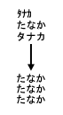

## 269 UTL\_I18N

`UTL_I18N` is a set of services that provides additional globalization functionality for applications written in PL/SQL.

See Also:

[Oracle Database Globalization Support Guide](https://docs.oracle.com/pls/topic/lookup?ctx=en/database/oracle/oracle-database/21/arpls&id=NLSPG-GUID-C4A4DCCB-90EA-4E29-AA5C-7F043ED949F7)

The chapter contains the following topics:

### 269.1 UTL\_I18N Overview

`UTL_I18N` services provide additional globalization functionality for applications written in PL/SQL.

The `UTL_I18N` PL/SQL package consists of the following categories of services:

- String conversion functions for various datatypes.
- Functions that convert a text string to character references and vice versa.
- Functions that map between Oracle, Java, and ISO languages and territories.
- Functions that map between Oracle, Internet Assigned Numbers Authority (IANA), and e-mail safe character sets.
- A function that returns the Oracle character set name from an Oracle language name.
- A function that returns the maximum number of bytes for a character of an Oracle character set.
- A function that performs script transliteration.
- Functions that return the ISO currency code, local time zones, and local languages supported for a given territory.
- Functions that return the most appropriate linguistic sort, a listing of all the applicable linguistic sorts, and the local territories supported for a given language.
- Functions that map between the Oracle full and short language names.
- A function that returns the language translation of a given language and territory name.
- A function that returns a listing of the most commonly used time zones.

### 269.2 UTL\_I18N Security Model

The functions of the `UTL_I18N` package neither read database contents nor modify them. The functions operate on their arguments only and/or they retrieve static internationalization information from NLS Data files. The execution privilege for the package is granted to `PUBLIC` by default

### 269.3 UTL\_I18N Constants

`UTL_I18N` defines constants to use when specifying parameter values.

These constants are shown in the following table.

Table 269-1 UTL\_I18N Constants

| Constant | Type | Value | Description |
| --- | --- | --- | --- |
| `GENERIC_CONTEXT` | `PLS_INTEGER` | `0` | Returns the default character set for general cases. |
| `MAIL_GENERIC` | `PLS_INTEGER` | `0` | Map from an Oracle character set name to an email safe character set name on a non-Windows platform. |
| `ORACLE_TO_IANA` | `PLS_INTEGER` | `0` | Map from an Oracle character set name to an IANA character set name. |
| `SHIFT_IN` | `PLS_INTEGER` | `0` | Used with `shift_status`. Must be set the first time it is called in piecewise conversion. |
| `IANA_TO_ORACLE` | `PLS_INTEGER` | `1` | Map from an IANA character set name to an Oracle character set name. |
| `MAIL_CONTEXT` | `PLS_INTEGER` | `1` | The mapping is between an Oracle character set name and an email safe character set name. |
| `MAIL_WINDOWS` | `PLS_INTEGER` | `1` | Map from an Oracle character set name to an email safe character set name on a Windows platform. |
| `SHIFT_OUT` | `PLS_INTEGER` | `1` |  |
| `FWKATAKANA_HIRAGANA` | `VARCHAR2(30)` | `'fwkatakana_hiragana'` | Converts only fullwidth Katakana characters to fullwidth Hiragana characters. |
| `FWKATAKANA_HWKATAKANA` | `VARCHAR2(30)` | `'fwkatakana_hwkatakana'` | Converts only fullwidth Katakana characters to halfwidth Katakana characters. |
| `HIRAGANA_FWKATAKANA` | `VARCHAR2(30)` | `'hiragana_fwkatakana'` | Converts only fullwidth Hiragana characters to fullwidth Katakana characters. |
| `HIRAGANA_HWKATAKANA` | `VARCHAR2(30)` | `'hiragana_hwkatakana'` | Converts only fullwidth Hiragana characters to halfwidth Katakana characters. |
| `HWKATAKANA_FWKATAKANA` | `VARCHAR2(30)` | `'hwkatakana_fwkatakana'` | Converts only halfwidth Katakana characters to fullwidth Katakana characters. |
| `HWKATAKANA_HIRAGANA` | `VARCHAR2(30)` | `'hwkatakana_hiragana'` | Converts only halfwidth Katakana characters to fullwidth Hiragana characters. |
| `KANA_FWKATAKANA` | `VARCHAR2(30)` | `'kana_fwkatakana'` | Converts any type of Kana character to a fullwidth Katakana character. |
| `KANA_HIRAGANA` | `VARCHAR2(30)` | `'kana_hiragana'` | Converts any type of Kana character to a fullwidth Hiragana character. |
| `KANA_HWKATAKANA` | `VARCHAR2(30)` | `'kana_hwkatakana'` | Converts any type of Kana character to a halfwidth Katakana character. |

### 269.4 Summary of UTL\_I18N Subprograms

This table lists the `UTL_I18N` subprograms and briefly describes them.

Table 269-2 UTL\_I18N Package Subprograms

| Procedure | Description |
| --- | --- |
| ESCAPE\_REFERENCE Function | Converts a given text string to its character reference counterparts, for characters that fall outside the document character set. |
| GET\_COMMON\_TIME\_ZONES Function | Returns the list of common time zone IDs that are independent of the locales. |
| GET\_DEFAULT\_CHARSET Function | Returns the default Oracle character set name or the default e-mail safe character set name from an Oracle language name. |
| GET\_DEFAULT\_ISO\_CURRENCY Function | Returns the default ISO 4217 currency code for the specified territory. |
| GET\_DEFAULT\_LINGUISTIC\_SORT Function | Returns the default linguistic sort name for the specified language. |
| GET\_LOCAL\_LANGUAGES Function | Returns the local language names for the specified territory. |
| GET\_LOCAL\_LINGUISTIC\_SORTS Function | Returns the local linguistic sort names for the specified language. |
| GET\_LOCAL\_TERRITORIES Function | Returns the local territory names for the specified language. |
| GET\_LOCAL\_TIME\_ZONES Function | Returns the local time zone IDs for the specified territory. |
| GET\_MAX\_CHARACTER\_SIZE Function | Returns the maximum character size of a given character set. |
| GET\_TRANSLATION Function | Returns the translation of the language and territory name in the specified translation language. |
| MAP\_CHARSET Function | - Maps an Oracle character set name to an IANA character set name. - Maps an IANA character set name to an Oracle character set name. - Maps an Oracle character set name to an e-mail safe character set name. |
| MAP\_FROM\_SHORT\_LANGUAGE Function | Maps an Oracle short language name to an Oracle language name. |
| MAP\_LANGUAGE\_FROM\_ISO Function | Returns an Oracle language name from an ISO locale name. |
| MAP\_LOCALE\_TO\_ISO Function | Returns an ISO locale name from the Oracle language and territory name. |
| MAP\_TERRITORY\_FROM\_ISO Function | Returns an Oracle territory name from an ISO locale name. |
| MAP\_TO\_SHORT\_LANGUAGE Function | Maps an Oracle language name to an Oracle short language name. |
| RAW\_TO\_CHAR Functions | Converts `RAW` data that is not encoded in the database character set into a `VARCHAR2` string |
| RAW\_TO\_NCHAR Functions | Converts `RAW` data that is not encoded in the national character set into an `NVARCHAR2` string |
| STRING\_TO\_RAW Function | Converts a `VARCHAR2` or `NVARCHAR2` string to another character set. The result is returned as a `RAW` datatype. |
| TRANSLITERATE Function | Transliterates between Japanese hiragana and katakana. |
| UNESCAPE\_REFERENCE Function | Converts an input string that contains character references to a text string. |
| VALIDATE\_CHARACTER\_ENCODING Function | Validates the character encoding of VARCHAR2, NVARCHAR2, CLOB, and NCLOB data. |

#### 269.4.1 ESCAPE\_REFERENCE Function

This function converts a text string to its character reference counterparts for characters that fall outside the character set used by the current document.

Character references are mainly used in HTML and XML documents to represent characters independently of the encoding of the document. Character references may appear in two forms, numeric character references and character entity references. Numeric character references specify the Unicode code point value of a character, while character entity references use symbolic names to refer to the same character. For example, `&#xe5;` is the numeric character reference for the small letter "a" with a ring above, whereas `&aring;` is the character entity reference for the same character. Character entity references are also used to escape special characters, as an example, `&lt;` represents the < (less than) sign. This is to avoid possible confusion with the beginning of a tag in Markup languages.

Syntax

```
UTL_I18N.ESCAPE_REFERENCE(
    str            IN VARCHAR2 CHARACTER SET ANY_CS,
    page_cs_name   IN VARCHAR2 DEFAULT NULL)
 RETURN VARCHAR2 CHARACTER SET str%CHARSET;
```

Parameters

Table 269-3 ESCAPE\_REFERENCE Function Parameters

| Parameter | Description |
| --- | --- |
| `str` | Specifies the input string |
| `page_cs_name` | Specifies the character set of the document. If `page_cs_name` is `NULL`, then the database character set is used for `CHAR` data and the national character set is used for `NCHAR` data. |

Usage Notes

If the user specifies an invalid character set or a `NULL` string, then the function returns a `NULL` string.

Examples

```
UTL_I18N.ESCAPE_REFERENCE('hello < '||chr(229),'us7ascii')
```

This returns `'hello &lt; &#xe5;'`.

#### 269.4.2 GET\_COMMON\_TIME\_ZONES Function

This function returns a listing of the most coemmonly used time zones. This list contains a subset of the time zones that are supported in the database.

Syntax

```
UTL_I18N.GET_COMMON_TIME_ZONES
 RETURN STRING_ARRAY;
```

Examples

Returns the list of the most commonly used time zones.

```
DECLARE
   retval UTL_I18N.STRING_ARRAY;
BEGIN
   retval := UTL_I18N.GET_COMMON_TIME_ZONES;
END;
/
```

#### 269.4.3 GET\_DEFAULT\_CHARSET Function

This function returns the default Oracle character set name or the default e-mail safe character set name from an Oracle language name.

See Also:

" MAP\_CHARSET Function " for an explanation of an e-mail safe character set

Syntax

```
UTL_I18N.GET_DEFAULT_CHARSET( 
   language  IN VARCHAR2,
   context   IN PLS_INTEGER DEFAULT GENERIC_CONTEXT,
   iswindows IN BOOLEAN DEFAULT FALSE)
 RETURN VARCHAR2;
```

Parameters

Table 269-4 GET\_DEFAULT\_CHARSET Function Parameters

| Parameter | Description |
| --- | --- |
| `language` | Specifies a valid Oracle language |
| `context` | `GENERIC_CONTEXT \| MAIL_CONTEXT`  `GENERIC_CONTEXT`: Returns the default character set for general cases  `MAIL_CONTEXT`: Returns the default e-mail safe character set name |
| `iswindows` | If `context` is set as `MAIL_CONTEXT`, then `iswindows` should be set to `TRUE` if the platform is Windows and `FALSE` if the platform is not Windows. The default is `FALSE`.  `iswindows` has no effect if `context` is set as `GENERIC_CONTEXT`. |

Usage Notes

If the user specifies an invalid language name or an invalid flag, then the function returns a `NULL` string.

Examples

GENERIC\_CONTEXT, iswindows=FALSE

```
UTL_I18N.GET_DEFAULT_CHARSET('French', UTL_I18N.GENERIC_CONTEXT, FALSE)
```

This returns `'WE8ISO8859P1'`.

MAIL\_CONTEXT, iswindows=TRUE

```
UTL_I18N.GET_DEFAULT_CHARSET('French', UTL_I18N.MAIL_CONTEXT, TRUE)
```

This returns ' `WE8MSWIN1252` '.

MAIL\_CONTEXT, iswindows=FALSE

```
UTL_I18N.GET_DEFAULT_CHARSET('French', UTL_I18N.MAIL_CONTEXT, FALSE)
```

This returns ' `WE8ISO8859P1` '.

#### 269.4.4 GET\_DEFAULT\_ISO\_CURRENCY Function

This function returns the default ISO 4217 currency code for the specified territory.

Syntax

```
UTL_I18N.GET_DEFAULT_ISO_CURRENCY (
   territory    IN VARCHAR2 CHARACTER SET ANY_CS)
RETURN VARCHAR2;
```

Parameters

Table 269-5 GET\_DEFAULT\_ISO\_CURRENCY Function Parameters

| Parameter | Description |
| --- | --- |
| `territory` | Specifies a valid Oracle territory. It is case-insensitive. |

Usage Notes

If the user specifies an invalid territory name, then the function returns a `NULL` string.

Examples

Displays the default ISO currency code for China.

```
DECLARE
   retval VARCHAR2(50);
BEGIN
   retval := UTL_I18N.GET_DEFAULT_ISO_CURRENCY('CHINA');
   DBMS_OUTPUT.PUT_LINE(retval);
END;
/
```

#### 269.4.5 GET\_DEFAULT\_LINGUISTIC\_SORT Function

This function returns the most commonly used Oracle linguistic sort for the specified language.

Syntax

```
UTL_I18N.GET_DEFAULT_LINGUISTIC_SORT (
   language  IN VARCHAR2 CHARACTER SET ANY_CS)
RETURN VARCHAR2;
```

Parameters

Table 269-6 GET\_DEFAULT\_LINGUISTIC\_SORT Function Parameters

| Parameter | Description |
| --- | --- |
| `language` | Specifies a valid Oracle language. It is case-insensitive. |

Usage Notes

If the user specifies an invalid language name, then the function returns a `NULL` string.

Examples

Displays the name of the most appropriate linguistic sort name for the language used in the current SQL session.

```
DECLARE
   retval VARCHAR2(50);
BEGIN
  SELECT value INTO retval FROM nls_database_parameters
   WHERE parameter = 'NLS_LANGUAGE';
   retval := UTL_I18N.GET_DEFAULT_LINGUISTIC_SORT(retval);
   DBMS_OUTPUT.PUT_LINE(retval);
END;
/
```

#### 269.4.6 GET\_LOCAL\_LANGUAGES Function

This function returns the local language names for the specified territory.

Syntax

```
UTL_I18N.GET_LOCAL_LANGUAGES (
   territory    IN VARCHAR2 CHARACTER SET ANY_CS)
RETURN STRING_ARRAY;
```

Parameters

Table 269-7 GET\_LOCAL\_LANGUAGES Function Parameters

| Parameter | Description |
| --- | --- |
| `territory` | Specifies a valid Oracle territory. It is case-insensitive. |

Usage Notes

If the user specifies an invalid territory name, then the function returns a `NULL` string.

Examples

Returns the list of local languages used in Belgium.

```
DECLARE
   retval UTL_I18N.STRING_ARRAY;
   cnt    INTEGER;
BEGIN
   retval   :=  UTL_I18N.GET_LOCAL_LANGUAGES('BELGIUM');
   DBMS_OUTPUT.PUT('Count = ');
   DBMS_OUTPUT.PUT_LINE(retval.LAST);
   cnt := retval.FIRST;
   WHILE cnt IS NOT NULL LOOP
      DBMS_OUTPUT.PUT_LINE(retval(cnt));
      cnt := retval.NEXT(cnt);
   END LOOP;
END;
/
...
Count = 2
DUTCH
FRENCH
```

#### 269.4.7 GET\_LOCAL\_LINGUISTIC\_SORTS Function

This function returns a list of the Oracle linguistic sort names that are appropriate for the specified language. A `BINARY` sort is included for all languages.

Syntax

```
UTL_I18N.GET_LOCAL_LINGUISTIC_SORTS (
   language  IN VARCHAR2 CHARACTER SET ANY_CS)
RETURN STRING_ARRAY;
```

Parameters

Table 269-8 GET\_LOCAL\_LINGUISTIC\_SORTS Function Parameters

| Parameter | Description |
| --- | --- |
| `language` | Specifies a valid Oracle language. It is case-insensitive. |

Usage Notes

If the user specifies an invalid language name, then the function returns a `NULL` string.

Examples

Displays the local linguistic sort names for `JAPANESE`.

```
DECLARE
   retval UTL_I18N.STRING_ARRAY;
   cnt INTEGER;
BEGIN
  retval := UTL_I18N.GET_LOCAL_LINGUISTIC_SORTS('Japanese');
  DBMS_OUTPUT.PUT('Count = ');
  DBMS_OUTPUT.PUT_LINE(retval.COUNT);
  cnt := retval.FIRST;
   WHILE cnt IS NOT NULL LOOP
      DBMS_OUTPUT.PUT_LINE(retval(cnt));
      cnt := retval.NEXT(cnt);
    END LOOP;
END;
/

...
Count = 2
JAPANESE_M
BINARY
```

#### 269.4.8 GET\_LOCAL\_TERRITORIES Function

This function returns the local territory names for the specified language.

Syntax

```
UTL_I18N.GET_LOCAL_TERRITORIES (
   language  IN VARCHAR2 CHARACTER SET ANY_CS)
 RETURN STRING_ARRAY;
```

Parameters

Table 269-9 GET\_LOCAL\_TERRITORIES Function Parameters

| Parameter | Description |
| --- | --- |
| `language` | Specifies a valid Oracle language. It is case-insensitive. |

Usage Notes

If the user specifies an invalid language name, then the function returns a `NULL` string.

Examples

Returns the list of Oracle territories that use German as one of their local languages.

```
DECLARE
   retval  UTL_I18N.STRING_ARRAY;
   cnt     INTEGER;
BEGIN
   retval  := UTL_I18N.GET_LCOAL_TERRITORIIES('GERMAN');
   DBMS_OUTPUT.PUT('Count = ');
   DBMS_OUTPUT.PUT_LINE(retval.LAST);
  cnt := retval.FIRST;
   WHILE cnt IS NOT NULL LOOP
      DBMS_OUTPUT.PUT_LINE(retval(cnt));
      cnt := retval.NEXT(cnt));
   END LOOP;
END;
/
...
Count = 4
GERMANY
AUSTRIA
LUXEMBOURG
SWITZERLAND
```

#### 269.4.9 GET\_LOCAL\_TIME\_ZONES Function

This function returns the local time zone IDs for the specified territory.

Syntax

```
UTL_I18N.GET_LOCAL_TIME_ZONES ( 
   territory      IN VARCHAR2 CHARACTER SET ANY_CS DEFAULT NULL)
RETURN STRING_ARRAY;
```

Parameters

Table 269-10 GET\_LOCAL\_TIME\_ZONES Function Parameters

| Parameter | Description |
| --- | --- |
| `territory` | Specifies a valid Oracle territory. It is case-insensitive. |

Usage Notes

If the user specifies an invalid territory name, then the function returns a `NULL` string.

Examples

Creates a function that returns the list of time zones locally used in the territory `AZERBAIJAN` followed by the general common time zones. This is useful for when the user's territory is known and the application still allows the user to choose other time zones as a user's preference.

```
CREATE OR REPLACE FUNCTION get_time_zones
(territory IN VARCHAR2 CHARACTER SET ANY_CS)
RETURN utl_i18n.string_array
IS
  retval  utl_i18n.string_array;
  retval2 utl_i18n.string_array;
  stpos   INTEGER;
BEGIN
  retval  := utl_i18n.get_local_time_zones(
    territory);
  retval2 := utl_i18n.get_common_time_zones;
  stpos := retval.LAST + 1;
  retval(stpos) := '-----'; -- a separator
  FOR i IN retval2.FIRST..retval2.LAST LOOP
    stpos := stpos + 1;
    retval(stpos) := retval2(i);
  END LOOP;
  RETURN retval;
END;
/
```

Returns the list of local time zones for `AZERBAIJAN` followed by the common time zones with a separator string of five dashes (-----).

```
DECLARE
   retval UTL_I18N.STRING_ARRAY;
   cnt INTEGER;
BEGIN
   DBMS_OUTPUT.ENABLE(100000);
   retval UTL_I18N.GET_TIME_ZONES('AZERBAIJAN');
   cnt := retval.FIRST;
  WHILE cnt IS NOT NULL LOOP
    DBMS_OUTPUT.PUT_LINE(retval(cnt));
    cnt := retval.NEXT(cnt);
  END LOOP;
END;
/

Asia/Baku
-----
Pacific/Pago_Pago
Pacific/Honolulu
America/Anchorage
America/Vancouver
America/Los_Angeles
America/Tijuana
America/Edmonton
America/Denver
America/Phoenix
America/Mazatlan
America/Winnipeg
America/Regina
America/Chicago
America/Mexico_City
America/Guatemala
America/El_Salvador
America/Managua
America/Costa_Rica
America/Montreal
...
```

#### 269.4.10 GET\_MAX\_CHARACTER\_SIZE Function

This function returns the maximum character size of a given character set.

Syntax

```
UTL_I18N.GET_MAX_CHARACTER_SIZE(
    charset_name       IN VARCHAR2 CHARACTER SET ANY_CS)
RETURN PLS_INTEGER;
```

Parameters

Table 269-11 GET\_MAX\_CHARACTER\_SIZE Function Parameters

| Parameter | Description |
| --- | --- |
| `charset_name` | Specifies a valid character set name. It is case-insensitive. |

Usage Notes

For shift-sensitive character sets, the returned maximum character size will include the possible extra shift characters.

Examples

```
UTL_I18N.GET_MAX_CHARACTER_SIZE('AL32UTF8');
```

This returns 4.

#### 269.4.11 GET\_TRANSLATION Function

This function returns the translation of the language and territory name in the specified translation language.

Syntax

```
UTL_I18N.GET_TRANSLATION ( 
   parameter        IN VARCHAR2 CHARACTER SET ANY_CS,
   trans_language   IN VARCHAR2 'AMERICAN',
   flag             IN PLS_INTEGER DEFAULT LANGUAGE_TRANS)
RETURN VARCHAR2 CHARACTER SET parameter%CHARSET;
```

Parameters

Table 269-12 GET\_TRANSLATION Function Parameters

| Parameter | Description |
| --- | --- |
| `parameter` | Specifies a valid language name, territory name, or a combined string in the form of `language_territory`. It is case-insensitive. |
| `trans_language` | Specifies a translation language name. For example, `ITALIAN` is for the Italian language. The default is `AMERICAN`, which indicates American English. |
| `flag` | Specifies the translation type:  - `LANGUAGE_TRANS`: The function returns the language translation. - `TERRITORY_TRANS`: The function returns the territory translation. - `LANGUAGE_TERRITORY_TRANS`: The function returns the language and territory translation.  The default translation type is `LANGUAGE_TRANS`. |

Usage Notes

If `VARCHAR2` is used as a parameter type, the returned translation text can be corrupted due to the conversion to the database character set. Using `NVARCHAR2` as the parameter type will preserve the translation text because Unicode can encode all translated languages.

If the specified translation language is not available or an invalid name is provided, the default "American English" translations are returned. For example, Oracle does not provide `GUJARATI` translations, so the returned translation would be in American English.

Examples

The following returns the names of all the Oracle-supported languages in Italian.

```
DECLARE
   CURSOR c1 IS
     SELECT value FROM V$NLS_VALID_VALUES
     WHERE parameter = 'LANGUAGE'
  ORDER BY value;
  retval NVARCHAR2(100);
BEGIN
   FOR item IN c1 LOOP
     retval := UTL_I18N.GET_TRANSLATION (TO_NCHAR(item.value), 'italian');
   END LOOP;
END;
```

#### 269.4.12 MAP\_CHARSET Function

This function maps a character set to another character set.

It maps the following:

- An Oracle character set name to an IANA character set name.
- An IANA character set name to an Oracle character set name.
- An Oracle character set to an e-mail safe character set name.

Syntax

```
UTL_I18N.MAP_CHARSET( 
   charset   IN VARCHAR2,
   context   IN PLS_INTEGER DEFAULT GENERIC_CONTEXT,
   flag      IN PLS_INTEGER DEFAULT ORACLE_TO_IANA)
RETURN VARCHAR2;
```

Parameters

Table 269-13 MAP\_CHARSET Function Parameters

| Parameter | Description |
| --- | --- |
| `charset` | Specifies the character set name to be mapped. The mapping is case-insensitive. |
| `context` | `GENERIC_CONTEXT \| MAIL_CONTEXT`  `GENERIC_CONTEXT`: The mapping is between an Oracle character set name and an IANA character set name. This is the default value.  `MAIL_CONTEXT`: The mapping is between an Oracle character set name and an email safe character set name. |
| `flag` | - `ORACLE_TO_IANA \| IANA_TO_ORACLE` if `GENERIC_CONTEXT` is set 	`ORACLE_TO_IANA`: Map from an Oracle character set name to an IANA character set name. This is the default. 	`IANA_TO_ORACLE`: Map from an IANA character set name to an Oracle character set name. - `MAIL_GENERIC \| MAIL_WINDOWS` if `MAIL_CONTEXT` is set 	`MAIL_GENERIC`: Map from an Oracle character set name to an email safe character set name on a non-Windows platform. 	`MAIL_WINDOWS`: Map from an Oracle character set name to an email safe character set name on a Windows platform. |

Usage Notes

An e-mail safe character set is an Oracle character set that is commonly used by applications when they submit e-mail messages. The character set is usually used to convert contents in the database character set to e-mail safe contents. To specify the character set name in the mail header, you should use the corresponding IANA character set name obtained by calling the `MAP_CHARSET` function with the `ORACLE_TO_IANA` option, providing the e-mail safe character set name as input.

For example, no e-mail client recognizes message contents in the `WE8DEC` character set, whose corresponding IANA name is `DEC-MCS`. If `WE8DEC` is passed to the `MAP_CHARSET` function with the `MAIL_CONTEXT` option, then the function returns `WE8ISO8859P1`. Its corresponding IANA name, `ISO-8859-1`, is recognized by most e-mail clients.

The steps in this example are as follows:

1. Call the `MAP_CHARSET` function with the `MAIL_CONTEXT | MAIL_GENERIC` option with the database character set name, `WE8DEC`. The result is `WE8ISO8859P1`.
2. Convert the contents stored in the database to `WE8ISO8859P1`.
3. Call the `MAP_CHARSET` function with the `ORACLE_TO_IANA | GENERIC_CONTEXT` option with the e-mail safe character set, `WE8ISO8859P1`. The result is `ISO-8859-1`.
4. Specify `ISO-8859-1` in the mail header when the e-mail message is submitted.

The function returns a character set name if a match is found. If no match is found or if the flag is invalid, then it returns `NULL`.

Note:

Many Oracle character sets can map to one e-mail safe character set. There is no function that maps an e-mail safe character set to an Oracle character set name.

Examples

Generic Context

```
UTL_I18N.MAP_CHARSET('iso-8859-1',UTL_I18N.GENERIC_CONTEXT,UTL_I18N.IANA_TO_ORACLE)
```

This returns `'WE8ISO8859P1'`.

Context

```
UTL_I18N.MAP_CHARSET('WE8DEC', utl_i18n.mail_context,  utl_i18n.mail_generic)
```

This returns `'WE8ISO8859P1'`.

See Also:

[Oracle Database Globalization Support Guide](https://docs.oracle.com/pls/topic/lookup?ctx=en/database/oracle/oracle-database/21/arpls&id=NLSPG-GUID-344E34CA-DD16-4979-8CF1-6D0A7AEBAA4A) for a list of valid Oracle character sets

#### 269.4.13 MAP\_FROM\_SHORT\_LANGUAGE Function

This function maps an Oracle short language name to an Oracle language name.

Syntax

```
UTL_I18N.MAP_FROM_SHORT_LANGUAGE (
   language           IN VARCHAR2 CHARACTER SET ANY_CS)
RETURN VARCHAR2;
```

Parameters

Table 269-14 MAP\_FROM\_SHORT\_LANGUAGE Function Parameters

| Parameter | Description |
| --- | --- |
| `language` | Specifies a valid short language name. It is case-insensitive. |

Usage Notes

If the user specifies an invalid language name, then the function returns a `NULL` string.

Examples

Returns the default linguistic sort name for the customer with the ID of 9000. Note that the table `customers` is from the `oe` user in the Common Schema. Because the customer's language preference is stored using a short language name, you need to convert to a full language name by calling the `GET_DEFAULT_LINGUISTIC_SORT` procedure.

```
DECLARE
   short_n VARCHAR2(10);
   ling_n VARCHAR2(50);
BEGIN
   SELECT nls_language INTO short 
   FROM customers WHERE customer_id = 9000;
   ling_n := UTL_I18N.GET_DEFAULT_LINGUISTIC_SORT (
   UTL_I18N.MAP_FROM_SHORT_LANGUAGE(short_n));
   DBMS_OUTPUT.PUT_LINE(ling_n);
END;
/
```

#### 269.4.14 MAP\_LANGUAGE\_FROM\_ISO Function

This function returns an Oracle language name from an ISO locale name.

Syntax

```
UTL_I18N.MAP_LANGUAGE_FROM_ISO( 
  isolocale IN VARCHAR2)
RETURN VARCHAR2;
```

Parameters

Table 269-15 MAP\_LANGUAGE\_FROM\_ISO Function Parameters

| Parameter | Description |
| --- | --- |
| `isolocale` | Specifies the ISO locale. The mapping is case-insensitive. |

Usage Notes

If the user specifies an invalid locale string, then the function returns a `NULL` string.

If the user specifies a locale string that includes only the language (for example, `en_` instead of `en_US`), then the function returns the default language name for the specified language (for example, `American`).

Examples

```
UTL_I18N.MAP_LANGUAGE_FROM_ISO('en_US')
```

This returns `'American'`.

See Also:

[Oracle Database Globalization Support Guide](https://docs.oracle.com/pls/topic/lookup?ctx=en/database/oracle/oracle-database/21/arpls&id=NLSPG-GUID-D2FCFD55-EDC3-473F-9832-AAB564457830) for a list of valid Oracle languages

#### 269.4.15 MAP\_LOCALE\_TO\_ISO Function

This function returns an ISO locale name from an Oracle language name and an Oracle territory name.

A valid string must include at least one of the following: a valid Oracle language name or a valid Oracle territory name.

Syntax

```
UTL_I18N.MAP_LOCALE_TO_ISO ( 
   ora_language   IN VARCHAR2,
   ora_territory  IN VARCHAR2)
 RETURN VARCHAR2;
```

Parameters

Table 269-16 MAP\_LOCALE\_TO\_ISO Function Parameters

| Parameter | Description |
| --- | --- |
| `ora_language` | Specifies an Oracle language name. It is case-insensitive. |
| ora\_territory | Specifies an Oracle territory name. It is case-insensitive. |

Usage Notes

If the user specifies an invalid string, then the function returns a `NULL` string.

Examples

```
UTL_I18N.MAP_LOCALE_TO_ISO('American','America')
```

This returns `'en_US'`.

See Also:

[Oracle Database Globalization Support Guide](https://docs.oracle.com/pls/topic/lookup?ctx=en/database/oracle/oracle-database/21/arpls&id=NLSPG-GUID-A9E30C27-FD47-4552-B670-F41A95B11405) for a list of valid Oracle languages and territories

#### 269.4.16 MAP\_TERRITORY\_FROM\_ISO Function

This function returns an Oracle territory name from an ISO locale.

Syntax

```
UTL_I18N.MAP_TERRITORY_FROM_ISO (
  isolocale IN VARCHAR2)
 RETURN VARCHAR2;
```

Parameters

Table 269-17 MAP\_TERRITORY\_FROM\_ISO Function Parameters

| Parameter | Description |
| --- | --- |
| `isolocale` | Specifies the ISO locale. The mapping is case-insensitive. |

Usage Notes

If the user specifies an invalid locale string, then the function returns a `NULL` string.

If the user specifies a locale string that includes only the territory (for example, `_fr` instead of `fr_fr`), then the function returns the default territory name for the specified territory (for example, `France`).

Examples

```
UTL_I18N.MAP_TERRITORY_FROM_ISO('en_US')
```

This returns ' `America'`.

See Also:

[Oracle Database Globalization Support Guide](https://docs.oracle.com/pls/topic/lookup?ctx=en/database/oracle/oracle-database/21/arpls&id=NLSPG-GUID-550D6A25-DB53-4911-9419-8065A73FFB06) for a list of valid Oracle territories

#### 269.4.17 MAP\_TO\_SHORT\_LANGUAGE Function

This function maps an Oracle language name to an Oracle short language name.

Syntax

```
UTL_I18N.MAP_TO_SHORT_LANGUAGE (
   language    IN VARCHAR2 CHARACTER SET ANY_CS)
RETURN VARCHAR2;
```

Parameters

Table 269-18 MAP\_TO\_SHORT\_LANGUAGE Function Parameters

| Parameter | Description |
| --- | --- |
| `language` | Specifies a valid full language name. It is case-insensitive. |

Usage Notes

If the user specifies an invalid language name, then the function returns a `NULL` string.

Examples

Returns the short language name for the language.

```
DECLARE  retval VARCHAR2(100);BEGIN  retval := UTL_I18N.MAP_TO_SHORT_LANGUAGE('american');  DBMS_OUTPUT.PUT_LINE(retval);END;/US
```

#### 269.4.18 RAW\_TO\_CHAR Functions

This function converts `RAW` data from a valid Oracle character set to a `VARCHAR2` string in the database character set.

The function is overloaded. The different forms of functionality are described along with the syntax declarations.

Syntax

Buffer Conversion:

```
UTL_I18N.RAW_TO_CHAR(
   data          IN RAW,
   src_charset   IN VARCHAR2 DEFAULT NULL)
 RETURN VARCHAR2;
```

Piecewise conversion converts raw data into character data piece by piece:

```
UTL_I18N.RAW_TO_CHAR (
   data            IN RAW,
   src_charset     IN VARCHAR2 DEFAULT NULL,
   scanned_length  OUT PLS_INTEGER,
   shift_status    IN OUT PLS_INTEGER)
RETURN VARCHAR2;
```

Parameters

Table 269-19 RAW\_TO\_CHAR Function Parameters

| Parameter | Description |
| --- | --- |
| `data` | Specifies the `RAW` data to be converted to a `VARCHAR2` string |
| `src_charset` | Specifies the character set that the `RAW` data was derived from. If src\_charset is `NULL`, then the database character set is used. |
| `scanned_length` | Specifies the number of bytes of source data scanned |
| `shift_status` | Specifies the shift status at the end of the scan. The user must set it to `SHIFT_IN` the first time it is called in piecewise conversion.  Note: ISO 2022 character sets use escape sequences instead of shift characters to indicate the encoding method. `shift_status` cannot hold the encoding method information that is provided by the escape sequences for the next function call. As a result, this function cannot be used to reconstruct ISO 2022 character from raw data in a piecewise way unless each unit of input can be guaranteed to be a closed string. A closed string begins and ends in a 7-bit escape state. |

Usage Notes

If the user specifies an invalid character set, `NULL` data, or data whose length is 0, then the function returns a `NULL` string.

Examples

Buffer Conversion

```
UTL_I18N.RAW_TO_CHAR(hextoraw('616263646566C2AA'), 'utf8')
```

This returns the following string in the database character set:

```
'abcde'||chr(170)
```

Piecewise Conversion

```
UTL_I18N.RAW_TO_CHAR(hextoraw('616263646566C2AA'),'utf8',shf,slen)
```

This expression returns the following string in the database character set:

```
'abcde'||chr(170)
```

It also sets `shf` to `SHIFT_IN` and `slen` to `8`.

The following example converts data from the Internet piece by piece to the database character set.

```
rvalue RAW(1050); 
  nvalue VARCHAR2(1024); 
  conversion_state  PLS_INTEGER = 0; 
  converted_len   PLS_INTEGER; 
  rtemp  RAW(10) = ''; 
  conn   utl_tcp.connection; 
  tlen PLS_INTEGER;

  ... 
  conn := utl_tcp.open_connection ( remote_host => 'localhost', 
                                    remote_port => 2000); 
  LOOP 
      tlen := utl_tcp.read_raw(conn, rvalue, 1024); 
      rvalue := utl_raw.concat(rtemp, rvalue); 
      nvalue := utl_i18n.raw_to_char(rvalue, 'JA16SJIS', converted_len, conversion_stat); 
      if (converted_len < utl_raw.length(rvalue) ) 
      then 
        rtemp := utl_raw.substr(rvalue, converted_len+1); 
      else 
        rtemp := ''; 
      end if; 
      /* do anything you want with nvalue */ 
      /* e.g htp.prn(nvalue); */ 
    END LOOP; 
    utl_tcp.close_connection(conn); 
  EXCEPTION 
    WHEN utl_tcp.end_of_input THEN 
      utl_tcp.close_connection(conn);
END;
```

#### 269.4.19 RAW\_TO\_NCHAR Functions

This function converts `RAW` data from a valid Oracle character set to an `NVARCHAR2` string in the national character set.

The function is overloaded. The different forms of functionality are described along with the syntax declarations.

Syntax

Buffer Conversion:

```
UTL_I18N.RAW_TO_NCHAR ( 
   data         IN RAW,
   src_charset  IN VARCHAR2 DEFAULT NULL)
 RETURN NVARCHAR2;
```

Piecewise conversion converts raw data into character data piece by piece:

```
UTL_I18N.RAW_TO_NCHAR ( 
   data            IN RAW,
   src_charset      IN VARCHAR2 DEFAULT NULL,
   scanned_length   OUT PLS_INTEGER,
   shift_status     IN OUT PLS_INTEGER)
 RETURN NVARCHAR2;
```

Parameters

Table 269-20 RAW\_TO\_NCHAR Function Parameters

| Parameter | Description |
| --- | --- |
| `data` | Specifies the `RAW` data to be converted to an `NVARCHAR2` string |
| `src_charset` | Specifies the character set that the `RAW` data was derived from. If `src_charset` is `NULL`, then the database character set is used. |
| `scanned_length` | Specifies the number of bytes of source data scanned |
| `shift_status` | Specifies the shift status at the end of the scan. The user must set it to `SHIFT_IN` the first time it is called in piecewise conversion.  Note: ISO 2022 character sets use escape sequences instead of shift characters to indicate the encoding method. `shift_status` cannot hold the encoding method information that is provided by the escape sequences for the next function call. As a result, this function cannot be used to reconstruct ISO 2022 character from raw data in a piecewise way unless each unit of input can be guaranteed to be a closed string. A closed string begins and ends in a 7-bit escape state. |

Usage Notes

If the user specifies an invalid character set, `NULL` data, or data whose length is 0, then the function returns a `NULL` string.

Examples

Buffer Conversion

```
UTL_I18N.RAW_TO_NCHAR(hextoraw('616263646566C2AA'),'utf8')
```

This returns the following string in the national character set:

```
'abcde'||chr(170)
```

Piecewise Conversion

```
UTL_I18N.RAW_TO_NCHAR(hextoraw('616263646566C2AA'),'utf8', shf, slen)
```

This expression returns the following string in the national character set:

```
'abcde'||chr(170)
```

It also sets `shf` to `SHIFT_IN` and `slen` to `8`.

The following example converts data from the Internet piece by piece to the national character set.

```
rvalue RAW(1050); 
  nvalue NVARCHAR2(1024); 
  converstion_state  PLS_INTEGER = 0; 
  converted_len   PLS_INTEGER; 
  rtemp  RAW(10) = ''; 
  conn   utl_tcp.connection; 
  tlen PLS_INTEGER;

  ... 
  conn := utl_tcp.open_connection ( remote_host => 'localhost', 
                                    remote_port => 2000); 
  LOOP 
      tlen := utl_tcp.read_raw(conn, rvalue, 1024); 
      rvalue := utl_raw.concat(rtemp, rvalue); 
      nvalue := utl_i18n.raw_to_nchar(rvalue, 'JA16SJIS', converted_len, conversion_stat); 
      if (converted_len < utl_raw.length(rvalue) ) 
      then 
        rtemp := utl_raw.substr(rvalue, converted_len+1); 
      else 
        rtemp := ''; 
      end if; 
      /* do anything you want with nvalue */ 
      /* e.g htp.prn(nvalue); */ 
    END LOOP; 
    utl_tcp.close_connection(conn); 
  EXCEPTION 
    WHEN utl_tcp.end_of_input THEN 
      utl_tcp.close_connection(conn); 
  END;
```

#### 269.4.20 STRING\_TO\_RAW Function

This function converts a `VARCHAR2` or `NVARCHAR2` string to another valid Oracle character set and returns the result as `RAW` data.

Syntax

```
UTL_I18N.STRING_TO_RAW( 
   data          IN VARCHAR2 CHARACTER SET ANY_CS,
   dst_charset   IN VARCHAR2 DEFAULT NULL)
RETURN RAW;
```

Parameters

Table 269-21 STRING\_TO\_RAW Function Parameters

| Parameter | Description |
| --- | --- |
| `data` | Specifies the `VARCHAR2` or `NVARCHAR2` string to convert. |
| `dst_charset` | Specifies the destination character set. If `dst_charset` is `NULL`, then the database character set is used for `CHAR` data and the national character set is used for `NCHAR` data. |

Usage Notes

If the user specifies an invalid character set, a `NULL` string, or a string whose length is 0, then the function returns a `NULL` string.

Examples

```
DECLARE 
    r raw(50); 
    s varchar2(20); 
  BEGIN 
    s:='abcdef'||chr(170); 
    r:=utl_i18n.string_to_raw(s,'utf8'); 
    dbms_output.put_line(rawtohex(r)); 
  end; 
/
```

This returns a hex value of `'616263646566C2AA'`.

#### 269.4.21 TRANSLITERATE Function

This function performs script transliteration. In this release, the `TRANSLITERATE` function only supports Japanese Kana conversion.

Syntax

```
UTL_I18N.TRANSLITERATE (
  data IN VARCHAR2 CHARACTER SET ANY_CS,
  name IN VARCHAR2)
RETURN VARCHAR2 CHARACTER SET data%CHARSET;
```

Parameters

Table 269-22 TRANSLITERATE Function Parameters

| Parameter | Description |
| --- | --- |
| `data` | Specifies the data to be converted. Either `CHAR` or `NCHAR` datatype can be specified. |
| `name` | Specifies the transliteration name string. For a list of valid names, see Table 269-23. |

Constants

These options specify Japanese Kana conversions.

Table 269-23 TRANSLITERATE Function Constants

| Constant Name | Value | Description |
| --- | --- | --- |
| `KANA_FWKATAKANA` | `'kana_fwkatakana'` | Converts any type of Kana character to a fullwidth Katakana character. |
| `KANA_HWKATAKANA` | `'kana_hwkatakana'` | Converts any type of Kana character to a halfwidth Katakana character. |
| `KANA_HIRAGANA` | `'kana_hiragana'` | Converts any type of Kana character to a fullwidth Hiragana character. |
| `FWKATAKANA_HWKATAKANA` | `'fwkatakana_hwkatakana'` | Converts only fullwidth Katakana characters to halfwidth Katakana characters. |
| `FWKATAKANA_HIRAGANA` | `'fwkatakana_hiragana'` | Converts only fullwidth Katakana characters to fullwidth Hiragana characters. |
| `HWKATAKANA_FWKATAKANA` | `'hwkatakana_fwkatakana'` | Converts only halfwidth Katakana characters to fullwidth Katakana characters. |
| `HWKATAKANA_HIRAGANA` | `'hwkatakana_hiragana'` | Converts only halfwidth Katakana characters to fullwidth Hiragana characters. |
| `HIRAGANA_FWKATAKANA` | `'hiragana_fwkatakana'` | Converts only fullwidth Hiragana characters to fullwidth Katakana characters. |
| `HIRAGANA_HWKATAKANA` | `'hiragana_hwkatakana'` | Converts only fullwidth Hiragana characters to halfwidth Katakana characters. |

Usage Notes

The function returns the converted string.

Examples

Given a table `japanese_emp`, containing an `NVARCHAR2` column `ename`, the following statement can be used to normalize all the kana names in `ename` to hiragana:

```
UPDATE japanese_emp
   SET ename = UTL_I18N.TRANSLITERATE (ename, 'kana_hiragana');
```

The following figure shows how this output might look.

Figure 269-1 Loading Locale-Specific Data to the Database



> The image kana\_small\_arrow.gif is partially described in the preceding text. It shows how three versions of the word "Tanaka" can be standardized and converted into one form.
>
> [  
> Copyright © 1996, 2025, Oracle and/or its affiliates.](https://docs.oracle.com/en/database/oracle/oracle-database/dcommon/html/cpyr.htm)


The following statement normalizes one kana name to hiragana:

```
DECLARE
   Name  japanese_emp.ename%TYPE;
   Eno   CONSTANT  NUMBER(4) := 1;
BEGIN
   SELECT ename INTO name FROM japanese_emp WHERE enumber = eno;
   name := UTL_I18N.TRANSLITERATE(name, UTL_I18N.KANA_HIRAGANA);
   UPDATE japanese_emp SET ename = name WHERE enumber = eno;
EXCEPTION
   WHEN  UTL_I18N.UNSUPPORTED_TRANSLITERATION THEN
   DBMS_OUTPUT.PUT_LINE('transliteration not supported');
END;
/
```

#### 269.4.22 UNESCAPE\_REFERENCE Function

This function returns a string from an input string that contains character references. It decodes each character reference to the corresponding character value.

See Also:

" ESCAPE\_REFERENCE Function " for more information about escape sequences

Syntax

```
UTL_I18N.UNESCAPE_REFERENCE ( 
   str IN VARCHAR2 CHARACTER SET ANY_CS)
 RETURN VARCHAR2 CHARACTER SET str%CHARSET;
```

Parameters

Table 269-24 UNESCAPE\_REFERENCE Function Parameters

| Parameter | Description |
| --- | --- |
| `str` | Specifies the input string |

Usage Notes

If the user specifies a `NULL` string or a string whose length is 0, then the function returns a `NULL` string. If the function fails, then it returns the original string.

Examples

```
UTL_I18N.UNESCAPE_REFERENCE('hello &lt; &#xe5;')
```

This returns `'hello <'||chr(229)`.

#### 269.4.23 VALIDATE\_CHARACTER\_ENCODING Functions

This function validates the character encoding of VARCHAR2, NVARCHAR2, CLOB, and NCLOB data. The validation is based on the database character set for VARCHAR2 and CLOB data and national character set for NVARCHAR2 and NCLOB data.

For Unicode character sets, such as AL32UTF8, AL16UTF16, AL16UTF16LE, UTF8, and UTFE, any byte sequences mapped to the following Unicode code points are considered invalid:

- Unpaired surrogate code point
- Non-character code point

In addition, any irregular or illegal UTF-8 byte sequence is considered invalid for AL32UTF8 and UTF8 character sets.

The `VALIDATE_CHARACTER_ENCODING` function is overloaded. One function is for validating VARCHAR2 and NVARCHAR2 data, while the other function is for validating CLOB and NCLOB data.

- Validating VARCHAR2 and NVARCHAR2 data
	A VARCHAR2 or NVARCHAR2 byte or its byte sequence is considered invalid for a character set, if it does not map to any of the characters defined in the character set.
- Validating CLOB and NCLOB data
	A LOB character is considered invalid for a character set if a byte (in case of a single-byte database character set) or a byte pair (in case of UTF-16 encoding used with a multibyte database character set) corresponding to the encoding of the LOB character does not map to any of the characters defined in the character set.

Syntax

This function validates VARCHAR2 and NVARCHAR2 data:

```
UTL_I18N.VALIDATE_CHARACTER_ENCODING (
   data IN VARCHAR2 CHARACTER SET ANY_CS)
RETURN PLS_INTEGER;
```

This function validates CLOB and NCLOB data:

```
UTL_I18N.VALIDATE_CHARACTER_ENCODING (
   lob_loc IN CLOB CHARACTER SET ANY_CS)
RETURN PLS_INTEGER;
```

Parameters

Table 269-25 VALIDATE\_CHARACTER\_ENCODING Function Parameters

| Parameter | Description |
| --- | --- |
| `data` | VARCHAR2 or NVARCHAR2 data to validate. |
| `lob_loc` | CLOB or NCLOB data to validate. |

Usage Notes

This function returns the offset of the first invalid byte for the VARCHAR2 or NVARCHAR2 data. It returns the offset of the first invalid character for the CLOB or NCLOB data. It returns 0, if all the bytes in the character data are valid. It returns `NULL`, if the value of the parameter `data` or `lob_loc` is `NULL`.

Examples

This example validates the character encoding of NVARCHAR2 and CLOB data where the database character set is AL32UTF8 while the national character set is AL16UTF16.

```
CREATE TABLE temp(col1 NVARCHAR2(20), col2 CLOB);
INSERT INTO temp VALUES(UNISTR('foo\D800bar'), UNISTR('foo\D800bar'));
COMMIT;
SELECT UTL_I18N.VALIDATE_CHARACTER_ENCODING(col1) invalid_offset_column1,
       UTL_I18N.VALIDATE_CHARACTER_ENCODING(col2) invalid_offset_column2
FROM temp;
```

The query returns:

```
INVALID_OFFSET_COLUMN1 INVALID_OFFSET_COLUMN2
---------------------- ----------------------
                     7                      4
```

Here, the surrogate code point `U+D800` is invalid. The number 7 is returned as `INVALID_OFFSET_COLUMN1`, because for `col1`, `‘foo’` is encoded in 6 bytes in NVARCHAR2 and the invalid code point `U+D800` starts at offset 7. The number 4 is returned as `INVALID_OFFSET_COLUMN2`, because for `col2`, `‘foo’` is encoded in 3 UTF-16 code points in CLOB and the invalid code point `U+D800` starts at offset 4.