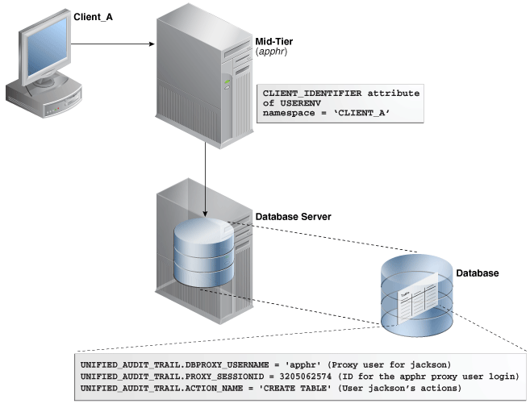
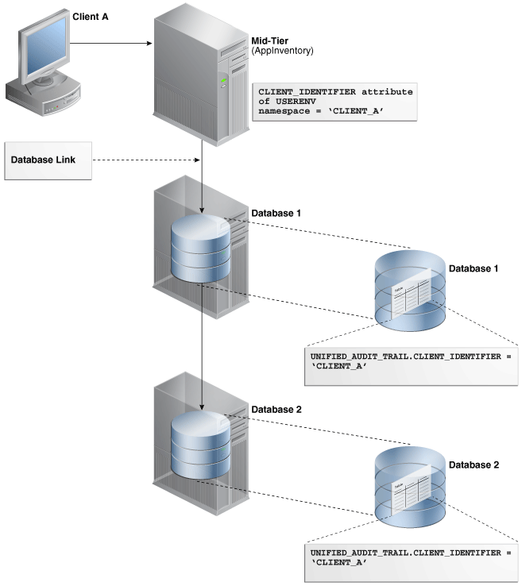

- Overview of Common Audit Configurations  
	For both mixed mode and unified auditing, a common audit configuration is visible and enforced across all PDBs.
- Selecting an Auditing Type  
	You can audit general activities (such as SQL statement actions), commonly used auditing activities, or fine-grained audit scenarios.
- Auditing Activities with Unified Audit Policies and the AUDIT Statement  
	You can use the `CREATE AUDIT POLICY` and `AUDIT` statements to use unified auditing policies.
- Auditing Activities with the Predefined Unified Audit Policies  
	Oracle Database provides predefined unified audit policies that cover commonly used security-relevant audit settings.
- Auditing Specific Activities with Fine-Grained Auditing  
	Fine-grained auditing enables you to create audit policies at the granular level.
- Audit Policy Data Dictionary Views  
	Data dictionary and dynamic views can be used to find detailed auditing information.

**Parent topic:** [Monitoring Database Activity with Auditing](part_6.md)

### 26.1 Overview of Common Audit Configurations

For both mixed mode and unified auditing, a common audit configuration is visible and enforced across all PDBs.

Audit configurations are either local or common. The scoping rules that apply to other local or common phenomena, such as users and roles, all apply to audit configurations.

Note:

Audit initialization parameters exist at the CDB level and not in each PDB.

PDBs support the following auditing options:

- Object auditing
	Object auditing refers to audit configurations for specific objects. Only common objects can be part of the common audit configuration. A local audit configuration cannot contain common objects.
- Audit policies
	Audit policies can be local or common:
	- Local audit policies
		A local audit policy applies to a single PDB. You can enforce local audit policies for local and common users in this PDB only. Attempts to enforce local audit policies across all containers result in an error.
		In all cases, enforcing of a local audit policy is part of the local auditing framework.
		- Common audit policies
		A common audit policy applies to all containers. This policy can only contain actions, system privileges, common roles, and common objects. You can apply a common audit policy only to common users. Attempts to enforce a common audit policy for a local user across all containers result in an error.

A common audit configuration is stored in the `SYS` schema of the root. A local audit configuration is stored in the `SYS` schema of the PDB to which it applies.

Audit trails are stored in the `SYS` or `AUDSYS` schemas of the relevant PDBs. Operating system and XML audit trails for PDBs are stored in subdirectories of the directory specified by the `AUDIT_FILE_DEST` initialization parameter.

**Parent topic:** Configuring Audit Policies

### 26.2 Selecting an Auditing Type

You can audit general activities (such as SQL statement actions), commonly used auditing activities, or fine-grained audit scenarios.

**Parent topic:** Configuring Audit Policies

#### 26.2.1 Auditing SQL Statements, Privileges, and Other General Activities

You can audit many types of objects, from SQL statements to other Oracle Database components, such as Oracle Database Vault..

In addition, you can create policies that use conditions. However, if you want to audit specific columns or use event handlers, you must use fine-grained auditing.

The general steps for performing this type of auditing are as follows:

1. In most cases, use the `CREATE AUDIT POLICY` statement to create an audit policy. If you must audit application context values, then use the `AUDIT` statement.
2. If you are creating an audit policy, then use the `AUDIT` statement to enable it and optionally apply (or exclude) the audit settings to one or more users, including administrative users who log in with the `SYSDBA` administrative privilege (for example, the `SYS` user).
	`AUDIT` also enables you to create an audit record upon an action's success, failure, or both.
3. Query the `UNIFIED_AUDIT_TRAIL` view to find the generated audit records.
4. Periodically archive and purge the contents of the audit trail.

#### 26.2.2 Auditing Commonly Used Security-Relevant Activities

Oracle Database provides a set default unified audit policies that you can choose from for commonly used security-relevant audits.

The general steps for performing this type of auditing are as follows:

1. Select from one of the predefined unified audit policies.
2. Use the `AUDIT` statement enable the policy and optionally apply (or exclude) the audit settings to one or more users.
3. Query the `UNIFIED_AUDIT_TRAIL` view to find the generated audit records.
4. Periodically archive and purge the contents of the audit trail.

#### 26.2.3 Auditing Specific, Fine-Grained Activities

Use fine-grained auditing if you want to audit individual columns and use event handlers.

This type of auditing provides all the features available in unified audit policies. The general steps for fine-grained auditing are as follows:

1. Create a fine-grained auditing policy.
2. Use the `DBMS_FGA` PL/SQL package to configure fine-grained auditing policies.
3. Query the `UNIFIED_AUDIT_TRAIL` or `ALL_AUDIT_POLICIES` view to find the generated audit records.
4. Periodically archive and purge the contents of the audit trail.

### 26.3 Auditing Activities with Unified Audit Policies and the AUDIT Statement

You can use the `CREATE AUDIT POLICY` and `AUDIT` statements to use unified auditing policies.

- About Auditing Activities with Unified Audit Policies and AUDIT  
	You can audit the several types of activities, using unified audit policies and the `AUDIT` SQL statement.
- Best Practices for Creating Unified Audit Policies  
	You can enable multiple policies at a time in the database, but ideally, limit the number of enabled policies.
- Syntax for Creating a Unified Audit Policy  
	To create a unified audit policy, you must use the `CREATE AUDIT POLICY` statement.
- Auditing Roles  
	You can use the `CREATE AUDIT POLICY` statement to audit database roles.
- Auditing System Privileges  
	You can use the `CREATE AUDIT POLICY` statement to audit system privileges.
- Auditing Administrative Users  
	You can create unified audit policies to capture the actions of administrative user accounts, such as `SYS`.
- Auditing Object Actions  
	You can use the `CREATE AUDIT POLICY` statement to audit object actions.
- Auditing the READ ANY TABLE and SELECT ANY TABLE Privileges  
	The `CREATE AUDIT POLICY` statement can audit the `READ ANY TABLE` and `SELECT ANY TABLE` privileges.
- Auditing SQL Statements and Privileges in a Multitier Environment  
	You can create a unified audit policy to audit the activities of a client in a multitier environment.
- Creating a Condition for a Unified Audit Policy  
	You can use the `CREATE AUDIT POLICY` statement to create conditions for a unified audit policy.
- Auditing Application Context Values  
	You can use the `AUDIT` statement to audit application context values.
- Auditing Oracle Database Real Application Security Events  
	You can use `CREATE AUDIT POLICY` statement to audit Oracle Database Real Application Security events.
- Auditing Oracle Recovery Manager Events  
	You can use the `CREATE AUDIT POLICY` statement to audit Oracle Recovery Manager events.
- Auditing Oracle Database Vault Events  
	In an Oracle Database Vault environment, the `CREATE AUDIT POLICY` statement can audit Database Vault activities.
- Auditing Oracle Label Security Events  
	In an Oracle Label Security environment, the `CREATE AUDIT POLICY` statement can audit Oracle Label Security activities.
- Auditing Oracle Machine Learning for SQL Events  
	You can use the `CREATE AUDIT POLICY` statement to audit Oracle Machine Learning for SQL events.
- Auditing Oracle Data Pump Events  
	You can use the `CREATE AUDIT POLICY` statement to audit Oracle Data Pump.
- Auditing Oracle SQL\*Loader Direct Load Path Events  
	You can use the `CREATE AUDIT POLICY` statement to audit Oracle SQL\*Loader direct load path events.
- Auditing Oracle XML DB HTTP and FTP Protocols  
	You can use the `CREATE AUDIT POLICY` statement to audit Oracle XML DB HTTP and FTP protocol messages.
- Auditing Only Top-Level Statements  
	You can audit top-level SQL or PL/SQL statements to limit the volume of audit records.
- Unified Audit Policies or AUDIT Settings in a Multitenant Environment  
	You can create unified audit policies for individual PDBs and in the root.
- Altering Unified Audit Policies  
	You can use the `ALTER AUDIT POLICY` statement to modify a unified audit policy.
- Enabling and Applying Unified Audit Policies to Users and Roles  
	You can use the `AUDIT POLICY` statement to enable and apply unified audit policies to users and roles.
- Disabling Unified Audit Policies  
	You can use the `NOAUDIT POLICY` statement to disable a unified audit policy.
- Dropping Unified Audit Policies  
	You can use the `DROP AUDIT POLICY` statement to drop a unified audit policy.
- Tutorial: Auditing Nondatabase Users  
	This tutorial shows how to create a unified audit policy that uses a client identifier to audit a nondatabase user's actions.

**Parent topic:** Configuring Audit Policies

#### 26.3.1 About Auditing Activities with Unified Audit Policies and AUDIT

You can audit the several types of activities, using unified audit policies and the `AUDIT` SQL statement.

The kinds of activities that you can audit are as follows:

- User accounts (including administrative users who log in with the `SYSDBA` administrative privilege), roles, and privileges
- Object actions, such as dropping a table or a running a procedure
- Application context values
- Activities from Oracle Database Real Application Security, Oracle Recovery Manager, Oracle Machine Learning for SQL, Oracle Data Pump, Oracle SQL\*Loader direct path events, Oracle Database Vault, and Oracle Label Security

To accomplish this, depending on what you want to audit, use the following:

- Unified audit policies. A unified audit policy is a named group of audit settings that enable you to audit a particular aspect of user behavior in the database. To create the policy, you use the `CREATE AUDIT POLICY` statement. The policy can be as simple as auditing the activities of a single user or you can create complex audit policies that use conditions. You can have more than one audit policy in effect at a time in a database. An audit policy can contain both system-wide and object-specific audit options. Most of the auditing that you will do for general activities (including standard auditing) requires the use of audit policies.
- AUDIT and NOAUDIT SQL statements. The `AUDIT` and `NOAUDIT` SQL statements enable you to, respectively, enable and disable an audit policy. The `AUDIT` statement also lets you include or exclude specific users for the policy. The `AUDIT` and `NOAUDIT` statements also enable you to audit application context values.
- For Oracle Recovery Manager, you do not create unified audit policies. The `UNIFIED_AUDIT_TRAIL` view automatically captures commonly audited Recovery Manager events.

**Parent topic:** Auditing Activities with Unified Audit Policies and the AUDIT Statement

#### 26.3.2 Best Practices for Creating Unified Audit Policies

You can enable multiple policies at a time in the database, but ideally, limit the number of enabled policies.

The unified audit policy syntax is designed so that you can write one policy that covers all the audit settings that your database needs. A good practice is to group related options into a single policy instead of creating multiple small policies. This enables you to manage the policies much easier. As an example, each predefined audit policies contains multiple audit settings within one unified audit policy.

Limiting the number of enabled audit policies for a user session has the following benefits:

- It reduces the logon overhead that is associated with loading the audit policy's details into the session's UGA memory. If the enabled policy count is less, then less time is spent in loading the policy information.
- It reduces the session's UGA memory consumption, because a fewer number of policies are required to be cached in UGA memory.
- It makes the internal audit check functionality more efficient, which determines whether to generate an audit record for its associated event.

#### 26.3.3 Syntax for Creating a Unified Audit Policy

To create a unified audit policy, you must use the `CREATE AUDIT POLICY` statement.

When you create a unified audit policy, Oracle Database stores it in a first class object that is owned by the `SYS` schema, not in the schema of the user who created the policy.

Example 26-1 shows the syntax for the `CREATE AUDIT POLICY` statement.

Example 26-1 Syntax for the CREATE AUDIT POLICY Statement

```
CREATE AUDIT POLICY policy_name
    { {privilege_audit_clause [action_audit_clause ] [role_audit_clause ]}
        | { action_audit_clause  [role_audit_clause ] } 
        | { role_audit_clause }
     }        
    [WHEN audit_condition EVALUATE PER {STATEMENT|SESSION|INSTANCE}] 
    [ONLY TOPLEVEL]
    [CONTAINER = {CURRENT | ALL}];
```

In this specification:

- `privilege_audit_clause` describes privilege-related audit options. The detailed syntax for configuring privilege audit options is as follows:
	```
	privilege_audit_clause  :=  PRIVILEGES  privilege1 [, privilege2]
	```
- `action_audit_clause` and `standard_actions` describe object action-related audit options. The syntax is as follows:
	```
	action_audit_clause := {standard_actions | component_actions}
	                                         [, component_actions ]
	standard_actions :=
	     ACTIONS action1 [ ON {schema.obj_name
	                                          | DIRECTORY directory_name
	                                          | MINING MODEL schema.obj_name
	                                           }
	                ]                                     
	           [, action2 [ ON {schema.obj_name
	                                          | DIRECTORY directory_name
	                                          | MINING MODEL schema.obj_name  
	                   }
	                ]
	```
- `component_actions` enables you to create an audit policy for Oracle Label Security, Oracle Database Real Application Security, Oracle Database Vault, Oracle Data Pump, or Oracle SQL\*Loader. The syntax is:
	```
	component_actions :=
	     ACTIONS COMPONENT=[OLS|XS] action1 [,action2 ] |
	     ACTIONS COMPONENT=DV DV_action ON DV_object_name |
	     ACTIONS COMPONENT=DATAPUMP [ EXPORT | IMPORT | ALL ] |
	     ACTIONS COMPONENT=DIRECT_LOAD [ LOAD | ALL ] |
	     ACTIONS COMPONENT=PROTOCOL [ HTTP | FTP ]
	```
- `role_audit_clause` enables you to audit roles. The syntax is:
	```
	role_audit_clause := ROLES role1 [, role2]
	```
- `WHEN ` `audit_condition` `EVALUATE PER` enables you to specify a function to create a condition for the audit policy and the evaluation frequency. You must include the `EVALUATE PER` clause with the `WHEN` condition. The syntax is:
	```
	WHEN 'audit_condition := function operation value_list'
	EVALUATE PER {STATEMENT|SESSION|INSTANCE}
	```
- `ONLY TOPLEVEL` allows users to audit only the top-level operations that are performed for the actions that were configured as part of this audit policy.
- `CONTAINER`, allows users to audit only the top-level operations that were performed for the actions that were configured as part of this audit policy.

This syntax is designed to audit any of the components listed in the policy. For example, suppose you create the following policy:

```
CREATE AUDIT POLICY table_pol
PRIVILEGES CREATE ANY TABLE, DROP ANY TABLE
ROLES emp_admin, sales_admin;
```

The audit trail will capture SQL statements that require the `CREATE ANY TABLE` system privilege or the `DROP ANY TABLE` system privilege or any system privilege directly granted to the role `emp_admin` or any system privilege directly granted to the role `sales_admin`. (Be aware that it audits privileges that are directly granted, not privileges that are granted recursively through a role.)

After you create the policy, you must enable it by using the `AUDIT` statement. Optionally, you can apply the policy to one or more users, exclude one or more users from the policy, and designate whether an audit record is written when the audited action succeeds, fails, or both succeeds or fails.

**Related Topics**

- Auditing System Privileges
- Auditing Object Actions
- Auditing Activities with Unified Audit Policies and the AUDIT Statement
- Auditing Roles
- Creating a Condition for a Unified Audit Policy
- Unified Audit Policies or AUDIT Settings in a Multitenant Environment
- Auditing Only Top-Level Statements
- Enabling and Applying Unified Audit Policies to Users and Roles

**Parent topic:** Auditing Activities with Unified Audit Policies and the AUDIT Statement

#### 26.3.4 Auditing Roles

You can use the `CREATE AUDIT POLICY` statement to audit database roles.

- About Role Auditing  
	When you audit a role, Oracle Database audits all system privileges that are directly granted to the role.
- Configuring Role Unified Audit Policies  
	To create a unified audit policy to capture role use, you must include the `ROLES` clause in the `CREATE AUDIT POLICY` statement.
- Example: Auditing the Predefined Common DBA Role  
	The `CREATE AUDIT POLICY` statement can audit roles in both the root and in PDBs.

**Parent topic:** Auditing Activities with Unified Audit Policies and the AUDIT Statement

##### 26.3.4.1 About Role Auditing

When you audit a role, Oracle Database audits all system privileges that are directly granted to the role.

You can audit any role, including user-defined roles. If you create a common unified audit policy for roles with the `ROLES` audit option, then you must specify only common roles in the role list. When such a policy is enabled, Oracle Database audits all system privileges that are commonly and directly granted to the common role. The system privileges that are locally granted to the common role will not be audited. To find if a role was commonly granted, query the `DBA_ROLES` data dictionary view. To find if the privileges granted to the role were commonly granted, query the `ROLE_SYS_PRIVS` view.

##### 26.3.4.2 Configuring Role Unified Audit Policies

To create a unified audit policy to capture role use, you must include the `ROLES` clause in the `CREATE AUDIT POLICY` statement.

- Use the following syntax to create a unified audit policy that audits roles:
	```
	CREATE AUDIT POLICY policy_name 
	 ROLES role1 [, role2];
	```

For example:

```
CREATE AUDIT POLICY audit_roles_pol 
 ROLES IMP_FULL_DATABASE, EXP_FULL_DATABASE;
```

You can build more complex role unified audit policies, such as those that include conditions. Remember that after you create the policy, you must use the `AUDIT` statement to enable it.

##### 26.3.4.3 Example: Auditing the Predefined Common DBA Role

The `CREATE AUDIT POLICY` statement can audit roles in both the root and in PDBs.

The following example shows how to audit a predefined common role `DBA`.

Example 26-2 Auditing the Predefined Common DBA Role

```
CREATE AUDIT POLICY role_dba_audit_pol 
 ROLES DBA
 CONTAINER = ALL;

AUDIT POLICY role_dba_audit_pol;
```

**Parent topic:** Auditing Roles

#### 26.3.5 Auditing System Privileges

You can use the `CREATE AUDIT POLICY` statement to audit system privileges.

- About System Privilege Auditing  
	System privilege auditing audits activities that successfully use a system privilege, such as `READ` `ANY` `TABLE.`
- System Privileges That Can Be Audited  
	You can audit the use of almost any system privilege.
- System Privileges That Cannot Be Audited  
	Several system privileges cannot be audited.
- Configuring a Unified Audit Policy to Capture System Privilege Use  
	The `PRIVILEGES` clause in the `CREATE AUDIT POLICY` statement audits system privilege use.
- Example: Auditing a User Who Has ANY Privileges  
	The `CREATE AUDIT POLICY` statement can audit users for `ANY` privileges.
- Example: Using a Condition to Audit a System Privilege  
	The `CREATE AUDIT POLICY` statement can create an audit policy that uses a condition to audit a system privilege.
- How System Privilege Unified Audit Policies Appear in the Audit Trail  
	The `UNIFIED_AUDIT_TRAIL` data dictionary view lists system privilege audit events.

**Parent topic:** Auditing Activities with Unified Audit Policies and the AUDIT Statement

##### 26.3.5.1 About System Privilege Auditing

System privilege auditing audits activities that successfully use a system privilege, such as `READ` `ANY` `TABLE.`

In this kind of auditing, SQL statements that require the audited privilege to succeed are recorded.

A single unified audit policy can contain both privilege and action audit options. Do not audit the privilege use of administrative users such as `SYS`. Instead, audit their object actions.

Be aware that a single query can generate multiple audit records, one for each object that is being accessed in the query and if auditing is enabled on all these objects. For example, while you query the view, multiple audit records can be generated for each of the underlying objects that is referenced by the view itself.

Note:

You can audit system privileges, objects, database events, and so on. However, if you must find database privilege usage (for example, which privileges that have been granted to a given role are used), and generate a report of the used and unused privileges, then you can create a privilege capture.

##### 26.3.5.2 System Privileges That Can Be Audited

You can audit the use of almost any system privilege.

To find a list of auditable system privileges, you can query the `SYSTEM_PRIVILEGE_MAP` table.

For example:

```
SELECT NAME FROM SYSTEM_PRIVILEGE_MAP;

NAME
-------------
ALTER ANY CUBE BUILD PROCESS
SELECT ANY CUBE BUILD PROCESS
ALTER ANY MEASURE FOLDER
...
```

Similar to action audit options, privilege auditing audits the use of system privileges that have been granted to database users. If you set similar audit options for both SQL statement and privilege auditing, then only a single audit record is generated. For example, if two policies exist, with one auditing `EXECUTE PROCEDURE` specifically on the `HR.PROC` procedure and the second auditing `EXECUTE PROCEDURE` in general (all procedures), then only one audit record is written.

Privilege auditing does not occur if the action is already permitted by the existing owner and object privileges. Privilege auditing is triggered only if the privileges are insufficient, that is, only if what makes the action possible is a system privilege. For example, suppose that user `SCOTT` has been granted the `SELECT ANY TABLE` privilege and `SELECT ANY TABLE` is being audited. If `SCOTT` selects their own table (for example, `SCOTT.EMP`), then the `SELECT ANY TABLE` privilege is not used. Because `SCOTT` performed the `SELECT` statement within their own schema, no audit record is generated. On the other hand, if `SCOTT` selects from another schema (for example, the `HR.EMPLOYEES` table), then an audit record is generated. Because `SCOTT` selected a table outside their own schema, they needed to use the `SELECT ANY TABLE` privilege.

**Parent topic:** Auditing System Privileges

##### 26.3.5.3 System Privileges That Cannot Be Audited

Several system privileges cannot be audited.

These privileges are:

- `INHERIT ANY PRIVILEGE`
- `INHERIT PRIVILEGE`
- `TRANSLATE ANY SQL`
- `TRANSLATE SQL`

**Parent topic:** Auditing System Privileges

##### 26.3.5.4 Configuring a Unified Audit Policy to Capture System Privilege Use

The `PRIVILEGES` clause in the `CREATE AUDIT POLICY` statement audits system privilege use.

- Use the following syntax to create a unified audit policy that audits privileges:
	```
	CREATE AUDIT POLICY policy_name 
	 PRIVILEGES privilege1 [, privilege2];
	```
	For example:
	```
	CREATE AUDIT POLICY my_simple_priv_policy
	 PRIVILEGES SELECT ANY TABLE, CREATE LIBRARY;
	```

You can build more complex privilege unified audit policies, such as those that include conditions. Remember that after you create the policy, you must use the `AUDIT` statement to enable it.

##### 26.3.5.5 Example: Auditing a User Who Has ANY Privileges

The `CREATE AUDIT POLICY` statement can audit users for `ANY` privileges.

Example 26-3 shows how to audit several `ANY` privileges of the user `HR_MGR`.

Example 26-3 Auditing a User Who Has ANY Privileges

```
CREATE AUDIT POLICY hr_mgr_audit_pol
 PRIVILEGES DROP ANY TABLE, DROP ANY CONTEXT, DROP ANY INDEX, DROP ANY LIBRARY;

AUDIT POLICY hr_mgr_audit_pol BY HR_MGR;
```

**Parent topic:** Auditing System Privileges

##### 26.3.5.6 Example: Using a Condition to Audit a System Privilege

The `CREATE AUDIT POLICY` statement can create an audit policy that uses a condition to audit a system privilege.

Example 26-4 shows how to use a condition to audit privileges that are used by two operating system users, `psmith` and `jrawlins`.

Example 26-4 Using a Condition to Audit a System Privilege

```
CREATE AUDIT POLICY os_users_priv_pol
 PRIVILEGES SELECT ANY TABLE, CREATE LIBRARY
 WHEN 'SYS_CONTEXT (''USERENV'', ''OS_USER'') IN (''psmith'', ''jrawlins'')'
 EVALUATE PER SESSION;

AUDIT POLICY os_users_priv_pol;
```

**Parent topic:** Auditing System Privileges

##### 26.3.5.7 How System Privilege Unified Audit Policies Appear in the Audit Trail

The `UNIFIED_AUDIT_TRAIL` data dictionary view lists system privilege audit events.

The following example shows a list of privileges used by the operating system user `psmith`.

```
SELECT SYSTEM_PRIVILEGE_USED FROM UNIFIED_AUDIT_TRAIL 
 WHERE OS_USERNAME = 'PSMITH' AND UNIFIED_AUDIT_POLICIES = 'OS_USERS_PRIV_POL';

SYSTEM_PRIVILEGE_USED
----------------------
SELECT ANY TABLE
DROP ANY TABLE
```

Note:

If you have created an audit policy for the `SELECT ANY TABLE` system privilege, whether the user has exercised the `READ` object privilege or the `SELECT` object privilege will affect the actions that the audit trail captures.

#### 26.3.6 Auditing Administrative Users

You can create unified audit policies to capture the actions of administrative user accounts, such as `SYS`.

- Administrative User Accounts That Can Be Audited  
	Oracle Database provides administrative user accounts that are associated with administrative privileges.
- Configuring a Unified Audit Policy to Capture Administrator Activities  
	The `CREATE AUDIT POLICY` statement can audit administrative users.
- Example: Auditing the SYS User  
	The `CREATE AUDIT POLICY` statement can audit the `SYS` user.

**Parent topic:** Auditing Activities with Unified Audit Policies and the AUDIT Statement

##### 26.3.6.1 Administrative User Accounts That Can Be Audited

Oracle Database provides administrative user accounts that are associated with administrative privileges.

Table 26-1 lists default administrative user accounts and the administrative privileges with which they are typically associated.

Table 26-1 Administrative Users and Administrative Privileges

| Administrative User Account | Administrative Privilege |
| --- | --- |
| `SYS` | `SYSDBA` |
| `PUBLIC` <sup>Foot 1</sup> | `SYSOPER` |
| `SYSASM` | `SYSASM` |
| `SYSBACKUP` | `SYSBACKUP` |
| `SYSDG` | `SYSDG` |
| `SYSKM` | `SYSKM` |

<sup>Footnote 1</sup>

`PUBLIC` refers to the user `PUBLIC`, which is the effective user when you log in with the `SYSOPER` administrative privilege. It does not refer to the `PUBLIC` role.

##### 26.3.6.2 Configuring a Unified Audit Policy to Capture Administrator Activities

The `CREATE AUDIT POLICY` statement can audit administrative users.

- To audit administrative users, create a unified audit policy and then apply this policy to the user, the same as you would for non-administrative users. Note that top-level statements by administrative users are mandatorily audited until the database opens.

**Parent topic:** Auditing Administrative Users

##### 26.3.6.3 Example: Auditing the SYS User

The `CREATE AUDIT POLICY` statement can audit the `SYS` user.

Example 26-5 shows how to audit grants of the `DBMS_FGA` PL/SQL package by user `SYS`.

Example 26-5 Auditing the SYS User

```
CREATE AUDIT POLICY dbms_fga_grants 
 ACTIONS GRANT
 ON DBMS_FGA;

AUDIT POLICY dbms_fga_grants BY SYS;
```

**Parent topic:** Auditing Administrative Users

#### 26.3.7 Auditing Object Actions

You can use the `CREATE AUDIT POLICY` statement to audit object actions.

- About Auditing Object Actions  
	You can audit actions performed on specific objects, such as `UPDATE` statements on the `HR.EMPLOYEES` table.
- Object Actions That Can Be Audited  
	Auditing object actions can be broad or focused (for example, auditing all user actions or only a select list of user actions).
- Configuring an Object Action Unified Audit Policy  
	The `ACTIONS` clause in the `CREATE AUDIT POLICY` statement creates a policy that captures object actions.
- Example: Auditing Actions on SYS Objects  
	The `CREATE AUDIT POLICY` statement can audit actions on `SYS` objects.
- Example: Auditing Multiple Actions on One Object  
	The `CREATE AUDIT POLICY` statement can audit multiple actions on one object.
- Example: Auditing GRANT and REVOKE Operations on an Object  
	The `CREATE AUDIT POLICY` statement can audit `GRANT` and `REVOKE` operations on objects, such as tables.
- Example: Auditing Both Actions and Privileges on an Object  
	The `CREATE AUDIT POLICY` statement can audit both actions and privileges on an object, using a single policy.
- Example: Auditing All Actions on a Table  
	The `CREATE AUDIT POLICY` statement can audit all actions on a table.
- Example: Auditing All Actions in the Database  
	The `CREATE AUDIT POLICY` statement can audit all actions in the database.
- How Object Action Unified Audit Policies Appear in the Audit Trail  
	The `UNIFIED_AUDIT_TRAIL` data dictionary view lists object action audit events.
- Auditing Functions, Procedures, Packages, and Triggers  
	You can audit functions, procedures, PL/SQL packages, and triggers.
- Auditing of Oracle Virtual Private Database Predicates  
	The unified audit trail automatically captures the predicates that are used in Oracle Virtual Private Database (VPD) policies.
- Audit Policies for Oracle Virtual Private Database Policy Functions  
	Auditing can affect dynamic VPD policies, static VPD policies, and context-sensitive VPD policies.
- Unified Auditing with Editioned Objects  
	An audit policy created to audit an action on an editioned object will be applied to all its editions.

**Parent topic:** Auditing Activities with Unified Audit Policies and the AUDIT Statement

##### 26.3.7.1 About Auditing Object Actions

You can audit actions performed on specific objects, such as `UPDATE` statements on the `HR.EMPLOYEES` table.

The audit can include both DDL and DML statements that were used on the object. A single unified audit policy can contain both privilege and action audit options, as well as audit options set for multiple objects.

For tables that contain sensitive information, Oracle recommends that you include the `ACTIONS ALL` clause in the unified audit policy so that the audit record will capture indirect `SELECT` operations.

**Parent topic:** Auditing Object Actions

##### 26.3.7.2 Object Actions That Can Be Audited

Auditing object actions can be broad or focused (for example, auditing all user actions or only a select list of user actions).

Table 26-2 lists the object-level standard database action options. Audit policies for the `SELECT` SQL statement will capture `READ` actions as well as `SELECT` actions.

Table 26-2 Object-Level Standard Database Action Audit Option

| Object | SQL Action That Can Be Audited |
| --- | --- |
| Table | `ALTER`, `AUDIT`, `COMMENT`, `DELETE`, `FLASHBACK`, `GRANT`, `INDEX`, `INSERT`, `LOCK`, `RENAME`, `SELECT`, `UPDATE` |
| View | `AUDIT`, `COMMENT`, `DELETE`, `FLASHBACK`, `GRANT`, `INSERT`, `LOCK`, `RENAME`, `SELECT`, `UPDATE` |
| Sequence | `ALTER`, `AUDIT`, `GRANT`, `SELECT` |
| Procedure (including triggers) | `AUDIT`, `EXECUTE`, `GRANT` |
| Function | `AUDIT`, `EXECUTE`, `GRANT` |
| Package | `AUDIT`, `EXECUTE`, `GRANT` |
| Materialized views | `ALTER`, `AUDIT`, `COMMENT`, `DELETE`, `INDEX`, `INSERT`, `LOCK`, `SELECT`, `UPDATE` |
| Mining Model | `AUDIT`, `COMMENT`, `GRANT`, `RENAME`, `SELECT` |
| Directory | `AUDIT`, `GRANT`, `READ` |
| Library | `EXECUTE`, `GRANT` |
| Object type | `ALTER`, `AUDIT`, `GRANT` |
| Java schema objects (source, class, resource) | `AUDIT`, `EXECUTE`, `GRANT` |

##### 26.3.7.3 Configuring an Object Action Unified Audit Policy

The `ACTIONS` clause in the `CREATE AUDIT POLICY` statement creates a policy that captures object actions.

- Use the following syntax to create a unified audit policy that audits object actions:
	```
	CREATE AUDIT POLICY policy_name 
	 ACTIONS action1 [, action2 ON object1] [, action3 ON object2];
	```

For example:

```
CREATE AUDIT POLICY my_simple_obj_policy
 ACTIONS SELECT ON OE.ORDERS, UPDATE ON HR.EMPLOYEES;
```

Note that you can audit multiple actions on multiple objects, as shown in this example.

You can build complex object action unified audit policies, such as those that include conditions. Remember that after you create the policy, you must use the `AUDIT` statement to enable it.

##### 26.3.7.4 Example: Auditing Actions on SYS Objects

The `CREATE AUDIT POLICY` statement can audit actions on `SYS` objects.

Example 26-6 shows how to create an audit policy that audits `SELECT` statements on the `SYS.USER$` system table. The audit policy applies to all users, including `SYS` and `SYSTEM`.

Example 26-6 Auditing Actions on SYS Objects

```
CREATE AUDIT POLICY select_user_dictionary_table_pol ACTIONS SELECT ON SYS.USER$;

AUDIT POLICY select_user_dictionary_table_pol;
```

**Parent topic:** Auditing Object Actions

##### 26.3.7.5 Example: Auditing Multiple Actions on One Object

The `CREATE AUDIT POLICY` statement can audit multiple actions on one object.

Example 26-7 shows how to audit multiple SQL statements performed by users `jrandolph` and `phawkins` on the `app_lib` library.

Example 26-7 Auditing Multiple Actions on One Object

```
CREATE AUDIT POLICY actions_on_hr_emp_pol1
 ACTIONS EXECUTE, GRANT 
 ON app_lib;

AUDIT POLICY actions_on_hr_emp_pol1 BY jrandolph, phawkins;
```

**Parent topic:** Auditing Object Actions

##### 26.3.7.6 Example: Auditing GRANT and REVOKE Operations on an Object

The `CREATE AUDIT POLICY` statement can audit `GRANT` and `REVOKE` operations on objects, such as tables.

Enabling auditing on `GRANT` operations on an object automatically enables the audit of `REVOKE` operations on the object as well.

Example 26-8 Auditing GRANT and REVOKE Operations

```
CREATE AUDIT POLICY grant_revoke_pol
ACTIONS GRANT ON HR.EMPLOYEES;

AUDIT POLICY grant_revoke_pol;
```

To select from the `UNIFIED_AUDIT_TRAIL` data dictionary view for this type of policy, you can perform a query similar to the following. The grantee name (to whom the privilege is granted) is recorded in the `TARGET_USER` column.

```
SELECT DBUSERNAME, OBJECT_PRIVILEGES, ACTION_NAME, OBJECT_SCHEMA, OBJECT_NAME, TARGET_USER 
FROM UNIFIED_AUDIT_TRAIL 
WHERE ACTION_NAME IN ('GRANT', 'REVOKE');
```

**Parent topic:** Auditing Object Actions

##### 26.3.7.7 Example: Auditing Both Actions and Privileges on an Object

The `CREATE AUDIT POLICY` statement can audit both actions and privileges on an object, using a single policy.

Example 26-9 shows how all `EXECUTE` and `GRANT` statements on the `app_lib` library using the `CREATE LIBRARY` privilege are audited.

Example 26-9 Auditing Both Actions and Privileges on an Object

```
CREATE AUDIT POLICY actions_on_hr_emp_pol2 
 PRIVILEGES CREATE LIBRARY
 ACTIONS EXECUTE, GRANT
 ON app_lib;

AUDIT POLICY actions_on_hr_emp_pol2 BY jrandolph, phawkins;
```

You can audit directory objects. For example, suppose you create a directory object that contains a preprocessor program that the `ORACLE_LOADER` access driver will use. You can audit anyone who runs this program within this directory object.

**Parent topic:** Auditing Object Actions

##### 26.3.7.8 Example: Auditing All Actions on a Table

The `CREATE AUDIT POLICY` statement can audit all actions on a table.

You can use the `ALL` keyword to audit all actions. Oracle recommends that you audit all actions only on sensitive objects. `ALL` is useful in that it captures indirect `SELECT` operations. Example 26-10 shows how to audit all actions on the `HR.EMPLOYEES` table, except actions by user `pmulligan`.

Example 26-10 Auditing All Actions on a Table

```
CREATE AUDIT POLICY all_actions_on_hr_emp_pol 
 ACTIONS ALL ON HR.EMPLOYEES;

AUDIT POLICY all_actions_on_hr_emp_pol EXCEPT pmulligan;
```

##### 26.3.7.9 Example: Auditing All Actions in the Database

The `CREATE AUDIT POLICY` statement can audit all actions in the database.

To prevent the scenario of a large number of audit records being generated and quickly filling up the audit trail, even for all the recursive actions for this audit policy configuration, include the `ONLY TOPLEVEL` clause in the `CREATE AUDIT POLICY` statement. As an alternative to `ONLY TOPLEVEL`, you can create the `ACTIONS ALL` policy using a condition to so that only a subset of records are captured.

Note:

Use `ACTIONS ALL` auditing with caution. Do not enable it for users who must perform online transaction processing (OLTP) workloads. This will avoid generating a large number of audit records.

Example 26-11 shows how to audit all actions in the entire database.

Example 26-11 Auditing All Actions in the Database

```
CREATE AUDIT POLICY all_actions_pol ACTIONS ALL ONLY TOPLEVEL;

AUDIT POLICY all_actions_pol;
```

##### 26.3.7.10 How Object Action Unified Audit Policies Appear in the Audit Trail

The `UNIFIED_AUDIT_TRAIL` data dictionary view lists object action audit events.

For example:

```
SELECT ACTION_NAME, OBJECT_SCHEMA, OBJECT_NAME FROM UNIFIED_AUDIT_TRAIL 
WHERE DBUSERNAME = 'SYS';

ACTION_NAME OBJECT_SCHEMA OBJECT_NAME
----------- ------------- ------------
SELECT      HR            EMPLOYEES
```

**Parent topic:** Auditing Object Actions

##### 26.3.7.11 Auditing Functions, Procedures, Packages, and Triggers

You can audit functions, procedures, PL/SQL packages, and triggers.

The areas that you can audit are as follows:

- You can individually audit standalone functions, standalone procedures, and PL/SQL packages.
- If you audit a PL/SQL package, Oracle Database audits all functions and procedures within the package.
- If you enable auditing for all executions, Oracle Database audits all triggers in the database, as well as all the functions and procedures within PL/SQL packages.
- You cannot audit individual functions or procedures within a PL/SQL package.
- When you audit the `EXECUTE` operation on a PL/SQL stored procedure or stored function, the database considers only its ability to find the procedure or function and authorize its execution when determining the success or failure of the operation for the purposes of auditing. Therefore, if you specify the `WHENEVER NOT SUCCESSFUL` clause, then only invalid object errors, non-existent object errors, and authorization failures are audited; errors encountered during the execution of the procedure or function are not audited. If you specify the `WHENEVER SUCCESSFUL` clause, then all executions that are not blocked by invalid object errors, non-existent object errors, or authorization failures are audited, regardless of whether errors are encountered during execution.

**Parent topic:** Auditing Object Actions

##### 26.3.7.12 Auditing of Oracle Virtual Private Database Predicates

The unified audit trail automatically captures the predicates that are used in Oracle Virtual Private Database (VPD) policies.

You do not need to create a unified audit policy to capture the VPD predicate audit information.

This type of audit enables you to identify the predicate expression that was run as part of a DML operation and thereby help you to identify other actions that may have occurred as part of the DML operation. For example, if a malicious attack on your database is performed using a VPD predicate, then you can track the attack by using the unified audit trail. In addition to predicates from user-created VPD policies, the internal predicates from Oracle Label Security and Oracle Real Application Security policies are captured as well. For example, Oracle Label Security internally creates a VPD policy while applying an OLS policy to a table. Oracle Real Application Security generates a VPD policy while enabling an Oracle RAS policy.

The unified audit trail writes this predicate information to the `RLS_INFO` column of the `UNIFIED_AUDIT_TRAIL` data dictionary view. If you have fine-grained audit policies, then the `RLS_INFO` column of these views captures VPD predicate information as well.

The audit trail can capture the predicates and their corresponding policy names if multiple VPD policies are enforced on the object. The audit trail captures the policy schema and policy name to enable you to differentiate predicates that are generated from different policies. By default, this information is concatenated in the `RLS_INFO` column, but Oracle Database provides a function in the `DBMS_AUDIT_UTIL` PL/SQL package that enables you to reformat the results in an easy-to-read format.

The following example shows how you can audit the predicates of a VPD policy:

1. Create the following VPD policy function:
	```
	CREATE OR REPLACE FUNCTION auth_orders( 
	  schema_var IN VARCHAR2,
	  table_var  IN VARCHAR2
	 )
	 RETURN VARCHAR2
	 IS
	  return_val VARCHAR2 (400);
	 BEGIN
	  return_val := 'SALES_REP_ID = 159';
	  RETURN return_val;
	 END auth_orders;
	/
	```
2. Create the following VPD policy:
	```
	BEGIN
	  DBMS_RLS.ADD_POLICY (
	    object_schema    => 'oe',
	    object_name      => 'orders',
	    policy_name      => 'orders_policy',
	    function_schema  => 'sec_admin',
	    policy_function  => 'auth_orders',
	    statement_types  => 'select, insert, update, delete'
	   );
	 END;
	/
	```
3. Create and enable the following the unified audit policy:
	```
	CREATE AUDIT POLICY oe_pol 
	 ACTIONS SELECT ON OE.ORDERS;
	AUDIT POLICY oe_pol;
	```
4. Connect as user `OE` and query the `OE.ORDERS` table.
	```
	CONNECT OE@pdb_name
	Enter password: password
	SELECT COUNT(*) FROM ORDERS;
	```
5. Connect as a user who has been granted the `AUDIT_ADMIN` role, and then query the `UNIFIED_AUDIT_TRAIL` data dictionary view.
	```
	CONNECT sec_admin@pdb_name
	Enter password: password
	SELECT RLS_INFO FROM UNIFIED_AUDIT_TRAIL;
	```
	Output similar to the following should appear:
	```
	((POLICY_TYPE=[3]'VPD'),(POLICY_SCHEMA=[9]'SEC_ADMIN'),(POLICY_NAME=[13]'ORDERS_POLICY'),(PREDICATE=[16]'SALES_REP_ID=159'));
	```
6. To extract these details and add them to their own columns, run the appropriate function from the `DBMS_AUDIT_UTIL` PL/SQL package.
	For unified auditing, you must run the `DBMS_AUDIT_UTIL.DECODE_RLS_INFO_ATRAIL_UNI` function.
	For example:
	```
	SELECT DBUSERNAME, ACTION_NAME, OBJECT_NAME, SQL_TEXT, 
	  RLS_PREDICATE, RLS_POLICY_TYPE, RLS_POLICY_OWNER, RLS_POLICY_NAME 
	  FROM TABLE (DBMS_AUDIT_UTIL.DECODE_RLS_INFO_ATRAIL_UNI 
	  (CURSOR (SELECT * FROM UNIFIED_AUDIT_TRAIL)));
	```
	The reformatted audit trail output appears similar to the following:
	```
	DBUSERNAME ACTION_NAME OBJECT_NAME SQL_TEXT
	---------- ----------- ----------- ---------------------------
	RLS_PREDICATE       RLS_POLICY_TYPE RLS_POLICY_OWNER RLS_POLICY_NAME
	------------------ ---------------  ---------------- ---------------
	OE         SELECT      ORDERS      SELECT COUNT(*) FROM ORDERS 
	SALES_REP_ID = 159  VPD             SEC_ADMIN        ORDERS_POLICY
	```

##### 26.3.7.13 Audit Policies for Oracle Virtual Private Database Policy Functions

Auditing can affect dynamic VPD policies, static VPD policies, and context-sensitive VPD policies.

- Dynamic policies: Oracle Database evaluates the policy function twice, once during SQL statement parsing and again during execution. As a result, two audit records are generated for each evaluation.
- Static policies: Oracle Database evaluates the policy function once and then caches it in the SGA. As a result, only one audit record is generated.
- Context-sensitive policies: Oracle Database executes the policy function once, during statement parsing. As a result, only one audit record is generated.

**Parent topic:** Auditing Object Actions

##### 26.3.7.14 Unified Auditing with Editioned Objects

An audit policy created to audit an action on an editioned object will be applied to all its editions.

In addition, newly created objects in an edition will inherit unified audit policies from the existing edition.

You can find the editions in which audited objects appear by querying the `OBJECT_NAME` and `OBJ_EDITION_NAME` columns in the `UNIFIED_AUDIT_TRAIL` data dictionary view.

#### 26.3.8 Auditing the READ ANY TABLE and SELECT ANY TABLE Privileges

The `CREATE AUDIT POLICY` statement can audit the `READ ANY TABLE` and `SELECT ANY TABLE` privileges.

- About Auditing the READ ANY TABLE and SELECT ANY TABLE Privileges  
	You can create unified audit policies that capture the use of the `READ ANY TABLE` and `SELECT ANY TABLE` system privileges.
- Creating a Unified Audit Policy to Capture READ Object Privilege Operations  
	You can create unified audit policies that capture `READ` object privilege operations.
- How the Unified Audit Trail Captures READ ANY TABLE and SELECT ANY TABLE  
	The unified audit trail captures `SELECT` behavior based on whether a user has the `READ ANY TABLE` or the `SELECT ANY TABLE` privilege.

**Parent topic:** Auditing Activities with Unified Audit Policies and the AUDIT Statement

##### 26.3.8.1 About Auditing the READ ANY TABLE and SELECT ANY TABLE Privileges

You can create unified audit policies that capture the use of the `READ ANY TABLE` and `SELECT ANY TABLE` system privileges.

Based on the action that the user tried to perform and the privilege that was granted to the user, the `SYSTEM_PRIVILEGE_USED` column of the `UNIFIED_AUDIT_TRAIL` data dictionary view will record either the `READ ANY TABLE` system privilege or the `SELECT ANY TABLE` system privilege. For example, suppose the user has been granted the `SELECT ANY TABLE` privilege and then performs a query on a table. The audit trail will record that the user used the `SELECT ANY TABLE` system privilege. If the user was granted `READ ANY TABLE` and performed the same query, then the `READ ANY TABLE` privilege is recorded.

**Parent topic:** Auditing the READ ANY TABLE and SELECT ANY TABLE Privileges

##### 26.3.8.2 Creating a Unified Audit Policy to Capture READ Object Privilege Operations

You can create unified audit policies that capture `READ` object privilege operations.

- To create a unified audit policy to capture any `READ` object operations, create the policy for the `SELECT` statement, not for the `READ` statement.

For example:

```
CREATE AUDIT POLICY read_hr_employees
 ACTIONS SELECT ON HR.EMPLOYEES;
```

For any `SELECT` object operations, also create the policy on the `SELECT` statement, as with other object actions that you can audit.

##### 26.3.8.3 How the Unified Audit Trail Captures READ ANY TABLE and SELECT ANY TABLE

The unified audit trail captures `SELECT` behavior based on whether a user has the `READ ANY TABLE` or the `SELECT ANY TABLE` privilege.

Table 26-3 describes how the unified audit trail captures these actions.

Table 26-3 Auditing Behavior for READ ANY TABLE and SELECT ANY TABLE

| Statement User Issues | Privilege Granted to User | System Privilege Being Audited | Expected UNIFIED\_AUDIT\_TRAIL Behavior |
| --- | --- | --- | --- |
| `SELECT` | `SELECT ANY TABLE` | `SELECT ANY TABLE` | Record inserted into `SYSTEM_PRIVILEGE_USED`:  `SELECT ANY TABLE` |
| `SELECT` | `SELECT ANY TABLE` | `READ ANY TABLE` | No record |
| `SELECT` | `SELECT ANY TABLE` | Both `SELECT ANY TABLE` and `READ ANY TABLE` | Record inserted into `SYSTEM_PRIVILEGE_USED`:  `SELECT ANY TABLE` |
| `SELECT` | `SELECT ANY TABLE` | Neither `SELECT ANY TABLE` nor `READ ANY TABLE` | No record |
| `SELECT` | `READ ANY TABLE` | `SELECT ANY TABLE` | No record |
| `SELECT` | `READ ANY TABLE` | `READ ANY TABLE` | Record inserted into `SYSTEM_PRIVILEGE_USED`:  `READ ANY TABLE` |
| `SELECT` | `READ ANY TABLE` | Both `SELECT ANY TABLE` and `READ ANY TABLE` | Record inserted into `SYSTEM_PRIVILEGE_USED`:  `READ ANY TABLE` |
| `SELECT` | `READ ANY TABLE` | Neither `SELECT ANY TABLE` nor `READ ANY TABLE` | No record |
| `SELECT` | Both `SELECT ANY TABLE` and `READ ANY TABLE` | `SELECT ANY TABLE` | No record, because `READ ANY TABLE` was used for access |
| `SELECT` | Both `SELECT ANY TABLE` and `READ ANY TABLE` | `READ ANY TABLE` | Record inserted into `SYSTEM_PRIVILEGE_USED`:  `READ ANY TABLE` |
| `SELECT` | Both `SELECT ANY TABLE` and `READ ANY TABLE` | Both `SELECT ANY TABLE` and `READ ANY TABLE` | Record inserted into `SYSTEM_PRIVILEGE_USED`:  `READ ANY TABLE` |
| `SELECT` | Both `SELECT ANY TABLE` and `READ ANY TABLE` | Neither `SELECT ANY TABLE` nor `READ ANY TABLE` | No record |
| `SELECT` | Neither `SELECT ANY TABLE` nor `READ ANY TABLE` | `SELECT ANY TABLE` | No record |
| `SELECT` | Neither `SELECT ANY TABLE` nor `READ ANY TABLE` | `READ ANY TABLE` | No record |
| `SELECT` | Neither `SELECT ANY TABLE` nor `READ ANY TABLE` | Both `SELECT ANY TABLE` and `READ ANY TABLE` | No record |
| `SELECT` | Neither `SELECT ANY TABLE` nor `READ ANY TABLE` | Neither `SELECT ANY TABLE` nor `READ ANY TABLE` | No record |
| `SELECT ... FOR UPDATE` | `SELECT ANY TABLE` | `SELECT ANY TABLE` | Record inserted into `SYSTEM_PRIVILEGE_USED`:  `SELECT ANY TABLE` |
| `SELECT ... FOR UPDATE` | `SELECT ANY TABLE` | `READ ANY TABLE` | No record |
| `SELECT ... FOR UPDATE` | `SELECT ANY TABLE` | Both `SELECT ANY TABLE` and `READ ANY TABLE` | Record inserted into `SYSTEM_PRIVILEGE_USED`:  `SELECT ANY TABLE` |
| `SELECT ... FOR UPDATE` | `SELECT ANY TABLE` | Neither `SELECT ANY TABLE` nor `READ ANY TABLE` | No record |
| `SELECT ... FOR UPDATE` | `READ ANY TABLE` | `SELECT ANY TABLE` | No record |
| `SELECT ... FOR UPDATE` | `READ ANY TABLE` | `READ ANY TABLE` | No record |
| `SELECT ... FOR UPDATE` | `READ ANY TABLE` | Both `SELECT ANY TABLE` and `READ ANY TABLE` | No record |
| `SELECT ... FOR UPDATE` | `READ ANY TABLE` | Neither `SELECT ANY TABLE` nor `READ ANY TABLE` | No record |
| `SELECT ... FOR UPDATE` | Both `SELECT ANY TABLE` and `READ ANY TABLE` | `SELECT ANY TABLE` | Record inserted into `SYSTEM_PRIVILEGE_USED`:  `SELECT ANY TABLE` |
| `SELECT ... FOR UPDATE` | Both `SELECT ANY TABLE` and `READ ANY TABLE` | `READ ANY TABLE` | No record, because `READ ANY TABLE` was used for access |
| `SELECT ... FOR UPDATE` | Both `SELECT ANY TABLE` and `READ ANY TABLE` | Both `SELECT ANY TABLE` and `READ ANY TABLE` | Record inserted into `SYSTEM_PRIVILEGE_USED`:  `SELECT ANY TABLE` |
| `SELECT ... FOR UPDATE` | Both `SELECT ANY TABLE` and `READ ANY TABLE` | Neither `SELECT ANY TABLE` nor `READ ANY TABLE` | No record |
| `SELECT ... FOR UPDATE` | Neither `SELECT ANY TABLE` nor `READ ANY TABLE` | `SELECT ANY TABLE` | No record |
| `SELECT ... FOR UPDATE` | Neither `SELECT ANY TABLE` nor `READ ANY TABLE` | `READ ANY TABLE` | No record |
| `SELECT ... FOR UPDATE` | Neither `SELECT ANY TABLE` nor `READ ANY TABLE` | Both `SELECT ANY TABLE` and `READ ANY TABLE` | No record |
| `SELECT ... FOR UPDATE` | Neither `SELECT ANY TABLE` nor `READ ANY TABLE` | Neither `SELECT ANY TABLE` or `READ ANY TABLE` | No record |

**Parent topic:** Auditing the READ ANY TABLE and SELECT ANY TABLE Privileges

#### 26.3.9 Auditing SQL Statements and Privileges in a Multitier Environment

You can create a unified audit policy to audit the activities of a client in a multitier environment.

In a multitier environment, Oracle Database preserves the identity of a client through all tiers. Thus, you can audit actions taken on behalf of the client by a middle-tier application, by using the `BY` `user` clause in the `AUDIT` statement for your policy. The audit applies to all user sessions, including proxy sessions.

The middle tier can also set the user client identity in a database session, enabling the auditing of end-user actions through the middle-tier application. The end-user client identity then shows up in the audit trail.

For example, suppose the proxy user `apphr` can connect as user `jackson`. The policy and enablement can be as follows:

```
CREATE AUDIT POLICY prox_pol ACTIONS LOGON;
AUDIT POLICY prox_pol BY jackson;
```

You can audit user activity in a multitier environment. Once audited, you can verify these activities by querying the `UNIFIED_AUDIT_TRAIL` data dictionary view. For example:

```
SELECT DBUSERNAME, DB_PROXY_USERNAME, PROXY_SESSIONID, ACTION_NAME
FROM UNIFIED_AUDIT_TRAIL
WHERE DBPROXY_USERNAME IS NOT NULL;
```

Output similar to the following appears:

```
DBUSERNAME  DBPROXY_USERNAME  PROXY_SESSIONID  ACTION_NAME
----------  ----------------  ---------------  ----------- 
JACKSON     APPHR             1214623540       LOGON
```

Figure 26-1 illustrates how you can audit proxy users by querying the `PROXY_SESSIONID`, `ACTION_NAME`, and `SESSION_ID` columns of the `UNIFIED_AUDIT_TRAIL` view. In this scenario, both the database user and proxy user accounts are known to the database. Session pooling can be used.

Figure 26-1 Auditing Proxy Users



> Figure dbseg\_vm\_004.png illustrates the environment in which you can audit proxy users. In this figure, from left to right, top to bottom, are the following components:
>
> - A client connects to a mid-tier application called AppHR.
> - The apphr mid-tier application passes the user's authentication to the database server.
> - Within the database is the audit trail. To find information about this user's activities, you can query the following columns from the UNIFIED\_AUDIT\_TRAIL data dictionary view:
> 	- UNIFIED\_AUDIT\_TRAIL.DBPROXY\_USERNAME = 'apphr' (Proxy user for user jackson)
> 		- UNIFIED\_AUDIT\_TRAIL.PROXY\_SESSIONID = 3205062574 (ID for the apphr proxy user login)
> 		- UNIFIED\_AUDIT\_TRAIL.ACTION\_NAME = 'CREATE TABLE' (User jackson's actions)


Figure 26-2 illustrates how you can audit client identifier information across multiple database sessions by querying the `CLIENT_ID` column of the `DBA_AUDIT_TRAIL` data dictionary view. In this scenario, the client identifier has been set to `CLIENT_A`. As with the proxy user-database user scenario described in Figure 26-1, session pooling can be used.

Figure 26-2 Auditing Client Identifier Information Across Sessions



> Figure dbseg\_vm0\_03.png illustrates an environment in which you can audit the client identifier of a user. From left to right, top to bottom, top to bottom, are the following components:
>
> - A client connects to a mid-tier application called AppInventory.
> - The AppInventory mid-tier application passes the user's authentication to the first database, Database 1. The AppInventory application sets the client identifier to CLIENT\_A.
> - From Database 1, you can audit the client identifier CLIENT\_A by querying the CLIENT\_IDENTIFIER column of the UNIFIED\_AUDIT\_TRAIL view.
> - A database link connects Database 1 to a second database, Database 2. The user now has connected to Database 2.
> - From Database 2, you can audit the client identifer again, by querying the CLIENT\_ID column of the UNIFIED\_AUDIT\_TRAIL view.


#### 26.3.10 Creating a Condition for a Unified Audit Policy

You can use the `CREATE AUDIT POLICY` statement to create conditions for a unified audit policy.

- About Conditions in Unified Audit Policies  
	You can create a unified audit policy that uses a `SYS_CONTEXT` namespace-attribute pair to specify a condition.
- Configuring a Unified Audit Policy with a Condition  
	The `WHEN` clause in the `CREATE AUDIT POLICY` statement defines the condition in the audit policy.
- Example: Auditing Access to SQL\*Plus  
	The `CREATE AUDIT POLICY` statement can audit access to SQL\*Plus.
- Example: Auditing Actions Not in Specific Hosts  
	The `CREATE AUDIT POLICY` statement can audit actions that are not in specific hosts.
- Example: Auditing Both a System-Wide and a Schema-Specific Action  
	The `CREATE AUDIT POLICY` statement can audit both system-wide and schema-specific actions.
- Example: Auditing a Condition Per Statement Occurrence  
	The `CREATE AUDIT POLICY` statement can audit conditions.
- Example: Unified Audit Session ID of a Current Administrative User Session  
	The `SYS_CONTEXT` function can be used to find session IDs.
- Example: Unified Audit Session ID of a Current Non-Administrative User Session  
	The `SYS_CONTEXT` function can find the session ID of a current non-administrative user session.
- How Audit Records from Conditions Appear in the Audit Trail  
	The audit record conditions from a unified audit policy do not appear in the audit trail.

**Parent topic:** Auditing Activities with Unified Audit Policies and the AUDIT Statement

##### 26.3.10.1 About Conditions in Unified Audit Policies

You can create a unified audit policy that uses a `SYS_CONTEXT` namespace-attribute pair to specify a condition.

For example, this audit condition can apply to a specific user who may fulfil the audit condition, or a computer host where the audit condition is fulfilled.

If the audit condition is satisfied, then Oracle Database creates an audit record for the event. As part of the condition definition, you must specify whether the audited condition is evaluated per statement occurrence, session, or database instance.

Note:

Audit conditions can use both secure and insecure application contexts.

**Parent topic:** Creating a Condition for a Unified Audit Policy

##### 26.3.10.2 Configuring a Unified Audit Policy with a Condition

The `WHEN` clause in the `CREATE AUDIT POLICY` statement defines the condition in the audit policy.

- Use the following syntax to create a unified audit policy that uses a condition:
	```
	CREATE AUDIT POLICY policy_name
	 action_privilege_role_audit_option
	[WHEN function_operation_value_list_1 [[AND | OR] function_operation_value_list_n]
	 EVALUATE PER STATEMENT | SESSION | INSTANCE];
	```

In this specification:

- `action_privilege_role_audit_option` refers to audit options for system actions, object actions, privileges, and roles.
- `WHEN` defines the condition. It has the following components:
	- `function` uses the following types of functions:
		Numeric functions, such as `BITAND`, `CEIL`, `FLOOR`, and `LN` `POWER`
		Character functions that return character values, such as `CONCAT`, `LOWER`, and `UPPER`
		Character functions that return numeric values, such as `LENGTH` or `INSTR`
		Environment and identifier functions, such as `SYS_CONTEXT` and `UID`. For `SYS_CONTEXT`, in most cases, you may want to use the `USERENV` namespace.
		- `operation` can be any the following operators: `AND`, `OR`, `IN`, `NOT IN`, `=`, `<`, `>`, `<>`
		- `value_list` refers to the condition for which you are testing.
	You can include additional conditions for each `function_operation_value_list` set, separated by `AND` or `OR`.
	When you write the `WHEN` clause, follow these guidelines:
	- Enclose the entire `function operation value` setting in single quotation marks. Within the clause, enclose each quoted component within two pairs of single quotation marks. Do not use double quotation marks.
		- Do not exceed 4000 bytes for the `WHEN` condition.
- `EVALUATE PER` refers to the following options:
	- `STATEMENT` evaluates the condition for each relevant auditable statement that occurs.
		- `SESSION` evaluates the condition only once during the session, and then caches and re-uses the result during the remainder of the session. Oracle Database evaluates the condition the first time the policy is used, and then stores the result in UGA memory afterward.
		- `INSTANCE` evaluates the condition only once during the database instance lifetime. After Oracle Database evaluates the condition, it caches and re-uses the result for the remainder of the instance lifetime. As with the `SESSION` evaluation, the evaluation takes place the first time it is needed, and then the results are stored in UGA memory afterward.

For example:

```
CREATE AUDIT POLICY oe_orders_pol
 ACTIONS UPDATE ON OE.ORDERS
 WHEN 'SYS_CONTEXT(''USERENV'', ''IDENTIFICATION_TYPE'') = ''EXTERNAL'''
 EVALUATE PER STATEMENT;
```

Remember that after you create the policy, you must use the `AUDIT` statement to enable it.

##### 26.3.10.3 Example: Auditing Access to SQL\*Plus

The `CREATE AUDIT POLICY` statement can audit access to SQL\*Plus.

Example 26-12 shows how to audit access to the database with SQL\*Plus by users who have been directly granted the roles `emp_admin` and `sales_admin`.

Example 26-12 Auditing Access to SQL\*Plus

```
CREATE AUDIT POLICY logon_pol
 ACTIONS LOGON
 WHEN 'INSTR(UPPER(SYS_CONTEXT(''USERENV'', ''CLIENT_PROGRAM_NAME'')), ''SQLPLUS'') > 0'
 EVALUATE PER SESSION;

AUDIT POLICY logon_pol BY USERS WITH GRANTED ROLES emp_admin, sales_admin;
```

**Parent topic:** Creating a Condition for a Unified Audit Policy

##### 26.3.10.4 Example: Auditing Actions Not in Specific Hosts

The `CREATE AUDIT POLICY` statement can audit actions that are not in specific hosts.

Example 26-13 shows how to audit two actions (`UPDATE` and `DELETE` statements) on the `OE.ORDERS` table, but excludes the host names `sales_24` and `sales_12` from the audit. It performs the audit on a per session basis and writes audit records for failed attempts only.

Example 26-13 Auditing Actions Not in Specific Hosts

```
CREATE AUDIT POLICY oe_table_audit1
 ACTIONS UPDATE ON OE.ORDERS, DELETE ON OE.ORDERS 
 WHEN 'SYS_CONTEXT (''USERENV'', ''HOST'') NOT IN (''sales_24'',''sales_12'')' 
 EVALUATE PER SESSION;

AUDIT POLICY oe_table_audit1 WHENEVER NOT SUCCESSFUL;
```

**Parent topic:** Creating a Condition for a Unified Audit Policy

##### 26.3.10.5 Example: Auditing Both a System-Wide and a Schema-Specific Action

The `CREATE AUDIT POLICY` statement can audit both system-wide and schema-specific actions.

Example 26-14 shows a variation of Example 26-13 in which the `UPDATE` statement is audited system wide. The `DELETE` statement audit is still specific to the `OE.ORDERS` table.

Example 26-14 Auditing Both a System-Wide and a Schema-Specific Action

```
CREATE AUDIT POLICY oe_table_audit2
 ACTIONS UPDATE, DELETE ON OE.ORDERS
 WHEN 'SYS_CONTEXT (''USERENV'', ''HOST'') NOT IN (''sales_24'',''sales_12'')' 
 EVALUATE PER SESSION;

AUDIT POLICY oe_table_audit2;
```

**Parent topic:** Creating a Condition for a Unified Audit Policy

##### 26.3.10.6 Example: Auditing a Condition Per Statement Occurrence

The `CREATE AUDIT POLICY` statement can audit conditions.

Example 26-15 shows how to audit a condition based on each occurrence of the `DELETE` statement on the `OE.ORDERS` table and exclude user `jmartin` from the audit.

Example 26-15 Auditing a Condition Per Statement Occurrence

```
CREATE AUDIT POLICY sales_clerk_pol
 ACTIONS DELETE ON OE.ORDERS
 WHEN 'SYS_CONTEXT(''USERENV'', ''CLIENT_IDENTIFIER'') = ''sales_clerk'''
 EVALUATE PER STATEMENT;

AUDIT POLICY sales_clerk_pol EXCEPT jmartin;
```

**Parent topic:** Creating a Condition for a Unified Audit Policy

##### 26.3.10.7 Example: Unified Audit Session ID of a Current Administrative User Session

The `SYS_CONTEXT` function can be used to find session IDs.

Example 26-16 shows how to find the unified audit session ID of current user session for an administrative user.

Example 26-16 Unified Audit Session ID of a Current Administrative User Session

```
CONNECT SYS AS SYSDBA
Enter password: password

SELECT SYS_CONTEXT('USERENV', 'UNIFIED_AUDIT_SESSIONID') FROM DUAL;
```

Output similar to the following appears:

```
SYS_CONTEXT('USERENV','UNIFIED_AUDIT_SESSIONID')
--------------------------------------------------------------------------------
2318470183
```

Note that in mixed mode auditing, the `UNIFIED_AUDIT_SESSIONID` value in the `USERENV` namespace is different from the value that is recorded by the `SESSIONID` parameter. Hence, if you are using mixed mode auditing and want to find the correct audit session ID, you should use the `USERENV UNIFIED_AUDIT_SESSIONID` parameter, not the `SESSIONID` parameter. In pure unified auditing, the `SESSIONID` and `UNIFIED_AUDIT_SESSIONID` values are the same.

**Parent topic:** Creating a Condition for a Unified Audit Policy

##### 26.3.10.8 Example: Unified Audit Session ID of a Current Non-Administrative User Session

The `SYS_CONTEXT` function can find the session ID of a current non-administrative user session.

Example 26-17 shows how to find the unified audit session ID of a current user session for a non-administrative user.

Example 26-17 Unified Audit Session ID of a Current Non-Administrative User Session

```
CONNECT mblake@pdb_name
Enter password: password

SELECT SYS_CONTEXT('USERENV', 'UNIFIED_AUDIT_SESSIONID') FROM DUAL;
```

Output similar to the following appears:

```
SYS_CONTEXT('USERENV','UNIFIED_AUDIT_SESSIONID')
--------------------------------------------------------------------------------
2776921346
```

**Parent topic:** Creating a Condition for a Unified Audit Policy

##### 26.3.10.9 How Audit Records from Conditions Appear in the Audit Trail

The audit record conditions from a unified audit policy do not appear in the audit trail.

If the condition evaluates to true and the record is written, then the record appears in the audit trail. You can check the audit trail by querying the `UNIFIED_AUDIT_TRAIL` data dictionary view.

#### 26.3.11 Auditing Application Context Values

You can use the `AUDIT` statement to audit application context values.

- About Auditing Application Context Values  
	You can capture application context values in the unified audit trail.
- Configuring Application Context Audit Settings  
	The `AUDIT` statement with the `CONTEXT` keyword configures auditing for application context values.
- Disabling Application Context Audit Settings  
	The `NOAUDIT` statement disables application context audit settings.
- Example: Auditing Application Context Values in a Default Database  
	The `AUDIT CONTEXT NAMESPACE` statement can audit application context values.
- Example: Auditing Application Context Values from Oracle Label Security  
	The `AUDIT CONTEXT NAMESPACE` statement can audit application context values from Oracle Label Security.
- How Audited Application Contexts Appear in the Audit Trail  
	The `UNIFIED_AUDIT_POLICIES` data dictionary view lists application context audit events.

**Parent topic:** Auditing Activities with Unified Audit Policies and the AUDIT Statement

##### 26.3.11.1 About Auditing Application Context Values

You can capture application context values in the unified audit trail.

This feature enables you to capture any application context values set by the database applications, while executing the audited statement.

If you plan to audit Oracle Label Security, then this feature captures session label activity for the database audit trail. The audit trail records all the values retrieved for the specified context-attribute value pairs.

The application context audit setting or the audit policy have session static semantics. In other words, if a new policy is enabled for a user, then the subsequent user sessions will see an effect of this command. After the session is established, then the policies and contexts settings are loaded and the subsequent `AUDIT` statements have no effect on that session.

Note that the application context audit policy applies only to the current PDB.

##### 26.3.11.2 Configuring Application Context Audit Settings

The `AUDIT` statement with the `CONTEXT` keyword configures auditing for application context values.

You do not create an unified audit policy for this type of auditing.

- Use the following syntax to configure auditing for application context values:
	```
	AUDIT CONTEXT NAMESPACE context_name1 ATTRIBUTES attribute1 [, attribute2] 
	 [, CONTEXT NAMESPACE context_name2 ATTRIBUTES attribute1 [, attribute2]]
	 [BY user_list];
	```

In this specification:

- `context_name1`: Optionally, you can include one additional `CONTEXT` name-attribute value pair.
- `user_list` is an optional list of database user accounts. Separate multiple names with a comma. If you omit this setting, then Oracle Database configures the application context policy for all users. When each user logs in, a list of all pertinent application contexts and their attributes is cached for the user session.

For example:

```
AUDIT CONTEXT NAMESPACE clientcontext3 ATTRIBUTES module, action, 
 CONTEXT NAMESPACE ols_session_labels ATTRIBUTES ols_pol1, ols_pol3
 BY appuser1, appuser2;
```

To find a list of currently configured application context audit settings, query the `AUDIT_UNIFIED_CONTEXTS` data dictionary view.

**Parent topic:** Auditing Application Context Values

##### 26.3.11.3 Disabling Application Context Audit Settings

The `NOAUDIT` statement disables application context audit settings.

- To disable an application context audit setting, specify the namespace and attribute settings in the `NOAUDIT` statement. You can enter the attributes in any order (that is, they do not need to match the order used in the corresponding `AUDIT CONTEXT` statement.)

For example:

```
NOAUDIT CONTEXT NAMESPACE client_context ATTRIBUTES module,
CONTEXT NAMESPACE ols_session_labels ATTRIBUTES ols_pol1, ols_pol3
BY USERS WITH GRANTED ROLES emp_admin;
```

To find the currently audited application contexts, query the `AUDIT_UNIFIED_CONTEXTS` data dictionary view.

**Parent topic:** Auditing Application Context Values

##### 26.3.11.4 Example: Auditing Application Context Values in a Default Database

The `AUDIT CONTEXT NAMESPACE` statement can audit application context values.

Example 26-18 shows how to audit the `clientcontext` application values for the `module` and `action` attributes, by the user `appuser1`.

Example 26-18 Auditing Application Context Values in a Default Database

```
AUDIT CONTEXT NAMESPACE clientcontext ATTRIBUTES module, action 
BY appuser1;
```

**Parent topic:** Auditing Application Context Values

##### 26.3.11.5 Example: Auditing Application Context Values from Oracle Label Security

The `AUDIT CONTEXT NAMESPACE` statement can audit application context values from Oracle Label Security.

Example 26-19 shows how to audit an application context for Oracle Label Security called `ols_session_labels`, for the attributes `ols_pol1` and `ols_pol2`.

Example 26-19 Auditing Application Context Values from Oracle Label Security

```
AUDIT CONTEXT NAMESPACE ols_session_labels ATTRIBUTES ols_pol1, ols_pol2;
```

**Parent topic:** Auditing Application Context Values

##### 26.3.11.6 How Audited Application Contexts Appear in the Audit Trail

The `UNIFIED_AUDIT_POLICIES` data dictionary view lists application context audit events.

The `APPLICATION_CONTEXTS` column of the `UNIFIED_AUDIT_TRAIL` data dictionary view shows application context audit data. The application contexts appear as a list of semi-colon separated values.

For example:

```
SELECT APPLICATION_CONTEXTS FROM UNIFIED_AUDIT_TRAIL 
 WHERE UNIFIED_AUDIT_POLICIES = 'app_audit_pol';

APPLICATION_CONTEXTS
----------------------------------------------------------
CLIENT_CONTEXT.APPROLE=MANAGER;E2E_CONTEXT.USERNAME=PSMITH
```

**Parent topic:** Auditing Application Context Values

#### 26.3.12 Auditing Oracle Database Real Application Security Events

You can use `CREATE AUDIT POLICY` statement to audit Oracle Database Real Application Security events.

- About Auditing Oracle Database Real Application Security Events  
	You must have the `AUDIT_ADMIN` role to audit Oracle Database Real Application Security events.
- Oracle Database Real Application Security Auditable Events  
	Oracle Database provides Real Application Security events that you can audit, such `CREATE USER`, `UPDATE USER`.
- Oracle Database Real Application Security User, Privilege, and Role Audit Events  
	The unified audit trail can capture Oracle Database Real Application Security events for users, privileges, and roles.
- Oracle Database Real Application Security Security Class and ACL Audit Events  
	The unified audit trail can capture Oracle Database Real Application Security security class and ACL audit events.
- Oracle Database Real Application Security Session Audit Events  
	The unified audit trail can capture Oracle Database Real Application Security session audit events.
- Oracle Database Real Application Security ALL Events  
	The unified audit trail can capture Oracle Database Real Application Security `ALL` events.
- Configuring a Unified Audit Policy for Oracle Database Real Application Security  
	The `CREATE AUDIT POLICY` statement can create a unified audit policy for Oracle Real Application Security.
- Example: Auditing Real Application Security User Account Modifications  
	The `CREATE AUDIT POLICY` statement can audit Real Application Security user account modifications.
- Example: Using a Condition in a Real Application Security Unified Audit Policy  
	The `CREATE AUDIT POLICY` statement can set a condition for a Real Application Security unified audit policy.
- How Oracle Database Real Application Security Events Appear in the Audit Trail  
	The `DBA_XS_AUDIT_TRAIL` data dictionary view lists Oracle Real Application Security audit events.

**Parent topic:** Auditing Activities with Unified Audit Policies and the AUDIT Statement

##### 26.3.12.1 About Auditing Oracle Database Real Application Security Events

You must have the `AUDIT_ADMIN` role to audit Oracle Database Real Application Security events.

To access the audit trail, you can query the `UNIFIED_AUDIT_TRAIL` data dictionary view, whose Real Application Security-specific columns begin with `XS_`. If you want to find audit information about the internally generated VPD predicate that is created while an Oracle Real Application Security policy is being enabled, then you can query the `RLS_INFO` column.

Real Application Security-specific views are as follows:

- `DBA_XS_AUDIT_TRAIL` provides detailed information about Real Application Security events that were audited.
- `DBA_XS_AUDIT_POLICY_OPTIONS` describes the auditing options that were defined for Real Application Security unified audit policies.
- `DBA_XS_ENB_AUDIT_POLICIES` lists users for whom Real Application Security unified audit polices are enabled.

**Parent topic:** Auditing Oracle Database Real Application Security Events

##### 26.3.12.2 Oracle Database Real Application Security Auditable Events

Oracle Database provides Real Application Security events that you can audit, such `CREATE USER`, `UPDATE USER`.

To find a list of auditable Real Application Security events that you can audit, you can query the `COMPONENT` and `NAME` columns of the `AUDITABLE_SYSTEM_ACTIONS` data dictionary view, as follows:

```
SELECT NAME FROM AUDITABLE_SYSTEM_ACTIONS WHERE COMPONENT = 'XS';

NAME
-------------
CREATE USER
UPDATE USER
DELETE USER
...
```

**Related Topics**

- Oracle Database Real Application Security User, Privilege, and Role Audit Events
- Oracle Database Real Application Security Security Class and ACL Audit Events
- Oracle Database Real Application Security Session Audit Events
- Oracle Database Real Application Security ALL Events

**Parent topic:** Auditing Oracle Database Real Application Security Events

##### 26.3.12.3 Oracle Database Real Application Security User, Privilege, and Role Audit Events

The unified audit trail can capture Oracle Database Real Application Security events for users, privileges, and roles.

Table 26-4 describes these events.

Table 26-4 Oracle Database Real Application Security User, Privilege, and Role Audit Events

| Audit Event | Description |
| --- | --- |
| `CREATE USER` | Creates an Oracle Database Real Application Security user account through the `XS_PRINCIPAL.CREATE_USER` procedure |
| `UPDATE USER` | Updates an Oracle Database Real Application Security user account through the following procedures:  - `XS_PRINCIPAL.SET_EFFECTIVE_DATES` - `XS_PRINCIPAL.SET_USER_DEFAULT_ROLES_ALL` - `XS_PRINCIPAL.SET_USER_SCHEMA` - `XS_PRINCIPAL.SET_GUID` - `XS_PRINCIPAL.SET_USER_STATUS` - `XS_PRINCIPAL.SET_DESCRIPTION` |
| `DELETE USER` | Deletes an Oracle Database Real Application Security user account through the through the `XS_PRINCIPAL.DELETE_PRINCIPAL` procedure |
| `AUDIT_GRANT_PRIVILEGE` | Audits the `GRANT_SYSTEM_PRIVILEGE` privilege |
| `AUDIT_REVOKE_PRIVILEGE` | Audits the `REVOKE_SYSTEM_PRIVILEGE` privilege |
| `CREATE ROLE` | Creates an Oracle Database Real Application Security role through the `XS_PRINCIPAL.CREATE_ROLE` procedure |
| `UPDATE ROLE` | Updates an Oracle Database Real Application Security role through the following procedures:  - `XS_PRINCIPAL.SET_DYNAMIC_ROLE_SCOPE` - `XS_PRINCIPAL.SET_DYNAMIC_ROLE_DURATION` - `XS_PRINCIPAL.SET_EFFECTIVE_DATES` - `XS_PRINCIPAL.SET_ROLE_DEFAULT` |
| `DELETE ROLE` | Deletes an Oracle Database Real Application Security role through the `XS_PRINCIPAL.DELETE_ROLE` procedure |
| `GRANT ROLE` | Grants Oracle Database Real Application Security roles through the `XS_PRINCIPAL.GRANT_ROLES` procedure |
| `REVOKE ROLE` | Revokes Oracle Database Real Application Security roles through the `XS_PRINCIPAL.REVOKE_ROLES` procedure and revokes all granted roles through the `XS_PRINCIPAL.REVOKE_ALL_GRANTED_ROLES` procedure |
| `ADD PROXY` | Adds Oracle Database Real Application Security proxy user account through the `XS_PRINCIPAL.ADD_PROXY_USER` procedure, and adds proxies to database users through the `XS_PRINCIPAL.ADD_PROXY_TO_SCHEMA` procedure |
| `REMOVE PROXY` | Removes an Oracle Database Real Application Security proxy user account through the `XS_PRINCIPAL.REMOVE_PROXY_USER`, `XS_PRINCIPAL.REMOVE_ALL_PROXY_USERS`, and `XS_PRINCIPAL.REMOVE_PROXY_FROM_SCHEMA PROCEDURES` |
| `SET USER PASSWORD` | Sets the Oracle Database Real Application Security user account password through the `XS_PRINCIPAL.SET_PASSWORD` procedure |
| `SET USER VERIFIER` | Sets the Oracle Database Real Application Security proxy user account verifier through the `XS_PRINCIPAL.SET_VERIFIER` procedure |

**Parent topic:** Auditing Oracle Database Real Application Security Events

##### 26.3.12.4 Oracle Database Real Application Security Security Class and ACL Audit Events

The unified audit trail can capture Oracle Database Real Application Security security class and ACL audit events.

Table 26-5 describes these events.

Table 26-5 Oracle Database Real Application Security Security Class and ACL Audit Events

| Audit Event | Description |
| --- | --- |
| `CREATE SECURITY CLASS` | Creates a security class through the `XS_SECURITY_CLASS.CREATE_SECURITY_CLASS` procedure |
| `UPDATE SECURITY CLASS` | Creates a security class through the following procedures:  - `XS_SECURITY_CLASS.SET_DEFAULT_ACL` - `XS_SECURITY_CLASS.ADD_PARENTS` - `XS_SECURITY_CLASS.REMOVE_ALL_PARENTS` - `XS_SECURITY_CLASS.REMOVE_PARENTS` - `XS_SECURITY_CLASS.ADD_PRIVILEGES` - `XS_SECURITY_CLASS.REMOVE_ALL_PRIVILEGES` - `XS_SECURITY_CLASS.ADD_IMPLIED_PRIVILEGES` - `XS_SECURITY_CLASS.REMOVE_IMPLIED_PRIVILEGES` - `XS_SECURITY_CLASS.REMOVE_ALL_IMPLIED_PRIVILEGES` - `XS_SECURITY_CLASS.SET_DESCRIPTION` |
| `DELETE SECURITY CLASS` | Deletes a security class through the `XS_SECURITY_CLASS.DELETE_SECURITY_CLASS` procedure |
| `CREATE ACL` | Creates an Access Control List (ACL) through the `XS_ACL.CREATE_ACL` procedure |
| `UPDATE ACL` | Updates an ACL through the following procedures:  - `XS_ACL.APPEND_ACES` - `XS_ACL.REMOVE_ALL_ACES` - `XS_ACL.SET_SECURITY_CLASS` - `XS_ACL.SET_PARENT_ACL` - `XS_ACL.ADD_ACL_PARAMETER` - `XS_ACL.REMOVE_ALL_ACL_PARAMETERS` - `XS_ACL.REMOVE_ACL_PARAMETER` - `XS_ACL.SET_DESCRIPTION` |
| `DELETE ACL` | Deletes an ACL through the `XS_ACL.DELETE_ACL` procedure |
| `CREATE DATA SECURITY` - | Creates a data security policy through the `XS_DATA_SECURITY.CREATE_DATA_SECURITY` procedure |
| `UPDATE DATA SECURITY` | Updates a data security policy through the following procedures:  - `XS_DATA_SECURITY.CREATE_ACL_PARAMETER` - `XS_DATA_SECURITY.DELETE_ACL_PARAMETER` - `XS_DATA_SECURITY.SET_DESCRIPTION` |
| `DELETE DATA SECURITY` | Deletes a data security policy through the `XS_DATA_SECURITY.DELETE_DATA_SECURITY` procedure |
| `ENABLE DATA SECURITY` | Enables extensible data security for a database table or view through the `XS_DATA_SECURITY.ENABLE_OBJECT_POLICY` procedure |
| `DISABLE DATA SECURITY` | Disables extensible data security for a database table or view through the `XS_DATA_SECURITY.DISABLE_XDS` procedure |

**Parent topic:** Auditing Oracle Database Real Application Security Events

##### 26.3.12.5 Oracle Database Real Application Security Session Audit Events

The unified audit trail can capture Oracle Database Real Application Security session audit events.

Table 26-4 describes these events.

Table 26-6 Oracle Database Real Application Security Session Audit Events

| Audit Event | Description |
| --- | --- |
| `CREATE SESSION` | Creates a session through the `DBMS_XS_SESSIONS.CREATE_SESSION` procedure |
| `DESTROY SESSION` | Destroys a session through the `DBMS_XS_SESSIONS.DESTROY_SESSION` procedure |
| `CREATE SESSION NAMESPACE` | Creates a namespace through the `DBMS_XS_SESSIONS.CREATE_NAMESPACE` procedure |
| `DELETE SESSION NAMESPACE` | Deletes a namespace through the `DBMS_XS_SESSIONS.DELETE_NAMESPACE` procedure |
| `CREATE NAMESPACE ATTRIBUTE` | Creates a namespace attribute through the `DBMS_XS_SESSIONS.CREATE_ATTRIBUTE` procedure |
| `SET NAMESPACE ATTRIBUTE` | Sets a namespace attribute through the `DBMS_XS_SESSIONS.SET_ATTRIBUTE` procedure |
| `GET NAMESPACE ATTRIBUTE` | Gets a namespace attribute through the `DBMS_XS_SESSIONS.GET_ATTRIBUTE` procedure |
| `DELETE NAMESPACE ATTRIBUTE` | Deletes a namespace attribute through the `DBMS_XS_SESSIONS.DELETE_ATTRIBUTE` procedure |
| `CREATE NAMESPACE TEMPLATE` | Creates a namespace attribute through the `XS_NS_TEMPLATE.CREATE_NS_TEMPLATE` procedure |
| `UPDATE NAMESPACE TEMPLATE` | Updates a namespace attribute through the following procedures:  - `XS_NS_TEMPLATE.SET_HANDLER` - `XS_NS_TEMPLATE.ADD_ATTRIBUTES` - `XS_NS_TEMPLATE.REMOVE_ALL_ATTRIBUTES` - `XS_NS_TEMPLATE.REMOVE_ATTRIBUTES` - `XS_NS_TEMPLATE.SET_DESCRIPTION` |
| `DELETE NAMESPACE TEMPLATE` | Deletes a namespace through the `XS_NS_TEMPLATE.DELETE_NS_TEMPLATE` procedure |
| `ADD GLOBAL CALLBACK` | Adds a global callback through the `DBMS_XS_SESSIONS.ADD_GLOBAL_CALLBACK` procedure |
| `DELETE GLOBAL CALLBACK` | Deletes a global callback through the `DBMS_XS_SESSIONS.DELETE_GLOBAL_CALLBACK` procedure |
| `ENABLE GLOBAL CALLBACK` | Enables a global callback through the `DBMS_XS_SESSIONS.ENABLE_GLOBAL_CALLBACK` procedure |
| `SET COOKIE` | Sets a session cookie through the `DBMS_XS_SESSIONS.SET_SESSION_COOKIE` procedure |
| `SET INACTIVE TIMEOUT` | Sets the time-out time for inactive sessions through the `DBMS_XS_SESSIONS.SET_INACTIVITY_TIMEOUT` procedure |
| `SWITCH USER` | Sets the security context of the current lightweight user session to a newly initialized security context for a specified user through the `DBMS_XS_SESSIONS.SWITCH_USER` procedure |
| `ASSIGN USER` | Assigns or removes one or more dynamic roles for the specified user through the `DBMS_XS_SESSIONS.ASSIGN_USER` procedure |
| `ENABLE ROLE` | Enable a role for a lightweight user session through the `DBMS_XS_SESSIONS.ENABLE_ROLE` procedure |
| `DISABLE ROLE` | Disables a role for a lightweight user session through the `DBMS_XS_SESSIONS.DISABLE_ROLE` procedure |

**Parent topic:** Auditing Oracle Database Real Application Security Events

##### 26.3.12.6 Oracle Database Real Application Security ALL Events

The unified audit trail can capture Oracle Database Real Application Security `ALL` events.

Table 26-7 describes these events.

Table 26-7 Oracle Database Real Application Security ALL Events

| Audit Event | Description |
| --- | --- |
| `ALL` | Captures all Real Application Security actions |

**Parent topic:** Auditing Oracle Database Real Application Security Events

##### 26.3.12.7 Configuring a Unified Audit Policy for Oracle Database Real Application Security

The `CREATE AUDIT POLICY` statement can create a unified audit policy for Oracle Real Application Security.

- Use the following syntax to create a unified audit policy for Oracle Database Real Application Security:
	```
	CREATE AUDIT POLICY policy_name 
	 ACTIONS COMPONENT=XS component_action1 [, action2];
	```

For example:

```
CREATE AUDIT POLICY audit_ras_pol
 ACTIONS COMPONENT=XS SWITCH USER, DISABLE ROLE;
```

You can build more complex policies, such as those that include conditions. Remember that after you create the policy, you must use the `AUDIT` statement to enable it.

##### 26.3.12.8 Example: Auditing Real Application Security User Account Modifications

The `CREATE AUDIT POLICY` statement can audit Real Application Security user account modifications.

Example 26-20 shows how to audit user `bhurst'` s attempts to switch users and disable roles.

Example 26-20 Auditing Real Application Security User Account Modifications

```
CREATE AUDIT POLICY ras_users_pol
 ACTIONS COMPONENT=XS SWITCH USER, DISABLE ROLE;

AUDIT POLICY ras_users_pol BY bhurst;
```

**Parent topic:** Auditing Oracle Database Real Application Security Events

##### 26.3.12.9 Example: Using a Condition in a Real Application Security Unified Audit Policy

The `CREATE AUDIT POLICY` statement can set a condition for a Real Application Security unified audit policy.

Example 26-21 shows how to create Real Application Security unified audit policy that applies the audit only to actions from the `nemosity` computer host.

Example 26-21 Using a Condition in a Real Application Security Unified Audit Policy

```
CREATE AUDIT POLICY ras_acl_pol
 ACTIONS DELETE ON OE.CUSTOMERS
 ACTIONS COMPONENT=XS CREATE ACL, UPDATE ACL, DELETE ACL
 WHEN 'SYS_CONTEXT(''USERENV'', ''HOST'') = ''nemosity'''
 EVALUATE PER INSTANCE;

AUDIT POLICY ras_acl_pol BY pfitch;
```

**Parent topic:** Auditing Oracle Database Real Application Security Events

##### 26.3.12.10 How Oracle Database Real Application Security Events Appear in the Audit Trail

The `DBA_XS_AUDIT_TRAIL` data dictionary view lists Oracle Real Application Security audit events.

The following example queries the Real Application Security-specific view, `DBA_XS_AUDIT_TRAIL`:

```
SELECT XS_USER_NAME FROM DBA_XS_AUDIT_TRAIL 
WHERE XS_ENABLED_ROLE = 'CLERK'; 

XS_USER_NAME
-------------
USER2
```

**Parent topic:** Auditing Oracle Database Real Application Security Events

#### 26.3.13 Auditing Oracle Recovery Manager Events

You can use the `CREATE AUDIT POLICY` statement to audit Oracle Recovery Manager events.

- About Auditing Oracle Recovery Manager Events  
	The `UNIFIED_AUDIT_TRAIL` data dictionary view automatically stores Oracle Recovery Manager audit events in the `RMAN_` column.
- Oracle Recovery Manager Unified Audit Trail Events  
	The unified audit trail can capture Oracle Recovery Manager events.
- How Oracle Recovery Manager Audited Events Appear in the Audit Trail  
	The UNIFIED\_AUDIT\_TRAIL data dictionary view lists Oracle Recovery Manager audit events.

**Parent topic:** Auditing Activities with Unified Audit Policies and the AUDIT Statement

##### 26.3.13.1 About Auditing Oracle Recovery Manager Events

The `UNIFIED_AUDIT_TRAIL` data dictionary view automatically stores Oracle Recovery Manager audit events in the `RMAN_` column.

Unlike other Oracle Database components, you do not create a unified audit policy for Oracle Recovery Manager events.

However, you must have the `AUDIT_ADMIN` or `AUDIT_VIEWER` role in order to query the `UNIFIED_AUDIT_TRAIL` view to see these events. If you have the `SYSBACKUP` or the `SYSDBA` administrative privilege, then you can find additional information about Recovery Manager jobs by querying views such as `V$RMAN_STATUS` or `V$RMAN_BACKUP_JOB_DETAILS`.

##### 26.3.13.2 Oracle Recovery Manager Unified Audit Trail Events

The unified audit trail can capture Oracle Recovery Manager events.

Table 26-8 describes these events.

Table 26-8 Oracle Recovery Manager Columns in UNIFIED\_AUDIT\_TRAIL View

| Recovery Manager Column | Description |
| --- | --- |
| `RMAN_SESSION_RECID` | Recovery Manager session identifier. Together with the `RMAN_SESSION_STAMP` column, this column uniquely identifies the Recovery Manager job. The Recovery Manager session ID is a a `RECID` value in the control file that identifies the Recovery Manager job. (Note that the Recovery Manager session ID is not the same as a user session ID.) |
| `RMAN_SESSION_STAMP` | Timestamp for the session. Together with the `RMAN_SESSION_RECID` column, this column identifies Recovery Manager jobs. |
| `RMAN_OPERATION` | The Recovery Manager operation executed by the job. One row is added for each distinct operation within a Recovery Manager session. For example, a backup job contains `BACKUP` as the `RMAN_OPERATION` value. |
| `RMAN_OBJECT_TYPE` | Type of objects involved in a Recovery Manager session. It contains one of the following values. If the Recovery Manager session does not satisfy more than one of them, then preference is given in the following order, from top to bottom of the list.  1. `DB FULL` (Database Full) refers to a full backup of the database 2. `RECVR AREA` refers to the Fast Recovery area 3. `DB INCR` (Database Incremental) refers to incremental backups of the database 4. `DATAFILE FULL` refers to a full backup of the data files 5. `DATAFILE INCR` refers to incremental backups of the data files 6. `ARCHIVELOG` refers to archived redo log files 7. `CONTROLFILE` refers to control files 8. `SPFILE` refers to the server parameter file 9. `BACKUPSET` refers to backup files |
| `RMAN_DEVICE_TYPE` | Device associated with a Recovery Manager session. This column can be `DISK`, `SBT` (system backup tape), or `*` (asterisk). An asterisk indicates more than one device. In most cases, the value will be `DISK` and `SBT`. |

**Parent topic:** Auditing Oracle Recovery Manager Events

##### 26.3.13.3 How Oracle Recovery Manager Audited Events Appear in the Audit Trail

The UNIFIED\_AUDIT\_TRAIL data dictionary view lists Oracle Recovery Manager audit events.

Table 26-8 lists the columns in the `UNIFIED_AUDIT_TRAIL` data dictionary view that you can query to find Oracle Recovery Manager-specific audit data.

For example:

```
SELECT RMAN_OPERATION FROM UNIFIED_AUDIT_TRAIL 
WHERE RMAN_OBJECT_TYPE = 'DB FULL';

RMAN_OPERATION 
---------------
BACKUP
```

**Parent topic:** Auditing Oracle Recovery Manager Events

#### 26.3.14 Auditing Oracle Database Vault Events

In an Oracle Database Vault environment, the `CREATE AUDIT POLICY` statement can audit Database Vault activities.

- About Auditing Oracle Database Vault Events  
	As with all unified auditing, you must have the `AUDIT_ADMIN` role before you can audit Oracle Database Vault events.
- Who Is Audited in Oracle Database Vault?  
	Audited Oracle Database Vault users include administrators and users whose activities affect Database Vault enforcement policies.
- About Oracle Database Vault Unified Audit Trail Events  
	The audit trail in an Oracle Database Vault environment captures all configuration changes or attempts at changes to Database Vault policies.
- Oracle Database Vault Realm Audit Events  
	The unified audit trail captures Oracle Database Vault realm events.
- Oracle Database Vault Rule Set and Rule Audit Events  
	The unified audit trail can capture Oracle Database Vault rule set and rule audit events.
- Oracle Database Vault Command Rule Audit Events  
	The unified audit trail can capture Oracle Database Vault command rule audit events.
- Oracle Database Vault Factor Audit Events  
	The unified audit trail can capture Oracle Database Vault factor events.
- Oracle Database Vault Secure Application Role Audit Events  
	The unified audit trail can capture Oracle Database Vault secure application role audit events.
- Oracle Database Vault Oracle Label Security Audit Events  
	The unified audit trail can capture Oracle Database Vault Oracle Label Security audit events.
- Oracle Database Vault Oracle Data Pump Audit Events  
	The unified audit trail can capture Oracle Database Vault Oracle Data Pump audit events.
- Oracle Database Vault Enable and Disable Audit Events  
	The unified audit trail can capture Oracle Database Vault enable and disable audit events.
- Configuring a Unified Audit Policy for Oracle Database Vault  
	The `ACTIONS` and `ACTIONS COMPONENT` clauses in the `CREATE AUDIT POLICY` statement can create unified audit policies for Oracle Database Vault events.
- Example: Auditing an Oracle Database Vault Realm  
	The `CREATE AUDIT POLICY` statement can audit Oracle Database Vault realms.
- Example: Auditing an Oracle Database Vault Rule Set  
	The `CREATE AUDIT POLICY` statement can audit Oracle Database Vault rule sets.
- Example: Auditing Two Oracle Database Vault Events  
	The `CREATE AUDIT POLICY` statement can audit multiple Oracle Database Vault events.
- Example: Auditing Oracle Database Vault Factors  
	The `CREATE AUDIT POLICY` statement can audit Oracle Database Vault factors.
- How Oracle Database Vault Audited Events Appear in the Audit Trail  
	The `UNIFIED_AUDIT_TRAIL` data dictionary view lists Oracle Database Vault audited events.

**Parent topic:** Auditing Activities with Unified Audit Policies and the AUDIT Statement

##### 26.3.14.1 About Auditing Oracle Database Vault Events

As with all unified auditing, you must have the `AUDIT_ADMIN` role before you can audit Oracle Database Vault events.

To create Oracle Database Vault unified audit policies, you must set the `CREATE AUDIT POLICY` statement's `COMPONENT` clause to `DV`, and then specify an action, such as `Rule Set Failure`, and an object, such as the name of a rule set.

To access the audit trail, you can query the following views:

- `UNIFIED_AUDIT_TRAIL`
- `AUDSYS.DV$CONFIGURATION_AUDIT`
- `AUDSYS.DV$ENFORCEMENT_AUDIT`

In the `UNIFIED_AUDIT_TRAIL` view, the Oracle Database Vault-specific columns begin with `DV_`. You must have the `AUDIT_VIEWER` role before you can query the `UNIFIED_AUDIT_TRAIL` view.

In addition to these views, the Database Vault reports capture the results of Database Vault-specific unified audit policies.

##### 26.3.14.2 Who Is Audited in Oracle Database Vault?

Audited Oracle Database Vault users include administrators and users whose activities affect Database Vault enforcement policies.

These users are as follows:

- Database Vault administrators. All configuration changes that are made to Oracle Database Vault are mandatorily audited. The auditing captures activities such as creating, modifying, or deleting realms, factors, command rules, rule sets, rules, and so on. The `AUDSYS.DV$CONFIGURATION_AUDIT` data dictionary view captures configuration changes made by Database Vault administrators.
- Users whose activities affect Oracle Database Vault enforcement policies. The `AUDSYS.DV$ENFORCEMENT_AUDIT` data dictionary view captures enforcement-related audits

**Parent topic:** Auditing Oracle Database Vault Events

##### 26.3.14.3 About Oracle Database Vault Unified Audit Trail Events

The audit trail in an Oracle Database Vault environment captures all configuration changes or attempts at changes to Database Vault policies.

It also captures violations by users to existing Database Vault policies.

You can audit the following kinds of Oracle Database Vault events:

- All configuration changes or attempts at changes to Oracle Database Vault policies. It captures both Database Vault administrator changes and attempts made by unauthorized users.
- Violations by users to existing Database Vault policies. For example, if you create a policy to prevent users from accessing a specific schema table during non-work hours, the audit trail will capture this activity.

**Parent topic:** Auditing Oracle Database Vault Events

##### 26.3.14.4 Oracle Database Vault Realm Audit Events

The unified audit trail captures Oracle Database Vault realm events.

Table 26-9 describes these events.

Table 26-9 Oracle Database Vault Realm Audit Events

| Audit Event | Description |
| --- | --- |
| `CREATE_REALM` | Creates a realm through the `DVSYS.DBMS_MACADM.CREATE_REALM` procedure |
| `UPDATE_REALM` | Updates a realm through the `DVSYS.DBMS_MACADM.UPDATE_REALM` procedure |
| `RENAME_REALM` | Renames a realm through the `DVSYS.DBMS_MACADM.RENAME_REALM` procedure |
| `DELETE_REALM` | Deletes a realm through the `DVSYS.DBMS_MACADM.DELETE_REALM` procedure |
| `DELETE_REALM_CASCADE` | Deletes a realm and its related Database Vault configuration information through the `DVSYS.DBMS_MACADM.DELETE_REALM_CASCADE` procedure |
| `ADD_AUTH_TO_REALM` | Adds an authorization to the realm through the `DVSYS.DBMS_MACADM.ADD_AUTH_TO_REALM` procedure |
| `DELETE_AUTH_FROM_REALM` | Removes an authorization from the realm through the `DVSYS.DBMS_MACADM.DELETE_AUTH_FROM_REALM` procedure |
| `UPDATE_REALM_AUTH` | Updates a realm authorization through the `DVSYS.DBMS_MACADM.UPDATE_REALM_AUTHORIZATION` procedure |
| `ADD_OBJECT_TO_REALM` | Adds an object to a realm authorization through the `DVSYS.DBMS_MACADM.ADD_AUTH_TO_REALM` procedure |
| `DELETE_OBJECT_FROM_REALM` | Removes an object from a realm authorization through the `DVSYS.DBMS_MACADM.DELETE_OBJECT_FROM_REALM` procedure |

**Parent topic:** Auditing Oracle Database Vault Events

##### 26.3.14.5 Oracle Database Vault Rule Set and Rule Audit Events

The unified audit trail can capture Oracle Database Vault rule set and rule audit events.

Table 26-10 describes these events.

Table 26-10 Oracle Database Vault Rule Set and Rule Audit Events

| Audit Event | Description |
| --- | --- |
| `CREATE_RULE_SET` | Creates a rule set through the `DVSYS.DBMS_MACADM.CREATE_RULE_SET` procedure |
| `UPDATE_RULE_SET` | Updates a rule set through the `DVSYS.DBMS_MACADM.UPDATE_RULE_SET` procedure |
| `RENAME_RULE_SET` | Renames a rule set through the `DVSYS.DBMS_MACADM.RENAME_RULE_SET` procedure |
| `DELETE_RULE_SET` | Deletes a rule set through the `DVSYS.DBMS_MACADM.DELETE_RULE_SET` procedure |
| `ADD_RULE_TO_RULE_SET` | Adds a rule to an existing rule set through the `DVSYS.DBMS_MACADM.ADD_RULE_TO_RULE_SET` procedure |
| `DELETE_RULE_FROM_RULE_SET` | Removes a rule from an existing rule set through the `DVSYS.DBMS_MACADM.DELETE_RULE_FROM_RULE_SET` procedure |
| `CREATE_RULE` | Creates a rule through the `DVSYS.DBMS_MACADM.CREATE_RULE` procedure |
| `UPDATE_RULE` | Updates a rule through the `DVSYS.DBMS_MACADM.UPDATE_RULE` procedure |
| `RENAME_RULE` | Renames a rule through the `DVSYS.DBMS_MACADM.RENAME_RULE` procedure |
| `DELETE_RULE` | Deletes a rule through the `DVSYS.DBMS_MACADM.DELETE_RULE` procedure |
| `SYNC_RULES` | Synchronizes the rules in Oracle Database Vault and Advanced Queuing Rules engine through the `DVSYS.DBMS_MACADM.SYNC_RULES` procedure |

**Parent topic:** Auditing Oracle Database Vault Events

##### 26.3.14.6 Oracle Database Vault Command Rule Audit Events

The unified audit trail can capture Oracle Database Vault command rule audit events.

Table 26-11 describes these events.

Table 26-11 Oracle Database Vault Command Rule Audit Events

| Audit Event | Description |
| --- | --- |
| `CREATE_COMMAND_RULE` | Creates a command rule through the `DVSYS.DBMS_MACADM.CREATE_COMMAND_RULE` procedure |
| `DELETE_COMMAND_RULE` | Deletes a command rule through the `DVSYS.DBMS_MACADM.DELETE_COMMAND_RULE` procedure |
| `UPDATE_COMMAND_RULE` | Updates a command rule through the `DVSYS.DBMS_MACADM.UPDATE_COMMAND_RULE` procedure |

**Parent topic:** Auditing Oracle Database Vault Events

##### 26.3.14.7 Oracle Database Vault Factor Audit Events

The unified audit trail can capture Oracle Database Vault factor events.

Table 26-12 describes these events.

Table 26-12 Oracle Database Vault Factor Audit Events

| Audit Event | Description |
| --- | --- |
| `CREATE_FACTOR_TYPE` | Creates a factor type through the `DVSYS.DBMS_MACADM.CREATE_FACTOR_TYPE` procedure |
| `DELETE_FACTOR_TYPE` | Deletes a factor type through the `DVSYS.DBMS_MACADM.DELETE_FACTOR_TYPE` procedure |
| `UPDATE_FACTOR_TYPE` | Updates a factor type through the `DVSYS.DBMS_MACADM.UPDATE_FACTOR_TYPE` procedure |
| `RENAME_FACTOR_TYPE` | Renames a factor type through the `DVSYS.DBMS_MACADM.RENAME_FACTOR_TYPE` procedure |
| `CREATE_FACTOR` | Creates a factor through the `DVSYS.DBMS_MACADM.CREATE_FACTOR` procedure |
| `UPDATE_FACTOR` | Updates a factor through the `DVSYS.DBMS_MACADM.UPDATE_FACTOR` procedure |
| `DELETE_FACTOR` | Deletes a factor through the `DVSYS.DBMS_MACADM.DELETE_FACTOR` procedure |
| `RENAME_FACTOR` | Renames a factor through the `DVSYS.DBMS_MACADM.RENAME_FACTOR` procedure |
| `ADD_FACTOR_LINK` | Specifies a parent-child relationship between two factors through the `DVSYS.DBMS_MACADM.ADD_FACTOR_LINK` procedure |
| `DELETE_FACTOR_LINK` | Removes the parent-child relationship between two factors through the `DVSYS.DBMS_MACADM.DELETE_FACTOR_LINK` procedure |
| `ADD_POLICY_FACTOR` | Specifies that the label for a factor contributes to the Oracle Label Security label for a policy, through the `DVSYS.DBMS_MACADM.ADD_POLICY_FACTOR` procedure |
| `DELETE_POLICY_FACTOR` | Removes factor label from being associated with an Oracle Label Security label for a policy, through the `DBMS_MACADM.DELETE_POLICY_FACTOR` procedure |
| `CREATE_IDENTITY` | Creates a factor identity through the `DVSYS.DBMS_MACADM.CREATE_IDENTITY` procedure |
| `UPDATE_IDENTITY` | Updates a factor identity through the `DVSYS.DBMS_MACADM.UPDATE_IDENTITY` procedure |
| `CHANGE_IDENTITY_FACTOR` | Associates an identity with a different factor through the `DVSYS.DBMS_MACADM.CHANGE_IDENTITY_FACTOR` procedure |
| `CHANGE_IDENTITY_VALUE` | Updates the value of an identity through the `DVSYS.DBMS_MACADM.CHANGE_IDENTITY_VALUE` procedure |
| `DELETE_IDENTITY` | Deletes an existing factor identity through the `DVSYS.DBMS_MACADM.DELETE_IDENTITY` procedure |
| `CREATE_IDENTITY_MAP` | Creates a factor identity map through the `DVSYS.DBMS_MACADM.CREATE_IDENTITY_MAP` procedure |
| `DELETE_IDENTITY_MAP` | Deletes a factor identity map through the `DVSYS.DBMS_MACADM.DELETE_IDENTITY_MAP` procedure |
| `CREATE_DOMAIN_IDENTITY` | Adds an Oracle Database Real Application Clusters database node to the domain factor identities and labels it according to the Oracle Label Security policy, through the `DVSYS.DBMS_MACADM.CREATE_DOMAIN_IDENTITY` procedure |
| `DROP_DOMAIN_IDENTITY` | Drops an Oracle RAC node from the domain factor identities through the `DVSYS.DBMS_MACADM.DROP_DOMAIN_IDENTITY` procedure |

**Parent topic:** Auditing Oracle Database Vault Events

##### 26.3.14.8 Oracle Database Vault Secure Application Role Audit Events

The unified audit trail can capture Oracle Database Vault secure application role audit events.

Table 26-13 describes these events.

Table 26-13 Oracle Database Vault Secure Application Role Audit Events

| Audit Event | Description |
| --- | --- |
| `CREATE_ROLE` | Creates an Oracle Database Vault secure application role through the `DVSYS.DBMS_MACADM.CREATE_ROLE` procedure |
| `DELETE_ROLE` | Deletes an Oracle Database Vault secure application role through the `DVSYS.DBMS_MACADM.DELETE_ROLE` procedure |
| `UPDATE_ROLE` | Updates an Oracle Database Vault secure application role through the `DVSYS.DBMS_MACADM.UPDATE_ROLE` procedure |
| `RENAME_ROLE` | Renames an Oracle Database Vault secure application role through the `DVSYS.DBMS_MACADM.RENAME_ROLE` procedure |

**Parent topic:** Auditing Oracle Database Vault Events

##### 26.3.14.9 Oracle Database Vault Oracle Label Security Audit Events

The unified audit trail can capture Oracle Database Vault Oracle Label Security audit events.

Table 26-14 describes these events.

Table 26-14 Oracle Database Vault Oracle Label Security Audit Events

| Audit Event | Description |
| --- | --- |
| `CREATE_POLICY_LABEL` | Creates an Oracle Label Security policy label through the `DVSYS.DBMS_MACADM.CREATE_POLICY_LABEL` procedure |
| `DELETE_POLICY_LABEL` | Deletes an Oracle Label Security policy label through the `DVSYS.DBMS_MACADM.DELETE_POLICY_LABEL` procedure |
| `CREATE_MAC_POLICY` | Specifies the algorithm that is used to merge labels when computing the label for a factor, or the Oracle Label Security Session label, through the `DVSYS.DBMS_MACADM.CREATE_MAC_POLICY` procedure |
| `UPDATE_MAC_POLICY` | Changes the Oracle Label Security merge label algorithm through the `DVSYS.DBMS_MACADM.UPDATE_MAC_POLICY` procedure |
| `DELETE_MAC_POLICY_CASCADE` | Deletes all Oracle Database Vault objects related to an Oracle Label Security policy, through the `DVSYS.DBMS_MACADM.DELETE_MAC_POLICY_CASCADE` procedure |

**Parent topic:** Auditing Oracle Database Vault Events

##### 26.3.14.10 Oracle Database Vault Oracle Data Pump Audit Events

The unified audit trail can capture Oracle Database Vault Oracle Data Pump audit events.

Table 26-15 describes these events.

Table 26-15 Oracle Database Vault Oracle Data Pump Audit Events

| Audit Event | Description |
| --- | --- |
| `AUTHORIZE_DATAPUMP_USER` | Authorizes an Oracle Data Pump user through the `DVSYS.DBMS_MACADM.AUTHORIZE_DATAPUMP_USER` procedure |
| `UNAUTHORIZE_DATAPUMP_USER` | Removes from authorization an Oracle Data Pump user through the `DVSYS.DBMS_MACADM.UNAUTHORIZE_DATAPUMP_USER` procedure |

**Parent topic:** Auditing Oracle Database Vault Events

##### 26.3.14.11 Oracle Database Vault Enable and Disable Audit Events

The unified audit trail can capture Oracle Database Vault enable and disable audit events.

Table 26-16 describes these events.

Table 26-16 Oracle Database Vault Enable and Disable Audit Events

| Event | Description |
| --- | --- |
| `ENABLE_EVENT` | `DBMS_MACADM.ENABLE_EVENT` |
| `DISABLE_EVENT` | `DBMS_MACADM.DISABLE_EVENT` |

**Parent topic:** Auditing Oracle Database Vault Events

##### 26.3.14.12 Configuring a Unified Audit Policy for Oracle Database Vault

The `ACTIONS` and `ACTIONS COMPONENT` clauses in the `CREATE AUDIT POLICY` statement can create unified audit policies for Oracle Database Vault events.

- Use the following syntax to create an Oracle Database Vault unified audit policy:
	```
	CREATE AUDIT POLICY policy_name 
	 ACTIONS COMPONENT= DV DV_action ON DV_object [,DV_action2 ON DV_object2]
	```

In this specification:

- `DV_action` is one of the following:
	- Realm-related actions:
		`Realm Violation` audits realm violations (for example, when an unauthorized user attempts to access a realm-protected object).
		`Realm Success` audits when a realm-protected object is successfully accessed by an authorized user.
		`Realm Access` audits both realm violation and realm success cases, that is, audits whenever the realm access attempt has been made, whether the access succeeded or failed.
		- Rule set-related actions: `Rule Set Failure`, `Rule Set Success`, `Rule Set Eval`
		- Factor-related actions: `Factor Error,` `Factor Null`, `Factor Validate Error`, `Factor Validate False`, `Factor Trust Level Null`, `Factor Trust Level Neg`, `Factor All`
- `DV_objects` is one of the following:
	- `Realm_Name`
		- `Rule_Set_Name`
		- `Factor_Name`

If the object was created in lower or mixed case, then you must enclose `DV_objects` in double quotation marks. If you had created the object in all capital letters, then you can omit the quotation marks.

For example, to audit realm violations on the Database Vault Account Management realm:

```
CREATE AUDIT POLICY audit_dv
 ACTIONS COMPONENT=DV Realm Violation ON "Database Vault Account Management";
```

Remember that after you create the policy, you must use the `AUDIT` statement to enable it.

**Parent topic:** Auditing Oracle Database Vault Events

##### 26.3.14.13 Example: Auditing an Oracle Database Vault Realm

The `CREATE AUDIT POLICY` statement can audit Oracle Database Vault realms.

Example 26-22 shows how to audit a realm violation on the `HR` schema.

Example 26-22 Auditing a Realm Violation

```
CREATE AUDIT POLICY dv_realm_hr 
 ACTIONS COMPONENT=DV Realm Violation ON "HR Schema Realm";

AUDIT POLICY dv_realm_hr;
```

**Parent topic:** Auditing Oracle Database Vault Events

##### 26.3.14.14 Example: Auditing an Oracle Database Vault Rule Set

The `CREATE AUDIT POLICY` statement can audit Oracle Database Vault rule sets.

Example: Auditing an Oracle Database Vault Rule Set shows how to audit the Can Maintain Accounts/Profile rule set.

Example 26-23 Auditing a Rule Set

```
CREATE AUDIT POLICY dv_rule_set_accts 
 ACTIONS COMPONENT=DV RULE SET FAILURE ON "Can Maintain Accounts/Profile";

AUDIT POLICY dv_rule_set_accts;
```

**Parent topic:** Auditing Oracle Database Vault Events

##### 26.3.14.15 Example: Auditing Two Oracle Database Vault Events

The `CREATE AUDIT POLICY` statement can audit multiple Oracle Database Vault events.

Example 26-24 shows how to audit a realm violation and a rule set failure.

Example 26-24 Auditing Two Oracle Database Vault Events

```
CREATE AUDIT POLICY audit_dv
 ACTIONS COMPONENT=DV REALM VIOLATION ON "Oracle Enterprise Manager", Rule Set
 Failure ON "Allow Sessions";

AUDIT POLICY audit_dv;
```

**Parent topic:** Auditing Oracle Database Vault Events

##### 26.3.14.16 Example: Auditing Oracle Database Vault Factors

The `CREATE AUDIT POLICY` statement can audit Oracle Database Vault factors.

Example 26-25 shows how to audit two types of errors for one factor.

Example 26-25 Auditing Oracle Database Vault Factor Settings

```
CREATE AUDIT POLICY audit_dv_factor
 ACTIONS COMPONENT=DV FACTOR ERROR ON "Database_Domain", Factor Validate Error ON "Client_IP";

AUDIT POLICY audit_dv_factor;
```

**Parent topic:** Auditing Oracle Database Vault Events

##### 26.3.14.17 How Oracle Database Vault Audited Events Appear in the Audit Trail

The `UNIFIED_AUDIT_TRAIL` data dictionary view lists Oracle Database Vault audited events.

The `DV_` \* columns of the `UNIFIED_AUDIT_TRAIL` view show Oracle Database Vault-specific audit data.

For example:

```
SELECT DBUSERNAME, SQL_TEXT, UNIFIED_AUDIT_POLICIES, DV_ACTION_NAME, DV_ACTION_OBJECT_NAME, DV_RULE_SET_NAME 
FROM UNIFIED_AUDIT_TRAIL 
WHERE AUDIT_TYPE = 'DATABASE VAULT' 
ORDER BY EVENT_TIMESTAMP;

DBUSERNAME SQL_TEXT                   UNIFIED_AUDIT_POLICIES DV_ACTION_NAME        DV_ACTION_OBJECT_NAME DV_RULE_SET_NAME
---------- –------------------------- –---------------------- –-------------------- –-------------------- –-----------------
PFITCH     SELECT * FROM HR.EMPLOYEES DV_AUDIT_POLICY         Command Failure Audit SELECT                HR_data_protection
```

**Parent topic:** Auditing Oracle Database Vault Events

#### 26.3.15 Auditing Oracle Label Security Events

In an Oracle Label Security environment, the `CREATE AUDIT POLICY` statement can audit Oracle Label Security activities.

- About Auditing Oracle Label Security Events  
	As with all unified auditing, you must have the `AUDIT_ADMIN` role before you can audit Oracle Label Security (OLS) events.
- Oracle Label Security Unified Audit Trail Events  
	The unified audit trail can capture Oracle Label Security audit events.
- Oracle Label Security Auditable User Session Labels  
	The `ORA_OLS_SESSION_LABELS` application context can capture user session label usage for each Oracle Database event.
- Configuring a Unified Audit Policy for Oracle Label Security  
	The `ACTIONS` and `ACTIONS COMPONENT` clauses in the `CREATE AUDIT POLICY` statement can be used to create Oracle Label Security event audit policies.
- Example: Auditing Oracle Label Security Session Label Attributes  
	The `AUDIT CONTEXT NAMESPACE` statement can audit Oracle Label Security session label attributes.
- Example: Excluding a User from an Oracle Label Security Policy  
	The `CREATE AUDIT POLICY` statement can exclude users from policies.
- Example: Auditing Oracle Label Security Policy Actions  
	The `CREATE AUDIT POLICY` statement can audit Oracle Label Security policy actions.
- Example: Querying for Audited OLS Session Labels  
	The `LBACSYS.ORA_GET_AUDITED_LABEL` function can be used in a UNIFIED\_AUDIT\_TRAIL query to find audited Oracle Label Security session labels.
- How Oracle Label Security Audit Events Appear in the Audit Trail  
	The `UNIFIED_AUDIT_TRAIL` data dictionary view lists Oracle Label Security audit events.

**Parent topic:** Auditing Activities with Unified Audit Policies and the AUDIT Statement

##### 26.3.15.1 About Auditing Oracle Label Security Events

As with all unified auditing, you must have the `AUDIT_ADMIN` role before you can audit Oracle Label Security (OLS) events.

To create Oracle Label Security unified audit policies, you must set the `CREATE AUDIT POLICY` statement `COMPONENT` clause to `OLS`.

To audit user session label information, you use the `AUDIT` statement to audit application context values.

To access the audit trail, you can query the `UNIFIED_AUDIT_TRAIL` data dictionary view. This view contains Oracle Label Security-specific columns whose names begin with `OLS_`. If you want to find audit information about the internally generated VPD predicate that is created when you apply an Oracle Label Security policy to a table, then you can query the `RLS_INFO` column.

##### 26.3.15.2 Oracle Label Security Unified Audit Trail Events

The unified audit trail can capture Oracle Label Security audit events.

To find a list of auditable Oracle Label Security events that you can audit, you can query the `COMPONENT` and `NAME` columns of the `AUDITABLE_SYSTEM_ACTIONS` data dictionary view.

For example:

```
SELECT NAME FROM AUDITABLE_SYSTEM_ACTIONS WHERE COMPONENT = 'Label Security';

NAME
-------------
CREATE POLICY
ALTER POLICY
DROP POLICY
...
```

Table 26-17 describes the Oracle Label Security audit events.

Table 26-17 Oracle Label Security Audit Events

| Audit Event | Description |
| --- | --- |
| `CREATE POLICY` | Creates an Oracle Label Security policy through the `SA_SYSDBA.CREATE_POLICY` procedure |
| `ALTER POLICY` | Alters an Oracle Label Security policy through the `SA_SYSDBA.ALTER_POLICY` procedure |
| `DROP POLICY` | Drops an Oracle Label Security policy through the `SA_SYSDBA.DROP_POLICY` procedure |
| `APPLY POLICY` | Applies a table policy through the `SA_POLICY_ADMIN.APPLY_TABLE_POLICY` procedure or a schema policy through the `SA_POLICY_ADMIN.APPLY_SCHEMA_POLICY` procedure |
| `REMOVE POLICY` | Removes a table policy through the `SA_POLICY_ADMIN.REMOVE_TABLE_POLICY` procedure or a schema policy through the `SA_POLICY_ADMIN.REMOVE_SCHEMA_POLICY` procedure |
| `SET AUTHORIZATION` | Covers all Oracle Label Security authorizations, including Oracle Label Security privileges and user labels to either users or trusted stored procedures. The PL/SQL procedures that correspond to the `SET AUTHORIZATION` event are `SA_USER_ADMIN.SET_USER_LABELS`, `SA_USER_ADMIN.SET_USER_PRIVS`, and `SA_USER_ADMIN.SET_PROG_PRIVS`. |
| `PRIVILEGED ACTION` | Covers any action that requires the user of an Oracle Label Security privilege. These actions are logons, `SA_SESSION.SET_ACCESS_PROFILE` executions, and the invocation of trusted stored procedures. |
| `ENABLE POLICY` | Enables an Oracle Label Security policy through the following procedures:  - `SA_SYSDBA.ENABLE_POLICY`: Enforces access control on the tables and schemas protected by the policy - `SA_POLICY_ADMIN.ENABLE_TABLE_POLICY`: Enables an Oracle Label Security policy for a specified table - `SA_POLICY_ADMIN.ENABLE_SCHEMA_POLICY`: Enables an Oracle Label Security policy for all the tables in a specified schema |
| `DISABLE POLICY` | Disables an Oracle Label Security policy through the following procedures:  - `SA_SYSDBA.DISABLE_POLICY`: Disables the enforcement of an Oracle Label Security policy - `SA_POLICY_ADMIN.DISABLE_TABLE_POLICY`: Disables the enforcement an Oracle Label Security policy for a specified table - `SA_POLICY_ADMIN.DISABLE_SCHEMA_POLICY`: Disables the enforcement of an Oracle Label Security policy for all the tables in a specified schema |
| `SUBSCRIBE OID` | Subscribes to an Oracle Internet Directory-enabled Oracle Label Security policy through the `SA_POLICY_ADMIN.POLICY_SUBSCRIBE` procedure |
| `UNSUBSCRIBE OID` | Unsubscribes to an Oracle Internet Directory-enabled Oracle Label Security policy through the `SA_POLICY_ADMIN.POLICY_UNSUBSCRIBE` procedure |
| `CREATE DATA LABEL` | Creates an Oracle Label Security data label through the `SA_LABEL_ADMIN.CREATE_LABEL` procedure. `CREATE DATA LABEL` also corresponds to the `LBACSYS.TO_DATA_LABEL` function. |
| `ALTER DATA LABEL` | Alters an Oracle Label Security data label through the `SA_LABEL_ADMIN.ALTER_LABEL` procedure |
| `DROP DATA LABEL` | Drops an Oracle Label Security data label through the `SA_LABEL_ADMIN.DROP_LABEL` procedure |
| `CREATE LABEL COMPONENT` | Creates an Oracle Label Security component through the following procedures:  - Levels: `SA_COMPONENTS.CREATE_LEVEL` - Compartments: `SA_COMPONENTS.CREATE_COMPARTMENT` - Groups: `SA_COMPONENTS.CREATE_GROUP` |
| `ALTER LABEL COMPONENTS` | Alters an Oracle Label Security component through the following procedures:  - Levels: `SA_COMPONENTS.ALTER_LEVEL` - Compartments: `SA_COMPONENTS.ALTER_COMPARTMENT` - Groups: `SA_COMPONENTS.ALTER_GROUP` and `SA_COMPONENTS.ALTER_GROUP_PARENT` |
| `DROP LABEL COMPONENTS` | Drops an Oracle Label Security component through the following procedures:  - Levels: `SA_COMPONENTS.DROP_LEVEL` - Compartments: `SA_COMPONENTS.DROP_COMPARTMENT` - Groups: `SA_COMPONENTS.DROP_GROUP` |
| `ALL` | Enables auditing of all Oracle Label Security actions |

**Parent topic:** Auditing Oracle Label Security Events

##### 26.3.15.3 Oracle Label Security Auditable User Session Labels

The `ORA_OLS_SESSION_LABELS` application context can capture user session label usage for each Oracle Database event.

The attributes used by this application context refer to Oracle Label Security policies..

The syntax is the same as the syntax used for application context auditing. For example:

```
AUDIT CONTEXT NAMESPACE ORA_SESSION_LABELS ATTRIBUTES policy1, policy2;
```

Because the recording of session labels is not user-session specific, the `BY` `user_list` clause is not required for auditing Oracle Label Security application contexts.

To disable the auditing of user session label information, you use the `NOAUDIT` statement. For example, to stop auditing for policies `policy1` and `policy2`, enter the following statement:

```
NOAUDIT CONTEXT NAMESPACE ORA_SESSION_LABELS ATTRIBUTES policy1, policy2;
```

##### 26.3.15.4 Configuring a Unified Audit Policy for Oracle Label Security

The `ACTIONS` and `ACTIONS COMPONENT` clauses in the `CREATE AUDIT POLICY` statement can be used to create Oracle Label Security event audit policies.

- Use the following syntax to create an Oracle Label Security unified audit policy:
	```
	CREATE AUDIT POLICY policy_name 
	 ACTIONS action1 [,action2 ]
	 ACTIONS COMPONENT=OLS component_action1 [, action2];
	```

For example:

```
CREATE AUDIT POLICY audit_ols
 ACTIONS SELECT ON OE.ORDERS
 ACTIONS COMPONENT=OLS ALL;
```

You can build more complex policies, such as those that include conditions. Remember that after you create the policy, you must use the `AUDIT` statement to enable it.

##### 26.3.15.5 Example: Auditing Oracle Label Security Session Label Attributes

The `AUDIT CONTEXT NAMESPACE` statement can audit Oracle Label Security session label attributes.

Example 26-26 shows how to audit `ORA_OLS_SESSION_LABELS` application context attributes for the Oracle Label Security policies `usr_pol1` and `usr_pol2`.

Example 26-26 Auditing Oracle Label Security Session Label Attributes

```
AUDIT CONTEXT NAMESPACE ORA_SESSION_LABELS ATTRIBUTES usr_pol1, usr_pol2;
```

**Parent topic:** Auditing Oracle Label Security Events

##### 26.3.15.6 Example: Excluding a User from an Oracle Label Security Policy

The `CREATE AUDIT POLICY` statement can exclude users from policies.

Example 26-27 shows how to create a unified audit policy that excludes actions from user `ols_mgr`.

Example 26-27 Excluding a User from an Oracle Label Security Policy

```
CREATE AUDIT POLICY auth_ols_audit_pol
 ACTIONS SELECT ON HR.EMPLOYEES
 ACTIONS COMPONENT=OLS DROP POLICY, DISABLE POLICY;

AUDIT POLICY auth_ols_audit_pol EXCEPT ols_mgr;
```

**Parent topic:** Auditing Oracle Label Security Events

##### 26.3.15.7 Example: Auditing Oracle Label Security Policy Actions

The `CREATE AUDIT POLICY` statement can audit Oracle Label Security policy actions.

Example 26-28 shows how to audit the `DROP POLICY`, `DISABLE POLICY`, `UNSUBSCRIBE OID` events, and `UPDATE` and `DELETE` statements on the `HR.EMPLOYEES` table. Then this policy is applied to the `HR` and `LBACSYS` users, and audit records are written to the unified audit trail only when the audited actions are successful.

Example 26-28 Auditing Oracle Label Security Policy Actions

```
CREATE AUDIT POLICY generic_audit_pol
 ACTIONS UPDATE ON HR.EMPLOYEES, DELETE ON HR.EMPLOYEES
 ACTIONS COMPONENT=OLS DROP POLICY, DISABLE POLICY, UNSUBSCRIBE OID;

AUDIT POLICY generic_audit_pol BY HR, LBACSYS WHENEVER SUCCESSFUL;
```

**Parent topic:** Auditing Oracle Label Security Events

##### 26.3.15.8 Example: Querying for Audited OLS Session Labels

The `LBACSYS.ORA_GET_AUDITED_LABEL` function can be used in a UNIFIED\_AUDIT\_TRAIL query to find audited Oracle Label Security session labels.

Example 26-29 shows how to use the `LBACSYS.ORA_GET_AUDITED_LABEL` function in a `UNIFIED_AUDIT_TRAIL` data dictionary view query.

Example 26-29 Querying for Audited Oracle Label Security Session Labels

```
SELECT ENTRY_ID, SESSIONID,
       LBACSYS.ORA_GET_AUDITED_LABEL( APPLICATION_CONTEXTS,'GENERIC_AUDIT_POL1') AS  SESSION_LABEL1,
       LBACSYS.ORA_GET_AUDITED_LABEL( APPLICATION_CONTEXTS,'GENERIC_AUDIT_POL2') AS  SESSION_LABEL2
FROM UNIFIED_AUDIT_TRAIL;
/

ENTRY_ID  SESSIONID  SESSION_LABEL1  SESSION_LABEL2
--------  ---------  --------------  --------------
       1       1023  SECRET          LEVEL_ALPHA
       2       1024  TOP_SECRET      LEVEL_BETA
```

**Parent topic:** Auditing Oracle Label Security Events

##### 26.3.15.9 How Oracle Label Security Audit Events Appear in the Audit Trail

The `UNIFIED_AUDIT_TRAIL` data dictionary view lists Oracle Label Security audit events.

The `OLS_` \* columns of the `UNIFIED_AUDIT_TRAIL` view show Oracle Label Security-specific audit data. For example:

```
SELECT OLS_PRIVILEGES_USED FROM UNIFIED_AUDIT_TRAIL WHERE DBUSERNAME = 'psmith';

OLS_PRIVILEGES_USED
-------------------
READ
WRITEUP
WRITEACROSS
```

The session labels that the audit trail captures are stored in the `APPLICATION_CONTEXTS` column of the `UNIFIED_AUDIT_TRAIL` view. You can use the `LBACSYS.ORA_GET_AUDITED_LABEL` function to retrieve session labels that are stored in the `APPLICATION_CONTEXTS` column. This function accepts the `UNIFIED_AUDIT_TRAIL.APPLICATION_CONTEXTS` column value, and the Oracle Label Security policy name as arguments, and then returns the session label that is stored in the column for the specified policy.

#### 26.3.16 Auditing Oracle Machine Learning for SQL Events

You can use the `CREATE AUDIT POLICY` statement to audit Oracle Machine Learning for SQL events.

- About Auditing Oracle Machine Learning for SQL Events  
	You must have the `AUDIT_ADMIN` role to audit Oracle Machine Learning for SQL events.
- Oracle Machine Learning for SQL Unified Audit Trail Events  
	The unified audit trail can capture Oracle Machine Learning for SQL audit events..
- Configuring a Unified Audit Policy for Oracle Machine Learning for SQL  
	The `CREATE AUDIT POLICY` statement `ACTIONS` and `ON MINING MODEL` clauses can be used to create Oracle Machine Learning for SQL event unified audit policies.
- Example: Auditing Multiple Oracle Machine Learning for SQL Operations by a User  
	The `CREATE AUDIT POLICY` statement can audit multiple Oracle Machine Learning for SQL operations.
- Example: Auditing All Failed Oracle Machine Learning for SQL Operations by a User  
	The `CREATE AUDIT POLICY` statement can audit failed Oracle Machine Learning for SQL operations by a user.
- How Oracle Machine Learning for SQL Events Appear in the Audit Trail  
	The `UNIFIED_AUDIT_TRAIL` data dictionary view lists Oracle Machine Learning for SQL audit events.

**Parent topic:** Auditing Activities with Unified Audit Policies and the AUDIT Statement

##### 26.3.16.1 About Auditing Oracle Machine Learning for SQL Events

You must have the `AUDIT_ADMIN` role to audit Oracle Machine Learning for SQL events.

To access the audit trail, you can query the `UNIFIED_AUDIT_TRAIL` data dictionary view.

##### 26.3.16.2 Oracle Machine Learning for SQL Unified Audit Trail Events

The unified audit trail can capture Oracle Machine Learning for SQL audit events..

Table 26-18 describes these events.

Table 26-18 Oracle Machine Learning for SQL Audit Events

| Audit Event | Description |
| --- | --- |
| `AUDIT` | Generates an audit record for a Oracle Machine Learning for SQL model |