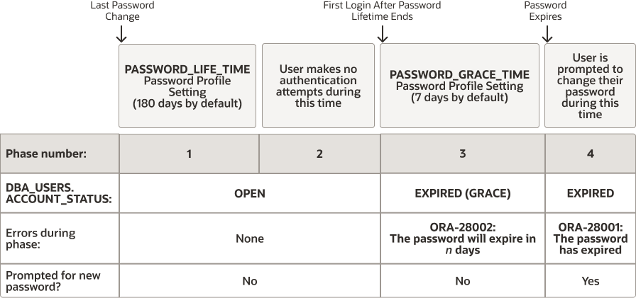
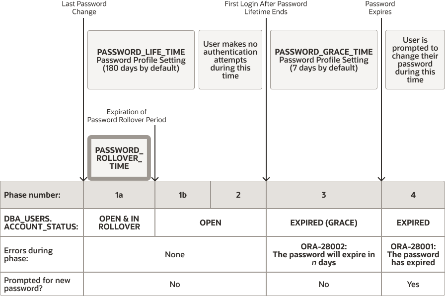
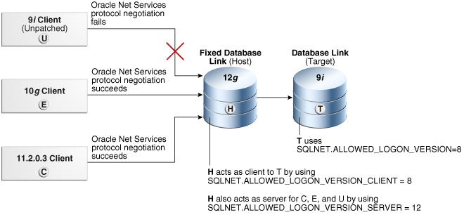
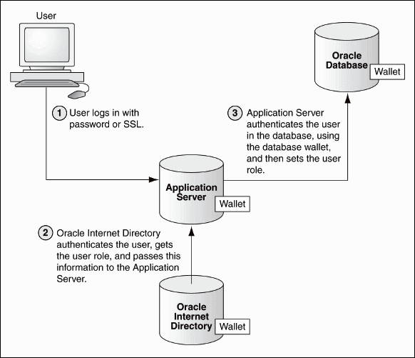

Authentication means to verify the identity of users or other entities that connect to the database.

- About Authentication  
	Authentication means verifying the identity of a user, device, or other entity who wants to use data, resources, or applications.
- Configuring Password Protection  
	You can secure user passwords in a variety of ways, such as controlling the password creation requirements or using password management policies.
- Authentication of Database Administrators  
	You can authenticate database administrators by using strong authentication, from the operating system, or from the database using passwords.
- Database Authentication of Users  
	Database authentication of users entails using information within the database itself to perform the authentication.
- Schema-Only Accounts  
	You can create schema-only accounts, that is, the schema user has no password.
- Operating System Authentication of Users  
	Oracle Database can authenticate by using information that is maintained by the operating system.
- Network Authentication of Users  
	You can authenticate users over a network by using Transport Layer Security with third-party services.
- Configuring Operating System Users for a PDB  
	The `DBMS_CREDENTIAL.CREATE_CREDENTIAL` procedure configures user accounts to be operating system users for a pluggable database (PDB).
- Global User Authentication and Authorization  
	Global user authentication and authorization enables you to centralize the management of user-related information.
- Configuring an External Service to Authenticate Users and Passwords  
	An external service (the operating system or the network) can administer passwords and authenticate users.
- Multitier Authentication and Authorization  
	Oracle Database secures middle-tier applications by limiting privileges, preserving client identities through all tiers, and auditing actions by clients.
- Administration and Security in Clients, Application Servers, and Database Servers  
	In a multitier environment, an application server provides data for clients and serves as an interface to one or more database servers.
- Preserving User Identity in Multitiered Environments  
	You can use middle tier servers for proxy authentication and client identifiers to identify application users who are not known to the database.
- User Authentication Data Dictionary Views  
	Oracle Database provides data dictionary views that list information about user authentication, such as roles that users have or profiles they use.

**Parent topic:** [Managing User Authentication and Authorization](part_1.md)

### 3.1 About Authentication

Authentication means verifying the identity of a user, device, or other entity who wants to use data, resources, or applications.

Validating this identity establishes a trust relationship for further interactions. Authentication also enables accountability by making it possible to link access and actions to specific identities. After authentication, authorization processes can allow or limit the levels of access and action permitted to that entity.

You can authenticate both database and nondatabase users for an Oracle database. For simplicity, the same authentication method is generally used for all database users, but Oracle Database allows a single database instance to use any or all methods. Oracle Database requires special authentication procedures for database administrators, because they perform special database operations. Oracle Database also encrypts passwords during transmission to ensure the security of network authentication.

After authentication, authorization processes can allow or limit the levels of access and action permitted to that entity.

### 3.2 Configuring Password Protection

You can secure user passwords in a variety of ways, such as controlling the password creation requirements or using password management policies.

- What Are the Oracle Database Built-in Password Protections?  
	Oracle Database provides a set of built-in password protections designed to protect your users' passwords.
- Minimum Requirements for Passwords  
	Oracle provides a set of minimum requirements for passwords.
- Creating a Password by Using the IDENTIFIED BY Clause  
	SQL statements that accept the `IDENTIFIED BY` clause also enable you to create passwords.
- Using a Password Management Policy  
	A password management policy can create and enforce a set of restrictions that can better secure user passwords.
- Managing Gradual Database Password Rollover for Applications  
	A gradual database password rollover enables the database password of an application to be updated while avoiding application downtime while the new password is propagated to application clients, by allowing the older password to remain valid for a specified period.
- Managing the Complexity of Passwords  
	Oracle Database provides a set of functions that you can use to manage the complexity of passwords.
- Managing Password Case Sensitivity  
	You can manage the password case sensitivity for passwords from user accounts from previous releases.
- Ensuring Against Password Security Threats by Using the 12C Password Version  
	The `12C` password version enables users to create complex passwords that meet compliance standards.
- Managing the Secure External Password Store for Password Credentials  
	The secure external password store is a client-side wallet that is used to store password credentials.
- Managing Passwords for Administrative Users  
	The passwords of administrative users have special protections, such as password files and password complexity functions.

**Parent topic:** Configuring Authentication

#### 3.2.1 What Are the Oracle Database Built-in Password Protections?

Oracle Database provides a set of built-in password protections designed to protect your users' passwords.

These password protections are as follows:

- Password encryption. Oracle Database automatically and transparently encrypts passwords during network (client-to-server and server-to-server) connections, using Advanced Encryption Standard (AES) before sending them across the network. However, a password that is specified within a SQL statement (such as `CREATE USER user_name IDENTIFIED BY password;`) is still transmitted across the network in clear text in the network trace files. For this reason, you should have native network encryption enabled or configure Transport Layer Security (TLS) encryption.
- Password complexity checking. In a default installation, Oracle Database provides the `ora12c_verify_function` and `ora12c_strong_verify_function` password verification functions to ensure that new or changed passwords are sufficiently complex to prevent intruders who try to break into the system by guessing passwords. You must manually enable password complexity checking. You can further customize the complexity of your users' passwords.
- Preventing passwords from being broken. If a user tries to log in to Oracle Database multiple times using an incorrect password, Oracle Database delays each login by one second. This protection applies for attempts made from different IP addresses or multiple client connections. This feature significantly decreases the number of passwords that an intruder would be able to try within a fixed time period when attempting to log in. The failed login delay slows down each failed login attempt, increasing the overall time that is required to perform a password-guessing attack, because such attacks usually require a very large number of failed login attempts.
	For non-administrative logins, Oracle Database protects against concurrent password guessing attacks by setting an exclusive lock for the failed login delay. This prevents an intruder from attempting to sidestep the failed login delay when the intruder tries the next concurrent guess in a different database session as soon as the first guess fails and is delayed.
	By holding an exclusive lock on the account that is being attacked, Oracle Database mitigates concurrent password guessing attacks, but this can simultaneously leave the account vulnerable to denial-of-service (DoS) attacks. To remedy this problem, you should create a password profile where the `FAILED_LOGIN_ATTEMPTS` parameter is set to `UNLIMITED`, and then apply this password profile to the user account. The value `UNLIMITED` for the `FAILED_LOGIN_ATTEMPTS` parameter setting disables failed login delays and does not limit the number of failed login attempts. For these types of accounts, Oracle recommends that you use a long random password.
	The concurrent password-guessing attack protection does not apply to administrative user connections, because these kinds of connections must remain available at all times and be immune to denial-of-service attacks. Hence, Oracle recommends that you choose long passwords for any administrative privileged account.
- Enforced case sensitivity for passwords. Passwords are case sensitive. For example, the password `hPP5620qr` fails if it is entered as `hpp5620QR` or `hPp5620Qr`. Case sensitivity affects password files and database links.
- Passwords hashed using the 12C password version. To verify the user's password and enforce case sensitivity in password creation, Oracle Database uses the `12C` password version, which is based on a de-optimized algorithm that involves Password-Based Key Derivation Function (PBKDF2) and the SHA-512 cryptographic hash functions.

#### 3.2.2 Minimum Requirements for Passwords

Oracle provides a set of minimum requirements for passwords.

Passwords can be at most 30 bytes long. There are a variety of ways that you can secure passwords, ranging from requiring passwords to be of a sensible length to creating custom password complexity verification scripts that enforce the password complexity policy requirements that apply at your site.

#### 3.2.3 Creating a Password by Using the IDENTIFIED BY Clause

SQL statements that accept the `IDENTIFIED BY` clause also enable you to create passwords.

- To create passwords for users, use the `CREATE USER`, `ALTER USER`, `GRANT CREATE SESSION`, or `CREATE DATABASE LINK` SQL statement.

The following SQL statements create passwords with the `IDENTIFIED BY` clause.

```
CREATE USER psmith IDENTIFIED BY password;
GRANT CREATE SESSION TO psmith IDENTIFIED BY password;
ALTER USER psmith IDENTIFIED BY password;
CREATE DATABASE LINK AUTHENTICATED BY psmith IDENTIFIED BY password;
```

#### 3.2.4 Using a Password Management Policy

A password management policy can create and enforce a set of restrictions that can better secure user passwords.

- About Managing Passwords  
	Database security systems that depend on passwords require that passwords be kept secret at all times.
- Finding User Accounts That Have Default Passwords  
	The `DBA_USERS_WITH_DEFPWD` data dictionary view can find user accounts that use default passwords.
- Password Settings in the Default Profile  
	A profile is a collection of parameters that sets limits on database resources.
- Using the ALTER PROFILE Statement to Modify Profile Limits  
	You can modify profile limits such as failed login attempts, password lock times, password reuse, and several other settings.
- Disabling and Enabling the Default Password Security Settings  
	Oracle provides scripts that you can use to disable and enable the default password security settings.
- Automatically Locking Inactive Database User Accounts  
	The `INACTIVE_ACCOUNT_TIME` profile parameter locks a user account that has not logged in to the database instance in a specified number of days.
- Automatically Locking User Accounts After a Specified Number of Failed Log-in Attempts  
	Oracle Database can lock a user's account after a specified number of consecutive failed log-in attempts.
- Example: Locking an Account with the CREATE PROFILE Statement  
	The `CREATE PROFILE` statement can lock user accounts if a user’s attempt to log in violates the CREATE PROFILE settings.
- Explicitly Locking a User Account with the CREATE USER or ALTER USER Statement  
	When you explicitly lock a user account, the account cannot be unlocked automatically. Only a security administrator can unlock the account.
- Controlling the User Ability to Reuse Previous Passwords  
	You can ensure that users do not reuse previous passwords for an amount of time or for a number of password changes.
- About Controlling Password Aging and Expiration  
	You can specify a password lifetime, after which the password expires.
- Setting a Password Lifetime  
	When you set a lifetime for a password, the user must create a new password when this lifetime ends.
- Checking the Status of a User Account  
	You can check the status of any account, whether it is open, in grace, or expired.
- Password Change Life Cycle  
	After a password is created, it follows a life cycle and grace period in four phases.
- PASSWORD\_LIFE\_TIME Profile Parameter Low Value  
	Be careful if you set the `PASSWORD_LIFE_TIME` parameter of `CREATE PROFILE` or `ALTER PROFILE` to a low value (for example, 1 day).

**Parent topic:** Configuring Password Protection

##### 3.2.4.1 About Managing Passwords

Database security systems that depend on passwords require that passwords be kept secret at all times.

Because passwords are vulnerable to theft and misuse, Oracle Database uses a password management policy. Database administrators and security officers control this policy through user profiles, enabling greater control of database security.

You can use the `CREATE PROFILE` statement to create a user profile. The profile is assigned to a user with the `CREATE USER` or `ALTER USER` statement.

**Parent topic:** Using a Password Management Policy

##### 3.2.4.2 Finding User Accounts That Have Default Passwords

The `DBA_USERS_WITH_DEFPWD` data dictionary view can find user accounts that use default passwords.

When you create a database, most of the default accounts are locked with the passwords expired. If you have upgraded from an earlier release of Oracle Database, then you may have user accounts that have default passwords. These are default accounts that are created when you create a database, such as the `HR`, `OE`, and `SCOTT` accounts.

For greater security, you should change the passwords for these accounts. Using a default password that is commonly known can make your database vulnerable to attacks by intruders.

1. Log in to the CDB root or to a PDB by using SQL\*Plus with the `SYSDBA` administrative privilege.
	For example, to log in to a PDB:
	```
	sqlplus sys@pdb_name as sysdba
	Enter password: password
	```
	To find the available PDBs in a CDB, log in to the CDB root container and then query the `PDB_NAME` column of the `DBA_PDBS` data dictionary view. To check the current container, run the `show con_name` command.
2. Query the `DBA_USERS_WITH_DEFPWD` data dictionary view.
	For example, to find both the names of accounts that have default passwords and the status of the account:
	```
	SELECT d.username, u.account_status 
	FROM DBA_USERS_WITH_DEFPWD d, DBA_USERS u 
	WHERE d.username = u.username 
	ORDER BY 2,1;
	USERNAME  ACCOUNT_STATUS
	--------- ---------------------------
	SCOTT     EXPIRED & LOCKED
	```
3. Change the passwords for any accounts that the `DBA_USERS_WITH_DEFPWD` view lists.
	Oracle recommends that you do not assign these accounts passwords that they may have had in previous releases of Oracle Database.
	For example:
	```
	ALTER USER SCOTT ACCOUNT UNLOCK IDENTIFIED BY password;
	```
	Replace `password` with a password that is secure.

##### 3.2.4.3 Password Settings in the Default Profile

A profile is a collection of parameters that sets limits on database resources.

If you assign the profile to a user, then that user cannot exceed these limits. You can use profiles to configure database settings such as sessions per user, logging and tracing features, and so on. Profiles can also control user passwords. To find information about the current password settings in the profile, you can query the `DBA_PROFILES` data dictionary view.

Table 3-1 lists the password-specific parameter settings in the default profile.

Table 3-1 Password-Specific Settings in the Default Profile

| Parameter | Default Setting | Description |
| --- | --- | --- |
| `INACTIVE_ACCOUNT_TIME` | `UNLIMITED` | Locks the account of a database user who has not logged in to the database instance in a specified number of days. |
| `FAILED_LOGIN_ATTEMPTS` | `10` | Sets the maximum times a user try to log in and to fail before locking the account.  Notes:  - When you set this parameter, take into consideration users who may log in using the `CONNECT THROUGH` privilege. - You can set limits on the number of times an unauthorized user (possibly an intruder) attempts to log in to Oracle Call Interface (OCI) applications by using the `SEC_MAX_FAILED_LOGIN_ATTEMPTS` initialization parameter. |
| `PASSWORD_GRACE_TIME` | `7` | Sets the number of days that a user has to change their password before it expires. |
| `PASSWORD_LIFE_TIME` | `180` | Sets the number of days the user can use their current password. |
| `PASSWORD_LOCK_TIME` | `1` | Sets the number of days an account will be locked after the specified number of consecutive failed login attempts. After the time passes, then the account becomes unlocked. This user's profile parameter is useful to help prevent brute force attacks on user passwords but not to increase the maintenance burden on administrators.  Even after the value set by `PASSWORD_LOCK_TIME` shows that the password has expired, the `DBA_USERS` data dictionary view will show that the account is locked. However, after the user connects, the information in `DBA_USERS` is updated with the correct `OPEN` status. |
| `PASSWORD_REUSE_MAX` | `UNLIMITED` | Sets the number of password changes required before the current password can be reused. |
| `PASSWORD_REUSE_TIME` | `UNLIMITED` | Sets the number of days before which a password cannot be reused. |
| `PASSWORD_ROLLOVER_TIME` | `0` | Enables the gradual database password rollover time. |

**Related Topics**

- [Managing Resources with Profiles](managing-security-for-oracle-database-users.md)
- Automatically Locking Inactive Database User Accounts
- [Configuration of the Maximum Number of Authentication Attempts](managing-security-for-application-developers.md)
- Automatically Locking User Accounts After a Specified Number of Failed Log-in Attempts
- About Controlling Password Aging and Expiration
- Controlling the User Ability to Reuse Previous Passwords

**Parent topic:** Using a Password Management Policy

##### 3.2.4.4 Using the ALTER PROFILE Statement to Modify Profile Limits

You can modify profile limits such as failed login attempts, password lock times, password reuse, and several other settings.

For greater security, use the default settings in the password profile, based on your needs.

- Use the `ALTER PROFILE` statement to modify a user's profile limits.
	For example:
	```
	ALTER PROFILE prof LIMIT
	 FAILED_LOGIN_ATTEMPTS 9
	 PASSWORD_LOCK_TIME 10
	 INACTIVE_ACCOUNT_TIME 21;
	```

##### 3.2.4.5 Disabling and Enabling the Default Password Security Settings

Oracle provides scripts that you can use to disable and enable the default password security settings.

If your applications use the default password security settings from Oracle Database 10g release 2 (10.2), then you can revert to these settings until you modify the applications to use the default password security settings from Oracle Database 11g or later.

1. Modify your applications to conform to the password security settings from Oracle Database 11g or later.
2. Update your database to use the security configuration that suits your business needs, using one of the following methods:
	- Manually update the database security configuration.
	- Run the `secconf.sql` script to apply the default password settings from Oracle Database 11g or later. You can customize this script to have different security settings if you like, but remember that the settings listed in the original script are Oracle-recommended settings.

If you created your database manually, then you should run the `secconf.sql` script to apply the Oracle default password settings to the database. Databases that have been created with Database Configuration Assistant (DBCA) will have these settings, but manually created databases do not.

The `secconf.sql` script is in the `$ORACLE_HOME/rdbms/admin` directory. The `secconf.sql` script affects both password and audit settings. It has no effect on other security settings.

**Parent topic:** Using a Password Management Policy

##### 3.2.4.6 Automatically Locking Inactive Database User Accounts

The `INACTIVE_ACCOUNT_TIME` profile parameter locks a user account that has not logged in to the database instance in a specified number of days.

Users are considered active users if they log in periodically. The `INACTIVE_ACCOUNT_TIME` timing is based on the number of days after the last time a user successfully logs in.

- To lock user accounts automatically after a specified number of days, set the `INACTIVE_ACCOUNT_TIME` profile parameter in the `CREATE PROFILE` or `ALTER PROFILE` statement.
	For example:
	```
	CREATE PROFILE prof LIMIT
	 ...
	 INACTIVE_ACCOUNT_TIME 20;
	```
	Note the following:
	- The default value for `INACTIVE_ACCOUNT_TIME` is `UNLIMITED`.
	- You must specify a whole number for the number of days. The minimum setting is `15` and the maximum is `24855`.
	- To set the user’s account to have an unlimited inactivity time, set the `INACTIVE_ACCOUNT_TIME` to `UNLIMITED`.
	- To set the user’s account to use the time specified by the default profile, set `INACTIVE_ACCOUNT_TIME` to `DEFAULT`.
	- You can set this parameter for all database authenticated users, including administrative users, but not for external or global authenticated users.
	- In a read-only database, the last successful login is not considered in the `INACTIVE_ACCOUNT_TIME` timing. It is not possible to lock a user account in a read-only database (except by performing consecutive failed logins equal in number to the account’s `FAILED_LOGIN_ATTEMPTS` password profile setting).
	- For a newly created user account, the timing begins at account creation time. When this user logs out and then logs again, the timing starts when the user successfully logs in.
	- For common users, the `INACTIVE_ACCOUNT_TIME` setting applies to the last time a common user logs in to the root. A common user is considered active if this user logs in to any of the PDBs or the root.
	- For a proxy user account login, the `INACTIVE_ACCOUNT_TIME` begins the timing when the proxy user logs in successfully.

For example, to create a profile that locks an account after 60 days of being inactive:

```
CREATE PROFILE time_limit LIMIT 
 INACTIVE_ACCOUNT_TIME 60;
```

**Parent topic:** Using a Password Management Policy

##### 3.2.4.7 Automatically Locking User Accounts After a Specified Number of Failed Log-in Attempts

Oracle Database can lock a user's account after a specified number of consecutive failed log-in attempts.

- To lock user accounts automatically after a specified time interval or to require database administrator intervention to be unlocked, set the `PASSWORD_LOCK_TIME` profile parameter in the `CREATE PROFILE` or `ALTER PROFILE` statement.
	For example, to set the time interval to 10 days:
	```
	CREATE PROFILE prof LIMIT
	 ...
	 PASSWORD_LOCK_TIME 10;
	```
	Note the following:
	- You can lock accounts manually, so that they must be unlocked explicitly by a database administrator.
	- You can specify the permissible number of failed login attempts by using the `CREATE PROFILE` statement. You can also specify the amount of time an account remains locked.
	- Each time the user unsuccessfully logs in, Oracle Database increases the delay exponentially with each login failure.
	- If you do not specify a time interval for unlocking the account, then `PASSWORD_LOCK_TIME` assumes the value specified in a default profile. (The recommended value is 1 day.) If you specify `PASSWORD_LOCK_TIME` as `UNLIMITED`, then you must explicitly unlock the account by using an `ALTER USER` statement. For example, assuming that `PASSWORD_LOCK_TIME` `UNLIMITED` is specified for `johndoe`, then you use the following statement to unlock the `johndoe` account:
		```
		ALTER USER johndoe ACCOUNT UNLOCK;
		```
	- After a user successfully logs into an account, Oracle Database resets the unsuccessful login attempt count for the user. If it is non-zero, then the count is set to zero.
	- A locked CDB common user account will be locked across all PDBs in the CDB. A locked application common user account will be locked across all PDBs that are associated with the application root.

**Parent topic:** Using a Password Management Policy

##### 3.2.4.8 Example: Locking an Account with the CREATE PROFILE Statement

The `CREATE PROFILE` statement can lock user accounts if a user’s attempt to log in violates the CREATE PROFILE settings.

Example 3-1 sets the maximum number of failed login attempts for the user `johndoe` to 10 (the default), and the amount of time the account locked to 30 days. The account will unlock automatically after 30 days.

Example 3-1 Locking an Account with the CREATE PROFILE Statement

```
CREATE PROFILE prof LIMIT
 FAILED_LOGIN_ATTEMPTS 10
 PASSWORD_LOCK_TIME 30

ALTER USER johndoe PROFILE prof;
```

**Parent topic:** Using a Password Management Policy

##### 3.2.4.9 Explicitly Locking a User Account with the CREATE USER or ALTER USER Statement

When you explicitly lock a user account, the account cannot be unlocked automatically. Only a security administrator can unlock the account.

After you have locked a CDB common user account in the CDB root, this user cannot log in to any PDB that is associated with this root, nor can this account be unlocked in a PDB. In addition, you can lock a CDB common account locally in a PDB, which will prevent the CDB common user from logging in to that PDB. Similarly, an application common user account that is locked in the application root cannot log in to any PDB associated with the application root, nor can the application common user be unlocked in an application PDB. You can explicitly lock an application common user locally in an application PDB.

- To explicitly lock a user account, use the `CREATE USER` or `ALTER USER` statement.

For example, the following statement locks the user account, `susan`:

```
ALTER USER susan ACCOUNT LOCK;
```

**Parent topic:** Using a Password Management Policy

##### 3.2.4.10 Controlling the User Ability to Reuse Previous Passwords

You can ensure that users do not reuse previous passwords for an amount of time or for a number of password changes.

For better security, Oracle recommends that you restrict the ability of users to use previous passwords.

- To configure the ability of users to reuse earlier passwords, set the `PASSWORD_REUSE_TIME` and `PASSWORD_REUSE_MAX` parameters in the `CREATE PROFILE` or `ALTER PROFILE` statement.
	For example, restrict the number of days (or a fraction of a day) between the earlier use of a password and its next use to 30 days and the number of password changes required before a password can be reused to 10:
	```
	CREATE PROFILE prof LIMIT
	 ...
	 PASSWORD_REUSE_TIME 30
	 PASSWORD_REUSE_MAX 10;
	```
	Note the following:
	- If you do not specify a parameter, then the user can reuse passwords at any time, which is not a good security practice.
	- If neither parameter is `UNLIMITED`, then password reuse is allowed, but only after meeting both conditions. The user must have changed the password the specified number of times, and the specified number of days must have passed since the previous password was last used. For example, suppose that the profile of user A had `PASSWORD_REUSE_MAX` set to `10` and `PASSWORD_REUSE_TIME` set to `30`. User A cannot reuse a password until he or she has reset the password 10 times, and until 30 days had passed since the password was last used.
	- If either parameter is specified as `UNLIMITED`, then the user can never reuse a password.
	- If you set both parameters to `UNLIMITED`, then Oracle Database ignores both, and the user can reuse any password at any time.
	- If you specify `DEFAULT` for either parameter, then Oracle Database uses the value defined in the `DEFAULT` profile, which sets all parameters to `UNLIMITED`. Oracle Database thus uses `UNLIMITED` for any parameter specified as `DEFAULT`, unless you change the setting for that parameter in the `DEFAULT` profile.

**Parent topic:** Using a Password Management Policy

##### 3.2.4.11 About Controlling Password Aging and Expiration

You can specify a password lifetime, after which the password expires.

This means that the next time the user logs in with the current, correct password, he or she is prompted to change the password. By default, there are no complexity or password history checks, so users can still reuse any previous or weak passwords. You can control these factors by setting the `PASSWORD_REUSE_TIME`, `PASSWORD_REUSE_MAX`, and `PASSWORD_VERIFY_FUNCTION` parameters.

In addition, you can set a grace period, during which each attempt to log in to the database account receives a warning message to change the password. If the user does not change it by the end of that period, then Oracle Database expires the account.

As a database administrator, you can manually set the password state to be expired, which sets the account status to `EXPIRED`. The user must then follow the prompts to change the password before the logon can proceed.

For example, in SQL\*Plus, suppose user `SCOTT` tries to log in with the correct credentials, but his password has expired. User `SCOTT` will then see the `ORA-28001: The password has expired` error and be prompted to change his password, as follows:

```
Changing password for scott
New password: new_password
Retype new password: new_password
Password changed.
```

##### 3.2.4.12 Setting a Password Lifetime

When you set a lifetime for a password, the user must create a new password when this lifetime ends.

- To specify a lifetime for passwords, set the `PASSWORD_LIFE_TIME` parameter in the `CREATE PROFILE` or `ALTER PROFILE` statement.
	For example, to set the password life time to 180 days:
	```
	CREATE PROFILE prof LIMIT
	 ...
	 PASSWORD_LIFE_TIME 180;
	```

##### 3.2.4.13 Checking the Status of a User Account

You can check the status of any account, whether it is open, in grace, or expired.

- To check the status of a user account, query the `ACCOUNT_STATUS` column of the `DBA_USERS` data dictionary view.
	For example:
	```
	SELECT ACCOUNT_STATUS FROM DBA_USERS WHERE USERNAME = 'username';
	```

**Parent topic:** Using a Password Management Policy

##### 3.2.4.14 Password Change Life Cycle

After a password is created, it follows a life cycle and grace period in four phases.

The following diagram shows the life cycle of the password lifetime and grace period.

Figure 3-1 Password Change Life Cycle



> Graphic admin\_vm\_024.gif shows the following elements, from top to bottom, left to right:
>
> - Phase 1: Represents the last password change, and the password lifetime.
> - Phase 2: Represents the period of time during which the user does not try to make any authentication attempts.
> - Phase 3: Represents the first login after the password lifetime has expired. This begins the grace period.
> - Phase 4: Represents the period of time after the expiration ends.


In this figure:

- Phase 1: After the user account is created, or the password of an existing account is changed, the password lifetime period begins.
- Phase 2: This phase represents the period of time after the password lifetime ends but before the user logs in again with the correct password. The correct credentials are needed for Oracle Database to update the account status. Otherwise, the account status will remain unchanged. Oracle Database does not have any background process to update the account status. All changes to the account status are driven by the Oracle Database server process on behalf of authenticated users.
- Phase 3: When the user finally does log in, the grace period begins. Oracle Database then updates the `DBA_USERS.EXPIRY_DATE` column to a new value using the current time plus the value of the `PASSWORD_GRACE_TIME` setting from the account's password profile. At this point, the user receives an `ORA-28002` warning message about the password expiring in the near future (for example, `ORA-28002 The password will expire within 7` ` days` if `PASSWORD_GRACE_TIME` is set to `7` days), but the user can still log in without changing the password. The `DBA_USERS.EXPIRY_DATE` column shows the time in the future when the user will be prompted to change their password.
- Phase 4: After the grace period (Phase 3) ends, the `ORA-28001: The password has expired` error appears, and the user is prompted to change the password after entering the current, correct password before the authentication can proceed. If the user has an Oracle Active Data Guard configuration, where there is a primary and a stand-by database, and the authentication attempt is made on the standby database (which is a read-only database), then the `ORA-28032: Your password has expired and the database is set to read-only` error appears. The user should log into the primary database and change the password there.

During any of these four phases, you can query the `DBA_USERS` data dictionary view to find the user's account status in the `DBA_USERS.ACCOUNT_STATUS` column.

In the following example, the profile assigned to `johndoe` includes the specification of a grace period: `PASSWORD_GRACE_TIME = 3` (the recommended value). The first time `johndoe` tries to log in to the database after 90 days (this can be any day after the 90th day, that is, the 91st day, 100th day, or another day), they receive a warning message that their password will expire in 3 days. If 3 days pass, and if they do not change their password, then the password expires. After this, `johndoe` receives a prompt to change the password on any attempt to log in.

```
CREATE PROFILE prof LIMIT
 FAILED_LOGIN_ATTEMPTS 4
 PASSWORD_LIFE_TIME 90
 PASSWORD_GRACE_TIME 3;

ALTER USER johndoe PROFILE prof;
```

A database administrator or a user who has the `ALTER USER` system privilege can explicitly expire a password by using the `CREATE USER` and `ALTER USER` statements. The following statement creates a user with an expired password. This setting forces the user to change the password before the user can log in to the database.

```
CREATE USER jbrown 
 IDENTIFIED BY password
 ...
 PASSWORD EXPIRE;
```

There is no "password unexpire" clause for the `CREATE USER` statement, but an account can be "unexpired" by changing the password on the account.

**Parent topic:** Using a Password Management Policy

##### 3.2.4.15 PASSWORD\_LIFE\_TIME Profile Parameter Low Value

Be careful if you set the `PASSWORD_LIFE_TIME` parameter of `CREATE PROFILE` or `ALTER PROFILE` to a low value (for example, 1 day).

The `PASSWORD_LIFE_TIME` limit of a profile is measured from the last time that an account's password is changed, or the account creation time if the password has never been changed. These dates are recorded in the `PTIME` (password change time) and `CTIME` (account creation time) columns of the `SYS.USER$` system table. The `PASSWORD_LIFE_TIME` limit is not measured starting from the timestamp of the last change to the `PASSWORD_LIFE_TIME` profile parameter, as may be initially thought. Therefore, any accounts affected by the changed profile whose last password change time was more than `PASSWORD_LIFE_TIME` days ago immediately expire and enter their grace period on their next connection, issuing the `ORA-28002: The password will expire within` `n` `days` warning.

As a database administrator, you can find an account's last password change time as follows:

```
ALTER SESSION SET NLS_DATE_FORMAT='DD-MON-YYYY HH24:MI:SS';
SELECT PTIME FROM SYS.USER$ WHERE NAME = 'user_name'; -- Password change time
```

To find when the account was created and the password expiration date, issue the following query:

```
SELECT CREATED, EXPIRY_DATE FROM DBA_USERS WHERE USERNAME = 'user_name';
```

If the user who is assigned this profile is currently logged in when you set the `PASSWORD_LIFE_TIME` parameter and remains logged in, then Oracle Database does not change the user's account status from `OPEN` to `EXPIRED(GRACE)` when the currently listed expiration date passes. The timing begins only when the user logs into the database. You can check the user's last login time as follows:

```
SELECT LAST_LOGIN FROM DBA_USERS WHERE USERNAME = 'user_name';
```

When making changes to a password profile, a database administrator must be aware that if some of the users who are subject to this profile are currently logged in to the Oracle database while their password profile is being updated by the administrator, then those users could potentially remain logged in to the system even beyond the expiration date of their password. You can find the currently logged in users by querying the `USERNAME` column of the `V$SESSION` view.

This is because the expiration date of a user's password is based on the timestamp of the last password change on their account plus the value of the `PASSWORD_LIFE_TIME` password profile parameter set by the administrator. It is not based on the timestamp of the last change to the password profile itself.

Note the following:

- If the user is not logged in when you set `PASSWORD_LIFE_TIME` to a low value, then the user's account status does not change until the user logs in.
- You can set the `PASSWORD_LIFE_TIME` parameter to `UNLIMITED`, but this only affects accounts that have not entered their grace period. After the grace period expires, the user must change the password.

**Parent topic:** Using a Password Management Policy

#### 3.2.5 Managing Gradual Database Password Rollover for Applications

A gradual database password rollover enables the database password of an application to be updated while avoiding application downtime while the new password is propagated to application clients, by allowing the older password to remain valid for a specified period.

- About Managing Gradual Database Password Rollover for Applications  
	You can configure a gradual database password rollover process to begin for database application clients when the database administrator changes the database password for the application.
- Password Change Life Cycle During a Gradual Database Password Rollover  
	After a password is created or changed, it follows a life cycle and grace period in four phases.
- Enabling the Gradual Database Password Rollover  
	To enable the gradual database password rollover, you must configure the `PASSWORD_ROLLOVER_TIME` user profile parameter.
- Changing a Password to Begin the Gradual Database Password Rollover Period  
	After you have set a non-zero `PASSWORD_ROLLOVER_TIME` value, change the user's password and update the password with all the applications.
- Changing a Password During the Gradual Database Password Rollover Period  
	After the rollover period has begun, you can still change the password.
- Ending the Password Rollover Period  
	There are multiple ways in which you can end the password rollover period.
- Database Behavior During the Gradual Password Rollover Period  
	Users can perform their standard password changes and logins during the password rollover period.
- Database Server Behavior After the Password Rollover Period Ends  
	Oracle Database performs clean-up operations after the gradual database password rollover period ends.
- Guideline for Handling Compromised Passwords  
	If a database account password is suspected of being compromised, then you should change the password immediately.
- How Gradual Database Password Rollover Works During Oracle Data Pump Exports  
	When a user is exported while they are in the password rollover period, only the verifier corresponding to their new password is exported.
- Using Gradual Database Password Rollover in an Oracle Data Guard Environment  
	In an Oracle Data Guard environment, you must set the `ADG_ACCOUNT_INFO_TRACKING` environment variable to `GLOBAL` to use gradual database password rollover.
- Finding Users Who Still Use Their Old Passwords  
	You can perform a query that makes use of the `AUTHENTICATION_TYPE` field for a `LOGIN` audit record to find users who still use their old passwords.

**Parent topic:** Configuring Password Protection

##### 3.2.5.1 About Managing Gradual Database Password Rollover for Applications

You can configure a gradual database password rollover process to begin for database application clients when the database administrator changes the database password for the application.

When the database or application administrator changes the password for the application in the database, the applications must be updated with the new database password. Setting the `PASSWORD_ROLLOVER_TIME` parameter in the user's profile enables a password change to take place without having to risk downtime or application outages that could occur as a result of an application attempting to use an outdated password. The password rollover takes place seamlessly from the server and works with all existing supported client versions.

The gradual database password rollover feature is designed for database accounts (service accounts) for applications. The application could be a single server (database client) or scaled out to multiple servers with multiple database clients. It is not designed for administrative users; hence, administrative users are restricted from using this feature, no matter which profile they are associated with. You cannot grant administrative privileges to users who have a password rollover-enabled profile.

You can configure the gradual database password rollover for native password-authenticated user connections. If you convert a password database account to a `NO AUTHENTICATION` account, then Oracle Database deletes the password and verifiers that are associated with this account. When a password-authenticated user account is converted to a `GLOBAL`, an `EXTERNAL` or a `NO AUTHENTICATION` account, then the user implicitly exits the password rollover period. Gradual password rollover supports the `11g` password version and later.

You also can configure the gradual database password rollover for environments that use connected user database links. In this case, when you configure the gradual database password rollover, ensure that you also put the target account into rollover on the target of the connected user database link, and then roll over the target accounts on these links as well. To put the target account into rollover, you would use this syntax:

```
ALTER USER username IDENTIFIED BY same_new_rollover_password;
```

You cannot configure the gradual database password rollover for the following kinds of connections:

- Direct logins for Oracle Real Application Security users
- Kerberos-, certificate-, or RADIUS-based externally authenticated connections
- Centrally managed user (CMU) connections
- Administrative connections that use external password files
- The Oracle Data Guard connection between the primary and the standby

**Parent topic:** Managing Gradual Database Password Rollover for Applications

##### 3.2.5.2 Password Change Life Cycle During a Gradual Database Password Rollover

After a password is created or changed, it follows a life cycle and grace period in four phases.

The following diagram shows the life cycle of the password lifetime and grace period.

Figure 3-2 Password Change Life Cycle During a Gradual Database Password Rollover



> Graphic password\_rollover\_cycle.png shows the following elements, from top to bottom, left to right:
>
> - Phase 1: Represents the last password change, and the password lifetime. It has two sub-phases, 1a and 1b. Phase 1a begins with the password change. During Phase 1a, the user can log in using either the old password or the new password. Phase 1b corresponds to the time remaining after the password rollover period expires. During Phase 1b, the user can log in using only the new password.
> - Phase 2: Represents the period of time during which the user does not try to make any authentication attempts.
> - Phase 3: Represents the first login after the password lifetime has expired. This begins the grace period.
> - Phase 4: Represents the period of time after the expiration ends.


In this figure:

- Phase 1: The password lifetime begins after the user account is created or when the password has been changed. When the password of an existing account is changed, and the user's profile has a non-zero `PASSWORD_ROLLOVER_TIME` value, then the password lifetime is composed of two phases, 1a and 1b:
	- begins with the password change. During Phase 1a, the user can log in using either the old password or the new password. The duration of phase 1a is normally `PASSWORD_ROLLOVER_TIME`, but if the administrator was able to update the password in all client applications sooner than this, they can decide to end the password rollover period sooner by issuing the following command, which makes the new password the only one that is accepted.
		```
		ALTER USER username EXPIRE PASSWORD ROLLOVER PERIOD;
		```
		- Phase 1b corresponds to the time remaining after the password rollover period expires until the end of `PASSWORD_LIFE_TIME`. During Phase 1b, the user can log in using only the new password.
- Phase 2: This phase represents the period of time after the password lifetime ends but before the user logs in again with the correct password. The correct credentials are needed for Oracle Database to update the account status. Otherwise, the account status will remain unchanged. Oracle Database does not have any background process to update the account status. All changes to the account status are driven by the Oracle Database server process on behalf of authenticated users.
- Phase 3: When the user finally does log in, the grace period begins. Oracle Database then updates the `DBA_USERS.EXPIRY_DATE` column to a new value using the current time plus the value of the `PASSWORD_GRACE_TIME` setting from the account's password profile. At this point, the user receives an `ORA-28002` warning message about the password expiring in the near future (for example, `ORA-28002 The password will expire within 7` ` days` if `PASSWORD_GRACE_TIME` is set to `7` days), but the user can still log in without changing the password. The `DBA_USERS.EXPIRY_DATE` column shows the time in the future when the user will be prompted to change their password.
- Phase 4: After the grace period (Phase 3) ends, the `ORA-28001: The password has expired` error appears, and the user is prompted to change the password after entering the current, correct password before the authentication can proceed. If the user has an Oracle Active Data Guard configuration, where there is a primary and a stand-by database, and the authentication attempt is made on the standby database (which is a read-only database), then the `ORA-28032: Your password has expired and the database is set to read-only` error appears. The user should log into the primary database and change the password there.

During any of these four phases, you can query the `DBA_USERS` data dictionary view to find the user's account status in the `DBA_USERS.ACCOUNT_STATUS` column.

In the following example, the profile assigned to `johndoe` includes the specification of a grace period: `PASSWORD_GRACE_TIME = 3` (the recommended value). The first time `johndoe` tries to log in to the database after 90 days (this can be any day after the 90th day, that is, the 91st day, 100th day, or another day), he receives a warning message that his password will expire in 3 days. If 3 days pass, and if he does not change his password, then the password expires. After this, he receives a prompt to change his password on any attempt to log in.

```
CREATE PROFILE prof LIMIT
 FAILED_LOGIN_ATTEMPTS 4
 PASSWORD_LIFE_TIME 90
 PASSWORD_GRACE_TIME 3;

ALTER USER johndoe PROFILE prof;
```

A database administrator or a user who has the `ALTER USER` system privilege can explicitly expire a password by using the `CREATE USER` and `ALTER USER` statements. The following statement creates a user with an expired password. This setting forces the user to change the password before the user can log in to the database.

```
CREATE USER jbrown 
 IDENTIFIED BY password
 ...
 PASSWORD EXPIRE;
```

There is no "password unexpire" clause for the `CREATE USER` statement, but an account can be "unexpired" by changing the password on the account.

**Parent topic:** Managing Gradual Database Password Rollover for Applications

##### 3.2.5.3 Enabling the Gradual Database Password Rollover

To enable the gradual database password rollover, you must configure the `PASSWORD_ROLLOVER_TIME` user profile parameter.

- To configure the gradual database password rollover, set the `PASSWORD_ROLLOVER_TIME` parameter in the `CREATE PROFILE` or `ALTER PROFILE` statement.
	For example, to set the gradual password rollover time period to 1 day:
	```
	CREATE PROFILE prof LIMIT
	 ...
	 PASSWORD_ROLLOVER_TIME 1;
	```
	Note the following:
	- You specify the rollover time period in days, but you can specify hours if you want. For example, enter `1/24` to specify 1 hour, or `6/24` (or `1/4`) to specify 6 hours.
	- The minimum value for an active rollover time is 1 hour. The maximum value is 60 days or the lower value of the `PASSWORD_LIFE_TIME` or `PASSWORD_GRACE_TIME` parameter. If `PASSWORD_GRACE_TIME` is set to `0` (zero), then it will be ignored with respect to any limits with `PASSWORD_ROLLOVER_TIME`. The following table describes these limits:
		Table 3-2 Password Rollover Time Limits
		| Profile Name | PASSWORD\_LIFE\_TIME | PASSWORD\_GRACE\_TIME | PASSWORD\_ROLLOVER\_TIME |
		| --- | --- | --- | --- |
		| Default | 180 | 7 | - Minimum: 1/24 (1 hour) - Maximum: 7 (days) |
		| `ORA_STIG_PROFILE` | 60 | 5 | - Minimum: 1/24 (1 hour) - Maximum: 5 (days) |
		| User Custom Profile | 365 | 90 | - Minimum: 1/24 (1 hour) - Maximum: 60 (days) |
	- The default setting for `PASSWORD_ROLLOVER_TIME` is `0` or `NULL`, which disables it.
	- To find database accounts that are currently in the password rollover process, query the `ACCOUNT_STATUS` column of the `DBA_USERS` data dictionary view. The status will be `IN ROLLOVER`.
	- The password rollover period begins the moment the administrator changes the password for the database account.

**Parent topic:** Managing Gradual Database Password Rollover for Applications

##### 3.2.5.4 Changing a Password to Begin the Gradual Database Password Rollover Period

After you have set a non-zero `PASSWORD_ROLLOVER_TIME` value, change the user's password and update the password with all the applications.

Use the `ALTER USER` statement to provision a new rollover password for the application. After the user's new password is provisioned in the database, you can update the password on the application servers. You must complete the password updates before the `PASSWORD_ROLLOVER_TIME` period ends.

You can check the user's password rollover status by querying the `ACCOUNT_STATUS` column of the `DBA_USERS` data dictionary view. A user account that is within the rollover period will have a status of `IN ROLLOVER`.

- Use the `CREATE USER` and `ALTER USER` statements to configure the user, the associated profile, and the password rollover period. `CREATE USER` allows the administrator to create a new application service account that is associated with a profile with password rollover. `ALTER USER` is more likely where an existing user is associated with a new or modified profile. To alter the profile, use the `ALTER PROFILE` statement.
	The following example `CREATE USER` creates a new user `u1` with password `p1` and a profile `prof1`, with `PASSWORD_ROLLOVER_TIME` configured. The `ALTER USER` statement changes the user's password to begin password rollover period. To check the user status, query the `DBA_USERS` data dictionary view.
	1. Create the profile `prof1`.
		```
		CREATE PROFILE prof1
		LIMIT
		PASSWORD_ROLLOVER_TIME 1;
		```
	2. Create the user `u1` and associate this user with the `prof1` profile.
		```
		CREATE USER u1 IDENTIFIED BY p1 PROFILE prof1;
		```
	3. Alter the user's password.
		```
		ALTER USER u1 IDENTIFIED BY p2;
		```
	4. Query the `DBA_USER` data dictionary view to check the user's rollover status.
		```
		SELECT USERNAME, ACCOUNT_STATUS FROM DBA_USERS WHERE USERNAME = 'U1';
		USERNAME ACCOUNT_STATUS
		–------- –-----------------
		U1       OPEN & IN ROLLOVER
		```

**Parent topic:** Managing Gradual Database Password Rollover for Applications

##### 3.2.5.5 Changing a Password During the Gradual Database Password Rollover Period

After the rollover period has begun, you can still change the password.

For example, suppose you inadvertently mistype the password. The following procedure enables you to correct the password even though the rollover process has already begun.

- To change a password after the rollover process has begun, use the `ALTER USER` statement, with or without the `REPLACE` clause.
	For example, suppose user `u1` has the original password `p1`, `p2` is the new password that started the rollover process, and you want to switch to using another password `p3` instead of password `p2`. Any of the following statements work:
	```
	ALTER USER u1 IDENTIFIED BY p3;
	ALTER USER u1 IDENTIFIED BY p3 REPLACE p1;
	ALTER USER u1 IDENTIFIED BY p3 REPLACE p2;
	```

After you have changed the password to `p3`, the user can log in using either `p1` or `p3`. An attempt to log in using `p2` returns an `ORA-1017 Invalid Username/Password` error, and is recorded as a failed login attempt. Similarly, after a subsequent password change from `p3` to `p4` during the rollover period, the user can log in using either `p1` or `p4`. Attempts to log in using either `p2` or `p3` will return an `ORA-1017 Invalid Username/Password` error, and are recorded as failed login attempts.

The rollover start time is fixed the first time a user changes their password. The start time is not affected by further password changes during the password rollover period. This design limits the length of time the old password can be used to the `PASSWORD_ROLLOVER_TIME` period after the password is changed outside of the password rollover period.

**Parent topic:** Managing Gradual Database Password Rollover for Applications

##### 3.2.5.6 Ending the Password Rollover Period

There are multiple ways in which you can end the password rollover period.

For example, suppose `p1` is the original password for user `u1`, and `p2` is the new password that has been updated to all clients.

- Use one of the following methods to end the password rollover period:
	- Let the password rollover period expire on its own. For example, if the password rollover period is 1 day, wait for 1 day and the password rollover period will expire automatically.
		- As either the user or an administrator, execute the following statement to manually end the password rollover period:
		```
		ALTER USER u1 EXPIRE PASSWORD ROLLOVER PERIOD;
		```
		- As an administrator, expire the password by executing the `ALTER USER username PASSWORD EXPIRE` statement. The next time the user logs in, he or she will be required to change their password.

Beginning with the first connection attempt after the password rollover period expires, Oracle Database drops the earlier password `p1`. Any attempt to login using the old password `p1` returns an `ORA-1017 Invalid Username/Password` error, and is recorded as a failed login attempt. In effect, connections after the rollover period are authenticated with only the new password, and connections that are attempted with the old password are recorded as failed login attempts. The failed login attempts could lock an account after a sufficient number of consecutive logon attempts with the old password.

Connection attempts to read-only database servers after `PASSWORD_ROLLOVER_TIME` expires will require new password (`p2`). The password change to `p2` will be made effective for all database clients.

**Parent topic:** Managing Gradual Database Password Rollover for Applications

##### 3.2.5.7 Database Behavior During the Gradual Password Rollover Period

Users can perform their standard password changes and logins during the password rollover period.

The following database behavior is implemented during the rollover period:

- The user can log in to the database using either the new or the old password. This effectively increases the lifetime of the old password by the time set with `PASSWORD_ROLLOVER_TIME`.
- Passwords can be changed by using the following methods:
	- An administrator or the user changes his or her own password by using the `ALTER USER` statement.
		- The user changes his or her own password by using the SQL\*Plus `password` command.
		- The user's password is programmatically changed when the Oracle Call Interface (Oracle OCI) `OCIPasswordChange` function is executed.
- Oracle Database does not send any special messages to the database clients that indicate that the user account is in the password rollover period. This design avoids any errors from applications that may not be equipped to handle error and warning messages when a user logs in.
- Too many failed login attempts move the user account into a timed lock state, depending on the value of profile limit `PASSWORD_LOCK_TIME`. After the timed lock period expires, the state of the password rollover period determines what happens when the user attempts to log in.
- User administrators can perform other password lifecyle related actions as usual, such as `ACCOUNT LOCK`, `ACCOUNT UNLOCK`, `EXPIRE PASSWORD` operations.
- The password limits that have been set by the `PASSWORD_REUSE_TIME` and `PASSWORD_REUSE_MAX` in the user profile continue to be honored during the rollover period. Any password changes during the rollover period are validated against password change history and added into the password change history.
- Expiring a user account does not affect the password rollover status. As with locked accounts, Oracle Database maintains the password verifiers in their current state. The user can log in using either old or new password (`p1` or `p2`). However, after the user successfully changes their password (to `p3`), the user is allowed to log in only using the newest password (`p3`). Both the old passwords are treated as expired.
- Oracle Data Pump exports the password hashes (also known as verifiers) for the latest password for user accounts in the password rollover period. For example, if a user `u1` has an old password `p1` and new password `p2`, then Oracle Data Pump exports password hashes for password `p2` only.

**Parent topic:** Managing Gradual Database Password Rollover for Applications

##### 3.2.5.8 Database Server Behavior After the Password Rollover Period Ends

Oracle Database performs clean-up operations after the gradual database password rollover period ends.

After the password rollover period expires, only the new password is allowed and the old password stops working. Attempting to use the old password returns an `ORA-1017 Invalid Username/Password` error, and is recorded as a failed login attempt. Connections after the password rollover period will only use the new password, and attempts to use the previous passwords will fail for both read-only and read-write databases. Failed login attempts could lock the user account depending on how many consecutive login attempts have been made to use the old password, based on the `FAILED_LOGIN_ATTEMPTS` limit in the password profile.

**Parent topic:** Managing Gradual Database Password Rollover for Applications

##### 3.2.5.9 Guideline for Handling Compromised Passwords

If a database account password is suspected of being compromised, then you should change the password immediately.

You can perform this change without going through a password rollover period by using the `ALTER USER` statement in one execution to both change and expire the old password, instead of executing two commands sequentially. This option is preferred over changing the `PASSWORD_ROLLOVER_TIME` in the associated user profile, because other accounts will then be affected.

Use the following syntax to change and expire the old password:

```
ALTER USER user_name IDENTIFIED BY new_password EXPIRE PASSWORD ROLLOVER PERIOD;
```

**Parent topic:** Managing Gradual Database Password Rollover for Applications

##### 3.2.5.10 How Gradual Database Password Rollover Works During Oracle Data Pump Exports

When a user is exported while they are in the password rollover period, only the verifier corresponding to their new password is exported.

The verifier that corresponds to their old password is not included in the Oracle Data Pump dump file. After the user is imported, only the new password can be used to authenticate.

**Parent topic:** Managing Gradual Database Password Rollover for Applications

##### 3.2.5.11 Using Gradual Database Password Rollover in an Oracle Data Guard Environment

In an Oracle Data Guard environment, you must set the `ADG_ACCOUNT_INFO_TRACKING` environment variable to `GLOBAL` to use gradual database password rollover.

```
ADG_ACCOUNT_INFO_TRACKING=GLOBAL
```

Otherwise, any initial logons that are performed on the Oracle Data Guard standby by a user who is using the rolled over password after the `PASSWORD_ROLLOVER_TIME` expiration will result in an `ORA-16000: database or pluggable database open for read-only access` error.

**Parent topic:** Managing Gradual Database Password Rollover for Applications

##### 3.2.5.12 Finding Users Who Still Use Their Old Passwords

You can perform a query that makes use of the `AUTHENTICATION_TYPE` field for a `LOGIN` audit record to find users who still use their old passwords.

The unified audit trail can identify which users are still connecting to the database using an old password. The `AUTHENTICATION_TYPE` field for a `LOGON` audit record can show if the old verifier was used. This information enables you to find applications that have not been updated with gradual database password rollover to use the new password. The `LOGON` audit record indicates which application server must be updated.

1. Connect to the database as a user who has the `AUDIT_VIEWER` or `AUDIT_MGMT` role.
2. ```
	SELECT DBUSERNAME, AUTHENTICATION_TYPE, OS_USERNAME, USERHOST, EVENT_TIMESTAMP 
	FROM UNIFIED_AUDIT_TRAIL 
	WHERE ACTION_NAME='LOGON' AND EVENT_TIMESTAMP > SYSDATE-1
	AND REGEXP_LIKE(AUTHENTICATION_TYPE, '\(VERIFIER=.*?\-OLD\)');
	```
	If there are users who are still using their old password, then output similar to the following appears:
	```
	DBUSERNAME    AUTHENTICATION_TYPE                                                                                                                                              OS_USERNAME    USERHOST    EVENT_TIMESTAMP
	_____________ ________________________________________________________________________________________________________________________________________________________________ ______________ ___________ __________________________________
	APP_USER      (TYPE=(DATABASE));(CLIENT ADDRESS=((PROTOCOL=tcp)(HOST=192.0.2.225)(PORT=24938)));(LOGON_INFO=((VERIFIER=12C-OLD)(CLIENT_CAPABILITIES=O5L_NP,O7L_MR,O8L_LI)));    oracle         db211       14-JAN-21 08.56.34.724172000 PM
	APP_USER      (TYPE=(DATABASE));(CLIENT ADDRESS=((PROTOCOL=tcp)(HOST=192.0.2.225)(PORT=24983)));(LOGON_INFO=((VERIFIER=12C-OLD)(CLIENT_CAPABILITIES=O5L_NP,O7L_MR,O8L_LI)));    oracle         db211       14-JAN-21 09.01.18.938008000 PM
	APP_USER      (TYPE=(DATABASE));(CLIENT ADDRESS=((PROTOCOL=tcp)(HOST=192.0.2.226)(PORT=48727)));(LOGON_INFO=((VERIFIER=12C-OLD)(CLIENT_CAPABILITIES=O5L_NP,O7L_MR,O8L_LI)));    oracle         db212       14-JAN-21 10.10.48.042817000 PM
	APP_USER      (TYPE=(DATABASE));(CLIENT ADDRESS=((PROTOCOL=tcp)(HOST=192.0.2.226)(PORT=48745)));(LOGON_INFO=((VERIFIER=12C-OLD)(CLIENT_CAPABILITIES=O5L_NP,O7L_MR,O8L_LI)));    oracle         db212       14-JAN-21 10.12.53.609965000 PM
	APP_USER      (TYPE=(DATABASE));(CLIENT ADDRESS=((PROTOCOL=tcp)(HOST=192.0.2.226)(PORT=48751)));(LOGON_INFO=((VERIFIER=12C-OLD)(CLIENT_CAPABILITIES=O5L_NP,O7L_MR,O8L_LI)));    oracle         db212       14-JAN-21 10.13.41.112194000 PM
	```

**Parent topic:** Managing Gradual Database Password Rollover for Applications

#### 3.2.6 Managing the Complexity of Passwords

Oracle Database provides a set of functions that you can use to manage the complexity of passwords.

- About Password Complexity Verification  
	Complexity verification checks that each password is complex enough to protect against intruders who try to guess user passwords.
- How Oracle Database Checks the Complexity of Passwords  
	Oracle Database provides four password verification functions to check password complexity.
- Who Can Use the Password Complexity Functions?  
	The password complexity functions enable you to customize how users access your data.
- ora12c\_verify\_function Password Requirements  
	The `ora12c_verify_function` function fulfills the Department of Defense Database Security Technical Implementation Guide requirements.
- ora12c\_strong\_verify\_function Function Password Requirements  
	The `ora12c_strong_verify_function` function is a stringent password verify function.
- ora12c\_stig\_verify\_function Password Requirements  
	The `ora12c_stig_verify_function` function fulfills the Department of Defense Security Technical Implementation Guide (STIG) requirements.
- About Customizing Password Complexity Verification  
	Oracle Database enables you to customize password complexity for your site.
- Enabling Password Complexity Verification  
	The `catpvf.sql` script can be customized to enable password complexity verification.

**Parent topic:** Configuring Password Protection

##### 3.2.6.1 About Password Complexity Verification

Complexity verification checks that each password is complex enough to protect against intruders who try to guess user passwords.

Using a complexity verification function forces users to create strong, secure passwords for database user accounts. You must ensure that the passwords for your users are complex enough to provide reasonable protection against intruders who try to break into the system by guessing passwords.

Be aware that if you associate a password verification function with a user's profile, then dropping the password verification function will prevent the user from changing his or her password and cause an `ORA-7443: function for password verification not found` error.

**Parent topic:** Managing the Complexity of Passwords

##### 3.2.6.2 How Oracle Database Checks the Complexity of Passwords

Oracle Database provides four password verification functions to check password complexity.

These functions are in the `catpvf.sql ` PL/SQL script (located in `$ORACLE_HOME/rdbms/admin`). When these functions are enabled, they can check whether users are correctly creating or modifying their passwords. When enabled, password complexity checking is not enforced for user `SYS`; it only applies to non- `SYS` users. For better security of passwords, Oracle recommends that you associate the password verification function with the default profile.

##### 3.2.6.3 Who Can Use the Password Complexity Functions?

The password complexity functions enable you to customize how users access your data.

Before you can use the password complexity verification functions in the `CREATE PROFILE` or `ALTER PROFILE` statement, you must be granted the `EXECUTE` privilege on them.

The password verification functions are located in the `SYS` schema.

**Parent topic:** Managing the Complexity of Passwords

##### 3.2.6.4 ora12c\_verify\_function Password Requirements

The `ora12c_verify_function` function fulfills the Department of Defense Database Security Technical Implementation Guide requirements.

This function checks for the following requirements when users create or modify passwords:

- The password contains no fewer than 8 characters and includes at least one numeric and one alphabetic character.
- The password is not the same as the user name or the user name reversed.
- The password is not the same as the database name.
- The password does not contain the word `oracle` (such as `oracle123`).
- The password differs from the previous password by at least 3 characters.
- The password contains at least 1 special character.

The following internal check is also applied:

- The password does not contain the double-quotation character (`"`). However, it can be surrounded by double-quotation marks.

**Parent topic:** Managing the Complexity of Passwords

##### 3.2.6.5 ora12c\_strong\_verify\_function Function Password Requirements

The `ora12c_strong_verify_function` function is a stringent password verify function.

This function checks for the following requirements when users create or modify passwords:

- The password contains no fewer than 9 characters.
- The password contains at least 2 upper case letters.
- The password contains at least 2 lower case letters.
- The password contains at least 2 numeric characters.
- The password contains at least 2 special characters. These special characters are as follows:
	```
	‘ ~ ! @ # $ % ^ & * ( ) _ - + = { } [ ] \ / < > , . ; ? ' : | (space)
	```
- The password differs from the previous password by at least 4 characters.

The following internal check is also applied:

- The password does not contain the double-quotation character (`"`). It can be surrounded by double-quotation marks, however.

**Parent topic:** Managing the Complexity of Passwords

##### 3.2.6.6 ora12c\_stig\_verify\_function Password Requirements

The `ora12c_stig_verify_function` function fulfills the Department of Defense Security Technical Implementation Guide (STIG) requirements.

This function checks for the following requirements when users create or modify passwords:

- The password has at least 15 characters.
- The password has at least 1 lower case character and at least 1 upper case character.
- The password has at least 1 digit.
- The password has at least 1 special character.
- The password differs from the previous password by at least 8 characters.

The following internal check is also applied:

- The password does not contain the double-quotation character (`"`). However, it can be surrounded by double-quotation marks.

The `ora12c_stig_verify_function` function is the default handler for the `ORA_STIG_PROFILE` profile, which is available in a newly-created or upgraded Oracle database.

##### 3.2.6.7 About Customizing Password Complexity Verification

Oracle Database enables you to customize password complexity for your site.

You can create your own password complexity verification function in the `SYS` schema, similar to the functions that are defined in `admin/catpvf.sql`. In fact, Oracle recommends that you do so to further secure your site’s passwords.

Note the following:

- Do not include Data Definition Language (DDL) statements in the custom password complexity verification function. DDLs are not allowed during the execution of password complexity verification functions.
- Do not modify the `admin/catpvf.sql` script or the Oracle-supplied password complexity functions. You can create your own functions based on the contents of these files.
- If you make no modifications to the `utlpwdmg.sql` script, then it uses the `ora12c_verify_function` function as the default function.

##### 3.2.6.8 Enabling Password Complexity Verification

The `catpvf.sql` script can be customized to enable password complexity verification.

To enable password complexity verification, you must edit the `catpvf.sql` script to use the password verification function that you want, and then run the script to enable it.

1. Log in to SQL\*Plus with administrative privileges.
	For example:
	```
	CONNECT SYSTEM
	Enter password: password
	```
2. Run the `catpvf.sql` script (or your modified version of this script) to create the password complexity functions in the `SYS` schema.
	```
	@$ORACLE_HOME/rdbms/admin/catpvf.sql
	```
3. Grant any users who must use this function the `EXECUTE` privilege on it.
	For example:
	```
	GRANT pmsith EXECUTE ON ora12c_strong_verify_function;
	```
4. In the default profile or the user profile, set the `PASSWORD_VERIFY_FUNCTION` setting to either the sample password complexity function in the `catpvf.sql` script, or to your customized function. Use one of the following methods:
	- Log in to SQL\*Plus with administrator privileges and use the `CREATE PROFILE` or `ALTER PROFILE` statement to enable the function. Ensure that you have the `EXECUTE` privilege on the function.
		For example, to update the default profile to use the `ora12c_strong_verify_function` function:
		```
		ALTER PROFILE default LIMIT 
		 PASSWORD_VERIFY_FUNCTION ora12c_strong_verify_function;
		```
	- In Oracle Enterprise Manager Cloud Control, from the Administration menu, select Security, and then Profiles. Select the Password tab. Under Complexity, from the Complexity function list, select the name of the complexity function that you want. Click Apply.

After you have enabled password complexity verification, it takes effect immediately. If you must disable it, then run the following statement:

```
ALTER PROFILE DEFAULT LIMIT PASSWORD_VERIFY_FUNCTION NULL;
```

Note:

The `ALTER USER` statement has a `REPLACE` clause. With this clause, users can change their own unexpired passwords by supplying the previous password to authenticate themselves.

If the password has expired, then the user cannot log in to SQL to issue the `ALTER USER` command. Instead, the `OCIPasswordChange()` function must be used, which also requires the previous password.

A database administrator with `ALTER ANY USER` privilege can change any user password (force a new password) without supplying the old one.

**Parent topic:** Managing the Complexity of Passwords

#### 3.2.7 Managing Password Case Sensitivity

You can manage the password case sensitivity for passwords from user accounts from previous releases.

- Management of Case Sensitivity for Secure Role Passwords  
	Oracle Database ensures that the passwords for secure roles are case sensitive.
- Management of Password Versions of Users  
	By default, Oracle Database uses Exclusive Mode, which does not permit case-insensitive passwords, to manage password versions.
- Finding and Resetting User Passwords That Use the 10G Password Version  
	For better security, find and reset passwords for user accounts that use the `10G` password version so that they use later, more secure password versions.
- How Case Sensitivity Affects Password Files  
	The password file version and whether the password file contains accounts from previous releases affects the case sensitivity of administrative authentication.
- How Case Sensitivity Affects Passwords Used in Database Link Connections  
	When you create a database link connection, you must define a user name and password for the connection.

**Parent topic:** Configuring Password Protection

##### 3.2.7.1 Management of Case Sensitivity for Secure Role Passwords

Oracle Database ensures that the passwords for secure roles are case sensitive.

If before upgrading to the current release, you created secure roles by using the `IDENTIFIED BY` clause of the `CREATE ROLE` statement, and if upon upgrading to Oracle Database 12c release 12.2, you set the `SQLNET.ALLOWED_LOGON_VERSION_SERVER` parameter to one of the Exclusive Modes 12 or 12a, then you must change the password for these secure roles in order for them to remain usable. Because Exclusive Mode is now the default, secure roles that were created in earlier releases (such as Oracle Database 10g, in which the 10G password version was the default) will need to have their passwords changed. These passwords will automatically be case sensitive.

You can query the `PASSWORD_REQUIRED` and `AUTHENTICATION_TYPE` columns of the `DBA_ROLES` data dictionary view to find any secure roles that must have their password changed after upgrading to the current release, in order to become usable again.

**Parent topic:** Managing Password Case Sensitivity

##### 3.2.7.2 Management of Password Versions of Users

By default, Oracle Database uses Exclusive Mode, which does not permit case-insensitive passwords, to manage password versions.

In a default installation, the `SQLNET.ALLOWED_LOGON_VERSION_SERVER` parameter is set to `12` to enable Exclusive Mode. Exclusive Mode requires that the password-based authentication protocol use one of the case-sensitive password versions (`11G` or `12C`) for the account that is being authenticated. Exclusive Mode excludes the use of the `10G` password version that was used in earlier releases. After you upgrade to Oracle Database 12c release 2 (12.2) or later, accounts that use the `10G` password version become inaccessible. This occurs because the server runs in Exclusive Mode by default, and Exclusive Mode cannot use the old `10G` password version to authenticate the client. The server is left with no password version with which to authenticate the client.

The user accounts from Release 10g use the `10G` password version. Therefore, you should find the user accounts that use the `10G` password version, and then reset the passwords for these accounts. This generates the appropriate password version based on the setting of the `SQLNET.ALLOWED_LOGON_VERSION_SERVER` parameter, as follows:

- `SQLNET.ALLOWED_LOGON_VERSION_SERVER=8` generates all three password versions `10G`, `11G`, and `12C`.
- `SQLNET.ALLOWED_LOGON_VERSION_SERVER=12` generates both `11G` and `12C` password versions, and removes the `10G` password version.
- `SQLNET.ALLOWED_LOGON_VERSION_SERVER=12a` generates only the `12C` password version.

If you first relax the `SQLNET.ALLOWED_LOGON_VERSION_SERVER` setting to a more permissive value (such as `SQLNET.ALLOWED_LOGON_VERSION_SERVER=8`) and then import the user accounts from an Oracle Database release 10g (or earlier) release into the current database release, then because the `10G` password version (used in the older release) is not case sensitive, these users will still be able to log into the database using any case for their password. But when such a user changes their password, the new `11G` and `12C` password versions are generated automatically, and their password will automatically become case sensitive.

**Parent topic:** Managing Password Case Sensitivity

##### 3.2.7.3 Finding and Resetting User Passwords That Use the 10G Password Version

For better security, find and reset passwords for user accounts that use the `10G` password version so that they use later, more secure password versions.

Finding All Password Versions of Current Users

You can query the `DBA_USERS` data dictionary view to find a list of all the password versions configured for user accounts.

For example:

```
SELECT USERNAME,PASSWORD_VERSIONS FROM DBA_USERS;

USERNAME                       PASSWORD_VERSIONS
------------------------------ -----------------
JONES                          10G 11G 12C 
ADAMS                          10G 11G
CLARK                          10G 11G
PRESTON                        11G
BLAKE                          10G
```

The `PASSWORD_VERSIONS` column shows the list of password versions that exist for the account. `10G` refers to the earlier case-insensitive Oracle password version, `11G` refers to the SHA-1-based password version, and `12C` refers to the SHA-2-based SHA-512 password version.

- User `jones`: The password for this user was reset in Oracle Database 12c Release 12.1 when the `SQLNET.ALLOWED_LOGON_VERSION_SERVER` parameter setting was `8`. This enabled all three password versions to be created.
- Users `adams` and `clark`: The passwords for these accounts were originally created in Oracle Database 10g and then reset in Oracle Database 11g. The Oracle Database 11g software was using the default `SQLNET.ALLOWED_LOGON_VERSION` setting of `8` at that time. Because case insensitivity is enabled by default, their passwords are now case sensitive, as is the password for `preston`.
- User `preston`: This account was imported from an Oracle Database 11g database that was running in Exclusive Mode (`SQLNET.ALLOWED_LOGON_VERSION = 12`).
- User `blake`: This account still uses the Oracle Database 10g password version. At this stage, user `blake` is prevented from logging in.

Resetting User Passwords That Use the 10G Password Version

You should remove the `10G` password version from the accounts of all users. In the following procedure, to reset the passwords of users who have the `10G` password version, you must temporarily relax the `SQLNET.ALLOWED_LOGON_VERSION_SERVER` setting, which controls the ability level required of clients before login can be allowed. Relaxing the setting enables these users to log in and change their passwords, and hence generate the newer password versions in addition to the `10G` password version. Afterward, you can set the database to use Exclusive Mode and ensure that the clients have the `O5L_NP` capability. Then the users can reset their passwords again, so that their password versions no longer include `10G`, but only have the more secure `11G` and `12C` password versions.

1. Query the `DBA_USERS` view to find users who only use the `10G` password version.
	```
	SELECT USERNAME FROM DBA_USERS 
	WHERE ( PASSWORD_VERSIONS = '10G '
	OR PASSWORD_VERSIONS = '10G HTTP ')
	AND USERNAME <> 'ANONYMOUS';
	```
2. Configure the database so that it does not run in Exclusive Mode, as follows:
	1. Edit the `SQLNET.ALLOWED_LOGON_VERSION_SERVER` setting in the `sqlnet.ora` file so that it is more permissive than the default. For example:
		```
		SQLNET.ALLOWED_LOGON_VERSION_SERVER=11
		```
		2. If you are in the CDB root, then restart the database (for example, `SHUTDOWN IMMEDIATE` followed by `STARTUP`). If you are in a PDB, connect to the root using the `SYSDBA` administrative privilege, and then enter the following statements:
		```
		ALTER PLUGGABLE DATABASE pdb_name CLOSE IMMEDIATE;
		ALTER PLUGGABLE DATABASE pdb_name OPEN;
		```
3. Expire the users that you found when you queried the `DBA_USERS` view to find users who only use the `10G` password version.
	You must expire the users who have only the `10G` password version, and do not have one or both of the `11G` or `12C` password versions.
	For example:
	```
	ALTER USER username PASSWORD EXPIRE;
	```
4. Ask the users whose passwords you expired to log in.
	When the users log in, they are prompted to change their passwords. The database generates the missing `11G` and `12C` password versions for their account, in addition to the `10G` password version. The `10G` password version continues to be present, because the database is running in the permissive mode.
5. Ensure that the client software with which the users are connecting has the `O5L_NP` ability.
	All Oracle Database release 11.2.0.3 and later clients have the `O5L_NP` ability. If you have an earlier Oracle Database client, then you must install the `CPUOct2012` patch.
6. After all clients have the `O5L_NP` capability, set the security for the server back to Exclusive Mode, as follows:
	1. Remove the `SQLNET.ALLOWED_LOGON_VERSION_SERVER` parameter from the server `sqlnet.ora` file, or set the value of `SQLNET.ALLOWED_LOGON_VERSION_SERVER` in the server `sqlnet.ora` file back to `12`, to set it to an Exclusive Mode.
		```
		SQLNET.ALLOWED_LOGON_VERSION_SERVER = 12
		```
		2. If you are in the CDB root, then restart the database (for example, `SHUTDOWN IMMEDIATE` followed by `STARTUP`). If you are in a PDB, connect to the root using the `SYSDBA` administrative privilege, and then enter the following statements:
		```
		ALTER PLUGGABLE DATABASE pdb_name CLOSE IMMEDIATE;
		ALTER PLUGGABLE DATABASE pdb_name OPEN;
		```
7. Find the accounts that still have the `10G` password version.
	```
	SELECT USERNAME FROM DBA_USERS
	WHERE PASSWORD_VERSIONS LIKE '%10G%' 
	AND USERNAME <> 'ANONYMOUS';
	```
8. Expire the accounts that still have the `10G` password version.
	```
	ALTER USER username PASSWORD EXPIRE;
	```
9. Ask these users to log in to their accounts.
	When the users log in, they are prompted to reset their passwords. The database then generates only the `11G` and `12C` password versions for their accounts. Because the database is running in Exclusive Mode, the `10G` password version is no longer generated.
10. ```
	SELECT USERNAME FROM DBA_USERS
	WHERE PASSWORD_VERSIONS LIKE '%10G%' 
	AND USERNAME <> 'ANONYMOUS';
	```
	If this query does not return any results, then it means that no user accounts have the `10G` password version. Hence, the database is running in a more secure mode than in previous releases.

**Parent topic:** Managing Password Case Sensitivity

##### 3.2.7.4 How Case Sensitivity Affects Password Files

The password file version and whether the password file contains accounts from previous releases affects the case sensitivity of administrative authentication.

Any password file account from a previous release that has only the `10G` verifier can only perform case-insensitive administrative authentication.

After a password file has been created (using the `orapwd` utility), the Oracle database updates it when an administrative privilege is granted to or revoked from the user, or when the password of a user who has an administrative privilege is updated.

The password file is external to the database, allowing the Oracle database to authenticate administrative connections (using the `AS administrative_privilege_name` clause, for example, `AS SYSKM`) even when the database is in the `CLOSED` state.

When an administrative connection is attempted, the Oracle database searches for the user in the password file to verify their password and to ensure that the user has been granted the requested administrative privilege. The Oracle database can use the password file to authenticate an administrative connection even when the database is in the `CLOSED` state.

The version of the password file and the type of verifier that it contains for the administrative user affects whether the authentication of that administrative user can be done in a case-sensitive fashion.

However, password files from earlier Oracle Database releases will by default retain their original case-insensitive verifiers. Oracle recommends that you force case sensitivity in these older password files by migrating the password file from one format to another and changing the password of any account that has only a `10G` verifier, using the following syntax:

```
orapwd FILE=new_pwd_file_name INPUT_FILE=old_pwd_file_name [FORMAT=12.2]
```

The `FORMAT` and `FORCE` options are not mandatory and can be omitted. If you omit `FORMAT`, then it defaults to `12.2`. If the `FILE` and `INPUT_FILE` options are set to the same file, then the `FORCE` option would be required.

For example:

```
orapwd FILE='/u01/oracle/dbs/old_pwd_file_name' INPUT_FILE='/u01/oracle/dbs/new_pwd_file_name' FORMAT=12.2 FORCE=y
Enter password for SYS: password
```

Assuming that the user accounts in the password file have the newer verifiers (`11G` and `12C`), this command creates a case-sensitive password file called `new_pwd_file_name` that will authenticate administrative connections in a case-sensitive fashion. If any user account in the password file uses only the older `10G` verifier, then the password of this account must be changed to enable case-sensitive authentication of administrative connections to that account. Afterward, if you connect using this password, it succeeds—as long as you enter it using the exact case in which it was created. If you enter the same password but with a different case, then the authentication attempt that uses the password fails.

If you imported user accounts from a previous release and these accounts were created with `SYSDBA` or `SYSOPER` administrative privilege, then they will be included in the password file. The passwords for these accounts are case insensitive. The next time these users change their passwords, the passwords become case sensitive. For greater security, have these users change their passwords. You can use the `ALTER USER PASSWORD EXPIRE` statement to expire a user's password. Afterward, ask the user log in again, so that the user will be prompted to change his or her password.

##### 3.2.7.5 How Case Sensitivity Affects Passwords Used in Database Link Connections

When you create a database link connection, you must define a user name and password for the connection.

When you create the database link connection, the password is case sensitive. How a user enters his or her password for the database link depends on the release to which the database link was created:

- Users can connect from a pre-Oracle Database 12c database to an Oracle Database 12c or later database. Because case sensitivity is enabled, then the user must enter the password using the case that was used when the account was created.
- If the user connects from an Oracle Database 12c or later database to a pre-Oracle Database 12c database, and if the `SEC_CASE_SENSITIVE_LOGON` parameter in the pre-Release 12c database had been set to `FALSE`, then the password for this database link can be specified using any case.

You can find the user accounts for existing database links by querying the `V$DBLINK` view. For example:

```
SELECT DB_LINK, OWNER_ID FROM V$DBLINK;
```

#### 3.2.8 Ensuring Against Password Security Threats by Using the 12C Password Version

The `12C` password version enables users to create complex passwords that meet compliance standards.

- About the 12C Version of the Password Hash  
	The `12C` password hash protects against password-based security threats by including support for mixed case passwords.
- Oracle Database 12C Password Version Configuration Guidelines  
	By default, Oracle Database generates two versions of the password hash: `11G` and `12C`.
- Configuring Oracle Database to Use the 12C Password Version Exclusively  
	You should set the `SQLNET.ALLOWED_LOGON_VERSION_SERVER` parameter to `12a` so that only the `12C` password hash version is used.
- How Server and Client Logon Versions Affect Database Links  
	The `SQLNET.ALLOWED_LOGON_VERSION_SERVER` and `SQLNET.ALLOWED_LOGON_VERSION_CLIENT` parameters can accommodate connections between databases and clients of different releases.
- Configuring Oracle Database Clients to Use the 12C Password Version Exclusively  
	An intruder may try to provision a fake server to downgrade authentication and trick the client into using a weaker password hash version.

**Parent topic:** Configuring Password Protection

##### 3.2.8.1 About the 12C Version of the Password Hash

The `12C` password hash protects against password-based security threats by including support for mixed case passwords.

The cryptographic hash function used for generating the `12C` version of the password hash is based on a de-optimized algorithm involving Password-Based Key Derivation Function 2 (PBKDF2) and the SHA-512 cryptographic hash functions. The PBKDF2 algorithm introduces computational asymmetry in the challenge that faces an intruder who is trying to recover the original password when in possession of the `12C` version of the password hash. The `12C` password generation performs a SHA-512 hash of the PBKDF2 output as its last step. This two-step approach used in the `12C` password version generation allows server CPU resources to be conserved when the client has the O7L\_MR capability. This is because during authentication, the server only needs to perform a single SHA-512 hash of a value transmitted by the O7L\_MR capable client, to validate it against the 12C version of the password hash.

In addition, the `12C` password version adds a salt to the password when it is hashed, which provides additional protection. (Salt is a random string that is added to the data before it is encrypted, making it more difficult for attackers to steal the data by matching patterns of ciphertext to known ciphertext samples.) The `12C` password version enables your users to create far more complex passwords. The `12C` password version's use of salt, its use of PBKDF2 de-optimization, and its support for mixed-case passwords makes it more expensive for an intruder to perform dictionary or brute force attacks on the `12C` password version in an attempt to recover the user's password. Oracle recommends that you use the `12C` version of the password hash.

The password hash values are considered to be extremely sensitive, because they are used as a "shared secret" between the server and person who is logging in. If an intruder learns this secret, then the protection of the authentication is immediately and severely compromised. Remember that administrative users who have account management privileges, administrative users who have the `SYSDBA` administrative privilege, or even users who have the `EXP_FULL_DATABASE` role can immediately access the password hash values. Therefore, this type of administrative user must be trustworthy if the integrity of the database password-based authentication is to be preserved. If you cannot trust these administrators, then it is better to deploy a directory server (such as Oracle Database Enterprise User Security) so that the password hash values remain within the Enterprise User Security directory and are never accessible to anyone except the Enterprise User Security administrator.

##### 3.2.8.2 Oracle Database 12C Password Version Configuration Guidelines

By default, Oracle Database generates two versions of the password hash: `11G` and `12C`.

The version of the password hash that Oracle Database uses to authenticate a given client depends on the client’s ability, and the settings for the `SQLNET.ALLOWED_LOGON_VERSION_CLIENT` and `SQLNET.ALLOWED_LOGON_VERSION_SERVER` parameters. See the column “Ability Required of the Client” in the “SQLNET.ALLOWED\_LOGON\_VERSION\_SERVER Settings” table in the `SQLNET.ALLOWED_LOGON_VERSION_SERVER` parameter description in [Oracle Database Net Services Reference](https://docs.oracle.com/pls/topic/lookup?ctx=en/database/oracle/oracle-database/21/dbseg&id=NETRF2016) for detailed information about how the client authentication works with password versions.

The `10G` password version, which was generated in Oracle Database 10g, is not case sensitive. Both the `11G` and `12C` password versions are case sensitive.

In Oracle Database 12g release 2 (12.2), the `sqlnet.ora` parameter `SQLNET.ALLOWED_LOGON_VERSION_SERVER` defaults to `12`, which is Exclusive Mode and prevents the use of the `10G` password version, and the `SQLNET.ALLOWED_LOGON_VERSION_CLIENT` parameter defaults to `11`. For new accounts, when the client is Oracle Database 12c, then Oracle Database uses the `12C` password version exclusively with clients that are running the Oracle Database 12c release software. For accounts that were created before Oracle Database release 12c, logins will succeed as long as the client has the O5L\_NP ability, because an `11G` password version normally exists for accounts created in earlier releases such as Oracle Database release 11g. For a very old account (for example, from Oracle Database release 10g), the user’s password may need to be reset, in order to create a SHA-1 password version for the account. To configure this server to generate only the `12C` password version whenever a new account is created or an existing account password is changed, then set the `SQLNET.ALLOWED_LOGON_VERSION_SERVER` parameter to `12a`. However, if you want your applications to be compatible with older clients, then ensure that `SQLNET.ALLOWED_LOGON_VERSION_SERVER` is set to `12`, which is the default.

How you set the `SQLNET.ALLOWED_LOGON_VERSION_SERVER` parameter depends on the balance of security and interoperability with older clients that your system requires. You can control the levels of security as follows:

- Greatest level of compatibility: To configure the server to generate all three versions of the password hash (the `12C` password version, the `11G` password version, and the DES-based `10G` password version), whenever a new account is created or an existing account password is changed, set the `SQLNET.ALLOWED_LOGON_VERSION_SERVER` parameter to the value `11` or lower. (Be aware that earlier releases used the value `8` as the default.)
- Recommended level of security: To configure the server to generate both the `12C` password version and the `11G` password version (but not the `10G` password version), whenever a new account is created or an existing account password is changed, set the `SQLNET.ALLOWED_LOGON_VERSION_SERVER` parameter to the value `12`.
- Highest level of security: To configure the server to generate only the `12C` password version whenever a new account is created or an existing account password is changed, set the `SQLNET.ALLOWED_LOGON_VERSION_SERVER` parameter to the value `12a`.

During authentication, the following scenarios are possible, based on the kinds of password versions that exist for the account, and on the version of the client software being used:

- Accounts with only the 10G version of the password hash: If you want to force the server to generate the newer versions of the password hash for older accounts, an administrator must expire the password for any account that has only the `10G` password version (and none of the more secure password versions, `11G` or `12C`). You must generate these password versions because the database depends on using these password versions to provide stronger security. You can find these users as follows.
	```
	SELECT USERNAME FROM DBA_USERS 
	WHERE PASSWORD_VERSIONS LIKE '%10G%
	AND USERNAME <> 'ANONYMOUS';
	```
	And then expire each account as follows:
	```
	ALTER USER username PASSWORD EXPIRE;
	```
	After you have expired each account, notify these users to log in, in which case they will be prompted to change their password. The version of the client determines the password version that is used. The setting of the `SQLNET.ALLOWED_LOGON_VERSION_SERVER` parameter determines the password versions that are generated. If the client has the O7L\_MR ability (Oracle Database release 12c), then the 12C password version is used to authenticate. If the client has the O5L\_NP ability but not the O7L\_MR ability (such as Oracle Database release 11g clients), then the `11G` password version is used to authenticate. You should upgrade all clients to Oracle Database release 12c so that the `12C` password version can be used exclusively to authenticate. (By default, Oracle Database release 11.2.0.3 and later clients have the `O5L_NP` ability, which enables the `11G` password version to be used exclusively. If you have an earlier Oracle Database client, then you must install the CPUOct2012 patch.)
	When an account password is expired and the `ALLOWED_LOGON_VERSION_SERVER` parameter is set to `12` or `12a`, then the `10G` password version is removed and only one or both of the new password versions are created, depending on how the parameter is set, as follows:
	- If `ALLOWED_LOGON_VERSION_SERVER` is set to `12` (the default), then both the `11G` and `12C` versions of the password hash are generated.
		- If `ALLOWED_LOGON_VERSION_SERVER` is set to `12a`, then only the `12C` version of the password hash is generated.
	For more details, see the "Generated Password Version" column in the table in the "Usage Notes" section for the `SQLNET.ALLOWED_LOGON_VERSION_SERVER` parameter in [Oracle Database Net Services Reference](https://docs.oracle.com/pls/topic/lookup?ctx=en/database/oracle/oracle-database/21/dbseg&id=NETRF2018).
- Accounts with both 10G and 11G versions of the password hash: For users who are using a Release 10g or later client, the user logins will succeed because the `11G` version of the password hash is used. However, to use the latest version, expire these passwords, as described in the previous bulleted item for accounts.
- Accounts with only the 11G version of the password hash: The authentication uses the `11G` version of the password hash. To use the latest version, expire the passwords, as described in the first bulleted item.

The Oracle Database 12c default configuration for `SQLNET.ALLOWED_LOGON_VERSION_SERVER` is `12`, which means that it is compatible with Oracle Database 12c release 2 (12.2) authentication protocols and later products that use OCI-based drivers, including SQL\*Plus, ODBC, Oracle.NET, Oracle Forms, and various third-party Oracle Database adapters. It is also compatible with JDBC type-4 (thin) versions that have had the CPUOct2012 bundle patch applied or starting with Oracle Database 11g, and Oracle Database Client interface (OCI)-based drivers starting in Oracle Database 10g release 10.2. Be aware that earlier releases of the OCI client drivers cannot authenticate to an Oracle database using password-based authentication.

**Parent topic:** Ensuring Against Password Security Threats by Using the 12C Password Version

##### 3.2.8.3 Configuring Oracle Database to Use the 12C Password Version Exclusively

You should set the `SQLNET.ALLOWED_LOGON_VERSION_SERVER` parameter to `12a` so that only the `12C` password hash version is used.

The `12C` password version is the most restrictive and secure of the password hash versions, and for this reason, Oracle recommends that you use only this password version. By default, `SQLNET.ALLOWED_LOGON_VERSION_SERVER` is set to `12`, which enables both the `11G` and `12C` password versions to be used. (Both the `SQLNET.ALLOWED_LOGON_VERSION_SERVER` values `12` and `12a` are considered Exclusive Mode, which prevents the use of the earlier `10G` password version.) If you have upgraded from a previous release, or if `SQLNET.ALLOWED_LOGON_VERSION_SERVER` is set to `12` or another setting that was used in previous releases, then you should reconfigure this parameter, because intruders will attempt to downgrade the authentication to use weaker password versions. Table 3-3 shows the effect of the `SQLNET.ALLOWED_LOGON_VERSION_SERVER` setting on password version generation.

Be aware that you can use the `12C` password version exclusively only if you use Oracle Database 12c release 12.1.0.2 or later clients. Before you change the `SQLNET.ALLOWED_LOGON_VERSION_SERVER` parameter to `12a`, check the versions of the database clients that are connected to the server.

1. Log in to SQL\*Plus as an administrative user who has the `ALTER USER` system privilege.
2. Perform the following SQL query to find the password versions of your users.
	```
	SELECT USERNAME,PASSWORD_VERSIONS FROM DBA_USERS;
	```
3. Expire the account of each user who does not have the `12C` password version.
	For example, assuming user `blake` is still using a `10G` password version:
	```
	ALTER USER blake PASSWORD EXPIRE;
	```
	The next time that these users log in, they will be forced to change their passwords, which enables the server to generate the password versions required for Exclusive Mode.
4. Remind users to log in within a reasonable period of time (such as 30 days).
	When they log in, they will be prompted to change their password, ensuring that the password versions required for authentication in Exclusive Mode are generated by the server. (For more information about how Exclusive Mode works, see the usage notes for the `SQLNET.ALLOWED_LOGON_VERSION_SERVER` parameter in [Oracle Database Net Services Reference](https://docs.oracle.com/pls/topic/lookup?ctx=en/database/oracle/oracle-database/21/dbseg&id=NETRF2018).)
5. Manually change the passwords for accounts that are used in test scripts or batch jobs so that they exactly match the passwords used by these test scripts or batch jobs, including the password's case.
6. Enable the Exclusive Mode configuration as follows:
	1. Create a back up copy of the `sqlnet.ora` parameter file.
		By default, this file is located in the `$ORACLE_HOME/network/admin` directory on UNIX operating systems and the `%ORACLE_HOME%\network\admin` directory on Microsoft Windows operating systems.
		The settings in the `sqlnet.ora` file apply to all PDBs.
		2. Set the `SQLNET.ALLOWED_LOGON_VERSION_SERVER` parameter, using Table 3-3 for guidance.
		3. Save the `sqlnet.ora` file.

Table 3-3 shows the effect of the `SQLNET.ALLOWED_LOGON_VERSION_SERVER` setting on password version generation.

Table 3-3 Effect of SQLNET.ALLOWED\_LOGON\_VERSION\_SERVER on Password Version Generation

| SQLNET.ALLOWED\_LOGON\_VERSION\_SERVER Setting | 8 | 11 | 12 | 12a |
| --- | --- | --- | --- | --- |
| Server runs in Exclusive Mode? | No | No | Yes | Yes |
| Generate the `10G` password version? | Yes | Yes | No | No |
| Generate the `11G` password version? | Yes | Yes | Yes | No |
| Generate the `12C` password version? | Yes | Yes | Yes | Yes |

If you only use Oracle Database 12c release 12.1.0.2 or later clients, then set `SQLNET.ALLOWED_LOGON_VERSION_SERVER` to `12a`.

The higher the setting, the more restrictive the use of password versions, as follows:

- A setting of `12a`, the most restrictive and secure setting, only permits the `12C` password version.
- A setting of `12` permits both the `11G` and `12C` password versions to be used for authentication.
- A setting of `8` permits the most password versions: `10G`, `11G`, and `12C`.

For detailed information about the `SQLNET.ALLOWED_LOGON_VERSION_SERVER` parameter, see [Oracle Database Net Services Reference](https://docs.oracle.com/pls/topic/lookup?ctx=en/database/oracle/oracle-database/21/dbseg&id=NETRF2016).

Note:

If your system hosts a fixed database link to a target database that runs an earlier release, then you can set the `SQLNET.ALLOWED_LOGON_VERSION_CLIENT` parameter, as described in How Server and Client Logon Versions Affect Database Links.

**Parent topic:** Ensuring Against Password Security Threats by Using the 12C Password Version

##### 3.2.8.4 How Server and Client Logon Versions Affect Database Links

The `SQLNET.ALLOWED_LOGON_VERSION_SERVER` and `SQLNET.ALLOWED_LOGON_VERSION_CLIENT` parameters can accommodate connections between databases and clients of different releases.

The following diagram illustrates how connections between databases and clients of different releases work. The `SQLNET.ALLOWED_LOGON_VERSION_CLIENT` parameter affects the "client allowed logon version" aspect of a server that hosts the database link H. This setting enables H to connect through database links to older servers, such as those running Oracle 9i (T), yet still refuse connections from older unpatched clients (U). When this happens, the Oracle Net Services protocol negotiation fails, which raises an `ORA-28040: No matching authentication protocol error` message in this client, which is attempting to authenticate using the Oracle 9I software. The Oracle Net Services protocol negotiation for Oracle Database 10g release 10.2 client E succeeds because this release incorporates the critical patch update CPUOct2012. The Oracle Net Services protocol negotiation for Release 11.2.0.3 client C succeeds because it uses a secure password version.



> Figure dbseg\_vm\_001.png illustrates how connections work. From left to right, top to bottom, are the following components:
>
> - Unpatched Oracle 9i client (U), which tries to use the Oracle Net Services protocol negotiation to connect to a fixed host Oracle Database link (H). It fails. The fixed Oracle Database link, for Oracle Database 12c, connects to an Oracle 9i target (T).
> - 10g Client (E), which can connect because it has had the critical patch update CPUOct2012 applied.
> - Following the 9i client is an Oracle Database Release 11.2.0.3 client (C), which succeeds in using the Oracle Net Services protocol to connect first to the fixed host database link (H), and then to the target Oracle 9i database (T).
> - The SQLNET.ALLOWED\_LOGON settings for the host and target databases are as follows:
> 	- Fixed host 12c (H) is set as as follows:
> 		H acts as a client to T by using SQLNET.ALLOWED\_LOGON\_VERSION\_CLIENT=8
> 		H also acts as the server for (C) and (U) by using SQLNET.ALLOWED\_LOGON\_VERSION\_SERVER=12
> 		- Target 9i database (T) is set to SQLNET.ALLOWED\_LOGON\_VERSION = 8


This scenario uses the following settings for the system that hosts the database link H:

```
SQLNET.ALLOWED_LOGON_VERSION_CLIENT=8
SQLNET.ALLOWED_LOGON_VERSION_SERVER=12
```

Note that the remote Oracle Database T has the following setting:

```
SQLNET.ALLOWED_LOGON_VERSION=8
```

If the release of the remote Oracle Database T does not meet or exceed the value defined by the `SQLNET.ALLOWED_LOGON_VERSION_CLIENT` parameter set for the host H, then queries over the fixed database link would fail during authentication of the database link user, resulting in an `ORA-28040: No matching authentication protocol` error when an end-user attempts to access a table over the database link.

Note:

If you are using an older Oracle Database client (such as Oracle Database 11g release 11.1.0.7), then Oracle strongly recommends that you upgrade to use the critical patch update CPUOct2012.

See Also:

- [Oracle Database Net Services Reference](https://docs.oracle.com/pls/topic/lookup?ctx=en/database/oracle/oracle-database/21/dbseg&id=NETRF2010) for more information about the `SQLNET.ALLOWED_LOGON_VERSION_CLIENT` parameter
- [`http://www.oracle.com/technetwork/topics/security/cpuoct2012-1515893.html`](http://www.oracle.com/technetwork/topics/security/cpuoct2012-1515893.html) for more information about CPUOct2012

**Parent topic:** Ensuring Against Password Security Threats by Using the 12C Password Version

##### 3.2.8.5 Configuring Oracle Database Clients to Use the 12C Password Version Exclusively

An intruder may try to provision a fake server to downgrade authentication and trick the client into using a weaker password hash version.

- To prevent the use of the `10G` password version, or both the `10G` and `11G` password versions, after you configure the server, configure the clients to run in Exclusive Mode, as follows:
	- To use the client Exclusive Mode setting to permit both the `11G` and `12C` password versions:
		```
		SQLNET.ALLOWED_LOGON_VERSION_CLIENT = 12
		```
		- To use the more restrictive client Exclusive Mode setting to permit only the `12C` password version (this setting permits the client to connect only to Oracle Database 12c release 1 (12.1.0.2) and later servers):
		```
		SQLNET.ALLOWED_LOGON_VERSION_CLIENT = 12a
		```

If the server and the client are both installed on the same computer, then ensure that the `TNS_ADMIN` environment variable for each points to the correct directory for its respective Oracle Net Services configuration files. If the variable is the same for both, then the server could use the client's `SQLNET.ALLOWED_LOGON_VERSION_CLIENT` setting instead.

If you are using older Oracle Database clients (such as Oracle Database 11g release 11.1.0.7), then you should apply CPU Oct2012 or later to these clients. This patch provides the `O5L_NP` ability. Unless you apply this patch, users will be unable to log in.

See Also:

- [Oracle Database Net Services Reference](https://docs.oracle.com/pls/topic/lookup?ctx=en/database/oracle/oracle-database/21/dbseg&id=NETRF2010) for more information about the `SQLNET.ALLOWED_LOGON_VERSION_CLIENT` parameter
- The following Oracle Technology Network site for more information about CPUOct2012:
	[`http://www.oracle.com/technetwork/topics/security/cpuoct2012-1515893.html`](http://www.oracle.com/technetwork/topics/security/cpuoct2012-1515893.html)

**Parent topic:** Ensuring Against Password Security Threats by Using the 12C Password Version

#### 3.2.9 Managing the Secure External Password Store for Password Credentials

The secure external password store is a client-side wallet that is used to store password credentials.

- About the Secure External Password Store  
	You can store password credentials database connections by using a client-side Oracle wallet.
- How Does the Secure External Password Store Work?  
	Users (and applications, batch jobs, and scripts) connect to databases by using a standard `CONNECT` statement that specifies a database connection string.
- About Configuring Clients to Use the Secure External Password Store  
	If your client is configured to use external authentication, such as Windows native authentication or SSL, then Oracle Database uses that authentication method.
- Configuring a Client to Use the Secure External Password Store  
	You can configure a client to use the secure external password store feature by using the `mkstore` command-line utility.
- Example: Sample sqlnet.ora File with Wallet Parameters Set  
	You can set special parameters in the sqlnet.ora file to control how wallets are managed.
- Managing External Password Store Credentials  
	The `mkstore` command-line utility manages credentials from an external password store.
- Creating SQL\*Loader Object Store Credentials  
	Before SQL\*Loader can read data from files from object stores, you must create credentials that can be used to access the object store.

**Parent topic:** Configuring Password Protection

##### 3.2.9.1 About the Secure External Password Store

You can store password credentials database connections by using a client-side Oracle wallet.

An Oracle wallet is a secure software container that stores authentication and signing credentials. This wallet usage can simplify large-scale deployments that rely on password credentials for connecting to databases. When this feature is configured, application code, scripts no longer need embedded user names and passwords. This reduces risk because the passwords are no longer exposed, and password management policies are more easily enforced without changing application code whenever user names or passwords change.

Note:

The external password store of the wallet is separate from the area where public key infrastructure (PKI) credentials are stored. Consequently, you cannot use Oracle Wallet Manager to manage credentials in the external password store of the wallet. Instead, use the command-line utility `mkstore` to manage these credentials.

Note that starting in Oracle Database 21c, Oracle Wallet Manager is deprecated.

##### 3.2.9.2 How Does the Secure External Password Store Work?

Users (and applications, batch jobs, and scripts) connect to databases by using a standard `CONNECT` statement that specifies a database connection string.

This string can include a user name and password, and an Oracle Net service name identifying the database on an Oracle Database network. If the password is omitted, the connection prompts the user for the password.

For example, the service name could be the URL that identifies that database, or a TNS alias you entered in the `tnsnames.ora` file in the database. Another possibility is a `host:port:sid` string.

The following examples are standard `CONNECT` statements that could be used for a client that is not configured to use the external password store:

```
CONNECT salesapp@sales_db.us.example.com
Enter password: password

CONNECT salesapp@orasales
Enter password: password

CONNECT salesapp@ourhost37:1527:DB17
Enter password: password
```

In these examples, `salesapp` is the user name, with the unique connection string for the database shown as specified in three different ways. You could use its URL `sales_db.us.example.com`, or its TNS alias `orasales` from the `tnsnames.ora` file, or its `host:port:sid` string.

However, when clients are configured to use the secure external password store, applications can connect to a database with the following `CONNECT` statement syntax, without specifying database login credentials:

```
CONNECT /@db_connect_string

CONNECT /@db_connect_string AS SYSDBA

CONNECT /@db_connect_string AS SYSOPER
```

In this specification, `db_connect_string` is a valid connection string to access the intended database, such as the service name, URL, or alias as shown in the earlier examples. Each user account must have its own unique connection string; you cannot create one connection string for multiple users.

In this case, the database credentials, user name and password, are securely stored in an Oracle wallet created for this purpose. The autologin feature of this wallet is turned on, so the system does not need a password to open the wallet. From the wallet, it gets the credentials to access the database for the user they represent.

##### 3.2.9.3 About Configuring Clients to Use the Secure External Password Store

If your client is configured to use external authentication, such as Windows native authentication or SSL, then Oracle Database uses that authentication method.

The same credentials used for this type of authentication are typically also used to log in to the database. For clients not using such authentication methods or wanting to override them for database authentication, you can set the `SQLNET.WALLET_OVERRIDE` parameter in `sqlnet.ora` to `TRUE`. The default value for `SQLNET.WALLET_OVERRIDE` is `FALSE`, allowing standard use of authentication credentials as before.

**Parent topic:** Managing the Secure External Password Store for Password Credentials

##### 3.2.9.4 Configuring a Client to Use the Secure External Password Store

You can configure a client to use the secure external password store feature by using the `mkstore` command-line utility.

1. Create a wallet on the client by using the following syntax at the command line:
	```
	mkstore -wrl wallet_location -create
	```
	For example:
	```
	mkstore -wrl c:\oracle\product\20.1.0\db_1\wallets -create
	Enter password: password
	```
	`wallet_location` is the path to the directory where you want to create and store the wallet. This command creates an Oracle wallet with the autologin feature enabled at the location you specify. The autologin feature enables the client to access the wallet contents without supplying a password.
	The `mkstore` utility `-create` option uses password complexity verification. See About Password Complexity Verification for more information.
2. Create database connection credentials in the wallet by using the following syntax at the command line:
	```
	mkstore -wrl wallet_location -createCredential db_connect_string username
	Enter password: password
	```
	For example:
	```
	mkstore -wrl c:\oracle\product\20.1.0\db_1\wallets -createCredential orcl system
	Enter password: password
	```
	In this specification:
	- `wallet_location` is the path to the directory where you created the wallet earlier in this procedure.
	- `db_connect_string` is the TNS alias you use to specify the database in the `tnsnames.ora` file or any service name you use to identify the database on an Oracle network. By default, `tnsnames.ora` is located in the `$ORACLE_HOME/network/admin` directory on UNIX systems and in `ORACLE_HOME` `\network\admin` on Windows.
	- `username` is the database login credential. When prompted, enter the password for this user.
	Repeat this step for each database you want accessible using the `CONNECT /@` `db_connect_string` syntax. The `db_connect_string` used in the `CONNECT /@` `db_connect_string` statement must be identical to the `db_connect_string` specified in the `-createCredential` command.
3. In the client `sqlnet.ora` file, enter the `WALLET_LOCATION` parameter and set it to the directory location of the wallet you created in Step 1.
	For example, if you created the wallet in `$ORACLE_HOME/network/admin` and your Oracle home is set to `/private/ora_db`, then you need to enter the following into your client `sqlnet.ora` file:
	```
	WALLET_LOCATION =
	  (SOURCE =
	    (METHOD = FILE)
	    (METHOD_DATA =
	  (DIRECTORY = /private/ora_db/network/admin)
	  )
	 )
	```
4. In the client `sqlnet.ora` file, enter the `SQLNET.WALLET_OVERRIDE` parameter and set it to `TRUE` as follows:
	```
	SQLNET.WALLET_OVERRIDE = TRUE
	```
	This setting causes all `CONNECT /@` `db_connect_string` statements to use the information in the wallet at the specified location to authenticate to databases.
	When external authentication is in use, an authenticated user with such a wallet can use the `CONNECT /@` `db_connect_string` syntax to access the previously specified databases without providing a user name and password. However, if a user fails that external authentication, then these connect statements also fail.
	Note:
	If an application uses SSL for encryption, then the `sqlnet.ora` parameter, `SQLNET.AUTHENTICATION_SERVICES`, specifies SSL and an SSL wallet is created. If this application wants to use secret store credentials to authenticate to databases (instead of the SSL certificate), then those credentials must be stored in the SSL wallet. After SSL authentication, if `SQLNET.WALLET_OVERRIDE = TRUE`, then the user names and passwords from the wallet are used to authenticate to databases. If `SQLNET.WALLET_OVERRIDE = FALSE`, then the SSL certificate is used.

##### 3.2.9.5 Example: Sample sqlnet.ora File with Wallet Parameters Set

You can set special parameters in the sqlnet.ora file to control how wallets are managed.

Example 3-2 shows a sample `sqlnet.ora` file with the `WALLET_LOCATION` and the `SQLNET.WALLET_OVERRIDE` parameters.

Example 3-2 Sample sqlnet.ora File with Wallet Parameters Set

```
WALLET_LOCATION =
  (SOURCE =
    (METHOD = FILE)
      (METHOD_DATA =
        (DIRECTORY = /private/ora_db/network/admin)
      )
   )

SQLNET.WALLET_OVERRIDE = TRUE
SSL_CLIENT_AUTHENTICATION = FALSE
SSL_VERSION = 0
```

**Parent topic:** Managing the Secure External Password Store for Password Credentials

##### 3.2.9.6 Managing External Password Store Credentials

The `mkstore` command-line utility manages credentials from an external password store.

- Listing External Password Store Contents  
	You can view the contents, including specific credentials, of a client wallet external password store.
- Adding Credentials to an External Password Store  
	You can store multiple credentials in one client wallet.
- Modifying Credentials in an External Password Store  
	You can modify the database login credentials that are stored in the wallet if the database connection strings change.
- Deleting Credentials from an External Password Store  
	You can delete login credentials for a database from a wallet if the database no longer exists or to disable connections to a specific database.

**Parent topic:** Managing the Secure External Password Store for Password Credentials

###### 3.2.9.6.1 Listing External Password Store Contents

You can view the contents, including specific credentials, of a client wallet external password store.

Listing the external password store contents provides information you can use to decide whether to add or delete credentials from the store.

- To list the contents of the external password store, enter the following command at the command line:
	```
	mkstore -wrl wallet_location -listCredential
	```

For example:

```
mkstore -wrl c:\oracle\product\20.1.0\db_1\wallets -listCredential
```

`wallet_location` specifies the path to the directory where the wallet, whose external password store contents you want to view, is located. This command lists all of the credential database service names (aliases) and the corresponding user name (schema) for that database. Passwords are not listed.

**Parent topic:** Managing External Password Store Credentials

###### 3.2.9.6.2 Adding Credentials to an External Password Store

You can store multiple credentials in one client wallet.

For example, if a client batch job connects to `hr_database` and a script connects to `sales_database`, then you can store the login credentials in the same client wallet. You cannot, however, store multiple credentials (for logging in to multiple schemas) for the same database in the same wallet. If you have multiple login credentials for the same database, then they must be stored in separate wallets.

- To add database login credentials to an existing client wallet, enter the following command at the command line:
	```
	mkstore -wrl wallet_location -createCredential db_alias username
	```

For example:

```
mkstore -wrl c:\oracle\product\20.1.0\db_1\wallets -createCredential orcl system
Enter password: password
```

In this specification:

- `wallet_location` is the path to the directory where the client wallet to which you want to add credentials is stored.
- `db_alias` can be the TNS alias you use to specify the database in the `tnsnames.ora` file or any service name you use to identify the database on an Oracle network.
- `username` is the database login credential for the schema to which your application connects. When prompted, enter the password for this user.

**Parent topic:** Managing External Password Store Credentials

###### 3.2.9.6.3 Modifying Credentials in an External Password Store

You can modify the database login credentials that are stored in the wallet if the database connection strings change.

- To modify database login credentials in a wallet, enter the following command at the command line:
	```
	mkstore -wrl wallet_location -modifyCredential db_alias username
	```

For example:

```
mkstore -wrl c:\oracle\product\20.1.0\db_1\wallets -modifyCredential sales_db
Enter password: password
```

In this specification:

- `wallet_location` is the path to the directory where the wallet is located.
- `db_alias` is a new or different alias you want to use to identify the database. It can be a TNS alias you use to specify the database in the `tnsnames.ora` file or any service name you use to identify the database on an Oracle network.
- `username` is the new or different database login credential. When prompted, enter the password for this user.

**Parent topic:** Managing External Password Store Credentials

###### 3.2.9.6.4 Deleting Credentials from an External Password Store

You can delete login credentials for a database from a wallet if the database no longer exists or to disable connections to a specific database.

- To delete database login credentials from a wallet, enter the following command at the command line:
	```
	mkstore -wrl wallet_location -deleteCredential db_alias
	```

For example:

```
mkstore -wrl c:\oracle\product\20.1.0\db_1\wallets -deleteCredential orcl
```

In this specification:

- `wallet_location` is the path to the directory where the wallet is located.
- `db_alias` is the TNS alias you use to specify the database in the `tnsnames.ora` file, or any service name you use to identify the database on an Oracle Database network.

**Parent topic:** Managing External Password Store Credentials

##### 3.2.9.7 Creating SQL\*Loader Object Store Credentials

Before SQL\*Loader can read data from files from object stores, you must create credentials that can be used to access the object store.

To create the credentials, you use the `mkstore` and `orapki` utilities.

1. Log in to the client database that uses the SQL\*Loader object store.
2. Run the `mkstore` command to create the user name.
	For example, assuming that the wallet location is in the `$ORACLE_HOME/wallet` directory:
	```
	mkstore -wrl $ORACLE_HOME/wallet -createEntry oracle.sqlldr.credential.obm_psmith.username PSMITH
	```
3. Run the `mkstore` command to create the user password.
	For example:
	```
	mkstore -wrl $ORACLE_HOME/wallet -createEntry oracle.sqlldr.credential.obm_psmith.password psmith_password
	```
4. If necessary, run the `orapki` command to create a certificate for the object store in the wallet.
	For example, assuming that you want to create the certificate in `$ORACLE_HOME/wallet`:
	```
	orapki cert create -wallet $ORACLE_HOME/wallet -request certificate_request_location -cert certificate_location -validity 5
	```
5. Run the `orapki` command to add the certificate for the object store to the wallet.
	For example, assuming that you want to add the certificate to `$ORACLE_HOME/wallet/ewallet.p12`:
	```
	orapki wallet add -wallet $ORACLE_HOME/wallet/ewallet.p12 -trusted_cert -cert trusted_certificate_file_name  –pwd wallet_password
	```

After you have created this credential the certificate for the object store, then users can begin to load data using SQL\*Loader.

**Parent topic:** Managing the Secure External Password Store for Password Credentials

#### 3.2.10 Managing Passwords for Administrative Users

The passwords of administrative users have special protections, such as password files and password complexity functions.

- About Managing Passwords for Administrative Users  
	The passwords of administrative users are stored outside of the database so that the users can be authenticated even when the database is not open.
- Setting the LOCK and EXPIRED Status of Administrative Users  
	Administrative users whose accounts have been locked cannot connect to the database.
- Password Profile Settings for Administrative Users  
	There are several user profile password settings that are enforced for administrative users.
- Last Successful Login Time for Administrative Users  
	The last successful login time of administrative user connections that use password file-based authentication is captured.
- Management of the Password File of Administrative Users  
	Setting the `ORAPWD` utility `FORMAT` parameter to `12.2` enables you to manage the password profile parameters for administrative users.
- Migration of the Password File of Administrative Users  
	The `ORAPWD` utility `input_file` parameter or DBUA can be used to migrate from earlier password file formats to the 12 or 12.2 format.
- How the Multitenant Option Affects Password Files for Administrative Users  
	The password information for the local and common administrative users is stored in different locations.
- Password Complexity Verification Functions for Administrative Users  
	For better security, use password complexity verification functions for the passwords of administrative users.

**Parent topic:** Configuring Password Protection

##### 3.2.10.1 About Managing Passwords for Administrative Users

The passwords of administrative users are stored outside of the database so that the users can be authenticated even when the database is not open.

There is no special protection with the password file. The password verifiers must be stored outside of the database so that authentication can be performed even when the database is not open. In previous releases, password complexity functions were available for non-administrative users only. Starting with Oracle Database release 12c (12.2), password complexity functions can be used for both non-administrative users and administrative users.

**Parent topic:** Managing Passwords for Administrative Users

##### 3.2.10.2 Setting the LOCK and EXPIRED Status of Administrative Users

Administrative users whose accounts have been locked cannot connect to the database.

- To unlock locked or expired administrative accounts, use the `ALTER USER` statement.
	For example:
	```
	ALTER USER hr_admin ACCOUNT UNLOCK;
	```
	If the administrative user’s password has expired, then the next time the user attempts to log in, the user will be prompted to create a new password.

**Parent topic:** Managing Passwords for Administrative Users

##### 3.2.10.3 Password Profile Settings for Administrative Users

There are several user profile password settings that are enforced for administrative users.

These password profile parameters are as follows:

- `FAILED_LOGIN_ATTEMPT`
- `INACTIVE_ACCOUNT_TIME`
- `PASSWORD_LOCK_TIME`
- `PASSWORD_LIFE_TIME`
- `PASSWORD_GRACE_TIME`

##### 3.2.10.5 Management of the Password File of Administrative Users

Setting the `ORAPWD` utility `FORMAT` parameter to `12.2` enables you to manage the password profile parameters for administrative users.

The password file is particularly important for administrative users because it stores the administrative user’s credentials in an external file, not in the database itself. This enables the administrative user to log in to a database that is not open and perform tasks such as querying the data dictionary views. To create the password file, you must use the `ORAPWD` utility.

The `FORMAT` parameter setting of `12.2`, which is the default setting, enables the password file to accommodate the password profile information for the administrative user.

For example:

```
orapwd file=orapworcl input_file=orapwold format=12.2
...
```

Setting `FORMAT` to `12.2` enforces the following rules:

- The password contains no fewer than 8 characters and includes at least one numeric and one alphabetic character.
- The password does not contain the user name or the user name reversed.
- The password does not contain the word `oracle` (such as `oracle123`).
- The password contains at least 1 special character.

`FORMAT=12.2` also applies the following internal checks:

- The password does not exceed 30 bytes.
- The password does not contain the double-quotation character (`"`). However, it can be surrounded by double-quotation marks.

The following user profile password settings are enforced for administrative users:

- `FAILED_LOGIN_ATTEMPT`
- `INACTIVE_ACCOUNT_TIME`
- `PASSWORD_GRACE_TIME`
- `PASSWORD_LIFE_TIME`
- `PASSWORD_LOCK_TIME`

You can find the administrative users who have been included in the password file and their administrative privileges by querying the `V$PWFILE_USERS` dynamic view.

**Parent topic:** Managing Passwords for Administrative Users

##### 3.2.10.6 Migration of the Password File of Administrative Users

The `ORAPWD` utility `input_file` parameter or DBUA can be used to migrate from earlier password file formats to the 12 or 12.2 format.

You can migrate from earlier password file formats to the 12 or 12.2 format by using either the `ORAPWD` utility file and `input_file` parameters, or by using Oracle Database Upgrade Assistant (DBUA).

- The ORAPWD FILE and INPUT\_FILE parameters: To migrate using the `ORAPWD` utility, set the `FILE` parameter to a name for the new password file and the `INPUT_FILE` parameter to the name of the earlier password file.
	For example:
	```
	orapwd file=orapworcl input_file=orapwold format=12.2
	```
- DBUA: To migrate from the earlier formats of password files (`FORMAT = LEGACY` and `FORMAT = 12`), you can use the DBUA when you upgrade an earlier database to the current release. However, ensure that the database is open in read-only mode. You can check the database read-only status by querying the `OPEN_MODE` column of the `V$DATABASE` dynamic view.

##### 3.2.10.7 How the Multitenant Option Affects Password Files for Administrative Users

The password information for the local and common administrative users is stored in different locations.

- For CDB common administrative users: The password information (hashes of the password) for the CDB common administrative users to whom administrative privileges were granted in the CDB root is stored in the password file.
- For all users in a CDB to whom administrative privileges were granted outside the CDB root: To view information about the password hash information of these users, query the `$PWFILE_USERS` dynamic view.

**Parent topic:** Managing Passwords for Administrative Users

##### 3.2.10.8 Password Complexity Verification Functions for Administrative Users

For better security, use password complexity verification functions for the passwords of administrative users.

Note the following:

- Profiles: You can specify a password complexity verification function for the `SYS` user by using the `PASSWORD_VERIFY_FUNCTION` clause of the `CREATE PROFILE` or `ALTER PROFILE` statement. Oracle recommends that you use password verification functions to better protect the passwords of administrative users.
- ORAPWD password files: If you created a password file using the `ORAPWD` utility, then Oracle Database enforces password complexity checking for the `SYS` user and for administrative users who have logged in using the `SYSDBA`, `SYSBACKUP`, `SYSDG`, and `SYSKM` administrative privileges.
	The password checks for the following requirements:
	- The password contains no fewer than 8 characters and includes at least one numeric character, one alphabetic character, and one special character.
		- The password is not the same as the user name or the user name reversed.
		- The password does not contain the word `oracle` (such as `oracle123`).
		- The password differs from the previous password by at least three characters.
	The following internal checks are also applied:
	- The password does not exceed 30 bytes.
		- The password does not contain the double-quotation character (`"`). However, it can be surrounded by double-quotation marks.

### 3.3 Authentication of Database Administrators

You can authenticate database administrators by using strong authentication, from the operating system, or from the database using passwords.

- About Authentication of Database Administrators  
	Database administrators perform special administrative operations, such as shutting down or starting databases.
- Strong Authentication, Centralized Management for Administrators  
	Strong authentication methods for centrally managed databases include directory authentication, Kerberos authentication, and SSL authentication.
- Authentication of Database Administrators by Using the Operating System  
	For both Windows and UNIX systems, you use `DBA` -privileged groups to authenticate for the operating system.
- Authentication of Database Administrators by Using Their Passwords  
	Password files are used to authenticate database administrators.
- Risks of Using Password Files for Database Administrator Authentication  
	Be aware that using password files may pose security risks.

**Parent topic:** Configuring Authentication

#### 3.3.1 About Authentication of Database Administrators

Database administrators perform special administrative operations, such as shutting down or starting databases.

Oracle Database provides methods to secure the authentication of database administrators who have the `SYSDBA`, `SYSOPER`, `SYSBACKUP`, `SYSDG`, or `SYSKM` administrative privilege.

**Parent topic:** Authentication of Database Administrators

#### 3.3.2 Strong Authentication, Centralized Management for Administrators

Strong authentication methods for centrally managed databases include directory authentication, Kerberos authentication, and SSL authentication.

- About Strong Authentication for Database Administrators  
	Strong authentication lets you centrally control `SYSDBA` and `SYSOPER` access to multiple databases.
- Configuring Directory Authentication for Administrative Users  
	Oracle Internet Directory configures directory authentication for administrative users.
- Configuring Kerberos Authentication for Administrative Users  
	Oracle Internet Directory can be used to configure Kerberos authentication for administrative users.

**Parent topic:** Authentication of Database Administrators

##### 3.3.2.1 About Strong Authentication for Database Administrators

Strong authentication lets you centrally control `SYSDBA` and `SYSOPER` access to multiple databases.

Consider using this type of authentication for database administration for the following situations:

- You have concerns about password file vulnerability.
- Your site has very strict security requirements.
- You want to separate the identity management from your database. By using a directory server such as Oracle Internet Directory (OID), for example, you can maintain, secure, and administer that server separately.

To enable the Oracle Internet Directory server to authorize `SYSDBA` and `SYSOPER` connections, use one of the following methods described in this section, depending on your environment.

**Parent topic:** Strong Authentication, Centralized Management for Administrators

##### 3.3.2.2 Configuring Directory Authentication for Administrative Users

Oracle Internet Directory configures directory authentication for administrative users.

1. Configure the administrative user by using the same procedures you would use to configure a typical user.
2. In Oracle Internet Directory, grant the `SYSDBA` or `SYSOPER` administrative privilege to the user for the database that this user will administer.
	Grant `SYSDBA` or `SYSOPER` only to trusted users.
3. Set the `LDAP_DIRECTORY_SYSAUTH` initialization parameter to `YES`:
	```
	ALTER SYSTEM SET LDAP_DIRECTORY_SYSAUTH = YES;
	```
	When set to `YES`, the `LDAP_DIRECTORY_SYSAUTH` parameter enables `SYSDBA` and `SYSOPER` users to authenticate to the database by using a strong authentication method.
4. Set the `LDAP_DIRECTORY_ACCESS` parameter to either `PASSWORD` or `SSL`. For example:
	```
	ALTER SYSTEM SET LDAP_DIRECTORY_ACCESS = PASSWORD;
	```
	Ensure that the `LDAP_DIRECTORY_ACCESS` initialization parameter is not set to `NONE`. Setting this parameter to `PASSWORD` or `SSL` ensures that users can be authenticated using the `SYSDBA` or `SYSOPER` administrative privileges through Oracle Internet Directory.
	In an Oracle Real Application Clusters (Oracle RAC) environment, ensure that all instances have the same `LDAP_DIRECTORY_ACCESS` setting, either through the `ALTER SYSTEM` statement or through the `init.ora` file.
	In an Oracle Data Guard or Active Data Guard environment, ensure that the standby database has the same `LDAP_DIRECTORY_ACCESS` setting as the primary database. In this environment, the `ALTER SYSTEM` statement propagates its settings from the primary database to the standby database. If you choose to update the `init.ora` file, remember that the `init.ora` parameters are used by both the primary database and the standby database, so you do not need to manually propagate this setting from one database to the other.

Afterward, this user can log in by including the net service name in the `CONNECT` statement in SQL\*Plus. For example, to log on as `SYSDBA` if the net service name is `orcl`:

```
CONNECT someuser@orcl AS SYSDBA
Enter password: password
```

If the database is configured to use a password file for remote authentication, Oracle Database checks the password file first.

##### 3.3.2.3 Configuring Kerberos Authentication for Administrative Users

Oracle Internet Directory can be used to configure Kerberos authentication for administrative users.

1. Configure the administrative user by using the same procedures you would use to configure a typical user.
2. Configure Oracle Internet Directory for Kerberos authentication.
	Oracle Database Enterprise User Security includes this functionality.
3. In Oracle Internet Directory, grant the `SYSDBA` or `SYSOPER` administrative privilege to the user for the database that this user will administer.
	Grant `SYSDBA` or `SYSOPER` only to trusted users.
4. Set the `LDAP_DIRECTORY_SYSAUTH` initialization parameter to `YES`:
	```
	ALTER SYSTEM SET LDAP_DIRECTORY_SYSAUTH = YES;
	```
	When set to `YES`, the `LDAP_DIRECTORY_SYSAUTH` parameter enables `SYSDBA` and `SYSOPER` users to authenticate to the database by using strong authentication methods.
5. Set the `LDAP_DIRECTORY_ACCESS` parameter to either `PASSWORD` or `SSL`. For example:
	```
	ALTER SYSTEM SET LDAP_DIRECTORY_ACCESS = SSL;
	```
	Ensure that the `LDAP_DIRECTORY_ACCESS` initialization parameter is not set to `NONE`. Setting this parameter to `PASSWORD` or `SSL` ensures that users can be authenticated using `SYSDBA` or `SYSOPER` through Oracle Internet Directory.
	In an Oracle Real Application Clusters (Oracle RAC) environment, ensure that all instances have the same `LDAP_DIRECTORY_ACCESS` setting, either through the `ALTER SYSTEM` statement or through the `init.ora` file.
	In an Oracle Data Guard or Active Data Guard environment, ensure that the standby database has the same `LDAP_DIRECTORY_ACCESS` setting as the primary database. In this environment, the `ALTER SYSTEM` statement propagates its settings from the primary database to the standby database. If you choose to update the `init.ora` file, remember that the `init.ora` parameters are used by both the primary database and the standby database, so you do not need to manually propagate this setting from one database to the other.

Afterward, this user can log in by including the net service name in the `CONNECT` statement in SQL\*Plus. For example, to log on as `SYSDBA` if the net service name is `orcl`:

```
CONNECT /@orcl AS SYSDBA
```

#### 3.3.3 Authentication of Database Administrators by Using the Operating System

For both Windows and UNIX systems, you use `DBA` -privileged groups to authenticate for the operating system.

Operating system authentication for a database administrator typically involves establishing a group on the operating system, granting `DBA` privileges to that group, and then adding the names of persons who should have those privileges to that group. (On UNIX systems, the group is the dba group.)

You can use operating system authentication for a database administrator only for the CDB root. You cannot use it for PDBs, the application root, or application PDBs.

On Microsoft Windows systems:

- Users who connect with the `SYSDBA` administrative privilege can take advantage of the Windows native authentication. If these users work with Oracle Database using their domain accounts, then you must explicitly grant them local administrative privileges and `ORA_DBA` membership.
- Oracle recommends that you run Oracle Database services using a low privileged Microsoft Windows user account rather than a Microsoft Windows built-in account.

See Also:

Your Oracle Database operating system-specific documentation for information about configuring operating system authentication of database administrators

**Parent topic:** Authentication of Database Administrators

#### 3.3.4 Authentication of Database Administrators by Using Their Passwords

Password files are used to authenticate database administrators.

That is, Oracle Database users who have been granted the `SYSDBA`, `SYSOPER`, `SYSASM`, `SYSBACKUP`, `SYSDG`, and `SYSKM` administrative privileges are first authenticated using database-specific password files.

These privileges enable the following activities:

- The `SYSOPER` system privilege lets database administrators perform `STARTUP`, `SHUTDOWN`, `ALTER DATABASE` `OPEN/MOUNT`, `ALTER` `DATABASE` `BACKUP`, `ARCHIVE` `LOG`, and `RECOVER` operations. `SYSOPER` also includes the `RESTRICTED` `SESSION` privilege.
- The `SYSDBA` administrative privilege has all system privileges with `ADMIN` `OPTION`, including the `SYSOPER` administrative privilege, and permits `CREATE` `DATABASE` and time-based recovery.
- A password file containing users who have the `SYSDBA`, `SYSOPER`, `SYSASM`, `SYSBACKUP`, `SYSDG`, and `SYSKM` administrative privileges can be shared between different databases. In addition, this type of password file authentication can be used in a Transport Layer Security (TLS) or Kerberos configuration, and for common administrative users. You can have a shared password file that contains users in addition to the `SYS` user. To share a password file among different databases, set the `REMOTE_LOGIN_PASSWORDFILE` parameter in the `init.ora` file to `SHARED`.
	If you set the `REMOTE_LOGIN_PASSWORDFILE` initialization parameter to `EXCLUSIVE` or `SHARED` from `NONE`, then ensure that the password file is synchronized with the dictionary passwords.
- For Automatic Storage Management (ASM) environments, you can create shared ASM password files. Remember that you must have the `SYSASM` system privilege to create an ASM password file.
- The `SYSDG` administrative privilege must be included in a password file for sharding administrators to perform tasks that involve file transfer and Oracle Recovery Manager (RMAN) activities.
- Password file-based authentication is enabled by default. This means that the database is ready to use a password file for authenticating users that have `SYSDBA`, `SYSOPER`, `SYSASM`, `SYSBACKUP`, `SYSDG`, and `SYSKM` administrative privileges. Password file-based authentication is activated as soon as you create a password file by using the `ORAPWD` utility.
	Anyone who has `EXECUTE` privileges and write privileges to the `$ORACLE_HOME/dbs` directory can run the `ORAPWD` utility.
- Password limits such as `FAILED_LOGIN_ATTEMPTS` and `PASSWORD_LIFE_TIME` are enforced for administrative logins, if the password file is created in the Oracle Database 12c release 2 (12.2) format.

Note:

- To find a list of users who are included in the password file, you can query the `V$PWFILE_USERS` data dictionary view.
- Connections requested `AS SYSDBA` or `AS SYSOPER` must use these phrases. Without them, the connection fails.

**Parent topic:** Authentication of Database Administrators

#### 3.3.5 Risks of Using Password Files for Database Administrator Authentication

Be aware that using password files may pose security risks.

For this reason, consider using the strong authentication methods.

Examples of password security risks are as follows:

- An intruder could steal or attack the password file.
- Many users do not change the default password.
- The password could be easily guessed.
- The password is vulnerable if it can be found in a dictionary.
- Passwords that are too short, chosen perhaps for ease of typing, are vulnerable if an intruder obtains the cryptographic hash of the password.

### 3.4 Database Authentication of Users

Database authentication of users entails using information within the database itself to perform the authentication.

- About Database Authentication of Users  
	Oracle Database can authenticate users attempting to connect to a database by using information stored in that database itself.
- Advantages of Database Authentication  
	There are three advantages of using the database to authenticate users.
- Creating Users Who Are Authenticated by the Database  
	When you create a user who is authenticated by the database, you assign this user a password.

**Parent topic:** Configuring Authentication

#### 3.4.1 About Database Authentication of Users

Oracle Database can authenticate users attempting to connect to a database by using information stored in that database itself.

To configure Oracle Database to use database authentication, you must create each user with an associated password. User names can use the National Language Support (NLS) character format, but you cannot include double quotation mark characters in the password. The user must provide this user name and password when attempting to establish a connection.

Oracle Database generates a one-way hash of the user's password and stores it for use when verifying the provided login password. In order to support older clients, Oracle Database can be configured to generate the one-way hash of the user's password using a variety of different hashing algorithms. The resulting password hashes are known as password versions, which have the short names `10G`, `11G`, and `12C`. The short names `10G`, `11G`, and `12C` serve as abbreviations for the details of the one-way password hashing algorithms, which are described in more detail in the documentation for the `PASSWORD_VERSIONS` column of the `DBA_USERS` view. To find the list of password versions for any given user, query the `PASSWORD_VERSIONS` column of the `DBA_USERS` view.

By default, there are currently two versions of the one-way hashing algorithm in use in Oracle Database: the salted SHA-1 hashing algorithm, and the salted PKBDF2 SHA-2 SHA-512 hashing algorithm. The salted SHA-1 hashing algorithm generates the hash that is used for the `11G` password version. The salted PKBDF2 SHA-2 SHA-512 hashing algorithm generates the hash that is used for the `12C` password version. This hash generation takes place for the same password; that is, both algorithms run for the same password. Oracle Database records these password versions in the `DBA_USERS` data dictionary view. When you query this view, you will see two password versions. For example:

```
SELECT USERNAME, PASSWORD_VERSIONS FROM DBA_USERS;

USERNAME  PASSWORD_VERSIONS
--------  -----------------
ADAMS     11G, 12C
SYS       11G, 12C
...
```

To specify which authentication protocol to allow during authentication of a client or of a database server acting as a client, you can explicitly set the `SQLNET.ALLOWED_LOGON_VERSION_SERVER` parameter in the server `sqlnet.ora` file. (The client version of this parameter is `SQLNET.ALLOWED_LOGON_VERSION_CLIENT`.) Each connection attempt is tested, and if the client or server does not meet the client ability requirements specified by its partner, authentication fails with an `ORA-28040 No matching authentication protocol` error in the “Ability Required of the Client” in the “SQLNET.ALLOWED\_LOGON\_VERSION\_SERVER Settings” table under the description of the `SQLNET.ALLOWED_LOGON_VERSION_SERVER` parameter in [Oracle Database Net Services Reference](https://docs.oracle.com/pls/topic/lookup?ctx=en/database/oracle/oracle-database/21/dbseg&id=NETRF2016). The parameter can take the values `12a`, `12`, `11`, `10`, `9`, or `8`. The default value is `12`, which is Exclusive Mode. These values represent the version of the authentication protocol. Oracle recommends the value `12`. However, be aware that if you set `SQLNET.ALLOWED_LOGON_VERSION_SERVER` and `SQLNET.ALLOWED_LOGON_VERSION_CLIENT` to `11`, then pre-Oracle Database Release 11.1 client applications including JDBC thin clients cannot authenticate to the Oracle database using password-based authentication.

To enhance security when using database authentication, Oracle recommends that you use password management, including account locking, password aging and expiration, password history, and password complexity verification.

If you are not using external authentication and only using local database password authentication, then set `AUTHENTICATION_SERVICES=(none)` in the client `sqlnet.ora` file. This setting improves performance because the default for this value is `ALL`, which forces the client to check external authentication as well as database password authentication.

#### 3.4.2 Advantages of Database Authentication

There are three advantages of using the database to authenticate users.

These advantages are as follows:

- User accounts and all authentication are controlled by the database. There is no reliance on anything outside of the database.
	If you are using Oracle Automatic Storage Management (Oracle ASM), then the password file can reside in Oracle ASM. In this case, administrative authentication (for example, logging on using `AS SYSDBA`) would rely on Oracle ASM if the database was configured with its password file in Oracle ASM.
- Oracle Database provides strong password management features to enhance security when using database authentication.
- It is easier to administer when there are small user communities.

**Parent topic:** Database Authentication of Users

#### 3.4.3 Creating Users Who Are Authenticated by the Database

When you create a user who is authenticated by the database, you assign this user a password.

- To create a user who is authenticated by the database, include the `IDENTIFIED BY` clause when you create the user.

For example, the following SQL statement creates a user who is identified and authenticated by Oracle Database. User `sebastian` must specify the assigned password whenever they connect to Oracle Database.

```
CREATE USER sebastian IDENTIFIED BY password;
```

### 3.5 Schema-Only Accounts

You can create schema-only accounts, that is, the schema user has no password.

- About Schema-Only Accounts  
	A schema-only account cannot log in to the database but can proxy in a single session proxy.
- Creating a Schema-Only Account  
	The `CREATE USER` SQL statement creates schema-only accounts.
- Altering a Schema-Only Account  
	The `ALTER USER` SQL statement can be used to modify schema-only accounts.

**Parent topic:** Configuring Authentication

#### 3.5.1 About Schema-Only Accounts

A schema-only account cannot log in to the database but can proxy in a single session proxy.

This type of account, designed for some Oracle-provided schemas along with some user-created schemas, can be created without the specification of a password or an authentication type. It cannot be authenticated unless an authentication method is assigned by using the `ALTER USER` statement. A schema-only account does not contain an entry in the `DBA_USERS_WITH_DEFPWD` data dictionary view.

By default, most of the predefined schema user accounts that are available with Oracle Database, such as the sample schema user accounts (for example, `HR`), are schema-only accounts. You can assign these accounts passwords if you want to, but for better security, Oracle recommends that you set them back to being schema-only afterwards. To check if a schema user account is schema only, query the `AUTHENTICATION_TYPE` column of the `DBA_USERS` data dictionary view. `NONE` indicates that the account is schema only.

Note the following rules about using schema only accounts:

- Schema only accounts can be used for both administrator and non-administrator accounts.
- Schema only accounts must be created on the database instance only, not in Oracle Automatic Storage Management (ASM) environments.
- You can grant system privileges (such as `CREATE ANY TABLE`) and administrator roles (such as `DBA`) to schema only accounts. Schema only accounts can create objects such as tables or procedures, assuming they have had to correct privileges granted to them.
- You can configure schema only accounts to be used as client users in a proxy authentication in a single session proxy. This is because in a single session proxy, only the credentials of the proxy user are verified, not the credentials of the client user. Therefore, a schema only account can be a client user. However, you cannot configure schema only accounts for a two-proxy scenario, because the client credentials must be verified. Hence, the authentication for a schema only account will fail.
- Schema only accounts cannot connect through database links, either with connected user links, fixed user links, or current user links.

#### 3.5.2 Creating a Schema-Only Account

The `CREATE USER` SQL statement creates schema-only accounts.

You can run the `CREATE USER` statement with the `NO AUTHENTICATION` clause only on a database instance. You cannot run it on an Oracle Automatic Storage Management (ASM) instance.

- Use the `CREATE USER` statement with the `NO AUTHENTICATION` clause.
	For example:
	```
	CREATE USER psmith NO AUTHENTICATION;
	```

**Parent topic:** Schema-Only Accounts

#### 3.5.3 Altering a Schema-Only Account

The `ALTER USER` SQL statement can be used to modify schema-only accounts.

1. Check if the schema user has administrative privileges.
	You can query the `V$PWFILE_USERS` to find if the schema user has administrative privileges.
2. If the schema user has administrative privileges, then use the `REVOKE` statement to revoke these privileges.
3. Use the `ALTER USER` SQL statement with the `NO AUTHENTICATION` clause to modify the schema account to have no authentication.
	For example:
	```
	ALTER USER psmith NO AUTHENTICATION;
	```

You can use `ALTER USER` to enable authentication for a schema-only account.

**Parent topic:** Schema-Only Accounts

### 3.6 Operating System Authentication of Users

Oracle Database can authenticate by using information that is maintained by the operating system.

Using the operating system to authenticate users has both advantages and disadvantages.

This functionality has the following benefits:

- Once authenticated by the operating system, users can connect to Oracle Database more conveniently, without specifying a user name or password. For example, an operating system-authenticated user can invoke SQL\*Plus and omit the user name and password prompts by entering the following command at the command line:
	```
	SQLPLUS /
	```
	Within SQL\*Plus, you enter:
	```
	CONNECT /
	```
- With control over user authentication centralized in the operating system, Oracle Database does not need to store or manage the cryptographic hashes (also called verifiers) of the user passwords, although it still maintains user names in the database.
- The audit trail captures the operating system user name and the database user name, where the database user name is the value of the `OS_AUTHENT_PREFIX` instance initialization parameter prefixed to the operating system user name. For example, if `OS_AUTHENT_PREFIX` is set to `OPS$` and the operating system user name is `psmith`, then the database user name will be `OPS$PSMITH`.
- You can authenticate both operating system and non-operating system users in the same system. For example:
	- Authenticate users by the operating system. You create the user account using the `IDENTIFIED EXTERNALLY` clause of the `CREATE USER` statement, and then you set the `OS_AUTHENT_PREFIX` initialization parameter to specify a prefix that Oracle Database uses to authenticate users attempting to connect to the server.
		- Authenticate non-operating system users. These are users who are assigned passwords and authenticated by the database.
		- Authenticate Oracle Database Enterprise User Security users. These user accounts where created using the `IDENTIFIED GLOBALLY` clause of the `CREATE USER` statement, and then authenticated by Oracle Internet Directory (OID) currently in the same database.

However, you should be aware of the following drawbacks to using the operating system to authenticate users:

- A user must have an operating system account on the computer that must be accessed. Not all users have operating system accounts, particularly non-administrative users.
- If a user has logged in using this method and steps away from the terminal, another user could easily log in because this user does not need any passwords or credentials. This could pose a serious security problem.
- When an operating system is used to authenticate database users, managing distributed database environments and database links requires special care. Operating system-authenticated database links can pose a security weakness. For this reason, Oracle recommends that you do not use them.
- You can use operating system authentication for a database administrator only for the CDB root. You cannot use it for PDBs, the application root, or application PDBs.

See Also:

- [Oracle Database Administrator’s Guide](https://docs.oracle.com/pls/topic/lookup?ctx=en/database/oracle/oracle-database/21/dbseg&id=ADMIN) for more information about authentication, operating systems, distributed database concepts, and distributed data management
- Operating system-specific documentation by Oracle Database for more information about authenticating by using your operating system

**Parent topic:** Configuring Authentication

### 3.7 Network Authentication of Users

You can authenticate users over a network by using Transport Layer Security with third-party services.

- Authentication with Transport Layer Security  
	The Transport Layer Security (TLS) protocol is an application layer protocol.
- Authentication with Third-Party Services  
	The third-party services Kerberos, RADIUS, directory-based services, and public key infrastructure can authenticate Oracle Database over a network.

**Parent topic:** Configuring Authentication

#### 3.7.1 Authentication with Transport Layer Security

The Transport Layer Security (TLS) protocol is an application layer protocol.

You can use TLS for user authentication to a database, and it is independent of global user management in Oracle Internet Directory. That is, users can use TLS to authenticate to the database without a directory server in place.

#### 3.7.2 Authentication with Third-Party Services

The third-party services Kerberos, RADIUS, directory-based services, and public key infrastructure can authenticate Oracle Database over a network.

- About Authentication Using Third-Party Services  
	You must use third-party network authentication services if you want to authenticate Oracle Database users over a network.
- Authentication with Kerberos  
	Kerberos is a trusted third-party authentication system that relies on shared secrets.
- Authentication with RADIUS  
	Remote Authentication Dial-In User Service (RADIUS) is a standard lightweight protocol used for user authentication, authorization, and accounting.
- Authentication with Directory-Based Services  
	Using a central directory can make authentication and its administration efficient.
- Authentication with Public Key Infrastructure  
	Authentication systems based on public key infrastructure (PKI) issue digital certificates to user clients.

**Parent topic:** Network Authentication of Users

##### 3.7.2.1 About Authentication Using Third-Party Services

You must use third-party network authentication services if you want to authenticate Oracle Database users over a network.

Prominent examples include Kerberos, PKI (public key infrastructure), the RADIUS (Remote Authentication Dial-In User Service), and directory-based services.

If network authentication services are available to you, then Oracle Database can accept authentication from the network service. If you use a network authentication service, then some special considerations arise for network roles and database links.

**Parent topic:** Authentication with Third-Party Services

##### 3.7.2.2 Authentication with Kerberos

Kerberos is a trusted third-party authentication system that relies on shared secrets.

Kerberos presumes that the third party is secure, and provides single sign-on capabilities, centralized password storage, database link authentication, and enhanced PC security. It does this through a Kerberos authentication server, or through Cybersafe Active Trust, a commercial Kerberos-based authentication server.

##### 3.7.2.3 Authentication with RADIUS

Remote Authentication Dial-In User Service (RADIUS) is a standard lightweight protocol used for user authentication, authorization, and accounting.

RADIUS also enables users to use the RSA One-Time Password Specifications (OTPS) to authenticate to the Oracle database.

##### 3.7.2.4 Authentication with Directory-Based Services

Using a central directory can make authentication and its administration efficient.

Directory-based services include the following:

- Oracle Internet Directory, which uses the Lightweight Directory Access Protocol (LDAP), uses a central repository to store and manage information about users (called enterprise users) whose accounts were created in a distributed environment. Although database users must be created (with passwords) in each database that they need to access, enterprise user information is accessible centrally in the Oracle Internet Directory. You can also integrate this directory with Microsoft Active Directory and SunOne.
- Oracle Enterprise Security Manager lets you store and retrieve roles from Oracle Internet Directory, which provides centralized privilege management to make administration easier and increase security levels.

**Parent topic:** Authentication with Third-Party Services

##### 3.7.2.5 Authentication with Public Key Infrastructure

Authentication systems based on public key infrastructure (PKI) issue digital certificates to user clients.

These clients can use these certificates to authenticate directly to servers in the enterprise without directly involving an authentication. Oracle Database provides a PKI for using public keys and certificates, consisting of the following components:

- Authentication and secure session key management using SSL.
- Trusted certificates. These are used to identify third-party entities that are trusted as signers of user certificates when an identity is being validated. When the user certificate is being validated, the signer is checked by using trust points or a trusted certificate chain of certificate authorities stored in the validating system. If there are several levels of trusted certificates in this chain, then a trusted certificate at a lower level is simply trusted without needing to have all its higher-level certificates reverified.
- Oracle Wallet Manager. An Oracle wallet is a data structure that contains the private key of a user, a user certificate, and the set of trust points of a user (trusted certificate authorities).
	You can use Oracle Wallet Manager to manage Oracle wallets. This is a standalone Java application used to manage and edit the security credentials in Oracle wallets. It performs the following operations:
	- Generates a public-private key pair and creates a certificate request for submission to a certificate authority, and creates wallets
		- Installs a certificate for the entity
		- Manages X.509 version 3 certificates on Oracle Database clients and servers
		- Configures trusted certificates for the entity
		- Opens a wallet to enable access to PKI-based services
	Oracle Wallet Manager (OWM) is deprecated with Oracle Database 21c. Instead of using Oracle Wallet Manager, Oracle recommends that you use the command line tools `orapki` and `mkstore`.
- X.509 version 3 certificates obtained from (and signed by) a trusted entity, a certificate authority. Because the certificate authority is trusted, these certificates verify that the requesting entity's information is correct and that the public key on the certificate belongs to the identified entity. The certificate is loaded into an Oracle wallet to enable future authentication.

**Parent topic:** Authentication with Third-Party Services

### 3.8 Configuring Operating System Users for a PDB

The `DBMS_CREDENTIAL.CREATE_CREDENTIAL` procedure configures user accounts to be operating system users for a pluggable database (PDB).

- About Configuring Operating System Users for a PDB  
	Instead of the `oracle` operating system user, a specific user account can be the operating system user for a pluggable database (PDB).
- PDB\_OS\_CREDENTIAL Initialization Parameter  
	When the database accesses an external procedure with the `extproc` agent, the `PDB_OS_CREDENTIAL` initialization parameter determines the identity of the operating system user employed when interacting with the operating system from a PDB.
- Configuring an Operating System User for a PDB  
	The `DBMS_CREDENTIAL.CREATE_CREDENTIAL` procedure can set an operating system user for a pluggable database (PDB).
- Setting the Default Credential in a PDB  
	You can set the database property `DEFAULT_CREDENTIAL` for a specified PDB.

**Parent topic:** Configuring Authentication

#### 3.8.1 About Configuring Operating System Users for a PDB

Instead of the `oracle` operating system user, a specific user account can be the operating system user for a pluggable database (PDB).

If you do not set a specific user to be the operating system user for the PDB, then by default the PDB uses the `oracle` operating system user. For the root, you can use the `oracle` operating system user when you must interact with the operating system.

For better security, Oracle recommends that you set a unique operating system user for each PDB. Doing so helps to ensure that operating system interactions are performed as a less powerful user than the `oracle` operating system user, and helps to protect data that belongs to one PDB from being accessed by users who are connected to other PDBs.

**Parent topic:** Configuring Operating System Users for a PDB

#### 3.8.2 PDB\_OS\_CREDENTIAL Initialization Parameter

When the database accesses an external procedure with the `extproc` agent, the `PDB_OS_CREDENTIAL` initialization parameter determines the identity of the operating system user employed when interacting with the operating system from a PDB.

Using an operating system user described by a credential whose name is specified as a value of the `PDB_OS_CREDENTIAL` initialization parameter can ensure that operating system interactions are performed as a less powerful user. In this way, the feature protects data belonging to one PDB from being accessed by users connected to another PDB. A credential is an object that is created using the `CREATE_CREDENTIAL` procedure in the `DBMS_CREDENTIAL` package.

The Oracle operating system user is usually a highly privileged user. Using this account for operating system interactions is not recommended. Also, using the same OS user for operating system interactions from different PDBs might compromise data belonging to a given PDB.

**Parent topic:** Configuring Operating System Users for a PDB

#### 3.8.3 Configuring an Operating System User for a PDB

The `DBMS_CREDENTIAL.CREATE_CREDENTIAL` procedure can set an operating system user for a pluggable database (PDB).

1. Log in to the CDB root as a user who has the `EXECUTE` privilege for the `DBMS_CREDENTIAL` PL/SQL package and the `ALTER SYSTEM` system privilege.
	For example:
	```
	sqlplus c##sec_admin
	Enter password: password
	```
2. Run the `DBMS_CREDENTIAL.CREATE_CREDENTIAL` procedure to create an Oracle credential for the operating system user.
	For example, to set the credential for a user named `os_admin`:
	```
	BEGIN 
	 DBMS_CREDENTIAL.CREATE_CREDENTIAL (
	    credential_name => 'PDB1_OS_USER',
	    username        => 'os_admin',
	    password        => 'password');
	END;
	/
	```
3. Connect to the PDB for which the operating system user will be used.
	For example:
	```
	CONNECT cc##sec_admin@pdb_name
	Enter password: password
	```
	To find the available PDBs in a CDB, log in to the CDB root container and then query the `PDB_NAME` column of the `DBA_PDBS` data dictionary view. To check the current container, run the `show con_name` command.
4. Set the `PDB_OS_CREDENTIAL` initialization parameter for the user whose credential was set in Step 2.
	For example:
	```
	ALTER SYSTEM SET PDB_OS_CREDENTIAL = PDB1_OS_USER SCOPE = SPFILE;
	```
	The `PDB_OS_CREDENTIAL` parameter is a static parameter, so you must set it using the `SCOPE = SPFILE` clause.
5. ```
	SHUTDOWN IMMEDIATE
	STARTUP
	```

#### 3.8.4 Setting the Default Credential in a PDB

You can set the database property `DEFAULT_CREDENTIAL` for a specified PDB.

A default credential is useful when importing files from an object store into a PDB. If you do not specify a credential name when using `impdp`, then Oracle Data Pump and the object store module can use the `DEFAULT_CREDENTIAL` object to retrieve the user name and password. When running `impdp` without specifying a credential, you must prefix the dump file name with `DEFAULT_CREDENTIAL:`.

1. Log in to a PDB with administrator privileges.
2. Use the `ALTER DATABASE` statement to set the default credential.
	For example, to set the credential to `SYSTEM.HR_CRED`:
	```
	ALTER DATABASE PROPERTY SET DEFAULT_CREDENTIAL = 'SYSTEM.HR_CRED';
	```
	The following example assumes that a default credential exists. This command imports data from an object store, prefacing the URL with the string `DEFAULT_CREDENTIAL`:
	```
	impdp hr@pdb1 table_exists_action=replace \
	  dumpfile=DEFAULT_CREDENTIAL:https://example.com/ostore/obucket/myt.dmp
	```

**Parent topic:** Configuring Operating System Users for a PDB

### 3.9 Global User Authentication and Authorization

Global user authentication and authorization enables you to centralize the management of user-related information.

- About Configuring Global User Authentication and Authorization  
	An LDAP-based directory service centralizes the management of user-related information, including authorizations.
- Configuration of Users Who Are Authorized by a Directory Service  
	You can configure either a global user or multiple enterprise users to be authorized by a directory service.
- Advantages of Global Authentication and Global Authorization  
	There are several advantages of global user authentication and authorization.

**Parent topic:** Configuring Authentication

#### 3.9.1 About Configuring Global User Authentication and Authorization

An LDAP-based directory service centralizes the management of user-related information, including authorizations.

This enables users and administrators to be identified in the database as global users, meaning that they are authenticated by TLS and that the management of these users is handled outside of the database by the centralized directory service. Global roles are defined in a database and are known only to that database, but the directory service handles authorizations for global roles.

Note:

You can also have users authenticated by Transport Layer Security (TLS), whose authorizations are not managed in a directory, that is, they have local database roles only.

This centralized management enables the creation of enterprise users and enterprise roles. Enterprise users are defined and managed in the directory. They have unique identities across the enterprise and can be assigned enterprise roles that determine their access privileges across multiple databases. An enterprise role consists of one or more global roles, and might be thought of as a container for global roles.

You also can use centrally managed users to authenticate and authorize users through a directory service such as Microsoft Active Directory.

#### 3.9.2 Configuration of Users Who Are Authorized by a Directory Service

You can configure either a global user or multiple enterprise users to be authorized by a directory service.

- Creating a Global User Who Has a Private Schema  
	You can create a user account who has a private schema by providing an identifier (distinguished name, or DN) meaningful to the enterprise directory.
- Creating Multiple Enterprise Users Who Share Schemas  
	Multiple enterprise users can share a single schema in the database.

**Parent topic:** Global User Authentication and Authorization

##### 3.9.2.1 Creating a Global User Who Has a Private Schema

You can create a user account who has a private schema by providing an identifier (distinguished name, or DN) meaningful to the enterprise directory.

However, be aware that you must create this user in every database that the user must access, plus the directory.

- To create a global user who has a private schema, use the `CREATE USER ... IDENTIFIED GLOBALLY` SQL statement.
	You can include standard LDAP Data Interchange Format (LDIF) fields. For example, to create a global user (`psmith_gl` with a private schema, authenticated by SSL, and authorized by the enterprise directory service:
	```
	CREATE USER psmith_gl IDENTIFIED GLOBALLY AS 'CN=psmith,OU=division1,O=example,C=US';
	```
	In this specification:
	- `CN` refers to the common name of this user, `psmith_gl`.
		- `OU` refers to the user’s organizational unit, `division1`.
		- `O` refers to the user’s organization, `Example`.
		- `C` refers to the country in which the organization Example is located, the `US`.

**Parent topic:** Configuration of Users Who Are Authorized by a Directory Service

##### 3.9.2.2 Creating Multiple Enterprise Users Who Share Schemas

Multiple enterprise users can share a single schema in the database.

These users are authorized by the enterprise directory service but do not own individual private schemas in the database. These users are not individually created in the database. They connect to a shared schema in the database.

1. Create a shared schema in the database using the following example:
	```
	CREATE USER appschema IDENTIFIED GLOBALLY AS '';
	```
2. In the directory, create multiple enterprise users and a mapping object.
	The mapping object tells the database how you want to map the DNs for the users to the shared schema. You can either create a full distinguished name (DN) mapping (one directory entry for each unique DN), or you can map, for each user, multiple DN components to one schema. For example:
	```
	OU=division1,O=Example,C=US
	```

Most users do not need their own schemas, and implementing schema-independent users separates users from databases. You create multiple users who share the same schema in a database, and as enterprise users, they can also access shared schemas in other databases.

#### 3.9.3 Advantages of Global Authentication and Global Authorization

There are several advantages of global user authentication and authorization.

- Provides strong authentication using SSL, Kerberos, or Windows native authentication.
- Enables centralized management of users and privileges across the enterprise.
- Is easy to administer: You do not have to create a schema for every user in every database in the enterprise.
- Facilitates single sign-on: Users need to sign on once to only access multiple databases and services. Further, users using passwords can have a single password to access multiple databases accepting password-authenticated enterprise users.
- Because global user authentication and authorization provide password-based access, you can migrate previously defined password-authenticated database users to the directory (using the User Migration Utility) to be centrally administered. This makes global authentication and authorization available for earlier Oracle Database release clients that are still supported.
- `CURRENT_USER` database links connect as a global user. A local user can connect as a global user in the context of a stored procedure, that is, without storing the global user password in a link definition.

### 3.10 Configuring an External Service to Authenticate Users and Passwords

An external service (the operating system or the network) can administer passwords and authenticate users.

- About External Authentication  
	With external authentication, Oracle Database maintains the user account, but an external service performs the password administration and user authentication.
- Advantages of External Authentication  
	External authentication provides several advantages.
- Enabling External Authentication  
	To enable external authentication, you can set the initialization parameter `OS_AUTHENT_PREFIX`, and use this prefix in Oracle Database user names.
- Creating a User Who Is Authenticated Externally  
	Externally authenticated users are authenticated by the operating system or network service.
- Authentication of User Logins By Using the Operating System  
	Oracle Database allows operating system-authenticated logins only over secure connections.

**Parent topic:** Configuring Authentication

#### 3.10.1 About External Authentication

With external authentication, Oracle Database maintains the user account, but an external service performs the password administration and user authentication.

This external service can be the operating system or a network service, such as Oracle Net. If you are authenticating users through a password file, then you can configure external authentication for users who have been granted the `SYSDBA`, `SYSOPER`, `SYSASM`, `SYSBACKUP`, `SYSDG`, and `SYSKM` administrative privileges.

With external authentication, your database relies on the underlying operating system or network authentication service to restrict access to database accounts. A database password is not used for this type of login. If your operating system or network service permits, then it can authenticate users before they can log in to the database.

You also can use centrally managed users to authenticate and authorize users through a directory service such as Microsoft Active Directory.

#### 3.10.2 Advantages of External Authentication

External authentication provides several advantages.

These advantages are as follows:

- More choices of authentication mechanisms are available, such as smart cards, fingerprints, Kerberos, or the operating system.
- Many network authentication services, such as Kerberos support single sign-on, enabling users to have fewer passwords to remember.
- If you are already using an external mechanism for authentication, such as one of those listed earlier, then there may be less administrative overhead to use that mechanism with the database.

**Parent topic:** Configuring an External Service to Authenticate Users and Passwords

#### 3.10.3 Enabling External Authentication

To enable external authentication, you can set the initialization parameter `OS_AUTHENT_PREFIX`, and use this prefix in Oracle Database user names.

The `OS_AUTHENT_PREFIX` parameter defines a prefix that Oracle Database adds to the beginning of the operating system account name of every user. Oracle Database compares the prefixed user name with the Oracle Database user names in the database when a user attempts to connect.

1. Set `OS_AUTHENT_PREFIX` to a null string (an empty set of double quotation marks: `""`). Using a null string eliminates the addition of any prefix to operating system account names, so that Oracle Database user names exactly match operating system user names.
	For example:
	```
	OS_AUTHENT_PREFIX=""
	```
2. Ensure that the `OS_AUTHENT_PREFIX` remains the same for the life of a database. If you change the prefix, then any database user name that includes the old prefix cannot be used to establish a connection, unless you alter the user name to have it use password authentication.

The default value of the `OS_AUTHENT_PREFIX` parameter is `OPS$` for backward compatibility with previous versions of Oracle Database. For example, assume that you set `OS_AUTHENT_PREFIX` as follows:

```
OS_AUTHENT_PREFIX=OPS$
```

If a user with an operating system account named `tsmith` is to connect to an Oracle database installation and be authenticated by the operating system, then Oracle Database checks that there is a corresponding database user `OPS$tsmith` and, if so, lets the user connect. All references to a user authenticated by the operating system must include the prefix, `OPS$`, as seen in `OPS$tsmith`.

Note:

The text of the `OS_AUTHENT_PREFIX` initialization parameter is case-sensitive on some operating systems. See your operating system-specific Oracle Database documentation for more information about this initialization parameter.

**Parent topic:** Configuring an External Service to Authenticate Users and Passwords

#### 3.10.4 Creating a User Who Is Authenticated Externally

Externally authenticated users are authenticated by the operating system or network service.

You can create users who are authenticated externally. Oracle Database then relies on this external login authentication when it provides that specific operating system user with access to the database resources of a specific user.

- Use the `IDENTIFIED EXTERNALLY` clause of the `CREATE USER` statement to create users who are authenticated externally.

The following example creates a user who is identified by Oracle Database and authenticated by the operating system or a network service. This example assumes that the `OS_AUTHENT_PREFIX` parameter has been set to a blank space (`" "`).

```
CREATE USER psmith IDENTIFIED EXTERNALLY;
```

**Parent topic:** Configuring an External Service to Authenticate Users and Passwords

#### 3.10.5 Authentication of User Logins By Using the Operating System

Oracle Database allows operating system-authenticated logins only over secure connections.

This restriction prevents a remote user from impersonating another operating system user over a network connection. This design creates a more secure configuration that enforces proper, server-based authentication of clients connecting to an Oracle database.

**Parent topic:** Configuring an External Service to Authenticate Users and Passwords

### 3.11 Multitier Authentication and Authorization

Oracle Database secures middle-tier applications by limiting privileges, preserving client identities through all tiers, and auditing actions by clients.

In applications that use a very busy middle tier, such as a transaction processing monitor, the identity of the clients connecting to the middle tier must be preserved. One advantage of using a middle tier is connection pooling, which allows multiple users to access a data server without each of them needing a separate connection. In such environments, you need to be able to set up and break down connections very quickly.

For these environments, you can use the Oracle Call Interface to create lightweight sessions, which enable database password authentication for each user. This method preserves the identity of the real user through the middle tier without the overhead of a separate database connection for each user.

You can create lightweight sessions with or without passwords. However, if a middle tier is outside of or on a firewall, then security is better when each lightweight session has its own password. For an internal application server, lightweight sessions without passwords might be appropriate.

**Parent topic:** Configuring Authentication

### 3.12 Administration and Security in Clients, Application Servers, and Database Servers

In a multitier environment, an application server provides data for clients and serves as an interface to one or more database servers.

The application server can validate the credentials of a client, such as a Web browser, and the database server can audit operations performed by the application server. These auditable operations include actions performed by the application server on behalf of clients, such as requests that information be displayed on the client. A request to connect to the database server is an example of an application server operation not related to a specific client.

Authentication in a multitier environment is based on trust regions. Client authentication is the domain of the application server. The application server itself is authenticated by the database server. The following operations take place:

- The end user provides proof of authenticity to the application server, typically, by using a password or an X.509 certificate.
- The application server authenticates the end user and then authenticates itself to the database server.
- The database server authenticates the application server, verifies that the end user exists, and verifies that the application server has the privilege to connect for the end user.

Application servers can also enable roles for an end user on whose behalf they connect. The application server can obtain these roles from a directory, which serves as an authorization repository. The application server can only request that these roles be enabled. The database verifies the following requirements:

- That the client has these roles by checking its internal role repository
- That the application server has the privilege to connect on behalf of the user and thus to use these roles as the user could

Figure 3-3 shows an example of multitier authentication.

Figure 3-3 Multitier Authentication



> This figure illustrates the process flow for multier authentication. The text in the following section describes each of the steps that take place in this process.
>
> [  
> Copyright © 1996, 2024, Oracle and/or its affiliates.](https://docs.oracle.com/en/database/oracle/oracle-database/dcommon/html/cpyr.htm)


The following actions take place:

1. The user logs on using a password or Transport Layer Security. The authentication information is passed through Oracle Application Server.
2. Oracle Internet Directory authenticates the user, gets the roles associated with that user from the wallet, and then passes this information back to Oracle Application Server.
3. Oracle Application Server checks the identity of the user in Oracle Database, which contains a wallet that stores this information, and then sets the role for that user.

Security for middle-tier applications must address the following key issues:

- Accountability. The database server must be able to distinguish between the actions of the application and the actions an application takes on behalf of a client. It must be possible to audit both kinds of actions.
- Least privilege. Users and middle tiers should be given the fewest privileges necessary to perform their actions, to reduce the danger of inadvertent or malicious unauthorized activities.

**Parent topic:** Configuring Authentication

### 3.13 Preserving User Identity in Multitiered Environments

You can use middle tier servers for proxy authentication and client identifiers to identify application users who are not known to the database.

- Middle Tier Server Use for Proxy Authentication  
	Oracle Call Interface (OCI), JDBC/OCI, or JDBC Thin Driver supports the middle tier for proxy authentication for database users or enterprise users.
- Using Client Identifiers to Identify Application Users Unknown to the Database  
	Client identifiers preserve user identity in middle tier systems; they also can be used independently of the global application context.

**Parent topic:** Configuring Authentication

#### 3.13.1 Middle Tier Server Use for Proxy Authentication

Oracle Call Interface (OCI), JDBC/OCI, or JDBC Thin Driver supports the middle tier for proxy authentication for database users or enterprise users.

- About Proxy Authentication  
	Oracle Database provides proxy authentication in Oracle Call Interface (OCI), JDBC/OCI, or JDBC Thin Driver for database users or enterprise users.
- Advantages of Proxy Authentication  
	In multitier environments, proxy authentication preserves client identities and privileges through all tiers in middle-tier applications and by auditing client actions.
- Who Can Create Proxy User Accounts?  
	To create proxy user accounts, users must have special privileges.
- Guidelines for Creating Proxy User Accounts  
	Oracle provides special guidelines for when you create proxy user accounts.
- Creating Proxy User Accounts and Authorizing Users to Connect Through Them  
	The `CREATE USER` and `ALTER USER` statements can be used to create a proxy user and authorize users to connect through it.
- Proxy User Accounts and the Authorization of Users to Connect Through Them  
	The `CREATE USER` statement enables you to create the several types of user accounts, all of which can be used as proxy accounts.
- Using Proxy Authentication with the Secure External Password Store  
	Use a secure external password store if you are concerned about the password used in proxy authentication being obtained by a malicious user.
- How the Identity of the Real User Is Passed with Proxy Authentication  
	You can use Oracle Call Interface, JDBC/OCI, or Thin drivers for enterprise users or database users.
- Limits to the Privileges of the Middle Tier  
	Least privilege is the principle that users should have the fewest privileges necessary to perform their duties and no more.
- Authorizing a Middle Tier to Proxy and Authenticate a User  
	You can authorize a middle-tier server to connect as a user.
- Authorizing a Middle Tier to Proxy a User Authenticated by Other Means  
	You can authorize a middle tier to proxy a user that has been authenticated by other means.
- Reauthenticating a User Through the Middle Tier to the Database  
	You can specify that authentication is required by using the `AUTHENTICATION REQUIRED` proxy clause with the `ALTER USER` SQL statement.
- Using Password-Based Proxy Authentication  
	When you use password-based proxy authentication, Oracle Database passes the password of the client to the middle-tier server.
- Using Proxy Authentication with Enterprise Users  
	How the middle-tier responds for proxy authentication depends on how the user is authenticated, either as an enterprise user or a password-authenticated user.

**Parent topic:** Preserving User Identity in Multitiered Environments

##### 3.13.1.1 About Proxy Authentication

Oracle Database provides proxy authentication in Oracle Call Interface (OCI), JDBC/OCI, or JDBC Thin Driver for database users or enterprise users.

Enterprise users are those who are managed in Oracle Internet Directory and who access a shared schema in the database.

You can design a middle-tier server to authenticate clients in a secure fashion by using the following three forms of proxy authentication:

- The middle-tier server authenticates itself with the database server and a client, in this case an application user or another application, authenticates itself with the middle-tier server. Client identities can be maintained all the way through to the database.
- The client, in this case a database user, is not authenticated by the middle-tier server. The clients identity and database password are passed through the middle-tier server to the database server for authentication.
- The client, in this case a global user, is authenticated by the middle-tier server, and passes one of the following through the middle tier for retrieving the client's user name.
	- Distinguished name (DN)
		- Certificate

In all cases, an administrator must authorize the middle-tier server to act on behalf of the client.

##### 3.13.1.2 Advantages of Proxy Authentication

In multitier environments, proxy authentication preserves client identities and privileges through all tiers in middle-tier applications and by auditing client actions.

For example, this feature allows the identity of a user using a Web application (which acts as a proxy) to be passed through the application to the database server.

Three-tier systems provide the following benefits to organizations:

- Organizations can separate application logic from data storage, partitioning the former in application servers and the latter in databases.
- Application servers and Web servers enable users to access data stored in databases.
- Users like using a familiar, easy-to-use browser interface.
- Organizations can also lower their cost of computing by replacing many thick clients with numerous thin clients and an application server.

In addition, Oracle Database proxy authentication provides the following security benefits:

- A limited trust model, by controlling the users on whose behalf middle tiers can connect and the roles that the middle tiers can assume for the user
- Scalability, by supporting user sessions through OCI, JDBC/OCI, or JDBC Thin driver and eliminating the overhead of reauthenticating clients
- Accountability, by preserving the identity of the real user through to the database, and enabling auditing of actions taken on behalf of the real user
- Flexibility, by supporting environments in which users are known to the database, and in which users are merely application users of which the database has no awareness
	Note:
	Oracle Database supports this proxy authentication functionality in three tiers only. It does not support it across multiple middle tiers.

**Parent topic:** Middle Tier Server Use for Proxy Authentication

##### 3.13.1.3 Who Can Create Proxy User Accounts?

To create proxy user accounts, users must have special privileges.

These privileges are as follows:

- The `CREATE USER` system privilege to create a database user account that will be used as a proxy user account
- The `DV_ACCTMGR` role if Oracle Database Vault is enabled, to create the proxy user account
- The ability to grant the `CREATE SESSION` system privilege to the proxy user account
- The `ALTER USER` system privilege to enable existing user accounts to connect to the database through the proxy account

Note:

In an Oracle Database Vault environment, when operations control is enabled, common users cannot proxy as local users in a PDB.

**Parent topic:** Middle Tier Server Use for Proxy Authentication

##### 3.13.1.4 Guidelines for Creating Proxy User Accounts

Oracle provides special guidelines for when you create proxy user accounts.

- For better security and to adhere to the principle of least privilege, only grant the proxy user account the `CREATE SESSION` privilege. Do not grant this user any other privileges. The proxy user account is designed to only enable another user to connect using the proxy account. Any privileges that must be exercised during the connection should belong to the connecting user, not to the proxy account.
- As with all passwords, ensure that the password you create for the proxy user is strong and not easily guessed. Remember that multiple users will be connecting as the proxy user, so it is especially important that this password be strong.
- Consider using the Oracle strong authentication network connection features, to prevent network eavesdropping.
- For further fine-tuning of the amount of control that the connecting user has, consider restricting the roles used by the connecting user when he or she is connected through the proxy account. The `ALTER USER` statement `WITH ROLE` clause enables you to configure the user to connect using specified roles, any role except a specified role, or with no roles at all. Be aware that the proxy user can only activate those roles that are included in the `WITH ROLE` clause. The proxy user session will have all the privileges that were directly granted to the client (that is, current) user.
- A proxy user in a proxy session can enable a password-protected role or secure application role only if the role has been allowed to be enabled with the `WITH ROLE` or `WITH ROLE ALL` clause. (If this clause is not specified, then `WITH ROLE ALL` is the default.) If `WITH ROLE` does not specify the secure roles, then those roles cannot be enabled, even with the correct password.

##### 3.13.1.5 Creating Proxy User Accounts and Authorizing Users to Connect Through Them

The `CREATE USER` and `ALTER USER` statements can be used to create a proxy user and authorize users to connect through it.

A proxy user in a proxy session can enable a password-protected role or secure application role only if the role has been allowed to be enabled with the `WITH ROLE` or `WITH ROLE ALL` clause. (If this clause is not specified, then `WITH ROLE ALL` is the default.) If `WITH ROLE` does not specify the secure roles, then those roles cannot be enabled, even with the correct password.

1. Use the `CREATE USER` statement to create the proxy user account.
	For example:
	```
	CREATE USER appuser IDENTIFIED BY password;
	```
2. Use the `GRANT CONNECT THROUGH` clause of the `ALTER USER` statement to enable an existing user to connect through the proxy user account.
	For example:
	```
	ALTER USER preston GRANT CONNECT THROUGH appuser;
	```
	Be aware that the user name and proxy combination must not exceed 250 characters.
	Suppose user `preston` has a large number of roles, but you only want this user to use one role (for example, the `appuser_role`) when this user is connected to the database through the `appuser` proxy account. You can use the following `ALTER USER` statement:
	```
	ALTER USER preston GRANT CONNECT THROUGH appuser WITH ROLE appuser_role;
	```
	Any other roles that user `preston` has will not be available to her as long as this user is connecting as the `appuser` proxy.

After you complete these steps, user `preston` can connect using the `appuser` proxy user as follows:

```
CONNECT appuser[preston]
Enter password: appuser_password
```

##### 3.13.1.6 Proxy User Accounts and the Authorization of Users to Connect Through Them

The `CREATE USER` statement enables you to create the several types of user accounts, all of which can be used as proxy accounts.

These accounts are as follows:

- Database user accounts, which are authenticated by passwords
- External user accounts, which are authenticated by external sources, such as Secure Socket Layer (SSL) or Kerberos
- Global user accounts, which are authenticated by an enterprise directory service (Oracle Internet Directory).

Note the following:

- The proxy user can only perform activities that the user `preston` has privileges to perform. Remember that the proxy user itself, `appuser`, only has the minimum privileges (`CREATE SESSION`).
- Using roles with middle-tier clients. You can also specify roles that the middle tier is permitted to activate when connecting as the client. Operations performed on behalf of a client by a middle-tier server can be audited.
- Finding proxy users. To find the users who are currently authorized to connect through a middle tier, query the `PROXY_USERS` data dictionary view, for example:
	```
	SELECT * FROM PROXY_USERS;
	```
- Removing proxy connections. Use the `REVOKE CONNECT THROUGH` clause of `ALTER USER` to disallow a proxy connection. For example, to revoke user `preston` from connecting through the proxy user `appuser`, enter the following statement:
	```
	ALTER USER preston REVOKE CONNECT THROUGH appuser;
	```
- Password expiration and proxy connections. Middle-tier use of password expiration does not apply to accounts that are authenticated through a proxy. Instead, lock the account rather than expire the password.

##### 3.13.1.7 Using Proxy Authentication with the Secure External Password Store

Use a secure external password store if you are concerned about the password used in proxy authentication being obtained by a malicious user.

To accomplish this, you use the secure external password store with the proxy authentication to store the password credentials in a wallet.

Connecting to Oracle Database using proxy authentication and the secure external password store is ideal for situations such as running batch files. When a proxy user connects to the database and authenticates using a secure external password, the password is not exposed in the event that a malicious user tries to obtain the password.

To use proxy authentication with the secure external password store:

1. Configure the proxy authentication account.
2. Configure the secure external password store.

Afterward, the user can connect using the proxy but without having to specify a password. For example:

```
sqlplus [preston]/@db_alias
```

When you use the secure external password store, the user logging in does not need to supply the user name and password. Only the `SERVICE_NAME` value (that is, `db_alias`) from the `tnsnames.ora` file must be specified. This `SERVICE_NAME` value maps to a PDB.

**Parent topic:** Middle Tier Server Use for Proxy Authentication

##### 3.13.1.8 How the Identity of the Real User Is Passed with Proxy Authentication

You can use Oracle Call Interface, JDBC/OCI, or Thin drivers for enterprise users or database users.

These tools enable a middle tier to set up several user sessions within a single database connection, each of which uniquely identifies a connected user (connection pooling)

These sessions reduce the network overhead of creating separate network connections from the middle tier to the database.

If you want to authenticate from clients through a middle tier to the database, then the full authentication sequence from the client to the middle tier to the database occurs as follows:

1. The client authenticates to the middle tier, using whatever form of authentication the middle tier will accept. For example, the client could authenticate to the middle tier by using a user name and password or an X.509 certificate by means of SSL.
2. The middle tier authenticates itself to the database by using whatever form of authentication the database accepts. This could be a password or an authentication mechanism supported by Oracle Database, such as a Kerberos ticket or an X.509 certificate (SSL).
3. The middle tier then creates one or more sessions for users using OCI, JDBC/OCI, or Thin driver.
	- If the user is a database user, then the session must, as a minimum, include the database user name. If the database requires it, then the session can include a password (which the database verifies against the password store in the database). The session can also include a list of database roles for the user.
		- If the user is an enterprise user, then the session may provide different information depending on how the user is authenticated.
		Example 1: If the user authenticates to the middle tier using SSL, then the middle tier can provide the DN from the X.509 certificate of the user, or the certificate itself in the session. The database uses the DN to look up the user in Oracle Internet Directory.
		Example 2: If the user is a password-authenticated enterprise user, then the middle tier must provide, as a minimum, a globally unique name for the user. The database uses this name to look up the user in Oracle Internet Directory. If the session also provides a password for the user, then the database will verify the password against Oracle Internet Directory. User roles are automatically retrieved from Oracle Internet Directory after the session is established.
		- The middle tier may optionally provide a list of database roles for the client. These roles are enabled if the proxy is authorized to use the roles on behalf of the client.
4. The database verifies that the middle tier has the privilege to create sessions on behalf of the user.
	The `OCISessionBegin` call fails if the application server cannot perform a proxy authentication on behalf of the client by the administrator, or if the application server is not allowed to activate the specified roles.

**Parent topic:** Middle Tier Server Use for Proxy Authentication

##### 3.13.1.9 Limits to the Privileges of the Middle Tier

Least privilege is the principle that users should have the fewest privileges necessary to perform their duties and no more.

As applied to middle tier applications, this means that the middle tier should not have more privileges than it needs.

Oracle Database enables you to limit the middle tier such that it can connect only on behalf of certain database users, using only specific database roles. You can limit the privilege of the middle tier to connect on behalf of an enterprise user, stored in an LDAP directory, by granting to the middle tier the privilege to connect as the mapped database user. For instance, if the enterprise user is mapped to the `APPUSER` schema, then you must at least grant to the middle tier the ability to connect on behalf of `APPUSER`. Otherwise, attempts to create a session for the enterprise user will fail.

However, you cannot limit the ability of the middle tier to connect on behalf of enterprise users. For example, suppose that user Sarah wants to connect to the database through a middle tier, `appsrv` (which is also a database user). Sarah has multiple roles, but it is desirable to restrict the middle tier to use only the `clerk` role on their behalf.

An administrator can grant permission for `appsrv` to initiate connections on behalf of Sarah using the `clerk` role only by using the following SQL statement:

```
ALTER USER sarah GRANT CONNECT THROUGH appsrv WITH ROLE clerk;
```

By default, the middle tier cannot create connections for any client. The permission must be granted for each user.

To enable `appsrv` to use all of the roles granted to the client Sarah, you can use the following statement:

```
ALTER USER sarah GRANT CONNECT THROUGH appsrv;
```

Each time a middle tier initiates an OCI, JDBC/OCI, or Thin driver session for another database user, the database verifies that the middle tier is authorized to connect for that user by using the role specified.

Note:

Instead of using default roles, create your own roles and assign only necessary privileges to them. Creating your own roles enables you to control the privileges granted by them and protects you if Oracle Database changes or removes default roles. For example, the `CONNECT` role now has only the `CREATE SESSION` privilege, the one most directly needed when connecting to a database. However, `CONNECT` formerly provided several additional privileges, often not needed or appropriate for most users. Extra privileges can endanger the security of your database and applications. These have now been removed from `CONNECT`.

A proxy user in a proxy session can enable a password-protected role or secure application role only if the role has been allowed to be enabled with the `WITH ROLE` or `WITH ROLE ALL` clause. (If this clause is not specified, then `WITH ROLE ALL` is the default.) If `WITH ROLE` does not specify the secure roles, then those roles cannot be enabled, even with the correct password.

##### 3.13.1.10 Authorizing a Middle Tier to Proxy and Authenticate a User

You can authorize a middle-tier server to connect as a user.

A proxy user in a proxy session can enable a password-protected role or secure application role only if the role has been allowed to be enabled with the `WITH ROLE` or `WITH ROLE ALL` clause. (If this clause is not specified, then `WITH ROLE ALL` is the default.) If `WITH ROLE` does not specify the secure roles, then those roles cannot be enabled, even with the correct password.

- To authorize a middle-tier server to connect as a user, use the `ALTER USER` statement.

The following statement authorizes the middle-tier server `appserve` to connect as user `bill`. It uses the `WITH ROLE` clause to specify that `appserve` activate all roles associated with `bill`, except `payroll`.

```
ALTER USER bill
    GRANT CONNECT THROUGH appserve 
    WITH ROLE ALL EXCEPT payroll;
```

To revoke the middle-tier server (`appserve`) authorization to connect as user `bill`, you can use the `REVOKE CONNECT THROUGH` clause. For example:

```
ALTER USER bill REVOKE CONNECT THROUGH appserve;
```

**Parent topic:** Middle Tier Server Use for Proxy Authentication

##### 3.13.1.11 Authorizing a Middle Tier to Proxy a User Authenticated by Other Means

You can authorize a middle tier to proxy a user that has been authenticated by other means.

Currently, `PASSWORD` is the only means supported.

- Use the `AUTHENTICATION REQURED` clause of the `ALTER USER ... GRANT CONNECT THROUGH` statement to authorize a user to be proxied, but not authenticated, by a middle tier.

For example:

```
ALTER USER mary
    GRANT CONNECT THROUGH midtier
    AUTHENTICATION REQUIRED;
```

In the preceding statement, middle-tier server `midtier` is authorized to connect as user `mary`, and `midtier` must also pass the user password to the database server for authorization.

**Parent topic:** Middle Tier Server Use for Proxy Authentication

##### 3.13.1.12 Reauthenticating a User Through the Middle Tier to the Database

You can specify that authentication is required by using the `AUTHENTICATION REQUIRED` proxy clause with the `ALTER USER` SQL statement.

In this case, the middle tier must provide user authentication credentials.

For example, suppose that user Sarah wants to connect to the database through a middle tier, `appsrv`.

- To require that `appsrv` provides authentication credentials for the user Sarah, use the following syntax:
	```
	ALTER USER sarah GRANT CONNECT THROUGH appsrv AUTHENTICATION REQUIRED;
	```

The `AUTHENTICATION REQUIRED` clause ensures that authentication credentials for the user must be presented when the user is authenticated through the specified proxy.

Note:

For backward compatibility, if you use the `AUTHENTICATED USING PASSWORD` proxy clause, then Oracle Database transforms it to `AUTHENTICATION REQUIRED`.

**Parent topic:** Middle Tier Server Use for Proxy Authentication

##### 3.13.1.13 Using Password-Based Proxy Authentication

When you use password-based proxy authentication, Oracle Database passes the password of the client to the middle-tier server.

The middle-tier server then passes the password as an attribute to the data server for verification.

The main advantage to this type of authentication is that the client computer does not have to have Oracle software installed on it to perform database operations.

- To pass the password of the client, configure the the middle-tier server to call the ` OCIAttrSet()` function as follows, passing `OCI_ATTR_PASSWORD` as the type of the attribute being set.
	```
	OCIAttrSet(
	  session_handle,    /* Pointer to a handle whose attribute gets modified. */
	  OCI_HTYPE_SESSION, /* Handle type: OCI user session handle. */
	  password_ptr,      /* Pointer to the value of the password attribute. */
	  0,                 /* The size of the password attribute value is already
	                        known by the OCI library. */
	  OCI_ATTR_PASSWORD, /* The attribute type. */
	  error_handle);     /* An error handle used to retrieve diagnostic
	                        information in the event of an error. */
	```

**Parent topic:** Middle Tier Server Use for Proxy Authentication

##### 3.13.1.14 Using Proxy Authentication with Enterprise Users

How the middle-tier responds for proxy authentication depends on how the user is authenticated, either as an enterprise user or a password-authenticated user.

If the middle tier connects to the database as a client who is an enterprise user, then either the distinguished name, or the X.509 certificate containing the distinguished name is passed over instead of the database user name. If the user is a password-authenticated enterprise user, then the middle tier must provide, as a minimum, a globally unique name for the user. The database uses this name to look up the user in Oracle Internet Directory.

- To configure proxy authentication with enterprise users, configure the application server and the middle tier to use the appropriate Oracle Call Interface settings:
	- To pass over the distinguished name of the client, configure the application server to call the Oracle Call Interface method `OCIAttrSet()` with `OCI_ATTR_DISTINGUISHED_NAME` as the attribute type, as follows:
		```
		OCIAttrSet(session_handle,
		           OCI_HTYPE_SESSION,
		           distinguished_name,
		           0,
		           OCI_ATTR_DISTINGUISHED_NAME,
		           error_handle);
		```
		- To pass over the entire certificate, configure the middle tier to call `OCIAttrSet()` with `OCI_ATTR_CERTIFICATE` as the attribute type, as follows:
		```
		OCIAttrSet(session_handle,
		           OCI_HTYPE_SESSION,
		           certificate,
		           certificate_length,
		           OCI_ATTR_CERTIFICATE,
		           error_handle);
		```

If the type is not specified, then the database uses its default certificate type of X.509.

Note:

- `OCI_ATTR_CERTIFICATE` is Distinguished Encoding Rules (DER) encoded.
- Certificate based proxy authentication using `OCI_ATTR_CERTIFICATE` will not be supported in future Oracle Database releases. Use the `OCI_ATTR_DISTINGUISHED_NAME` or `OCI_ATTR_USERNAME` attribute instead

If you are using proxy authentication for password-authenticated enterprise users, then use the same OCI attributes as for database users authenticated by password (`OCI_ATTR_USERNAME`). Oracle Database first checks the user name against the database. If it finds no user, then the database checks the user name in the directory. This user name must be globally unique.

**Parent topic:** Middle Tier Server Use for Proxy Authentication

#### 3.13.2 Using Client Identifiers to Identify Application Users Unknown to the Database

Client identifiers preserve user identity in middle tier systems; they also can be used independently of the global application context.

- About Client Identifiers  
	Oracle Database provides the `CLIENT_IDENTIFIER` attribute of the built-in `USERENV` application context namespace for application users.
- How Client Identifiers Work in Middle Tier Systems  
	Many applications use session pooling to set up several sessions to be reused by multiple application users.
- Use of the CLIENT\_IDENTIFIER Attribute to Preserve User Identity  
	The `CLIENT_IDENTIFIER` predefined attribute of the built-in application context namespace, `USERENV`, captures the application user name for use with a global application context.
- Use of the CLIENT\_IDENTIFIER Independent of Global Application Context  
	Using the `CLIENT_IDENTIFIER` attribute is especially useful for those applications in which the users are unknown to the database.
- Setting the CLIENT\_IDENTIFIER Independent of Global Application Context  
	You can set the `CLIENT_IDENTIFIER` setting with Oracle Call Interface to be independent of the global application context.
- Use of the DBMS\_SESSION PL/SQL Package to Set and Clear the Client Identifier  
	The `DBMS_SESSION` PL/SQL package manages client identifiers on both the middle tier and the database itself.
- Enabling the CLIENTID\_OVERWRITE Event System-Wide  
	The `ALTER SYSTEM` statement can enable the `CLIENTID_OVERWRITE` event system-wide.
- Enabling the CLIENTID\_OVERWRITE Event for the Current Session  
	The `ALTER SESSION` statement can enable the `CLIENTID_OVERWRITE` event for the current session only.
- Disabling the CLIENTID\_OVERWRITE Event  
	The `ALTER SYSTEM` statement can disable the `CLIENTID_OVERWRITE` event.

**Parent topic:** Preserving User Identity in Multitiered Environments

##### 3.13.2.1 About Client Identifiers

Oracle Database provides the `CLIENT_IDENTIFIER` attribute of the built-in `USERENV` application context namespace for application users.

These application users are known to an application but unknown to the database. The `CLIENT_IDENTIFIER` attribute can capture any value that the application uses for identification or access control, and passes it to the database. The `CLIENT_IDENTIFIER` attribute is supported in OCI, JDBC/OCI, or Thin driver.

**Parent topic:** Using Client Identifiers to Identify Application Users Unknown to the Database

##### 3.13.2.2 How Client Identifiers Work in Middle Tier Systems

Many applications use session pooling to set up several sessions to be reused by multiple application users.

Users authenticate themselves to a middle-tier application, which uses a single identity to log in to the database and maintains all the user connections. In this model, application users are users who are authenticated to the middle tier of an application, but who are not known to the database. You can use a `CLIENT_IDENTIFIER` attribute, which acts like an application user proxy for these types of applications.

In this model, the middle tier passes a client identifier to the database upon the session establishment. The client identifier could actually be anything that represents a client connecting to the middle tier, for example, a cookie or an IP address. The client identifier, representing the application user, is available in user session information and can also be accessed with an application context (by using the `USERENV` naming context). In this way, applications can set up and reuse sessions, while still being able to keep track of the application user in the session. Applications can reset the client identifier and thus reuse the session for a different user, enabling high performance.

**Parent topic:** Using Client Identifiers to Identify Application Users Unknown to the Database

##### 3.13.2.3 Use of the CLIENT\_IDENTIFIER Attribute to Preserve User Identity

The `CLIENT_IDENTIFIER` predefined attribute of the built-in application context namespace, `USERENV`, captures the application user name for use with a global application context.

You also can use the `CLIENT_IDENTIFIER` attribute independently.

When you use the `CLIENT_IDENTIFIER` attribute independently from a global application context, you can set `CLIENT_IDENTIFIER` with the `DBMS_SESSION` interface. The ability to pass a `CLIENT_IDENTIFIER` to the database is supported in Oracle Call Interface (OCI), JDBC/OCI, or Thin driver.

When you use the `CLIENT_IDENTIFIER` attribute with global application context, it provides flexibility and high performance for building applications. For example, suppose a Web-based application that provides information to business partners has three types of users: gold partner, silver partner, and bronze partner, representing different levels of information available. Instead of each user having their own session set up with individual application contexts, the application could set up global application contexts for gold partners, silver partners, and bronze partners. Then, use the `CLIENT_IDENTIFIER` to point the session at the correct context to retrieve the appropriate type of data. The application need only initialize the three global contexts once and use the `CLIENT_IDENTIFIER` to access the correct application context to limit data access. This provides performance benefits through session reuse and through accessing global application contexts set up once, instead of having to initialize application contexts for each session individually.

##### 3.13.2.4 Use of the CLIENT\_IDENTIFIER Independent of Global Application Context

Using the `CLIENT_IDENTIFIER` attribute is especially useful for those applications in which the users are unknown to the database.

In these situations, the application typically connects as a single database user and all actions are taken as that user.

Because all user sessions are created as the same user, this security model makes it difficult to achieve data separation for each user. These applications can use the `CLIENT_IDENTIFIER` attribute to preserve the real application user identity through to the database.

With this approach, sessions can be reused by multiple users by changing the value of the `CLIENT_IDENTIFIER` attribute, which captures the name of the real application user. This avoids the overhead of setting up a separate session and separate attributes for each user, and enables reuse of sessions by the application. When the `CLIENT_IDENTIFIER` attribute value changes, the change is added to the next OCI, JDBC/OCI, or Thin driver call for additional performance benefits.

For example, the user Daniel connects to a Web Expense application. Daniel is not a database user; this user is a typical Web Expense application user. The application accesses the built-in application context namespace and sets `DANIEL` as the `CLIENT_IDENTIFIER` attribute value. Daniel completes the Web Expense form and exits the application. Then, Ajit connects to the Web Expense application. Instead of setting up a new session for Ajit, the application reuses the session that currently exists for Daniel, by changing the `CLIENT_IDENTIFIER` to `AJIT`. This avoids the overhead of setting up a new connection to the database and the overhead of setting up a global application context. The `CLIENT_IDENTIFIER` attribute can be set to any value on which the application bases access control. It does not have to be the application user name.

**Parent topic:** Using Client Identifiers to Identify Application Users Unknown to the Database

##### 3.13.2.5 Setting the CLIENT\_IDENTIFIER Independent of Global Application Context

You can set the `CLIENT_IDENTIFIER` setting with Oracle Call Interface to be independent of the global application context.

- To set the `CLIENT_IDENTIFIER` attribute with OCI, use the `OCI_ATTR_CLIENT_IDENTIFIER` attribute in the call to `OCIAttrSet()`. Then, on the next request to the server, the information is propagated and stored in the server sessions.

For example:

```
OCIAttrSet (session,
```
```
OCI_HTYPE_SESSION,
(dvoid *) "appuser1",
(ub4)strlen("appuser1"),
OCI_ATTR_CLIENT_IDENTIFIER,
*error_handle);
```

For applications that use JDBC, be aware that JDBC does not set the client identifier. To set the client identifier in a connection pooling environment, use Dynamic Monitoring Service (DMS) metrics. If DMS is not available, then use the `connection.setClientInfo` method. For example:

```
connection.setClientInfo("E2E_CONTEXT.CLIENT_IDENTIFIER", "appuser");
```

See Also:

- [Oracle Call Interface Programmer's Guide](https://docs.oracle.com/pls/topic/lookup?ctx=en/database/oracle/oracle-database/21/dbseg&id=LNOCI080) about how the `OCI_ATTR_CLIENT_IDENTIFIER` user session handle attribute is used in middle-tier applications
- [Oracle Database JDBC Developer’s Guide](https://docs.oracle.com/pls/topic/lookup?ctx=en/database/oracle/oracle-database/21/dbseg&id=JJDBC29006) for more information about configuring client connections using JDBC and DMS metrics
- [Oracle Database JDBC Developer’s Guide](https://docs.oracle.com/pls/topic/lookup?ctx=en/database/oracle/oracle-database/21/dbseg&id=JJDBC29007) for more information about the `setClientInfo` method

**Parent topic:** Using Client Identifiers to Identify Application Users Unknown to the Database

##### 3.13.2.6 Use of the DBMS\_SESSION PL/SQL Package to Set and Clear the Client Identifier

The `DBMS_SESSION` PL/SQL package manages client identifiers on both the middle tier and the database itself.

To use the `DBMS_SESSION` package to set and clear the `CLIENT_IDENTIFIER` value on the middle tier, you must use the `SET_IDENTIFIER` and `CLEAR_IDENTIFIER` procedures.

The middle tier uses `SET_IDENTIFIER` to associate the database session with a particular user or group. Then, the `CLIENT_IDENTIFIER` is an attribute of the session and can be viewed in session information.

If you plan to use the `DBMS_SESSION.SET_IDENTIFIER` procedure, then be aware of the following:

- The maximum number of bytes for the `client_id` parameter of `DBMS_SESSION.SET_IDENTIFIER` is 64 bytes. If it exceeds 64, then the additional bytes are truncated.
- The `DBMS_APPLICATION_INFO.SET_CLIENT_INFO` procedure can overwrite the value of the client identifier. Typically, these values should be the same, so if `SET_CLIENT_INFO` is set, then its value can be automatically propagated to the value set by `SET_IDENTIFIER` if the `CLIENTID_OVERWRITE` event is set to `ON`. You can check the status of the `CLIENTID_OVERWRITE` event by running the `SHOW PARAMETER` command for the `EVENT` parameter.
	For example, assuming that `CLIENTID_OVERWRITE` is enabled:
	```
	SHOW PARAMETER EVENT
	NAME                           TYPE               VALUE
	------------------------------ ------------------ ------------------
	event                          string             clientid_overwrite
	```

**Parent topic:** Using Client Identifiers to Identify Application Users Unknown to the Database

##### 3.13.2.7 Enabling the CLIENTID\_OVERWRITE Event System-Wide

The `ALTER SYSTEM` statement can enable the `CLIENTID_OVERWRITE` event system-wide.

1. Enter the following `ALTER SYSTEM` statement:
	```
	ALTER SYSTEM SET EVENTS 'CLIENTID_OVERWRITE';
	```
	Or, enter the following line in your `init.ora` file:
	```
	event="clientid_overwrite"
	```
2. Connect to the CDB with the `SYSDBA` administrative privilege.
	```
	CONNECT / AS SYSDBA
	```
3. Do one of the following:
	- To restart the entire CDB:
		```
		SHUTDOWN IMMEDIATE
		STARTUP
		```
	- To restart a specific PDB:
		```
		ALTER PLUGGABLE DATABASE pdb_name CLOSE IMMEDIATE;
		ALTER PLUGGABLE DATABASE pdb_name OPEN;
		```
	To find the available PDBs, query the `DBA_PDBS` data dictionary view. To check the current PDB, run the `show con_name` command.

See Also:

- [Global Application Contexts](using-application-contexts-to-retrieve-user-information.md) for information about using client identifiers in a global application context
- [Oracle Database PL/SQL Packages and Types Reference](https://docs.oracle.com/pls/topic/lookup?ctx=en/database/oracle/oracle-database/21/dbseg&id=ARPLS054) for more information about the `DBMS_SESSION` package

**Parent topic:** Using Client Identifiers to Identify Application Users Unknown to the Database

##### 3.13.2.8 Enabling the CLIENTID\_OVERWRITE Event for the Current Session

The `ALTER SESSION` statement can enable the `CLIENTID_OVERWRITE` event for the current session only.

1. Use the `ALTER SESSION ` statement to set the `CLIENTID_OVERWRITE` value for the session only.
	For example:
	```
	ALTER SESSION SET EVENTS 'CLIENTID_OVERWRITE OFF';
	```
2. If you set the client identifier by using the `DBMS_APPLICATION_INFO.SET_CLIENT_INFO` procedure, then run `DBMS_SESSION.SET_IDENTIFIER` so that the client identifier settings are the same.
	For example:
	```
	DBMS_SESSION.SET_IDENTIFIER(session_id_p);
	```

**Parent topic:** Using Client Identifiers to Identify Application Users Unknown to the Database

##### 3.13.2.9 Disabling the CLIENTID\_OVERWRITE Event

The `ALTER SYSTEM` statement can disable the `CLIENTID_OVERWRITE` event.

1. Enter the following `ALTER SYSTEM` statement:
	```
	ALTER SYSTEM SET EVENTS 'CLIENTID_OVERWRITE OFF';
	```
2. For example:
	```
	SHUTDOWN IMMEDIATE
	STARTUP
	```

**Parent topic:** Using Client Identifiers to Identify Application Users Unknown to the Database

### 3.14 User Authentication Data Dictionary Views

Oracle Database provides data dictionary views that list information about user authentication, such as roles that users have or profiles they use.

Table 3-4 Data Dictionary Views That Describe User Authentication

| View | Description |
| --- | --- |
| `DBA_PROFILES` | Displays information about profiles, including their settings and limits |
| `DBA_ROLES` | Displays the kind of authentication used for a database role to log in to the database, such as `NONE` or `GLOBAL` (query the `AUTHENTICATION_TYPE` column) |
| `DBA_USERS` | Among other user information, displays the following:  - The kind of authentication the user used to log in to the database, such as `PASSWORD` or `EXTERNAL` (`AUTHENTICATION_TYPE` column) - The list of versions of password versions (also known as hashes) that exist for the user account (`PASSWORD_VERSIONS` column) |
| `DBA_USERS_WITH_DEFPWD` | Displays whether the user account password is a default password |
| `PROXY_USERS` | Displays users who are currently authorized to connect through a middle tier |
| `V$DBLINK` | Displays user accounts for existing database links (`DB_LINK`, `OWNER_ID` columns); applies to the current pluggable database (PDB) |
| `V$PWFILE` | Lists the names and granted administrative privileges of the administrative users who are included in the password file; also lists the password versions of these users |
| `V$SESSION` | Querying the `USERNAME` column displays concurrently logged in users to the current PDB |