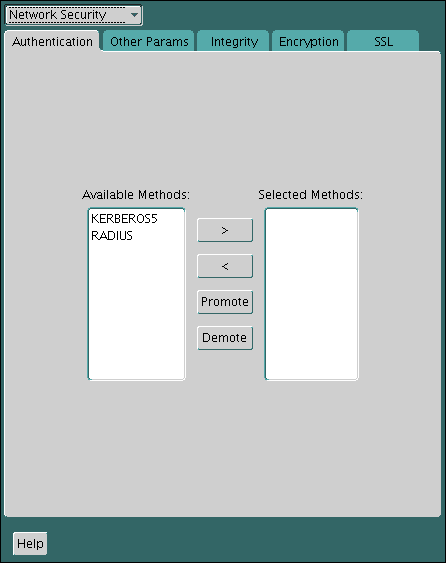
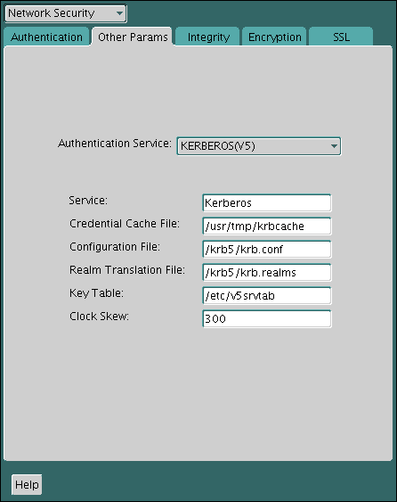

Kerberos is a trusted third-party authentication system that relies on shared secrets and presumes that the third party is secure.

**Parent topic:** [Managing Strong Authentication](part_5.md)

### 21.1 Enabling Kerberos Authentication

To enable Kerberos authentication for Oracle Database, you must first install it, and then follow a set of configuration steps.

- Step 1: Install Kerberos  
	You should install Kerberos Version 5.
- Step 2: Configure a Service Principal for an Oracle Database Server  
	You must create a service principal for Oracle Database before the server can validate the identity of clients that authenticate themselves using Kerberos.
- Step 3: Extract a Service Key Table from Kerberos  
	Next, you are ready to extract the service key table from Kerberos and copy it to the Oracle database server/Kerberos client system.
- Step 4: Install an Oracle Database Server and an Oracle Client  
	After you extract a service key table from Kerberos, you are ready to install the Oracle Database server and an Oracle client.
- Step 5: Configure Oracle Net Services and Oracle Database  
	After you install the Oracle Database server and client, you can configure Oracle Net Services on the server and client.
- Step 6: Configure Kerberos Authentication  
	You must set the required parameters in the Oracle database server and client `sqlnet.ora` files.
- Step 7: Create a Kerberos User  
	You must create the Kerberos user on the Kerberos authentication server where the administration tools are installed.
- Step 8: Create an Externally Authenticated Oracle User  
	Next, you are ready to create an externally authenticated Oracle user.
- Step 9: Get an Initial Ticket for the Kerberos/Oracle User  
	Before you can connect to the database, you must ask the Key Distribution Center (KDC) for an initial ticket.

**Parent topic:** Configuring Kerberos Authentication

#### 21.1.1 Step 1: Install Kerberos

You should install Kerberos Version 5.

The source distribution for notes about building and installing Kerberos provide details. After you install Kerberos, if you are using IBM AIX on POWER systems (64-bit), you should ensure that Kerboros 5 is the preferred authentication method.

1. Install Kerberos on the system that functions as the authentication server.
	Note:
	After upgrading from a 32-bit version of Oracle Database, the first use of the Kerberos authentication adapter causes an error message:` ORA-01637: Packet receive failed`.
	Workaround: After upgrading to the 64-bit version of the database and before using Kerberos external authentication method, check for a file named `/usr/tmp/oracle_service_name.RC` on your computer, and remove it.
2. For IBM AIX on POWER systems (64-bit), check the authentication method.
	For example:
	```
	/usr/bin/lsauthent
	```
	Output similar to the following may appear:
	```
	Standard Aix
	```
3. Configure Kerberos 5 as the preferred method.
	For example:
	```
	/usr/bin/chauthent -k5 -std
	```
	This command sets Kerberos 5 as the preferred authentication method (`k5`) and Standard AIX as the second (`std`).
4. To ensure that Kerberos 5 is now the preferred method, check the new configuration.
	```
	/usr/bin/lsauthent
	Kerberos 5
	Standard Aix
	```

**Parent topic:** Enabling Kerberos Authentication

#### 21.1.2 Step 2: Configure a Service Principal for an Oracle Database Server

You must create a service principal for Oracle Database before the server can validate the identity of clients that authenticate themselves using Kerberos.

1. Decide on a name for the service principal, using the following format:
	```
	kservice/kinstance@REALM
	```
	Each of the fields in the service principal specify the following values:
	| Service Principal Field | Description |
	| --- | --- |
	| `kservice` | A case-sensitive string that represents the Oracle service. This can be the same as the database service name. |
	| `kinstance` | Typically the fully qualified DNS name of the system on which Oracle Database is running. |
	| `REALM` | The name of the Kerberos realm with which the service principal is registered. `REALM` must always be uppercase and is typically the DNS domain name. |
	The utility names in this section are executable programs. However, the Kerberos user name `krbuser` and the realm `EXAMPLE.COM` are examples only.
	For example, suppose `kservice` is `oracle`, the fully qualified name of the system on which Oracle Database is running is `dbserver.example.com` and the realm is `EXAMPLE.COM`. The principal name then is:
	```
	oracle/dbserver.example.com@EXAMPLE.COM
	```
2. Run `kadmin.local` to create the service principal. On UNIX, run this command as the root user.
	The service principal is a string that uniquely identifies a client or server to which a set of Kerberos credentials is assigned. It generally has three parts: `kservice/kinstance@REALM`. In the case of a user, `kservice` is the user name. Use the following syntax to create the principal:
	```
	# cd /kerberos-install-directory/sbin
	# ./kadmin.local
	```
	For example, to add a principal named `oracle/dbserver.example.com@EXAMPLE.COM` to the list of server principals known by Kerberos, you can enter the following:
	```
	kadmin.local:addprinc -randkey oracle/dbserver.example.com@EXAMPLE.COM
	```

**Parent topic:** Enabling Kerberos Authentication

#### 21.1.3 Step 3: Extract a Service Key Table from Kerberos

Next, you are ready to extract the service key table from Kerberos and copy it to the Oracle database server/Kerberos client system.

For example, to extract a service key table for `dbserver.example.com`:

1. Ensure that you have domain administrative privileges.
2. Enter the following to extract the service key table:
	```
	kadmin.local:  ktadd -k /tmp/keytab oracle/dbserver.example.com
	Entry for principal oracle/dbserver.example.com with kvno 2, 
	encryption type AES-256 CTS mode with 96-bit SHA-1 HMAC added to keytab WRFILE:
	WRFILE:/tmp/keytab
	kadmin.local:  exit
	```
3. To check the service key table, enter the following command:
	```
	oklist -k -t /tmp/keytab
	```
4. After the service key table has been extracted, verify that the new entries are in the table in addition to the old ones.
	If they are not, or you need to add more, use `kadmin.local` to append to them.
	If you do not enter a realm when using `ktadd`, it uses the default realm of the Kerberos server. `kadmin.local` is connected to the Kerberos server running on the `localhost`.
5. If the Kerberos service key table is on the same system as the Kerberos client, you can move it. If the service key table is on a different system from the Kerberos client, you must transfer the file with a program such as FTP. If using FTP, transfer the file in binary mode.
	The following example shows how to move the service key table on a UNIX platform:
	```
	# mv /tmp/keytab /etc/v5srvtab
	```
	The default name of the service file is `/etc/v5srvtab`.
6. Verify that the owner of the Oracle database server executable can read the service key table (`/etc/v5srvtab` in the previous example).
	To do so, set the file owner to the Oracle user, or make the file readable by the group to which Oracle belongs.
	Do not make the file readable to all users. This can cause a security breach.

**Parent topic:** Enabling Kerberos Authentication

#### 21.1.4 Step 4: Install an Oracle Database Server and an Oracle Client

After you extract a service key table from Kerberos, you are ready to install the Oracle Database server and an Oracle client.

- See the Oracle Database operating system-specific installation documentation for instructions on installing the Oracle database server and client software.

**Parent topic:** Enabling Kerberos Authentication

#### 21.1.5 Step 5: Configure Oracle Net Services and Oracle Database

After you install the Oracle Database server and client, you can configure Oracle Net Services on the server and client.

- See the following documentation for information on configuring Oracle Net Services on the Oracle database server and client.
	- Oracle Database operating system-specific installation documentation
		- [Oracle Database Net Services Administrator's Guide](https://docs.oracle.com/pls/topic/lookup?ctx=en/database/oracle/oracle-database/21/dbseg&id=NETAG001)

**Parent topic:** Enabling Kerberos Authentication

#### 21.1.6 Step 6: Configure Kerberos Authentication

You must set the required parameters in the Oracle database server and client `sqlnet.ora` files.

Note:

The settings in the `sqlnet.ora` file apply to all pluggable databases (PDBs). However, this does not mean that all PDBs must authenticate with one KDC if you are using Kerberos; the settings in the `sqlnet.ora` file and Kerberos configuration files can support multiple KDCs.

- Step 6A: Configure Kerberos on the Client and on the Database Server  
	First, you must configure Kerberos authentication service parameters on the client and on the database server.
- Step 6B: Set the Initialization Parameters  
	Next, you are ready to set the `OS_AUTHENT_PREFIX` initialization parameter.
- Step 6C: Set sqlnet.ora Parameters (Optional)  
	You can set optional `sqlnet.ora` parameters, in addition to the required parameters, for better security.
- Step 6D: Configure Kerberos to Use TCP or UDP (Optional)  
	By default, Oracle Database uses TCP for Kerberos connections.

**Parent topic:** Enabling Kerberos Authentication

##### 21.1.6.1 Step 6A: Configure Kerberos on the Client and on the Database Server

First, you must configure Kerberos authentication service parameters on the client and on the database server.

1. Start Oracle Net Manager.
	- (UNIX) From `$ORACLE_HOME` `/bin`, enter the following command at the command line:
		```
		netmgr
		```
	- (Windows) Select Start, Programs, Oracle - HOME\_NAME, Configuration and Migration Tools, then Net Manager.
2. Expand Oracle Net Configuration, and from Local, select Profile.
3. From the Naming list, select Network Security.
	The Network Security tabbed window appears.
4. Select the Authentication tab.
	

> This is a text description of kerb0001.gif, which is an image of the Authentication tab in the Oracle Advanced Security profile region of Oracle Net Manager. Use this window to configure your client or server to use Kerberos authentication.
>
> You can choose Kerberos from the Available Methods list of authentication types. Then click a right arrow and the adjacent Selected Methods list is populated with the Kerberos authentication type. To remove Kerberos from the Selected Methods list, you can click a left arrow and it moves back to the Available Methods list.

5. From the Available Methods list, select KERBEROS5.
	Be aware that cross-realm Kerberos authentication is not supported using constraint delegation with the KERBEROS5 or KERKBEROS5PRE adapter.
6. Move KERBEROS5 to the Selected Methods list by clicking the right arrow (>).
7. Arrange the selected methods in order of use.
	To do so, select a method in the Selected Methods list, then click Promote or Demote to position it in the list. For example, if you want `KERBEROS5` to be the first service used, move it to the top of the list.
8. Select the Other Params tab.
9. From the Authentication Service list, select KERBEROS(V5).
10. Type Kerberos into the Service field.
	

> This is a text description of kerb0002.gif, which is an image of the Other Params tab in the Oracle Advanced Security profile region of Oracle Net Manager. Use this window to finish configuring your client or server to use Kerberos authentication.
>
> This window contains the following fields:
>
> - Authentication Service (choose Kerberos from this list)
> - Service (enter Kerberos)
> - Credential Cache File (enter the path to this file)
> - Configuration File (enter the path to this file)
> - Realm Translation file (enter the path to this file)
> - Key Table (enter the path to this file)
> - Clock Skew (how many seconds can pass before the Kerberos credential is considered expired)
>
> Click the Help button at the bottom of this window to access the online help.

	This field defines the name of the service Oracle Database uses to obtain a Kerberos service ticket. A service ticket is trusted information used to authenticate the client, to a specific service or server, for a predetermined period of time. It is obtained from the KDC using the initial ticket. When you provide the value for this field, the other fields are enabled.
11. Optionally enter values for the following fields:
	- Credential Cache File
	- Configuration File
	- Realm Translation File
	- Key Table
	- Clock Skew
	See the Oracle Net Manager online Help for more information about the fields and the parameters they configure.
12. From the File menu, select Save Network Configuration.
	The `sqlnet.ora` file is updated with the following entries in addition to any optional choices that you may have made in the previous step:
	```
	SQLNET.AUTHENTICATION_SERVICES=(KERBEROS5)
	SQLNET.AUTHENTICATION_KERBEROS5_SERVICE=kservice
	```

**Parent topic:** Step 6: Configure Kerberos Authentication

##### 21.1.6.2 Step 6B: Set the Initialization Parameters

Next, you are ready to set the `OS_AUTHENT_PREFIX` initialization parameter.

1. Locate the `init.ora` file.
	By default, the `init.ora` file is located in the `ORACLE_HOME` `/dbs` directory (or the same location of the data files) on Linux and UNIX systems, and in the `ORACLE_HOME` `\database` directory on Windows.
2. In the `init.ora` file, set the value of `OS_AUTHENT_PREFIX` to null in the `init.ora` initialization parameter file.
	For example:
	```
	OS_AUTHENT_PREFIX=""
	```
	Set this value to null because Kerberos user names can be long, and Oracle user names are limited to 30 bytes. Setting this parameter to null overrides the default value of `OPS$`.

Note:

You can create externally authenticated database users that have Kerberos user names of more than 30 bytes.

##### 21.1.6.3 Step 6C: Set sqlnet.ora Parameters (Optional)

You can set optional `sqlnet.ora` parameters, in addition to the required parameters, for better security.

- Optionally, set the parameters listed in the following table on both the client and the Oracle database server.

Table 21-1 Kerberos-Specific sqlnet.ora Parameters

| Parameter | Description |
| --- | --- |
| `SQLNET.KERBEROS5_CC_NAME=` `pathname_to_credentials_cache_file` \| `OS_MEMORY` | Specifies the complete path name to the Kerberos credentials cache (CC) file. The default value is operating system-dependent. For UNIX, it is `/tmp/krb5cc_` `userid`.  Using the `OS_MEMORY` option indicates that an OS-managed memory credential cache is used for the credential cache file. This option is supported in all platforms.  You can use the following formats to specify a value for `SQLNET.KERBEROS5_CC_NAME`:  - `SQLNET.KERBEROS5_CC_NAME=` `complete_path_to_cc_file` 	For example: 	`SQLNET.KERBEROS5_CC_NAME=/tmp/kcache` 	`SQLNET.KERBEROS5_CC_NAME=D:\tmp\kcache` - `SQLNET.KERBEROS5_CC_NAME=FILE:``complete_path_to_cc_file` 	For example: 	`SQLNET.KERBEROS5_CC_NAME=FILE:/tmp/kcache` - `SQLNET.KERBEROS5_CC_NAME=OSMSFT://` 	Use this value if you are running Windows and using a Microsoft KDC.  You can also set this parameter by using the `KRB5CCNAME` environment variable, but the value set in the `sqlnet.ora` file takes precedence over the value set in `KRB5CCNAME`.  For example:  ``` SQLNET.KERBEROS5_CC_NAME=/usr/tmp/krbcache ``` |
| `SQLNET.KERBEROS5_CLOCKSKEW=` `number_of_seconds_accepted_as_network_delay` | This parameter specifies how many seconds can pass before a Kerberos credential is considered out-of-date. It is used when a credential is actually received by either a client or a database server. An Oracle database server also uses it to decide if a credential needs to be stored to protect against a replay attack. The default is 300 seconds.  For example:  ``` SQLNET.KERBEROS5_CLOCKSKEW=1200 ``` |
| `SQLNET.KERBEROS5_CONF=` `pathname_to_Kerberos_configuration_file` `\|AUTO_DISCOVER` | This parameter specifies the complete path name to the `Kerberos` configuration file. The configuration file contains the realm for the default KDC (key distribution center) and maps realms to KDC hosts. The default is operating system-dependent. For UNIX, it is `/krb5/krb.conf`.  Using the `AUTO_DISCOVER` option in place of the configuration file enables Kerberos clients to auto-discover the KDC.  For example:  ``` SQLNET.KERBEROS5_CONF=/krb/krb.conf SQLNET.KERBEROS5_CONF=AUTO_DISCOVER ``` |
| `SQLNET.KERBEROS5_CONF_LOCATION=` `path_to_Kerberos_configuration_directory` | This parameter indicates that the Kerberos configuration file is created by the system, and does not need to be specified by the client. The configuration file uses DNS lookup to obtain the realm for the default KDC, and maps realms to KDC hosts.  For example:  ``` SQLNET.KERBEROS5_CONF_LOCATION=/krb ``` |
| `SQLNET.KERBEROS5_KEYTAB=` `path_to_Kerberos_principal/key_table` | This parameter specifies the complete path name to the Kerberos principal/secret key mapping file. It is used by the Oracle database server to extract its key and decrypt the incoming authentication information from the client. The default is operating system-dependent. For UNIX, it is `/etc/v5srvtab`.  For example:  ``` SQLNET.KERBEROS5_KEYTAB=/etc/v5srvtab ``` |
| `SQLNET.KERBEROS5_REALMS=` `path_to_Kerberos_realm_translation_file` | This parameter specifies the complete path name to the Kerberos realm translation file. The translation file provides a mapping from a host name or domain name to a realm. The default is operating system-dependent. For UNIX, it is `/etc/krb.realms`.  For example:  ``` SQLNET.KERBEROS5_REALMS=/krb5/krb.realms ``` |

**Parent topic:** Step 6: Configure Kerberos Authentication

##### 21.1.6.4 Step 6D: Configure Kerberos to Use TCP or UDP (Optional)

By default, Oracle Database uses TCP for Kerberos connections.

- To control whether an Oracle databases uses TCP or UDP, set the `forcetcp` parameter, located in the `libdefaults` section of the `krb5.conf` file, as follows:
	- To use TCP connections:
		```
		forcetcp = 1
		```
		- To use UDP connections:
		```
		forcetcp = 0
		```

**Parent topic:** Step 6: Configure Kerberos Authentication

#### 21.1.7 Step 7: Create a Kerberos User

You must create the Kerberos user on the Kerberos authentication server where the administration tools are installed.

The realm must already exist.

Note:

The utility names in this section are executable programs. However, the Kerberos user name `krbuser` and realm `EXAMPLE.COM` are examples only. They can vary among systems.

- Run `/krb5/admin/kadmin.local` as root to create a new Kerberos user, such as `krbuser`.
	For example, to create a Kerberos user is UNIX-specific:
	```
	# /krb5/admin/kadmin.local
	kadmin.local: addprinc krbuser
	Enter password for principal: "krbuser@example.com": (password does not display)
	Re-enter password for principal: "krbuser@example.com": (password does not display)
	kadmin.local: exit
	```

**Parent topic:** Enabling Kerberos Authentication

#### 21.1.8 Step 8: Create an Externally Authenticated Oracle User

Next, you are ready to create an externally authenticated Oracle user.

1. Log in to a PDB as a user who has the `CREATE USER` privilege.
	```
	sqlplus sec_admin@pdb_name
	Enter password: password
	```
	To find the available PDBs in a CDB, log in to the CDB root container and then query the `PDB_NAME` column of the `DBA_PDBS` data dictionary view. To check the current container, run the `show con_name` command.
2. Ensure that the `OS_AUTHENT_PREFIX` is set to null (`""`).
3. Create an Oracle Database user account that corresponds to the Kerberos user. Enter the Oracle user name in uppercase and enclose it in double quotation marks.
	For example:
	```
	CREATE USER krbuser IDENTIFIED EXTERNALLY AS 'krbuser@example.com'; 
	GRANT CREATE SESSION TO krbuser;
	```

Note:

The database administrator should ensure that multiple database users are not identified externally by the same Kerberos principal name.

**Parent topic:** Enabling Kerberos Authentication

#### 21.1.9 Step 9: Get an Initial Ticket for the Kerberos/Oracle User

Before you can connect to the database, you must ask the Key Distribution Center (KDC) for an initial ticket.

An initial ticket or ticket granting ticket (TGT) identifies the user as having the right to ask for additional service tickets. No tickets can be obtained without an initial ticket. An initial ticket is retrieved by running the `okinit` program and providing a password.

If more than one Kerberos principal will use this client to authenticate, then each Kerberos principal must get an initial ticket and store it in a credential cache in its own directory. Additional Kerberos users and the credential cache location (other than the one described in the `sqlnet.ora` file) can be specified either in the connect string or in `tnsnames.ora`.

- To request an initial ticket, run the following command on the client:
	```
	% okinit username
	```
	If you want to enable credentials that can be used across database links, then include the `-f` option and provide the Kerberos password when prompted.
	```
	% services/okinit -f
	Password for krbuser@EXAMPLE.COM:(password does not display)
	```
	If you encounter an error such as `okinit: Cannot contact any KDC for requested realm`, then check the `/etc/services` file if there are the kerberos5 entries. For example:
	```
	kerberos        88/tcp          kerberos5 krb5  # Kerberos v5
	kerberos        88/udp          kerberos5 krb5  # Kerberos v5
	```

### 21.2 Utilities for the Kerberos Authentication Adapter

The Oracle Kerberos authentication adapter utilities are designed for an Oracle client with Oracle Kerberos authentication support installed.

- okinit Utility Options for Obtaining the Initial Ticket  
	The `okinit` utility obtains and caches Kerberos tickets.
- oklist Utility Options for Displaying Credentials  
	The `oklist` utility displays the list of tickets held.
- okdstry Utility Options for Removing Credentials from the Cache File  
	The `okdstry` (`okdestroy`) utility removes credentials from the cache file.
- okcreate Utility Options for Automatic Keytab Creation  
	The `okcreate` utility automates the creation of keytabs from either the KDC or a service endpoint.

**Parent topic:** Configuring Kerberos Authentication

#### 21.2.1 okinit Utility Options for Obtaining the Initial Ticket

The `okinit` utility obtains and caches Kerberos tickets.

This utility is typically used to obtain the ticket-granting ticket, using a password entered by the user to decrypt the credential from the key distribution center (KDC). The ticket-granting ticket is then stored in the user's credential cache.

The following table lists the options available with `okinit`. To use the functionality that is described in this table, you must set the `sqlnet.ora` `SQLNET.KERBEROS5_CONF_MIT` parameter to `TRUE`. (Note that `SQLNET.KERBEROS5_CONF_MIT` is deprecated, but is retained for backward compatibility for `okinit`.)

Table 21-2 Options for the okinit Utility

| Option | Description |
| --- | --- |
| `-f` \| `-F` | Requests forwardable or non-forwardable tickets. This option is necessary to follow database links. |
| `-l` `lifetime` | Specifies the lifetime of the ticket-granting ticket and all subsequent tickets. By default, the ticket-granting ticket is good for eight (8) hours, but shorter or longer-lived credentials may be desired. The KDC can ignore this option or put site-configured limits on what can be specified. The lifetime value is a string that consists of a number qualified by `w` (weeks), `d` (days), `h` (hours), `m` (minutes), or `s` (seconds), as in the following example:  ``` okinit -l 2wld6h20m30s ```  The example requests a ticket-granting ticket that has a lifetime of 2 weeks, 1 day, 6 hours, 20 minutes, and 30 seconds. |
| `-s` `start_time` | Specifies the duration of the delay before the ticket can become valid. Tickets are issued with the invalid flag set. |
| `-r` `renewable_life` | Requests renewable tickets with a total lifetime of `renewable_life` |
| `-p` \| `-P` | Requests proxiable or non-proxiable tickets |
| `-a` | Requests tickets that are restricted to the local address of the host |
| `-A` | Requests tickets not restricted by address |
| `-E` | Treats the principal name as an enterprise name |
| `-v` | Requests that the ticket-granting ticket in the cache be passed to the KDC for validation. If the ticket is within the requested time range, then the cache is replaced with the validated ticket. |
| `-R` | Requests renewal of the ticket-granting ticket |
| `-k` \[`-t` `keytab_file`\] | Requests a ticket, which is obtained from a key in the local host’s keytab |
| `-n` | Requests anonymous processing |
| `-C` | Requests canonicalization of the principal name, and enables the KDC to reply with a different client principal from the one that was requested |
| `-c` `cache_name` | Specifies the name of a cache as a cache location. For UNIX, the default is ` /tmp/krb5cc_` uid. You can also specify the alternate credential cache by using the `SQLNET.KERBEROS5_CC_NAME` parameter in the `sqlnet.ora` file. |
| `-I` `input_cache` | Specifies the name of a credential cache that already contains a ticket. When it obtains that ticket, if the information about how the ticket was obtained is stored in cache, then the same information will be used to affect how new credentials are obtained. |
| `-T` `armor_cache` | If supported by the KDC, this cache is used to armor the request, preventing offline dictionary attacks and enabling the use of additional pre-authentication mechanisms. |
| `-X` ``` attribute[`=``value` ``` | Specifies a pre-authentication attribute and value. Specifies one of the following values: - `X509_user_identity=` `value` specifies where to find the user’s X509 identity information - X `509_anchors=` `value` specifies where to find trusted X509 anchor information - `flag_RSA_PROTOCOL` \[`=yes`\] specifies the use of RSA rather than the default Diffie-Hellman protocol |
| `-?` | List command line options. |

**Parent topic:** Utilities for the Kerberos Authentication Adapter

#### 21.2.2 oklist Utility Options for Displaying Credentials

The `oklist` utility displays the list of tickets held.

The following table lists the available `oklist` options. To use the functionality that is described in this table, you must set the `sqlnet.ora` `SQLNET.KERBEROS5_CONF_MIT` parameter to `TRUE`. (Note that `SQLNET.KERBEROS5_CONF_MIT` is deprecated, but is retained for backward compatibility for `oklist`.)

Table 21-3 Options for the oklist Utility

| Option | Description |
| --- | --- |
| `-f` | Show flags with credentials. Relevant flags are:  - `I`, credential is a ticket-granting ticket - `F`, credential is forwardable - `f`, credential is forwarded. |
| `-c` | Specify an alternative credential cache. In UNIX, the default is `/tmp/krb5cc_` `uid`. The alternate credential cache can also be specified by using the `SQLNET.KERBEROS5_CC_NAME` parameter in the `sqlnet.ora` file. |
| `-k` | List the entries in the service table (default `/etc/v5srvtab`) on UNIX. The alternate service table can also be specified by using the `SQLNET.KERBEROS5_KEYTAB` parameter in the `sqlnet.ora` file. |
| `-e` | Displays the encryption types of the session key and the ticket for each credential in the credential cache, or each key in the keytab file. |
| `-l` | If a cache collection is available, displays a table summarizing the caches present in the collection. |
| `-A` | If a cache collection is available, displays the contents of all of the caches in the collection |
| `-s` | Runs utility without producing output. Utility will exit with status 1 if the cache cannot be read or is expired, else with status 0 |
| `-a` | Displays a list of addresses in the credential |
| `-n` | Shows numeric addresses instead of reverse-resolving addresses |
| `-C` | Lists configuration data that has been stored in the credentials cache when `klist` encounters it. By default, configuration data is not listed. |
| `-t` | Displays the time entry timestamps for each keytab entry in the keytab file |
| `-K` | Displays the value of the encryption key in each keytab entry in the keytab file |
| `-V` | Displays the Kerberos version number and exit. |

The show flag option (`-f`) displays additional information, as shown in the following example:

```
% oklist -f
04-Aug-2015 21:57:51   28-Aug-2015 05:58:14
krbtgt/EXAMPLE.COM@EXAMPLE.COM
Flags: FI
```

**Parent topic:** Utilities for the Kerberos Authentication Adapter

#### 21.2.3 okdstry Utility Options for Removing Credentials from the Cache File

The `okdstry` (`okdestroy`) utility removes credentials from the cache file.

The following table lists the available `okdstry` options. To use the functionality that is described in this table, you must set the `sqlnet.ora` `SQLNET.KERBEROS5_CONF_MIT` parameter to `TRUE`. (Note that `SQLNET.KERBEROS5_CONF_MIT` is deprecated, but is retained for backward compatibility for `okdstry`.)

Table 21-4 Options for the okdstry Utility

| Option | Description |
| --- | --- |
| `—A` | Destroys all caches in the collection, if a cache collection is available |
| `—q` | Runs quietly. Normally `okdstry` beeps if it fails to destroy the user’s tickets. This flag suppresses this behavior. |
| `—c` `cache_name` | Uses `cache_name` as the credentials (ticket) cache name and location. For UNIX, the default is `/tmp/krb5cc_` `uid`. You can also specify the alternate credential cache by using the `SQLNET.KERBEROS5_CC_NAME` parameter in the `sqlnet.ora` file. |

**Parent topic:** Utilities for the Kerberos Authentication Adapter

#### 21.2.4 okcreate Utility Options for Automatic Keytab Creation

The `okcreate` utility automates the creation of keytabs from either the KDC or a service endpoint.

The following table lists the available `okcreate` options.

Table 21-5 okcreate Utility Options for Automatic Keytab Creation

| Option | Description |
| --- | --- |
| `-name` `service_name` | Specifies the service name of the kerberized service for which to get a keytab.The default is `oracle`. |
| `—hosts` `path-to_hosts_list` | Specifies either a comma-separated list of hosts for which to get the keytab, or the path to a text file that contains a list of the hosts. The default is `none`. |
| `—out` `path_to_output` | Specifies the output path to store the resulting keytabs. The default is the current directory.  Ensure that this directory is readable only by the root user. Never send keytabs over the network in clear text. |
| `—k` | For use if the operation is performed on the KDC. Do not use this option if you are using `—s`. |
| `—s` | For use if the operation is performed on a Kerberized service. Do not use this option if you are using `—k`. |
| `-u` `KDC_username` | Specifies the user name for the KDC. Only use this setting on a Kerberized service endpoint.  If you specify the `—s` and omit this setting, then okcreate prompts for the `KDCuser@KDCmachine`. |
| `-r` | Specifies the Kerberos realm |
| `—p` | Specifies the Kerberos principal |
| `-q` | Specifies the Kerberos query |
| `—d` | Specifies the KDC database name |
| `—e` | Specifies the salt list to be used for any new keys that are created |
| `—m` | Specifies to prompt for the KDC master password |

**Parent topic:** Utilities for the Kerberos Authentication Adapter

### 21.3 Connecting to an Oracle Database Server Authenticated by Kerberos

After Kerberos is configured, you can connect to an Oracle database server without using a user name or password.

- Use the following syntax to connect to the database without using a user name or password:
	```
	$ sqlplus /@net_service_name
	```
	In this specification, `net_service_name` is an Oracle Net Services service name. For example:
	```
	$ sqlplus /@oracle_dbname
	```

**Parent topic:** Configuring Kerberos Authentication

### 21.4 Configuring Interoperability with Microsoft Windows Server Domain Controller KDC

You can configure Oracle Database to interoperate with a Microsoft Windows Server domain controller key distribution center (KDC).

- About Configuring Interoperability with a Microsoft Windows Server Domain Controller KDC  
	Oracle Database complies with MIT Kerberos.
- Step 1: Configure Oracle Kerberos Client for Microsoft Windows Server Domain Controller  
	You can configure the Oracle Kerberos client to interoperate with a Microsoft Windows Server Domain Controller KDC.
- Step 2: Configure a Microsoft Windows Server Domain Controller KDC for the Oracle Client  
	Next, you are ready to configure a Microsoft Windows Server Domain Controller KDC to interoperate with an Oracle Client.
- Step 3: Configure Oracle Database for a Microsoft Windows Server Domain Controller KDC  
	You must configure the Oracle database for the domain controller on the host computer where the Oracle database is installed.
- Step 4: Obtain an Initial Ticket for the Kerberos/Oracle User  
	Before a client can connect to the database, the client must request an initial ticket.

**Parent topic:** Configuring Kerberos Authentication

#### 21.4.1 About Configuring Interoperability with a Microsoft Windows Server Domain Controller KDC

Oracle Database complies with MIT Kerberos.

This enables Oracle Database to interoperate with tickets that are issued by a Kerberos Key Distribution Center (KDC) on a Microsoft Windows Server domain controller. This process enables Kerberos authentication with an Oracle database.

**Parent topic:** Configuring Interoperability with Microsoft Windows Server Domain Controller KDC

#### 21.4.2 Step 1: Configure Oracle Kerberos Client for Microsoft Windows Server Domain Controller

You can configure the Oracle Kerberos client to interoperate with a Microsoft Windows Server Domain Controller KDC.

- Step 1A: Create the Client Kerberos Configuration Files  
	You must configure a set of client Kerberos configuration files that refer to the Windows 2008 domain controller as the Kerberos KDC.
- Step 1B: Specify the Oracle Configuration Parameters in the sqlnet.ora File  
	Configuring an Oracle client to interoperate with a Microsoft Windows Server Domain Controller Kerberos Key Distribution Center (KDC) uses the same `sqlnet.ora` file parameters that are used for configuring Kerberos on the client and on the database server.
- Step 1C: Optionally, Specify Additional Kerberos Principals Using tnsnames.ora  
	You can configure additional Kerberos principal users to connect from an Oracle Database client.
- Step 1D: Specify the Listening Port Number  
	The Microsoft Windows Server domain controller KDC listens on UDP/TCP port 88.

**Parent topic:** Configuring Interoperability with Microsoft Windows Server Domain Controller KDC

##### 21.4.2.1 Step 1A: Create the Client Kerberos Configuration Files

You must configure a set of client Kerberos configuration files that refer to the Windows 2008 domain controller as the Kerberos KDC.

- Create the `krb.conf` and `krb5.realms` files. Oracle Database provides a default `krb5.conf` file, which you must modify for your site.
	The `krb5.conf` file is located in the location indicated by the `SQLNET.KERBEROS_CONF` parameter.
	For example, assuming that the Windows 2008 domain controller is running on a node named `sales3854.us.example.com`:
	- `krb.conf` file
		For example:
		```
		SALES3854.US.EXAMPLE.COM
		SALES3854.US.EXAMPLE.COM 
		sales3854.us.example.com admin server
		```
	- `krb5.conf` file
		For example:
		```
		[libdefaults]
		default_realm=SALES.US.EXAMPLE.COM
		[realms]
		SALES.US.EXAMPLE.COM= { kdc=sales3854.us.example.com:88 }
		[domain_realm]
		.us.example.com=SALES.US.EXAMPLE.COM
		```
	- `krb5.realms` file
		For example:
		```
		us.example.com SALES.US.EXAMPLE.COM
		```

**Parent topic:** Step 1: Configure Oracle Kerberos Client for Microsoft Windows Server Domain Controller

##### 21.4.2.2 Step 1B: Specify the Oracle Configuration Parameters in the sqlnet.ora File

Configuring an Oracle client to interoperate with a Microsoft Windows Server Domain Controller Kerberos Key Distribution Center (KDC) uses the same `sqlnet.ora` file parameters that are used for configuring Kerberos on the client and on the database server.

- Set the following parameters in the `sqlnet.ora` file on the client:
	```
	SQLNET.KERBEROS5_CONF=pathname_to_Kerberos_configuration_file
	SQLNET.KERBEROS5_CONF_MIT=TRUE
	SQLNET.AUTHENTICATION_KERBEROS5_SERVICE=Kerberos_service_name
	SQLNET.AUTHENTICATION_SERVICES=(BEQ,KERBEROS5)
	```
	Note the following:
	- The `SQLNET.KERBEROS5_CONF_MIT` parameter has been deprecated, but is retained for backward compatibility for the `okint`, `oklist`, and `okdstry` utilities.
	- Ensure that the `SQLNET.KERBEROS5_CONF_MIT` parameter is set to `TRUE` because the Windows Server operating system is designed to interoperate only with security services that are based on MIT Kerberos version 5.
	- If you want to use multiple Kerberos principal users, then you can specify them as part of a connect string or in `tnsnames.ora`.

**Related Topics**

- Step 6A: Configure Kerberos on the Client and on the Database Server
- Step 1C: Optionally, Specify Additional Kerberos Principals Using tnsnames.ora

**Parent topic:** Step 1: Configure Oracle Kerberos Client for Microsoft Windows Server Domain Controller

##### 21.4.2.3 Step 1C: Optionally, Specify Additional Kerberos Principals Using tnsnames.ora

You can configure additional Kerberos principal users to connect from an Oracle Database client.

- Add the `KERBEROS5_CC_NAME` and `KERBEROS5_PRINCIPAL` settings to the `tnsnames.ora` connect string.
	`KERBEROS5_CC_NAME` is mandatory for all additional Kerberos users and principals, but the `KERBEROS5_PRINCIPAL` setting is optional. Oracle Database checks `KERBEROS5_PRINCIPAL` against the value that is retrieved from the credential cache. If the two values do not match, then the user is not authenticated.
	For example:
	```
	krbuser1 = 
	(DESCRIPTION=(ADDRESS=(PROTOCOL=tcp)(HOST=hostname)(PORT=port_number))
	(CONNECT_DATA=(SERVICE_NAME=db.example.com)) 
	(SECURITY=(KERBEROS5_CC_NAME = /tmp/krbuser1/krb.cc)
	          (KERBEROS5_PRINCIPAL = krbprinc1@example.com)))
	krbuser2 = 
	(DESCRIPTION=(ADDRESS=(PROTOCOL=tcp)(HOST=hostname)(PORT=port_number))
	(CONNECT_DATA=(SERVICE_NAME=db.example.com)) 
	(SECURITY=(KERBEROS5_CC_NAME = /tmp/krbuser2/krb.cc) 
	          (KERBEROS5_PRINCIPAL = krbprinc2@example.com)))
	```

##### 21.4.2.4 Step 1D: Specify the Listening Port Number

The Microsoft Windows Server domain controller KDC listens on UDP/TCP port 88.

- Ensure that the system file entry for `kerberos5` is set to UDP/TCP port 88.
	For the UNIX environment, ensure that the first `kerberos5` entry in the `/etc/services` file is set to 88.

**Parent topic:** Step 1: Configure Oracle Kerberos Client for Microsoft Windows Server Domain Controller

#### 21.4.3 Step 2: Configure a Microsoft Windows Server Domain Controller KDC for the Oracle Client

Next, you are ready to configure a Microsoft Windows Server Domain Controller KDC to interoperate with an Oracle Client.

- Step 2A: Create the User Account  
	You must create a user account for the Microsoft Windows Server Domain Controller KDC.
- Step 2B: Create the Oracle Database Principal User Account and Keytab  
	After you create the user account, you are ready to create the Oracle Database principal user account.

See Also:

Microsoft documentation for information about how to create users in Active Directory.

**Parent topic:** Configuring Interoperability with Microsoft Windows Server Domain Controller KDC

##### 21.4.3.1 Step 2A: Create the User Account

You must create a user account for the Microsoft Windows Server Domain Controller KDC.

- On the Microsoft Windows Server domain controller, create a new user account for the Oracle client in Microsoft Active Directory.

**Parent topic:** Step 2: Configure a Microsoft Windows Server Domain Controller KDC for the Oracle Client

##### 21.4.3.2 Step 2B: Create the Oracle Database Principal User Account and Keytab

After you create the user account, you are ready to create the Oracle Database principal user account.

After you create this account on the Windows Server domain controller, you must use the `okcreate` utility to register it with the principal keytab. You can run this utilty on the same KDC to create all the service keytabs rather than creating them individually, or you can run `okcreate` from a service endpoint that connects to the KDC, run the ncessary commands, and then copy the resulting keytab back to the service endpoint.

1. Create a new user account for the Oracle database in Microsoft Active Directory.
	For example, if the Oracle database runs on the host `sales3854.us.example.com`, then use Active Directory to create a user with the user name `sales3854.us.example.com`.
	Do not create a user as `host/hostname.dns.com`, such as `oracle/sales3854.us.example.com`, in Active Directory. Microsoft's KDC does not support multipart names like an MIT KDC does. An MIT KDC allows multipart names to be used for service principals because it treats all principals as user names. However, Microsoft’s KDC does not.
2. Run the `okcreate` command to create a keytab that will use this user account. The syntax is as follows:
	```
	okcreate (-s [-u KDCuser@KDCmachine] | -k) 
	  [-name service_name] [-hosts path_to_host_list] 
	  [-out path_to_output] [-r realm] [-p principal] 
	  [-q query] [-d dbname] [-e enc:salt...] [-m] 
	  [-x db_args]
	```
	For example:
	```
	okcreate -s -u kdcuser1@kdcmachine1 -name oracle 
	  -hosts sales3854.us.example.com 
	  -out /OSsecured/keytablocation
	```
3. Copy the extracted `keytab` file to the host computer where the Oracle database is installed.
	For example, the `keytab` that was created in the previous step can be copied to `/krb5/v5svrtab`.

**Parent topic:** Step 2: Configure a Microsoft Windows Server Domain Controller KDC for the Oracle Client

#### 21.4.4 Step 3: Configure Oracle Database for a Microsoft Windows Server Domain Controller KDC

You must configure the Oracle database for the domain controller on the host computer where the Oracle database is installed.

- Step 3A: Set Configuration Parameters in the sqlnet.ora File  
	You must first set configuration parameters for the database.
- Step 3B: Create an Externally Authenticated Oracle User  
	After you set the configuration parameters, you are ready to create an externally authenticated Oracle user.

**Parent topic:** Configuring Interoperability with Microsoft Windows Server Domain Controller KDC

##### 21.4.4.1 Step 3A: Set Configuration Parameters in the sqlnet.ora File

You must first set configuration parameters for the database.

- Specify values for the following parameters in the `sqlnet.ora` file for the database server:
	```
	SQLNET.KERBEROS5_CONF=pathname_to_Kerberos_configuration_file
	SQLNET.KERBEROS5_KEYTAB=pathname_to_Kerberos_principal/key_table
	SQLNET.KERBEROS5_CONF_MIT=TRUE
	SQLNET.AUTHENTICATION_KERBEROS5_SERVICE=Kerberos_service_name
	SQLNET.AUTHENTICATION_SERVICES=(BEQ,KERBEROS5)
	```

Note:

- The `SQLNET.KERBEROS5_CONF_MIT` parameter has been deprecated, but is retained for backward compatibility for the `okint`, `oklist`, and `okdstry` utilities.
- Ensure that the `SQLNET.KERBEROS5_CONF_MIT` parameter is set to `TRUE` because the Windows Server operating system is designed to interoperate only with security services that are based on MIT Kerberos version 5.
- Be aware that the settings in the `sqlnet.ora` file apply to all PDBs. However, this does not mean that all PDBs must authenticate with one KDC if using Kerberos; the settings in the `sqlnet.ora` file and Kerberos configuration files can support multiple KDCs.

**Parent topic:** Step 3: Configure Oracle Database for a Microsoft Windows Server Domain Controller KDC

##### 21.4.4.2 Step 3B: Create an Externally Authenticated Oracle User

After you set the configuration parameters, you are ready to create an externally authenticated Oracle user.

- Follow the procedure under Step 8: Create an Externally Authenticated Oracle User to create an externally authenticated Oracle user.
	Ensure that you create the username in all uppercase characters (for example, `ORAKRB@SALES.US.EXAMPLE.COM`).

See Also:

Step 6: Configure Kerberos Authentication for information about using Oracle Net Manager to set the `sqlnet.ora` file parameters.

**Parent topic:** Step 3: Configure Oracle Database for a Microsoft Windows Server Domain Controller KDC

#### 21.4.5 Step 4: Obtain an Initial Ticket for the Kerberos/Oracle User

Before a client can connect to the database, the client must request an initial ticket.

1. To request an initial ticket, follow the task information for Step 9: Get an Initial Ticket for the Kerberos/Oracle User.
	The user does not need to explicitly request for an initial ticket, using the `okinit` command, when using the Windows native cache.
	If the Oracle client is running on Microsoft Windows Server or later, then the Kerberos ticket is automatically retrieved when the user logs in to Windows.
	See also the Microsoft documentation for details about the `Kerbtray.exe` utility, which can be used to display Kerberos ticket information for a system.
2. For each Kerberos principal user that you have added to `tnsnames.ora`, run the `okinit` command in the client.
	For example:
	```
	okinit krbprinc1@example.com
	```

**Parent topic:** Configuring Interoperability with Microsoft Windows Server Domain Controller KDC

### 21.5 Configuring Kerberos Authentication Fallback Behavior

You can configure fallback behavior (password-based authentication) in case the Kerberos authentication fails.

After you have configured Kerberos authentication for Oracle clients to use Kerberos authentication to authenticate to an Oracle database, there are cases where you may want to fall back to password-based authentication. An example would be if you have fixed user database links in the Oracle database.

- To enable Kerberos authentication to fall back to password-based authentication, set the `SQLNET.FALLBACK_AUTHENTICATION` parameter to `TRUE` in the `sqlnet.ora` files on both the client and server.
	The default of this parameter is `FALSE`. This means that by default, the connection fails when Kerberos authentication fails.

### 21.6 Troubleshooting the Oracle Kerberos Authentication Configuration

Oracle provides guidance for common Kerberos configuration problems.

- Common Kerberos Configuration Problems  
	Oracle provides guidance for common Kerberos configuration problems.
- ORA-12631 Errors in the Kerberos Configuration  
	The `ORA-12631: username retrieval failed` error can result from the wrong or incorrectly formatted principal being used for the Kerberos authentication
- ORA-28575 Errors in the Kerberos Configuration  
	The `ORA-28575: unable to open RPC connection to external procedure agent` error can occur when the client is remote and the `EXTPROC` process is spawned.
- ORA-01017 Errors in the Kerberos Configuration  
	The `ORA-01017: invalid username/password; logon denied` error can result if `okinit` fails and there is no valid ticket in the SQL\*Plus connection.
- Enabling Tracing for Kerberos okinit Operations  
	The `KRB5_TRACE` environment variable enables you to trace Kerberos `okinit` operations.

**Parent topic:** Configuring Kerberos Authentication

#### 21.6.1 Common Kerberos Configuration Problems

Oracle provides guidance for common Kerberos configuration problems.

Common problems are as follows:

- If you cannot get your ticket-granting ticket using `okinit`:
	- Ensure that the default realm is correct by examining the `krb.conf` file.
		- Ensure that the KDC is running on the host specified for the realm.
		- Ensure that the KDC has an entry for the user principal and that the passwords match.
		- Ensure that the `krb.conf` and `krb.realms` files are readable by Oracle.
		- Ensure that the `TNS_ADMIN` environment variable is pointing to the directory containing the `sqlnet.ora` configuration file.
- If you have an initial ticket but still cannot connect, try the following:
	- After trying to connect, check for a service ticket.
		- Check that the `sqlnet.ora` file on the database server side has a service name that corresponds to a service known by Kerberos.
		- Check that the clocks on all systems involved are set to times that are within a few minutes of each other or change the `SQLNET.KERBEROS5_CLOCKSKEW` parameter in the `sqlnet.ora` file.
- If you have a service ticket and you still cannot connect:
	- Check the clocks on the client and database server.
		- Check that the `v5srvtab` file exists in the correct location and is readable by Oracle. Remember to set the `sqlnet.ora` parameters.
		- Check that the `v5srvtab` file has been generated for the service named in the `sqlnet.ora` file on the database server side.
- If everything seems to work well, but then you issue another query and it fails, then try the following:
	- Check that the initial ticket is forwardable. You must have obtained the initial ticket by running the `okinit ` utility.
		- Check the expiration date on the credentials. If the credentials have expired, then close the connection and run `okinit` to get a new initial ticket.

**Parent topic:** Troubleshooting the Oracle Kerberos Authentication Configuration

#### 21.6.2 ORA-12631 Errors in the Kerberos Configuration

The `ORA-12631: username retrieval failed` error can result from the wrong or incorrectly formatted principal being used for the Kerberos authentication

Check the `sqlnet` server trace files for `Wrong principal in request` in the output.

To remedy this problem, edit the `krb5.conf` file and check the `[domain_realm]` settings. These settings are case sensitive, so even if the `domain_realm` name is correct, it will fail to parse correctly if it is lower case. Ensure that this setting is upper case. For example:

```
[domain_realm]
.country.<DOMAIN_NAME> = SECWIN.LOCAL
country.<DOMAIN_NAME> = SECWIN.LOCAL
```

**Parent topic:** Troubleshooting the Oracle Kerberos Authentication Configuration

#### 21.6.3 ORA-28575 Errors in the Kerberos Configuration

The `ORA-28575: unable to open RPC connection to external procedure agent` error can occur when the client is remote and the `EXTPROC` process is spawned.

There is no need to have Kerberos authentication with an external procedure call. To remedy this problem, add `BEQ` in front of the `KERBEROS5` and `KERBEROS5PRE` parameters in the `sqlnet.ora` file.

**Parent topic:** Troubleshooting the Oracle Kerberos Authentication Configuration

#### 21.6.4 ORA-01017 Errors in the Kerberos Configuration

The `ORA-01017: invalid username/password; logon denied` error can result if `okinit` fails and there is no valid ticket in the SQL\*Plus connection.

The `okinit` trace file will show the following errors:

```
nauk5l_sendto_kdc: entry
snauk5l_sendto_kdc: exit
snauk5l_sendto_kdc: exit
nauk5la_get_in_tkt: Returning 25: Additional pre-authentication required
.
snauk5l_sendto_kdc: exit
snauk5l_sendto_kdc: exit
nauk5la_get_in_tkt: Returning 24: Preauthentication failed
.
nauk5la_get_in_tkt: exit
nauk5zi_kinit: Getting TGT failed: Preauthentication failed
.
nauk5fq_free_principal: entry
nauk5fq_free_principal: exit
nauk5fq_free_principal: entry
nauk5fq_free_principal: exit
nauk5zi_kinit: Returning 24: Preauthentication failed
.
nauk5zi_kinit: exit
```

To remedy this problem:

1. Set the `default_tkt_enctypes` parameter in the `krb5.conf` file. This enables you to control the encryption types that are requested from the client. For example:
	```
	default_tgs_enctypes = aes256-cts-hmac-sha1-96
	default_tkt_enctypes = aes256-cts-hmac-sha1-96
	```
2. Test `okinit` with the following option:
	```
	okinit user_name
	```
	If DES encryption algorithm is not implemented in an Active Directory server, the `okinit` fails:
	```
	okinit user_name
	Kerberos Utilities for Solaris: Version 23.0.0.0.0 - Production on 15-MAY-2023 11:50:39
	Copyright (c) 1996, 2023 Oracle. All rights reserved.
	Password for user_name@domain:
	okinit: KDC has no support for encryption type
	okinit user_name
	Kerberos Utilities for Solaris: Version 23.0.0.0.0 - Production on 15-MAY-2023 11:50:39
	Copyright (c) 1996, 2023 Oracle. All rights reserved.
	Password for user_name@domain:
	okinit: Preauthentication failed
	```
	However, the following succeeds:
	```
	okinit user_name
	Kerberos Utilities for Solaris: Version 23.0.0.0.0 - Production on 15-MAY-2023 11:50:39
	Copyright (c) 1996, 2023 Oracle. All rights reserved.
	Password for user_name@domain:
	```
	The `oklist` utility lists the user principal from the ticket and as long as a valid ticket is present one can connect in the usual way. After `okinit` has completed successfully, you can connect to an Oracle Database server without using a user name or password, as follows:.
	```
	% sqlplus /@service_name
	```

**Parent topic:** Troubleshooting the Oracle Kerberos Authentication Configuration

#### 21.6.5 Enabling Tracing for Kerberos okinit Operations

The `KRB5_TRACE` environment variable enables you to trace Kerberos `okinit` operations.

You can use this method verifying any encryption type that has been set using the `default_tkt_enctypes` setting in the `krb.conf`.

1. Run the `export` command on the `KRB5_TRACE` environment variable.
	For example, for a trace file named `krb5.trc`:
	```
	export KRB5_TRACE="/oracle/work/krb5.trc"
	```
2. Run the `okinit` command as follows:
	```
	okinit user_name
	```
	Output similar to the following appears:
	```
	Kerberos Utilities for Linux: Version 23.0.0.0.0 - Development on 15-MAY-2023 21:37:39
	Copyright (c) 1996, 2023 Oracle. All rights reserved.
	Configuration file : /oracle/work/krb/krb.conf.
	Password for user_name@US.EXAMPLE.COM:
	pfitch@sales_us:/oracle/work/
	```
3. Use the `grep` command to find the `default_tkt_enctype` setting in the trace file.
	For example:
	```
	/oracle/work/fgrep aes256-cts krb5.trc
	[4072148] 1683321391.149999: Selected etype info: etype aes256-cts, salt "US.EXAMPLE.COMoratst", params ""
	[4072148] 1683321393.375503: AS key obtained from gak_fct: aes256-cts/95C0
	[4072148] 1683321393.375504: Decrypted AS reply; session key is: aes256-cts/40F6
	[4072182] 1683321415.915360: Selected etype info: etype aes256-cts, salt "US.EXAMPLE.COMoratst", params ""
	[4072182] 1683321417.701784: AS key obtained from gak_fct: aes256-cts/95C0
	[4072182] 1683321417.701785: Decrypted AS reply; session key is: aes256-cts/859E
	[4075441] 1683322653.162464: Selected etype info: etype aes256-cts, salt "US.EXAMPLE.COMoratst", params ""
	[4075441] 1683322656.084028: AS key obtained from gak_fct: aes256-cts/1938
	[4075455] 1683322659.360899: Selected etype info: etype aes256-cts, salt "US.EXAMPLE.COMoratst", params ""
	[4075455] 1683322661.242404: AS key obtained from gak_fct: aes256-cts/95C0
	[4075455] 1683322661.242405: Decrypted AS reply; session key is: aes256-cts/3580
	```

**Parent topic:** Troubleshooting the Oracle Kerberos Authentication Configuration