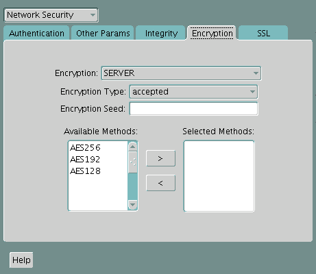
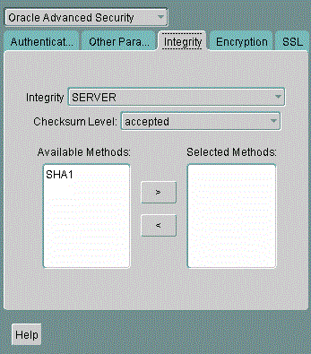

You can configure native Oracle Net Services data encryption and data integrity for both servers and clients.

**Parent topic:** [Securing Data on the Network](part_4.md)

### 17.1 About Oracle Database Native Network Encryption and Data Integrity

Oracle Database enables you to encrypt data that is sent over a network.

- How Oracle Database Native Network Encryption and Integrity Works  
	Oracle Database provides native data network encryption and integrity to ensure that data is secure as it travels across the network.
- Advanced Encryption Standard  
	Oracle Database supports the Federal Information Processing Standard (FIPS) encryption algorithm, Advanced Encryption Standard (AES).
- Triple-DES Encryption  
	Triple-DES encryption (3DES) encrypts message data with three passes of the DES algorithm.
- Choosing Between Native Network Encryption and Transport Layer Security  
	Oracle offers two ways to encrypt data over the network, native network encryption and Transport Layer Security (TLS).

**Parent topic:** Configuring Oracle Database Native Network Encryption and Data Integrity

#### 17.1.1 How Oracle Database Native Network Encryption and Integrity Works

Oracle Database provides native data network encryption and integrity to ensure that data is secure as it travels across the network.

The purpose of a secure cryptosystem is to convert plaintext data (text that has not been encrypted) into unintelligible ciphertext (text that has been encrypted) based on a key, in such a way that it is very hard (computationally infeasible) to convert ciphertext back into its corresponding plaintext without knowledge of the correct key.

In a symmetric cryptosystem, the same key is used both for encryption and decryption of the same data. Oracle Database provides the Advanced Encryption Standard (AES) symmetric cryptosystem for protecting the confidentiality of Oracle Net Services traffic.

**Parent topic:** About Oracle Database Native Network Encryption and Data Integrity

#### 17.1.2 Advanced Encryption Standard

Oracle Database supports the Federal Information Processing Standard (FIPS) encryption algorithm, Advanced Encryption Standard (AES).

AES can be used by all U.S. government organizations and businesses to protect sensitive data over a network. This encryption algorithm defines three standard key lengths, which are 128-bit, 192-bit, and 256-bit. All versions operate in outer Cipher Block Chaining (CBC) mode. CBC mode is an encryption method that protects against block replay attacks by making the encryption of a cipher block dependent on all blocks that precede it; it is designed to make unauthorized decryption incrementally more difficult. Oracle Database employs outer cipher block chaining because it is more secure than inner cipher block chaining, with no material performance penalty.

Note:

The AES algorithms have been improved. To transition your Oracle Database environment to use stronger algorithms, download and install the patch described in My Oracle Support note [2118136.2](https://support.oracle.com/CSP/main/article?cmd=show&type=NOT&id=2118136.2).

**Parent topic:** About Oracle Database Native Network Encryption and Data Integrity

#### 17.1.3 Triple-DES Encryption

Triple-DES encryption (3DES) encrypts message data with three passes of the DES algorithm.

Note:

The DES, DES40, 3DES112, and 3DES168 algorithms are deprecated in this release. To transition your Oracle Database environment to use stronger algorithms, download and install the patch described in My Oracle Support note [2118136.2](https://support.oracle.com/CSP/main/article?cmd=show&type=NOT&id=2118136.2).

3DES provides a high degree of message security, but with a performance penalty. The magnitude of the performance penalty depends on the speed of the processor performing the encryption. 3DES typically takes three times as long to encrypt a data block when compared to the standard DES algorithm.

3DES is available in two-key and three-key versions, with effective key lengths of 112-bits and 168-bits, respectively. Both versions operate in outer Cipher Bock Chaining (CDC) mode.

The DES40 algorithm, available with Oracle Database and Secure Network Services, is a variant of DES in which the secret key is preprocessed to provide 40 effective key bits. It was designed to provide DES-based encryption to customers outside the U.S. and Canada at a time when the U.S. export laws were more restrictive. Currently DES40, DES, and 3DES are all available for export. DES40 is still supported to provide backward-compatibility for international customers.

**Parent topic:** About Oracle Database Native Network Encryption and Data Integrity

#### 17.1.4 Choosing Between Native Network Encryption and Transport Layer Security

Oracle offers two ways to encrypt data over the network, native network encryption and Transport Layer Security (TLS).

There are advantages and disadvantages to both methods.

Table 17-1 Comparison of Native Network Encryption and Transport Layer Security

| \- | Native Network Encryption | Transport Layer Security |
| --- | --- | --- |
| Advantages | - It is configured with parameters in the `sqlnet.ora` configuration file. - In most cases, no client configuration changes are required. - No certificates are required. - Clients that do not support native network encryption can fall back to unencrypted connections while incompatibility is mitigated. | - It is an industry standard for encrypting data in motion. - It provides non-repudiation for server connections to prevent third-party attacks. - It can be used for database user authentication. |
| Disadvantages | - It uses a non-standard, Oracle proprietary implementation. - It provides no non-repudiation of the server connection (that is, no protection against a third-party attack). | - It requires client and server changes. - Certificates are required for server and are optional for the client. However, the client must have the trusted root certificate for the certificate authority that issued the server’s certificate. - Certificates eventually expire. |

**Parent topic:** About Oracle Database Native Network Encryption and Data Integrity

### 17.2 Oracle Database Native Network Encryption Data Integrity

Encrypting network data provides data privacy so that unauthorized parties cannot view plaintext data as it passes over the network.

Oracle Database also provides protection against two forms of active attacks.

Table 17-2 provides information about these attacks.

Table 17-2 Two Forms of Network Attacks

| Type of Attack | Explanation |
| --- | --- |
| Data modification attack | An unauthorized party intercepting data in transit, altering it, and retransmitting it is a data modification attack. For example, intercepting a $100 bank deposit, changing the amount to $10,000, and retransmitting the higher amount is a data modification attack. |
| Replay attack | Repetitively retransmitting an entire set of valid data is a replay attack, such as intercepting a $100 bank withdrawal and retransmitting it ten times, thereby receiving $1,000. |

**Parent topic:** Configuring Oracle Database Native Network Encryption and Data Integrity

### 17.3 Improving Native Network Encryption Security

Oracle provides a patch that will strengthen native network encryption security for both Oracle Database servers and clients.

- About Improving Native Network Encryption Security  
	The Oracle patch will update encryption and checksumming algorithms and deprecate weak encryption and checksumming algorithms.
- Applying Security Improvement Updates to Native Network Encryption  
	In addition to applying a patch to the Oracle Database server and client, you must set the server and client `sqlnet.ora` parameters.

**Parent topic:** Configuring Oracle Database Native Network Encryption and Data Integrity

#### 17.3.1 About Improving Native Network Encryption Security

The Oracle patch will update encryption and checksumming algorithms and deprecate weak encryption and checksumming algorithms.

This patch, which you can download from My Oracle Support note [2118136.2](https://support.oracle.com/CSP/main/article?cmd=show&type=NOT&id=2118136.2), strengthens the connection between servers and clients, fixing a vulnerability in native network encryption and checksumming algorithms. It adds two parameters that make it easy to disable older, less secure encryption and checksumming algorithms. Oracle strongly recommends that you apply this patch to your Oracle Database server and clients.

This patch applies to Oracle Database releases 11.2 and later. You can apply this patch in the following environments: standalone, multitenant, primary-standby, Oracle Real Application Clusters (Oracle RAC), and environments that use database links.

The supported algorithms that have been improved are as follows:

- Encryption algorithms: AES128, AES192 and AES256
- Checksumming algorithms: SHA1, SHA256, SHA384, and SHA512

Weak algorithms that are deprecated and should not be used after you apply the patch are as follows:

- Encryption algorithms: DES, DES40, 3DES112, 3DES168, RC4\_40, RC4\_56, RC4\_128, and RC4\_256
- Checksumming algorithm: MD5

The general procedure that you will follow is to first replace references to desupported algorithms in your Oracle Database environment with supported algorithms, patch the server, patch the client, and finally, set `sqlnet.ora` parameters to re-enable a proper connection between the server and clients.

The patch affects the following areas including, but not limited to, the following:

- JDBC network encryption-related configuration settings
- Encryption and integrity parameters that you have configured using Oracle Net Manager
- Transport Layer Security (TLS) `SSL_CIPHER_SUITE` parameter settings
- SecureFiles LOB encrypted columns
- Database Resident Connection Pooling (DRCP) configurations
- Encryption settings used for the configuration of Oracle Call Interface (Oracle OCI), `ODP.NET`

**Parent topic:** Improving Native Network Encryption Security

#### 17.3.2 Applying Security Improvement Updates to Native Network Encryption

In addition to applying a patch to the Oracle Database server and client, you must set the server and client `sqlnet.ora` parameters.

Ensure that you perform the following steps in the order shown:

1. Back up the servers and clients to which you will install the patch.
2. Log in to My Oracle Support and then download patch described in My Oracle Support note [2118136.2](https://support.oracle.com/CSP/main/article?cmd=show&type=NOT&id=2118136.2).My Oracle Support is located at the following URL:
	[`https://support.oracle.com`](https://support.oracle.com/)
3. Patch the server.
	Follow the instructions in My Oracle Support note [2118136.2](https://support.oracle.com/CSP/main/article?cmd=show&type=NOT&id=2118136.2) to apply the patch to the server. You will apply the same patch to the client in a later step.
4. Patch the clients.
	Determine which clients you need to patch.
	Follow the instructions in My Oracle Support note [2118136.2](https://support.oracle.com/CSP/main/article?cmd=show&type=NOT&id=2118136.2) to apply the patch to each client.
5. In each client `sqlnet.ora` file, remove all deprecated algorithms if they are defined.
	You can bypass this step if the following parameters are not defined or have no algorithms listed.
	- `SQLNET.ENCRYPTION_TYPES_CLIENT`
	- `SQLNET.CRYPTO_CHECKSUM_TYPES_CLIENT`
6. In the server `sqlnet.ora` file, remove all deprecated algorithms if they are defined.
	You can bypass this step if the following parameters are not defined or have no algorithms listed.
	- `SQLNET.ENCRYPTION_TYPES_SERVER`
	- `SQLNET.CRYPTO_CHECKSUM_TYPES_SERVER`
7. For maximum security on the server, set the following `sqlnet.ora` parameters:
	- `SQLNET.ENCRYPTION_SERVER = REQUIRED`
	- `SQLNET.ENCRYPTION_TYPES_SERVER = (AES256)`
	- `SQLNET.CRYPTO_CHECKSUM_SERVER = REQUIRED`
	- `SQLNET.CRYPTO_CHECKSUM_TYPES_SERVER = (SHA512)`
	- `SQLNET.ALLOW_WEAK_CRYPTO_CLIENTS = FALSE`
8. For maximum security on the client, set the following `sqlnet.ora` parameters:
	- `SQLNET.ENCRYPTION_CLIENT = REQUIRED`
	- `SQLNET.ENCRYPTION_TYPES_CLIENT = (AES256)`
	- `SQLNET.CRYPTO_CHECKSUM_CLIENT = REQUIRED`
	- `SQLNET.CRYPTO_CHECKSUM_TYPES_CLIENT = (SHA512)`
	- `SQLNET.ALLOW_WEAK_CRYPTO = FALSE`
9. In each client `sqlnet.ora` file, after you have removed all the deprecated algorithms from the server and the clients per steps [^1] and [^2], set the parameter `SQLNET.ALLOW_WEAK_CRYPTO = FALSE` so that the clients can be prevented from communicating with unpatched servers.
	If the `SQLNET.ALLOW_WEAK_CRYPTO` parameter is set to `FALSE`, then a client attempting to use a weak algorithm will produce an `ORA-12269: client uses weak encryption/crypto-checksumming version` error at the server. A client connecting to a server (or proxy) that is using weak algorithms will receive an `ORA-12268: server uses weak encryption/crypto-checksumming version` error.
10. In the server `sqlnet.ora` file, after you have updated all the clients with `SQLNET.ALLOW_WEAK_CRYPTO = FALSE` per step [^3], set the parameter `SQLNET.ALLOW_WEAK_CRYPTO_CLIENTS = FALSE`. This parameter prevents a patched server from communicating with unpatched clients.
	If the `SQLNET.ALLOW_WEAK_CRYPTO` parameter is set to `FALSE`, then a client attempting to use a weak algorithm will produce an `ORA-12269: client uses weak encryption/crypto-checksumming version` error at the server. A client connecting to a server (or proxy) that is using weak algorithms will receive an `ORA-12268: server uses weak encryption/crypto-checksumming version` error.
	If you use the database links, then the first database server acts as a client and connects to the second server. Therefore, ensure that all servers are fully patched and unsupported algorithms are removed before you set `SQLNET.ALLOW_WEAK_CRYPTO` to `FALSE`

**Parent topic:** Improving Native Network Encryption Security

### 17.4 Data Integrity Algorithms Support

Data integrity algorithms protect against third-party attacks and message replay attacks. Oracle recommends SHA-2, but maintains SHA-1 (deprecated) and MD5 for backward compatibility.

Note:

MD5 is deprecated in this release. To transition your Oracle Database environment to use stronger algorithms, download and install the patch described in My Oracle Support note [2118136.2](https://support.oracle.com/CSP/main/article?cmd=show&type=NOT&id=2118136.2).

These hashing algorithms create a checksum that changes if the data is altered in any way. This protection operates independently from the encryption process so you can enable data integrity with or without enabling encryption.

### 17.5 Diffie-Hellman Based Key Negotiation

You can use the Diffie-Hellman key negotiation algorithm to secure data in a multiuser environment.

Secure key distribution is difficult in a multiuser environment. Oracle Database uses the well known Diffie-Hellman key negotiation algorithm to perform secure key distribution for both encryption and data integrity.

When encryption is used to protect the security of encrypted data, keys must be changed frequently to minimize the effects of a compromised key. Accordingly, the Oracle Database key management function changes the session key with every session.

The Diffie-Hellman key negotiation algorithm is a method that lets two parties communicating over an insecure channel to agree upon a random number known only to them. Oracle Database uses the Diffie-Hellman key negotiation algorithm to generate session keys.

The client and the server begin communicating using the session key generated by Diffie-Hellman. When the client authenticates to the server, they establish a shared secret that is only known to both parties. Oracle Database combines the shared secret and the Diffie-Hellman session key to generate a stronger session key designed to defeat a person-in-the-middle attack.

Note:

The use of the anonymous RC4 cipher suite for non-authenticated TLS connections is desupported in Oracle Database 21c (`SSL_DH_anon_WITH_RC4_128_MD5`)

Oracle recommends that you use the more secure authenticated connections available with Oracle Database. If you use anonymous Diffie-Hellman with RC4 for connecting to Oracle Internet Directory for Enterprise User Security, then you must migrate to use a different algorithm connection. Oracle recommends that you use either TLS one-way, or mutual authentication using certificates.

To transition your Oracle Database environment to use stronger algorithms, download and install the patch described in My Oracle Support note [2118136.2](https://support.oracle.com/CSP/main/article?cmd=show&type=NOT&id=2118136.2).

**Parent topic:** Configuring Oracle Database Native Network Encryption and Data Integrity

### 17.6 Configuration of Data Encryption and Integrity

Oracle Database native Oracle Net Services encryption and integrity presumes the prior installation of Oracle Net Services.

- About Activating Encryption and Integrity  
	In any network connection, both the client and server can support multiple encryption algorithms and integrity algorithms.
- About Negotiating Encryption and Integrity  
	The `sqlnet.ora` file on systems using data encryption and integrity must contain some or all the `REJECTED`, `ACCEPTED`, `REQUESTED`, and `REQUIRED` parameters.
- Configuring Encryption and Integrity Parameters Using Oracle Net Manager  
	You can set up or change encryption and integrity parameter settings using Oracle Net Manager.

**Parent topic:** Configuring Oracle Database Native Network Encryption and Data Integrity

#### 17.6.1 About Activating Encryption and Integrity

In any network connection, both the client and server can support multiple encryption algorithms and integrity algorithms.

When a connection is made, the server selects which algorithm to use, if any, from those algorithms specified in the `sqlnet.ora` files.The server searches for a match between the algorithms available on both the client and the server, and picks the first algorithm in its own list that also appears in the client list. If one side of the connection does not specify an algorithm list, all the algorithms installed on that side are acceptable. The connection fails with error message `ORA-12650` if either side specifies an algorithm that is not installed.

Encryption and integrity parameters are defined by modifying a `sqlnet.ora` file on the clients and the servers on the network.

You can choose to configure any or all of the available encryption algorithms, and either or both of the available integrity algorithms. Only one encryption algorithm and one integrity algorithm are used for each connect session.

Note:

Oracle Database selects the first encryption algorithm and the first integrity algorithm enabled on the client and the server. Oracle recommends that you select algorithms and key lengths in the order in which you prefer negotiation, choosing the strongest key length first.

#### 17.6.2 About Negotiating Encryption and Integrity

The `sqlnet.ora` file on systems using data encryption and integrity must contain some or all the `REJECTED`, `ACCEPTED`, `REQUESTED`, and `REQUIRED` parameters.

- About the Values for Negotiating Encryption and Integrity  
	Oracle Net Manager can be used to specify four possible values for the encryption and integrity configuration parameters.
- REJECTED Configuration Parameter  
	The `REJECTED` value disables the security service, even if the other side requires this service.
- ACCEPTED Configuration Parameter  
	The `ACCEPTED` value enables the security service if the other side requires or requests the service.
- REQUESTED Configuration Parameter  
	The `REQUESTED` value enables the security service if the other side permits this service.
- REQUIRED Configuration Parameter  
	The `REQUIRED` value enables the security service or preclude the connection.

**Parent topic:** Configuration of Data Encryption and Integrity

##### 17.6.2.1 About the Values for Negotiating Encryption and Integrity

Oracle Net Manager can be used to specify four possible values for the encryption and integrity configuration parameters.

The following four values are listed in the order of increasing security, and they must be used in the profile file (`sqlnet.ora`) for the client and server of the systems that are using encryption and integrity.

The value `REJECTED` provides the minimum amount of security between client and server communications, and the value `REQUIRED` provides the maximum amount of network security:

- `REJECTED`
- `ACCEPTED`
- `REQUESTED`
- `REQUIRED`

The default value for each of the parameters is `ACCEPTED.`

Oracle Database servers and clients are set to `ACCEPT` encrypted connections out of the box. This means that you can enable the desired encryption and integrity settings for a connection pair by configuring just one side of the connection, server-side or client-side.

So, for example, if there are many Oracle clients connecting to an Oracle database, you can configure the required encryption and integrity settings for all these connections by making the appropriate sqlnet.ora changes at the server end. You do not need to implement configuration changes for each client separately.

Table 17-3 shows whether the security service is enabled, based on a combination of client and server configuration parameters. If either the server or client has specified `REQUIRED`, the lack of a common algorithm causes the connection to fail. Otherwise, if the service is enabled, lack of a common service algorithm results in the service being disabled.

Table 17-3 Encryption and Data Integrity Negotiations

| Client Setting | Server Setting | Encryption and Data Negotiation |
| --- | --- | --- |
| `REJECTED` | `REJECTED` | `OFF` |
| `ACCEPTED` | `REJECTED` | `OFF` |
| `REQUESTED` | `REJECTED` | `OFF` |
| `REQUIRED` | `REJECTED` | Connection fails |
| `REJECTED` | `ACCEPTED` | `OFF` |
| `ACCEPTED` | `ACCEPTED` | `OFF` <sup>Foot 1</sup> |
| `REQUESTED` | `ACCEPTED` | `ON` |
| `REQUIRED` | `ACCEPTED` | `ON` |
| `REJECTED` | `REQUESTED` | `OFF` |
| `ACCEPTED` | `REQUESTED` | `ON` |
| `REQUESTED` | `REQUESTED` | `ON` |
| `REQUIRED` | `REQUESTED` | `ON` |
| `REJECTED` | `REQUIRED` | Connection fails |
| `ACCEPTED` | `REQUIRED` | `ON` |
| `REQUESTED` | `REQUIRED` | `ON` |
| `REQUIRED` | `REQUIRED` | `ON` |

<sup>Footnote 1</sup>

This value defaults to `OFF`. Cryptography and data integrity are not enabled until the user changes this parameter by using Oracle Net Manager or by modifying the `sqlnet.ora` file.

**Parent topic:** About Negotiating Encryption and Integrity

##### 17.6.2.2 REJECTED Configuration Parameter

The `REJECTED` value disables the security service, even if the other side requires this service.

In this scenario, this side of the connection specifies that the security service is not permitted. If the other side is set to `REQUIRED`, the connection terminates with error message `ORA-12650`. If the other side is set to `REQUESTED`, `ACCEPTED`, or `REJECTED`, the connection continues without error and without the security service enabled.

**Parent topic:** About Negotiating Encryption and Integrity

##### 17.6.2.3 ACCEPTED Configuration Parameter

The `ACCEPTED` value enables the security service if the other side requires or requests the service.

In this scenario, this side of the connection does not require the security service, but it is enabled if the other side is set to `REQUIRED` or `REQUESTED`. If the other side is set to `REQUIRED` or `REQUESTED`, and an encryption or integrity algorithm match is found, the connection continues without error and with the security service enabled. If the other side is set to `REQUIRED` and no algorithm match is found, the connection terminates with error message `ORA-12650`.

If the other side is set to `REQUESTED` and no algorithm match is found, or if the other side is set to `ACCEPTED` or `REJECTED`, the connection continues without error and without the security service enabled.

**Parent topic:** About Negotiating Encryption and Integrity

##### 17.6.2.4 REQUESTED Configuration Parameter

The `REQUESTED` value enables the security service if the other side permits this service.

In this scenario, this side of the connection specifies that the security service is desired but not required. The security service is enabled if the other side specifies `ACCEPTED`, `REQUESTED`, or `REQUIRED`. There must be a matching algorithm available on the other side, otherwise the service is not enabled. If the other side specifies `REQUIRED` and there is no matching algorithm, the connection fails.

**Parent topic:** About Negotiating Encryption and Integrity

##### 17.6.2.5 REQUIRED Configuration Parameter

The `REQUIRED` value enables the security service or preclude the connection.

In this scenario, this side of the connection specifies that the security service must be enabled. The connection fails if the other side specifies `REJECTED` or if there is no compatible algorithm on the other side.

**Parent topic:** About Negotiating Encryption and Integrity

#### 17.6.3 Configuring Encryption and Integrity Parameters Using Oracle Net Manager

You can set up or change encryption and integrity parameter settings using Oracle Net Manager.

- Configuring Encryption on the Client and the Server  
	Use Oracle Net Manager to configure encryption on the client and on the server.
- Configuring Integrity on the Client and the Server  
	You can use Oracle Net Manager to configure network integrity on both the client and the server.
- Enabling Both Oracle Native Encryption and SSL Authentication for Different Users Concurrently  
	Depending on the `SQLNET.ENCRYPTION_CLIENT` and `SQLNET.ENCRYPTION_SERVER` settings, you can configure Oracle Database to allow both Oracle native encryption and SSL authentication for different users concurrently.

**Parent topic:** Configuration of Data Encryption and Integrity

##### 17.6.3.1 Configuring Encryption on the Client and the Server

Use Oracle Net Manager to configure encryption on the client and on the server.

1. Start Oracle Net Manager.
	- (UNIX) From `$ORACLE_HOME` `/bin`, enter the following command at the command line:
		```
		netmgr
		```
	- (Windows) Select Start, Programs, Oracle - HOME\_NAME, Configuration and Migration Tools, then Net Manager.
2. Expand Oracle Net Configuration, and from Local, select Profile.
3. From the Naming list, select Network Security.
	The Network Security tabbed window appears.
4. Select the Encryption tab.
	

> This is a text description of asoencry\_12102.png, which is an image of the Encryption tab in the Network Security profile region of Oracle Net Manager Manager.
>
> This window has the following fields which you can use to configure network encryption:
>
> - Encryption (a list from which you can choose either CLIENT or SERVER)
> - Encryption Type (a list from which you can choose one of the following: REQUESTED, REQUIRED, ACCEPTED, or REJECTED)
>
> In the lower half of the window, you can choose the Selected Methods of encryption you want to use from the Available Methods list. Select an encryption method from the Available Methods list on the left, then click a right arrow and the encryption method populates the Selected Methods list on the right side of the window. To remove an encryption method from the Selected Methods list, you can click a left arrow and the encryption method moves back to the Available Methods list.

5. Select CLIENT or SERVER option from the Encryption box.
6. From the Encryption Type list, select one of the following:
	- REQUESTED
	- REQUIRED
	- ACCEPTED
	- REJECTED
7. (Optional) In the Encryption Seed field, enter between 10 and 70 random characters. The encryption seed for the client should not be the same as that for the server.
8. Select an encryption algorithm in the Available Methods list. Move it to the Selected Methods list by choosing the right arrow (>). Repeat for each additional method you want to use.
9. Select File, Save Network Configuration. The `sqlnet.ora` file is updated.
10. Repeat this procedure to configure encryption on the other system. The `sqlnet.ora` file on the two systems should contain the following entries:
	- On the server:
		```
		SQLNET.ENCRYPTION_SERVER = [accepted | rejected | requested | required]
		SQLNET.ENCRYPTION_TYPES_SERVER = (valid_encryption_algorithm [,valid_encryption_algorithm])
		```
	- On the client:
		```
		SQLNET.ENCRYPTION_CLIENT = [accepted | rejected | requested | required]
		SQLNET.ENCRYPTION_TYPES_CLIENT = (valid_encryption_algorithm [,valid_encryption_algorithm])
		```

Table 17-4 lists valid encryption algorithms and their associated legal values.

Table 17-4 Valid Encryption Algorithms

| Algorithm Name | Legal Value |
| --- | --- |
| AES 256-bit key | AES256 |
| AES 192-bit key | AES192 |
| AES 128-bit key | AES128 |

**Parent topic:** Configuring Encryption and Integrity Parameters Using Oracle Net Manager

##### 17.6.3.2 Configuring Integrity on the Client and the Server

You can use Oracle Net Manager to configure network integrity on both the client and the server.

1. Start Oracle Net Manager.
	- (UNIX) From `$ORACLE_HOME` `/bin`, enter the following command at the command line:
		```
		netmgr
		```
	- (Windows) Select Start, Programs, Oracle - HOME\_NAME, Configuration and Migration Tools, then Net Manager.
2. Expand Oracle Net Configuration, and from Local, select Profile.
3. From the Naming list, select Network Security.
	The Network Security tabbed window appears.
4. Select the Integrity tab.
	

> This is a text description of cfig0002.gif, which is an image of the Integrity tab in the Oracle Advanced Security profile region of Oracle Net Manager Manager. Use this window to configure cryptographic checksumming for data integrity.
>
> This window has the following fields which you can use to configure cryptographic checksumming:
>
> - Integrity (a list from which you can choose either CLIENT or SERVER)
> - Checksum Level (a list from which you can choose one of the following: REQUESTED, REQUIRED, ACCEPTED, or REJECTED)
>
> In the lower half of the window, you can choose the Selected Methods of checksumming you want to use from the Available Methods list. SHA-1 and MD5 display as available checksum algorithms. Select a checksumming method from the Available Methods list on the left, then click a right arrow and the checksumming method populates the Selected Methods list on the right side of the window. To remove a checksumming method from the Selected Methods list, you can click a left arrow and the checksumming method moves back to the Available Methods list.

5. Depending upon which system you are configuring, select the Server or Client from the Integrity box.
6. From the Checksum Level list, select one of the following checksum level values:
	- REQUESTED
	- REQUIRED
	- ACCEPTED
	- REJECTED
7. Select an integrity algorithm in the Available Methods list. Move it to the Selected Methods list by choosing the right arrow (>). Repeat for each additional method you want to use.
8. Select File, Save Network Configuration.
	The `sqlnet.ora` file is updated.
9. Repeat this procedure to configure integrity on the other system.
	The `sqlnet.ora` file on the two systems should contain the following entries:
	- On the server:
		```
		SQLNET.CRYPTO_CHECKSUM_SERVER = [accepted | rejected | requested | required]
		SQLNET.CRYPTO_CHECKSUM_TYPES_SERVER = (valid_crypto_checksum_algorithm [,valid_crypto_checksum_algorithm])
		```
	- On the client:
		```
		SQLNET.CRYPTO_CHECKSUM_CLIENT = [accepted | rejected | requested | required]
		SQLNET.CRYPTO_CHECKSUM_TYPES_CLIENT = (valid_crypto_checksum_algorithm [,valid_crypto_checksum_algorithm])
		```

Valid integrity/checksum algorithms that you can use are as follows:

- SHA1
- SHA256
- SHA384
- SHA512

##### 17.6.3.3 Enabling Both Oracle Native Encryption and SSL Authentication for Different Users Concurrently

Depending on the `SQLNET.ENCRYPTION_CLIENT` and `SQLNET.ENCRYPTION_SERVER` settings, you can configure Oracle Database to allow both Oracle native encryption and SSL authentication for different users concurrently.

- About Enabling Both Oracle Native Encryption and SSL Authentication for Different Users Concurrently  
	By default, Oracle Database does not allow both Oracle native encryption and Transport Layer Security (SSL) authentication for different users concurrently.
- Configuring Both Oracle Native Encryption and SSL Authentication for Different Users Concurrently  
	Use the `IGNORE_ANO_ENCRYPTION_FOR_TCPS` parameter to enable the concurrent use of both Oracle native encryption and Transport Layer Security (SSL) authentication.

**Parent topic:** Configuring Encryption and Integrity Parameters Using Oracle Net Manager

###### 17.6.3.3.1 About Enabling Both Oracle Native Encryption and SSL Authentication for Different Users Concurrently

By default, Oracle Database does not allow both Oracle native encryption and Transport Layer Security (SSL) authentication for different users concurrently.

The use of both Oracle native encryption (also called Advanced Networking Option (ANO) encryption) and TLS authentication together is called double encryption.

There are cases in which both a TCP and TCPS listener must be configured, so that some users can connect to the server using a user name and password, and others can validate to the server by using a TLS certificate. In these situations, you must configure both password-based authentication and TLS authentication. A workaround in previous releases was to set the `SQLNET.ENCRYPTION_SERVER` parameter to `requested`. If your requirements are that `SQLNET.ENCRYPTION_SERVER` be set to `required`, then you can set the `IGNORE_ANO_ENCRYPTION_FOR_TCPS` parameter in both `SQLNET.ENCRYPTION_CLIENT` and `SQLNET.ENCRYPTION_SERVER` to `TRUE`. By default, it is set to `FALSE`.

Setting `IGNORE_ANO_ENCRYPTION_FOR_TCPS` to `TRUE` forces the client to ignore the value that is set for the `SQLNET.ENCRYPTION_CLIENT` parameter for all outgoing TCPS connections. This parameter allows the database to ignore the `SQLNET.ENCRYPTION_CLIENT` or `SQLNET.ENCRYPTION_SERVER` setting when there is a conflict between the use of a TCPS client and when these two parameters are set to `required`.

**Parent topic:** Enabling Both Oracle Native Encryption and SSL Authentication for Different Users Concurrently

###### 17.6.3.3.2 Configuring Both Oracle Native Encryption and SSL Authentication for Different Users Concurrently

Use the `IGNORE_ANO_ENCRYPTION_FOR_TCPS` parameter to enable the concurrent use of both Oracle native encryption and Transport Layer Security (SSL) authentication.

On the server, you must set `IGNORE_ANO_ENCRYPTION_FOR_TCPS` in the `sqlnet.ora` file, and on the client, you can set it in either the `sqlnet.ora` file or the `tnsnames.ora` file.

1. Log in to the database server
2. Go to the location of the `sqlnet.ora` file.
	By default, `sqlnet.ora` is in the `ORACLE_BASE/network/admin` directory. The `sqlnet.ora` file can also be stored in the directory specified by the `TNS_ADMIN` environment variable.
3. In `sqlnet.ora`, check if the current `SQLNET.ENCRYPTION_SERVER` setting is `required` or `requested`.
4. If `SQLNET.ENCRYPTION_SERVER` is set to required, then add the `SQLNET.IGNORE_ANO_ENCRYPTION_FOR_TCPS` to `sqlnet.ora` and then set it to `TRUE`.
	```
	IGNORE_ANO_ENCRYPTION_FOR_TCPS=TRUE
	```
5. Save and exit `sqlnet.ora`.
6. Log in to the client.
	For the client, you can set the value in either the `sqlnet.ora` file or the `tnsnames.ora` file.
	- Setting the value in `sqlnet.ora`: Check if the `SQLNET.ENCRYPTION_CLIENT` parameter is set to `required`. If `SQLNET.ENCRYPTION_CLIENT`, then edit the `sqlnet.ora` file to have the following setting:
		```
		IGNORE_ANO_ENCRYPTION_FOR_TCPS=TRUE
		```
		- Setting the value in `tnsnames.ora`: By default, `tnsnames.ora` is in the same location as `sqlnet.ora`. If `SQLNET.ENCRYPTION_CLIENT` is set to `required` in `sqlnet.ora`, then in the `SECURITY` portion of the `TNS_ALIAS` setting, set ` IGNORE_ANO_ENCRYPTION_FOR_TCPS=TRUE`. For example:
		```
		test_tls=
		    (DESCRIPTION =
		       (ADDRESS=(PROTOCOL=tcps)(HOST=)(PORT=1750))
		       (CONNECT_DATA=(SID=^ORACLE_SID^))
		       (SECURITY=(IGNORE_ANO_ENCRYPTION_FOR_TCPS=TRUE))
		     )
		```

**Parent topic:** Enabling Both Oracle Native Encryption and SSL Authentication for Different Users Concurrently

[^1]: In each client `sqlnet.ora` file, remove all deprecated algorithms if they are defined.

You can bypass this step if the following parameters are not defined or have no algorithms listed.
- `SQLNET.ENCRYPTION_TYPES_CLIENT`
- `SQLNET.CRYPTO_CHECKSUM_TYPES_CLIENT`

[^2]: In the server `sqlnet.ora` file, remove all deprecated algorithms if they are defined.

You can bypass this step if the following parameters are not defined or have no algorithms listed.
- `SQLNET.ENCRYPTION_TYPES_SERVER`
- `SQLNET.CRYPTO_CHECKSUM_TYPES_SERVER`

[^undefined]: For maximum security on the server, set the following `sqlnet.ora` parameters:

- `SQLNET.ENCRYPTION_SERVER = REQUIRED`
- `SQLNET.ENCRYPTION_TYPES_SERVER = (AES256)`
- `SQLNET.CRYPTO_CHECKSUM_SERVER = REQUIRED`
- `SQLNET.CRYPTO_CHECKSUM_TYPES_SERVER = (SHA512)`
- `SQLNET.ALLOW_WEAK_CRYPTO_CLIENTS = FALSE`

[^undefined]: For maximum security on the client, set the following `sqlnet.ora` parameters:

- `SQLNET.ENCRYPTION_CLIENT = REQUIRED`
- `SQLNET.ENCRYPTION_TYPES_CLIENT = (AES256)`
- `SQLNET.CRYPTO_CHECKSUM_CLIENT = REQUIRED`
- `SQLNET.CRYPTO_CHECKSUM_TYPES_CLIENT = (SHA512)`
- `SQLNET.ALLOW_WEAK_CRYPTO = FALSE`

[^undefined]: ↩

[^3]: In each client `sqlnet.ora` file, after you have removed all the deprecated algorithms from the server and the clients per steps [5](configuring-secure-sockets-layer-authentication.md) and [6](configuring-secure-sockets-layer-authentication.md), set the parameter `SQLNET.ALLOW_WEAK_CRYPTO = FALSE` so that the clients can be prevented from communicating with unpatched servers.

If the `SQLNET.ALLOW_WEAK_CRYPTO` parameter is set to `FALSE`, then a client attempting to use a weak algorithm will produce an `ORA-12269: client uses weak encryption/crypto-checksumming version` error at the server. A client connecting to a server (or proxy) that is using weak algorithms will receive an `ORA-12268: server uses weak encryption/crypto-checksumming version` error.

[^undefined]: In the server `sqlnet.ora` file, after you have updated all the clients with `SQLNET.ALLOW_WEAK_CRYPTO = FALSE` per step [9](configuring-secure-sockets-layer-authentication.md), set the parameter `SQLNET.ALLOW_WEAK_CRYPTO_CLIENTS = FALSE`. This parameter prevents a patched server from communicating with unpatched clients.

If the `SQLNET.ALLOW_WEAK_CRYPTO` parameter is set to `FALSE`, then a client attempting to use a weak algorithm will produce an `ORA-12269: client uses weak encryption/crypto-checksumming version` error at the server. A client connecting to a server (or proxy) that is using weak algorithms will receive an `ORA-12268: server uses weak encryption/crypto-checksumming version` error.

If you use the database links, then the first database server acts as a client and connects to the second server. Therefore, ensure that all servers are fully patched and unsupported algorithms are removed before you set `SQLNET.ALLOW_WEAK_CRYPTO` to `FALSE`