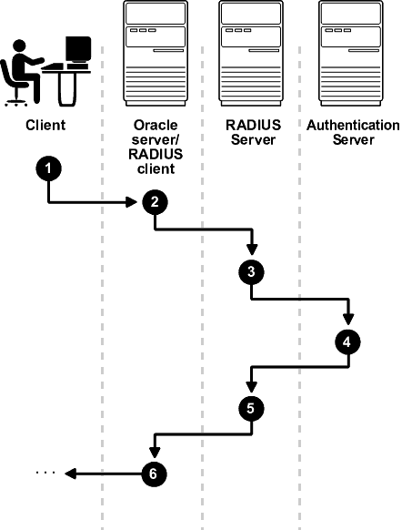
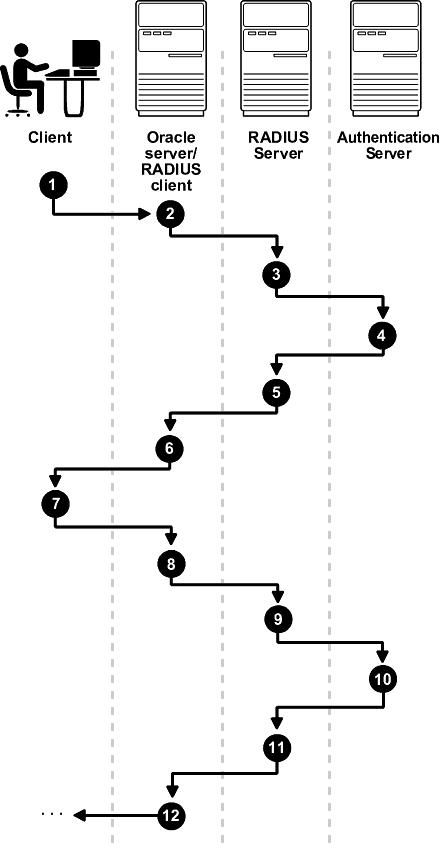
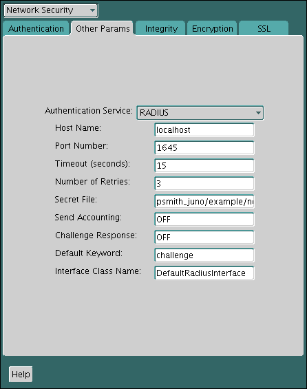

**Parent topic:** [Managing Strong Authentication](part_5.md)

### 23.1 About Configuring RADIUS Authentication

An Oracle Database network can use any authentication method that supports the RADIUS standard.

The supported RADIUS standard includes token cards and smart cards when you install and configure the RADIUS protocol. Oracle Database uses RADIUS in a client/server network environment. Moreover, when you use RADIUS, you can change the authentication method without modifying either the Oracle client or the Oracle database server.

From an end user's perspective, the entire authentication process is transparent. When the user seeks access to an Oracle database server, the Oracle database server, acting as the RADIUS client, notifies the RADIUS server. The RADIUS server then:

- Looks up the user's security information
- Passes authentication and authorization information between the appropriate authentication server or servers and the Oracle database server
- Grants the user access to the Oracle database server
- Logs session information, including when, how often, and for how long the user was connected to the Oracle database server
	Note:
	Oracle Database does not support RADIUS authentication over database links.

Figure 23-1 illustrates the Oracle Database-RADIUS environment.

Figure 23-1 RADIUS in an Oracle Environment


> This is a text description of asoag003.gif, an image which shows the Oracle/RADIUS environment. From left to right, there are three entities depicted in this image: An Oracle client, an Oracle server (which also is the RADIUS client), and the RADIUS server (or RSA ACE/Server). There are arrows between all three entities pointing in both directions to show that there is two-way communication between them.


The Oracle Database server acts as the RADIUS client, passing information between the Oracle client and the RADIUS server. Similarly, the RADIUS server passes information between the Oracle database server and the appropriate authentication servers.

A RADIUS server vendor is often the authentication server vendor as well. In this case authentication can be processed on the RADIUS server. For example, the RSA ACE/Server is both a RADIUS server and an authentication server. It thus authenticates the user's pass code.

Note:

SecurID, an authentication product of RSA Security, Inc., though not directly supported by Oracle Database, has been certified as RADIUS-compliant. You can therefore, run SecurID under RADIUS. Refer to the RSA Security SecurID documentation for further information.

### 23.2 RADIUS Components

RADIUS has a set of authentication components that enable you to manage configuration settings.

Table 23-1 lists the authentication components.

Table 23-1 RADIUS Authentication Components

| Component | Stored Information |
| --- | --- |
| Oracle client | Configuration setting for communicating through RADIUS. |
| Oracle database server/RADIUS client | Configuration settings for passing information between the Oracle client and the RADIUS server.  The secret key file. |
| RADIUS server | Authentication and authorization information for all users.  Each client's name or IP address.  Each client's shared secret.  Unlimited number of menu files enabling users already authenticated to select different login options without reconnecting. |
| Authentication server or servers | User authentication information such as pass codes and PINs, depending on the authentication method in use.  Note: The RADIUS server can also be the authentication server. |

**Parent topic:** Configuring RADIUS Authentication

### 23.3 RADIUS Authentication Modes

User authentication can take place either through synchronous authentication mode or challenge-response (asynchronous) authentication mode.

- Synchronous Authentication Mode  
	In the synchronous mode, RADIUS lets you use various authentication methods, including passwords and SecurID token cards.
- Challenge-Response (Asynchronous) Authentication Mode  
	When the system uses the asynchronous mode, the user does not need to enter a user name and password at the SQL\*Plus CONNECT string.

**Parent topic:** Configuring RADIUS Authentication

#### 23.3.1 Synchronous Authentication Mode

In the synchronous mode, RADIUS lets you use various authentication methods, including passwords and SecurID token cards.

- Sequence for Synchronous Authentication Mode  
	The sequence of synchronous authentication mode is comprised of six steps.
- Example: Synchronous Authentication with SecurID Token Cards  
	With SecurID authentication, each user has a token card that displays a dynamic number that changes every sixty seconds.

**Parent topic:** RADIUS Authentication Modes

##### 23.3.1.1 Sequence for Synchronous Authentication Mode

The sequence of synchronous authentication mode is comprised of six steps.

Figure 23-2 shows the sequence in which synchronous authentication occurs.

Figure 23-2 Synchronous Authentication Sequence



> This is a text description of asoag010.gif, an image which depicts the synchronous authentication sequence as follows:
>
> 1. A user logs in by entering a connect string, passcode, or other value, and the client machine passes this data to the Oracle database server.
> 2. The Oracle database server, acting as the RADIUS client, passes the data from the Oracle client to the RADIUS server.
> 3. The RADIUS server passes the data to the appropriate authentication server for validation.
> 4. The authentication server sends back to the RADIUS server either an access accept or an access reject message.
> 	Note: If the RADIUS server is the authentication server, the two preceeding steps are combined.
> 5. The RADIUS server passes this response to the Oracle database server/RADIUS client.
> 6. The Oracle database server/RADIUS client passes the response to the Oracle client.


The following steps describe the synchronous authentication sequence:

1. A user logs in by entering a connect string, pass code, or other value. The client system passes this data to the Oracle database server.
2. The Oracle database server, acting as the RADIUS client, passes the data from the Oracle client to the RADIUS server.
3. The RADIUS server passes the data to the appropriate authentication server, such as Smart Card or SecurID ACE for validation.
4. The authentication server sends either an Access Accept or an Access Reject message back to the RADIUS server.
5. The RADIUS server passes this response to the Oracle database server/RADIUS client.
6. The Oracle database server/RADIUS client passes the response back to the Oracle client.

**Parent topic:** Synchronous Authentication Mode

##### 23.3.1.2 Example: Synchronous Authentication with SecurID Token Cards

With SecurID authentication, each user has a token card that displays a dynamic number that changes every sixty seconds.

To gain access to the Oracle database server/RADIUS client, the user enters a valid pass code that includes both a personal identification number (PIN) and the dynamic number currently displayed on the user's SecurID card. The Oracle database server passes this authentication information from the Oracle client to the RADIUS server, which in this case is the authentication server for validation. Once the authentication server (RSA ACE/Server) validates the user, it sends an accept packet to the Oracle database server, which, in turn, passes it to the Oracle client. The user is now authenticated and able to access the appropriate tables and applications.

See Also:

Documentation provided by RSA Security, Inc.

**Parent topic:** Synchronous Authentication Mode

#### 23.3.2 Challenge-Response (Asynchronous) Authentication Mode

When the system uses the asynchronous mode, the user does not need to enter a user name and password at the SQL\*Plus CONNECT string.

- Sequence for Challenge-Response (Asynchronous) Authentication Mode  
	The sequence for challenge-response (asynchronous) authentication mode is comprised of 12 steps.
- Example: Asynchronous Authentication with Smart Cards  
	With smart card authentication, the user logs in by inserting the smart card into a smart card reader that reads the smart card.
- Example: Asynchronous Authentication with ActivCard Tokens  
	One particular ActivCard token is a hand-held device with a keypad and which displays a dynamic password.

**Parent topic:** RADIUS Authentication Modes

##### 23.3.2.1 Sequence for Challenge-Response (Asynchronous) Authentication Mode

The sequence for challenge-response (asynchronous) authentication mode is comprised of 12 steps.

Note:

Challenge-response (Asynchronous) authentication mode is not supported on database servers that run on the Microsoft Windows platform, regardless of the client connection to the database server.

Figure 23-3 shows the sequence in which challenge-response (asynchronous) authentication occurs.

Note:

If the RADIUS server is the authentication server, Steps 3, 4, and 5, and Steps 9, 10, and 11 in Figure 23-3 are combined.

Figure 23-3 Asynchronous Authentication Sequence



> This is a text description of asoag011.gif, an image which depicts a challenge-response, or asynchronous authentication sequence as follows:
>
> 1. A user seeks a connection to the Oracle database server, and the client machine passes the data to the Oracle database server.
> 2. The Oracle database server, acting as the RADIUS client, passes the data from the Oracle client to the RADIUS server.
> 3. The RADIUS server passes the data to the appropriate authentication server for validation.
> 4. The authentication server sends a challenge to the RADIUS server.
> 5. The RADIUS server sends the challenge to the Oracle database server/RADIUS client (the three preceeding steps are combined if the RADIUS server is the authentication server).
> 6. The Oracle database server/RADIUS client sends the challenge to the Oracle client where a graphical interface presents it to the user.
> 7. The user provides a response to the challenge by various means which the Oracle client passes to the Oracle database server/RADIUS client.
> 8. The Oracle database server/RADIUS client sends the user's response to the RADIUS server.
> 9. The RADIUS server passes it to the appropriate authentication server for validation.
> 10. The authentication server sends back to the RADIUS server either an access accept or an access reject message.
> 11. The RADIUS server passes the response to the Oracle database server/RADIUS client. (The three preceeding steps are combined if the RADIUS server is the authentication server.)
> 12. The Oracle database server/RADIUS client passes it on to the Oracle client.


The following steps describe the asynchronous authentication sequence:

1. A user initiates a connection to an Oracle database server. The client system passes the data to the Oracle database server.
2. The Oracle database server, acting as the RADIUS client, passes the data from the Oracle client to the RADIUS server.
3. The RADIUS server passes the data to the appropriate authentication server, such as a Smart Card, SecurID ACE, or token card server.
4. The authentication server sends a challenge, such as a random number, to the RADIUS server.
5. The RADIUS server passes the challenge to the Oracle database server/RADIUS client.
6. The Oracle database server/RADIUS client, in turn, passes it to the Oracle client. A graphical user interface presents the challenge to the user.
7. The user provides a response to the challenge. To formulate a response, the user can, for example, enter the received challenge into the token card. The token card provides a dynamic password that is entered into the graphical user interface. The Oracle client passes the user's response to the Oracle database server/RADIUS client.
8. The Oracle database server/RADIUS client sends the user's response to the RADIUS server.
9. The RADIUS server passes the user's response to the appropriate authentication server for validation.
10. The authentication server sends either an Access Accept or an Access Reject message back to the RADIUS server.
11. The RADIUS server passes the response to the Oracle database server/RADIUS client.
12. The Oracle database server/RADIUS client passes the response to the Oracle client.

**Parent topic:** Challenge-Response (Asynchronous) Authentication Mode

##### 23.3.2.2 Example: Asynchronous Authentication with Smart Cards

With smart card authentication, the user logs in by inserting the smart card into a smart card reader that reads the smart card.

The smart card is a plastic card, like a credit card, with an embedded integrated circuit for storing information.

The Oracle client sends the login information contained in the smart card to the authentication server by way of the Oracle database server/RADIUS client and the RADIUS server. The authentication server sends back a challenge to the Oracle client, by way of the RADIUS server and the Oracle database server, prompting the user for authentication information. The information could be, for example, a PIN as well as additional authentication information contained on the smart card.

The Oracle client sends the user's response to the authentication server by way of the Oracle database server and the RADIUS server. If the user has entered a valid number, the authentication server sends an accept packet back to the Oracle client by way of the RADIUS server and the Oracle database server. The user is now authenticated and authorized to access the appropriate tables and applications. If the user has entered incorrect information, the authentication server sends back a message rejecting user's access.

**Parent topic:** Challenge-Response (Asynchronous) Authentication Mode

##### 23.3.2.3 Example: Asynchronous Authentication with ActivCard Tokens

One particular ActivCard token is a hand-held device with a keypad and which displays a dynamic password.

When the user seeks access to an Oracle database server by entering a password, the information is passed to the appropriate authentication server by way of the Oracle database server/RADIUS client and the RADIUS server. The authentication server sends back a challenge to the client, by way of the RADIUS server and the Oracle database server. The user types that challenge into the token, and the token displays a number for the user to send in response.

The Oracle client then sends the user's response to the authentication server by way of the Oracle database server and the RADIUS server. If the user has typed a valid number, the authentication server sends an accept packet back to the Oracle client by way of the RADIUS server and the Oracle database server. The user is now authenticated and authorized to access the appropriate tables and applications. If the user has entered an incorrect response, the authentication server sends back a message rejecting the user's access.

**Parent topic:** Challenge-Response (Asynchronous) Authentication Mode

### 23.4 Enabling RADIUS Authentication, Authorization, and Accounting

To enable RADIUS authentication, authorization, and accounting, you can use Oracle Net Manager.

- Step 1: Configure RADIUS Authentication  
	To configure RADIUS authentication, you must first configure it on the Oracle client, then the server. Afterward, you can configure additional RADIUS features.
- Step 2: Create a User and Grant Access  
	After you complete the RADIUS authentication, you must create an Oracle Database user who is responsible for the RADIUS configuration.
- Step 3: Configure External RADIUS Authorization (Optional)  
	You must configure the Oracle server, the Oracle client, and the RADIUS server to RADIUS users who must connect to an Oracle database.
- Step 4: Configure RADIUS Accounting  
	RADIUS accounting logs information about access to the Oracle database server and stores it in a file on the RADIUS accounting server.
- Step 5: Add the RADIUS Client Name to the RADIUS Server Database  
	The RADIUS server that you select must comply with RADIUS standards.
- Step 6: Configure the Authentication Server for Use with RADIUS  
	After you add the RADIUS client name to the RADIUS server database, you can configure the authentication server to use the RADIUS.
- Step 7: Configure the RADIUS Server for Use with the Authentication Server  
	After you configure the authentication server for use with RADIUS, you can configure the RADIUS server to use the authentication server.
- Step 8: Configure Mapping Roles  
	If the RADIUS server supports vendor type attributes, then you can manage roles by storing them in the RADIUS server.

**Parent topic:** Configuring RADIUS Authentication

#### 23.4.1 Step 1: Configure RADIUS Authentication

To configure RADIUS authentication, you must first configure it on the Oracle client, then the server. Afterward, you can configure additional RADIUS features.

Note:

Unless otherwise indicated, perform these configuration tasks by using Oracle Net Manager or by using any text editor to modify the `sqlnet.ora` file. Be aware that the settings in the `sqlnet.ora` file apply to all pluggable databases (PDBs).

- Step 1A: Configure RADIUS on the Oracle Client  
	You can use Oracle Net Manager to configure RADIUS on the Oracle client.
- Step 1B: Configure RADIUS on the Oracle Database Server  
	You must create a file to hold the RADIUS key and store this file on the Oracle database server. Then you must configure the appropriate parameters in the `sqlnet.ora` file.
- Step 1C: Configure Additional RADIUS Features  
	You can change the default settings, configure the challenge-response mode, and set parameters for an alternate RADIUS server.

**Parent topic:** Enabling RADIUS Authentication, Authorization, and Accounting

##### 23.4.1.1 Step 1A: Configure RADIUS on the Oracle Client

You can use Oracle Net Manager to configure RADIUS on the Oracle client.

1. Start Oracle Net Manager.
	- (UNIX) From `$ORACLE_HOME` `/bin`, enter the following command at the command line:
		```
		netmgr
		```
	- (Windows) Select Start, Programs, Oracle - HOME\_NAME, Configuration and Migration Tools, then Net Manager.
2. Expand Oracle Net Configuration, and from Local, select Profile.
3. From the Naming list, select Network Security.
	The Network Security tabbed window appears.
4. Select the Authentication tab. (It should be selected by default.)
	

> This is a text description of kerb0001.gif, which is an image of the Authentication tab in the Oracle Advanced Security profile region of Oracle Net Manager. Use this window to configure your client or server to use Kerberos authentication.
>
> You can choose Kerberos from the Available Methods list of authentication types. Then click a right arrow and the adjacent Selected Methods list is populated with the Kerberos authentication type. To remove Kerberos from the Selected Methods list, you can click a left arrow and it moves back to the Available Methods list.

5. From the Available Methods list, select RADIUS.
6. Select the right-arrow (>) to move RADIUS to the Selected Methods list.
	Move any other methods you want to use in the same way.
7. Arrange the selected methods in order of required usage by selecting a method in the Selected Methods list, and clicking Promote or Demote to position it in the list.
	For example, put RADIUS at the top of the list for it to be the first service used.
8. From the File menu, select Save Network Configuration.
	The `sqlnet.ora` file is updated with the following entry:
	```
	SQLNET.AUTHENTICATION_SERVICES=(RADIUS)
	```

**Parent topic:** Step 1: Configure RADIUS Authentication

##### 23.4.1.2 Step 1B: Configure RADIUS on the Oracle Database Server

You must create a file to hold the RADIUS key and store this file on the Oracle database server. Then you must configure the appropriate parameters in the `sqlnet.ora` file.

- Step 1B (1): Create the RADIUS Secret Key File on the Oracle Database Server  
	First, you must create the RADIUS secret key file.
- Step 1B (2): Configure RADIUS Parameters on the Server (sqlnet.ora file)  
	After you create RADIUS secret key file, you are ready to configure the appropriate parameters in the `sqlnet.ora` file.
- Step 1B (3): Set Oracle Database Server Initialization Parameters  
	After you configure the `sqlnet.ora` file, you must configure the `init.ora` initialization file.

**Parent topic:** Step 1: Configure RADIUS Authentication

###### 23.4.1.2.1 Step 1B (1): Create the RADIUS Secret Key File on the Oracle Database Server

First, you must create the RADIUS secret key file.

1. Obtain the RADIUS secret key from the RADIUS server.
	For each RADIUS client, the administrator of the RADIUS server creates a shared secret key, which must be less than or equal to 16 characters.
2. On the Oracle database server, create a directory:
	- (UNIX) `$ORACLE_HOME` `/network/security`
	- (Windows) `ORACLE_BASE` `\` `ORACLE_HOME` `\network\security`
3. Create the file `radius.key` to hold the shared secret copied from the RADIUS server. Place the file in the directory you created earlier in this procedure.
4. Copy the shared secret key and paste it (and nothing else) into the `radius.key` file created on the Oracle database server.
5. For security purposes, change the file permission of `radius.key` to read only, accessible only by the Oracle owner. Oracle relies on the file system to keep this file secret.
	See Also:
	The RADIUS server administration documentation, for information about obtaining the secret key

**Parent topic:** Step 1B: Configure RADIUS on the Oracle Database Server

###### 23.4.1.2.2 Step 1B (2): Configure RADIUS Parameters on the Server (sqlnet.ora file)

After you create RADIUS secret key file, you are ready to configure the appropriate parameters in the `sqlnet.ora` file.

1. Start Oracle Net Manager.
	- (UNIX) From `$ORACLE_HOME` `/bin`, enter the following command at the command line:
		```
		netmgr
		```
	- (Windows) Select Start, Programs, Oracle - HOME\_NAME, Configuration and Migration Tools, then Net Manager.
2. Expand Oracle Net Configuration, and from Local, select Profile.
3. From the Naming list, select Network Security.
	The Network Security tabbed window appears.
4. Select the Authentication tab.
5. From the Available Methods list, select RADIUS.
6. Move RADIUS to the Selected Methods list by choosing the right-arrow (>).
7. To arrange the selected methods in order of desired use, select a method in the Selected Methods list, and select Promote or Demote to position it in the list.
	For example, if you want RADIUS to be the first service used, then put it at the top of the list.
8. Select the Other Params tab.
9. From the Authentication Service list, select RADIUS.
10. In the Host Name field, accept the localhost as the default primary RADIUS server, or enter another host name.
	

> This is a text description of radu0002.gif, which is an image of the Other Params tab in the Oracle Advanced Security profile region of Oracle Net Manager. Use this window to finish configuring your server to use RADIUS authentication.
>
> This window contains the following fields:
>
> - Authentication Service (choose RADIUS from this list)
> - Host Name
> - Port Number
> - Timeout (in seconds)
> - Number of Retries
> - Secret File (path to the radius.key file)
> - Send Accounting (set to ON or OFF)
> - Challenge Response (set to ON or OFF)
> - Default Keyword
> - Interface Class Name
>
> Click the Help button at the bottom of this window to access the online help.

11. Ensure that the default value of the Secret File field is valid.
12. From the File menu, select Save Network Configuration.
	The `sqlnet.ora` file is updated with the following entries:
	```
	SQLNET.AUTHENTICATION_SERVICES=RADIUS
	SQLNET.RADIUS_AUTHENTICATION=RADIUS_server_{hostname|IP_address}
	```
	The `IP_address` can either be an Internet Protocol Version 4 (IPv4) or Internet Protocol Version 6 (IPv6) address. The RADIUS adapter supports both IPv4 and IPv6 based servers.

**Parent topic:** Step 1B: Configure RADIUS on the Oracle Database Server

###### 23.4.1.2.3 Step 1B (3): Set Oracle Database Server Initialization Parameters

After you configure the `sqlnet.ora` file, you must configure the `init.ora` initialization file.

1. Add the following setting to the `init.ora` file.
	```
	OS_AUTHENT_PREFIX=""
	```
	By default, the `init.ora` file is located in the `ORACLE_HOME` `/dbs` directory (or the same location of the data files) on Linux and UNIX systems, and in the `ORACLE_HOME` `\database` directory on Windows.
2. For example:
	```
	SQL> SHUTDOWN
	SQL> STARTUP
	```

##### 23.4.1.3 Step 1C: Configure Additional RADIUS Features

You can change the default settings, configure the challenge-response mode, and set parameters for an alternate RADIUS server.

- Step 1C(1): Change Default Settings  
	You can use Oracle Net Manager to change the default RADIUS settings.
- Step 1C(2): Configure Challenge-Response Mode  
	To configure challenge-response mode, you must specify information such as a dynamic password that you obtain from a token card.
- Step 1C(3): Set Parameters for an Alternate RADIUS Server  
	If you are using an alternate RADIUS server, then you must set additional parameters.

**Parent topic:** Step 1: Configure RADIUS Authentication

###### 23.4.1.3.1 Step 1C(1): Change Default Settings

You can use Oracle Net Manager to change the default RADIUS settings.

1. Start Oracle Net Manager.
	- (UNIX) From `$ORACLE_HOME` `/bin`, enter the following command at the command line:
		```
		netmgr
		```
	- (Windows) Select Start, Programs, Oracle - HOME\_NAME, Configuration and Migration Tools, then Net Manager.
2. Expand Oracle Net Configuration, and from Local, select Profile.
3. From the Naming list, select Network Security.
	The Network Security tabbed window appears.
4. Click the Other Params tab.
5. From the Authentication Service list, select RADIUS.
6. Change the default setting for any of the following fields:
	- Port Number: Specifies the listening port of the primary RADIUS server. The default value is 1645.
	- Timeout (seconds): Specifies the time the Oracle database server waits for a response from the primary RADIUS server. The default is 15 seconds.
	- Number of Retries: Specifies the number of times the Oracle database server resends messages to the primary RADIUS server, based on how you configured RADIUS accounting. The default is three retries.
	- Secret File: Specifies the location of the secret key on the Oracle database server. The field specifies the location of the secret key file, not the secret key itself.
7. From the File menu, select Save Network Configuration.
	The `sqlnet.ora` file is updated with the following entries:
	```
	SQLNET.RADIUS_AUTHENTICATION_PORT=(PORT)
	SQLNET.RADIUS_AUTHENTICATION_TIMEOUT=(NUMBER OF SECONDS TO WAIT FOR response)
	SQLNET.RADIUS_AUTHENTICATION_RETRIES=(NUMBER OF TIMES TO RE-SEND TO RADIUS server)
	SQLNET.RADIUS_SECRET=(path/radius.key)
	```

###### 23.4.1.3.2 Step 1C(2): Configure Challenge-Response Mode

To configure challenge-response mode, you must specify information such as a dynamic password that you obtain from a token card.

With the RADIUS adapter, this interface is Java-based to provide optimal platform independence. Note that third-party vendors of authentication devices must customize this graphical user interface to fit their particular device. For example, a smart card vendor would customize the Java interface so that the Oracle client reads data, such as a dynamic password, from the smart card. When the smart card receives a challenge, it responds by prompting the user for more information, such as a PIN.

1. If you are using JDK 1.1.7 or JRE 1.1.7, then set the `JAVA_HOME` environment variable to the JRE or JDK location on the system where the Oracle client is run:
	- On UNIX, enter this command at the prompt:
		```
		% setenv JAVA_HOME /usr/local/packages/jre1.1.7B
		```
	- On Windows, select Start, Settings, Control Panel, System, Environment, and set the `JAVA_HOME` variable as follows:
		```
		c:\java\jre1.1.7B
		```
	This step is not required for any other JDK/JRE version.
2. Start Oracle Net Manager.
	- (UNIX) From `$ORACLE_HOME` `/bin`, enter the following command at the command line:
		```
		netmgr
		```
	- (Windows) Select Start, Programs, Oracle - HOME\_NAME, Configuration and Migration Tools, then Net Manager.
3. Expand Oracle Net Configuration, and from Local, select Profile.
4. From the Naming list, select Network Security.
	The Network Security tabbed window appears.
5. From the Authentication Service list, select RADIUS.
6. In the Challenge Response field, enter ON to enable challenge-response.
7. In the Default Keyword field, accept the default value of the challenge or enter a keyword for requesting a challenge from the RADIUS server.
	The keyword feature is provided by Oracle and supported by some, but not all, RADIUS servers. You can use this feature only if your RADIUS server supports it.
	By setting a keyword, you let the user avoid using a password to verify identity. If the user does not enter a password, the keyword you set here is passed to the RADIUS server which responds with a challenge requesting, for example, a driver's license number or birth date. If the user does enter a password, the RADIUS server may or may not respond with a challenge, depending upon the configuration of the RADIUS server.
8. In the Interface Class Name field, accept the default value of DefaultRadiusInterface or enter the name of the class you have created to handle the challenge-response conversation.
	If other than the default RADIUS interface is used, then you also must edit the `sqlnet.ora` file to enter `SQLNET.RADIUS_CLASSPATH=(location)`, where `location` is the complete path name of the jar file. It defaults to `$` `ORACLE_HOME/network/jlib/netradius.jar: ``$` `ORACLE_HOME/JRE/lib/vt.jar`
9. From the File menu, select Save Network Configuration.
	The `sqlnet.ora` file is updated with the following entries:
	```
	SQLNET.RADIUS_CHALLENGE_RESPONSE=([ON | OFF])
	SQLNET.RADIUS_CHALLENGE_KEYWORD=(KEYWORD)
	SQLNET.RADIUS_AUTHENTICATION_INTERFACE=(name of interface including the package name delimited by "/" for ".")
	```

###### 23.4.1.3.3 Step 1C(3): Set Parameters for an Alternate RADIUS Server

If you are using an alternate RADIUS server, then you must set additional parameters.

- Set the following parameters in the `sqlnet.ora` file:
	```
	SQLNET.RADIUS_ALTERNATE=(hostname or ip address of alternate radius server)
	SQLNET.RADIUS_ALTERNATE_PORT=(1812)
	SQLNET.RADIUS_ALTERNATE_TIMEOUT=(number of seconds to wait for response)
	SQLNET.RADIUS_ALTERNATE_RETRIES=(number of times to re-send to radius server)
	```

**Parent topic:** Step 1C: Configure Additional RADIUS Features

#### 23.4.2 Step 2: Create a User and Grant Access

After you complete the RADIUS authentication, you must create an Oracle Database user who is responsible for the RADIUS configuration.

1. Connect to the CDB root or to the PDB in which RADIUS is implemented.
	For example:
	```
	CONNECT system@pdb_name;
	Enter password: password
	```
2. Create the user as a common user if you connected to the CDB root, or as a local user if you connected to a PDB..
	```
	CREATE USER username IDENTIFIED EXTERNALLY;
	GRANT CREATE SESSION TO USER user_name;
	```
3. Enter the user `username` in the RADIUS server's users file.

See Also:

Administration documentation for the RADIUS server

**Parent topic:** Enabling RADIUS Authentication, Authorization, and Accounting

#### 23.4.3 Step 3: Configure External RADIUS Authorization (Optional)

You must configure the Oracle server, the Oracle client, and the RADIUS server to RADIUS users who must connect to an Oracle database.

- Step 3A: Configure the Oracle Server (RADIUS Client)  
	You can edit the `init.ora` file to configure an Oracle server for a RADIUS client.
- Step 3B: Configure the Oracle Client Where Users Log In  
	Next, you must configure the Oracle client where users log in.
- Step 3C: Configure the RADIUS Server  
	To configure the RADIUS server, you must modify the RADIUS server attribute configuration file.

**Parent topic:** Enabling RADIUS Authentication, Authorization, and Accounting

##### 23.4.3.1 Step 3A: Configure the Oracle Server (RADIUS Client)

You can edit the `init.ora` file to configure an Oracle server for a RADIUS client.

To do so, you must modify the `init.ora` file, restart the database, and the set the RADIUS challenge-response mode.

1. Add the `OS_ROLES` parameter to the `init.ora` file and set this parameter to `TRUE` as follows:
	```
	OS_ROLES=TRUE
	```
	By default, the `init.ora` file is located in the `ORACLE_HOME` `/dbs` directory (or the same location of the data files) on Linux and UNIX systems, and in the `ORACLE_HOME` `\database` directory on Windows.
2. Restart the database so that the system can read the change to the `init.ora` file.
	For example:
	```
	SQL> SHUTDOWN 
	SQL> STARTUP
	```
3. Set the RADIUS challenge-response mode to `ON` for the server if you have not already done so.
4. Add externally identified users and roles.

##### 23.4.3.2 Step 3B: Configure the Oracle Client Where Users Log In

Next, you must configure the Oracle client where users log in.

- Set the RADIUS challenge-response mode to `ON` for the client if you have not already done so.

##### 23.4.3.3 Step 3C: Configure the RADIUS Server

To configure the RADIUS server, you must modify the RADIUS server attribute configuration file.

1. Add the following attributes to the RADIUS server attribute configuration file:
	| ATTRIBUTE NAME | CODE | TYPE |
	| --- | --- | --- |
	| `VENDOR_SPECIFIC` | 26 | Integer |
	| `ORACLE_ROLE` | 1 | String |
2. Assign a Vendor ID for Oracle in the RADIUS server attribute configuration file that includes the SMI Network Management Private Enterprise Code of `111`.
	For example, enter the following in the RADIUS server attribute configuration file:
	```
	VALUE     VENDOR_SPECIFIC     ORACLE     111
	```
3. Using the following syntax, add the `ORACLE_ROLE` attribute to the user profile of the users who will use external RADIUS authorization:
	```
	ORA_databaseSID_rolename[_[A]|[D]]
	```
	In this specification.:
	- `ORA` designates that this role is used for Oracle purposes
	- `databaseSID` is the Oracle system identifier that is configured in the database `init.ora` file.
		By default, the `init.ora` file is located in the `ORACLE_HOME` `/dbs` directory (or the same location of the data files) on Linux and UNIX systems, and in the `ORACLE_HOME` `\database` directory on Windows.
	- `rolename` is the name of role as it is defined in the data dictionary.
	- `A` is an optional character that indicates the user has administrator's privileges for this role.
	- `D` is an optional character that indicates this role is to be enabled by default.
	Ensure that RADIUS groups that map to Oracle roles adhere to the `ORACLE_ROLE` syntax.
	For example:
	```
	USERNAME     USERPASSWD="user_password",
	             SERVICE_TYPE=login_user,
	             VENDOR_SPECIFIC=ORACLE,
	             ORACLE_ROLE=ORA_ora920_sysdba
	```
	See Also:
	The RADIUS server administration documentation for information about configuring the server.

**Parent topic:** Step 3: Configure External RADIUS Authorization (Optional)

#### 23.4.4 Step 4: Configure RADIUS Accounting

RADIUS accounting logs information about access to the Oracle database server and stores it in a file on the RADIUS accounting server.

Use this feature only if both the RADIUS server and authentication server support it.

- Step 4A: Set RADIUS Accounting on the Oracle Database Server  
	To set RADIUS accounting on the server, you can use Oracle Net Manager.
- Step 4B: Configure the RADIUS Accounting Server  
	RADIUS Accounting Server resides on the same host as the RADIUS authentication server or on a separate host.

**Parent topic:** Enabling RADIUS Authentication, Authorization, and Accounting

##### 23.4.4.1 Step 4A: Set RADIUS Accounting on the Oracle Database Server

To set RADIUS accounting on the server, you can use Oracle Net Manager.

1. Start Oracle Net Manager.
	- (UNIX) From `$ORACLE_HOME` `/bin`, enter the following command at the command line:
		```
		netmgr
		```
	- (Windows) Select Start, Programs, Oracle - HOME\_NAME, Configuration and Migration Tools, then Net Manager.
2. Expand Oracle Net Configuration, and from Local, select Profile.
3. From the Naming list, select Network Security.
	The Network Security tabbed window appears.
4. Select the Other Params tab.
5. From the Authentication Service list, select RADIUS.
6. In the Send Accounting field, enter ON to enable accounting or OFF to disable accounting.
7. From the File menu, select Save Network Configuration.
	The `sqlnet.ora` file is updated with the following entry:
	```
	SQLNET.RADIUS_SEND_ACCOUNTING= ON
	```

**Parent topic:** Step 4: Configure RADIUS Accounting

##### 23.4.4.2 Step 4B: Configure the RADIUS Accounting Server

RADIUS Accounting Server resides on the same host as the RADIUS authentication server or on a separate host.

- See the administration documentation for the RADIUS server, for information about configuring RADIUS accounting.

**Parent topic:** Step 4: Configure RADIUS Accounting

#### 23.4.5 Step 5: Add the RADIUS Client Name to the RADIUS Server Database

The RADIUS server that you select must comply with RADIUS standards.

You can use any RADIUS server that complies with the Internet Engineering Task Force (IETF) RFC #2138, Remote Authentication Dial In User Service (RADIUS), and RFC #2139 RADIUS Accounting standards. Because RADIUS servers vary, consult the documentation for your particular RADIUS server for any unique interoperability requirements.

1. Open the clients file, which is located in `/etc/raddb/clients`.
	The following text and table appear:
	```
	@ (#) clients 1.1 2/21/96 Copyright 1991 Livingston Enterprises Inc
	This file contains a list of clients which are allowed to make authentication requests and their encryption key. The first field is a valid hostname. The second field (separated by blanks or tabs) is the encryption key.
	Client Name                     Key
	```
2. In the `CLIENT NAME` column, enter the host name or IP address of the host on which the Oracle database server is running.
	In the `KEY` column, type the shared secret. The value you enter in the `CLIENT NAME` column, whether it is the client's name or IP address, depends on the RADIUS server.
3. Save and close the clients file.

See Also:

Administration documentation for the RADIUS server

**Parent topic:** Enabling RADIUS Authentication, Authorization, and Accounting

#### 23.4.6 Step 6: Configure the Authentication Server for Use with RADIUS

After you add the RADIUS client name to the RADIUS server database, you can configure the authentication server to use the RADIUS.

- Refer to the authentication server documentation for instructions about configuring the authentication servers.

**Parent topic:** Enabling RADIUS Authentication, Authorization, and Accounting

#### 23.4.7 Step 7: Configure the RADIUS Server for Use with the Authentication Server

After you configure the authentication server for use with RADIUS, you can configure the RADIUS server to use the authentication server.

- Refer to the RADIUS server documentation for instructions about configuring the RADIUS server for use with the authentication server.

**Parent topic:** Enabling RADIUS Authentication, Authorization, and Accounting

#### 23.4.8 Step 8: Configure Mapping Roles

If the RADIUS server supports vendor type attributes, then you can manage roles by storing them in the RADIUS server.

The Oracle database server downloads the roles when there is a `CONNECT` request using RADIUS.To use this feature, you must configure roles on both the Oracle database server and the RADIUS server.

1. Use a text editor to set the `OS_ROLES` parameter in the initialization parameters file on the Oracle database server.
	By default, the `init.ora` file is located in the `ORACLE_HOME` `/dbs` directory (or the same location of the data files) on Linux and UNIX systems, and in the `ORACLE_HOME` `\database` directory on Windows.
2. Stop and restart the Oracle database server.
	For example:
	```
	SHUTDOWN
	STARTUP
	```
3. Create each role that the RADIUS server will manage on the Oracle database server with the value `IDENTIFIED EXTERNALLY`.
	To configure roles on the RADIUS server, use the following syntax:
	```
	ORA_DatabaseName.DatabaseDomainName_RoleName
	```
	In this specification:
	- `DatabaseName` is the name of the Oracle database server for which the role is being created. This is the same as the value of the DB\_NAME initialization parameter.
	- `DatabaseDomainName` is the name of the domain to which the Oracle database server belongs. The value is the same as the value of the `DB_DOMAIN` initialization parameter.
	- `RoleName` is name of the role created in the Oracle database server.
	For example:
	```
	ORA_USERDB.US.EXAMPLE.COM_MANAGER
	```
4. Configure RADIUS challenge-response mode.

### 23.5 Using RADIUS to Log in to a Database

You can use RADIUS to log into a database by using either synchronous authentication mode or challenge-response mode.

- Start SQL\*Plus and use one of the following ways to log in to the database:
	- If you are using the synchronous authentication mode, first ensure that challenge-response mode is not turned to `ON`, and then enter the following command:
		```
		CONNECT username@database_alias
		Enter password: password
		```
	- If you are using the challenge-response mode, ensure that challenge-response mode is set to `ON` and then enter the following command:
		```
		CONNECT /@database_alias
		```
	The challenge-response mode can be configured for all login cases.

**Parent topic:** Configuring RADIUS Authentication

### 23.6 RSA ACE/Server Configuration Checklist

If you are using an RSA ACE/Server RADIUS server, check the host agent and SecurID tokens for this server before making the initial connection.

- Ensure that the host agent in the RSA ACE/Server is set up to send a node secret. In version 5.0, this is done by leaving the SENT Node secret box unchecked. If the RSA ACE/Server fails to send a node secret to the agent, then a node verification failure message will be written to the RSA ACE/Server log.
- If you are using RSA SecurID tokens, then ensure that the token is synchronized with the RSA ACE/Server.

See Also:

RSA ACE/Server documentation for specific information about troubleshooting.

**Parent topic:** Configuring RADIUS Authentication