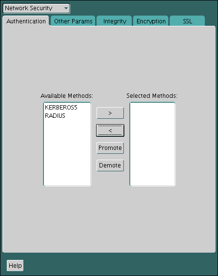

**Parent topic:** [Managing Strong Authentication](part_5.md)

### 24.1 Connecting to a Database Using Strong Authentication

You can use password authentication to connect to a database that is configured to use strong authentication.

1. To connect to an Oracle database server using a user name and password when an Oracle network and strong authentication method has been configured, disable the external authentication.
	You must first disable strong authentication by disabling the external authentication before you can connect to an Oracle Database server using a user name and password when an Oracle network and strong authentication method has been configured.
2. With the external authentication disabled, connect to the database using the following format:
	```
	% sqlplus username@net_service_name
	Enter password: password
	```
	For example:
	```
	% sqlplus hr@emp
	Enter password: password
	```
	You can configure multiple authentication methods, including both externally authenticated users and password authenticated users, on a single database.

### 24.2 Disabling Strong Authentication and Native Network Encryption

You can use Oracle Net Manager to disable strong authentication and native network encryption.

1. Start Oracle Net Manager.
	- (UNIX) From `$ORACLE_HOME` `/bin`, enter the following command at the command line:
		```
		netmgr
		```
	- (Windows) Select Start, Programs, Oracle - HOME\_NAME, Configuration and Migration Tools, then Net Manager.
2. Expand Oracle Net Configuration, and from Local, select Profile.
3. From the Naming list, select Network Security.
	The Network Security tabbed window appears.
4. Select the Authentication tab (which is selected by default).
5. Sequentially move all authentication methods from the Selected Method list to the Available Methods list by selecting a method and choosing the left arrow \[<\].
	

> This is a text description of auth0001.gif, which is an image of the Authentication tab in the Oracle Advanced Security profile region of Oracle Net Manager. Use this window to disable Oracle Advanced Security.
>
> To disable Oracle Advanced Security, choose all Selected Methods of authentication in the list on the right of the window. Then click the left arrow to remove all authenticaton types from the Selected Methods.

6. Select the Encryption tab.
7. Do the following:
	- From the Encryption menu, select SERVER.
		- Set Encryption Type to rejected.
		- In the Encryption Seed field, enter a valid encryption seed if an encryption seed was used.
		- Under Select Methods, move any methods to the Available Methods field.
8. Repeat these steps disable native network encryption for the client, by selecting CLIENT from the Encryption menu.
9. From the File menu, select Save Network Configuration.
	The `sqlnet.ora` file is updated with the following entries to indicate that strong authentication and native network encryption are disabled:
	Strong authentication:
	```
	SQLNET.AUTHENTICATION_SERVICES = (NONE)
	```
	If you are using local database password authentication, then you can also set `SQLNET.AUTHENTICATION_SERVICES=(NONE)` in the client. This setting improves client performance.
	For native network encryption, you can set it individually, for the server side and for the client side. The following examples show native network encryption being disabled for both the server and the client:
	```
	SQLNET.ENCRYPTION_SERVER = REJECTED
	SQLNET.ENCRYPTION_CLIENT = REJECTED
	```
	Be aware that the settings in the `sqlnet.ora` file apply to all pluggable databases (PDBs).

### 24.3 Configuring Multiple Authentication Methods

Many networks use more than one authentication method on a single security server.

Accordingly, Oracle Database lets you configure your network so that Oracle clients can use a specific authentication method, and Oracle database servers can accept any method specified.

You can set up multiple authentication methods on both client and server systems either by using Oracle Net Manager, or by using any text editor to modify the `sqlnet.ora` file. Use Oracle Net Manager to add authentication methods to both clients and servers.

1. Start Oracle Net Manager.
	- (UNIX) From `$ORACLE_HOME` `/bin`, enter the following command at the command line:
		```
		netmgr
		```
	- (Windows) Select Start, Programs, Oracle - HOME\_NAME, Configuration and Migration Tools, then Net Manager.
2. Expand Oracle Net Configuration, and from Local, select Profile.
3. From the Naming list, select Network Security.
	The Network Security tabbed window appears.
4. Select the Authentication tab.
5. Select a method listed in the Available Methods list.
6. Sequentially move selected methods to the Selected Methods list by clicking the right arrow (>).
7. Arrange the selected methods in order of desired use.
	To do this, select a method in the Selected Methods list, and select Promote or Demote to position it in the list.
8. From the File menu, select Save Network Configuration.
	The `sqlnet.ora` file is updated with the following entry, listing the selected authentication methods:
	```
	SQLNET.AUTHENTICATION_SERVICES = (KERBEROS5, RADIUS)
	```

Note:

SecurID functionality is available through RADIUS; RADIUS support is built into the RSA ACE/Server.

### 24.4 Configuring Oracle Database for External Authentication

You can use parameters to configure Oracle Database for network authentication.

- Setting the SQLNET.AUTHENTICATION\_SERVICES Parameter in sqlnet.ora  
	The `SQLNET.AUTHENTICATION_SERVICES` parameter defines the authentication method and version to be used.
- Setting OS\_AUTHENT\_PREFIX to a Null Value  
	The `OS_AUTHENT_PREFIX` parameter specifies a prefix that Oracle Database uses to authenticate users who attempt to connect to the server.

**Parent topic:** Customizing the Use of Strong Authentication

#### 24.4.1 Setting the SQLNET.AUTHENTICATION\_SERVICES Parameter in sqlnet.ora

The `SQLNET.AUTHENTICATION_SERVICES` parameter defines the authentication method and version to be used.

You must set the `SQLNET.AUTHENTICATION_SERVICES` parameter in the `sqlnet.ora` file for all clients and servers to enable each to use a supported authentication method.

- Set the `SQLNET.AUTHENTICATION_SERVICES` parameter using the following syntax:
	```
	SQLNET.AUTHENTICATION_SERVICES=(oracle_authentication_method)
	```
	For example, for all clients and servers using Kerberos authentication:
	```
	SQLNET.AUTHENTICATION_SERVICES=(KERBEROS5)
	```
	By default, the `sqlnet.ora` file is located in the `ORACLE_HOME` `/network/admin` directory or in the location set by the `TNS_ADMIN` environment variable. Ensure that you have properly set the `TNS_ADMIN` variable to point to the correct `sqlnet.ora` file.
	If you are only using local database password authentication, then set the `SQLNET.AUTHENTICATION_SERVICES` as follows for better client performance:
	```
	SQLNET.AUTHENTICATION_SERVICES=(NONE)
	```

#### 24.4.2 Setting OS\_AUTHENT\_PREFIX to a Null Value

The `OS_AUTHENT_PREFIX` parameter specifies a prefix that Oracle Database uses to authenticate users who attempt to connect to the server.

Authentication service-based user names can be long, and Oracle user names are limited to 128 bytes. Oracle strongly recommends that you set the `OS_AUTHENT_PREFIX` parameter to a null value.

- In the initialization file for the database instance, set `OS_AUTHENT_PREFIX` as follows:
	```
	OS_AUTHENT_PREFIX=""
	```
	Note the following:
	- The default value for `OS_AUTHENT_PREFIX` is `OPS$`; however, you can set it to any string.
	- If a database already has the `OS_AUTHENT_PREFIX` set to a value other than `NULL` (" "), then do not change it, because it can inhibit previously created, externally identified users from connecting to the Oracle server.
	After you have set `OS_AUTHENT_PREFIX` to null, then you can create external users by using the following syntax:
	```
	CREATE USER os_authent_prefix_username IDENTIFIED EXTERNALLY;
	```
	For example, to create the user `king`:
	```
	CREATE USER king IDENTIFIED EXTERNALLY;
	```
	The advantage of creating a user in this way is that you no longer need to maintain different user names for externally identified users. This is true for all supported authentication methods.

**Parent topic:** Configuring Oracle Database for External Authentication