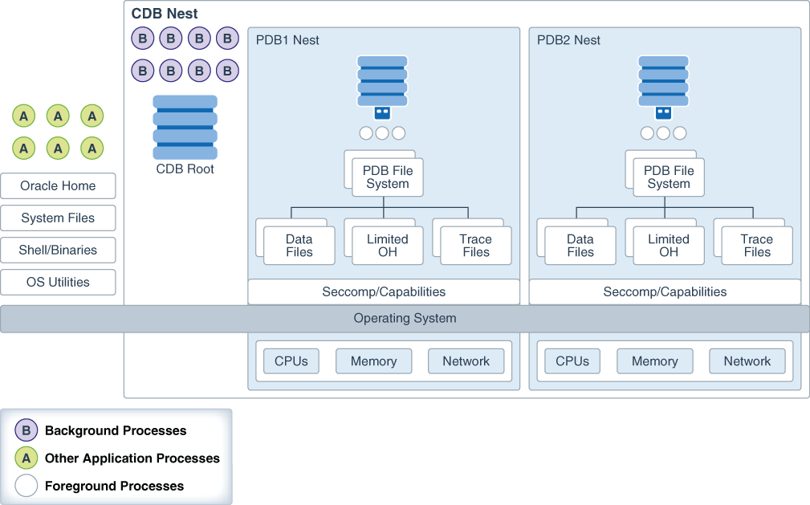

**Parent topic:** [Controlling Access to Data](part_3.md)

### 15.1 About DbNest

DbNest provides hierarchical, isolated run-time environments at the CDB and PDB level.

These run-time environments provide file system isolation, process ID number space isolation, and secure computing for PDBs and CDBs. To protect the multitenant environment from security breaches, dbNest uses the latest Linux resource isolation, namespace, and control group features.

**Parent topic:** Securing and Isolating Resources Using DbNest

### 15.2 How DbNest Works

DbNest achieves isolation and file system access controls using Linux namespaces.

- Purpose of DbNest  
	DbNest isolates a database instance from other databases and applications running on the same host, and also isolates PDBs from each other and from the CDB.
- Linux Namespaces  
	A Linux namespace wraps a global system resource in an abstraction that makes it appear to processes within the namespace that they have their own isolated instance of the global resource.
- DbNest Properties  
	A nest is a runtime environment that Oracle Database creates for every CDB, PDB, or application container.
- DbNest Architecture  
	The dbNest library is integrated with Oracle Database binaries, forming a single virtual environment.
- User Interface for DbNest  
	By default, dbNest is disabled. You can enable and configure it using initialization parameters.
- How Oracle Database Manages a Nest  
	When the `DBNEST_ENABLE` initialization parameter is set to any value other than `NONE`, Oracle Database automatically creates, manages, and deletes nests. These operations are transparent to the user.

**Parent topic:** Securing and Isolating Resources Using DbNest

#### 15.2.1 Purpose of DbNest

DbNest isolates a database instance from other databases and applications running on the same host, and also isolates PDBs from each other and from the CDB.

Sharing instance-level and operating system resources can lead to security and isolation constraints, especially in large-scale cloud deployments. Vulnerabilities can be external, such as compromised applications, unauthorized access of resources, and shared resources. An example of an internal vulnerability is a compromised Oracle process.

Ideally, a database instance protects all resources from unauthorized access from all methods. For database instance and PDB protection, the requirements are as follows:

- The database instance and its resources must not be accessed by the `oracle` operating system user or a high-privileged operating system user.
- Another database instance or application, whether in the same Oracle home or a different Oracle home, must not have access to the database instance.
- Processes from one PDB must not access resources belonging to either the CDB or another PDB.

DbNest is the Oracle solution for database instance and PDB protection. This infrastructure enables a database instance to run in a protected, virtualized environment.

The infrastructure is implemented as a Linux-specific package that provides hierarchical containers, called **nests**. A CDB resides within a single parent nest, while PDBs reside within the individual child nests created within the parent. Linux processes in a PDB nest have their own process ID (PID) number spaces and cannot access PIDs in other nests. Process isolation provides a last level of defense in a security breach if a malicious user compromises a process.

**Parent topic:** How DbNest Works

#### 15.2.2 Linux Namespaces

A Linux namespace wraps a global system resource in an abstraction that makes it appear to processes within the namespace that they have their own isolated instance of the global resource.

Important types of namespaces are:

- Process namespace
	A namespace has an independent set of process IDs. The first process initializes the namespace. Every process inside the namespace receives a process ID, starting with 1. Each process can only see the processes inside the namespace.
- User ID namespace
	A user namespace maps user IDs between the namespace and the operating system. The `oracle` user can create a namespace without the need for system-wide root privileges. Configured properly, the `oracle` is effectively a root user inside this namespace, but this privilege is restricted to the namespace.
- Mount namespace
	Mount namespaces control mount points. A mount point within a child namespace is not visible to its parent. However, any mount operations within the parent namespace are visible to the child.

Linux namespaces provide the operating system infrastructure for dbNest, enabling different nests to function as independent virtual environments.

**Parent topic:** How DbNest Works

#### 15.2.3 DbNest Properties

A nest is a runtime environment that Oracle Database creates for every CDB, PDB, or application container.

Each nest corresponds to exactly one container. The nest hierarchy exactly mirrors the container hierarchy. Because a CDB can contain one or more PDBs, a parent CDB nest can have one or more child nests. Each child nest corresponds to the PDB that can be contained in the nest.

A **database nest instance** is the collection of all nests and metadata associated with a CDB. For example, assume that a parent nest contains a CDB, and each of its 99 PDBs is in a separate child nest. In this case, the database nest instance for this CDB contains 100 nests. A database nest instance can contain a maximum of 4000 nests. If a host contains x number of CDBs, then 4000x nests are supported on this host, up to a maximum of 8142.

A nest has the following properties:

- Operating system isolation
	A nest isolates operating system resources such as the process ID, user, and mount by providing a virtualized environment in which an application runs. The hierarchical structure provides visibility for the parent nest to access the child nests. A process belonging to one PDB is not visible to other PDBs or the CDB root.
- File system isolation
	Within a nest, you can control the visibility for file system entities, so that critical or unrelated entities are hidden from other nests. For example, within `hrpdb`, you might make only the following file system entities visible within the nest: `/lib`, `$ORACLE_HOME/lib`, the data file path, the trace file path, and the ETL staging area. The shell, device files, and mount configuration are not accessible to PDBs in other nests.
	A **pivot root** in Linux namespaces is equivalent to `chroot`: an operation that changes what the current running process sees as the root directory. A **bind mount** enables the contents of one directory to be accessible in a different directory. The two directories are independent. Using bind mounts, the same files can be located in multiple `chroot` environments without copying the contents.
- Resource management
	You can control and monitor the resources of a nest, including CPU and memory. The resources available for a nest are based on the availability of the same resources from parent nest.
- Secure computing mode (`seccomp`)
	DbNest uses `seccomp` to filter out system calls that could be unnecessary or malicious. Internally, `seccomp` uses Berkeley Packet Filters (BPF).

When you enable dbNest, the CDB is created as a resource-only (or partial) nest. Each PDB within the CDB is created as a full nest, which includes both isolation and resource management.

**Parent topic:** How DbNest Works

#### 15.2.4 DbNest Architecture

The dbNest library is integrated with Oracle Database binaries, forming a single virtual environment.

The dbNest interface layer manages the Linux namespaces, resources, file system, and so on. This interface layer interacts with the CDB, which maintains a table that maps PDBs to nests.

The following figure illustrates the basic architecture of dbNest for a CDB that contains two PDBs.

Figure 15-1 Architecture of a CDB Nest



> This is the start of your graphic description.
>
> [  
> Copyright © 1996, 2024, Oracle and/or its affiliates.](https://docs.oracle.com/en/database/oracle/oracle-database/dcommon/html/cpyr.htm)


The graphic shows one nest hierarchy. The parent nest contains the CDB root, including the database background processes. If Oracle Automatic Storage Management (Oracle ASM) is used for storage, then the storage security model is provided by Oracle ASM.

The parent nest has two child nests: one containing PDB1 and its foreground processes, and one containing PDB2 and its foreground processes. Each PDB only has access to the relevant file system, trace files, and Oracle home files within its own nest. Each nest manages its own CPU, memory, and network resources.

In the preceding diagram, the CDB nest hierarchy has no access to operating system processes and files. For example, PDB1 cannot access a Linux shell, system files, or application processes.

**Parent topic:** How DbNest Works

#### 15.2.5 User Interface for DbNest

By default, dbNest is disabled. You can enable and configure it using initialization parameters.

- DbNest Initialization Parameters  
	You can manually enable and configure DbNest by using initialization parameters.
- DbNest Configuration File  
	The configuration file, which applies to the whole CDB, lists paths to be mounted inside the CDB. These paths are in addition to the default paths.

**Parent topic:** How DbNest Works

##### 15.2.5.1 DbNest Initialization Parameters

You can manually enable and configure DbNest by using initialization parameters.

To set the following initialization parameters using the `ALTER SYSTEM` statement, the instance must have been started with a server parameter file, and you must set `SCOPE=SPFILE` in `ALTER SYSTEM`.

Table 15-1 Initialization Parameters for DbNest

| Parameter | Description |
| --- | --- |
| `DBNEST_ENABLE` | Enables or disables dbNest. Set this parameter in the CDB root. `DBNEST_ENABLE` accepts the following values:  - `NONE` 	Disables dbNest. This is the default value. - `CDB_RESOURCE_PDB_ALL` 	Enables full nest for PDBs and a resource-only nest for the CDB.  To set this parameter, a dedicated broker must have been configured. |
| `DBNEST_PDB_FS_CONF` | Specifies the location of an optional file system configuration file. Set this parameter in the CDB root. |

**Parent topic:** User Interface for DbNest

##### 15.2.5.2 DbNest Configuration File

The configuration file, which applies to the whole CDB, lists paths to be mounted inside the CDB. These paths are in addition to the default paths.

Syntax for the Configuration File

Whitelisting is the default option for file system configuration. If a configuration file is specified, then the list of directory paths is mounted inside the nest along with default paths. A path specification has the following syntax:

```
source [destination [options]]
```

The first two placeholders are defined as follows:

- `source`
	Specifies the source directory in which to mount. If you specify the source as `dev`, then the file system mounts a special directory that contains only the following files: `zero`, `random`, `urandom`, `shm`. The file `shm` can be mounted if required.
- `destination`
	Specifies an optional destination directory. If no directory is specified, then the database uses source as the destination.
	Note:
	Both `source` and `destination` can be environment variables.
- `options`
	Options require `destination` to be set. Options can be any of the following:
	- `ro` specifies read-only mount.
		- `nosetuid` specifies no `setuid` execution through files in this directory.
		- `noexec` specifies no execution of any binaries in this directory.
		- `optional` specifies that this directory will be mounted only if the source is available.

Tokens for the Source and Destination Directories

The source and destination can have tokens in the form `$TOKEN` or `${TOKEN}`. You can provide the token either as an environment variable or through options in the dbNest library call. The library call uses the format `name[array], value[array]`. A user-provided name-value pair takes precedence.

DbNest supports the following tokens:

- `$PDB`
- `$PDBID` (the container ID shown in `V$PDBS.CON_ID`)
- `$ORACLE_HOME`
- `$ORACLE_BASE`
- `$ORACLE_BASE_HOME`
- `$ORACLE_BASE_CONFIG`

Directives in the Configuration File

By default, a configuration file is an allowlist. If `DBNEST_NO_DEFAULT` is the first line in the configuration file, then the database ignores internal default paths. The following configuration file allowlists `/home/oracle/MYCDB/$PDB` and ignores internal default paths:

```
DBNEST_NO_DEFAULT
/home/oracle/MYCDB/$PDB
```

If `DBNEST_NO_FS_ROOT_MODE` is specified, then the directories following this line are blocked, creating a blocklist. DbNest assumes that any specified directories exist. Assume that the directories `/usr/local/bin` and `/bin/usr/bin` exist. The following configuration file blocklists these directories:

```
DBNEST_NO_FS_ROOT_MODE
/usr/local/bin
/bin/usr/bin
```

Note:

Do not place `$ORACLE_HOME/bin` on the blocklist because this directory is necessary for the `oracle` binary to be spawned.

**Parent topic:** User Interface for DbNest

#### 15.2.6 How Oracle Database Manages a Nest

When the `DBNEST_ENABLE` initialization parameter is set to any value other than `NONE`, Oracle Database automatically creates, manages, and deletes nests. These operations are transparent to the user.

Specifically, Oracle Database performs the following operations:

- Creating a nest
	At instance startup, Oracle Database creates a parent nest for the CDB root, and one child nest for each mounted PDB. Also, a `CREATE PLUGGABLE DATABASE` command automatically triggers the creation of a child nest for the created PDB.
- Opening a nest
	When you first log in to a PDB, the CDB opens the child nest for the PDB. Logging in to the CDB root and opening a PDB also opens the child nest for this PDB.
- Updating a nest
	Resources such as CPU count may change while the CDB is running. In this case, Resource Manager updates the nest configuration automatically.
- Closing a nest
	The CDB closes a PDB child nest when you close a PDB by using the connection either inside the PDB or from the CDB root. A background processes closes the nest.
- Deleting a nest
	The CDB removes a PDB child nest when the PDB is deleted or unplugged. When the database instance is shut down, the CDB parent nest is removed.

**Parent topic:** How DbNest Works

### 15.3 Enabling DbNest

When you enable dbNest, the CDB nest is created as a resource-only nest, and the CDB child PDBs are created as full nests.

1. Ensure that the CDB and its PDBs are registered with a local listener.
	This listener must be configured to route all connections through a dedicated broker. When a client connects to the database, the listener hands the connection off to the broker, which then passes the client connection to a dedicated server process. Unlike the listener, the broker is part of the database instance. The CDB and PDB services should be registered with the listener to redirect the connection to the broker.
	The `listener.ora` file must the following setting:
	```
	dedicated_through_broker_listenername=on
	```
2. Connect to the CDB root as a user who has administrative privileges.
	For example:
	```
	CONNECT c##sec_admin
	Enter password: password
	```
3. Ensure that the `USE_DEDICATED_BROKER` initialization parameter is set to `TRUE`.
	```
	SHOW PARAMETER DEDICATED_BROKER
	```
	The following output should appear:
	```
	NAME                                 TYPE        VALUE
	------------------------------------ ----------- -----------------------
	use_dedicated_broker                 boolean     TRUE
	```
4. Set the `DBNEST_ENABLE` initialization parameter to `CDB_RESOURCE_PDB_ALL` and the scope to `SPFILE`:
	```
	ALTER SYSTEM SET DBNEST_ENABLE=CDB_RESOURCE_PDB_ALL SCOPE=SPFILE;
	```
5. Restart the CDB so that the server parameter file will use the setting from the `ALTER SYSTEM SET DBNEST_ENABLE` statement.
	```
	SHUTDOWN IMMEDIATE
	STARTUP
	```
	The CDB instance and all PDBs show now be running within a database nest.
6. Optionally, check the alert log to ensure that the dbNest was correctly configured.
	Search for `nest` or `DB Nest`. A line similar to the following appears:
	```
	Instance running inside DB Nest (dbNest_name)
	```

**Parent topic:** Securing and Isolating Resources Using DbNest

### 15.4 Configuring File System Isolation for a Database Nest

You can configure a file system to be mounted within or excluded from a nest.

By default, dbNest mounts necessary file systems. For security reasons, you may choose to hide and reveal selected sets of directories or mount points from other nests. The following procedure assumes that the CDB and its PDBs are in a single nest. Before you can perform this procedure, a nest must be currently enabled for the CDB or PDB.

1. On the Linux host, create a text file named `nest_blocklist.txt` (or any arbitrary file name) with the following contents:
	```
	DBNEST_NO_FS_ROOT_MODE
	list_of_file_systems_to_exclude
	```
	For example, if you want to exclude the `/bin` and `/usr/bin`:
	```
	DBNEST_NO_FS_ROOT_MODE
	/bin
	/usr/bin
	```
2. Check the alert log for the CDB to ensure that it has been configured to use a nest.
	Search for `nest` or `DB Nest`. A line similar to the following appears:
	```
	Instance running inside DB Nest (dbNest_name)
	```
3. Connect to the CDB root as a user who has administrative privileges.
	For example:
	```
	CONNECT c##sec_admin
	Enter password: password
	```
4. Set the `DBNEST_PDB_FS_CONF` initialization parameter to the name of the configuration file, and set the scope to `SPFILE`.
	For example:
	```
	ALTER SYSTEM SET DBNEST_PDB_FS_CONF='/dsk1/nest_blocklist.txt' SCOPE=SPFILE;
	```
5. Restart the CDB so that the server parameter file will use the setting from the `ALTER SYSTEM SET DBNEST_PDB_FS_CONF` statement.
	```
	SHUTDOWN IMMEDIATE
	STARTUP
	```

**Parent topic:** Securing and Isolating Resources Using DbNest