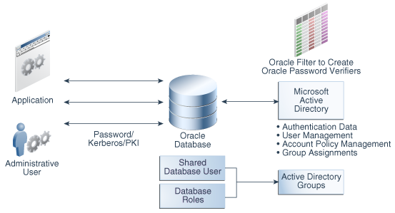

Oracle Database can authenticate and authorize Microsoft Active Directory users with the database directly without intermediate directories or Oracle Enterprise User Security.

**Parent topic:** [Managing User Authentication and Authorization](part_1.md)

### 6.1 Introduction to Centrally Managed Users with Microsoft Active Directory

Centrally managed users (CMU) provides a simpler integration with Microsoft Active Directory to allow centralized authentication and authorization of users.

- About the Oracle Database-Microsoft Active Directory Integration  
	Centrally managed users provides a simpler integration with Microsoft Active Directory to allow centralized authentication and authorization of users.
- How Centrally Managed Users with Microsoft Active Directory Works  
	The integration works by mapping Microsoft Active Directory users and groups directly to Oracle database users and roles.
- Centrally Managed User-Microsoft Active Directory Architecture  
	The CMU with Active Directory architecture enables Oracle Database users and roles to be managed in Active Directory.
- Supported Authentication Methods  
	The Oracle Database-Microsoft Active Directory integration supports three common authentication methods.
- Users Supported by Centrally Managed Users with Microsoft Active Directory  
	CMU with Active Directory supports exclusively mapped users, users mapped to shared schemas, and administrative users.
- How the Oracle Multitenant Option Affects Centrally Managed Users  
	PDB users can connect to a central Microsoft Active Directory or to a different Microsoft Active Directory.
- Centrally Managed Users with Database Links  
	CMU supports both fixed user database links and connected user database links, but not current user database links.

**Parent topic:** Configuring Centrally Managed Users with Microsoft Active Directory

#### 6.1.1 About the Oracle Database-Microsoft Active Directory Integration

Centrally managed users provides a simpler integration with Microsoft Active Directory to allow centralized authentication and authorization of users.

The minimum version requirement for Active Directory server operating system is Microsoft Windows Server 2008 R2.

This integration enables organizations to use Active Directory to centrally manage users and roles in multiple Oracle databases with a single directory along with other Information Technology services. Active Directory users can authenticate to the Oracle database by using credentials that are stored in Active Directory. Active Directory users can also be associated with database users (schemas) and roles by using Active Directory groups. Microsoft Active Directory users can be mapped to exclusive or shared Oracle Database users (schemas), and be associated with database roles through their group membership in the directory. Active Directory account policies such as password expiration time and lockout after a specified number of failed login attempts are honored by the Oracle Database when users login.

Before Oracle Database 18c release 1 (18.1), database user authentication and authorization could be integrated with Active Directory by configuring Oracle Enterprise User Security and installing and configuring Oracle Internet Directory (or Oracle Universal Directory). This architecture is still available and will continue to be used by users who must use the Oracle enterprise domain and current user database link between trusted databases, complex enterprise roles, and having a single place for auditing database access privileges and roles.

The majority of organizations do not have these complex requirements. Instead, they can use centrally managed users (CMUs) with Active Directory. This integration is designed for organizations who prefer to use Active Directory as their centralized identity management solution. Oracle Net Naming Services continues to work as it did before with directory services.

Organizations can use Kerberos, PKI, or password authentication with CMU with Active Directory. Use of CMU with Active Directory is backward compatible with currently supported Oracle Database clients. This means that LDAP bind operations are not used for password authentication and you will need to add an Oracle filter to Active Directory along with an extension to the Active Directory schema to store password verifiers. Organizations using Kerberos or PKI will not need to add the filter or extend Active Directory schema.

The Oracle Database-Active Directory integration is particularly beneficial for the following types of users:

- Users who are currently using strong authentication such as Kerberos or Public Key Infrastructure (PKI). These users already use a centralized identity management system
- Users who currently use Oracle Enterprise User Security, Oracle Internet Directory, Oracle Unified Directory, Oracle Virtual Directory, and need to integrate with Active Directory.

**Parent topic:** Introduction to Centrally Managed Users with Microsoft Active Directory

#### 6.1.2 How Centrally Managed Users with Microsoft Active Directory Works

The integration works by mapping Microsoft Active Directory users and groups directly to Oracle database users and roles.

In order for the Oracle Database CMU with Active Directory integration to work, the Oracle database must be able to login to a service account specifically created for the database in Active Directory. The database uses this service account to query Active Directory for user and group information when a user logs into the database. This Active Directory service account must have all the privileges required to query the user and group information as well as being able to write updates related to the password policies in Active Directory (for example, failed login attempts, clear failed login attempts). Users can authenticate using passwords, Kerberos, or PKI and either be assigned to an exclusive schema or a shared schema. Mapping of an Active Directory user to a shared schema is determined by the association of the user to an Active Directory group that is mapped to the shared schema. Active Directory groups can also be mapped to database global roles. An Active Directory security administrator can assign a user to groups that are mapped to shared database global users (schemas) and/or database global roles, and hence update privileges and roles that are assigned to the Active Directory user in a database.

**Parent topic:** Introduction to Centrally Managed Users with Microsoft Active Directory

#### 6.1.3 Centrally Managed User-Microsoft Active Directory Architecture

The CMU with Active Directory architecture enables Oracle Database users and roles to be managed in Active Directory.

The following figure illustrates the Oracle Database CMU feature. In this figure, users, either through applications as non-administrative users or administrative users, connect to the Oracle database with either password, Kerberos, or public key infrastructure (PKI) authentication. The database connection to Active Directory enables these users and roles to be mapped with Active Directory users and groups. If you plan to use password authentication, then you must install an Oracle filter in Active Directory. You can use an Oracle provided utility to install the Oracle filter that will generate Oracle password verifiers for individual users as needed. The utility can also be used to extend the Active Directory schema to hold the Oracle password verifiers. With Oracle Database centrally managed users, an Active Directory administrator can control the authentication, user management, account policies, and group assignments of Active Directory users and groups who have been mapped to Oracle Database users and roles.



> Image dbseg\_pb\_001b.png illustrates the Oracle Database connection to Microsoft Active Directory. From top to bottom, left to right, are the following components:
>
> The application and administrative users, who connect to the Oracle database using either password, Kerberos, or PKI authentication.
>
> From the Oracle Database, a connection to the Microsoft Active Directory. The Active Directory has been enabled with password filters using Oracle Filter.
>
> Shared database users and database roles are mapped to Active Directory groups.
>
> The Active Directory now can be used for authentication, user management, account policy management, and group assignments of the shared users, roles, and groups.


**Parent topic:** Introduction to Centrally Managed Users with Microsoft Active Directory

#### 6.1.4 Supported Authentication Methods

The Oracle Database-Microsoft Active Directory integration supports three common authentication methods.

These authentication methods are as follows:

- Password authentication
- Kerberos authentication
- Public key infrastructure (PKI) authentication (certificate-based authentication)

#### 6.1.5 Users Supported by Centrally Managed Users with Microsoft Active Directory

CMU with Active Directory supports exclusively mapped users, users mapped to shared schemas, and administrative users.

These users are as follows:

- Directory users that access an Oracle database using a shared schema.
	This type of directory user can connect to a shared schema in the database by being part of a directory group that is mapped to the shared schema (database user). Using shared schemas allows centralized Active Directory management of database users and is the recommended best practices over using exclusive schemas (described next). Even if there is only one user associated with a schema (for example, an administrator responsible for database backup), it is easier to manage adding another backup administrator or removing the existing administrator by making changes only in Active Directory instead of making changes in all associated databases as well.
	Users will be given additional privileges appropriate to their task using global roles that are mapped to groups in Active Directory. With this design, a user can change his or her tasks within an organization and have new database privileges through a new group in Active Directory.
	Active Directory users could accidentally (or on purpose) be a member of multiple groups in Active Directory that are mapped to different shared schemas on the same database. The user could also have an exclusive mapping to a database schema. In cases where the user has multiple possible schema mappings when they login, the following precedence rules apply:
	- If an exclusive mapping exists for a user, then that mapping takes precedence over any other shared mappings.
		- If multiple shared schema mappings exist for a user, then the shared user mapping with lowest schema ID (`USER_ID`) takes precedence.
	Oracle recommends only having one possible mapping per user so unexpected schema mappings do not occur.
- Exclusively mapped global users who are regular Oracle Database users in two- and three-tier applications, or users who have direct privilege grants in the database.
	Oracle recommends that you grant privileges to these users through global roles. This type of privilege grant facilitates authorization management by centrally managing privileges and roles for a user instead of having to log in into each database to update privileges and roles for the user.
- Administrative global users, who have the following administrative privileges: `SYSDBA`, `SYSOPER`, `SYSBACKUP`, `SYSDG`, `SYSKM`, and `SYSRAC`.
	You cannot grant these administrative privileges through global roles. To authorize an Active Directory user with these administrative privileges, you must map the directory user to a database user (exclusively or with a shared schema) that has the system administrative privilege already granted to the database user account.

#### 6.1.6 How the Oracle Multitenant Option Affects Centrally Managed Users

PDB users can connect to a central Microsoft Active Directory or to a different Microsoft Active Directory.

All PDBs and the root container can have a shared configuration, so that the entire CDB can authenticate and authorize users against a single Active Directory server, multiple Active Directory servers in one Windows domain, or multiple Active Directory servers in trusted Windows domains, based on the shared configuration. Alternatively, individual PDBs can authenticate and authorize users against different Active Directory servers in the same Windows domain or different (trusted or un-trusted) Windows domains, based on their individual configurations.

**Parent topic:** Introduction to Centrally Managed Users with Microsoft Active Directory

#### 6.1.7 Centrally Managed Users with Database Links

CMU supports both fixed user database links and connected user database links, but not current user database links.

There is no special requirement for CMU-Active Directory users to use the fixed user database links. CMU-Active Directory users using password, Kerberos, or PKI authentication can use fixed user database links as regular database users do. Kerberos authentication works the same with Oracle Database strong authentication with database links. For more information, see My Oracle Support note [1370327.1](https://support.oracle.com/CSP/main/article?cmd=show&type=NOT&id=1370327.1).

For CMU-Active Directory users to use connected user database links, only password authentication is supported, and both source and target databases must be configured with CMU-Active Directory to allow the same Active Directory user to log in both databases using password authentication.

**Parent topic:** Introduction to Centrally Managed Users with Microsoft Active Directory

### 6.2 Configuring the Oracle Database-Microsoft Active Directory Integration

Before you can use Microsoft Active Directory to authenticate and authorize users, you must configure the connection from the Oracle database to Active Directory.

- About Configuring the Oracle Database-Microsoft Active Directory Connection  
	Before you configure this connection, you must have Microsoft Active Directory installed and configured.
- Connecting to Microsoft Active Directory  
	You can configure a Microsoft Active Directory connection during the Oracle database creation or with an existing Oracle database.

**Parent topic:** Configuring Centrally Managed Users with Microsoft Active Directory

#### 6.2.1 About Configuring the Oracle Database-Microsoft Active Directory Connection

Before you configure this connection, you must have Microsoft Active Directory installed and configured.

You must create an Oracle service directory user in Active Directory, configure the Oracle Database connection to Active Directory, and then depending on the authentication type, configure the database and Active Directory for password, Kerberos, or public key infrastructure (PKI) authentication. Before you map Database users and global roles to Active Directory users and groups, you must ensure that the Active Directory users and groups have been created. You will map the database users and global roles to Active Directory users and groups by using the `CREATE USER`, `CREATE ROLE`, `ALTER USER`, `ALTER ROLE` SQL statements with the `GLOBALLY` clause. An Active Directory system administrator must also set up new Active Directory groups with Active Directory users to meet your requirements.

The Active Directory system administrator is responsible for setting Active Directory connections with or without SASL bind. The Oracle Database will automatically try the Active Directory connection first with SASL bind and if it fails, it will try it without SASL bind but still secured with TLS. This means that regardless of how the Microsoft Active Directory administrator may have the SASL settings configured on Active Directory, the Oracle database will connect even if the SASL bind is unsuccessful.

**Parent topic:** Configuring the Oracle Database-Microsoft Active Directory Integration

#### 6.2.2 Connecting to Microsoft Active Directory

You can configure a Microsoft Active Directory connection during the Oracle database creation or with an existing Oracle database.

- Step 1: Create an Oracle Service Directory User Account on Microsoft Active Directory and Grant Permissions  
	The Oracle service directory user account is for the interaction between Oracle Database and the LDAP directory service.
- Step 2: For Password Authentication, Install the Password Filter and Extend the Microsoft Active Directory Schema  
	You can use the Oracle `opwdintg.exe` executable on the Active Directory server to install the password filter and extend the Active Directory schema.
- Step 3: If Necessary, Install the Oracle Database Software  
	If you have not done so yet, then use Oracle Universal Installer (OUI) to install the Oracle software.
- Step 4: Create the dsi.ora or ldap.ora File  
	The `dsi.ora` and `ldap.ora` files specify connections for centrally managed users for Active Directory.
- Step 5: Request an Active Directory Certificate for a Secure Connection  
	After you have configured the `dsi.ora` or `ldap.ora` file, you are ready to prepare Microsoft Active Directory and Oracle Database certificates for a secure connection.
- Step 6: Create the Wallet for a Secure Connection  
	After you have copied the Active Directory certificate, you are ready to add it to the Oracle wallet.
- Step 7: Configure the Microsoft Active Directory Connection  
	Next, you are ready to connect the database to Active Directory using the settings you have so far.
- Step 8: Verify the Oracle Wallet  
	The `orapki` utility can verify that the wallet for this database was created successfully.
- Step 9: Test the Integration  
	To test the integration, you must set the `ORACLE_HOME`, `ORACLE_BASE,` and `ORACLE_SID` environment variables and then verify the LDAP parameter settings.

**Parent topic:** Configuring the Oracle Database-Microsoft Active Directory Integration

##### 6.2.2.1 Step 1: Create an Oracle Service Directory User Account on Microsoft Active Directory and Grant Permissions

The Oracle service directory user account is for the interaction between Oracle Database and the LDAP directory service.

In addition to being used for the Oracle Database-to-LDAP directory service interaction, the Oracle service directory user account can be used for Kerberos.

This account is an Active Directory user account that Oracle Database uses to bind to Active Directory domain controllers and query for users and groups information from Active Directory, update login success or failure, and if Kerberos is configured, update Kerberos authentication. The minimum permissions required for this account are `Read properties` (of Active Directory users who will log in to a database) permission, and if database password authentication is to be used by Active Directory users, the `Write lockoutTime` (property of the Active Directory users) permission, and `Control Access` (of the `orclCommonAttribute` property of the Active Directory users) permission. Note that the user password that you create for this account does not follow the rules that Oracle user passwords must follow when Oracle password complexity functions are in place.

1. Log in to a Windows domain controller of Microsoft Active Directory as an administrator who has administrative privileges to create a user account and grant permissions to the user account.
2. Create the Oracle service directory user account as an Active Directory user.
	Create the service user account in the directory. Depending on the Windows domains that your Active Directory users will use, you can choose where the service user account will be created. Follow these guidelines:
	- If all the Active Directory users will be in one domain, then create this account in that domain. Doing so will help performance.
	- If the Active Directory users will be in multiple Windows domains, then create this service user account in a domain that is trusted by all other domains.
		- The domain chosen must be trusted by all other domains.
			- The service user must be able to bind to all of these multiple Windows domains, and must be able to access the properties of Active Directory users in all of these multiple Windows domains with the granted permissions.
			- All other domains must support simple bind over TLS/SSL to allow the access of the service user from the trusted domain.
			- All other domains administrators must grant the required minimum permissions to the service user account from the trusted domain.
3. Grant the Oracle service directory user account in the Active Directory the following permissions on the properties of the Active Directory users who need to access Oracle databases:
	- `Read properties` (of Active Directory users who will log in to an Oracle database)
	- `Write lockoutTime` (property of Active Directory users who will use password authentication to log in to an Oracle database)
	- `Control Access` (of the `orclCommonAttribute` property of the Active Directory users who will use password authentication to log in to an Oracle database)

**Parent topic:** Connecting to Microsoft Active Directory

##### 6.2.2.2 Step 2: For Password Authentication, Install the Password Filter and Extend the Microsoft Active Directory Schema

You can use the Oracle `opwdintg.exe` executable on the Active Directory server to install the password filter and extend the Active Directory schema.

You do not need to perform this step if your authentication method is Kerberos or SSL. The `opwdintg.exe` executable installs the Oracle password filter, extends the Active Directory schema, and creates Active Directory groups to allow Oracle Database password authentication with Active Directory. This procedure adds an `orclCommonAttribute` property to the Active Directory schema for user accounts.

Note:

You must install the Oracle password filter on every Windows domain controller in a domain, to ensure that Oracle password verifiers will be generated for Active Directory users in this domain if they need to use password authentication to log in Oracle database.

Note also that `orclCommonAttribute` stores Oracle password verifier for the Active Directory user. This attribute is also used for password authentication by other Oracle products or features such as Enterprise User Security. For security consideration, you should deny everyone except the Oracle service directory user from accessing the `orclCommonAttribute` property.

1. Access the latest version of the `opwdintg.exe` (Oracle Password Integration) utility.
	- If you have a My Oracle Support account: Log in to your account at [My Oracle Support](https://support.oracle.com/) and then search for Doc ID [2462012.1](https://support.oracle.com/epmos/faces/DocumentDisplay?_afrLoop=389854691171787&id=2462012.1&_adf.ctrl-state=zybhnxjos_86). Download `opwdintg.exe` from this location. This version is the latest version.
		- If you do not have a My Oracle Support account: Register for a My Oracle Support account so that you can download the latest version of `opwdintg.exe` from Doc ID [2462012.1](https://support.oracle.com/epmos/faces/DocumentDisplay?_afrLoop=389854691171787&id=2462012.1&_adf.ctrl-state=zybhnxjos_86).
2. Using a secure method of copying (such as `sftp`), copy `opwdintg.exe` to a temporary directory (for example, `C:\temp`) on each Windows domain controller.
3. Connect to each Windows domain controller as the Active Directory administrator.
	Currently, the `opwdintg.exe` utility requires English for the Windows OS.
4. Ensure that the Windows OS language setting is English.
5. Run the `opwdintg.exe` utility on each Windows domain controller.
	If you reinstall an updated password filter using a newer `opwdintg.exe`, then you must restart the domain controller.
	Use one of the following methods to run the `opwdintg.exe` utility:
	- Open the Windows Explorer and then double click the `opwdintg.exe` utility.
		- Open a Windows command prompt and then follow these steps:
		1. Navigate to the directory where the `opwdintg.exe` utility is located. For example:
			```
			cd c:\temp
			```
				2. Execute the utility from the command line by typing the following command:
			```
			.\opwdintg.exe
			```
6. Answer the following prompts:
	- Do you want to extend AD schema? \[Yes/No\]: Enter `Yes`.
		Extending the Active Directory schema requires the Windows OS language setting to be English.
		- Schema extension for this domain will be permanent. Continue? \[Yes/No\]:Enter `Yes`.
		Note the following:
		- You can only extend the Active Directory schema one time. If you try to extend the schema again, error messages appear, but you can ignore these errors.
				- This step creates the following three verifier groups. If these groups already exist, then errors will appear, but you can ignore these errors. These verifier groups can be moved from the installed AD Users folder or outside this folder structure for user objects.
			- `ORA_VFR_MD5` is required when the Oracle Database WebDAV client is used.
						- `ORA_VFR_11G` enables the use of the Oracle Database 11G password verifier.
						- `ORA_VFR_12C` enables the use of the Oracle Database 12C password verifier.
		- Unless you have backed up the Active Directory schema, once extended, the Active Directory schema extension cannot be reverted.
		The next two prompts depend on whether the password filter has been installed already.
		- Found password filter installed already. Do you want to deinstall? \[Yes/No\]: This prompt appears if the password filter has already been installed. In most cases, enter No to not deinstall the filter.
		If you enter `Yes` to deinstall the password filter, then you must re-run `opwdintg.exe` to re-install the password filter after you complete these prompts. Otherwise, after you restart the computer, the password verifiers will be no longer be generated when Active Directory users change their passwords.
		- Do you want to install Oracle password filter? \[Yes/No\]: This prompt appears if the password filter has not been installed yet. Enter `Yes`.
		- The change requires machine reboot. Do you want to reboot now? \[Yes/No\]: Enter `Yes`.

**Parent topic:** Connecting to Microsoft Active Directory

##### 6.2.2.3 Step 3: If Necessary, Install the Oracle Database Software

If you have not done so yet, then use Oracle Universal Installer (OUI) to install the Oracle software.

You only need to install the Oracle Database software, not the full database. After you install the Oracle database software, you can configure centrally managed users with Active Directory during database creation by using Database Configuration Assistant (DBCA). You can also configure centrally managed users with Active Directory using DBCA or manually after database creation.

- Follow the instructions in the Oracle Database Installation Guide for your platform to install the Oracle software.

After you install the Oracle database software, then you can configure centrally managed users with Active Directory during database creation using DBCA. You can also configure centrally managed users with Active Directory using DBCA or manually after the database creation.

**Parent topic:** Connecting to Microsoft Active Directory

##### 6.2.2.4 Step 4: Create the dsi.ora or ldap.ora File

The `dsi.ora` and `ldap.ora` files specify connections for centrally managed users for Active Directory.

- Comparison of the dsi.ora and ldap.ora Files  
	How you use the `dsi.ora` and `ldap.ora` depends on how `ldap.ora` is used with other services.
- About Using a dsi.ora File  
	You use a `dsi.ora` file to specify Active Directory servers for centrally managed users.
- Creating the dsi.ora File  
	The `dsi.ora` configuration file sets the information to find the Active Directory servers for centrally managed users.
- About Using an ldap.ora File  
	You can use an `ldap.ora` file to specify Active Directory servers for centrally managed users.
- Creating the ldap.ora File  
	These steps assume that `ldap.ora` is not being used for net naming services and can be used to set up the connection with Active Directory for centrally managed users.

**Parent topic:** Connecting to Microsoft Active Directory

###### 6.2.2.4.1 Comparison of the dsi.ora and ldap.ora Files

How you use the `dsi.ora` and `ldap.ora` depends on how `ldap.ora` is used with other services.

The `dsi.ora` file specifies connections for centrally managed users for Active Directory. The `ldap.ora` file can also specify the connection to the Active Directory server. However, because each individual PDB cannot have its own `ldap.ora`, and also `ldap.ora` may already be used (or may be used in the future) for other services like net naming services, Oracle recommends the use of `dsi.ora` for centrally managed users.

If all the containers in the CDB (CDB root, application root, application PDB) connect to the same Active Directory server, then you can use a single set of `dsi.ora` and wallet files and use directory objects to point to that location from every container that needs to connect to the Active Directory server. This way, you do not need to maintain multiple sets of the same `dsi.ora` and wallet files. An `ldap.ora` file can also be used to connect all the containers to a single Active Directory server, because each container looks for the `ldap.ora` in the common locations when `dsi.ora` is not present. However, each container looks for the wallet only in container-specific locations.

**Parent topic:** Step 4: Create the dsi.ora or ldap.ora File

###### 6.2.2.4.2 About Using a dsi.ora File

You use a `dsi.ora` file to specify Active Directory servers for centrally managed users.

You must manually create the `dsi.ora` file to identify the Active Directory servers. The `dsi.ora` file provides Active Directory connection information for all pluggable databases if it is located in the same places where the `ldap.ora` file can be placed. A `dsi.ora` file in a PDB-specific wallet location takes precedence over the main `dsi.ora` file for that PDB only.

Note:

If you are using `ldap.ora` for naming services, then do not make any changes to `ldap.ora` for the CMU with Active Directory configuration. Only use `dsi.ora` to configure CMU-Active Directory.

Placement of dsi.ora

Oracle recommends that you use directories for writable files under `$ORACLE_BASE`, not under `$ORACLE_HOME`. Starting with Oracle Database 18c, you can optionally set the `$ORACLE_HOME` directory to be read-only. Hence, you should place the `dsi.ora` file in a directory that is outside of `$ORACLE_HOME` to accommodate the `dsi.ora` configuration for future releases.

Search Order for dsi.ora

When you create the `dsi.ora` file, Oracle Database searches for it in the following order:

1. For a PDB, if the database property `CMU_WALLET` is set to a directory object, then Oracle Database searches for it in the location path specified by this directory object.
2. If the `WALLET_LOCATION` setting is included in the `sqlnet.ora` file, then for the root container, Oracle searches for it in the location that is specified in `sqlnet.ora`. For a PDB, Oracle searches for it in the per-PDB wallet location that is in the `WALLET_LOCATION_specified_in_sqlnet.ora/pdb_guid` directory.
3. If the `WALLET_LOCATION` setting is not included in the `sqlnet.ora` file, then Oracle Database searches for it in the default wallet location.
4. If Oracle Database cannot find `dsi.ora` in the wallet location, then Oracle Database searches for it in the following order. These are the same locations that Oracle Database searches for the `ldap.ora` file.
	1. `$LDAP_ADMIN` environment variable setting
		2. `$ORACLE_HOME/ldap/admin` directory
		3. `$TNS_ADMIN` environment variable setting
		4. `$ORACLE_HOME/network/admin` directory

When to Use dsi.ora

Oracle recommends that you use only `dsi.ora` to identify the Active Directory servers for centrally managed users. If both `dsi.ora` and `ldap.ora` are configured in the same database for centrally managed users for Active Directory and are both located in the same directory, then `dsi.ora` takes precedence over the `ldap.ora` file. If they are in different directories, then Oracle uses the first one that it finds in the location precedence list above to find the Active Directory server. If the directory server type in the first found `dsi.ora` or `ldap.ora` is not Active Directory, then centrally managed users will not be enabled.

Using dsi.ora in a Multitenant Environment

When you set the per-PDB `CMU_WALLET` database property to a directory object, then the `dsi.ora` file for an individual PDB will be in the wallet location that is specified by this per-PDB database property. (You set `CMU_WALLET` in individual PDBs, and you can also set `CMU_WALLET` in the CDB root. However, setting `CMU_WALLET` in the CDB root will only be effective for the root container, not for the entire CDB.) The `CMU_WALLET` property takes precedence over the `WALLET_LOCATION` setting.

If the `CMU_WALLET` database property is not set, and if the `WALLET_LOCATION` parameter in the `sqlnet.ora` file is set, then the `dsi.ora` file for an individual PDB will be in the per-PDB wallet in the `WALLET_LOCATION_specified_in_sqlnet.ora/pdb_guid/` directory.

If neither the `CMU_WALLET` database property nor the `WALLET_LOCATION` parameter in the ` sqlnet.ora` file is set, then the default wallet location for an individual container is the `$ORACLE_BASE/admin/db_unique_name/pdb_guid/wallet/` directory. For each PDB to use the default wallet location, you must not set the `CMU_WALLET` database property, and must not set `WALLET_LOCATION` in `sqlnet.ora`.

To find the `db_unique_name`, connect to the CDB root and execute the following query:

```
SELECT DB_UNIQUE_NAME FROM V$DATABASE;
```

To find the `pdb_guid`, from the CDB root, execute the following query:

```
SELECT PDB_NAME,GUID FROM DBA_PDBS;
```

How the CMU\_WALLET Database Property Affects the dsi.ora File

When you set the `CMU_WALLET` database property to a directory object, then the `dsi.ora` file for an individual PDB will be in the wallet location that is specified by this per-PDB database property. Note that the database property is only effective if the PDB is open. This implies that an Active Directory user with administrative privileges will not be able to start an idle PDB based on the configuration specified by the `CMU_WALLET` database property, because looking up the database property and associated directory object is dependent on the PDB being open.

For example, suppose you want to set the wallet location using `CMU_WALLET`. If the `PATH_PREFIX` clause was not specified when a PDB was created, then you must create a directory object using an absolute path and then set the `CMU_WALLET` database property on the PDB. For example:

```
CREATE OR REPLACE DIRECTORY example_dir AS '/u01/app/oracle/pdb1/cmu/wallet';
ALTER DATABASE PROPERTY SET CMU_WALLET='EXAMPLE_DIR';
```

This enables Oracle Database to search the `dsi.ora` file in the wallet location that was specified by the directory path `/u01/app/oracle/pdb1/cmu/wallet/`.

If the `PATH_PREFIX` clause was specified when the PDB was created, then you must create a directory object using a relative path and set the `CMU_WALLET` database property on the PDB. For example:

```
CREATE OR REPLACE DIRECTORY example_dir AS 'cmu/wallet';
ALTER DATABASE PROPERTY SET CMU_WALLET='EXAMPLE_DIR';
```

Note that if the directory object name (`example_dir`) is not double quoted, then it is case insensitive in the `CREATE OR REPLACE DIRECTORY` statement and can be in lower case. However, the corresponding directory object name must be in upper case when it is used in the `ALTER DATABASE PROPERTY SET CMU_WALLET` statement.

To look up the wallet location that is set by the database property `CMU_WALLET`, execute the following SQL statement:

```
SELECT DIRECTORY_PATH FROM DBA_DIRECTORIES WHERE DIRECTORY_NAME = (SELECT PROPERTY_VALUE FROM DATABASE_PROPERTIES WHERE PROPERTY_NAME='CMU_WALLET');
```

To unset the wallet location specified by the database property `CMU_WALLET`, execute the following statement:

```
ALTER DATABASE PROPERTY REMOVE CMU_WALLET;
```

How the WALLET\_LOCATION Parameter in sqlnet.ora Affects dsi.ora

Setting or not setting the `WALLET_LOCATION` parameter in `sqlnet.ora` has the following effects:

- If `WALLET_LOCATION` is not set in `sqlnet.ora`, then you can also place `dsi.ora` in the default wallet directory for the CDB root container, located in the `$ORACLE_BASE/admin/db_unique_name/wallet` directory. However, this will only connect the CDB root container to the Active Directory, not the entire CDB database.
- If `WALLET_LOCATION` is set in `sqlnet.ora`, then you can place the `dsi.ora` in that wallet location, and this will also only connect the CDB root container to the Active Directory, not the entire CDB database.

Modifications to the dsi.ora File

Changes to the `dsi.ora` file take effect immediately and do not require you to restart the database. Changes to the wallet also take effect immediately.

**Parent topic:** Step 4: Create the dsi.ora or ldap.ora File

###### 6.2.2.4.3 Creating the dsi.ora File

The `dsi.ora` configuration file sets the information to find the Active Directory servers for centrally managed users.

To use the `dsi.ora` configuration file:

1. Log in to the host where the Oracle database is located.
2. Choose a directory where to use the `dsi.ora` file, based on the search order for the `dsi.ora` file. (See Related Topics.) If this directory does not exist, then create the directory. Then go to this directory to create the `dsi.ora` file.
3. Add the following parameters to the `dsi.ora` file:
	- `DSI_DIRECTORY_SERVERS`, which sets the Active Directory server host and port number, and alternate directory servers. The directory server name must be a fully qualified name. You can also have multiple Active Directory servers here if you want to use multiple Windows domains. For example:
		```
		DSI_DIRECTORY_SERVERS = (AD-server.production.examplecorp.com:389:636, sparky.production.examplecorp.com:389:636)
		```
		Active Directory domain servers in a high availability and failover configuration can be configured with CMU. You can configure high availability and failover Active Directory domain servers by one of the following methods:
		- Using a load balancer in front of the Active Directory domain servers
				- Listing each Active Directory domain server by host name or IP address in a list
				- Using a domain name that returns a different Active Directory domain server
		Using a load balancer is the preferred choice, especially if you already use one for the Active Directory domain servers. The load balancer enables you to manage and add or subtract Active Directory domain servers behind the load balancer without having to make any changes to the `dsi.ora` file. Specifying a list of Active Directory domain servers is quicker and less expensive, but it ties you to the Active Directory domain servers so changes (new or dropped servers) must be reflected in `dsi.ora`. Using a domain name offers some high availability and failover, but it is not an ideal solution. The DNS will need to return different servers instead of the same server every time. CMU will try the first returned server from a domain name look-up and if that fails, then the authentication will fail. However, using domain names gives you some ability to use different Active Directory domain servers without having to specify the list of servers in `dsi.ora`.
		- `DSI_DEFAULT_ADMIN_CONTEXT`, which sets the search base where the Active Directory users and groups are located. By default, Oracle locates Active Directory users and groups in Active Directory's default naming context. Oracle recommends that you do not set this parameter. Set this parameter only if you want to limit the search scope for Active Directory users and groups. For example:
		```
		DSI_DEFAULT_ADMIN_CONTEXT = "OU=sales,DC=production,DC=examplecorp,DC=com"
		```
		- `DSI_DIRECTORY_SERVER_TYPE`, which determines the Active Directory server access. You must set it to `AD` for Active Directory. Enter this value in upper case.
		```
		DSI_DIRECTORY_SERVER_TYPE = AD
		```

###### 6.2.2.4.4 About Using an ldap.ora File

You can use an `ldap.ora` file to specify Active Directory servers for centrally managed users.

If you are already using an `ldap.ora` file for another purpose such as net naming services, then you must use the `dsi.ora` file to configure centrally managed users to connect with Active Directory for user authentication and authorization. Even if Active Directory is already being used for net naming services, then you must create and use a `dsi.ora` file to identify the Active Directory servers for centrally managed users. Even if the database currently is not using `ldap.ora` for another service, Oracle recommends using `dsi.ora` in case `ldap.ora` will be used at a future time for net naming services.

If `ldap.ora` is being used for naming services, then do not make any changes to `ldap.ora`. Only use `dsi.ora` to configure CMU-Active Directory.

Benefit of Using ldap.ora

The benefit of using `ldap.ora` is that you can use the DBCA graphical interface or the DBCA silent mode to complete configuring the connection to the Active Directory servers. When using `dsi.ora`, the steps to complete configuring the connection to Active Directory must be done separately.

Placement of ldap.ora

Typically, the `ldap.ora` file is stored in the `$ORACLE_HOME/network/admin` directory. Usually, the `ldap.ora` file cannot be in the same directory as the `WALLET_LOCATION` that is specified in the `sqlnet.ora` file, unless the `WALLET_LOCATION` is set to `$ORACLE_HOME/network/admin`.

Search Order for ldap.ora

After you create the `ldap.ora` file, Oracle Database searches for it in the following order:

1. `$LDAP_ADMIN` environment variable setting
2. `$ORACLE_HOME/ldap/admin` directory
3. `$TNS_ADMIN` environment variable setting
4. `$ORACLE_HOME/network/admin` directory

Changing the Contents of ldap.ora

If you change the contents of `ldap.ora` after the database has been started, then you must either restart the database instance or re-execute the following DDL to make the updated content in `ldap.ora` effective:

```
ALTER SYSTEM SET LDAP_DIRECTORY_ACCESS = 'PASSWORD';
```

You should set the `LDAP_DIRECTORY_ACCESS` parameter in each PDB, not in the CDB root.

**Parent topic:** Step 4: Create the dsi.ora or ldap.ora File

###### 6.2.2.4.5 Creating the ldap.ora File

These steps assume that `ldap.ora` is not being used for net naming services and can be used to set up the connection with Active Directory for centrally managed users.

1. Log in to the host where the Oracle database is located.
2. Choose a directory where to use the `ldap.ora` file, based on the search order for the `ldap.ora` file. (See Related Topics.) If this directory does not exist, then create the directory. Then go to this directory to create the `ldap.ora` file.
3. If the `ldap.ora` file does not exist, then create it by using a text editor.
	If the `ldap.ora` file does exist, create a backup of this file, and then open `ldap.ora`.
4. Add the following parameters to the `ldap.ora` file:
	- `DIRECTORY_SERVERS`, which sets the Active Directory server host and port number, and alternate directory servers. You can also have multiple Active Directory servers here if you want to use multiple Windows domains. The directory server name must be a fully qualified name. For example:
		```
		DIRECTORY_SERVERS = (AD-server.production.examplecorp.com:389:636, sparky.production.examplecorp.com:389:636)
		```
		- `DEFAULT_ADMIN_CONTEXT`, which sets the search base where the Active Directory users and groups are located. By default, Oracle locates Active Directory users and groups in the Active Directory's default naming context. Oracle recommends that you do not set this parameter. Set this parameter only if you want to limit the search scope for Active Directory users and groups. For example:
		```
		DEFAULT_ADMIN_CONTEXT = "OU=sales,DC=production,DC=examplecorp,DC=com"
		```
		- `DIRECTORY_SERVER_TYPE`, which determines the LDAP server access. You must set it to `AD` for Active Directory. Enter this value in upper case.
		```
		DIRECTORY_SERVER_TYPE = AD
		```

##### 6.2.2.5 Step 5: Request an Active Directory Certificate for a Secure Connection

After you have configured the `dsi.ora` or `ldap.ora` file, you are ready to prepare Microsoft Active Directory and Oracle Database certificates for a secure connection.

- Request the Active Directory certificate from an Active Directory administrator.

##### 6.2.2.6 Step 6: Create the Wallet for a Secure Connection

After you have copied the Active Directory certificate, you are ready to add it to the Oracle wallet.

1. Copy the certificate text file (for example, `AD_CA_Root_cert.txt`) from the Active Directory server to a temporary directory (for example, `/tmp`) on the local host.
	The Active Directory certificate can be in either text (BASE64) or binary (DER) format. For additional information on retrieving the certificate from the Active Directory domain server (and configuring the Active Directory domain server), see the My Oracle Support note entitled "How to Configure Centrally Managed Users For Database Release 18c or Later Releases" (Doc ID [2462012.1](https://support.oracle.com/CSP/main/article?cmd=show&type=NOT&id=2462012.1)).
	If the wallet location is neither specified by the `CMU_WALLET` database property, nor specified in the ` sqlnet.ora` file, then the database will search the following locations in this order for the wallet. The directory location may need to be created.
	For the CDB root container:
	1. `$ORACLE_BASE/admin/db_unique_name/wallet/`
		2. `$ORACLE_HOME/admin/db_unique_name/wallet/`
	For a PDB:
	1. `$ORACLE_BASE/admin/db_unique_name/pdb_guid/wallet/`
		2. `$ORACLE_HOME/admin/db_unique_name/pdb_guid/wallet/`
	Oracle recommends that for each individual container, you place the wallet files in the default wallet location under `$ORACLE_BASE`, that is, in the `$ORACLE_BASE/admin/db_unique_name/pdb_guid/wallet/` directory.
	To find the `db_unique_name`, connect to the CDB root and execute the following query:
	```
	SELECT DB_UNIQUE_NAME FROM V$DATABASE;
	```
	To find the `pdb_guid`, from the CDB root, execute the following query:
	```
	SELECT PDB_NAME,GUID FROM DBA_PDBS;
	```
	If you are using the `CMU_WALLET` database property to specify the wallet location, then the wallet location specified is for an individual PDB.
	If you are using `sqlnet.ora` to specify the wallet location, then the wallet location specified is for the root container. For each PDB, its wallet is located at `WALLET_LOCATION_specified_in_sqlnet.ora/pdb_guid`. You can also place an individual PDB `dsi.ora` in `WALLET_LOCATION_specified_in_sqlnet.ora/pdb_guid`.
2. The following command creates an auto-login wallet in the specified path.
	```
	orapki wallet create -wallet wallet_location -auto_login
	Enter password: password
	```
3. Create an entry in wallet with the user name of the Oracle service directory user account for performing searches in Active Directory (created in the first step).
	For example:
	```
	mkstore -wrl wallet_location -createEntry ORACLE.SECURITY.USERNAME oracle
	```
4. Create an entry in wallet with the DN of the Oracle service directory user account.
	For example:
	```
	mkstore -wrl wallet_location -createEntry ORACLE.SECURITY.DN cn=oracle,cn=users,dc=production,dc=examplecorp,dc=com
	```
	In this example, the `DN` indicates that the DNS domain is `production.examplecorp.com`. The Windows domain name is just `production`.
5. Create an entry in wallet with the user password credential of the Oracle service directory user account.
	For example:
	```
	mkstore -wrl wallet_location -createEntry ORACLE.SECURITY.PASSWORD password
	```
6. Add the certificate to the wallet. Use the Active Directory certificate that you received from the Active Directory administrator.
	For example:
	```
	orapki wallet add -wallet wallet_location -cert /tmp/AD_CA_Root_cert.txt -trusted_cert
	```
	If `WALLET_LOCATION` is specified in `sqlnet.ora`, then you must add Active Directory certificates to the PDB specific wallet location (that is, `WALLET_LOCATION_specified_in_sqlnet.ora/pdb_guid`, for each individual PDB). You can also add the Active Directory certificate to the `WALLET_LOCATION_specified_in_sqlnet.ora`. However, it will only be effective for the root container, not for the entire CDB.
7. For example:
	```
	orapki wallet display -wallet wallet_location
	```
	The output should be similar to the following:
	```
	Requested Certificates: 
	User Certificates: 
	Oracle Secret Store entries: 
	ORACLE.SECURITY.DN 
	ORACLE.SECURITY.PASSWORD 
	ORACLE.SECURITY.USERNAME 
	Trusted Certificates: 
	Subject: CN=ADSVR,DC=production,DC=examplecorp,DC=com
	```
	Changes to the wallet take effect immediately and do not require a database restart.

**Parent topic:** Connecting to Microsoft Active Directory

##### 6.2.2.7 Step 7: Configure the Microsoft Active Directory Connection

Next, you are ready to connect the database to Active Directory using the settings you have so far.

- About Configuring the Microsoft Active Directory Connection  
	To configure the Microsoft Active Directory connection, you can set the parameters in the database or use DBCA.
- Configuring the Access Manually Using Database System Parameters  
	You can configure the Active Directory services connection manually by using LDAP-specific Oracle Database system parameters.
- Configuring the Access Using the Database Configuration Assistant GUI  
	Oracle Database Configuration Assistant (DBCA) completes the LDAP connection configuration and automatically creates the wallet and stores the Active Directory certificate for use. DBCA only works when `ldap.ora` is configured for CMU-Active Directory.
- Configuring the Access Using Database Configuration Assistant Silent Mode  
	Assuming `ldap.ora` (not `dsi.ora`) has been created in the correct location and configured properly, DBCA silent mode can create a new database or alter an existing database for the Microsoft Active Directory-Oracle Database integration.

**Parent topic:** Connecting to Microsoft Active Directory

###### 6.2.2.7.1 About Configuring the Microsoft Active Directory Connection

To configure the Microsoft Active Directory connection, you can set the parameters in the database or use DBCA.

DBCA only recognizes the `ldap.ora` that is configured for centrally managed users, and only creates the wallet in the recommended default location. To use the default wallet locations, you must not set the `CMU_WALLET` database property for a PDB, and must not set `WALLET_LOCATION` in `sqlnet.ora`.

Note:

Oracle recommends using `dsi.ora` for CMU-Active Directory.

###### 6.2.2.7.2 Configuring the Access Manually Using Database System Parameters

You can configure the Active Directory services connection manually by using LDAP-specific Oracle Database system parameters.

1. Ensure that you have created the `dsi.ora` file or the `ldap.ora` file, and that you have created the wallet.
2. Log in to the appropriate PDB as a user who has the `ALTER SYSTEM` system privilege.
	For example:
	```
	sqlplus sec_admin@pdb_name
	Enter password: password
	```
	To find the available PDBs in a CDB, log in to the CDB root container and then query the `PDB_NAME` column of the `DBA_PDBS` data dictionary view. To check the current container, run the `show con_name` command.
3. Modify the `LDAP_DIRECTORY_ACCESS` parameter, which determines the type of LDAP directory access.
	Set `LDAP_DIRECTORY_ACCESS` in each PDB, not in the CDB root. Setting this parameter in the CDB root will apply it only to the root, not to the PDBs.
	Valid values are `PASSWORD` and `NONE` (to disable the connection). `PASSWORD` requires an Active Directory server certificate and when you create the wallet, you must include the credentials for the Active Directory service user account for Oracle.
	For example:
	```
	ALTER SYSTEM SET LDAP_DIRECTORY_ACCESS = 'PASSWORD';
	```
	You can also set this parameter in the spfile or in the `init.ora` file (if the `init.ora` file is used). Afterward, restart the database.
4. Set the `LDAP_DIRECTORY_SYSAUTH` parameter to `YES`, so that administrative users from Active Directory can log in to Oracle Database with the `SYSDBA`, `SYSOPER`, `SYSBACKUP`, `SYSDG`, `SYSKM`, or `SYSRAC` administrative privilege.
	Set `LDAP_DIRECTORY_SYSAUTH` in each PDB, not in the CDB root. Setting this parameter in the CDB root will apply it only to the root, not to the PDBs.
	If you set this parameter to `NO`, then centrally managed users from Active Directory cannot log in to Oracle database with these privileges.
	```
	ALTER SYSTEM SET LDAP_DIRECTORY_SYSAUTH = YES SCOPE=SPFILE ;
	```
	You can also set this parameter in the spfile or in the `init.ora` file (if the `init.ora` file is used). Afterward, restart the database.
5. Connect to the root as a user with the `SYSDBA` administrative privilege.
6. Close and then re-open the PDB.
	```
	ALTER PLUGGABLE DATABASE pdb_name CLOSE IMMEDIATE;
	ALTER PLUGGABLE DATABASE pdb_name OPEN;
	```

After you re-open the PDB, you can log in to the PDB with the `SYSDBA` administrative privilege and check the LDAP parameters settings as follows:
```
show parameter ldap
```

**Parent topic:** Step 7: Configure the Microsoft Active Directory Connection

###### 6.2.2.7.3 Configuring the Access Using the Database Configuration Assistant GUI

Oracle Database Configuration Assistant (DBCA) completes the LDAP connection configuration and automatically creates the wallet and stores the Active Directory certificate for use. DBCA only works when `ldap.ora` is configured for CMU-Active Directory.

These instructions assume that you have already installed the Oracle software and that you are using an `ldap.ora` file (not `dsi.ora`) to identify the Active Directory servers for the centrally managed users. If you have not installed the database software yet, then you can install the software using Oracle Universal Installer (OUI). After that, use DBCA to create the database, and at the same time you can configure the connection for Active Directory centrally managed users.

1. Log in to the host where the Oracle database software is installed as a user who has administrative privileges.
2. Start `DBCA`.
	By default, the `DBCA` utility is located in the `$ORACLE_HOME/bin` directory.
	For example:
	```
	cd $ORACLE_HOME/bin
	./dbca
	```
3. Select the Network Configuration option (or when you get to the Network Configuration option when creating the database).
	The Specify Network Configuration Details window appears. If the Directory Service Integration area is not visible, then the `ldap.ora` file was not configured correctly. Check the `ldap.ora` configuration that you did earlier, and after you have corrected the file, rerun DBCA.
4. In the Directory Service Integration area, do the following:
	- In the Service username field, enter the name of the Oracle service directory user account.
		- In the Password field, enter the password of the Oracle service directory user account.
		- In the Service user DN field, enter the DN for the Oracle service directory user account. The DN can be retrieved directly from the Active Directory server or from an Active Directory system administrator.
		- For Access Type, select the type of authentication from the list (for example, PASSWORD). (This setting sets the `LDAP_DIRECTORY_ACCESS` parameter.) If necessary, select the Allow admin privileges authentication checkbox, which allows Active Directory users to authenticate and use database schemas with administrative privileges (for example, `SYSDBA`, `SYSOPER`, `SYSBACKUP`, and so on). Otherwise, centrally managed users from Active Directory cannot log in to the database with administrative privileges. (This setting corresponds to the `LDAP_DIRECTORY_SYSAUTH` parameter.)
		- Provide the path to the Active Directory certificate in the Certificate file location field. In a multitentant environment, DBCA recognizes and sets up Active Directory connections for the database instance connection. You must manually configure PDB connections if you want to connect a different Active Directory server to a PDB.
		- In the Wallet password and Confirm password fields, enter and confirm the password for the Oracle wallet that will store the certificate and credential of the Oracle service directory user account. Afterward, DBCA automatically validates the service directory user account, creates the wallet, stores the user credential, and imports the certificate.
5. Click Next until you reach the Finish page.
6. Click Finish.

###### 6.2.2.7.4 Configuring the Access Using Database Configuration Assistant Silent Mode

Assuming `ldap.ora` (not `dsi.ora`) has been created in the correct location and configured properly, DBCA silent mode can create a new database or alter an existing database for the Microsoft Active Directory-Oracle Database integration.

1. Log in to the host that will have the Oracle database to be used for the integration.
2. Make sure `ldap.ora` is created with the correct content in a correct location.
3. Make sure that the `WALLET_LOCATION` parameter is not specified in the `sqlnet.ora` file.
4. Run Database Configuration Assistant (DBCA) in silent mode.
	To configure the root container of a CDB:
	```
	cd $ORACLE_HOME/bin
	./dbca -silent -configureDatabase -sourceDB db_name
	-registerWithDirService true
	-dirServiceUser oracle
	-dirServiceUserName cn=oracle,cn=users,dc=production,dc=examplecorp,dc=com
	-dirServicePassword service_user_password
	-ldapDirectoryAccessType PASSWORD
	-useSYSAuthForLDAPAccess true
	-dirServiceCertificatePath /tmp/AD_CA_Root_cert.txt
	-walletPassword wallet_password
	```
	To configure a pluggable database in a CDB:
	```
	cd $ORACLE_HOME/bin
	./dbca -silent -configurePluggableDatabase -pdbName pdb_name -sourceDB db_name
	-registerWithDirService true
	-dirServiceUser oracle
	-dirServiceUserName cn=oracle,cn=users,dc=production,dc=examplecorp,dc=com
	-dirServicePassword service_user_password
	-dirServiceCertificatePath /tmp/AD_CA_Root_cert.txt
	-walletPassword wallet_password
	```

##### 6.2.2.8 Step 8: Verify the Oracle Wallet

The `orapki` utility can verify that the wallet for this database was created successfully.

1. Log in to the host where a database is used in the integration.
2. Go to the directory that contains the wallet.
	If neither `CMU_WALLET` database property is set for a PDB, nor `WALLET_LOCATION` is set in `sqlnet.ora`, then the default wallet locations are the following:
	The wallet location is one of the following directories:
	- For the CDB root, the wallet location is the wallet location is the ` $ORACLE_BASE/admin/db_unique_name/wallet/` directory.
	- For a PDB, the wallet location is the `$ORACLE_BASE/admin/db_unique_name/pdb_guid/wallet/` directory.
3. At the command line, enter the following commands:
	`ls -ltr wallet_location` (to check that the `wallet` directory contains wallet files)
	For example:
	```
	$ ls -ltr $ORACLE_BASE/admin/db_unique_name/pdb_guid/wallet/
	total 12
	-rw------- 1 creator_user creator_group 1597 Nov 27 22:47 cwallet.sso
	-rw------- 1 creator_user creator_group 1552 Nov 27 22:47 ewallet.p12
	-rw-rw-r-- 1 creator_user creator_group 86   Nov 27 22:48 dsi.ora
	```
	`orapki wallet display -wallet wallet_location` (to find the Oracle Secret Store entries)
	The output should contain the following entries:
	```
	Requested Certificates: 
	User Certificates: 
	Oracle Secret Store entries: 
	ORACLE.SECURITY.DN 
	ORACLE.SECURITY.PASSWORD 
	ORACLE.SECURITY.USERNAME 
	Trusted Certificates: 
	Subject: CN=ADSVR,DC=production,DC=examplecorp,DC=com
	```

**Parent topic:** Connecting to Microsoft Active Directory

##### 6.2.2.9 Step 9: Test the Integration

To test the integration, you must set the `ORACLE_HOME`, `ORACLE_BASE,` and `ORACLE_SID` environment variables and then verify the LDAP parameter settings.

1. Log in to the host where a database is used for the integration.
2. Set the `ORACLE_HOME`, `ORACLE_BASE`, and `ORACLE_SID` environment variables.
	For example:
	```
	export ORACLE_HOME=/app/product/18.1/dbhome_1
	export ORACLE_BASE=/app
	export ORACLE_SID=sales_db
	```
3. Log in to the PDB as a user who has the `SYSDBA` administrative privilege.
	For example:
	```
	sqlplus sec_admin@pdb_name as sysdba
	Enter password: password
	```
	To find the available PDBs in a CDB, log in to the CDB root container and then query the `PDB_NAME` column of the `DBA_PDBS` data dictionary view. To check the current container, run the `show con_name` command.
4. ```
	show parameter ldap
	```
	The output should be similar to the following:
	```
	NAME                          TYPE       VALUE
	---------------------------   ---------  -----------------
	ldap_directory_access         string     PASSWORD 
	ldap_directory_sysauth        string     YES
	```

**Parent topic:** Connecting to Microsoft Active Directory

### 6.3 Configuring Authentication for Centrally Managed Users

You can configure password authentication, Kerberos authentication, or public key infrastructure (PKI) authentication.

- Configuring Password Authentication for Centrally Managed Users  
	Configuring password authentication for centrally managed users entails the use of a password filter with Active Directory to generate and store Oracle Database password verifiers on Active Directory.
- Configuring Kerberos Authentication for Centrally Managed Users  
	If you plan to use Kerberos authentication, then you must configure Kerberos in the Oracle database that will be integrated with Microsoft Active Directory.
- Configuring Authentication Using PKI Certificates for Centrally Managed Users  
	If you plan to use PKI certificates for the authentication of centrally managed users, then you must configure Transport Layer Security in the Oracle database that will be integrated with Microsoft Active Directory.

**Parent topic:** Configuring Centrally Managed Users with Microsoft Active Directory

#### 6.3.1 Configuring Password Authentication for Centrally Managed Users

Configuring password authentication for centrally managed users entails the use of a password filter with Active Directory to generate and store Oracle Database password verifiers on Active Directory.

- About Configuring Password Authentication for Centrally Managed Users  
	To configure password authentication, you must deploy a password filter, extend the Active Directory schema by adding one user attribute, and create groups for generating different versions of password verifiers on Active Directory.
- Configuring Password Authentication for a Centrally Managed User  
	You must perform password authentication configuration on Active Directory servers, and also on Oracle databases if it is required that Active Directory users will log in to Oracle databases with administrative privileges.
- Logging in to an Oracle Database Using Password Authentication  
	For password authentication, centrally managed users have choices of how to log in to the database.

**Parent topic:** Configuring Authentication for Centrally Managed Users

##### 6.3.1.1 About Configuring Password Authentication for Centrally Managed Users

To configure password authentication, you must deploy a password filter, extend the Active Directory schema by adding one user attribute, and create groups for generating different versions of password verifiers on Active Directory.

For Active Directory users to log in Oracle database with administrative privileges, you must also set a password file with Oracle database.

For password authentication, because Oracle Database does not pass Active Directory users' passwords through the `ldapbind` command to authenticate with Active Directory, you must install an Oracle filter and extend the Active Directory schema. The Oracle filter that you install in Active Directory creates Oracle-specific password verifiers when Active Directory users update their passwords. The Oracle filter does not generate all required Oracle password verifiers when it is first installed; the Oracle filter only generates the Oracle password verifier for a user when the user changes his or her Active Directory password.

To maintain backward compatibility (if your site requires it), the Oracle filter can generate password verifiers to work with Oracle Database clients for releases 11g, 12c, and 18c. The Oracle password filter uses Active Directory groups named `ORA_VFR_MD5` (for `WebDAV`), `ORA_VFR_11G` (for release 11g) and `ORA_VFR_12C` (for releases 12c and 18c) to determine which Oracle Database password verifiers to generate. These groups must be created in Active Directory for the Oracle password verifiers to be generated for group member users. These are separate groups that dictate which specific verifiers should be generated for the Active Directory users. For example, if ten directory users need to log in to a newly created Oracle Database release 18c database that only communicated with Oracle Database release 18c and 12c clients, then an Active Directory group `ORA_VFR_12C` will have ten Active Directory users as members. The Oracle filter will only generate `12C` verifiers for these ten Active Directory users when they change passwords with Active Directory (18c verifiers are the same as 12c verifiers). If an Active Directory user no long needs to log in to Oracle databases, in order to clear the Oracle password verifiers generated for the Active Directory user, remove the user from any `ORA_VFR` groups, and reset the password (or require password change) for this user. You can also manually clear the `orclCommonAttribute` attribute for this user. Oracle password verifiers will no longer be generated after the user has been removed from `ORA_VFR` groups.

**Parent topic:** Configuring Password Authentication for Centrally Managed Users

##### 6.3.1.2 Configuring Password Authentication for a Centrally Managed User

You must perform password authentication configuration on Active Directory servers, and also on Oracle databases if it is required that Active Directory users will log in to Oracle databases with administrative privileges.

1. Deploy the Oracle Database password filter and extend the Active Directory schema.
	The utility tool for performing this task, `opwdintg.exe`, is located in `$ORACLE_HOME/bin`. This utility installs the password filter in Active Directory, extends the Active Directory schema to hold the Oracle password verifiers, and creates the Active Directory password verifier groups. The password filter will enable the Microsoft Active Directory user accounts to be authenticated by the Oracle database when connected to clients using `WebDAV`, `11G`, and `12C` password verifiers.
	1. To deploy the `opwdintg.exe` executable, copy this file to the Active Directory server and then have the Active Directory administrator run the `opwdintg.exe` utility tool.
		2. Log in to Microsoft Active Directory as a user who has privileges to create and manage user groups.
		3. Check for the following password verifier user groups: `ORA_VFR_MD5`, `ORA_VFR_11G`, and `ORA_VFR_12C`. If these groups do not exist, then rerun the `opwdintg.exe` utility tool.
		4. Add the Microsoft Active Directory users who will use Oracle Database to these groups, following these guidelines:
		- If either the client or the server only permits Oracle Database release 12c authentication, then add the user to the `ORA_VFR_12C` group. (Oracle Database release 18c uses the same verifier as Oracle Database release 12c.)
		- If both the client and the server only permit authentication lower than Oracle Database release 12c (that is, they have Oracle Database releases 11g, or 12.1.0.1 clients), then add the user to the `ORA_VFR_11G` group.
		- If a user must authenticate through an Oracle Database `WebDAV` client, then the user must be a member of the `ORA_VFR_MD5` group.
		This configuration enables fine-grained control over the generation of the Oracle Database password verifiers. Only the required verifiers for the required users are generated. For example, if Microsoft Active Directory user `pfitch` is added to the `ORA_VFR_12C` and `ORA_VFR_11G` groups, then both the `12C` and `11G` verifiers will be generated for `pfitch`. This ensures that when applicable, the most secure and strongest verifier is chosen, while in other cases, the `11G` verifier is chosen for the Oracle Database release 11g clients.
2. Update the database password file to version 12.2.
	If it is required that Active Directory users will log in to Oracle databases with administrative privileges, then update the database password file to version 12.2.
	1. As a user with administrative privileges, log in to the host where the database that is to be used for the Microsoft Active Directory connection resides.
		2. Go to the `$ORACLE_HOME/dbs` directory.
		3. Run the `ORAPWD` utility to set the format to 12.2.
		For example:
		```
		orapwd FILE='/app/oracle/product/18.1/db_1/dbs/orapwdb181' FORMAT=12.2
		```
		This setting ensures that you can grant the various administrative privileges such as `SYSOPOER` and `SYSBACKUP` to the global user.
		4. Log in to the database instance as a user who has the `ALTER SYSTEM` privilege.
		5. Make sure that the `LDAP_DIRECTORY_SYSAUTH` parameter is set to `YES` in the `spfile` or the `init.ora` file.
		6. Set the `REMOTE_LOGIN_PASSWORDFILE` parameter to `EXCLUSIVE` in the `spfile` or the ` init.ora` file.
		7. Connect to the root as a user with the `SYSDBA` administrative privilege.
		8. - Enter the following:
			```
			SHUTDOWN IMMEDIATE
			STARTUP
			```
		- Enter the following:
			```
			ALTER PLUGGABLE DATABASE pdb_name CLOSE IMMEDIATE;
			ALTER PLUGGABLE DATABASE pdb_name OPEN;
			```
			To find the available PDBs in a CDB, log in to the CDB root container and then query the `PDB_NAME` column of the `DBA_PDBS` data dictionary view. To check the current container, run the `show con_name` command.
		```
		SHUTDOWN IMMEDIATE
		STARTUP
		```

##### 6.3.1.3 Logging in to an Oracle Database Using Password Authentication

For password authentication, centrally managed users have choices of how to log in to the database.

To log in to a database that is configured to connect to Active Directory, an Active Directory user can use the following logon user name syntax if he or she is using password authentication:

```
sqlplus /nolog 
connect "Windows_domain\Active_Directory_user_name"@tnsname_of_database 
Password: password
```

If the password contains special characters, such as `@` and `_`, and you are entering the password in the `CONNECT` line, then enclose the password in double quotation marks. For better security, Oracle recommends that you enter the password at the `Password` prompt. (In that case, you do not need to enclose the password in quotes.)

The TNS alias in the `tnsnames.ora` file corresponds to a PDB of a mutlitenant database. The following connection assumes the Windows domain name is `production`:

```
connect "production\pfitch"@inst1
```

If the Active Directory user is in the same Active Directory domain as the Oracle Service Directory User Account configured in the database wallet, then an Active Directory user can use this user name (`samAccountName`) directly to log on to the database:

```
sqlplus samAccountName@tnsname_of_database
Enter password: password
```

For example:

```
connect pfitch@instl
Enter password: password
```

Alternatively, the user can use their Active Directory Windows user logon name with the DNS domain name.

```
connect "Active_Directory_user_name@Windows_DNS_domain_name"@tnsname_of_database 
Password: password
```

For example:

```
connect "pfitch@production.examplecorp.com"@inst1
```

**Parent topic:** Configuring Password Authentication for Centrally Managed Users

#### 6.3.2 Configuring Kerberos Authentication for Centrally Managed Users

If you plan to use Kerberos authentication, then you must configure Kerberos in the Oracle database that will be integrated with Microsoft Active Directory.

CMU-Active Directory only supports the Microsoft Active Directory Kerberos server. Other non-Active Directory Kerberos servers are not supported with CMU-Active Directory.

Note:

You do not create database users identified externally as an Active Directory user's Kerberos UPN. Instead, you use global users that are mapped to Active Directory users or groups.

**Parent topic:** Configuring Authentication for Centrally Managed Users

#### 6.3.3 Configuring Authentication Using PKI Certificates for Centrally Managed Users

If you plan to use PKI certificates for the authentication of centrally managed users, then you must configure Transport Layer Security in the Oracle database that will be integrated with Microsoft Active Directory.

While Kerberos authentication with CMU requires use of the Microsoft Active Directory-Active Directory Kerberos server, PKI authentication can use third-party CA services, not just the one with Microsoft Active Directory-Active Directory.

Note:

You use an Active Directory user certificate when you configure Transport Layer Security Authentication. However, you do not create database users identified externally as the DN of the Active Directory user certificate. Instead, you use global users that are mapped to Active Directory users or groups.

**Related Topics**

- Mapping a Directory Group to a Shared Database Global User
- Exclusively Mapping a Directory User to a Database Global User
- [Configuring Transport Layer Security Authentication](configuring-secure-sockets-layer-authentication.md)
- [Public Key Infrastructure in an Oracle Environment](configuring-secure-sockets-layer-authentication.md)

**Parent topic:** Configuring Authentication for Centrally Managed Users

### 6.4 Configuring Authorization for Centrally Managed Users

With centrally managed users, you can manage the authorization for Active Directory users to access Oracle databases.

Users can be added, modified, or dropped from an organization by using Active Directory without your having to add, modify, or drop the user from every database in your organization.

- About Configuring Authorization for Centrally Managed Users  
	You can manage user authorization for a database within Active Directory.
- Mapping a Directory Group to a Shared Database Global User  
	Most users of the database will be mapped to a shared global database user (schema) through membership in a directory group.
- Mapping a Directory Group to a Global Role  
	Database global roles mapped to directory groups give member users additional privileges and roles above what they have been granted through their login schemas.
- Exclusively Mapping a Directory User to a Database Global User  
	You can map a Microsoft Active Directory user exclusively to an Oracle Database global user.
- Altering or Migrating a User Mapping Definition  
	You can update an Active Directory user to a Database global user mapping by using the `ALTER USER` statement.
- Configuring Administrative Users  
	Administrative users can work as they have in the past, but with CMUs, they can be controlled with centralized authentication and authorization if they are using shared schemas.
- Verifying the Centrally Managed User Logon Information  
	After you configure and authorize a centrally managed user, you can verify the user logon information by executing a set of SQL queries on the Oracle database side.

**Parent topic:** Configuring Centrally Managed Users with Microsoft Active Directory

#### 6.4.1 About Configuring Authorization for Centrally Managed Users

You can manage user authorization for a database within Active Directory.

Most Oracle Database users will be mapped to a shared database schema (user). This minimizes the work that must be done in each Oracle database when directory users are hired, change jobs within the company, or leave the company. A directory user will be assigned to an Active Directory group that is mapped to an Oracle database global user (schema). When the user logs into the database, the database will query Active Directory to find the groups the user is a member of. If your deployment is using shared schemas, then one of the groups will map to a shared database schema and the user will be assigned to that database schema. The user will have the roles and privileges that granted to the database schema. Because multiple users will be assigned to the same shared database schema, only the minimal set of roles and privileges should be granted to the shared schema. In some cases, no privileges and roles should be granted to the shared schema. Users will be assigned the appropriate set of roles and schemas through database global roles. Global roles are mapped to Active Directory groups. This way, different users can have different roles and privileges even if they are mapped to the same database shared schema. A newly hired user will be assigned to an Active Directory group mapped to a shared schema and then to one or more additional groups mapped to global roles to gain the additional roles and privileges required to complete their tasks. The combination of shared schemas and global roles allows for centralized authorization management with minimal changes to the database operationally. The database must be initially provisioned with the set of shared schemas and global roles mapped to the appropriate Active Directory groups, but then user authorization management can happen within Active Directory.

An Active Directory user can also be exclusively mapped to a database global user. This requires a new user in the database that is mapped directly to the Active Directory user. New users and departing users will require updates to each database they are members of.

Active Directory users requiring administrative privileges such as `SYSOPER` and ` SYSBACKUP` cannot be granted these through global roles. Administrative privileges can only be granted to a schema and not a role. But even in these cases with administrative privileges, shared schemas can be used to provide ease of user authorization management. Using a shared schema with the `SYSOPER` privilege will allow new users to be easily added to the Active Directory group mapped to the schema with `SYSOPER` without having to create a new user schema in the database. Even if only one user is assigned to the shared schema, it can still be managed centrally.

When using global roles to grant privileges and roles to the user, remember that the maximum number of enabled roles in a session is 150.

The following types of global user mappings are supported for authorization:

- Map shared global users, in which directory users are assigned to a shared database schema (user) through the mapping of a directory group to the shared schema. The directory users that are members of the group can connect to the database through this shared schema. Use of shared schemas allows for centralized management of user authorization in Active Directory.
- Exclusive global user mappings, in which a dedicated database user is exclusively mapped to a directory user. Not as common as the shared database schema, this user is created for direct database access by using either SQL\*Plus or the schema user for two-tier or three-tier applications. Oracle recommends that you grant database privileges to these users through global roles, which facilitates authorization management. However, these users can also have direct privilege grants in the Oracle database, although this is not recommended. This is because two-tier and three-tier applications can use the global user as the database schema, so the global user has the full database privileges on the schema objects as the owner.

It is common for a directory user to be a member of multiple groups. However, only one of these groups should be mapped to a shared schema.

**Parent topic:** Configuring Authorization for Centrally Managed Users

#### 6.4.2 Mapping a Directory Group to a Shared Database Global User

Most users of the database will be mapped to a shared global database user (schema) through membership in a directory group.

The Active Directory group must be created before the database global user can be mapped to it. You can add Active Directory users to the group at any time before the user needs to log in to the database. On the database side, you must have the `CREATE USER` and `ALTER USER` privileges to perform these mappings. This configuration can be used for users who have the password authentication, Kerberos authentication, and public key infrastructure (PKI) authentication methods.

You can assign users who share the same database schema for an application into an Active Directory group. A shared Oracle Database global user (that is, a shared schema) is mapped to an Active Directory group. This way, any Active Directory user of this group can log in to the database through that shared global user account. Although the database global user account is shared by group members, the Active Directory user's authenticated identity (Windows domain and his or her `samAccountName`), and enterprise identity (DN) are tracked and audited inside the database.

1. Log in to the database instance as a user who has been granted the `CREATE USER` or `ALTER USER` system privilege.
2. Execute the `CREATE USER` or `ALTER USER` statement with the `IDENTIFIED GLOBALLY AS` clause specifying the DN of an Active Directory group.
	For example, to map a directory group named `widget_sales_group` in the `sales` organization unit of the `production.examplecorp.com` domain to a shared database global user named `WIDGET_SALES`:
	```
	CREATE USER widget_sales IDENTIFIED GLOBALLY AS
	'CN=widget_sales_group,OU=sales,DC=production,DC=examplecorp,DC=com';
	```
	All members of the `widget_sales_group` will be assigned to the `widget_sales` shared schema when they log in to the database.

**Parent topic:** Configuring Authorization for Centrally Managed Users

#### 6.4.3 Mapping a Directory Group to a Global Role

Database global roles mapped to directory groups give member users additional privileges and roles above what they have been granted through their login schemas.

1. Log in to the database instance as a user who has been granted the `CREATE ROLE` or `ALTER ROLE` system privilege.
2. Execute the `CREATE ROLE` or `ALTER ROLE` statement with the `IDENTIFIED GLOBALLY AS` clause specifying the DN of an Active Directory group.
	For example, to map a directory user group named `widget_sales_group` in the `sales` organization unit of the `production.examplecorp.com` domain to a database global role `WIDGET_SALES_ROLE`:
	```
	CREATE ROLE widget_sales_role IDENTIFIED GLOBALLY AS
	'CN=widget_sales_group,OU=sales,DC=production,DC=examplecorp,DC=com';
	```
	To create a common role called `C##WIDGET_SALES_ROLE`:
	```
	CREATE ROLE c##widget_sales_role IDENTIFIED GLOBALLY AS
	'CN=widget_sales_group,OU=sales,DC=production,DC=examplecorp,DC=com'  
	CONTAINER = ALL;
	```
	All members of the `widget_sales_group` will be authorized with the database role `widget_sales_role` when they log in to the database.

**Parent topic:** Configuring Authorization for Centrally Managed Users

#### 6.4.4 Exclusively Mapping a Directory User to a Database Global User

You can map a Microsoft Active Directory user exclusively to an Oracle Database global user.

You perform the configuration on the Oracle Database side only, not the Active Directory side. You must have the `CREATE USER` and `ALTER USER` privileges to perform these mappings. This configuration can be used for users who have the password authentication, Kerberos authentication, and public key infrastructure (PKI) authentication methods.

1. Log in to the database instance as a user who has been granted the `CREATE USER` or ` ALTER USER` system privilege.
2. Execute the `CREATE USER` or `ALTER USER` statement with the `IDENTIFIED GLOBALLY AS` clause specifying the DN of an Active Directory user.
	For example, to map an existing Active Directory user named `Peter Fitch` (whose `samAccountName` is `pfitch`) in the `sales` organization unit of the `production.examplecorp.com` domain to a database global user named `PETER_FITCH`:
	```
	CREATE USER peter_fitch IDENTIFIED GLOBALLY AS
	'CN=Peter Fitch,OU=sales,DC=production,DC=examplecorp,DC=com';
	```

**Parent topic:** Configuring Authorization for Centrally Managed Users

#### 6.4.5 Altering or Migrating a User Mapping Definition

You can update an Active Directory user to a Database global user mapping by using the `ALTER USER` statement.

You can update users whose accounts were created using any of the `CREATE USER` statement clauses: `IDENTIFIED BY password`, `IDENTIFIED EXTERNALLY`, or `IDENTIFIED GLOBALLY`. This is useful when migrating users to using CMU. For example, a database user that is externally authenticated to Kerberos will be identified by their user principal name (UPN). To migrate the user to use CMU with Kerberos authentication, you would need to run the `ALTER USER` statement to declare a global user and identify the user with their Active Directory distinguished name (DN).

1. Log in to the database instance as a user who has been granted the `ALTER USER` system privilege.
2. Execute the `ALTER USER` statement with the `IDENTIFIED GLOBALLY AS` clause.
	For example:
	```
	ALTER USER peter_fitch IDENTIFIED GLOBALLY AS
	'CN=Peter Fitch,OU=sales,DC=production,DC=examplecorp,DC=com';
	```

**Parent topic:** Configuring Authorization for Centrally Managed Users

#### 6.4.6 Configuring Administrative Users

Administrative users can work as they have in the past, but with CMUs, they can be controlled with centralized authentication and authorization if they are using shared schemas.

- Configuring Database Administrative Users with Shared Access Accounts  
	Using shared accounts simplifies the management of database administrators for multiple databases as they join, move, and leave the organization.
- Configuring Database Administrative Users Using Exclusive Mapping  
	Database administrators can also be mapped to exclusive schemas in databases.

**Parent topic:** Configuring Authorization for Centrally Managed Users

##### 6.4.6.1 Configuring Database Administrative Users with Shared Access Accounts

Using shared accounts simplifies the management of database administrators for multiple databases as they join, move, and leave the organization.

You can assign new database administrators to shared accounts in multiple databases using Active Directory groups without having to create new Oracle database accounts.

1. Ensure that the password file for the current database instance is in the 12.2 format.
	```
	orapwd file=pwd_file FORMAT=12.2
	Enter password for SYS: password
	```
2. In Active Directory, create an Active Directory group (for example, for a database administrator backup users group called `ad_dba_backup_users`).
3. In Oracle Database, create a global user (shared schema) (for example, `db_dba_backup_global_user`) and map this user to the Active Directory `ad_dba_backup_users` group.
4. Grant the `SYSBACKUP` administrative privilege to the global user `db_dba_backup_global_user`.

At this stage, any Active Directory user who is added to the `ad_dba_backup_users` Active Directory group will be assigned to the new database shared schema with the `SYSBACKUP` administrative privilege.

**Parent topic:** Configuring Administrative Users

##### 6.4.6.2 Configuring Database Administrative Users Using Exclusive Mapping

Database administrators can also be mapped to exclusive schemas in databases.

1. Ensure that the password file for the current database instance is in the 12.2 format.
	```
	orapwd file=pwd_file FORMAT=12.2
	Enter password for SYS: password
	```
2. Log in to the database instance as a user who can create users and grant administrative privileges to other users.
3. For example:
	```
	CREATE USER peter_fitch IDENTIFIED GLOBALLY AS
	'CN=Peter Fitch,OU=sales,DC=production,DC=examplecorp,DC=com';
	```
4. Grant this user the administrative privilege.
	For example, to grant a user the `SYSKM` administrative privilege:
	```
	GRANT SYSKM TO peter_fitch;
	```

Due to the amount of work to maintain accounts and the mapping in both the database and Active Directory, a more centralized approach would be to use shared schemas for these administrative accounts as well, even if only one Active Directory user is assigned to the shared database account in some cases.

**Parent topic:** Configuring Administrative Users

#### 6.4.7 Verifying the Centrally Managed User Logon Information

After you configure and authorize a centrally managed user, you can verify the user logon information by executing a set of SQL queries on the Oracle database side.

1. Log in to the CDB or PDB as a centrally managed user from Active Directory that you have just configured and authorized.
	For example, to log in to the database instance `inst1` as the enterprise user `pfitch`, who is on the Windows domain `production`:
	```
	sqlplus /nolog
	connect "production\pfitch"@inst1
	Enter password: password
	```
2. The mapped global user is the database user account that has the centrally managed user authorization. User `PETER_FITCH` is considered a global user with exclusive mapping for the Active Directory user `pfitch`, while user `WIDGET_SALES` is considered a global user with shared mapping for Active Directory group `widget_sales_group` of which `pfitch` is a member. A global user account has its own schema.
	```
	SHOW USER;
	```
	Output similar to the following appears, depending on if it is an exclusive mapping or a shared mapping:
	```
	USER is "PETER_FITCH"
	```
	Or
	```
	USER is "WIDGET_SALES"
	```
3. Find the roles that have been granted to the centrally managed user.
	```
	SELECT ROLE FROM SESSION_ROLES ORDER BY ROLE;
	```
	Output similar to the following appears:
	```
	ROLE
	----------------------------------------------------------------------
	WIDGET_SALES_ROLE
	...
	```
4. Execute the following queries to check the `SYS_CONTEXT` namespace values for the current schema being used in this database session, current user name, session user name, authentication method, authenticated identity, enterprise identity, identification type, and LDAP server type.
	- Verify the current schema that is being used in this database session. A database schema is an object container that identifies the objects it contains. The current schema is the default container for objects name resolution in this database session.
		```
		SELECT SYS_CONTEXT('USERENV', 'CURRENT_SCHEMA') FROM DUAL;
		```
		Output similar to the following appears, depending on if it is an exclusive mapping or a shared mapping:
		```
		SYS_CONTEXT('USERENV','CURRENT_SCHEMA')
		----------------------------------------------------------------------
		PETER_FITCH
		```
		Or
		```
		SYS_CONTEXT('USERENV','CURRENT_SCHEMA')
		----------------------------------------------------------------------
		WIDGET_SALES
		```
		- Verify the current user. In this case, the current user is the same as the current schema.
		```
		SELECT SYS_CONTEXT('USERENV', 'CURRENT_USER') FROM DUAL;
		```
		Output similar to the following appears, depending on if it is an exclusive mapping or a shared mapping:
		```
		SYS_CONTEXT('USERENV','CURRENT_USER')
		----------------------------------------------------------------------
		PETER_FITCH
		```
		Or
		```
		SYS_CONTEXT('USERENV','CURRENT_USER')
		----------------------------------------------------------------------
		WIDGET_SALES
		```
		- Verify the session user.
		```
		SELECT SYS_CONTEXT('USERENV', 'SESSION_USER') FROM DUAL;
		```
		Output similar to the following appears, depending on if it is an exclusive mapping or a shared mapping:
		```
		SYS_CONTEXT('USERENV','SESSION_USER')
		----------------------------------------------------------------------
		PETER_FITCH
		```
		Or
		```
		SYS_CONTEXT('USERENV','SESSION_USER')
		----------------------------------------------------------------------
		WIDGET_SALES
		```
		- Verify the authentication method.
		```
		SELECT SYS_CONTEXT('USERENV', 'AUTHENTICATION_METHOD') FROM DUAL;
		```
		Output similar to the following appears:
		```
		SYS_CONTEXT('USERENV','AUTHENTICATION_METHOD')
		----------------------------------------------------------------------
		PASSWORD_GLOBAL
		```
		- Verify the authenticated identity for the enterprise user. The Active Directory authenticated user identity is captured and audited when this user logs on to the database.
		```
		SELECT SYS_CONTEXT('USERENV', 'AUTHENTICATED_IDENTITY') FROM DUAL;
		```
		Output similar to the following appears:
		```
		SYS_CONTEXT('USERENV','AUTHENTICATED_IDENTITY')
		----------------------------------------------------------------------
		production\pfitch
		```
		- Verify the centrally managed user's enterprise identity.
		```
		SELECT SYS_CONTEXT('USERENV', 'ENTERPRISE_IDENTITY') FROM DUAL;
		```
		Output similar to the following appears:
		```
		SYS_CONTEXT('USERENV','ENTERPRISE_IDENTITY')
		----------------------------------------------------------------------
		cn=Peter Fitch,ou=sales,dc=production,dc=examplecorp,dc=com
		```
		- Verify the identification type.
		```
		SELECT SYS_CONTEXT('USERENV', 'IDENTIFICATION_TYPE') FROM DUAL
		```
		Output similar to the following appears, depending on if it is an exclusive mapping or a shared mapping:
		```
		SYS_CONTEXT('USERENV','IDENTIFICATION_TYPE')
		----------------------------------------------------------------------
		GLOBAL EXCLUSIVE
		```
		Or
		```
		SYS_CONTEXT('USERENV','IDENTIFICATION_TYPE')
		----------------------------------------------------------------------
		GLOBAL SHARED
		```
		- Verify the LDAP server type.
		```
		SELECT SYS_CONTEXT('USERENV', 'LDAP_SERVER_TYPE') FROM DUAL;
		```
		Output similar to the following appears. In this case, the LDAP server type is Active Directory.
		```
		SYS_CONTEXT('USERENV','LDAP_SERVER_TYPE')
		----------------------------------------------------------------------
		AD
		```

### 6.5 Integration of Oracle Database with Microsoft Active Directory Account Policies

As part of the Oracle Database-Microsoft Active Directory integration, Oracle Database enforces the Active Directory account policies when Active Directory users log into the Oracle database.

Active Directory account policy settings cover the password policy, account lockout policy, and Kerberos policy. Oracle Database enforces all of the account policies for centrally managed users from Active Directory. For example, Oracle prevents Active Directory users with account status, such as `password expired`, `password must change`, `account locked out`, or `account disabled` from logging in to the database. If you are using Kerberos authentication, then Oracle prevents Active Directory users with expired Kerberos tickets from logging in the database. If you are using password authentication, then an Active Directory user account will be locked out for a specified period of time on Active Directory after the user makes a specified number of failed attempts consecutively when trying to log in to the Oracle database using incorrect passwords. With enforcing the account lockout policy, Oracle effectively prevents password guessing attacks against Active Directory user accounts.

Note:

Oracle supports only the Active Directory default domain policy, but not any fine-grained password policies. For example, if a password expiration is set in the default domain policy but the fine-grained password policy has a shorter expiration, then only the password expiration in default domain policy is honored with Active Directory users who access the Oracle database by using CMU with Active Directory.

**Parent topic:** Configuring Centrally Managed Users with Microsoft Active Directory

### 6.6 Configuring Centrally Managed Users with Oracle Autonomous Database

You can deploy centrally managed users (CMU) on Oracle Autonomous Database.

For instructions on deploying CMU on Oracle Autonomous Database, see "Use Microsoft Active Directory with Autonomous Database" in [Using Oracle Autonomous Database on Shared Exadata Infrastructure](https://docs.oracle.com/pls/topic/lookup?ctx=en/database/oracle/oracle-database/21/dbseg&id=ADBSA-GUID-11754210-CCD7-48B3-BC16-0E537A27217C).

**Parent topic:** Configuring Centrally Managed Users with Microsoft Active Directory

### 6.7 Troubleshooting Centrally Managed Users

You can find troubleshooting information about the configuration of centrally managed users (CMU) on My Oracle Support.

For troubleshooting information about the CMU configuration for on-premise databases, see "How To Configure Centrally Managed Users For Database Release 18c or Later Releases" (Doc ID [2462012.1](https://support.oracle.com/epmos/faces/DocumentDisplay?_afrLoop=389854691171787&id=2462012.1&_adf.ctrl-state=zybhnxjos_86)) on [My Oracle Support](https://support.oracle.com/).

- ORA-01017 Connection Errors  
	The `ORA-01017: invalid username/password logon denied` error can be generated due to the differences in how special characters are allowed in Oracle Database and in Microsoft Active Directory.
- ORA-28274 Connection Errors  
	The `ORA-28274: No ORACLE password attribute corresponding to user nickname exists` error is generated due to problems with the Active Directory schema or the Oracle service directory.
- ORA-28276 Connection Errors  
	The `ORA-28276: Invalid ORACLE password attribute` error can result from an improperly set `orclCommonAttribute` attribute.
- ORA-28300 Connection Errors  
	The `ORA-28030: No permission to read user entry in LDAP directory service` error is generated due to permissions problems with the Oracle service directory.
- Using Trace Files to Diagnose CMU Connection Errors  
	The trace setting `gdsi` tracks centrally managed users (CMU) connection errors.

**Parent topic:** Configuring Centrally Managed Users with Microsoft Active Directory

#### 6.7.1 ORA-01017 Connection Errors

The `ORA-01017: invalid username/password logon denied` error can be generated due to the differences in how special characters are allowed in Oracle Database and in Microsoft Active Directory.

User names and passwords that centrally managed users (CMU) create follow different creation rules than the rules for Oracle Database user names and passwords. To remedy the problem of `ORA-01017` errors, enclose the Active Directory user's user name and password in double quotation marks. For example, for an Active Directory user whose user name is `peter fitch` and whose password is `ILoveMySalads@_home!`, and who is in the same domain as the Oracle service user, the following login works:

```
CONNECT "peter fitch"/"ILoveMySalads@_home!"@orcl
```

If the Active Directory user is in a different domain than the Oracle service user, then the Windows domain (`EXAMPLE` in this case) must be included in the user name:

```
CONNECT "EXAMPLE\peter fitch"/"ILoveMySalads@_home!"@orcl

CONNECT "EXAMPLE\peter fitch"@orcl
Enter password: password
```

Note that for the password entered at the `Enter password` prompt, there are 22 characters in all: 20 characters for the `ILoveMySalads@_home!` password, plus two characters for the two double quotation marks.

**Parent topic:** Troubleshooting Centrally Managed Users

#### 6.7.2 ORA-28274 Connection Errors

The `ORA-28274: No ORACLE password attribute corresponding to user nickname exists` error is generated due to problems with the Active Directory schema or the Oracle service directory.

The Active Directory schema may not have been extended or it was populated poorly. Alternatively, the Oracle service directory user does not have required permissions to access the `orclCommonAttribute` attribute of the user who tried to log in to Oracle database.

To remedy this problem:

- Solution 1:
	1. Run the `opwdintg.exe` to install the password filter on every Windows domain controller in the domain for Active Directory.
		2. Restart each Windows domain controller server. Each Windows domain controller must be restarted after you install the password filter. Otherwise, the password filter will not work on the Windows domain controller.
		3. Assign the Active Directory users to the appropriate `ORA_VFR` group.
		4. Reset the user password on Active Directory.
		5. Run `ldapsearch` to check that the password has been generated.
- Solution 2:
	1. Grant the Oracle service directory user account the `Read Properties` and `Write lockoutTime`, which are permissions to access the properties of the Active Directory user who tries to log in to the database.
		2. Set permissions for `Control Access` on the `orclCommonAttribute` of the Active Directory users.

#### 6.7.3 ORA-28276 Connection Errors

The `ORA-28276: Invalid ORACLE password attribute` error can result from an improperly set `orclCommonAttribute` attribute.

For example:

```
SQL> connect "myad\dev"@orcl_db
Enter password: password

ERROR:
ORA-28276: Invalid ORACLE password attribute.
```

This error occurs when the `orclCommonAttribute` attribute has not been correctly populated with user password. For example:

```
$ ldapsearch -h <AD_Server> -p 389 -D "cn=oracleservice,cn=users,dc=myad,dc=example,dc=com" -w **** -U 2 -W "file:wallet_path" 
-P password -b "dc=myad,dc=example,dc=com" -s sub "(sAMAccountName=def*)" 
dn orclCommonAttributeCN=def,CN=Users,DC=myad,DC=example,DC=com

orclCommonAttribute=
```

To remedy this problem:

1. Run the `opwdintg.exe` to install the password filter on every Windows domain controller in the domain for Active Directory.
2. Restart each Windows domain controller server. Each Windows domain controller must be restarted after you install the password filter. Otherwise, the password filter will not work on the Windows domain controller.
3. Assign the Active Directory users to the appropriate `ORA_VFR` group.
4. Reset the user password on Active Directory.
5. Run `ldapsearch` to check that the password has been generated.

**Parent topic:** Troubleshooting Centrally Managed Users

#### 6.7.4 ORA-28300 Connection Errors

The `ORA-28030: No permission to read user entry in LDAP directory service` error is generated due to permissions problems with the Oracle service directory.

You can track this error using the CMU trace. For example:

```
2023-03-27 19:51:55.0 - KZLG_ERR: failed to modify user status Insufficient access
2023-03-27 17:57:27.0 - KZLG_ERR: LDAPERR=50, OER=28300
```

To remedy this problem, In addition), and also the permission

1. Grant the Oracle service directory user account the `Read Properties` and `Write lockoutTime`, which are permissions to access the properties of the Active Directory user who tries to log in to the database.
2. Set permissions for `Control Access` on the `orclCommonAttribute` of the Active Directory users.

**Parent topic:** Troubleshooting Centrally Managed Users

#### 6.7.5 Using Trace Files to Diagnose CMU Connection Errors

The trace setting `gdsi` tracks centrally managed users (CMU) connection errors.

As a user who has the `ALTER SYSTEM` privilege and the `SYSDBA` administrative privilege, you can enable this trace event as follows:

```
ALTER SYSTEM SET EVENTS='TRACE[GDSI] DISK LOW';
```

After the Active Directory user tries to log in, and if the login fails, go to the directory that contains the trace files and `grep` these files for the connection errors.

```
grep -i kzlg *.trc
```

Then you can collect and review the trace file that contains the detailed information.

To disable tracing, you can enter the following command:

```
ALTER SYSTEM SET EVENTS='TRACE[GDSI] OFF';
```

**Parent topic:** Troubleshooting Centrally Managed Users