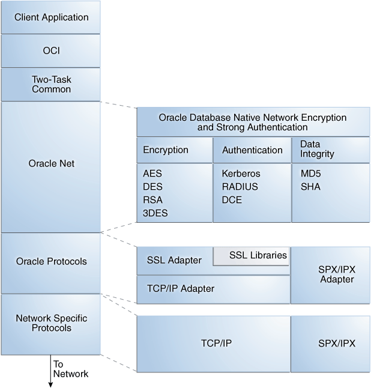
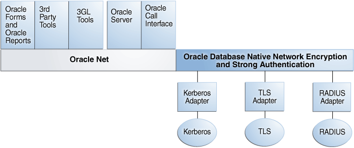

Strong authentication supports tools such as Transport Layer Security (TLS) to verify the identities of users who log in to the database.

**Parent topic:** [Managing Strong Authentication](part_5.md)

### 19.1 What Is Strong Authentication?

You use authentication to prove the identities of users who are attempting to log into the database.

Authenticating user identity is imperative in distributed environments, without which there can be little confidence in network security. Passwords are the most common means of authentication. Oracle Database enables strong authentication with Oracle authentication adapters that support various third-party authentication services, including TLS with digital certificates.

Figure 19-1 shows user authentication with an Oracle database instance configured to use a third-party authentication server. Having a central facility to authenticate all members of the network (clients to servers, servers to servers, users to both clients and servers) is one effective way to address the threat of network nodes falsifying their identities.

Figure 19-1 Strong Authentication with Oracle Authentication Adapters

> This is a text description of asoag035.gif, an image which depicts a client connection to an Oracle database that uses a third-party authentication server. It shows the client sending a request to an Oracle database. The Oracle database then sends a request to a third-party authentication server to authenticate the client.

**Parent topic:** Introduction to Strong Authentication

### 19.2 Centralized Authentication and Single Sign-On

Single sign-on enables users to access multiple accounts and applications with a single password.

Centralized authentication also provides the benefit of single sign-on (SSO) for users. This is the ability of a user to authenticate once, combined with strong authentication occurring transparently in subsequent connections to other databases or applications. Single sign-on lets a user access multiple accounts and applications with a single password, entered during a single connection. Single password, single authentication. Oracle Database supports Kerberos and SSL-based single sign-on.

In single sign-on, a user only needs to login once and can then automatically connect to any other service without having to give the user name and password again. Single sign-on eliminates the need for the user to remember and administer multiple passwords, reducing the time spent logging into multiple services.

**Parent topic:** Introduction to Strong Authentication

### 19.3 How Centralized Network Authentication Works

A centralized network authentication system works with an Oracle server, an authentication server, and users who connect to the Oracle server.

Figure 19-2 shows how a centralized network authentication service typically operates.

Figure 19-2 How a Network Authentication Service Authenticates a User

> This is a text description of asoag012.gif, an image which depicts how a network authentication service authenticates a user as follows:
>
> 1. First, the user (client) requests authentication services from an authentication server. The user proves his or her identity by providing a token or password.
> 2. After authenticating the user, the authentication server passes a ticket or credentials back to the client.
> 3. The client can now take these credentials and pass them to the Oracle server while asking for a service, such as connection to a database.
> 4. The Oracle server sends the credentials to the authentication server to verify their validity.
> 5. The authentication server either accepts or rejects the credentials and sends a notification to the Oracle server.
> 6. If the authentication server accepts the credentials, then the Oracle server performs the requested task for the user. If the credentials are not accepted, the requested service is denied.

The following steps describe how centralized Network Authentication Process works.

1. A user (client) requests authentication services and provides identifying information, such as a token or password.
2. The authentication server validates the user's identity and passes a ticket or credentials back to the client, which may include an expiration time.
3. The client passes these credentials to the Oracle server concurrent with a service request, such as connection to a database.
4. The server sends the credentials back to the authentication server for authentication.
5. The authentication server checks the credentials and notifies the Oracle server.
6. If the credentials were accepted by the authentication server, then the Oracle server authenticates the user. If the authentication server rejected the credentials, then authentication fails, and the service request is denied.

**Parent topic:** Introduction to Strong Authentication

### 19.4 Supported Strong Authentication Methods

Oracle Database supports industry-standard authentication methods.

- About Kerberos  
	Oracle Database support for Kerberos provides the benefits of single sign-on and centralized authentication of Oracle users.
- About Remote Authentication Dial-In User Service (RADIUS)  
	RADIUS is a client/server security protocol that is most widely known for enabling remote authentication and access.
- About Transport Layer Security  
	Transport Layer Security (TLS) is an industry standard protocol for securing network connections.

**Parent topic:** Introduction to Strong Authentication

#### 19.4.1 About Kerberos

Oracle Database support for Kerberos provides the benefits of single sign-on and centralized authentication of Oracle users.

Kerberos is a trusted third-party authentication system that relies on shared secrets. It presumes that the third party is secure, and provides single sign-on capabilities, centralized password storage, database link authentication, and enhanced PC security. It does this through a Kerberos authentication server.

Note:

Oracle authentication for Kerberos provides database link authentication (also called proxy authentication). Kerberos is also an authentication method that is supported with Enterprise User Security.

#### 19.4.2 About Remote Authentication Dial-In User Service (RADIUS)

RADIUS is a client/server security protocol that is most widely known for enabling remote authentication and access.

Oracle Database uses this standard in a client/server network environment to enable use of any authentication method that supports the RADIUS protocol. RADIUS can be used with a variety of authentication mechanisms, including token cards and smart cards.

- Smart Cards. A RADIUS-compliant smart card is a credit card-like hardware device which has memory and a processor. It is read by a smart card reader located at the client workstation.
- Token Cards. Token cards (Secure ID or RADIUS-compliant) can improve ease of use through several different mechanisms. Some token cards dynamically display one-time passwords that are synchronized with an authentication service. The server can verify the password provided by the token card at any given time by contacting the authentication service. Other token cards have a keypad and operate on a challenge-response basis. In this case, the server offers a challenge (a number) that the user enters into a token card. The token card provides a response (another number cryptographically derived from the challenge) that the user enters and sends to the server.
	You can use SecurID tokens through the RADIUS adapter.

#### 19.4.3 About Transport Layer Security

Transport Layer Security (TLS) is an industry standard protocol for securing network connections.

TLS provides authentication, data encryption, and data integrity.

The TLS protocol is the foundation of a public key infrastructure (PKI). For authentication, TLS uses digital certificates that comply with the X.509v3 standard and a public and private key pair.

With a public and a private key page, a set of two numbers are used for encryption and decryption, where one is called the private key and the other is called the public key. Public keys are typically made widely available, while private keys are held by their respective owners. Though mathematically related, it is generally viewed as computationally infeasible to derive the private key from the public key. Public and private keys are used only with asymmetric encryption algorithms, also called public-key encryption algorithms, or public-key cryptosystems. Data encrypted with either a public key or a private key from a key pair can be decrypted with its associated key from the key-pair. However, data encrypted with a public key cannot be decrypted with the same public key, and data enwrapped with a private key cannot be decrypted with the same private key.

Oracle Database TLS can be used to secure communications between any client and any server. You can configure TLS to provide authentication for the server only, the client only, or both client and server. You can also configure TLS features in combination with other authentication methods supported by Oracle Database (database user names and passwords, RADIUS, and Kerberos).

To support your PKI implementation, Oracle Database includes the following features in addition to TLS:

- Oracle wallets, where you can store PKI credentials
- Oracle Wallet Manager, which you can use to manage your Oracle wallets (Oracle Wallet Manager is deprecated with Oracle Database 21c. Instead of using Oracle Wallet Manager, Oracle recommends that you use the command line tools `orapki` and `mkstore`.)
- Certificate validation with certificate revocation lists (CRLs)
- Hardware security module support

### 19.5 Oracle Database Native Network Encryption/Strong Authentication Architecture

The Oracle Database native network encryption and strong authentication architecture complements an Oracle database server or client installations.

The following diagram shows the this architecture within an Oracle networking environment.

Figure 19-3 Oracle Native Network Encryption and Strong Authentication Architecture

> Image dbseg\_vm\_010.png describes the architecture of the Oracle native network encryption and strong authentication. The client application, Oracle Call Interface (OCI), two-task common functionality, Oracle Net, Oracle protocols, and network-specific protocols all work to send data to the network. Oracle Net works with the Oracle Database native network encryption and strong authentication tools, which comprise encryption (AES, DES, RSA, and 3DES), authentication (Kerberos, RADIUS, and DCE), and data integrity (MD5 and SHA). Oracle protocols work with the SSL adapter and SSL libraries, TCP/IP adapter, and SPX/IPS adapter. The network-specific protocols work with TCP/IP and SPX/IPX.

Oracle Database supports authentication through adapters that are similar to the existing Oracle protocol adapters. As shown in Figure 19-4, authentication adapters integrate the Oracle Net interface, and allow existing applications to take advantage of new authentication systems transparently, without any changes to the application.

Figure 19-4 Oracle Net Services with Authentication Adapters

> Image dbseg\_vm\_009.png shows the Oracle Net Services with authentication adapters. Oracle Net is comprised of Oracle Forms and Oracle Reports, third-party tools, 3GL tools, the Oracle server, and Oracle Call Interface. The Oracle Database native network encryption and strong authentication tools are adpaters for Kerberos, SSL, DCE, and RADIUS.
>
> [  
> Copyright © 1996, 2024, Oracle and/or its affiliates.](https://docs.oracle.com/en/database/oracle/oracle-database/dcommon/html/cpyr.htm)

See Also:

[Oracle Database Net Services Administrator's Guide](https://docs.oracle.com/pls/topic/lookup?ctx=en/database/oracle/oracle-database/21/dbseg&id=NETAG004) for more information about stack communications in an Oracle networking environment

**Parent topic:** Introduction to Strong Authentication

### 19.6 System Requirements for Strong Authentication

Kerberos, RADIUS, and Transport Layer Security (TLS) have a set of system requirements for strong authentication.

Table 19-1 lists the TLS system requirements for strong authentication.

Table 19-1 Authentication Methods and System Requirements

| Authentication Method | System Requirements |
| --- | --- |
| Kerberos | - MIT Kerberos Version 5, release 1.8 or above. - The Kerberos authentication server must be installed on a physically secure system. |
| RADIUS | - A RADIUS server that is compliant with the standards in the Internet Engineering Task Force (IETF) RFC #2138, Remote Authentication Dial In User Service (RADIUS) and RFC #2139 RADIUS Accounting. - To enable challenge-response authentication, you must run RADIUS on an operating system that supports the Java Native Interface as specified in release 1.1 of the Java Development Kit from JavaSoft. |
| TLS | - A wallet that is compatible with Oracle Database 10g. |

**Parent topic:** Introduction to Strong Authentication

### 19.7 Oracle Database Native Network Encryption and Strong Authentication Restrictions

Oracle applications support Oracle Database native network encryption and strong authentication.

However, because Oracle Database native network encryption and strong authentication requires Oracle Net Services to transmit data securely, these external authentication features are not supported by some parts of Oracle Financial, Human Resource, and Manufacturing Applications when they are running on Microsoft Windows.

The portions of these products that use Oracle Display Manager (ODM) do not take advantage of Oracle Database native network encryption and strong authentication, because ODM does not use Oracle Net Services.

**Parent topic:** Introduction to Strong Authentication