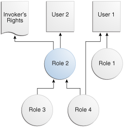
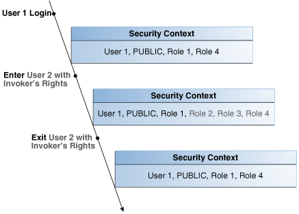
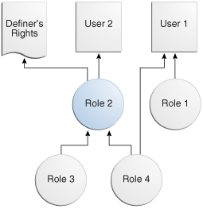
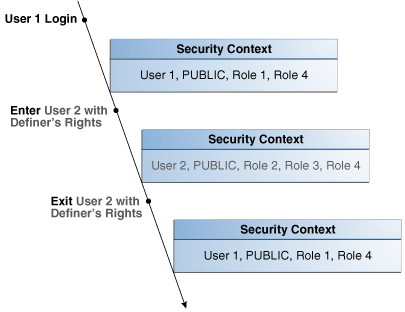

Invoker’s rights and definer’s rights have several security advantages when used to control access to privileges during user-defined procedure executions.

- About Definer's Rights and Invoker's Rights  
	Definer's rights and invoker's rights are used to control access to privileges during user-defined procedure executions necessary to run a user-created procedure, or program unit.
- How Procedure Privileges Affect Definer's Rights  
	The owner of a procedure, called the definer, must have the necessary object privileges for objects that the procedure references.
- How Procedure Privileges Affect Invoker's Rights  
	An invoker’s rights procedure executes with all of the invoker's privileges.
- When You Should Create Invoker's Rights Procedures  
	Oracle recommends that you create invoker's rights procedures in certain situations.
- Controlling Invoker's Rights Privileges for Procedure Calls and View Access  
	The `INHERIT PRIVILEGES` and `INHERIT ANY PRIVILEGES` privileges regulate the privileges used when invoker's rights procedures are run.
- Definer's Rights and Invoker's Rights in Views  
	The `BEQEATH` clause in the `CREATE VIEW` SQL statement can control definer's rights and invoker's rights in user-created views.
- Using Code Based Access Control for Definer's Rights and Invoker's Rights  
	Code based access control, used to attach database roles to PL/SQL functions, procedures, or packages, works well with invoker's rights and definer's procedures.
- Controlling Definer's Rights Privileges for Database Links  
	You can control privilege grants for definer’s rights procedures if your applications use database links and definer’s rights procedures.

**Parent topic:** [Managing User Authentication and Authorization](part_1.md)

### 7.1 About Definer's Rights and Invoker's Rights

Definer's rights and invoker's rights are used to control access to privileges during user-defined procedure executions necessary to run a user-created procedure, or program unit.

In a definer's rights procedure, the procedure runs with the privileges of the owner, not the current user. The privileges are bound to the schema in which they were created. An invoker's rights procedure runs with the privileges of the current user, that is, the user who invokes the procedure. These procedures are not bound to a particular schema. They can be run by a variety of users and allow multiple users to manage their own data by using centralized application logic. Invoker's rights procedures are created with the `AUTHID` clause in the declaration section of the procedure code.

For example, suppose user `bixby` creates a procedure that is designed to modify table `cust_records` and then grants the `EXECUTE` privilege on this procedure to user `rlayton`. If `bixby` had created the procedure with definer's rights, then the procedure would look for table `cust_records` in `bixby` 's schema. Had the procedure been created with invoker's rights, then when `rlayton` runs it, the procedure would look for table `cust_records` in `rlayton` 's schema.

By default, all procedures are considered definer's rights. You can designate a procedure to be an invoker's rights procedure by using the `AUTHID CURRENT_USER` clause when you create or modify it, or you can use the `AUTHID DEFINER` clause to make it a definer's rights procedure.

You can create privilege analysis policies to capture privilege use of definer’s rights and invoker’s rights procedures.

### 7.2 How Procedure Privileges Affect Definer's Rights

The owner of a procedure, called the definer, must have the necessary object privileges for objects that the procedure references.

If the procedure owner grants to another user the right to use the procedure, then the privileges of the procedure owner (on the objects the procedure references) apply to the grantee's exercise of the procedure. The privileges of the procedure's definer must be granted directly to the procedure owner, not granted through roles. These are called definer's rights.

The user of a procedure who is not its owner is called the invoker. Additional privileges on referenced objects are required for an invoker's rights procedure, but not for a definer's rights procedure.

A user of a definer's rights procedure requires only the privilege to execute the procedure and no privileges on the underlying objects that the procedure accesses. This is because a definer's rights procedure operates under the security domain of the user who owns the procedure, regardless of who is executing it. The owner of the procedure must have all the necessary object privileges for referenced objects. Fewer privileges need to be granted to users of a definer's rights procedure. This results in stronger control of database access.

You can use definer's rights procedures to control access to private database objects and add a level of database security. By writing a definer's rights procedure and granting only the `EXECUTE` privilege to a user, this user can be forced to access the referenced objects only through the procedure.

At run time, Oracle Database checks whether the privileges of the owner of a definer's rights procedure allow access to that procedure's referenced objects, before the procedure is executed. If a necessary privilege on a referenced object was revoked from the owner of a definer's rights procedure, then no user, including the owner, can run the procedure.

An example of when you may want to use a definer's rights procedure is as follows: Suppose that you must create an API whose procedures have unrestricted access to its tables, but you want to prevent ordinary users from selecting table data directly, and from changing it with `INSERT`, `UPDATE`, and `DELETE` statements. To accomplish this, in a separate, low-privileged schema, create the tables and the procedures that comprise the API. By default, each procedure is a definer's rights unit, so you do not need to specify `AUTHID DEFINER` when you create it. Then grant the `EXECUTE` privilege to the users who must use this API, but do not grant any privileges that allow data access. This solution gives you complete control over your API behavior and how users have access to its underlying objects.

Oracle recommends that you create your definer's rights procedures, and views that access these procedures, in their own schema. Grant this schema very low privileges, or no privileges at all. This way, when other users run these procedures or views, they will not have access to any unnecessarily high privileges from this schema.

Note:

Trigger processing follows the same patterns as definer's rights procedures. The user runs a SQL statement, which that user is privileged to run. As a result of the SQL statement, a trigger is fired. The statements within the triggered action temporarily execute under the security domain of the user that owns the trigger.

### 7.3 How Procedure Privileges Affect Invoker's Rights

An invoker’s rights procedure executes with all of the invoker's privileges.

Oracle Database enables the privileges that were granted to the invoker through any of the invoker's enabled roles to take effect, unless a definer's rights procedure calls the invoker's rights procedure directly or indirectly. A user of an invoker's rights procedure must have privileges (granted to the user either directly or through a role) on objects that the procedure accesses through external references that are resolved in the schema of the invoker. When the invoker runs an invoker's rights procedure, this user temporarily has all of the privileges of the invoker.

The invoker must have privileges at run time to access program references embedded in DML statements or dynamic SQL statements, because they are effectively recompiled at run time.

For all other external references, such as direct PL/SQL function calls, Oracle Database checks the privileges of the owner at compile time, but does not perform a run-time check. Therefore, the user of an invoker's rights procedure does not need privileges on external references outside DML or dynamic SQL statements. Therefore, the developer of an invoker's rights procedure only needs to grant privileges on the procedure itself, not on all objects directly referenced by the invoker's rights procedure.

You can create a software bundle that consists of multiple program units, some with definer's rights and others with invoker's rights, and restrict the program entry points (controlled step-in). A user who has the privilege to run an entry-point procedure can also execute internal program units indirectly, but cannot directly call the internal programs. For very precise control over query processing, you can create a PL/SQL package specification with explicit cursors.

### 7.4 When You Should Create Invoker's Rights Procedures

Oracle recommends that you create invoker's rights procedures in certain situations.

These situations are as follows:

- When creating a PL/SQL procedure in a high-privileged schema. When lower-privileged users invoke the procedure, then it can do no more than those users are allowed to do. In other words, the invoker's rights procedure runs with the privileges of the invoking user.
- When the PL/SQL procedure contains no SQL and is available to other users. The `DBMS_OUTPUT` PL/SQL package is an example of a PL/SQL subprogram that contains no SQL and is available to all users. The reason you should use an invoker's rights procedure in this situation is because the unit issues no SQL statements at run time, so the run-time system does not need to check their privileges. Specifying `AUTHID` `CURRENT_USER` makes invocations of the procedure more efficient, because when an invoker's right procedure is pushed onto, or comes from, the call stack, the values of `CURRENT_USER` and `CURRENT_SCHEMA`, and the currently enabled roles do not change.

See Also:

- [Oracle Database PL/SQL Packages and Types Reference](https://docs.oracle.com/pls/topic/lookup?ctx=en/database/oracle/oracle-database/21/dbseg&id=LNPLS00809) for information about how Oracle Database handles name resolution and privilege checking at runtime using invoker's and definer's rights
- [Oracle Database PL/SQL Packages and Types Reference](https://docs.oracle.com/pls/topic/lookup?ctx=en/database/oracle/oracle-database/21/dbseg&id=LNPLS00809) for more information about the differences between invoker's rights and definer's rights units
- [Oracle Database PL/SQL Packages and Types Reference](https://docs.oracle.com/pls/topic/lookup?ctx=en/database/oracle/oracle-database/21/dbseg&id=LNPLS01371) for information about defining explicit cursors in the `CREATE PACKAGE` statement

**Parent topic:** Managing Security for Definer's Rights and Invoker's Rights

### 7.5 Controlling Invoker's Rights Privileges for Procedure Calls and View Access

The `INHERIT PRIVILEGES` and `INHERIT ANY PRIVILEGES` privileges regulate the privileges used when invoker's rights procedures are run.

- How the Privileges of a Schema Affect the Use of Invoker's Rights Procedures  
	An invoker’s rights procedure is useful in situations where a lower-privileged user must run a procedure owned by a higher-privileged user.
- [How the INHERIT \[ANY\] PRIVILEGES Privileges Control Privilege Access](https://docs.oracle.com/en/database/oracle/oracle-database/21/dbseg/managing-security-for-definers-rights-and-invokers-rights.html#GUID-174CF65A-209E-4A50-93ED-648C0EB38E90)  
	Use the `INHERIT PRIVILEGES` and `INHERIT ANY PRIVILEGES` privileges to secure invoker’s rights procedures.
- Grants of the INHERIT PRIVILEGES Privilege to Other Users  
	By default, all users are granted `INHERIT PRIVILEGES` `ON USER` `newuser` `TO PUBLIC`.
- Example: Granting INHERIT PRIVILEGES on an Invoking User  
	The `GRANT` statement can grant the `INHERIT PRIVILEGES` privilege on an invoking user to a procedure owner.
- Example: Revoking INHERIT PRIVILEGES  
	The `REVOKE` statement can revoke the `INHERIT PRIVILEGES` privilege from a user.
- Grants of the INHERIT ANY PRIVILEGES Privilege to Other Users  
	By default, user `SYS` has the `INHERIT ANY PRIVILEGES` system privilege and can grant this privilege to other database users or roles.
- Example: Granting INHERIT ANY PRIVILEGES to a Trusted Procedure Owner  
	The `GRANT` statement can grant the `INHERIT ANY PRIVILEGES` privilege to trusted procedure owners.
- Managing INHERIT PRIVILEGES and INHERIT ANY PRIVILEGES  
	By default, `PUBLIC` has the `INHERIT PRIVILEGE` privilege on new and upgraded user accounts; the `SYS` user has the `INHERIT ANY PRIVILEGES` privilege.

**Parent topic:** Managing Security for Definer's Rights and Invoker's Rights

#### 7.5.1 How the Privileges of a Schema Affect the Use of Invoker's Rights Procedures

An invoker’s rights procedure is useful in situations where a lower-privileged user must run a procedure owned by a higher-privileged user.

When a user runs an invoker's rights procedure (or any PL/SQL program unit that has been created with the `AUTHID CURRENT_USER` clause), the procedure temporarily inherits all of the privileges of the invoking user while the procedure runs.

During that time, the procedure owner has, through the procedure, access to this invoking user's privileges. Consider the following scenario:

1. User `ebrown` creates the `check_syntax` invoker's rights procedure and then grants user `jward` the `EXECUTE` privilege on it.
2. User `ebrown`, who is a junior programmer, has only the minimum set of privileges necessary for their job. The `check_syntax` procedure resides in `ebrown` 's schema.
3. User `jward`, who is a manager, has a far more powerful set of privileges than user `ebrown`.
4. When user `jward` runs the `check_syntax` invoker's rights procedure, the procedure inherits user `jward` 's higher privileges while it runs.
5. Because user `ebrown` owns the `check_syntax` procedure, this user has access to user `jward` 's privileges whenever `jward` runs the `check_syntax` procedure.

The danger in this type of situation—in which the lower privileged `ebrown` 's procedure has access to `jward` 's higher privileges whenever `jward` runs the procedure—lies in the risk that the procedure owner can misuse the higher privileges of the invoking user. For example, user `ebrown` could make use of `jward` 's higher privileges by rewriting the `check_syntax` procedure to give `ebrown` a raise or delete `ebrown` 's bad performance appraisal record. Or, `ebrown` originally could have created the procedure as a definer's rights procedure, granted its `EXECUTE` privilege to `jward`, and then later on change it to a potentially malicious invoker's rights procedure without letting `jward` know. These types of risks increase when random users, such as application users, have access to a database that uses invoker's rights procedures.

When user `jward` runs `ebrown` 's invoker's rights procedure, there is an element of trust involved. This user must be assured that `ebrown` will not use the `check_syntax` procedure in a malicious way when it accesses `jward` 's privileges. The `INHERIT PRIVILEGES` and `INHERIT ANY PRIVILEGES` privileges can help user `jward` control whether user `ebrown` 's procedure can have access to `jward` 's privileges. Any user can grant or revoke the `INHERIT PRIVILEGES` privilege on themselves to the user whose invoker's rights procedures they want to run. `SYS` users manage the `INHERIT ANY PRIVILEGES` privilege.

**Parent topic:** Controlling Invoker's Rights Privileges for Procedure Calls and View Access

#### 7.5.2 How the INHERIT \[ANY\] PRIVILEGES Privileges Control Privilege Access

Use the `INHERIT PRIVILEGES` and `INHERIT ANY PRIVILEGES` privileges to secure invoker’s rights procedures.

The `INHERIT PRIVILEGES` and `INHERIT ANY PRIVILEGES` privileges regulate the privileges used when a user runs an invoker's rights procedure or queries a `BEQUEATH CURRENT_USER` view that references an invoker's rights procedure.

When a user runs an invoker's rights procedure, Oracle Database checks it to ensure that the procedure owner has either the `INHERIT PRIVILEGES` privilege on the invoking user, or if the owner has been granted the `INHERIT ANY PRIVILEGES` privilege. If the privilege check fails, then Oracle Database returns an `ORA-06598: insufficient INHERIT PRIVILEGES privilege` error.

The benefit of these two privileges is that they give invoking users control over who can access their privileges when they run an invoker's rights procedure or query a `BEQUEATH CURRENT_USER` view.

**Parent topic:** Controlling Invoker's Rights Privileges for Procedure Calls and View Access

#### 7.5.3 Grants of the INHERIT PRIVILEGES Privilege to Other Users

By default, all users are granted `INHERIT PRIVILEGES` `ON USER` `newuser` `TO PUBLIC`.

This grant takes place when the user accounts are created or when accounts that were created earlier are upgraded to the current release.

The invoking user can revoke the `INHERIT PRIVILEGE` privilege from other users on himself and then grant it only to users that he trusts.

The syntax for the `INHERIT PRIVILEGES` privilege grant is as follows:

```
GRANT INHERIT PRIVILEGES ON USER invoking_user TO procedure_owner;
```

In this specification:

- `invoking_user` is the user who runs the invoker's rights procedure. This user must be a database user account.
- `procedure_owner` is the user who owns the invoker's rights procedure. This value must be a database user account. As an alternative to granting the `INHERIT PRIVILEGES` privilege to the procedure's owner, you can grant the privilege to a role that is in turn granted to the procedure.

The following users or roles must have the `INHERIT PRIVILEGES` privilege granted to them by users who will run their invoker's rights procedures:

- Users or roles who own the invoker's rights procedures
- Users or roles who own `BEQUEATH CURRENT_USER` views

**Parent topic:** Controlling Invoker's Rights Privileges for Procedure Calls and View Access

#### 7.5.4 Example: Granting INHERIT PRIVILEGES on an Invoking User

The `GRANT` statement can grant the `INHERIT PRIVILEGES` privilege on an invoking user to a procedure owner.

Example 7-1 shows how the invoking user `jward` can grant user `ebrown` the `INHERIT PRIVILEGES` privilege.

Example 7-1 Granting INHERIT PRIVILEGES on an Invoking User to a Procedure Owner

```
GRANT INHERIT PRIVILEGES ON USER jward TO ebrown;
```

The statement enables any invoker's rights procedure that `ebrown` writes, or will write in the future, to access `jward` 's privileges when `jward` runs it.

**Parent topic:** Controlling Invoker's Rights Privileges for Procedure Calls and View Access

#### 7.5.5 Example: Revoking INHERIT PRIVILEGES

The `REVOKE` statement can revoke the `INHERIT PRIVILEGES` privilege from a user.

Example 7-2 shows how user `jward` can revoke the use of their privileges from `ebrown`.

Example 7-2 Revoking INHERIT PRIVILEGES

```
REVOKE INHERIT PRIVILEGES ON USER jward FROM ebrown;
```

**Parent topic:** Controlling Invoker's Rights Privileges for Procedure Calls and View Access

#### 7.5.6 Grants of the INHERIT ANY PRIVILEGES Privilege to Other Users

By default, user `SYS` has the `INHERIT ANY PRIVILEGES` system privilege and can grant this privilege to other database users or roles.

As with all `ANY` privileges, only grant this privilege to trusted users or roles. Once a user or role has been granted the `INHERIT ANY PRIVILEGES` privilege, then this user's invoker's rights procedures have access to the privileges of the invoking user. You can find the users who have been granted the `INHERIT ANY PRIVILEGES` privilege by querying the `DBA_SYS_PRIVS` data dictionary view.

**Parent topic:** Controlling Invoker's Rights Privileges for Procedure Calls and View Access

#### 7.5.7 Example: Granting INHERIT ANY PRIVILEGES to a Trusted Procedure Owner

The `GRANT` statement can grant the `INHERIT ANY PRIVILEGES` privilege to trusted procedure owners.

Example 7-3 shows how to grant the `INHERIT ANY PRIVILEGES` privilege to user `ebrown`.

Example 7-3 Granting INHERIT ANY PRIVILEGES to a Trusted Procedure Owner

```
GRANT INHERIT ANY PRIVILEGES TO ebrown;
```

Be careful about revoking the `INHERIT ANY PRIVILEGES` privilege from powerful users. For example, suppose user `SYSTEM` has created a set of invoker's rights procedures. If you revoke `INHERIT ANY PRIVILEGES` from `SYSTEM`, then other users cannot run his procedures, unless they have specifically granted him the `INHERIT PRIVILEGE` privilege.

**Parent topic:** Controlling Invoker's Rights Privileges for Procedure Calls and View Access

#### 7.5.8 Managing INHERIT PRIVILEGES and INHERIT ANY PRIVILEGES

By default, `PUBLIC` has the `INHERIT PRIVILEGE` privilege on new and upgraded user accounts; the `SYS` user has the `INHERIT ANY PRIVILEGES` privilege.

Oracle by default configures a set of grants of `INHERIT PRIVILEGES` that are designed to help protect against misuse of the privileges of various Oracle-defined users.

You can choose to revoke the default grant of `INHERIT PRIVILEGES ON USER ` `user_name` `TO PUBLIC` for a customer-defined user and grant more specific grants of `INHERIT PRIVILEGES` as appropriate for that particular user. To find the users who have been granted the `INHERIT ANY PRIVILEGES` privilege, query the `DBA_SYS_PRIVS` data dictionary view.

1. Revoke the `INHERIT PRIVILEGES` privilege from `PUBLIC`.
	For example:
	```
	REVOKE INHERIT PRIVILEGES ON invoking_user FROM PUBLIC;
	```
	Be aware that this time, any users who run invoker's rights procedures cannot do so, due to run-time errors from failed `INHERIT PRIVILEGES` checks.
2. Selectively grant the `INHERIT PRIVILEGES` privilege to trusted users or roles.
3. Similarly, selectively grant the `INHERIT ANY PRIVILEGES` privilege only to trusted users or roles.

You can create an audit policy to audit the granting and revoking of these two privileges, but you cannot audit run-time errors that result from failed `INHERIT PRIVILEGES` privilege checks.

See Also:

- [Oracle Database PL/SQL Packages and Types Reference](https://docs.oracle.com/pls/topic/lookup?ctx=en/database/oracle/oracle-database/21/dbseg&id=LNPLS01109) for information about SQL injection attacks
- [Oracle Database PL/SQL Packages and Types Reference](https://docs.oracle.com/pls/topic/lookup?ctx=en/database/oracle/oracle-database/21/dbseg&id=SQLRF01603) for more information about the `GRANT` statement and default privileges

**Parent topic:** Controlling Invoker's Rights Privileges for Procedure Calls and View Access

### 7.6 Definer's Rights and Invoker's Rights in Views

The `BEQEATH` clause in the `CREATE VIEW` SQL statement can control definer's rights and invoker's rights in user-created views.

- About Controlling Definer's Rights and Invoker's Rights in Views  
	You can configure user-defined views to accommodate invoker's rights functions that are referenced in the view.
- Using the BEQUEATH Clause in the CREATE VIEW Statement  
	The `BEQUEATH` controls how an invoker’s right function can be executed using the rights of the invoking user.
- Finding the User Name or User ID of the Invoking User  
	PL/SQL functions can be used to find the invoking user, based on whether invoker’s rights or definer’s rights are being used.
- Finding BEQUEATH DEFINER and BEQUEATH\_CURRENT\_USER Views  
	You can find out if a view is a `BEQUEATH DEFINER` or `BEQUEATH CURRENT_USER` view.

**Parent topic:** Managing Security for Definer's Rights and Invoker's Rights

#### 7.6.1 About Controlling Definer's Rights and Invoker's Rights in Views

You can configure user-defined views to accommodate invoker's rights functions that are referenced in the view.

When a user invokes an identity- or privilege-sensitive SQL function or an invoker's rights PL/SQL or Java function, then current schema, current user, and currently enabled roles within the operation's execution can be inherited from the querying user's environment, rather than being set to the owner of the view.

This configuration does not turn the view itself into an invoker's rights object. Name resolution within the view is still handled using the view owner's schema, and privilege checking for the view is done using the view owner's privileges. However, at runtime, the function referenced by view runs under the invoking user's privileges rather than those of the view owner's.

The benefit of this feature is that it enables functions such as `SYS_CONTEXT` and `USERENV`, which must return information accurate for the invoking user, to return consistent results when these functions are referenced in a view.

**Parent topic:** Definer's Rights and Invoker's Rights in Views

#### 7.6.2 Using the BEQUEATH Clause in the CREATE VIEW Statement

The `BEQUEATH` controls how an invoker’s right function can be executed using the rights of the invoking user.

To enable an invoker's rights function to be executed using the rights of the user issuing SQL that references the view, in the `CREATE VIEW` statement, you can set the `BEQUEATH` clause to `CURRENT_USER`.

If you plan to issue a SQL query or DML statement against the view, then the view owner must be granted the `INHERIT` `PRIVILEGES` privilege on the invoking user or the view owner must have the `INHERIT ANY PRIVILEGES` privilege. If not, then when a `SELECT` query or DML statement involves a `BEQUEATH` `CURRENT_USER` view, the run-time system will raise error `ORA-06598: insufficient INHERIT PRIVILEGES privilege`.

- Use the use `BEQUEATH CURRENT_USER` clause to set the view's function to be executed using invoker's rights.

For example:

```
CREATE VIEW MY_OBJECTS_VIEW BEQUEATH CURRENT_USER AS
 SELECT GET_OBJS_FUNCTION;
```

If you want the function within the view to be executed using the view owner's rights, then you should either omit the `BEQUEATH` clause or set it to `DEFINER`.

For example:

```
CREATE VIEW my_objects_view BEQUEATH DEFINER AS
 SELECT OBJECT_NAME FROM USER_OBJECTS;
```

See Also:

- [Oracle Database SQL Language Reference](https://docs.oracle.com/pls/topic/lookup?ctx=en/database/oracle/oracle-database/21/dbseg&id=SQLRF01603) for additional information about granting the `INHERIT` `PRIVILEGES` and `INHERIT` `ANY` `PRIVILEGES` privileges
- [Oracle Database Real Application Security Administrator's and Developer's Guide](https://docs.oracle.com/pls/topic/lookup?ctx=en/database/oracle/oracle-database/21/dbseg&id=DBFSG433) for information about how to use `BEQUEATH CURRENT_USER` views with Oracle Database Real Application Security applications

**Parent topic:** Definer's Rights and Invoker's Rights in Views

#### 7.6.3 Finding the User Name or User ID of the Invoking User

PL/SQL functions can be used to find the invoking user, based on whether invoker’s rights or definer’s rights are being used.

- Use the `ORA_INVOKING_USER` or `ORA_INVOKING_USERID` function to find the invoking user based on whether invoker's rights or definer's rights:
	- `ORA_INVOKING_USER`: Use this function to return the name of the user who is invoking the current statement or view. This function treats the intervening views as specified by their `BEQUEATH` clauses. If the invoking user is an Oracle Database Real Application Security-defined user, then this function returns `XS$NULL`.
		- `ORA_INVOKING_USERID`: Use this function to return the identifier (ID) of the user who is invoking the current statement or view. This function treats the intervening views as specified by their `BEQUEATH` clauses. If the invoking user is an Oracle Database Real Application Security-defined user, then this function returns an ID that is common to all Real Application Security sessions but is different from the ID of any database user.
		For example:
		```
		CONNECT HR@pdb_name
		Enter password: password
		SELECT ORA_INVOKING_USER FROM DUAL;
		ORA_INVOKING_USER
		--------------------
		HR
		```

See Also:

[Oracle Database Real Application Security Administrator's and Developer's Guide](https://docs.oracle.com/pls/topic/lookup?ctx=en/database/oracle/oracle-database/21/dbseg&id=DBFSG436) for information about similar functions that are used for Oracle Database Real Application Security applications

**Parent topic:** Definer's Rights and Invoker's Rights in Views

#### 7.6.4 Finding BEQUEATH DEFINER and BEQUEATH\_CURRENT\_USER Views

You can find out if a view is a `BEQUEATH DEFINER` or `BEQUEATH CURRENT_USER` view.

- To find if a view is `BEQUEATH DEFINER` or `BEQUEATH CURRENT_USER` view, query the `BEQUEATH` column of a `*_VIEWS` or `*_VIEWS_AE` static data dictionary view for that view.
	For example:
	```
	SELECT BEQUEATH FROM USER_VIEWS WHERE VIEW_NAME = 'MY_OBJECTS';
	BEQUEATH
	------------
	CURRENT_USER
	```

**Parent topic:** Definer's Rights and Invoker's Rights in Views

### 7.7 Using Code Based Access Control for Definer's Rights and Invoker's Rights

Code based access control, used to attach database roles to PL/SQL functions, procedures, or packages, works well with invoker's rights and definer's procedures.

- About Using Code Based Access Control for Applications  
	You can use code based access control (CBAC) to better manage definer’s rights program units.
- Who Can Grant Code Based Access Control Roles to a Program Unit?  
	Code based access control roles can be granted to a program unit if a set of conditions are met.
- How Code Based Access Control Works with Invoker's Rights Program Units  
	Code based access control can run a program unit in an invoking user's context and with roles associated with this context.
- How Code Based Access Control Works with Definer's Rights Program Units  
	Code based access control can be used to secure definer’s rights.
- Grants of Database Roles to Users for Their CBAC Grants  
	The `DELEGATE` option in the `GRANT` statement can limit privilege grants to roles by users responsible for CBAC grants.
- Grants and Revokes of Database Roles to a Program Unit  
	The `GRANT` and `REVOKE` statements can grant database roles to or revoke database roles from a program unit.
- Tutorial: Controlling Access to Sensitive Data Using Code Based Access Control  
	This tutorial demonstrates how to control access to sensitive data in the `HR` schema by using code based access control.

**Parent topic:** Managing Security for Definer's Rights and Invoker's Rights

#### 7.7.1 About Using Code Based Access Control for Applications

You can use code based access control (CBAC) to better manage definer’s rights program units.

Applications must often run program units in the caller's environment, while requiring elevated privileges. PL/SQL programs traditionally make use of definer's rights to temporarily elevate the privileges of the program.

However, definer's rights based program units run in the context of the definer or the owner of the program unit, as opposed to the invoker's context. Also, using definer's rights based programs often leads to the program unit getting more privileges than required.

Code based access control (CBAC) provides the solution by enabling you to attach database roles to a PL/SQL function, procedure, or package. These database roles are enabled at run time, enabling the program unit to execute with the required privileges in the calling user's environment.

You can create privilege analysis policies that capture the use of CBAC roles.

#### 7.7.2 Who Can Grant Code Based Access Control Roles to a Program Unit?

Code based access control roles can be granted to a program unit if a set of conditions are met.

These conditions are as follows:

- The grantor is user `SYS` or owns the program unit.
- If the grantor owns the program unit, then the grantor must have the `GRANT ANY ROLE` system privilege, or have the `ADMIN` or `DELEGATE` option for the roles that they want to grant to program units.
- The roles to be granted are directly granted roles to the owner.
- The roles to be granted are standard database roles.

If these three conditions are not met, then error `ORA-28702: Program unit string is not owned by the grantor` is raised if the first condition is not met, and error `ORA-1924: role 'string' not granted or does not exist` is raised if the second and third conditions are not met.

**Parent topic:** Using Code Based Access Control for Definer's Rights and Invoker's Rights

#### 7.7.3 How Code Based Access Control Works with Invoker's Rights Program Units

Code based access control can run a program unit in an invoking user's context and with roles associated with this context.

Consider a scenario where there are two application users, `1` and `2`. Application user `2` creates the invoker's right program unit, grants database role `2` to the invoker's rights unit, and then grants execute privileges on the invoker's rights unit to application user `1`.

Figure 7-1 shows the database roles `1` and `2` granted to application users `1` and `2`, and an invoker's right program unit.

Figure 7-1 Roles Granted to Application Users and Invoker's Right Program Unit



> Described in surrounding text.
>
> [  
> Copyright © 1996, 2024, Oracle and/or its affiliates.](https://docs.oracle.com/en/database/oracle/oracle-database/dcommon/html/cpyr.htm)


The grants are as follows:

- Application user `1` is directly granted database roles `1` and `4`.
- Application user `2` is directly granted database role `2`, which includes application roles `3` and `4`.
- The invoker's right program unit is granted database role `2`.

When application user `1` logs in and executes the invoker's rights program unit, then the invoker's rights unit executes with the combined database roles of user `1` and the database roles attached to the invoker's rights unit.

Figure 7-2 shows the security context in which the invoker's rights unit is executed. When application user `1` first logs on, application user `1` has the database `PUBLIC` role (by default), and the database roles `1` and `4`, which have been granted to it. Application user `1` next executes the invoker's rights program unit created by application user `2`.

The invoker's rights unit executes in application user `1` 's context, and has the additional database role `2` attached to it. Database roles `3` and `4` are included, as they are a part of database role `2`. After the invoker's rights unit exits, then application user `1` only has the application roles that have been granted to it, `PUBLIC`, role `1`, and role `4`.

Figure 7-2 Security Context in Which Invoker's Right Program Unit IR Is Executed



> Described in surrounding text.
>
> [  
> Copyright © 1996, 2024, Oracle and/or its affiliates.](https://docs.oracle.com/en/database/oracle/oracle-database/dcommon/html/cpyr.htm)


**Parent topic:** Using Code Based Access Control for Definer's Rights and Invoker's Rights

#### 7.7.4 How Code Based Access Control Works with Definer's Rights Program Units

Code based access control can be used to secure definer’s rights.

Code based access control works with definer's rights program units to enable the program unit to run using the defining user's rights, with the privileges of a combined set of database roles that are associated with this user.

Consider a scenario where application user `2` creates a definer's rights program unit, grants role `2` to the definer's rights program unit, and then grants the `EXECUTE` privilege on the definer's rights program unit to application user `1`.

Figure 7-3 shows the database roles granted to application users `1` and `2`, and a definer's rights program unit.

Figure 7-3 Roles Granted to Application Users and Definer's Rights Program Unit



> Described in surrounding text.
>
> [  
> Copyright © 1996, 2024, Oracle and/or its affiliates.](https://docs.oracle.com/en/database/oracle/oracle-database/dcommon/html/cpyr.htm)


The grants are as follows:

- Application user `1` is directly granted database roles `1` and `4`.
- Application user `2` is directly granted database role `2`, which includes database roles `3` and `4`.
- The definer's right program unit is granted database role `2`.

When application user `1` logs in and executes definer's right program unit, then the definer's rights unit executes with the combined database roles of application user `2` and the database roles attached to the definer's rights unit (roles `2`, `3`, and `4`).

Figure 7-4 shows the security context in which the definer's right program unit is executed. When application user `1` first logs on, application user `1` has the database `PUBLIC` role (by default), and the database roles `1` and `4`, which have been granted to it. Application user `1` next executes the definer's rights program unit created by application user `2`.

The definer's rights program unit executes in application user `2` 's context, and has the additional database role `2` attached to it. Database roles `3` and `4` are included, as they are a part of database role `2`. After the definer's rights unit exits, application user `1` only has the database roles that have been granted to it (`PUBLIC`, role `1`, and role `4`).

Figure 7-4 Security Context in Which Definer's Right Program Unit DR Is Executed



> Described in surrounding text.
>
> [  
> Copyright © 1996, 2024, Oracle and/or its affiliates.](https://docs.oracle.com/en/database/oracle/oracle-database/dcommon/html/cpyr.htm)


**Parent topic:** Using Code Based Access Control for Definer's Rights and Invoker's Rights

#### 7.7.5 Grants of Database Roles to Users for Their CBAC Grants

The `DELEGATE` option in the `GRANT` statement can limit privilege grants to roles by users responsible for CBAC grants.

When you grant a database role to a user who is responsible for CBAC grants, you can include the `DELEGATE` option in the `GRANT` statement to prevent giving the grantee additional privileges on the roles.

The `DELEGATE` option enables the roles to be granted to program units, but it does not permit the granting of the role to other principals or the administration of the role itself. You also can use the `ADMIN` option for the grants, which does permit the granting of the role to other principals. Both the `ADMIN` and `DELEGATE` options are compatible; that is, you can grant both to a user, though you must do this in separate `GRANT` statements for each option. To find if a user has been granted a role with these options, query the `DELEGATE_OPTION` column or the `ADMIN_OPTION` column of either the `USER_ROLE_PRIVS` or `DBA_ROLE_PRIVS` for the user.

The syntax for using the `DELEGATE` and `ADMIN` option is as follows:

```
GRANT role_list to user_list WITH DELEGATE OPTION;

GRANT role_list to user_list WITH ADMIN OPTION;
```

For example:

```
GRANT cb_role1 to usr1 WITH DELEGATE OPTION;

GRANT cb_role1 to usr1 WITH ADMIN OPTION;

GRANT cb_role1, cb_role2 to usr1, usr2 with DELEGATE OPTION;

GRANT cb_role1, cb_role2 to usr1, usr2 with ADMIN OPTION;
```

You can use the `DELEGATE` option for common grants such as granting common roles to common users, just as you can with the `ADMIN` option.

For example:

```
GRANT c##cb_role1 to c##usr1 WITH DELEGATE OPTION CONTAINER = ALL;
```

Be aware that CBAC grants themselves can only take place locally in a PDB.

See Also:

[Oracle Database SQL Language Reference](https://docs.oracle.com/pls/topic/lookup?ctx=en/database/oracle/oracle-database/21/dbseg&id=SQLRF55020) for more information about the `ADMIN` option

**Parent topic:** Using Code Based Access Control for Definer's Rights and Invoker's Rights

#### 7.7.6 Grants and Revokes of Database Roles to a Program Unit

The `GRANT` and `REVOKE` statements can grant database roles to or revoke database roles from a program unit.

The following syntax to grants or revokes database roles for a PL/SQL function, procedure, or package:

```
GRANT role_list TO code_list 
REVOKE {role_list | ALL} FROM code_list
```

In this specification:

```
role_list ::=  code-based_role_name[, role_list]
code_list ::=  {
      {FUNCTION  [schema.]function_name}
   |  {PROCEDURE [schema.]procedure_name}
   |  {PACKAGE   [schema.]package_name}
                 }[, code_list]
```

For example:

```
GRANT cb_role1 TO FUNCTION func1, PACKAGE pack1;

GRANT cb_role2, cb_role3 TO FUNCTION HR.func2, PACKAGE SYS.pack2;

REVOKE cb_role1 FROM FUNCTION func1, PACKAGE pack1;

REVOKE ALL FROM FUNCTION HR.func2, PACKAGE SYS.pack2;
```

**Related Topics**

- Who Can Grant Code Based Access Control Roles to a Program Unit?
- Grants of Database Roles to Users for Their CBAC Grants

**Parent topic:** Using Code Based Access Control for Definer's Rights and Invoker's Rights

#### 7.7.7 Tutorial: Controlling Access to Sensitive Data Using Code Based Access Control

This tutorial demonstrates how to control access to sensitive data in the `HR` schema by using code based access control.

- About This Tutorial  
	In this tutorial, you will create a user who must have access to specific employee information for his department.
- Step 1: Create the User and Grant HR the CREATE ROLE Privilege  
	To begin, you must create the `"Finance"` user account and then grant this the `HR` user the `CREATE ROLE` privilege.
- Step 2: Create the print\_employees Invoker's Rights Procedure  
	The `print_employees` invoker's rights procedure shows employee information in the current user's department.
- Step 3: Create the hr\_clerk Role and Grant Privileges for It  
	Next, you are ready to create the `hr_clerk` role, which must have the `EXECUTE` privilege on the `print_employees` procedure.
- Step 4: Test the Code Based Access Control HR.print\_employees Procedure  
	At this stage, you are ready to test the code based access control `HR.print_employees` procedure.
- Step 5: Create the view\_emp\_role Role and Grant Privileges for It  
	Next, user `HR` must create the `view_emp_role` role and then grant privileges to it.
- Step 6: Test the HR.print\_employees Procedure Again  
	With the appropriate privileges in place, user `"Finance"` can try the `HR.print_employees` procedure again.
- Step 7: Remove the Components of This Tutorial  
	If you no longer need the components of this tutorial, then you can remove them.

**Parent topic:** Using Code Based Access Control for Definer's Rights and Invoker's Rights

##### 7.7.7.1 About This Tutorial

In this tutorial, you will create a user who must have access to specific employee information for his department.

However, the table `HR.EMPLOYEES` contains sensitive information such as employee salaries, which must not be accessible to the user. You will implement access control using code based access control. The employee data will be shown to the user through an invoker's rights procedure. Instead of granting the `SELECT` privilege directly to the user, you will grant the `SELECT` privilege to the invoker's rights procedure through a database role. In the procedure, you will hide the sensitive information, such as salaries. Because the procedure is an invoker's rights procedure, you know the caller's context inside the procedure. In this case, the caller's context is for the Finance department. The user is named `"Finance"`, so that only data for employees who work in the Finance department is accessible to the user.

**Parent topic:** Tutorial: Controlling Access to Sensitive Data Using Code Based Access Control

##### 7.7.7.2 Step 1: Create the User and Grant HR the CREATE ROLE Privilege

To begin, you must create the `"Finance"` user account and then grant this the `HR` user the `CREATE ROLE` privilege.

1. Log into a PDB as an administrator who has privileges to create user accounts and roles.
	For example:
	```
	sqlplus sec_admin@pdb_name
	Enter password: password
	```
	To find the available PDBs, query the `DBA_PDBS` data dictionary view. To check the current PDB, run the `show con_name` command.
2. Create the `"Finance"` user account.
	```
	GRANT CONNECT TO "Finance" IDENTIFIED BY password;
	```
	Ensure that you enter `"Finance"` in the case shown, enclosed by double quotation marks. Replace `password` with a password that is secure.
3. Grant the `CREATE ROLE` privilege to user `HR`.
	```
	GRANT CREATE ROLE TO HR;
	```

##### 7.7.7.3 Step 2: Create the print\_employees Invoker's Rights Procedure

The `print_employees` invoker's rights procedure shows employee information in the current user's department.

You must create this procedure as an invoker's rights procedure because you must know who the caller is when inside the procedure.

1. Connect to the PDB as user `HR`.
	```
	CONNECT HR@pdb_name
	Enter password: password
	```
2. Create the `print_employees` procedure as follows.
	```
	create or replace procedure print_employees
	authid current_user
	as 
	begin
	  dbms_output.put_line(rpad('ID', 10) ||
	                       rpad('First Name', 15)  ||
	                       rpad('Last Name', 15)   ||
	                       rpad('Email', 15)       ||
	                       rpad('Phone Number', 20));
	  for rec in (select e.employee_id, e.first_name, e.last_name, 
	                     e.email, e.phone_number
	                from hr.employees e, hr.departments d 
	               where e.department_id = d.department_id
	                 and d.department_name = 
	                     sys_context('userenv', 'current_user'))
	  loop
	    dbms_output.put_line(rpad(rec.employee_ID, 10)  ||
	                         rpad(rec.first_name, 15)   || 
	                         rpad(rec.last_name, 15)    ||
	                         rpad(rec.email, 15)        ||
	                         rpad(rec.phone_number, 20));
	  end loop;
	end;
	/
	```
	In this example:
	- `dbms_output.put_line` prints the table header.
	- `for rec in (select ...` finds the employee information for the caller's department, which for this tutorial is the Finance department for user `"Finance"`. Had you created a user named `"Marketing"` (which is also listed in the `DEPARTMENT_NAME` column of the `HR.EMPLOYEES` table), then the procedure could capture information for Marketing employees.
	- `loop` and `dbms_output.put_line` populate the output with the employee data from the Finance department.

**Parent topic:** Tutorial: Controlling Access to Sensitive Data Using Code Based Access Control

##### 7.7.7.4 Step 3: Create the hr\_clerk Role and Grant Privileges for It

Next, you are ready to create the `hr_clerk` role, which must have the `EXECUTE` privilege on the `print_employees` procedure.

After you create this role, you must grant it to `"Finance"`.

1. Create the `hr_clerk` role.
	```
	CREATE ROLE hr_clerk;
	```
2. Grant the `EXECUTE` privilege on the print\_employees procedure to the `hr_clerk` role.
	```
	GRANT EXECUTE ON print_employees TO hr_clerk;
	```
3. Grant the `hr_clerk` role to `"Finance"`.
	```
	GRANT hr_clerk TO "Finance";
	```

**Parent topic:** Tutorial: Controlling Access to Sensitive Data Using Code Based Access Control

##### 7.7.7.5 Step 4: Test the Code Based Access Control HR.print\_employees Procedure

At this stage, you are ready to test the code based access control `HR.print_employees` procedure.

To test the code based access control `HR.print_employees` procedure, user `"Finance"` must query the `HR.EMPLOYEES` table and try to run the `HR.print_employees` procedure.

1. Connect to the PDB as user `"Finance"`.
	```
	CONNECT "Finance"@pdb_name
	Enter password: password
	```
2. Try to directly query the `HR.EMPLOYEES` table.
	```
	SELECT EMPLOYEE_ID, FIRST_NAME, LAST_NAME, SALARY FROM HR.EMPLOYEES;
	```
	The query fails because user `Finance` does not have the `SELECT` privilege for `HR.EMPLOYEES`.
	```
	ERROR at line 1:
	ORA-00942: table or view does not exist
	```
3. Run the `HR.print_employees` procedure.
	```
	EXEC HR.print_employees;
	```
	The query fails because user `"Finance"` does not have the appropriate privileges.
	```
	ERROR at line 1:
	ORA-00942: table or view does not exist
	ORA-06512: at "HR.PRINT_EMPLOYEES", line 13ORA-06512: at line 1
	```

**Parent topic:** Tutorial: Controlling Access to Sensitive Data Using Code Based Access Control

##### 7.7.7.6 Step 5: Create the view\_emp\_role Role and Grant Privileges for It

Next, user `HR` must create the `view_emp_role` role and then grant privileges to it.

User `HR` grants the `SELECT` privilege `HR.EMPLOYEES` and `HR.DEPARTMENTS` to the `view_emp_role` role, and then grants `SELECT` on `HR.EMPLOYEES` and `HR.DEPARTMENTS` to the `view_emp_role` role.

1. Connect to the PDB as user `HR`.
	```
	CONNECT HR@pdb_name
	Enter password: password
	```
2. Create the `view_emp_role` role.
	```
	CREATE ROLE view_emp_role;
	```
3. Grant the `SELECT` privilege on `HR.EMPLOYEES` and `HR.DEPARTMENTS` to the `view_emp_role` role.
	```
	GRANT SELECT ON HR.EMPLOYEES TO view_emp_role;
	GRANT SELECT ON HR.DEPARTMENTS TO view_emp_role;
	```
4. Grant the `view_emp_role` role to the `HR.print_employees` invoker's rights procedure.
	```
	GRANT view_emp_role TO PROCEDURE HR.print_employees;
	```

**Parent topic:** Tutorial: Controlling Access to Sensitive Data Using Code Based Access Control

##### 7.7.7.7 Step 6: Test the HR.print\_employees Procedure Again

With the appropriate privileges in place, user `"Finance"` can try the `HR.print_employees` procedure again.

1. Connect to the PDB as user `"Finance"`.
	```
	CONNECT "Finance"@pdb_name
	Enter password: password
	```
2. Set the server output to display.
	```
	SET SERVEROUTPUT ON;
	```
3. Try to directly query the `HR.EMPLOYEES` table.
	```
	SELECT EMPLOYEE_ID, FIRST_NAME, LAST_NAME, SALARY FROM HR.EMPLOYEES;
	```
	The query fails.
	```
	ERROR at line 1:
	ORA-00942: table or view does not exist
	```
4. Run the `HR.print_employees` procedure to show the employee information.
	```
	EXEC HR.print_employees;
	```
	The call succeeds.
	```
	ID        First Name     Last Name      Email          Phone Number
	108       Nancy          Greenberg      NGREENBE       515.124.4569
	109       Daniel         Faviet         DFAVIET        515.124.4169
	110       John           Chen           JCHEN          515.124.4269
	111       Ismael         Sciarra        ISCIARRA       515.124.4369
	112       Jose Manuel    Urman          JMURMAN        515.124.4469
	113       Luis           Popp           LPOPP          515.124.4567
	PL/SQL procedure successfully completed.
	```

**Parent topic:** Tutorial: Controlling Access to Sensitive Data Using Code Based Access Control

##### 7.7.7.8 Step 7: Remove the Components of This Tutorial

If you no longer need the components of this tutorial, then you can remove them.

1. Connect to the PDB as a user with administrative privileges.
	For example:
	```
	CONNECT sec_admin@pdb_name
	Enter password: password
	```
2. Drop the user `"Finance"`.
	```
	DROP USER "Finance";
	```
3. Drop the `hr_clerk` role.
	```
	DROP ROLE hr_clerk;
	```
4. Connect as user `HR`.
	```
	CONNECT HR@pdb_name
	Enter password: password
	```
5. Drop the `view_emp_role` role and the `HR.print_employees` procedure.
	```
	DROP ROLE view_emp_role;
	DROP PROCEDURE print_employees;
	```
6. ```
	CONNECT sec_admin@pdb_name
	Enter password: password
	```
7. Revoke the `CREATE ROLE` privilege from `HR`.
	```
	REVOKE CREATE ROLE FROM HR;
	```

**Parent topic:** Tutorial: Controlling Access to Sensitive Data Using Code Based Access Control

### 7.8 Controlling Definer's Rights Privileges for Database Links

You can control privilege grants for definer’s rights procedures if your applications use database links and definer’s rights procedures.

- About Controlling Definer's Rights Privileges for Database Links  
	When a definer’s rights procedure connects to a database link, operations on the database link should use the procedure owner’s credentials.
- Grants of the INHERIT REMOTE PRIVILEGES Privilege to Other Users  
	The `INHERIT REMOTE PRIVILEGES` privilege enables the current user to have explicit privileges over the connected user in the database.
- Example: Granting INHERIT REMOTE PRIVILEGES on a Connected User  
	You can grant the `INHERIT REMOTE PRIVILEGES` privilege on a connected user to the current user.
- Grants of the INHERIT ANY REMOTE PRIVILEGES Privilege to Other Users  
	The `INHERIT ANY REMOTE PRIVILEGES` privilege enables the grantee user to open a `connected_user` database link as any user.
- [Revokes of the INHERIT \[ANY\] REMOTE PRIVILEGES Privilege](https://docs.oracle.com/en/database/oracle/oracle-database/21/dbseg/managing-security-for-definers-rights-and-invokers-rights.html#GUID-AE54CF0B-B3B3-4067-B0B2-53D2F6FAF4EF)  
	The methods for revoking the `INHERIT REMOTE PRIVILEGES` and `INHERIT ANY REMOTE PRIVILEGES` privileges differ.
- Example: Revoking the INHERIT REMOTE PRIVILEGES Privilege  
	The `REVOKE` SQL statement can revoke the `INHERIT REMOTE PRIVILEGES` privilege.
- Example: Revoking the INHERIT REMOTE PRIVILEGES Privilege from PUBLIC  
	The `REVOKE` SQL statement can revoke the `INHERIT REMOTE PRIVILEGES` from `PUBLIC`, as well as from individual procedure owners.
- Tutorial: Using a Database Link in a Definer's Rights Procedure  
	This tutorial demonstrates how the `INHERIT REMOTE PRIVILEGES` privilege works in a definer's rights procedure that uses a database link.

**Parent topic:** Managing Security for Definer's Rights and Invoker's Rights

#### 7.8.1 About Controlling Definer's Rights Privileges for Database Links

When a definer’s rights procedure connects to a database link, operations on the database link should use the procedure owner’s credentials.

The `INHERIT REMOTE PRIVILEGES` and `INHERIT ANY REMOTE PRIVILEGES` privileges apply when a connected user database link is used with a definer’s rights procedure. These privileges allow the use of the credentials of the logged-in user for connected user database link operations with definer rights procedures.

You can perform a grant of the `INHERIT REMOTE PRIVILEGES` and `INHERIT ANY REMOTE PRIVILEGES` privileges so the users who invoke the definer’s rights procedure can use a connected user database link within a definer’s rights block. A definer’s rights procedure executes with the privileges of the procedure owner. However, a connected user database link operation must have the credentials of the logged in user. Hence, the `INHERIT REMOTE PRIVILEGES` and `INHERIT ANY REMOTE PRIVILEGES` privileges are required to be granted to enable the database link operations within the definer’s rights block.

Be aware that during an upgrade, the `INHERIT REMOTE PRIVILEGES` and `INHERIT ANY REMOTE PRIVILEGES` privileges are not granted by default to any existing users.

The `INHERIT REMOTE PRIVILEGES` and `INHERIT ANY REMOTE PRIVILEGES` privileges apply only to situations in which users are trying to connect to user database links in a definer’s rights procedure. In addition, these privileges apply to both privately created and publicly created database links. By default, database links are created as private links. In addition, by default, `INHERIT REMOTE PRIVILEGES` is not granted to `PUBLIC`.

The ways that you can perform grants of these privileges are as follows:

- `GRANT INHERIT REMOTE PRIVILEGES ON USER dbuser_1 TO dbuser_2`: In this scenario, `dbuser_1` can explicitly grant the `INHERIT REMOTE PRIVILEGE` privilege to `dbuser_2` and use a definer’s rights procedure that user `dbuser_2` owns.
- `GRANT INHERIT REMOTE PRIVILEGES ON USER dbuser_1 TO PUBLIC`. In this scenario, `dbuser_1` grants the `INHERIT REMOTE PRIVILEGE` privilege to public. This grant enables `dbuser_1` to use the definer’s rights procedures that any other user owns.
- `GRANT INHERIT ANY REMOTE PRIVILEGES TO dbuser_2`: In this scenario, any user can use the definer’s rights procedures that `dbuser_2` owns.

If the user does not have the `INHERIT REMOTE PRIVILEGE` privilege and tries to execute the definer’s rights privilege, then the `ORA-25433: User does not have INHERIT REMOTE PRIVILEGES` error appears.

**Parent topic:** Controlling Definer's Rights Privileges for Database Links

#### 7.8.2 Grants of the INHERIT REMOTE PRIVILEGES Privilege to Other Users

The `INHERIT REMOTE PRIVILEGES` privilege enables the current user to have explicit privileges over the connected user in the database.

The syntax for granting the `INHERIT REMOTE PRIVILEGES` privilege is as follows:

```
GRANT INHERIT REMOTE PRIVILEGES ON USER connected_user TO current_user:
```

In this specification:

- `connected_user` is the user who runs the definer's rights procedure.
- `current_user` is the user who owns the definer's right procedure. This value must be a database user account. As an alternative to granting the `INHERIT REMOTE PRIVILEGES` privilege to the procedure's owner, you can grant the privilege to a role that is in turn granted to the procedure.

Users or roles who own the definer's rights procedures must have the `INHERIT REMOTE PRIVILEGES` privilege granted to them by users who will run their definer's rights procedures.

Any user can grant or revoke the `INHERIT REMOTE PRIVILEGES` privilege on themselves to the user whose definer's rights procedures they want to run.

**Parent topic:** Controlling Definer's Rights Privileges for Database Links

#### 7.8.3 Example: Granting INHERIT REMOTE PRIVILEGES on a Connected User

You can grant the `INHERIT REMOTE PRIVILEGES` privilege on a connected user to the current user.

In this example, the connected user, `jward`, must have remote privileges on the current user, `ebrown`. This enables `jward` to execute the definer's right procedure that `ebrown` created.

Example 7-4 shows how an administrator (or user `jward`) can grant the `INHERIT REMOTE PRIVILEGES` on user `jward` to user `ebrown`. This privilege grant enables any definer's rights procedure that `ebrown` writes, or will write in the future, to access `ebrown` 's privileges when the procedure is run.

Example 7-4 Granting INHERIT REMOTE PRIVILEGES on a Connected User to the Current User

```
GRANT INHERIT REMOTE PRIVILEGES ON USER jward TO ebrown;
```

**Parent topic:** Controlling Definer's Rights Privileges for Database Links

#### 7.8.4 Grants of the INHERIT ANY REMOTE PRIVILEGES Privilege to Other Users

The `INHERIT ANY REMOTE PRIVILEGES` privilege enables the grantee user to open a `connected_user` database link as any user.

As with all `ANY` privileges, `INHERIT ANY REMOTE PRIVILEGES` is a powerful privilege that must only be granted to trusted users. By default, user `SYS` has the `INHERIT ANY REMOTE PRIVILEGES` system privilege `WITH GRANT OPTION`. To find users who have been granted the `INHERIT ANY REMOTE PRIVILEGES` privilege, query the `DBA_SYS_PRIVS` data dictionary view.

For better security, Oracle recommends that you protect the `INHERIT ANY REMOTE PRIVILEGES` privilege with a PDB lockdown profile. A PDB lockdown profile prevents local pluggable database (PDB) users from opening a connected user database link as a common user, irrespective of the kind of `INHERIT REMOTE PRIVILEGE` the PDB user has. If the PDB is protected by a PDB lockdown profile, then grants such as `GRANT INHERIT REMOTE PRIVILEGES` and `GRANT INHERIT ANY REMOTE` privileges succeed but the effects of these grants do not apply as long as the PDB lockdown continues.

The syntax for granting the `INHERIT ANY REMOTE PRIVILEGES` privilege is as follows:

```
GRANT INHERIT ANY REMOTE PRIVILEGES TO current_user;
```

In this specification, `current_user` is the user who owns the define’s right procedure.

#### 7.8.5 Revokes of the INHERIT \[ANY\] REMOTE PRIVILEGES Privilege

The methods for revoking the `INHERIT REMOTE PRIVILEGES` and `INHERIT ANY REMOTE PRIVILEGES` privileges differ.

The `INHERIT REMOTE PRIVILEGES` privilege can be revoked by a user from another user. The `INHERIT ANY REMOTE PRIVILEGES` privilege must be revoked by a user with administrative privileges.

The revocation syntax is as follows

```
REVOKE INHERIT REMOTE PRIVILEGES ON USER connected_user FROM current_user;
```

In this specification:

- `connected_user` is the user who runs the definer's rights procedure.
- `current_user` is the user who owns the definer’s rights procedure.

If you want to revoke the `INHERIT REMOTE PRIVILEGES` or `INHERIT ANY REMOTE PRIVILEGES` privilege from a user, use the standard revocation syntax, as follows:

```
REVOKE INHERIT REMOTE PRIVILEGES FROM connected_user;
REVOKE INHERIT ANY REMOTE PRIVILEGES FROM current_user;
```

#### 7.8.6 Example: Revoking the INHERIT REMOTE PRIVILEGES Privilege

The `REVOKE` SQL statement can revoke the `INHERIT REMOTE PRIVILEGES` privilege.

After you revoke the `INHERIT REMOTE PRIVILEGES` privilege, if user `jward` executes a definer's rights procedure that `jward` owns, then any operation on a connected user database link inside the definer’s rights procedure fails because `jward` has explicitly denied `ebrown` the privilege to open a connected user database link using `jward` ’credentials.

Example 7-5 shows how to revoke the `INHERIT REMOTE PRIVILEGES` procedure on the connecting user, `jward`, from the procedure owner, `ebrown`.

Example 7-5 Revoking the INHERIT REMOTE PRIVILEGES Privilege

```
REVOKE INHERIT REMOTE PRIVILEGES ON USER jward FROM ebrown;
```

**Parent topic:** Controlling Definer's Rights Privileges for Database Links

#### 7.8.7 Example: Revoking the INHERIT REMOTE PRIVILEGES Privilege from PUBLIC

The `REVOKE` SQL statement can revoke the `INHERIT REMOTE PRIVILEGES` from `PUBLIC`, as well as from individual procedure owners.

Example 7-6 shows how to revoke this privilege from `PUBLIC`.

Example 7-6 Revoking the INHERIT REMOTE PRIVILEGES Privilege from PUBLIC

```
REVOKE INHERIT REMOTE PRIVILEGES FROM PUBLIC;
```

**Parent topic:** Controlling Definer's Rights Privileges for Database Links

#### 7.8.8 Tutorial: Using a Database Link in a Definer's Rights Procedure

This tutorial demonstrates how the `INHERIT REMOTE PRIVILEGES` privilege works in a definer's rights procedure that uses a database link.

- About This Tutorial  
	In this tutorial, you test the privilege grant and revoke of the `INHERIT REMOTE PRIVILEGES` privilege.
- Step 1: Create User Accounts  
	You must create a user who creates a definer's rights procedure that has a database link, and a second user who executes this procedure.
- Step 2: As User dbuser2, Create a Table to Store User IDs  
	The user IDs in this table are the IDs that the database link uses.
- Step 3: As User dbuser1, Create a Database Link and Definer's Rights Procedure  
	User `dbuser1` is ready to create a database link and then a definer's rights procedure that references the database link.
- Step 4: Test the Definer's Rights Procedure  
	User `dbuser2` must grant `INHERIT REMOTE PRIVILEGES` to `dbuser1` before the definer’s rights procedure can be tested.
- Step 5: Remove the Components of This Tutorial  
	If you no longer need the components of this tutorial, then you can remove them.

**Parent topic:** Controlling Definer's Rights Privileges for Database Links

##### 7.8.8.1 About This Tutorial

In this tutorial, you test the privilege grant and revoke of the `INHERIT REMOTE PRIVILEGES` privilege.

To accomplish this, you must create two users, one who creates a definer’s rights procedure that refers to a database link, and a second user to execute this definer’s rights procedure. Both users create identical look-up tables in their schemas. The definer’s rights procedure must enable the second user to query the lookup table that belongs to the definer’s rights users.

**Parent topic:** Tutorial: Using a Database Link in a Definer's Rights Procedure

##### 7.8.8.2 Step 1: Create User Accounts

You must create a user who creates a definer's rights procedure that has a database link, and a second user who executes this procedure.

1. Log in to a PDB as a user who has privileges to create users and perform privilege grants.
	For example:
	```
	sqlplus sec_admin@pdb_name
	Enter password: password
	```
	To find the available PDBs, query the `DBA_PDBS` data dictionary view. To check the current PDB, run the `show con_name` command.
2. Create the user accounts as follows:
	```
	GRANT CONNECT, RESOURCE, UNLIMITED TABLESPACE TO dbuser1 IDENTIFIED BY password;
	GRANT CONNECT, RESOURCE, UNLIMITED TABLESPACE TO dbuser2 IDENTIFIED BY password;
	```
	Replace `password` with a password that is secure.

##### 7.8.8.3 Step 2: As User dbuser2, Create a Table to Store User IDs

The user IDs in this table are the IDs that the database link uses.

1. Connect to the PDB as user `dbuser2` to instance `inst1`.
	```
	connect dbuser2@inst1
	Enter password: password
	```
	The `tnsnames.ora` `SERVICE_NAME` setting for this instance maps to the correct PDB.
2. ```
	CREATE TABLE dbusertab(ID NUMBER(2));
	```
3. Populate this table with the ID value `10`.
	```
	INSERT INTO dbusertab VALUES(10);
	```

**Parent topic:** Tutorial: Using a Database Link in a Definer's Rights Procedure

##### 7.8.8.4 Step 3: As User dbuser1, Create a Database Link and Definer's Rights Procedure

User `dbuser1` is ready to create a database link and then a definer's rights procedure that references the database link.

1. Connect as user `dbuser1` to instance `inst1`.
	```
	connect dbuser1@inst1
	Enter password: password
	```
2. Create a database link, which will be used in the definer's rights procedure.
	```
	CREATE DATABASE LINK dblink USING 'inst1';
	```
3. Create a `dbusertab` table and then populate it with the ID `20`.
	```
	CREATE TABLE DBUSERTAB(ID NUMBER(2));
	INSERT INTO dbusertab VALUES(20);
	```
4. Create a definer's rights procedure that contains a reference to the database lnk
	```
	CREATE OR REPLACE PROCEDURE test_remote_db_link
	AS
	v_id varchar(50);
	BEGIN   
	    SELECT ID INTO v_id FROM dbusertab@dblink;
	    DBMS_OUTPUT.PUT_LINE('v_id : ' || v_id);
	END ;
	/
	```
5. ```
	SET SERVEROUTPUT ON
	EXEC test_remote_db_link;
	```
	The output should be as follows, indicating that user `dbuser1` has executed the procedure on his own version of the table `dbusertab`:
	```
	v_id : 20
	```
6. Grant the user `dbuser2` the `EXECUTE` privilege on the `test_remote_db_link` procedure.
	```
	GRANT EXECUTE ON test_remote_db_link TO dbuser2;
	```

**Parent topic:** Tutorial: Using a Database Link in a Definer's Rights Procedure

##### 7.8.8.5 Step 4: Test the Definer's Rights Procedure

User `dbuser2` must grant `INHERIT REMOTE PRIVILEGES` to `dbuser1` before the definer’s rights procedure can be tested.

1. Connect as user `dbuser2` to instance `inst1`.
	```
	connect dbuser2@inst1
	Enter password: password
	```
2. Grant the `INHERIT REMOTE PRIVILEGE` privilege on user `dbuser2` to `dbuser1`.
	```
	GRANT INHERIT REMOTE PRIVILEGES ON user dbuser2 TO dbuser1;
	```
3. Relog back in, because the grant does not take effect until you start a new session.
	```
	connect dbuser2@inst1
	Enter password: password
	```
4. Run the `test_remote_db_link` definer’s rights procedure:
	```
	SET SERVEROUTPUT ON
	EXEC dbuser1.test_remote_db_link;
	```
	The output shows the following, which indicates that user `dbuser1` is able to use the database link to connect to the schema of `dbuser2` and access the values in the `dbusertab` table in `dbuser2` ’s schema.
	```
	v_id : 10
	```
5. Revoke the `INHERIT REMOTE PRIVILEGE` privilege on `dbuser2` from `dbuser1`.
	```
	REVOKE INHERIT REMOTE PRIVILEGES ON USER dbuser2 FROM dbuser1;
	```
6. Try executing the `test_remote_db_link` definer’s rights procedure again.
	```
	EXEC dbuser1.test_remote_db_link;
	```
	The `ORA-25433: User DBUSER1 does not have INHERIT REMOTE PRIVILEGES on connected user DBUSER2` error should appear.

**Parent topic:** Tutorial: Using a Database Link in a Definer's Rights Procedure

##### 7.8.8.6 Step 5: Remove the Components of This Tutorial

If you no longer need the components of this tutorial, then you can remove them.

1. Connect to the PDB as a user who has privileges to drop user accounts and database links
	For example:
	```
	connect sec_admin@pdb_name
	Enter password: password
	```
2. ```
	DROP USER dbuser1 CASCADE;
	DROP USER dbuser2 CASCADE;
	```
3. Drop the `dblink` database link.
	```
	DROP PUBLIC DATABASE LINK dblink;
	```

**Parent topic:** Tutorial: Using a Database Link in a Definer's Rights Procedure