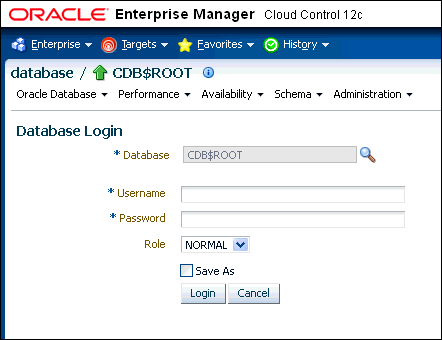
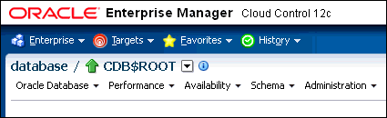
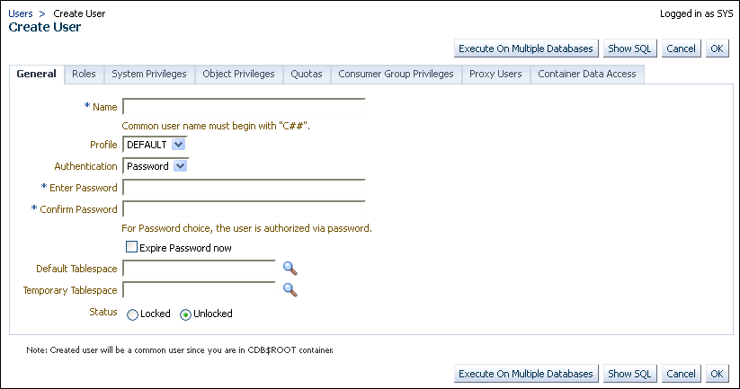
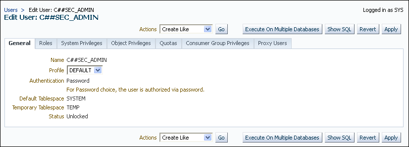
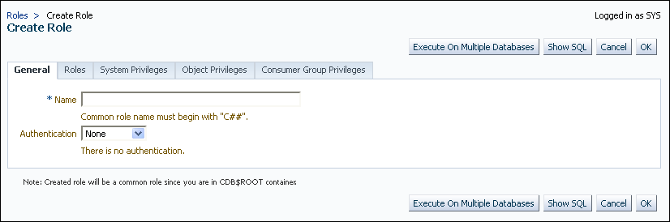

**Parent topic:** [Managing User Authentication and Authorization](part_1.md)

### 9.1 About Managing Security for a Multitenant Environment in Enterprise Manager

You can use Oracle Enterprise Manager Cloud Control to create, manage, and monitor common users and roles for both the root and the associated pluggable databases (PDBs).

Enterprise Manager enables you to switch easily between the root and a designated PDB.

**Parent topic:** Managing Security for a Multitenant Environment in Enterprise Manager

### 9.2 Logging into a Multitenant Environment in Enterprise Manager

You can log in to a CDB or a PDB, and switch from a PDB to a different PDB or to the root.

- Logging into a CDB or a PDB  
	Different variations of the Enterprise Manager Database login page appear automatically based on the feature that you requested while logging in.
- Switching to a Different PDB or to the Root  
	From Oracle Enterprise Manager, you can switch from one PDB to a different PDB, or to the root.

**Parent topic:** Managing Security for a Multitenant Environment in Enterprise Manager

#### 9.2.1 Logging into a CDB or a PDB

Different variations of the Enterprise Manager Database login page appear automatically based on the feature that you requested while logging in.

To log in as a CDB administrator (an Enterprise Manager user who has the `CONNECT` privilege on the CDB target) to use a CDB-scoped feature:

1. Log into Oracle Enterprise Manager Cloud Control as either user `SYSTEM` or `SYSMAN`.
	The URL is as follows:
	```
	https://host:port/em
	```
2. Navigate to the Databases page.
3. Select the database that you want to access.
	The database home page appears.
4. Select the menu item for the action that you want to perform, such as selecting Administration, then Security, and then Users to authenticate a user.
	The Database Login page appears. The following example shows the Database Login page for the CDB (because the database name is shown as `CDB$ROOT`). Because of this name, this page is colloquially referred to as the database login page for the `root` of the multitenant environment. The Database field refers to the current database; had you selected a PDB, then the name of the PDB would appear in this field.
	

> Image em\_login.gif shows from top to bottom, left to right, the following components:
>
> - The main Enterprise Manager Enterprise, Targets, Favorites, and History menu.
> - The database home page icon with the current database listed
> - The Oracle Database, Performance, Availability, Schema, and Administration menu.
> - The Database Login label.
> - The Database, User Name, Password, Role fields; the Save As check box, and the Login and Cancel buttons. The Database field is grayed out and shows the current database.

5. Log in using the appropriate credentials.
	Remember that only common users can log into the root, and that the names of common users begin with `C##` or `c##`. Both common and local users can log into a PDB, depending on their privileges.

**Parent topic:** Logging into a Multitenant Environment in Enterprise Manager

#### 9.2.2 Switching to a Different PDB or to the Root

From Oracle Enterprise Manager, you can switch from one PDB to a different PDB, or to the root.

1. At the top left side of the page, find the database link.
	In the database link, the current container name appears. The following example shows that the current database is the CDB itself (`CDB$ROOT`), colloquially known as the root.
	

> Image em\_database\_breadcrumb.gif...
>
> - The main Enterprise Manager Enterprise, Targets, Favorites, and History menu.
> - The database home page icon with the current database listed. To the left of the database name is a green Up arrow indicating that the database is active, and to the right of the database name is triangle icon, which represents the selection menu.

2. Select the menu icon to the right of the container, and from this menu, select the database that you want to access.
	If the menu item does not appear, then navigate to a page where it does appear, such as the Database home page.
3. When you decide which activity you want to perform (such as creating users), log in with the appropriate privileges.
	If you attempt to perform an activity without first having authenticated with the appropriate privileges, then you will be prompted to log in with the appropriate privilege.

**Parent topic:** Logging into a Multitenant Environment in Enterprise Manager

### 9.3 Managing Common and Local Users in Enterprise Manager

Oracle Enterprise Manager enables you to create, edit, and drop common and local users.

- Creating a Common User Account in Enterprise Manager  
	A common user is a user that exists in the root and can access PDBs in the CDB.
- Editing a Common User Account in Enterprise Manager  
	You can edit a common user account from the root.
- Dropping a Common User Account in Enterprise Manager  
	You can drop a common user from the CDB root.
- Creating a Local User Account in Enterprise Manager  
	A local user is a user that exists only in a specific PDB and does not have access to any other PDBs.
- Editing a Local User Account in Enterprise Manager  
	You can edit a local user from the PDB in which the local user resides.
- Dropping a Local User Account in Enterprise Manager  
	You can drop a local user from the PDB in which the local user resides.

**Parent topic:** Managing Security for a Multitenant Environment in Enterprise Manager

#### 9.3.1 Creating a Common User Account in Enterprise Manager

A common user is a user that exists in the root and can access PDBs in the CDB.

1. From the Enterprise Manager database home page, log in to the root as a common user who has the common `CREATE USER` and `SET CONTAINER` privileges.
2. From the Administration menu, select Security, then Users.
	If prompted, enter your login information. Afterward, the Users page appears.
3. Click Create.
	The Create User page appears.
	

> Image em\_com\_user\_create2.gif shows the Create User page. From top to bottom, left to right, are the following components:
>
> - The User > Create User breadcrumb.
> - The Create User label.
> - The Execute On Multiple Databases, Show SQL, Cancel, and OK buttons.
> - The Create User tabs: General, Roles, System Privileges, Object Privileges, Quotas, Consumer Group Privileges, Proxy Users, and Container Data Access. The General tab is displayed.
> - The General tab shows from top to bottom, Name, Profile, Authentication, Enter Password, Confirm Password, Expire Password Now, Default Tablespace, Temporary Tablespace, Status (Locked or Unlocked).

4. Select the options to create a common user and grant this user privileges.
	Ensure that you preface the user name with `C##` or `c##`.
5. Click OK or Apply.
	The common user is created in the root and will appear in the Users page for any associated PDBs.

#### 9.3.2 Editing a Common User Account in Enterprise Manager

You can edit a common user account from the root.

1. From the Enterprise Manager database home page, log in to the root as a common user who has the common `CREATE USER` and `SET CONTAINER` privileges.
	- If you are logging into the root, then ensure that you are a common user who has the common `CREATE USER` and `SET CONTAINER` privileges.
		- If you are logging into a PDB, ensure that you have the `CREATE USER` privilege for that PDB.
2. From the Administration menu, select Security, then Users.
	If prompted, enter your login information. Afterward, the Users page appears. In the root, only common users are listed. In the PDB, both common and local users are listed.
3. Select the common user to be edited and then click Edit.
	The Edit User page appears. For a common user in the root, you can modify all settings for the common user. For a common user in a PDB, you cannot change the user password, default tablespace, and temporary tablespace. The settings that you make apply only to the current PDB. The following screen shows how a common user Edit User page appears in a PDB.
	

> Image em\_com\_user\_edit.gif shows the Edit User page, with the following components, top to bottom, left to right:
>
> - The User > Edit User breadcrumb.
> - The Edit User label followed by the name of the user account.
> - The menu Actions with Go, and the Execute On Multiple Databases, Show SQL, Cancel, and OK buttons.
> - The Create User tabs: General, Roles, System Privileges, Object Privileges, Quotas, Consumer Group Privileges, Proxy Users, and Container Data Access. The General tab is displayed.
> - The General tab shows from top to bottom, Name (disabled), Profile, Authentication (disabled), Default Tablespace (disabled), Temporary Tablespace (disabled), Status (disabled).

4. Modify the common user as necessary.
5. Click Apply.

#### 9.3.3 Dropping a Common User Account in Enterprise Manager

You can drop a common user from the CDB root.

1. From the Enterprise Manager database home page, log in to the root as a common user who has the common `CREATE USER` and `SET CONTAINER` privileges.
	You cannot drop common users from PDBs.
2. From the Administration menu, select Security, then Users.
	If prompted, enter your login information. Afterward, the Users page appears, listing only common users.
3. Select the common user that you want to drop and then click Delete.
4. Confirm that you want to delete the common user.

#### 9.3.4 Creating a Local User Account in Enterprise Manager

A local user is a user that exists only in a specific PDB and does not have access to any other PDBs.

1. From the Enterprise Manager database home page, log in to the root as a local or common user who has the local `CREATE USER` privilege.
2. From the Administration menu, select Security, then Users.
	If prompted, enter your login information. Afterward, the Users page appears, showing only local users for the current PDB.
3. Click Create.
	The Create User page appears.
4. Select the options that create a local user and grant this user privileges.
	Ensure that you do not preface the user name with `C##` or `c##`.
5. Click OK.
	The local user is created in the current PDB.

#### 9.3.5 Editing a Local User Account in Enterprise Manager

You can edit a local user from the PDB in which the local user resides.

1. From the Enterprise Manager database home page, log in to the PDB as a local or common user who has the local `CREATE USER` privilege.
2. From the Administration menu, select Security, then Users.
	If prompted, enter your login information. Afterward, the Users page appears, showing only local users for the current PDB and common users.
3. Select the local user to be edited and then click Edit.
	The Edit User page appears.
4. Modify the local user as necessary.
5. Click Apply.

#### 9.3.6 Dropping a Local User Account in Enterprise Manager

You can drop a local user from the PDB in which the local user resides.

1. From the Enterprise Manager database home page, log in to the PDB as a local or common user who has the local `CREATE USER` privilege.
2. From the Administration menu, select Security, then Users.
	If prompted, enter your login information. Afterward, the Users page appears, showing only local users for the current PDB and common users. (You cannot drop common users from a PDB.)
3. Select the local user you want to drop and then click Delete.
	Enterprise Manager prompts you to confirm deletion of the user.
4. Confirm that you want to delete the local user.

### 9.4 Managing Common and Local Roles and Privileges in Enterprise Manager

You can use Oracle Enterprise Manager to create, edit, drop, and revoke common and local roles.

- Creating a Common Role in Enterprise Manager  
	Common roles can be used to assign common privileges to common users.
- Editing a Common Role in Enterprise Manager  
	You can edit a common role from the root.
- Dropping a Common Role in Enterprise Manager  
	You can drop a common role from the root.
- Revoking Common Privilege Grants in Enterprise Manager  
	You can revoke common privilege grants from the root.
- Creating a Local Role in Enterprise Manager  
	A common role can be used to assign a local set of privileges to local users later.
- Editing a Local Role in Enterprise Manager  
	You can edit a local role in the PDB in which the local role resides.
- Dropping a Local Role in Enterprise Manager  
	You can drop local role from the PDB in which the local role resides.
- Revoking Local Privilege Grants in Enterprise Manager  
	You can revoke local privileges in the PDB in which the privileges are used.

**Parent topic:** Managing Security for a Multitenant Environment in Enterprise Manager

#### 9.4.1 Creating a Common Role in Enterprise Manager

Common roles can be used to assign common privileges to common users.

These roles are valid across all containers.

1. From the Enterprise Manager database home page, log in to the root as a common user who has the common `CREATE ROLE` and `SET CONTAINER` privileges.
2. From the Administration menu, select Security, then Roles.
	If prompted, enter your login information. Afterward, the Create Role page appears.
3. Click Create.
	The Create Role page appears.
	

> Image em\_com\_role\_create.gif shows the Create Role page, with the following components from top to bottom, left to right:
>
> - The User > Create Role breadcrumb.
> - The Create Role label.
> - The buttons Execute On Multiple Databases, Show SQL, Cancel, and OK buttons.
> - The Create Role tabs: General, Roles, System Privileges, Object Privileges, Consumer Group Privileges. The General tab is displayed.
> - The General tab shows from top to bottom, Name field and Authentication menu.

4. Select the options that create a common role and grant this role privileges.
	Ensure that you preface the role name with `C##` or `c##`.
5. Click OK.
	The common role is created in the root.

**Parent topic:** Managing Common and Local Roles and Privileges in Enterprise Manager

#### 9.4.2 Editing a Common Role in Enterprise Manager

You can edit a common role from the root.

1. From the Enterprise Manager database home page, log in to the root or the PDB. If you are logging into the root, then ensure that you are a common user who has the common `CREATE ROLE` and `SET CONTAINER` privileges. If you are logging into a PDB, ensure that you have the `CREATE ROLE` privilege for that PDB.
2. From the Administration menu, select Security, then Roles.
	If prompted, enter your login information. Afterward, the Roles page appears. In the root, only common roles are shown. In the PDB, both common and local roles are shown.
3. Select the common role to be edited and then click Edit.
	The Edit Role page appears. For a common user in the root, you can modify all settings for the common user.
	For a common role in a PDB, you can only change the role's authentication and grant this user different roles, system privileges, object privileges, and consumer group privileges. These settings apply only to the current PDB.
4. Modify the common user as necessary.
5. Click Apply.

#### 9.4.3 Dropping a Common Role in Enterprise Manager

You can drop a common role from the root.

1. From the Enterprise Manager database home page, log in to the root as a common user who has the common `CREATE ROLE` and `SET CONTAINER` privileges.
	You cannot drop common roles from PDBs.
2. From the Administration menu, select Security, then Roles.
	If prompted, enter your login information. Afterward, the Roles page appears, showing only common roles.
3. Select the common role that you want to drop and then click Delete.
4. Confirm that you want to delete the common role.

#### 9.4.4 Revoking Common Privilege Grants in Enterprise Manager

You can revoke common privilege grants from the root.

1. From the Enterprise Manager database home page, log in to the root as a common user who has the common `CREATE USER`, `CREATE ROLE`, and `SET CONTAINER` privileges.
2. From the Administration menu, select Security, then Users.
	The Users page lists the common users.
3. Select the user whose privileges you want to revoke and then click Edit.
	The Edit User page appears.
4. Select Roles or the appropriate Privileges tab.
	Enterprise Manager displays a list of roles and privileges assigned to this user.
5. Select Edit List and then remove the roles or privileges as necessary.
6. Click the OK button.

#### 9.4.5 Creating a Local Role in Enterprise Manager

A common role can be used to assign a local set of privileges to local users later.

These roles will be valid across PDB containers for whom they are defined.

1. From the Enterprise Manager database home page, log in to the PDB as a user who has the local `CREATE ROLE` privilege.
2. From the Administration menu, select Security, then Roles.
	The Roles page appears.
3. Click Create.
	If prompted, enter your login information. Afterward, the Create Role page appears.
4. Select the options that create a local role and grant this role privileges.
	Ensure that you do not preface the role name with `C##` or `c##`.
5. Click OK.
	The local role is created in the current PDB.

#### 9.4.6 Editing a Local Role in Enterprise Manager

You can edit a local role in the PDB in which the local role resides.

1. From the Enterprise Manager database home page, log in to the PDB as a user who has the local `CREATE ROLE` privilege.
2. From the Administration menu, select Security, then Roles.
	If prompted, enter your login information. Afterward, the Roles page appears, showing only local roles for the current PDB and common roles.
3. Select the local role to be edited and then click Edit.
	The Edit User page appears.
4. Modify the local user as necessary.
5. Click Apply.

#### 9.4.7 Dropping a Local Role in Enterprise Manager

You can drop local role from the PDB in which the local role resides.

1. From the Enterprise Manager database home page, log in to the PDB as a user who has the local `CREATE ROLE` privilege.
2. From the Administration menu, select Security, then Role.
	If prompted, enter your login information. Afterward, the Roles page appears, showing only local roles for the current PDB and common roles. (You cannot drop common roles from a PDB.)
3. Select the local role you want to drop and then click Delete.
	Enterprise Manager prompts you to confirm deletion of the role.
4. Confirm that you want to delete the local role.

#### 9.4.8 Revoking Local Privilege Grants in Enterprise Manager

You can revoke local privileges in the PDB in which the privileges are used.

1. From the Enterprise Manager database home page, log in to the PDB as a common or local user who has the `CREATE USER` and `CREATE ROLE` privileges.
2. From the Administration menu, select Security, then Users.
	If prompted, enter your login information. Afterward, the Users page appears. In a PDB, both common and local users are listed.
3. Select the user whose privileges you want to revoke and then click Edit.
	The Edit User page appears.
4. Select Roles or the appropriate Privileges tab.
	Enterprise Manager displays a list of roles and privileges assigned to this user.
5. Select Edit List and then remove the privileges as necessary.
6. Click the OK button.