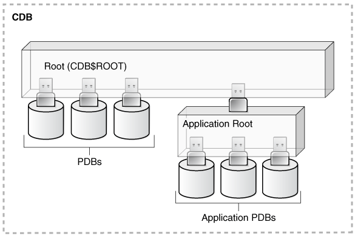

You can manage the security for Oracle Database users in many ways, such as enforcing restrictions on the way that passwords are created.

- About User Security  
	You can secure users accounts through strong passwords and by specifying special limits for the users.
- Creating User Accounts  
	A user account can have restrictions such as profiles, a default role, and tablespace restrictions.
- Altering User Accounts  
	The `ALTER USER` statement modifies user accounts, such their default tablespace or profile, or changing a user's password.
- Configuring User Resource Limits  
	A resource limit defines the amount of system resources that are available for a user.
- Dropping User Accounts  
	You can drop user accounts if the user is not in a session, and if the user has objects in the user’s schema.
- Predefined Schema User Accounts Provided by Oracle Database  
	The Oracle Database installation process creates predefined administrative, non-administrative, and sample schema user accounts in the database.
- Database User and Profile Data Dictionary Views  
	Oracle Database provides a set of data dictionary views that provide information about the settings that you used to create users and profiles.

**Parent topic:** [Managing User Authentication and Authorization](part_1.md)

### 2.1 About User Security

You can secure users accounts through strong passwords and by specifying special limits for the users.

Each Oracle database (CDB and PDB) has a list of valid database users. To access CDB or PDB, a user must run a database application, and connect to the database instance using a valid user name defined in the database.

When you create user accounts, you can specify limits to the user account. You can also set limits on the amount of various system resources available to each user as part of the security domain of that user. Oracle Database provides a set of database views that you can query to find information such as resource and session information.

Profiles are also available. Profiles provide a way to configure the resources for the database user. A profile is collection of attributes that apply to a user. It enables a single point of reference for any of multiple users that share those exact attributes.

Oracle Database provides a set of predefined administrative, non-administrative, and sample schema accounts. The Oracle Database installation guides provide a listing of these accounts. To find the status of these accounts, query the `USERNAME` and `ACCOUNT_STATUS` columns of the `DBA_USERS` data dictionary view.

### 2.2 Creating User Accounts

A user account can have restrictions such as profiles, a default role, and tablespace restrictions.

- About Common Users and Local Users  
	CDB common users and application common have access to their respective containers, and local users are specific to a PDB.
- Who Can Create User Accounts?  
	Users who has been granted the `CREATE USER` system privilege can create user accounts, including user accounts to be used as proxy users.
- Creating a New User Account That Has Minimum Database Privileges  
	When you create a new user account, you should enable this user to access the database.
- Restrictions on Creating the User Name for a New Account  
	When you specify a name for a user account, be aware of restrictions such as naming conventions and whether the name is unique.
- Assignment of User Passwords  
	The `IDENTIFIED BY` clause of the `CREATE USER` statement assigns the user a password.
- Default Tablespace for the User  
	A default tablespace stores objects that users create.
- Tablespace Quotas for a User  
	The tablespace quota defines how much space to provide for a user's tablespace.
- Temporary Tablespaces for the User  
	A temporary tablespace contains transient data that persists only for the duration of a user session.
- Profiles for the User  
	A profile is a set of limits, defined by attributes, on database resources and password access to the database.
- Creation of a Common User or a Local User  
	The `CREATE USER` SQL statement can be used to create both common (CDB and application) users and local users.
- Creating a Default Role for the User  
	A default role is automatically enabled for a user when the user creates a session.

**Parent topic:** Managing Security for Oracle Database Users

#### 2.2.1 About Common Users and Local Users

CDB common users and application common have access to their respective containers, and local users are specific to a PDB.

**Parent topic:** Creating User Accounts

##### 2.2.1.1 About Common Users

Oracle provides two types of common users: CDB common users and application common users.

A CDB common user is a database user whose single identity and password are known in the CDB root and in every existing and future pluggable database (PDB), including any application roots. All Oracle-supplied administrative user accounts, such as `SYS` and `SYSTEM`, are CDB common users and can navigate across the system container. CDB common users can have different privileges in different PDBs. For example, the user `SYSTEM` can switch between PDBs and use the privileges that are granted to `SYSTEM` in the current PDB. However, if one of the PDBs is Oracle Database Vault-enabled, then the Database Vault restrictions, such as `SYSTEM` not being allowed to create user accounts, apply to `SYSTEM` when this user is connected to that PDB. Oracle does not recommend that you change the privileges of the Oracle-supplied CDB common users.

A CDB common user can perform all tasks that an application common user can perform, provided that appropriate privileges have been granted to that user.

An application common user is a user account that is created in an application root, and is common only within this application container. In other words, the application common user does not have access to the entire CDB environment like CDB common users. An application common user is responsible for activities such as creating (which includes plugging), opening, closing, unplugging, and dropping application PDBs. This user can create application common objects in the application root. You can create an application common user only when you are connected to an application root. The ability for users to access the application common objects is subject to the same privileges as local and CDB common objects. For example, a local user in a PDB that is associated with an application root has access to only the objects in that PDB for which the user has privileges. In the application root itself, you can commonly grant a privilege on a CDB common object that will apply across the application container.

Both of these types of common users are responsible for managing the common objects in their respective roots. If the CDB common user or the application common user has the appropriate privileges, then this user can perform operations in PDBs as well, such as granting privileges to local users. These users can also locally grant common users different privileges in each container.

Both CDB and application common users can perform the following activities:

- Granting privileges to common users or common roles. That is, a CDB common user can grant a privilege to a common user or role, and the scope within which this privilege applies is determined by the container (CDB root, application root, or PDB) in which the statement is issued and whether the privilege is granted commonly (in the CDB root or the application root). A CDB common user connected to an application root can commonly grant a privilege on a CDB common object, and that privilege will apply across the application container.
	The following diagram illustrates the access hierarchy with CDB common users, application common users, and local users:
	

> Image dbseg\_vm\_011a.png illustrates the hierarchy of a CDB environment. Within the CDB environment there is the root (CDB$ROOT). Connecting to this root are one or more PDBs and an application root. Connecting to the application root can be one or more application PDBs.
>
> [  
> Copyright © 1996, 2024, Oracle and/or its affiliates.](https://docs.oracle.com/en/database/oracle/oracle-database/dcommon/html/cpyr.htm)

	CDB common users are defined in the CDB root and may be able to access all PDBs within the CDB, including application roots and their application PDBs. Application common users are defined in the application root and have access to the PDBs that belong to the application container. Local users in either the CDB PDBs or the application PDBs have access only to the PDBs in which the local user resides.
- The state of a PDB can be altered by a suitably privileged user who can issue the `ALTER PLUGGABLE DATABASE` statement from the CDB root, from an application root (if a PDB is an application PDB that belongs to the application container), or from a PDB itself.
	One difference between CDB common users and application common users is that only a CDB common user can run an `ALTER DATABASE` statement that specifies the recovery clauses that apply to the entire CDB.

##### 2.2.1.2 How Plugging in PDBs Affects CDB Common Users

Plugging a unplugged PDB into a CDB as a PDB affects both Oracle-supplied administrative and user-created accounts and privileges.

This affects the passwords of these CDB common user accounts, and privileges of all accounts in the newly plugged-in database.

The following actions take place:

- The Oracle-supplied administrative accounts are merged with the existing common user accounts.
- User-created accounts are merged with the existing user-created common user accounts.
- The passwords of the existing CDB common user accounts take precedence over the passwords for the accounts from the non-CDB.
- If you had modified the privileges of a user account in its original unplugged PDB, then these privileges are saved, but they only apply to the PDB that was created when the PDB was plugged into the CDB, as locally granted privileges. For example, suppose you had granted the user `SYSTEM` a role called `hr_mgr` in the non-CDB `db1`. After the `db1` database has been added to a CDB, then `SYSTEM` can only use the `hr_mgr` role in the `db1` PDB, and not in any other PDBs.

The following two scenarios are possible when you plug a PDB (for example, `pdb_1`) from one CDB (`cdb_1`) to a another CDB (`cdb_2`):

- `cdb_1` has the common user `c##cdb1_user`. `cdb_2` does not have this user.
	`c##cdb1_user` remains in `PDB_1` but this account is locked. To resurrect this account, you must close `pdb_1`, recreate common user `c##cdb1_user` in the root of `cdb_2`, and then re-open `pdb_1`.
- `cdb_1` and `cdb_2` both have common user `c##common_user`.
	Both `c##common_user` accounts are merged. `c##common_user` retains its password in `cdb_2`. Any privileges assigned to it in `cdb_2` but not in `cdb_1` are retained locally in `pdb_1`.

**Parent topic:** About Common Users and Local Users

##### 2.2.1.3 About Local Users

A local user is a database user that exists only in a single PDB.

Local users can have administrative privileges, but these privileges apply only in the PDB in which the local user account was created. A local user account has the following characteristics, which distinguishes it from common user accounts:

- Local user accounts cannot create common user accounts or commonly grant them privileges. A common user with the appropriate privileges can create and modify common or local user accounts and grant and revoke privileges, commonly or locally. A local user can create and modify local user accounts or locally grant privileges to common or local users in a given PDB.
- You can grant local user accounts common roles. However, the privileges associated with the common role only apply to the local user's PDB.
- The local user account must be unique only within its PDB.
- With the appropriate privileges, a local user can access objects in a common user's schema. For example, a local user can access a table within the schema of a common user if the common user has granted the local user privileges to access it.
- You can editions-enable a local user account but not a common user account.

#### 2.2.2 Who Can Create User Accounts?

Users who has been granted the `CREATE USER` system privilege can create user accounts, including user accounts to be used as proxy users.

Because the `CREATE USER` system privilege is a powerful privilege, a database administrator or security administrator is usually the only user who has this system privilege.

If you want to create users who themselves have the privilege to create users, then include the `WITH ADMIN OPTION` clause in the `GRANT` statement. For example:

```
GRANT CREATE USER TO lbrown WITH ADMIN OPTION;
```

As with all user accounts to whom you grant privileges, grant these privileges to trusted users only.

Before you can create common user accounts, you must have the commonly granted `CREATE USER` system privilege. To create local user accounts, you must have a commonly granted `CREATE USER` privilege or a locally granted `CREATE USER` privilege in the PDB in which the local user account will be created.

Note:

As a security administrator, you should create your own roles and assign only those privileges that are needed. For example, many users formerly granted the `CONNECT` privilege did not need the additional privileges `CONNECT` used to provide. Instead, only `CREATE SESSION` was actually needed. By default, the `SET CONTAINER` privilege is granted to `CONNECT` role.

Creating organization-specific roles gives an organization detailed control of the privileges it assigns, and protects it in case Oracle Database changes the roles that it defines in future releases.

#### 2.2.3 Creating a New User Account That Has Minimum Database Privileges

When you create a new user account, you should enable this user to access the database.

1. Use the `CREATE USER` statement to create a new user account.
	For example:
	```
	CREATE USER jward 
	 IDENTIFIED BY password 
	 DEFAULT TABLESPACE example 
	 QUOTA 10M ON example 
	 TEMPORARY TABLESPACE temp
	 QUOTA 5M ON system 
	 PASSWORD EXPIRE;
	```
	Ensure that the password that you create is secure. This example creates a local user account and specifies the user password, default tablespace, temporary tablespace where temporary segments are created, tablespace quotas, and profile.
2. At minimum, grant the user the `CREATE SESSION` privilege so that the user can access the database instance.
	```
	GRANT CREATE SESSION TO jward;
	```
	A newly created user cannot connect to the database until he or she has the `CREATE SESSION` privilege. If the user must access Oracle Enterprise Manager, then you should also grant the user the `SELECT ANY DICTIONARY` privilege.

**Related Topics**

- [Guidelines for Securing Passwords](keeping-your-oracle-database-secure.md)
- Restrictions on Creating the User Name for a New Account
- Assignment of User Passwords
- Default Tablespace for the User
- Tablespace Quotas for a User
- Temporary Tablespaces for the User
- Profiles for the User
- Creation of a Common User or a Local User

**Parent topic:** Creating User Accounts

#### 2.2.4 Restrictions on Creating the User Name for a New Account

When you specify a name for a user account, be aware of restrictions such as naming conventions and whether the name is unique.

- Uniqueness of User Names  
	Each user has an associated schema; within a schema, each schema object must have a unique name.
- User Names in a Multitenant Environment  
	Within each PDB, a user name must be unique with respect to other user names and roles in that PDB.
- Case Sensitivity for User Names  
	How you create a user name controls the case sensitivity in which the user name is stored in the database.

**Parent topic:** Creating User Accounts

##### 2.2.4.1 Uniqueness of User Names

Each user has an associated schema; within a schema, each schema object must have a unique name.

Oracle Database will prevent you from creating a user name if it is already exists. You can check existing names by querying the `USERNAME` column of the `DBA_USERS` data dictionary view.

**Parent topic:** Restrictions on Creating the User Name for a New Account

##### 2.2.4.2 User Names in a Multitenant Environment

Within each PDB, a user name must be unique with respect to other user names and roles in that PDB.

Note the following restrictions:

- For common user names, names for user-created common users must begin with a common user prefix. By default, for CDB common users, this prefix is `C##`. For application common users, this prefix is an empty string. This means that there are no restrictions on the name that can be assigned to an application common user other than that it cannot start with the prefix reserved for CDB common users. For example, you could name a CDB common user `c##hr_admin` and an application common user `hr_admin`.
	The `COMMON_USER_PREFIX` parameter in `CDB$ROOT` defines the common user prefix. You can change this setting, but do so only with great care.
- For local user names, the name cannot start with `C##` (or `c##`).
- A user and a role cannot have the same name.

**Parent topic:** Restrictions on Creating the User Name for a New Account

##### 2.2.4.3 Case Sensitivity for User Names

How you create a user name controls the case sensitivity in which the user name is stored in the database.

For example:

```
CREATE USER jward
 IDENTIFIED BY password
 DEFAULT TABLESPACE data_ts
 QUOTA 100M ON test_ts
 QUOTA 500K ON data_ts
 TEMPORARY TABLESPACE temp_ts
 PROFILE clerk
 CONTAINER = CURRENT;
```

User `jward` is stored in the database in upper-case letters. For example:

```
SELECT USERNAME FROM ALL_USERS;

USERNAME
---------
JWARD
...
```

However, if you enclose the user name in double quotation marks, then the name is stored using the case sensitivity that you used for the name. For example:

```
CREATE USER "jward" IDENTIFIED BY password;
```

So, when you query the `ALL_USERS` data dictionary view, you will find that the user account is stored using the case that you used to create it.

```
SELECT USERNAME FROM ALL_USERS;

USERNAME
---------
jward
...
```

User `JWARD` and user `jward` are both stored in the database as separate user accounts. Later on, if you must modify or drop the user that you had created using double quotation marks, then you must enclose the user name in double quotation marks.

For example:

```
DROP USER "jward";
```

**Parent topic:** Restrictions on Creating the User Name for a New Account

#### 2.2.5 Assignment of User Passwords

The `IDENTIFIED BY` clause of the `CREATE USER` statement assigns the user a password.

Ensure that you create a secure password.

```
CREATE USER jward
 IDENTIFIED BY password
 DEFAULT TABLESPACE data_ts
 QUOTA 100M ON test_ts
 QUOTA 500K ON data_ts
 TEMPORARY TABLESPACE temp_ts
 PROFILE clerk
 CONTAINER = CURRENT;
```

#### 2.2.6 Default Tablespace for the User

A default tablespace stores objects that users create.

- About Assigning a Default Tablespace for a User  
	Each user should have a default tablespace.
- DEFAULT TABLESPACE Clause for Assigning a Default Tablespace  
	The `DEFAULT TABLESPACE` clause in the `CREATE USER` statement assigns a default tablespace to the user.

**Parent topic:** Creating User Accounts

##### 2.2.6.1 About Assigning a Default Tablespace for a User

Each user should have a default tablespace.

When a schema object is created in the user's schema and the DDL statement does not specify a tablespace to contain the object, the Oracle Database stores the object in the user's default tablespace.

Tablespaces enable you to separate user data from system data, such as the data that is stored in the `SYSTEM` tablespace. You use the `CREATE USER` or `ALTER USER` statement to assign a default tablespace to a user. The default setting for the default tablespaces of all users is the `SYSTEM` tablespace. If a user does not create objects, and has no privileges to do so, then this default setting is fine. However, if a user is likely to create any type of object, then you should specifically assign the user a default tablespace, such as the `USERS` tablespace. Using a tablespace other than `SYSTEM` reduces contention between data dictionary objects and user objects for the same data files. In general, do not store user data in the `SYSTEM` tablespace.

You can use the `CREATE TABLESPACE` SQL statement to create a permanent default tablespace other than `SYSTEM` at the time of database creation, to be used as the database default for permanent objects. By separating the user data from the system data, you reduce the likelihood of problems with the `SYSTEM` tablespace, which can in some circumstances cause the entire database to become nonfunctional. This default permanent tablespace is not used by system users, that is, `SYS`, `SYSTEM`, and `OUTLN`, whose default permanent tablespace is `SYSTEM`. A tablespace designated as the default permanent tablespace cannot be dropped. To accomplish this goal, you must first designate another tablespace as the default permanent tablespace. You can use the `ALTER TABLESPACE` SQL statement to alter the default permanent tablespace to another tablespace. Be aware that this will affect all users or objects created after the `ALTER` DDL statement is executed.

You can also set a user default tablespace during user creation, and change it later with the `ALTER USER` statement. Changing the user default tablespace affects only objects created after the setting is changed.

When you specify the default tablespace for a user, also specify a quota on that tablespace.

**Parent topic:** Default Tablespace for the User

##### 2.2.6.2 DEFAULT TABLESPACE Clause for Assigning a Default Tablespace

The `DEFAULT TABLESPACE` clause in the `CREATE USER` statement assigns a default tablespace to the user.

In the following `CREATE USER` statement, the default tablespace for local user `jward` is `data_ts`:

```
CREATE USER jward
 IDENTIFIED BY password
 DEFAULT TABLESPACE data_ts
 QUOTA 100M ON test_ts
 QUOTA 500K ON data_ts
 TEMPORARY TABLESPACE temp_ts
 PROFILE clerk
 CONTAINER = CURRENT;
```

#### 2.2.7 Tablespace Quotas for a User

The tablespace quota defines how much space to provide for a user's tablespace.

- About Assigning a Tablespace Quota for a User  
	You can assign each user a tablespace quota for any tablespace, except a temporary tablespace.
- CREATE USER Statement for Assigning a Tablespace Quota  
	The `QUOTA` clause of the `CREATE USER` statement assigns the quotas for a tablespace.
- Restriction of the Quota Limits for User Objects in a Tablespace  
	You can restrict the quota limits for user objects in a tablespace so that the current quota is zero.
- Grants to Users for the UNLIMITED TABLESPACE System Privilege  
	To permit a user to use an unlimited amount of any tablespace in the database, grant the user the `UNLIMITED TABLESPACE` system privilege.

**Parent topic:** Creating User Accounts

##### 2.2.7.1 About Assigning a Tablespace Quota for a User

You can assign each user a tablespace quota for any tablespace, except a temporary tablespace.

Assigning a quota accomplishes the following:

- Users with privileges to create certain types of objects can create those objects in the specified tablespace.
- Oracle Database limits the amount of space that can be allocated for storage of a user's objects within the specified tablespace to the amount of the quota.

By default, a user has no quota on any tablespace in the database. If the user has the privilege to create a schema object, then you must assign a quota to allow the user to create objects. At a minimum, assign users a quota for the default tablespace, and additional quotas for other tablespaces in which they can create objects. The maximum amount of space that you can assign for a tablespace is 2 TB. If you need more space, then specify `UNLIMITED` for the `QUOTA` clause.

You can assign a user either individual quotas for a specific amount of disk space in each tablespace or an unlimited amount of disk space in all tablespaces. Specific quotas prevent a user's objects from using too much space in the database.

You can assign quotas to a user tablespace when you create the user, or add or change quotas later. (You can find existing user quotas by querying the `USER_TS_QUOTAS` view.) If a new quota is less than the old one, then the following conditions remain true:

- If a user has already exceeded a new tablespace quota, then the objects of a user in the tablespace cannot be allocated more space until the combined space of these objects is less than the new quota.
- If a user has not exceeded a new tablespace quota, or if the space used by the objects of the user in the tablespace falls under a new tablespace quota, then the user's objects can be allocated space up to the new quota.

**Parent topic:** Tablespace Quotas for a User

##### 2.2.7.2 CREATE USER Statement for Assigning a Tablespace Quota

The `QUOTA` clause of the `CREATE USER` statement assigns the quotas for a tablespace.

The following `CREATE USER` statement assigns quotas for the `test_ts` and `data_ts` tablespaces:

```
CREATE USER jward
 IDENTIFIED BY password
 DEFAULT TABLESPACE data_ts
 QUOTA 500K ON data_ts
 QUOTA 100M ON test_ts
 TEMPORARY TABLESPACE temp_ts
 PROFILE clerk
 CONTAINER = CURRENT;
```

**Parent topic:** Tablespace Quotas for a User

##### 2.2.7.3 Restriction of the Quota Limits for User Objects in a Tablespace

You can restrict the quota limits for user objects in a tablespace so that the current quota is zero.

To restrict the quote limits, use the `ALTER USER` SQL statement.

After a quota of zero is assigned, the objects of the user in the tablespace remain, and the user can still create new objects, but the existing objects will not be allocated any new space. For example, you could not insert data into one of this user's existing tables. The operation will fail with an `ORA-1536 space quota exceeded for tablespace %s` error.

**Parent topic:** Tablespace Quotas for a User

##### 2.2.7.4 Grants to Users for the UNLIMITED TABLESPACE System Privilege

To permit a user to use an unlimited amount of any tablespace in the database, grant the user the `UNLIMITED TABLESPACE` system privilege.

The `UNLIMITED TABLESPACE` privilege overrides all explicit tablespace quotas for the user. If you later revoke the privilege, then you must explicitly grant quotas to individual tablespaces. You can grant this privilege only to users, not to roles.

Before granting the `UNLIMITED TABLESPACE` system privilege, consider the consequences of doing so.

Advantage:

- You can grant a user unlimited access to all tablespaces of a database with one statement.

Disadvantages:

- The privilege overrides all explicit tablespace quotas for the user.
- You cannot selectively revoke tablespace access from a user with the `UNLIMITED TABLESPACE` privilege. You can grant selective or restricted access only after revoking the privilege.

**Parent topic:** Tablespace Quotas for a User

#### 2.2.8 Temporary Tablespaces for the User

A temporary tablespace contains transient data that persists only for the duration of a user session.

- About Assigning a Temporary Tablespace for a User  
	You should assign each user a temporary tablespace.
- TEMPORARY TABLESPACE Clause for Assigning a Temporary Tablespace  
	The `TEMPORARY TABLESPACE` clause in the `CREATE USER` statement assigns a user a temporary tablespace.

**Parent topic:** Creating User Accounts

##### 2.2.8.1 About Assigning a Temporary Tablespace for a User

You should assign each user a temporary tablespace.

When a user executes a SQL statement that requires a temporary segment, Oracle Database stores the segment in the temporary tablespace of the user. These temporary segments are created by the system when performing sort or join operations. Temporary segments are owned by `SYS`, which has resource privileges in all tablespaces.

To create a temporary tablespace, you can use the `CREATE TEMPORARY TABLESPACE` SQL statement.

If you do not explicitly assign the user a temporary tablespace, then Oracle Database assigns the user the default temporary tablespace that was specified at database creation, or by an `ALTER DATABASE` statement at a later time. If there is no default temporary tablespace explicitly assigned, then the default is the `SYSTEM` tablespace or another permanent default established by the system administrator. Assigning a tablespace to be used specifically as a temporary tablespace eliminates file contention among temporary segments and other types of segments.

Note:

If your `SYSTEM` tablespace is locally managed, then users must be assigned a specific default (locally managed) temporary tablespace. They may not be allowed to default to using the `SYSTEM` tablespace because temporary objects cannot be placed in locally managed permanent tablespaces.

You can set the temporary tablespace for a user at user creation, and change it later using the `ALTER USER` statement. You can also establish tablespace groups instead of assigning individual temporary tablespaces.

##### 2.2.8.2 TEMPORARY TABLESPACE Clause for Assigning a Temporary Tablespace

The `TEMPORARY TABLESPACE` clause in the `CREATE USER` statement assigns a user a temporary tablespace.

In the following example, the temporary tablespace of `jward` is `temp_ts`, a tablespace created explicitly to contain only temporary segments.

```
CREATE USER jward
 IDENTIFIED BY password
 DEFAULT TABLESPACE data_ts
 QUOTA 100M ON test_ts
 QUOTA 500K ON data_ts
 TEMPORARY TABLESPACE temp_ts
 PROFILE clerk
 CONTAINER = CURRENT;
```

**Parent topic:** Temporary Tablespaces for the User

#### 2.2.9 Profiles for the User

A profile is a set of limits, defined by attributes, on database resources and password access to the database.

The profile can be applied to multiple users, enabling them to share these attributes.

You can specify a profile when you create a user. The `PROFILE` clause of the `CREATE USER` statement assigns a user a profile. If you do not specify a profile, then Oracle Database assigns the user a default profile.

For example:

```
CREATE USER jward
 IDENTIFIED BY password
 DEFAULT TABLESPACE data_ts
 QUOTA 100M ON test_ts
 QUOTA 500K ON data_ts
 TEMPORARY TABLESPACE temp_ts
 PROFILE clerk
 CONTAINER = CURRENT;
```

Different profiles can be assigned to a common user in the root and in a PDB. When the common user logs in to the PDB, a profile whose setting applies to the session depends on whether the settings are password-related or resource-related.

- Password-related profile settings are fetched from the profile that is assigned to the common user in the root. For example, suppose you assign a common profile `c##prof` (in which `FAILED_LOGIN_ATTEMPTS` is set to `1`) to common user `c##admin` in the root. In a PDB that user is assigned a local profile `local_prof` (in which `FAILED_LOGIN_ATTEMPTS` is set to `6`.) Common user `c##admin` is allowed only one failed login attempt when he or she tries to log in to the PDB where `loc_prof` is assigned to him.
- Resource-related profile settings specified in the profile assigned to a user in a PDB get used without consulting resource-related settings in a profile assigned to the common user in the root. For example, if the profile `local_prof` that is assigned to user `c##admin` in a PDB has `SESSIONS_PER_USER` set to `2`, then `c##admin` is only allowed only 2 concurrent sessions when he or she logs in to the PDB `loc_prof` is assigned to him, regardless of value of this setting in a profile assigned to him in the root.

#### 2.2.10 Creation of a Common User or a Local User

The `CREATE USER` SQL statement can be used to create both common (CDB and application) users and local users.

- About Creating Common User Accounts  
	Be aware of common user account restrictions such as where they can be created, naming conventions, and objects stored in their schemas.
- CREATE USER Statement for Creating a Common User Account  
	The `CREATE USER` statement `CONTAINER=ALL` clause can be used to create a common user account.
- About Creating Local User Accounts  
	Be aware of local user account restrictions such as where they can be created, naming conventions, and objects stored in their schemas.
- CREATE USER Statement for Creating a Local User Account  
	The `CREATE USER` statement `CONTAINER` clause can be used to create a local user account.

**Parent topic:** Creating User Accounts

##### 2.2.10.1 About Creating Common User Accounts

Be aware of common user account restrictions such as where they can be created, naming conventions, and objects stored in their schemas.

To create a common user account, follow these rules:

- To create a CDB common user, you must be connected to the CDB root and have the commonly granted `CREATE USER` system privilege.
- To create an application common user, you must be connected to the application root and have the commonly granted `CREATE USER` system privilege.
- You can run the `CREATE USER ... CONTAINER = ALL` statement to create an application common user in the application root. Afterward, you must synchronize the application so that this user can be visible in the application PDB. For example, for an application named `saas_sales_app`:
	```
	ALTER PLUGGABLE DATABASE APPLICATION saas_sales_app SYNC;
	```
- The name that you give the common user who connects to the CDB root must begin with the prefix that is defined in the `COMMON_USER_PREFIX` parameter in the CDB root, which by default is `C##`. (You can modify this parameter, but only do so with great caution.) It must contain only ASCII or EBCDIC characters. This naming requirement does not apply to the names of existing Oracle-supplied user accounts, such as `SYS` or `SYSTEM`. To find the names of existing user accounts, query the `ALL_USERS`, `CDB_USERS`, `DBA_USERS`, and `USER_USERS` data dictionary views.
- The name that you give the common user who connects to the application root must follow the naming conventions for standard user accounts. By default, the `COMMON_USER_PREFIX` parameter in the application root is set to an empty string. In other words, you can create a user named `hr_admin` in the application root but not a user named `c##hr_admin`.
- To explicitly designate a user account as a CDB or an application common user, in the `CREATE USER` statement, specify the `CONTAINER=ALL` clause. If you are logged into the CDB or application root, and if you omit the `CONTAINER` clause from your `CREATE USER` statement, then the `CONTAINER=ALL` clause is implied.
- Do not create objects in the schemas of common users for a CDB. Instead, you can create application common objects. These are objects whose metadata, and in case of data links or extended data links, data, is shared between all application PDBs that belong to the application container. You must create the application common object in the root of an application container.
- If you specify the `DEFAULT TABLESPACE`, `TEMPORARY TABLESPACE`, `QUOTA...ON`, and `PROFILE` clauses in the `CREATE USER` statement for a CDB or an application common user account, then you must ensure that these objects—tablespaces, tablespace groups, and profiles—exist in all containers of the CDB for a CDB common user, or in the application root and all PDBs of an application container for an application common user.

**Parent topic:** Creation of a Common User or a Local User

##### 2.2.10.2 CREATE USER Statement for Creating a Common User Account

The `CREATE USER` statement `CONTAINER=ALL` clause can be used to create a common user account.

You must be in the CDB root to create a CDB common user account and the application root to create an application common user account.

The following example shows how to create a CDB common user account from the CDB root by using the `CONTAINER` clause, and then granting the user the `SET CONTAINER` and `CREATE SESSION` privileges. Common users must have the `SET CONTAINER` system privilege to navigate between containers. When you create the account, there is a single common password for this common user across all containers.

```
CONNECT SYSTEM
Enter password: password
Connected.

CREATE USER c##hr_admin
IDENTIFIED BY password
DEFAULT TABLESPACE data_ts
QUOTA 100M ON test_ts
QUOTA 500K ON data_ts
TEMPORARY TABLESPACE temp_ts
CONTAINER = ALL;

GRANT SET CONTAINER, CREATE SESSION TO c##hr_admin 
CONTAINER = ALL;
```

The next example shows how to create an application common user in the application root (`app_root`) by using the `CONTAINER` clause, and then granting the user the `SET CONTAINER`, and `CREATE SESSION` system privileges. Finally, to synchronize this user so that it is visible in the application PDBs, the `ALTER PLUGGABLE DATABASE APPLICATION APP$CON SYNC` statement is run.

```
CONNECT SYSTEM@app_root
Enter password: password
Connected.

CREATE USER app_admin
IDENTIFIED BY password
DEFAULT TABLESPACE data_ts
QUOTA 100M ON temp_ts
QUOTA 500K ON data_ts
TEMPORARY TABLESPACE temp_ts
CONTAINER = ALL;

GRANT SET CONTAINER, CREATE SESSION TO app_admin CONTAINER = ALL; 

CONNECT SYSTEM@app_hr_pdb
Enter password: password
Connected.

ALTER PLUGGABLE DATABASE APPLICATION APP$CON SYNC;
```

##### 2.2.10.3 About Creating Local User Accounts

Be aware of local user account restrictions such as where they can be created, naming conventions, and objects stored in their schemas.

To create a local user account, follow these rules:

- To create a local user account, you must be connected to the PDB in which you want to create the account, and have the `CREATE USER` privilege.
- The name that you give the local user must not start with a prefix that is reserved for common users, which by default is `C##` for CDB common users.
- You can include `CONTAINER=CURRENT` in the `CREATE USER` statement to specify the user as a local user. If you are connected to a PDB and omit this clause, then the `CONTAINER=CURRENT` clause is implied.
- You cannot have common users and local users with the same name. However, you can use the same name for local users in different PDBs. To find the names of existing user accounts, query the `ALL_USERS`, `CDB_USERS`, `DBA_USERS`, and `USER_USERS` data dictionary views.
- Both common and local users connected to a PDB can create local user accounts, as long as they have the appropriate privileges.

**Parent topic:** Creation of a Common User or a Local User

##### 2.2.10.4 CREATE USER Statement for Creating a Local User Account

The `CREATE USER` statement `CONTAINER` clause can be used to create a local user account.

You must create the local user account in the PDB where you want this account to reside.

The following example shows how to create a local user account using the `CONTAINER` clause.

```
CONNECT SYSTEM@pdb_name
Enter password: password
Connected.

CREATE USER kmurray
 IDENTIFIED BY password
 DEFAULT TABLESPACE data_ts
 QUOTA 100M ON test_ts
 QUOTA 500K ON data_ts
 TEMPORARY TABLESPACE temp_ts
 PROFILE hr_profile
 CONTAINER = CURRENT;
```

#### 2.2.11 Creating a Default Role for the User

A default role is automatically enabled for a user when the user creates a session.

You can assign a user zero or more default roles. You cannot set default roles for a user in the `CREATE USER` statement. When you first create a user, the default role setting for the user is `ALL`, which causes all roles subsequently granted to the user to be default roles.

- Use the `ALTER USER` statement to change the default roles for the user.

For example:

```
GRANT USER rdale clerk_mgr;

ALTER USER rdale DEFAULT ROLE clerk_mgr;
```

Before a role can be made the default role for a user, that user must have been already granted the role.

### 2.3 Altering User Accounts

The `ALTER USER` statement modifies user accounts, such their default tablespace or profile, or changing a user's password.

- About Altering User Accounts  
	Changing user security settings affects the future user sessions, not the current session.
- Methods of Altering Common or Local User Accounts  
	You can use the `ALTER USER` statement or the `PASSWORD` command to alter both common and local user accounts.
- Changing Non-SYS User Passwords  
	Users can change their own passwords but to change other users' passwords, they must have the correct privileges.
- Changing the SYS User Password  
	To change the `SYS` user password, you can use the `ALTER USER` statement, the `PASSWORD` command, or the `ORAPWD` command line utility.

**Parent topic:** Managing Security for Oracle Database Users

#### 2.3.1 About Altering User Accounts

Changing user security settings affects the future user sessions, not the current session.

In most cases, you can alter user security settings with the `ALTER USER` SQL statement. Users can change their own passwords. However, to change any other option of a user security domain, you must have the `ALTER USER` system privilege. Security administrators are typically the only users that have this system privilege, as it allows a modification of any user security domain. This privilege includes the ability to set tablespace quotas for a user on any tablespace in the database, even if the user performing the modification does not have a quota for a specified tablespace.

You must have the commonly granted `ALTER USER` system privilege to alter common user accounts. To alter local user accounts, you must have a commonly granted `ALTER USER` privilege or a locally granted `ALTER USER` privilege in the PDB in which the local user account resides.

**Parent topic:** Altering User Accounts

#### 2.3.2 Methods of Altering Common or Local User Accounts

You can use the `ALTER USER` statement or the `PASSWORD` command to alter both common and local user accounts.

You cannot change an existing common user account to be a local user account, or a local user account to be made into a common user account. In this case, you must create a new account, as either a common user account or a local user account.

The following example shows how to use the `ALTER USER` statement to restrict user `c##hr_admin` ’s ability to view `V$SESSION` rows to those that pertain to sessions that are connected to `CDB$ROOT`, and to the `emp_db` and `hr_db` PDBs.

```
CONNECT SYSTEM
Enter password: password
Connected.

ALTER USER c##hr_admin
 DEFAULT TABLESPACE data_ts
 TEMPORARY TABLESPACE temp_ts
 QUOTA 100M ON data_ts
 QUOTA 0 ON test_ts
 SET CONTAINER_DATA = (emp_db, hr_db) FOR V$SESSION 
 CONTAINER = CURRENT;
```

The `ALTER USER` statement here changes the security settings for the user `c##hr_admin` as follows:

- `DEFAULT TABLESPACE` and `TEMPORARY TABLESPACE` are set explicitly to `data_ts` and `temp_ts`, respectively.
- `QUOTA 100M` gives the `data_ts` tablespace 100 MB.
- `QUOTA 0` revokes the quota on the `temp_ts` tablespace.
- `SET CONTAINER_DATA` enables user `c##hr_admin` to have access to data related to the `emp_db` and `hr_db` PDBs as well as the root when they query the `V$SESSION` view from the root.

To change passwords, you can use `ALTER USER`, but Oracle recommends that you use the `PASSWORD` command to change passwords, for both non- `SYS` and `SYS` user accounts.

#### 2.3.3 Changing Non-SYS User Passwords

Users can change their own passwords but to change other users' passwords, they must have the correct privileges.

- About Changing Non-SYS User Passwords  
	Users can use either the `PASSWORD` command or `ALTER USER` statement to change a password.
- Using the PASSWORD Command or ALTER USER Statement to Change a Password  
	Most users can change their own passwords with the SQL\*Plus `PASSWORD` command or the `ALTER USER` SQL statement.

**Parent topic:** Altering User Accounts

##### 2.3.3.1 About Changing Non-SYS User Passwords

Users can use either the `PASSWORD` command or `ALTER USER` statement to change a password.

No special privileges (other than those to connect to the database and create a session) are required for a user to change their own password. Encourage users to change their passwords frequently. You can find existing users for the current database instance by querying the `ALL_USERS` view.

For better security, use the `PASSWORD` command to change the account's password. The `ALTER USER` statement displays the new password on the screen, where it can be seen by any overly curious coworkers. The `PASSWORD` command does not display the new password, so it is only known to you, not to your co-workers. The `PASSWORD` command also encrypts the password on the network. `ALTER USER` will send the password in clear text, so you should not use it unless the network connection between the client and database is encrypted or the session is a local session not routed over the network.

Users must have the `PASSWORD` and `ALTER USER` privilege to switch between methods of authentication. Usually, only an administrator has this privilege.

##### 2.3.3.2 Using the PASSWORD Command or ALTER USER Statement to Change a Password

Most users can change their own passwords with the SQL\*Plus `PASSWORD` command or the `ALTER USER` SQL statement.

A CDB common user must change his or her password in the CDB root, and an application common user must change his or her password in the application root. As with all passwords, ensure that the new password is secure.

- Use one of the following methods to change a user’s password:
	- To use the SQL\*Plus `PASSWORD` command to change a password, supply the user's name, and when prompted, enter the new password.
		For example:
		```
		PASSWORD andy
		Changing password for andy
		New password: password
		Retype new password: password
		```
		- To use the `ALTER USER` SQL statement change a password, include the `IDENTIFIED BY` clause.
		For example:
		```
		ALTER USER andy IDENTIFIED BY password;
		```

#### 2.3.4 Changing the SYS User Password

To change the `SYS` user password, you can use the `ALTER USER` statement, the `PASSWORD` command, or the `ORAPWD` command line utility.

- About Changing the SYS User Password  
	The method of changing the `SYS` password that you choose will depend on how your database is configured (for example, how the `REMOTE_LOGIN_PASSWORDFILE` initialization parameter is set).
- ORAPWD Utility for Changing the SYS User Password  
	The `ORAPWD` utility enables you to change the `SYS` user password.

**Parent topic:** Altering User Accounts

##### 2.3.4.1 About Changing the SYS User Password

The method of changing the `SYS` password that you choose will depend on how your database is configured (for example, how the `REMOTE_LOGIN_PASSWORDFILE` initialization parameter is set).

You an use the `PASSWORD` command, the `ALTER USER` statement, or the `ORAPWD` utility to change `SYS` password.

As with non- `SYS` user accounts, there are good reasons for using `PASSWORD` to change the `SYS` user account. `PASSWORD` does not show the new password on the screen, and `PASSWORD` also encrypts the password over the network. `ALTER USER` will send the password in clear text, so you should not use it unless the network connection between the client and database is encrypted or the session is a local session not routed over the network. Hence, you should use `PASSWORD` for remote connections.

The `ALTER USER` statement has the following advantages over using `ORAPWD`:

- It enables you to change the `SYS` user password from within the Oracle database instance.
- In an Oracle Data Guard environment, it propagates the `SYS` password change to Oracle Data Guard instances.

Be aware that Oracle Real Application Clusters (Oracle RAC) databases using a shared password file will have ` REMOTE_LOGIN_PASSWORDFILE = SHARED`, which prevents `ALTER USER` from updating `SYS` password. If the password file is not shared and the password is changed, then you must copy the password file to all the nodes in the Oracle RAC cluster.

If the `REMOTE_LOGIN_PASSWORDFILE` initialization parameter is set and you want to use `ALTER USER` to change the `SYS` password, then note the following:

- Ensure that the `REMOTE_LOGIN_PASSWORDFILE` initialization parameter is set to `EXCLUSIVE`. Otherwise, the `SYS` user password change (or any administrative user password change) attempt will fail.
- If `REMOTE_LOGIN_PASSWORDFILE` is null or set to `NONE`, then the password change attempt fails with and `ORA-01994: password file missing or disabled` error.
- If `REMOTE_LOGIN_PASSWORDFILE` is set to `SHARED`, then using the `ALTER USER` statement to change the password fails with an `ORA-28046: Password change for SYS disallowed` error.

If you want to use `ORAPWD` to change the `SYS` password, then note the following:

- Before you can change the password of the `SYS` user account, a password file must exist for this account.
- If the instance initialization parameter `REMOTE_LOGIN_PASSWORDFILE` is set to `SHARED` or is null, then you must use `ORAPWD` to change the `SYS` password.

The following applies to both the `ALTER USER` and `ORAPWD` methods of changing the `SYS` user password:

- New accounts are created with the `SHA-2` (`SHA-512`) verifier. `SYS` user verifiers are generated based on the `sqlnet.ora` parameter `ALLOWED_LOGON_VERSION_SERVER`. You can identify these accounts by querying the `PASSWORD_VERSIONS` column of the `DBA_USERS` data dictionary view. (These verifiers are listed as `12C` in the `PASSWORD_VERSIONS` column of the `DBA_USERS` view output.)
- In an Oracle Real Application Clusters (Oracle RAC) environment, store the password in the ASM disk group so that it can be shared by multiple Oracle RAC instances.

##### 2.3.4.2 ORAPWD Utility for Changing the SYS User Password

The `ORAPWD` utility enables you to change the `SYS` user password.

You can use the `ORAPWD` utility with the `INPUT_FILE` parameter to change the `SYS` user password. To migrate the password files to a specific format, include the `FORMAT` option. By default, the format is `12.2` if you do not specify the `FORMAT` option.

To set a new password for the `SYS` user using the `ORAPWD` utility, set the `SYS` option to `Y` (yes), use the `INPUT_FILE` parameter to specify the current password file name, and use the `FILE` parameter to create the password file to which the original password file is migrated. For example:

```
ORAPWD INPUT_FILE='orapworcl' FILE='orapwd' SYS=Y 
Enter password for SYS: new_password
```

Replace `new_password` with a password that is secure. If you do not want to migrate the password file to a different format, then you can specify the same format as the `input_file`. For example, assuming that the input file `orapworcl` format is `12` and you want to change the `SYS` user password:

```
ORAPWD INPUT_FILE='orapworcl' FILE='orapwd' FORMAT=12 SYS=Y 
Enter password for SYS: new_password
```

### 2.4 Configuring User Resource Limits

A resource limit defines the amount of system resources that are available for a user.

- About User Resource Limits  
	You can set limits on the amount of system resources available to each user as part of the security domain of that user.
- Types of System Resources and Limits  
	You can limit several types of system resources, including CPU time and logical reads, at the session level, call level, or both.
- Values for Resource Limits of Profiles  
	Before you create profiles and set resource limits, you should determine appropriate values for each resource limit.
- Managing Resources with Profiles  
	A profile is a named set of resource limits and password parameters that restrict database usage and instance resources for a user.
- Common Mandatory Profiles in the CDB Root  
	You can enforce a minimum password length throughout the CDB and its PDBs without restricting access to database user profiles.

**Parent topic:** Managing Security for Oracle Database Users

#### 2.4.1 About User Resource Limits

You can set limits on the amount of system resources available to each user as part of the security domain of that user.

By doing so, you can prevent the uncontrolled consumption of valuable system resources such as CPU time.

This resource limit feature is very useful in large, multiuser systems, where system resources are very expensive. Excessive consumption of these resources by one or more users can detrimentally affect the other users of the database. In single-user or small-scale multiuser database systems, the system resource feature is not as important, because user consumption of system resources is less likely to have a detrimental impact.

You manage user resource limits by using Database Resource Manager. You can set password management preferences using profiles, either set individually or using a default profile for many users. Each Oracle database can have an unlimited number of profiles. Oracle Database allows the security administrator to enable or disable the enforcement of profile resource limits universally.

Setting resource limits causes a slight performance degradation when users create sessions, because Oracle Database loads all resource limit data for each user upon each connection to the database.

#### 2.4.2 Types of System Resources and Limits

You can limit several types of system resources, including CPU time and logical reads, at the session level, call level, or both.

- Limits to the User Session Level  
	When a user connects to a CDB or PDB, a session is created. Sessions use CPU time and memory, on which you can set limits.
- Limits to Database Call Levels  
	Each time a user runs a SQL statement, Oracle Database performs several steps to process the statement.
- Limits to CPU Time  
	When SQL statements and other calls are made to an Oracle CDB or PDB, CPU time is necessary to process the call.
- Limits to Logical Reads  
	Input/output (I/O) is one of the most expensive operations in a database system.
- Limits to Other Resources  
	You can control limits for user concurrent sessions and idle time.

**Parent topic:** Configuring User Resource Limits

##### 2.4.2.1 Limits to the User Session Level

When a user connects to a CDB or PDB, a session is created. Sessions use CPU time and memory, on which you can set limits.

You can set several resource limits at the session level. If a user exceeds a session-level resource limit, then Oracle Database terminates (rolls back) the current statement and returns a message indicating that the session limit has been reached. At this point, all previous statements in the current transaction are intact, and the only operations the user can perform are `COMMIT`, `ROLLBACK`, or disconnect (in this case, the current transaction is committed). All other operations produce an error. Even after the transaction is committed or rolled back, the user cannot accomplish any more work during the current session.

**Parent topic:** Types of System Resources and Limits

##### 2.4.2.2 Limits to Database Call Levels

Each time a user runs a SQL statement, Oracle Database performs several steps to process the statement.

During the SQL statement processing, several calls are made to the database as a part of the different execution phases. To prevent any one call from using the system excessively, Oracle Database lets you set several resource limits at the call level.

If a user exceeds a call-level resource limit, then Oracle Database halts the processing of the statement, rolls back the statement, and returns an error. However, all previous statements of the current transaction remain intact, and the user session remains connected.

**Parent topic:** Types of System Resources and Limits

##### 2.4.2.3 Limits to CPU Time

When SQL statements and other calls are made to an Oracle CDB or PDB, CPU time is necessary to process the call.

Average calls require a small amount of CPU time. However, a SQL statement involving a large amount of data or a runaway query can potentially use a large amount of CPU time, reducing CPU time available for other processing.

To prevent uncontrolled use of CPU time, you can set fixed or dynamic limits on the CPU time for each call and the total amount of CPU time used for Oracle Database calls during a session. The limits are set and measured in CPU one-hundredth seconds (0.01 seconds) used by a call or a session.

**Parent topic:** Types of System Resources and Limits

##### 2.4.2.4 Limits to Logical Reads

Input/output (I/O) is one of the most expensive operations in a database system.

SQL statements that are I/O-intensive can monopolize memory and disk use and cause other database operations to compete for these resources.

To prevent single sources of excessive I/O, you can limit the logical data block reads for each call and for each session. Logical data block reads include data block reads from both memory and disk. The limits are set and measured in number of block reads performed by a call or during a session.

**Parent topic:** Types of System Resources and Limits

##### 2.4.2.5 Limits to Other Resources

You can control limits for user concurrent sessions and idle time.

Limits to other resources are as follows:

- You can limit the number of concurrent sessions for each user. Each user can create only up to a predefined number of concurrent sessions.
- You can limit the idle time for a session. If the time between calls in a session reaches the idle time limit, then the current transaction is rolled back, the session is terminated, and the resources of the session are returned to the system. The next call receives an error that indicates that the user is no longer connected to the instance. This limit is set as a number of elapsed minutes.
	Note:
	Shortly after a session is terminated because it has exceeded an idle time limit, the process monitor (PMON) background process cleans up after the terminated session. Until PMON completes this process, the terminated session is still counted in any session or user resource limit.
- You can limit the elapsed connect time for each session. If the duration of a session exceeds the elapsed time limit, then the current transaction is rolled back, the session is dropped, and the resources of the session are returned to the system. This limit is set as a number of elapsed minutes.
	Note:
	Oracle Database does not constantly monitor the elapsed idle time or elapsed connection time. Doing so reduces system performance. Instead, it checks every few minutes. Therefore, a session can exceed this limit slightly (for example, by 5 minutes) before Oracle Database enforces the limit and terminates the session.
- You can limit the amount of private System Global Area (SGA) space (used for private SQL areas) for a session. This limit is only important in systems that use the shared server configuration. Otherwise, private SQL areas are located in the Program Global Area (PGA). This limit is set as a number of bytes of memory in the SGA of an instance. Use the characters K or M to specify kilobytes or megabytes.

**Parent topic:** Types of System Resources and Limits

#### 2.4.3 Values for Resource Limits of Profiles

Before you create profiles and set resource limits, you should determine appropriate values for each resource limit.

You can base the resource limit values on the type of operations a typical user performs. For example, if one class of user does not usually perform a high number of logical data block reads, then use the `ALTER RESOURCE COST` SQL statement to set the `LOGICAL_READS_PER_SESSION` setting conservatively.

Usually, the best way to determine the appropriate resource limit values for a given user profile is to gather historical information about each type of resource usage. For example, the database or security administrator can use the `AUDIT` `SESSION` clause to gather information about the limits `CONNECT_TIME`, `LOGICAL_READS_PER_SESSION`.

In an Oracle Data Guard environment, an active standby database is opened in read-only mode. This allows user connections on it in the same way as on a primary database. Hence, all the password resource-related limits of a given user profile will work independently between them, except for the ones that imply or require a user password change in the standby database; this task cannot be performed in a database that is opened in read-only mode.

You can gather statistics for other limits using the Monitor feature of Oracle Enterprise Manager (or SQL\*Plus), specifically the Statistics monitor.

**Parent topic:** Configuring User Resource Limits

#### 2.4.4 Managing Resources with Profiles

A profile is a named set of resource limits and password parameters that restrict database usage and instance resources for a user.

- About Profiles  
	A profile is a collection of attributes that apply to a user.
- ORA\_CIS\_PROFILE User Profile  
	The `ORA_CIS_PROFILE` user profile is designed for Center for Internet Security (CIS) compliance.
- ORA\_STIG\_PROFILE User Profile  
	The `ORA_STIG_PROFILE` user profile complies with the Security Technical Implementation Guide's requirements.
- Creating a Profile  
	A profile can encompass limits for a specific category, such as limits on passwords or limits on resources.
- Creating a CDB Profile or an Application Profile  
	The `CREATE PROFILE` or `ALTER PROFILE` statement `CONTAINER=ALL` clause can create a profile in a CDB or application root.
- Assigning a Profile to a User  
	After you create a profile, you can assign it to users.
- Dropping Profiles  
	You can drop a profile, even if it is currently assigned to a user.

**Parent topic:** Configuring User Resource Limits

##### 2.4.4.1 About Profiles

A profile is a collection of attributes that apply to a user.

The profile is used to enable a single point of reference for multiple users who share these attributes.

You should assign a profile to each user. Each user can have only one profile, and creating a new one supersedes an earlier assignment.

You can create and manage user profiles only if resource limits are a requirement of your database security policy. To use profiles, first categorize the related types of users in a database. Just as roles are used to manage the privileges of related users, profiles are used to manage the resource limits of related users. Determine how many profiles are needed to encompass all categories of users in a database and then determine appropriate resource limits for each profile.

User profiles in Oracle Internet Directory contain attributes pertinent to directory usage and authentication for each user. Similarly, profiles in Oracle Label Security contain attributes useful in label security user administration and operations management. Profile attributes can include restrictions on system resources. You can use Database Resource Manager to set these types of resource limits. Profiles are useful for the administration and operations performed in the container databases (CDBs) and application containers, as well as their associated pluggable databases (PDBs). For both CDB and application containers, if you define a common profile, then the profile applies to the entire container and not outside this container. If you create a local profile, then it applies to that PDB only.

Profile resource limits are enforced only when you enable resource limitation for the associated database. Enabling this limitation can occur either before starting the database (using the `RESOURCE_LIMIT` initialization parameter) or while it is open (using the `ALTER SYSTEM` statement).

Though password parameters reside in profiles, they are unaffected by `RESOURCE_LIMIT` or `ALTER SYSTEM` and password management is always enabled. In Oracle Database, Database Resource Manager primarily handles resource allocations and restrictions.

Any authorized database user can create, assign to users, alter, and drop a profile at any time (using the `CREATE USER` or `ALTER USER` statement). Profiles can be assigned only to users and not to roles or other profiles. Profile assignments do not affect current sessions; instead, they take effect only in subsequent sessions.

To find information about current profiles, query the `DBA_PROFILES` view.

See Also:

[Oracle Database Administrator’s Guide](https://docs.oracle.com/pls/topic/lookup?ctx=en/database/oracle/oracle-database/21/dbseg&id=ADMIN027) for detailed information about managing resources

**Parent topic:** Managing Resources with Profiles

##### 2.4.4.2 ORA\_CIS\_PROFILE User Profile

The `ORA_CIS_PROFILE` user profile is designed for Center for Internet Security (CIS) compliance.

The `ORA_CIS_PROFILE` user profile addresses CIS requirements such as the need for a password complexity function, maximum failed login attempts, reuse time, and other requirements. The definition for this profile is as follows:
```
CREATE PROFILE ORA_CIS_PROFILE
   sessions_per_user 10
   failed_login_attempts 5
   password_life_time 90
   password_reuse_time 365
   password_reuse_max 20
   password_lock_time 1
   password_grace_time 5
   inactive_account_time 120
   password_verify_function ora12c_verify_function
```

**Parent topic:** Managing Resources with Profiles

##### 2.4.4.3 ORA\_STIG\_PROFILE User Profile

The `ORA_STIG_PROFILE` user profile complies with the Security Technical Implementation Guide's requirements.

The `ORA_STIG_PROFILE` user profile addresses STIG requirements such as the need for a password complexity function, maximum failed login attempts, reuse time, and other requirements. The definition for this profile is as follows:
```
CREATE PROFILE ORA_STIG_PROFILE
  password_life_time        35
  password_grace_time       0
  password_reuse_time       175
  password_reuse_max        5
  failed_login_attempts     3
  password_lock_time        unlimited
  inactive_account_time     35
  idle_time                 15
  password_verify_function  ora12c_stig_verify_function;
```

**Parent topic:** Managing Resources with Profiles

##### 2.4.4.4 Creating a Profile

A profile can encompass limits for a specific category, such as limits on passwords or limits on resources.

To create a profile, you must have the `CREATE PROFILE` system privilege. To find all existing profiles, you can query the `DBA_PROFILES` view.

- Use the `CREATE PROFILE` statement to create a profile.

For example, to create a profile that defines password limits:

```
CREATE PROFILE password_prof LIMIT
  FAILED_LOGIN_ATTEMPTS 6
  PASSWORD_LIFE_TIME 60
  PASSWORD_REUSE_TIME 60
  PASSWORD_REUSE_MAX 5
  PASSWORD_LOCK_TIME 1/24
  PASSWORD_GRACE_TIME 10
  PASSWORD_VERIFY_FUNCTION DEFAULT;
```

This profile can be created locally in a PDB. If you are creating a common profile, then you must provide the profile name with the `c##` prefix (for example, `c##password_prof`).

The following example shows how to create a resource limits profile.

```
CREATE PROFILE app_user LIMIT 
  SESSIONS_PER_USER          UNLIMITED 
  CPU_PER_SESSION            UNLIMITED 
  CPU_PER_CALL               3500 
  CONNECT_TIME               50 
  LOGICAL_READS_PER_SESSION  DEFAULT 
  LOGICAL_READS_PER_CALL     1200 
  PRIVATE_SGA                20K
  COMPOSITE_LIMIT            7500000;
```

##### 2.4.4.5 Creating a CDB Profile or an Application Profile

The `CREATE PROFILE` or `ALTER PROFILE` statement `CONTAINER=ALL` clause can create a profile in a CDB or application root.

You cannot create local profiles in the CDB root or the application root. The profile that you create will be applied to all PDBs that are associated with the CDB root or the application root.

- To create a profile in a CDB root or an application root, optionally include the `CONTAINER=ALL` clause in the `CREATE PROFILE` or `ALTER PROFILE` statement.
	The `CONTAINER=ALL` clause is optional because it is the default when the statement is processed.

For example:

```
CREATE PROFILE password_prof LIMIT
  FAILED_LOGIN_ATTEMPTS 6
  PASSWORD_LIFE_TIME 60
  PASSWORD_REUSE_TIME 60
  PASSWORD_REUSE_MAX 5
  PASSWORD_LOCK_TIME 1/24
  PASSWORD_GRACE_TIME 10
  PASSWORD_VERIFY_FUNCTION DEFAULT
  CONTAINER=ALL;
```

**Parent topic:** Managing Resources with Profiles

##### 2.4.4.6 Assigning a Profile to a User

After you create a profile, you can assign it to users.

You can assign a profile to a user who has already been assigned a profile, but the most recently assigned profile takes precedence. When you assign a profile to an external user or a global user, the password parameters do not take effect for that user.

To find the profiles that are currently assigned to users, you can query the `DBA_USERS` view.

- Use the `ALTER USER` statement to assign the profile to a user.

For example:

```
ALTER USER psmith PROFILE app_user;
```

**Parent topic:** Managing Resources with Profiles

##### 2.4.4.7 Dropping Profiles

You can drop a profile, even if it is currently assigned to a user.

When you drop a profile, the drop does not affect currently active sessions. Only sessions that were created after a profile is dropped use the modified profile assignments. To drop a profile, you must have the `DROP PROFILE` system privilege. You cannot drop the default profile.

- Use the SQL statement `DROP PROFILE` to drop a profile. To drop a profile that is currently assigned to a user, use the `CASCADE` option.

For example:

```
DROP PROFILE clerk CASCADE;
```

Any user currently assigned to a profile that is dropped is automatically is assigned to the `DEFAULT` profile. The `DEFAULT` profile cannot be dropped.

#### 2.4.5 Common Mandatory Profiles in the CDB Root

You can enforce a minimum password length throughout the CDB and its PDBs without restricting access to database user profiles.

- About Common Mandatory Profiles in the CDB Root  
	The mandatory user profile imposes mandatory profile limits across the entire CDB or for individual PDBs.
- Creating a Common Mandatory Profile in the CDB Root  
	To create and manage the mandatory profile, you use the `CREATE MANDATORY PROFILE` and `ALTER SYSTEM` statements.
- Example: Function to Enforce Minimum Password Length  
	You can use the `MANDATORY_VERIFY_FUNCTION` parameter to create complex functions that perform tasks such as checking the minimum password length of user passwords.

**Parent topic:** Configuring User Resource Limits

##### 2.4.5.1 About Common Mandatory Profiles in the CDB Root

The mandatory user profile imposes mandatory profile limits across the entire CDB or for individual PDBs.

The limits that you define in this mandatory user profile can be enforced in addition to the already existing limits in the profile for which the user is currently associated. Hence, you can use mandatory profiles to enforce the password complexity rules for all the user accounts in the database, regardless of the profile limits that are enforced in individual PDBs. For example, if a user profile limit states that the user must have at least 8 characters in the password but the mandatory profile states the user must have 10, then the 10-character limit will take precedence. User profile restrictions that are not in the mandatory profile still take effect. Only password length is enforced in a mandatory profile.

The password complexity verification function of the mandatory profile executes before the password complexity function that is associated with the user account profile (assuming this profile has a password complexity function). The mandatory profile limits apply for all local and common users in the entire CDB, so they can be used to enforce a CDB-wide password policy that is always active.

Because the mandatory profile is a common profile that is created in the CDB root, PDB administrators cannot alter or drop this profile in an attempt to circumvent the mandatory profile's user restrictions. Only common users who have been commonly granted the `ALTER PROFILE` system privilege can alter or drop the mandatory profile, and only from the CDB root. Only a common user who has been commonly granted the `ALTER SYSTEM` privilege or has the `SYSDBA` administrative privilege can modify the `MANDATORY_USER_PROFILE` in the `init.ora` file.

Unlike other user profiles, you cannot assign the mandatory profile to a user. Any attempt to do so will result in an `ORA-02384: cannot assign profile_name profile to a user` error.

You can create multiple mandatory profiles in the CDB root, which you then can use to configure different mandatory limits at the PDB level.

If you want to apply the mandatory user profile for all PDBs in the CDB, then you must do so in the CDB root using the `ALTER SYSTEM` statement. If you want to apply the mandatory user profile for individual PDBs, then you must configure it in the `init.ora` file that is associated with the PDB. The mandatory profile that you set in `init.ora` takes precedence over the mandatory profile that you set with the `ALTER SYSTEM` statement in the CDB root. This functionality enables you to have the following use case: suppose you have a CDB with 20 PDBs, two of which must have a different mandatory profile set from the remaining 18. To accomplish this, do the following:

1. Create two mandatory profiles, one for the two PDBs and a second mandatory profile for the remaining 18.
2. For the two PDBs, edit the `init.ora` file to point to the mandatory profile that you want these PDBs to use.
3. For the remaining PDBS, execute the `ALTER SYSTEM` statement in the CDB root to point to the mandatory profile that these PDBs need to use

**Parent topic:** Common Mandatory Profiles in the CDB Root

##### 2.4.5.2 Creating a Common Mandatory Profile in the CDB Root

To create and manage the mandatory profile, you use the `CREATE MANDATORY PROFILE` and `ALTER SYSTEM` statements.

1. Connect to the CDB root as a common user who has the `CREATE PROFILE` and `ALTER SYSTEM` system privileges.
	For example:
	```
	CONNECT c##sec_admin
	Enter password: password
	```
2. Create the mandatory profile.
	For example, to create a mandatory profile called `c##cdb_profile` that will use the `cdb_mandatory_function` password verification function:
	```
	CREATE MANDATORY PROFILE c##cdb_profile 
	LIMIT PASSWORD_VERIFY_FUNCTION cdb_mandatory_function
	CONTAINER = ALL;
	```
	In this specification:
	- `LIMIT` restricts the profile so that it only uses a specific password verification function (`cdb_mandatory_function`).
	- `PASSWORD_VERIFY_FUNCTION` specifies the user-created password complexity function `cdb_mandatory_function`. `PASSWORD_VERIFY_FUNCTION` is the only allowed parameter for `CREATE MANDATORY PROFILE`.
	- `CONTAINER = ALL` applies the profile to the entire CDB. If you want to set a different profile (for example, a stricter one) on a PDB in this CDB, then you can still apply a mandatory profile on that PDB to override the one that was set for the entire CDB. In an Oracle Autonomous Data Warehouse (ADW) environment, note that the lockdown profile will be used so that a local administrator cannot set or change the PDB-specific mandatory profile.
	You can create multiple mandatory profiles if you want (for example, one for the entire CDB and others for individual PDBs).
3. Apply the mandatory profile to either the entire CDB environment or to individual pluggable databases (PDBs) within the CDB.
	To find the current `MANDATORY_USER_PROFILE` parameter setting, you can use the `SHOW PARAMETER` command.
	- For all PDBs in the CDB, from the root, execute the `ALTER SYSTEM` statement. For example:
		```
		ALTER SYSTEM SET MANDATORY_USER_PROFILE=c##cdb_profile;
		```
		- For individual PDBs, set the `MANDATORY_USER_PROFILE` parameter in the `init.ora` file. For example, assuming that you created a PDB-specific mandatory profile called `c##pdb_profile`:
		```
		MANDATORY_USER_PROFILE = c##pdb_profile
		```

**Parent topic:** Common Mandatory Profiles in the CDB Root

##### 2.4.5.3 Example: Function to Enforce Minimum Password Length

You can use the `MANDATORY_VERIFY_FUNCTION` parameter to create complex functions that perform tasks such as checking the minimum password length of user passwords.

This example shows how to create a common password function and how it works with the CDB root and a PDB.

1. Connect to the CDB as an administrative user.
	```
	CONNECT sec_admin@cdb_name;
	Enter password: password
	```
2. Create a CDB common mandatory profile.
	```
	CREATE MANDATORY PROFILE c##mand LIMIT PASSWORD_VERIFY_FUNCTION NULL;
	Profile created.
	```
3. Check the profile that you just created.
	```
	SELECT RESOURCE_NAME, LIMIT, PROFILE FROM DBA_PROFILES WHERE PROFILE = 'C##MAND';
	RESOURCE_NAME                  LIMIT      PROFILE
	------------------------------ ---------- ----------
	COMPOSITE_LIMIT                           C##MAND
	SESSIONS_PER_USER                         C##MAND
	CPU_PER_SESSION                           C##MAND
	CPU_PER_CALL                              C##MAND
	LOGICAL_READS_PER_SESSION                 C##MAND
	LOGICAL_READS_PER_CALL                    C##MAND
	IDLE_TIME                                 C##MAND
	CONNECT_TIME                              C##MAND
	PRIVATE_SGA                               C##MAND
	FAILED_LOGIN_ATTEMPTS                     C##MAND
	PASSWORD_LIFE_TIME                        C##MAND
	PASSWORD_REUSE_TIME                       C##MAND
	PASSWORD_REUSE_MAX                        C##MAND
	PASSWORD_VERIFY_FUNCTION       NULL       C##MAND
	PASSWORD_LOCK_TIME                        C##MAND
	PASSWORD_GRACE_TIME            0          C##MAND
	INACTIVE_ACCOUNT_TIME                     C##MAND
	PASSWORD_ROLLOVER_TIME                    C##MAND
	18 rows selected.
	```
4. Create the `my_mandatory_verify_function` function, which will enforce the minimum password length.
	```
	CREATE OR REPLACE FUNCTION my_mandatory_verify_function
	 ( username     varchar2,
	   password     varchar2,
	   old_password varchar2)
	 return boolean IS
	BEGIN
	   -- mandatory verify function will always be evaluated regardless of the
	   -- password verify function that is associated to a particular profile/user
	   -- requires the minimum password length to be 8 characters
	   if not ora_complexity_check(password, chars => 8) then
	      return(false);
	   end if;
	   return(true);
	END;
	/
	Function created.
	```
5. Attach the `mandatory_verify_function` function to the `c##mand` profile.
	```
	ALTER PROFILE c##mand LIMIT PASSWORD_VERIFY_FUNCTION my_mandatory_verify_function;
	Profile altered.
	```
6. Set the `MANDATORY_USER_PROFILE` parameter in the `CDB$ROOT` so that all the PDBs inherit the same mandatory profile and limits.
	```
	ALTER SYSTEM SET MANDATORY_USER_PROFILE=c##mand;
	System altered.
	```
7. Check the `MANDATORY_USER_PROFILE` parameter setting for the CDB.
	```
	SHOW PARAMETER MANDATORY_USER_PROFILE
	NAME                                 TYPE        VALUE
	------------------------------------ ----------- ------------------------------
	mandatory_user_profile               string      C##MAND
	```
8. You can find the names of PDBs by executing the `SELECT PDB_NAME FROM DBA_PDBS` query. For example, to switch to PDB `hrpdb`:
	```
	ALTER SESSION SET CONTAINER=hrpdb;
	Session altered.
	```
9. Check the `MANDATORY_USER_PROFILE` parameter setting for the PDB.
	```
	SHOW PARAMETER MANDATORY_USER_PROFILE
	NAME                                 TYPE        VALUE
	------------------------------------ ----------- ------------------------------
	mandatory_user_profile               string      C##MAND
	```
10. Check the `c##mand` profile as it is set for the PDB.
	```
	SELECT RESOURCE_NAME, LIMIT, PROFILE FROM DBA_PROFILES WHERE PROFILE = 'C##MAND';
	RESOURCE_NAME                  LIMIT      PROFILE
	------------------------------ ---------- ----------
	COMPOSITE_LIMIT                           C##MAND
	SESSIONS_PER_USER                         C##MAND
	CPU_PER_SESSION                           C##MAND
	CPU_PER_CALL                              C##MAND
	LOGICAL_READS_PER_SESSION                 C##MAND
	LOGICAL_READS_PER_CALL                    C##MAND
	IDLE_TIME                                 C##MAND
	CONNECT_TIME                              C##MAND
	PRIVATE_SGA                               C##MAND
	FAILED_LOGIN_ATTEMPTS                     C##MAND
	PASSWORD_LIFE_TIME                        C##MAND
	PASSWORD_REUSE_TIME                       C##MAND
	PASSWORD_REUSE_MAX                        C##MAND
	PASSWORD_VERIFY_FUNCTION       NULL       C##MAND
	PASSWORD_LOCK_TIME                        C##MAND
	PASSWORD_GRACE_TIME            0          C##MAND
	INACTIVE_ACCOUNT_TIME                     C##MAND
	PASSWORD_ROLLOVER_TIME                    C##MAND
	18 rows selected.
	```
11. ```
	ALTER SESSION SET CONTAINER=CDB$ROOT;
	Session altered.
	```
12. Test the `my_mandatory_verify_function` function and `c##mand` profile by attempting to create a user whose password is less than 8 characters.
	```
	CREATE USER c##jack IDENTIFIED BY lame;
	```
	The following error is returned:
	```
	ERROR at line 1:
	ORA-28219: password verification failed for mandatory profile
	ORA-20000: password length less than 8 characters
	```
13. Now try creating the common user's password correctly:
	```
	CREATE USER c##jack IDENTIFIED BY correct_password;
	User created.
	```
14. Try altering `c##jack` 's password to be of an incorrect length:
	```
	ALTER USER c##jack IDENTIFIED BY lame;
	```
	The following error is returned:
	```
	ERROR at line 1:
	ORA-28219: password verification failed for mandatory profile
	ORA-20000: password length less than 8 characters
	```
	If user `c##jack` tries to change their password to be less than 8 characters, then the same errors are returned.
15. ```
	ALTER SESSION SET CONTAINER=hrpdb;
	Session altered.
	```
16. Try creating a local user using less than 8 characters for the password.
	```
	CREATE USER jessica IDENTIFIED BY lame;
	ERROR at line 1:
	ORA-28219: password verification failed for mandatory profile
	ORA-20000: password length less than 8 characters
	```
17. Create user `jessica` with the correct password requirement.
	```
	CREATE USER jessica IDENTIFIED BY correct_password;
	User created.
	```
18. Create a custom password verify function for the PDB.
	This verify function requires that the password be at least 6 characters long with at least 2 digits.
	```
	CREATE OR REPLACE FUNCTION custom_verify_function
	 ( username     varchar2,
	   password     varchar2,
	   old_password varchar2)
	 return boolean IS
	BEGIN
	   -- requires the password to be at least 6 characters long and minimum
	   -- 2 digits be present
	   if not ora_complexity_check(password, chars => 6, digit=>2) then
	      return(false);
	   end if;
	   return(true);
	END;
	/
	Function created.
	```
19. Create a local profile and then associate it with the `custom_verify_function` function.
	```
	CREATE PROFILE lprofile LIMIT password_verify_function custom_verify_function;
	Profile created.
	```
20. Assign profile `lprofile` to the local user `jessica`.
	```
	ALTER USER jessica PROFILE lprofile;
	User altered.
	```
21. Try changing user `jessica` 's password to one that uses 6 characters.
	```
	ALTER USER jessica IDENTIFIED BY six_66;
	ERROR at line 1:
	ORA-28219: password verification failed for mandatory profile
	ORA-20000: password length less than 8 characters
	```
	Even though user `jessica's` password meets the requirements of the `custom_verify_function` function, the common function `my_mandatory_verify_function` overrides the local function `custom_verify_function`.

**Parent topic:** Common Mandatory Profiles in the CDB Root

### 2.5 Dropping User Accounts

You can drop user accounts if the user is not in a session, and if the user has objects in the user’s schema.

- About Dropping User Accounts  
	Before you drop a user account, you must ensure that you have the appropriate privileges for doing so.
- Terminating a User Session  
	A user who is connected to a database cannot be dropped.
- About Dropping a User After the User Is No Longer Connected to the Database  
	After a user is disconnected from the database, you can use the `DROP USER` statement to drop the user.
- Dropping a User Whose Schema Contains Objects  
	Before you drop a user whose schema contains objects, carefully investigate the implications of dropping these schema objects.

**Parent topic:** Managing Security for Oracle Database Users

#### 2.5.1 About Dropping User Accounts

Before you drop a user account, you must ensure that you have the appropriate privileges for doing so.

To drop a user account in any environment, you must have the `DROP USER` system privilege. To drop common user accounts, you must have the commonly granted `DROP USER` system privilege. To drop local user accounts, you must have a commonly granted `DROP USER` privilege or a locally granted `DROP USER` privilege in the PDB in which the local user account resides.

When you drop a user account, Oracle Database removes the user account and associated schema from the data dictionary. It also immediately drops all schema objects contained in the user schema, if any.

Note:

- If a user schema and associated objects must remain but the user must be denied access to the database, then revoke the `CREATE SESSION` privilege from the user.
- Do not attempt to drop the `SYS` or `SYSTEM` user. Doing so corrupts your database.

**Parent topic:** Dropping User Accounts

#### 2.5.2 Terminating a User Session

A user who is connected to a database cannot be dropped.

You must first terminate the user session (or the user can exit the session) before you can drop the user.

1. Query the `V$SESSION` dynamic view to find the session ID of the user whose session you want to terminate.
	For example:
	```
	SELECT SID, SERIAL#, USERNAME FROM V$SESSION;
	    SID         SERIAL# USERNAME
	------- --------------- ----------------------
	    127          55234  ANDY
	...
	```
2. Use the `ALTER SYSTEM` SQL statement to stop the session for the user, based on the `SID` and `SERIAL#` settings of the `V$SESSION` view.
	For example:
	```
	ALTER SYSTEM KILL SESSION '127, 55234';
	```

**Parent topic:** Dropping User Accounts

#### 2.5.3 About Dropping a User After the User Is No Longer Connected to the Database

After a user is disconnected from the database, you can use the `DROP USER` statement to drop the user.

To drop a user and all the user schema objects (if any), you must have the `DROP USER` system privilege. Because the `DROP USER` system privilege is powerful, a security administrator is typically the only type of user that has this privilege.

If the schema of the user contains any dependent schema objects, then use the `CASCADE` option to drop the user and all associated objects and foreign keys that depend on the tables of the user successfully. If you do not specify `CASCADE` and the user schema contains dependent objects, then an error message is returned and the user is not dropped.

**Parent topic:** Dropping User Accounts

#### 2.5.4 Dropping a User Whose Schema Contains Objects

Before you drop a user whose schema contains objects, carefully investigate the implications of dropping these schema objects.

1. Query the `DBA_OBJECTS` data dictionary view to find the objects that are owned by the user.
	For example:
	```
	SELECT OWNER, OBJECT_NAME FROM DBA_OBJECTS WHERE OWNER LIKE 'ANDY';
	```
	Enter the user name in capital letters. Pay attention to any unknown cascading effects. For example, if you intend to drop a user who owns a table, then check whether any views or procedures depend on that particular table.
2. Use the `DROP USER` SQL statement with the `CASCADE` clause to drop the user and all associated objects and foreign keys that depend on the tables that the user owns.
	For example:
	```
	DROP USER andy CASCADE;
	```

**Parent topic:** Dropping User Accounts

### 2.6 Predefined Schema User Accounts Provided by Oracle Database

The Oracle Database installation process creates predefined administrative, non-administrative, and sample schema user accounts in the database.

- About the Predefined Schema User Accounts  
	The predefined schema accounts are either created automatically when you run standard Oracle scripts or they are accounts that represent a fictional company.
- Predefined Administrative Accounts  
	A default Oracle Database installation provides predefined administrative accounts to manage commonly used features, such as auditing.
- Predefined Non-Administrative User Accounts  
	A default Oracle Database installation provides non-administrative user accounts to manage features such as Oracle Spatial.
- Predefined Sample Schema User Accounts  
	Oracle Database provides a set of sample schemas that you can download and install.

**Parent topic:** Managing Security for Oracle Database Users

#### 2.6.1 About the Predefined Schema User Accounts

The predefined schema accounts are either created automatically when you run standard Oracle scripts or they are accounts that represent a fictional company.

The predefined schema accounts are in two categories:

- The predefined administrative and non-administrative schema accounts are created automatically when you run standard scripts such as the various `cat.*sql` scripts. You can find these accounts by querying the `USERNAME` and `ORACLE_MAINTAINED` columns of the `ALL_USERS` data dictionary view. If the output for `ORACLE_MAINTAINED` is `Y`, then you must not modify the user account except by running the script that was used to create it.
- The `HR` sample schema user account is installed by default. A set of additional schema user accounts (`OE`, `PM`, `IX`, and `SH`, along with `HR`) is available on GitHub. These schema accounts represent different divisions of a fictional company that manufactures various products. You can find the status of these accounts by querying the `DBA_USERS` data dictionary view. Because the `ORACLE_MAINTAINED` column output for these accounts is `N`, you can modify these accounts without re-running the scripts that were used to create them.

By default, most of these accounts are authenticated as schema only accounts, except for the sample schema accounts, which are locked and expired during the database installation process. When using these accounts, you can configure them to be authenticated in other ways (such as with password authentication), but Oracle recommends that for better security, to keep these accounts as schema only accounts.

#### 2.6.2 Predefined Administrative Accounts

A default Oracle Database installation provides predefined administrative accounts to manage commonly used features, such as auditing.

These are accounts that have special privileges required to administer areas of the database, such as the `CREATE ANY TABLE` or `ALTER SESSION` privilege, or `EXECUTE` privileges on packages owned by the `SYS` schema. The default tablespace for administrative accounts is either `SYSTEM` or `SYSAUX`. Predefined administrative accounts reside in the CDB root.

To protect these accounts from unauthorized access, the installation process expires and locks most of these accounts, except where noted in the following table. As the database administrator, you are responsible for unlocking and resetting these accounts.

Table 2-1 lists the predefined administrative user accounts, which Oracle Database automatically creates when you run standard scripts (such as the various `cat` \*`.sql` scripts). You can find a complete list of user accounts that are created and maintained by Oracle by querying the `USERNAME` and `ORACLE_MAINTAINED` columns of the `ALL_USERS` data dictionary view. If the output for `ORACLE_MAINTAINED` is `Y`, then you must not modify the user account except by running the script that was used to create it.

To find the status of an account, such as whether it is open, locked, or expired, query the `ACCOUNT_STATUS` column of the `DBA_USERS` data dictionary view. If the account is schema only, then the status is `NONE`.

Table 2-1 Predefined Oracle Database Administrative User Accounts

| User Account | Description |
| --- | --- |
| `ANONYMOUS` | An account that allows HTTP access to Oracle XML DB. It is used in place of the `APEX_PUBLIC_USER` account when the Embedded PL/SQL Gateway (EPG) is installed in the database.  EPG is a Web server that can be used with Oracle Database. It provides the necessary infrastructure to create dynamic applications. |
| `APPQOSSYS` | Used for storing and managing all data and metadata required by Oracle Quality of Service Management. |
| `AUDSYS` | The internal account used by the unified audit feature to store unified audit trail records. |
| `CTXSYS` | The account used to administer Oracle Text. Oracle Text enables you to build text query applications and document classification applications. It provides indexing, word and theme searching, and viewing capabilities for text. |
| `DBSNMP` | The account used by the Management Agent component of Oracle Enterprise Manager to monitor and manage the database. |
| `DGPDB_INT` | An internal account that is used by the Oracle Data Guard for the pluggable databases feature (DGPDB) when it is configured using the Data Guard Broker. This account is locked by default and is only unlocked when DGPDB is used. This account is locked by default and is only unlocked when DGPDB is used. |
| `DBSFWUSER` | The account used to run the `DBMS_SFW_ACL_ADMIN` package.  See [Oracle Database PL/SQL Packages and Types Reference](https://docs.oracle.com/pls/topic/lookup?ctx=en/database/oracle/oracle-database/21/dbseg&id=ARPLS-GUID-865B6FB6-6358-4098-A28D-6EA16C79D225). |
| `DVF` | The account owned by Oracle Database Vault that contains public functions to retrieve Database Vault factor values. |
| `DVSYS` | Oracle Database Vault account that is associated with the `DV_OWNER` (for administrative configurations) and `DV_ACCTMGR` (for account management) roles. |
| `GGSYS` | The internal account used by Oracle GoldenGate. It should not be unlocked or used for a database login. |
| `GSMADMIN_INTERNAL` | The internal account that owns the Global Data Services schema. It should not be unlocked or used for a database login. |
| `GSMCATUSER` | The account used by Global Service Manager to connect to the Global Data Services catalog. |
| `GSMROOTUSER` | An account that is used to log into `CDB$ROOT` for CDBs in a sharding configuration. This user is not used in GDS configurations. Any connections to `CDB$ROOT` in a CDB are with `GSMROOTUSER`. |
| `GSMUSER` | The account used by Global Service Manager to connect to the database. |
| `LBACSYS` | The account used to administer Oracle Label Security (OLS). It is created only when you install the Label Security custom option. |
| `MDSYS` | The Oracle Spatial and Oracle Multimedia Locator administrator account. |
| `OJVMSYS` | The account that is used with the Java Naming and Directory Interface (JNDI) support with Oracle JVM support. This account owns database tables that store the following details about JVM objects: namespace metadata, bound names, attributes, permissions, and stored object representations.  See [Oracle Database Java Developer’s Guide](https://docs.oracle.com/pls/topic/lookup?ctx=en/database/oracle/oracle-database/21/dbseg&id=JJDEV-GUID-31C110A2-C115-4FFB-A13D-E5FA0E4D752F). |
| `OLAPSYS` | The account that owns the OLAP Catalog (CWMLite). This account has been deprecated, but is retained for backward compatibility. |
| `ORDDATA` | This account contains the Oracle Multimedia DICOM data model. |
| `ORDPLUGINS` | The Oracle Multimedia user. Plug-ins supplied by Oracle and third-party, format plug-ins are installed in this schema.  Oracle Multimedia enables Oracle Database to store, manage, and retrieve images, audio, video, DICOM format medical images and other objects, or other heterogeneous media data integrated with other enterprise information. |
| `ORDSYS` | The Oracle Multimedia administrator account. |
| `OUTLN` | The account that supports plan stability. Plan stability enables you to maintain the same execution plans for the same SQL statements. `OUTLN` acts as a role to centrally manage metadata associated with stored outlines. |
| `REMOTE_SCHEDULER_AGENT` | The account to disable remote jobs on a database. This account is created during the remote scheduler agent configuration. You can disable the capability of a database to run remote jobs by dropping this user.  See [Oracle Database Administrator’s Guide](https://docs.oracle.com/pls/topic/lookup?ctx=en/database/oracle/oracle-database/21/dbseg&id=ADMIN-GUID-5271609E-3476-4E4A-A28F-8E9776D2B20A). |
| `SI_INFORMTN_SCHEMA` | The account that stores the information views for the SQL/MM Still Image Standard.  Note: The `SI_INFORMTN_SCHEMA` account is deprecated in Oracle Database 12c release 2 (12.2). |
| `SYS` | An account used to perform database administration tasks. |
| `SYS$UMF` | The account used to administer Remote Management Framework, including the remote Automatic Workload Repository (AWR).  See [Oracle Database Performance Tuning Guide](https://docs.oracle.com/pls/topic/lookup?ctx=en/database/oracle/oracle-database/21/dbseg&id=TGDBA-GUID-E1369092-DA6B-4CF4-B286-69D4A3BDFA1E). |
| `SYSBACKUP` | The account used to perform Oracle Recovery Manager recovery and backup operations. |
| `SYSDG` | The account used to perform Oracle Data Guard operations. |
| `SYSKM` | The account used to manage Transparent Data Encryption. |
| `SYSRAC` | The account used to manage Oracle Real Application Clusters. |
| `SYSTEM` | A default generic database administrator account for Oracle databases.  For production systems, Oracle recommends creating individual database administrator accounts and not using the generic `SYSTEM` account for database administration operations. |
| `WMSYS` | The account used to store the metadata information for Oracle Workspace Manager. |
| `XDB` | The account used for storing Oracle XML DB data and metadata. For better security, never unlock the `XDB` user account.  Oracle XML DB provides high-performance XML storage and retrieval for Oracle Database data. |

Note:

If you create an Oracle Automatic Storage Management (Oracle ASM) instance, then the `ASMSNMP` account is created. Oracle Enterprise Manager uses this account to monitor ASM instances to retrieve data from ASM-related data dictionary views. The `ASMSNMP` account status is set to `OPEN` upon creation, and it is granted the `SYSDBA` administrative privilege.

**Parent topic:** Predefined Schema User Accounts Provided by Oracle Database

#### 2.6.3 Predefined Non-Administrative User Accounts

A default Oracle Database installation provides non-administrative user accounts to manage features such as Oracle Spatial.

Table 2-2 lists the predefined non-administrative user accounts that Oracle Database automatically creates when you run standard scripts (such as the various `cat` \*`.sql` scripts). You can find a complete list of user accounts that are created and maintained by Oracle by querying the `USERNAME` and `ORACLE_MAINTAINED` columns of the `ALL_USERS` data dictionary view. If the output for `ORACLE_MAINTAINED` is `Y`, then you must not modify the user account except by running the script that was used to create it.

Non-administrative user accounts only have the minimum privileges needed to perform their jobs. Their default tablespace is `USERS`. Predefined non-administrative accounts reside in the CDB root.

To protect these accounts from unauthorized access, the installation process locks and expires these accounts immediately after installation, except where noted in the following table. As the database administrator, you are responsible for unlocking and resetting these accounts.

To find the status of an account, such as whether it is open, locked, or expired, query the `ACCOUNT_STATUS` column of the `DBA_USERS` data dictionary view. If the account is schema only, then the status is `NONE`.

Table 2-2 Predefined Oracle Database Non-Administrative User Accounts

| User Account | Description |
| --- | --- |
| `DIP` | The Oracle Directory Integration and Provisioning (DIP) account that is installed with Oracle Label Security. This profile is created automatically as part of the installation process for Oracle Internet Directory-enabled Oracle Label Security. |
| `MDDATA` | The schema used by Oracle Spatial for storing Geocoder and router data.  Oracle Spatial provides a SQL schema and functions that enable you to store, retrieve, update, and query collections of spatial features in an Oracle database. |
| `ORACLE_OCM` | The account used with Oracle Configuration Manager. This feature enables you to associate the configuration information for the current Oracle Database instance with My Oracle Support. Then when you log a service request, it is associated with the database instance configuration information. |
| `XS$NULL` | An internal account that represents the absence of database user in a session and the actual session user is an application user supported by Oracle Real Application Security. `XS$NULL` has no privileges and does not own any database object. No one can authenticate as `XS$NULL`, nor can authentication credentials ever be assigned to `XS$NULL`. |

**Parent topic:** Predefined Schema User Accounts Provided by Oracle Database

#### 2.6.4 Predefined Sample Schema User Accounts

Oracle Database provides a set of sample schemas that you can download and install.

The sample schema user accounts are all non-administrative accounts, and their tablespace is `USERS`. They reside in PDBs, not the CDB root.

You can download and install the sample schemas by following the instructions in [Oracle Database Sample Schemas](https://docs.oracle.com/pls/topic/lookup?ctx=en/database/oracle/oracle-database/21/dbseg&id=COMSC-GUID-1E645D09-F91F-4BA6-A286-57C5EC66321D). After you install them, they are ready to use.

The sample schemas represent different divisions of a fictional company that manufactures various products. You can find the status of these accounts by querying the `DBA_USERS` data dictionary view. Because the `ORACLE_MAINTAINED` column output for these accounts is `N`, you can modify these accounts without re-running the scripts that were used to create them. To find the status of an account, such as whether it is open, locked, or expired, query the `ACCOUNT_STATUS` column of the `DBA_USERS` data dictionary view. If the account is schema only, then the status is `NONE`.

**Parent topic:** Predefined Schema User Accounts Provided by Oracle Database

### 2.7 Database User and Profile Data Dictionary Views

Oracle Database provides a set of data dictionary views that provide information about the settings that you used to create users and profiles.

- Data Dictionary Views That List Information About Users and Profiles  
	Oracle Database provides a set of data dictionary views that contain information about database users and profiles.
- Query to Find All Users and Associated Information  
	The `DBA_USERS` data dictionary view shows all users and their associated information as defined in the database.
- Query to List All Tablespace Quotas  
	The `DBA_TS_QUOTAS` data dictionary view lists all tablespace quotas assigned to each user.
- Query to List All Profiles and Assigned Limits  
	The `DBA_PROFILE` view lists all profiles in the database and associated settings for each limit in each profile.
- Query to View Memory Use for Each User Session  
	The `V$SESSION` dynamic view lists the memory use for each user session.

**Parent topic:** Managing Security for Oracle Database Users

#### 2.7.1 Data Dictionary Views That List Information About Users and Profiles

Oracle Database provides a set of data dictionary views that contain information about database users and profiles.

Table 2-3 lists these data dictionary views.

Table 2-3 Data Dictionary Views That Display Information about Users and Profiles

| View | Description |
| --- | --- |
| `ALL_OBJECTS` | Describes all objects accessible to the current user |
| `ALL_USERS` | Lists users visible to the current user, but does not describe them |
| `DBA_PROFILES` | Displays all profiles and their limits |
| `DBA_TS_QUOTAS` | Describes tablespace quotas for users |
| `DBA_OBJECTS` | Describes all objects in the database |
| `DBA_USERS` | Describes all users of the database |
| `DBA_USERS_WITH_DEFPWD` | Lists all user accounts that have default passwords |
| `PROXY_USERS` | Describes users who can assume the identity of other users |
| `RESOURCE_COST` | Lists the cost for each resource in terms of CPUs for each session, reads for each session, connection times, and SGA |
| `USER_PASSWORD_LIMITS` | Describes the password profile parameters that are assigned to the user |
| `USER_RESOURCE_LIMITS` | Displays the resource limits for the current user |
| `USER_TS_QUOTAS` | Describes tablespace quotas for users |
| `USER_OBJECTS` | Describes all objects owned by the current user |
| `USER_USERS` | Describes only the current user |
| `V$SESSION` | Lists session information for the current database session |
| `V$SESSTAT` | Displays user session statistics |
| `V$STATNAME` | Displays decoded statistic names for the statistics shown in the `V$SESSTAT` view |

The following sections present examples of using these views. These examples assume that the following statements have been run. The users are all local users.

```
CREATE PROFILE clerk LIMIT
 SESSIONS_PER_USER 1
 IDLE_TIME 30
 CONNECT_TIME 600;

CREATE USER jfee
 IDENTIFIED BY password
 DEFAULT TABLESPACE example
 TEMPORARY TABLESPACE temp
 QUOTA 500K ON example
 PROFILE clerk
 CONTAINER = CURRENT;

CREATE USER dcranney
 IDENTIFIED BY password
 DEFAULT TABLESPACE example
 TEMPORARY TABLESPACE temp
 QUOTA unlimited ON example
 CONTAINER = CURRENT;

CREATE USER userscott
 IDENTIFIED BY password
 CONTAINER = CURRENT;
```

#### 2.7.2 Query to Find All Users and Associated Information

The `DBA_USERS` data dictionary view shows all users and their associated information as defined in the database.

For example:

```
col username format a11
col profile format a10
col account_status format a19
col authentication_type format a29

SELECT USERNAME, PROFILE, ACCOUNT_STATUS, AUTHENTICATION_TYPE FROM DBA_USERS;
 
USERNAME        PROFILE         ACCOUNT_STATUS   AUTHENTICATION_TYPE
--------------- --------------- ---------------  -------------------
SYS             DEFAULT         OPEN             PASSWORD
SYSTEM          DEFAULT         OPEN             PASSWORD
USERSCOTT       DEFAULT         OPEN             PASSWORD
JFEE            CLERK           OPEN             GLOBAL
DCRANNEY        DEFAULT         OPEN             EXTERNAL
```

#### 2.7.3 Query to List All Tablespace Quotas

The `DBA_TS_QUOTAS` data dictionary view lists all tablespace quotas assigned to each user.

For example:

```
SELECT * FROM DBA_TS_QUOTAS;

TABLESPACE    USERNAME    BYTES     MAX_BYTES    BLOCKS    MAX_BLOCKS
----------    ---------  --------   ----------   -------   ----------
EXAMPLE       JFEE              0       512000         0          250
EXAMPLE       DCRANNEY          0           -1         0           -1
```

When specific quotas are assigned, the exact number is indicated in the `MAX_BYTES` column. This number is always a multiple of the database block size, so if you specify a tablespace quota that is not a multiple of the database block size, then it is rounded up accordingly. Unlimited quotas are indicated by `-1`.

#### 2.7.4 Query to List All Profiles and Assigned Limits

The `DBA_PROFILE` view lists all profiles in the database and associated settings for each limit in each profile.

For example:

```
SELECT * FROM DBA_PROFILES
   ORDER BY PROFILE;

PROFILE             RESOURCE_NAME              RESOURCE_TYPE   LIMIT 
-----------------   -----------------------    -------------  --------------
CLERK               COMPOSITE_LIMIT            KERNEL         DEFAULT
CLERK               FAILED_LOGIN_ATTEMPTS      PASSWORD       DEFAULT
CLERK               PASSWORD_LIFE_TIME         PASSWORD       DEFAULT
CLERK               PASSWORD_REUSE_TIME        PASSWORD       DEFAULT
CLERK               PASSWORD_REUSE_MAX         PASSWORD       DEFAULT
CLERK               PASSWORD_VERIFY_FUNCTION   PASSWORD       DEFAULT
CLERK               PASSWORD_LOCK_TIME         PASSWORD       DEFAULT
CLERK               PASSWORD_GRACE_TIME        PASSWORD       DEFAULT
CLERK               PRIVATE_SGA                KERNEL         DEFAULT
CLERK               CONNECT_TIME               KERNEL         600    
CLERK               IDLE_TIME                  KERNEL         30     
CLERK               LOGICAL_READS_PER_CALL     KERNEL         DEFAULT
CLERK               LOGICAL_READS_PER_SESSION  KERNEL         DEFAULT
CLERK               CPU_PER_CALL               KERNEL         DEFAULT
CLERK               CPU_PER_SESSION            KERNEL         DEFAULT
CLERK               SESSIONS_PER_USER          KERNEL         1      
DEFAULT             COMPOSITE_LIMIT            KERNEL         UNLIMITED
DEFAULT             PRIVATE_SGA                KERNEL         UNLIMITED
DEFAULT             SESSIONS_PER_USER          KERNEL         UNLIMITED
DEFAULT             CPU_PER_CALL               KERNEL         UNLIMITED
DEFAULT             LOGICAL_READS_PER_CALL     KERNEL         UNLIMITED
DEFAULT             CONNECT_TIME               KERNEL         UNLIMITED
DEFAULT             IDLE_TIME                  KERNEL         UNLIMITED
DEFAULT             LOGICAL_READS_PER_SESSION  KERNEL         UNLIMITED
DEFAULT             CPU_PER_SESSION            KERNEL         UNLIMITED
DEFAULT             FAILED_LOGIN_ATTEMPTS      PASSWORD       10
DEFAULT             PASSWORD_LIFE_TIME         PASSWORD       180
DEFAULT             PASSWORD_REUSE_MAX         PASSWORD       UNLIMITED
DEFAULT             PASSWORD_LOCK_TIME         PASSWORD       1
DEFAULT             PASSWORD_GRACE_TIME        PASSWORD       7
DEFAULT             PASSWORD_VERIFY_FUNCTION   PASSWORD       UNLIMITED
DEFAULT             PASSWORD_REUSE_TIME        PASSWORD       UNLIMITED
DEFAULT             INACTIVE_ACCOUNT_TIME      KERNEL         UNLIMITED
DEFAULT             PASSWORD_ROLLOVER_TIME     PASSWORD       0

34 rows selected.
```

To find the default profile values, you can run the following query:

```
SELECT * FROM DBA_PROFILES WHERE PROFILE = 'DEFAULT';

PROFILE             RESOURCE_NAME              RESOURCE_TYPE  LIMIT  
-----------------   -------------------------  -------------  --------------
DEFAULT             COMPOSITE_LIMIT            KERNEL         UNLIMITED
DEFAULT             SESSIONS_PER_USER          KERNEL         UNLIMITED
DEFAULT             CPU_PER_SESSION            KERNEL         UNLIMITED
DEFAULT             CPU_PER_CALL               KERNEL         UNLIMITED
DEFAULT             LOGICAL_READS_PER_SESSION  KERNEL         UNLIMITED
DEFAULT             LOGICAL_READS_PER_CALL     KERNEL         UNLIMITED
DEFAULT             IDLE_TIME                  KERNEL         UNLIMITED
DEFAULT             CONNECT_TIME               KERNEL         UNLIMITED
DEFAULT             PRIVATE_SGA                KERNEL         UNLIMITED
DEFAULT             FAILED_LOGIN_ATTEMPTS      PASSWORD       10
DEFAULT             PASSWORD_LIFE_TIME         PASSWORD       180
DEFAULT             PASSWORD_REUSE_TIME        PASSWORD       UNLIMITED
DEFAULT             PASSWORD_REUSE_MAX         PASSWORD       UNLIMITED
DEFAULT             PASSWORD_VERIFY_FUNCTION   PASSWORD       NULL
DEFAULT             PASSWORD_LOCK_TIME         PASSWORD       1
DEFAULT             PASSWORD_GRACE_TIME        PASSWORD       7

16 rows selected.
```

#### 2.7.5 Query to View Memory Use for Each User Session

The `V$SESSION` dynamic view lists the memory use for each user session.

The following query lists all current sessions, showing the Oracle Database user and current User Global Area (UGA) memory use for each session:

```
SELECT USERNAME, VALUE || 'bytes' "Current UGA memory"
   FROM V$SESSION sess, V$SESSTAT stat, V$STATNAME name
WHERE sess.SID = stat.SID
   AND stat.STATISTIC# = name.STATISTIC#
   AND name.NAME = 'session uga memory';

USERNAME                       Current UGA memory
------------------------------ ---------------------------------------------
                               18636bytes
                               17464bytes
                               19180bytes
                               18364bytes
                               39384bytes
                               35292bytes
                               17696bytes
                               15868bytes
USERSCOTT                      42244bytes
SYS                            98196bytes
SYSTEM                         30648bytes

11 rows selected.
```

To see the maximum UGA memory allocated to each session since the instance started, replace `'session uga memory'` in the preceding query with `'session uga memory max'.`