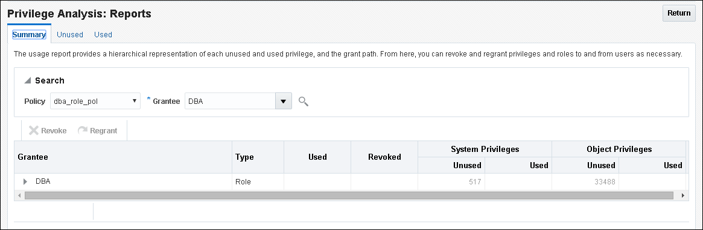

- What Is Privilege Analysis?  
	Privilege analysis increases the security of your applications and database operations by helping you to implement least privilege best practices for database roles and privileges.
- Creating and Managing Privilege Analysis Policies  
	You can create and manage privilege analysis policies by using tools such as SQL\*Plus, SQLcl, SQL Developer, or Enterprise Manager Cloud Control.
- Creating Roles and Managing Privileges Using Cloud Control  
	You can create new roles using privileges found in a privilege analysis report and then grant this role to users.
- Tutorial: Using Capture Runs to Analyze ANY Privilege Use  
	This tutorial demonstrates how to create capture runs to analyze the use of the `READ ANY TABLE` system privilege.
- Tutorial: Analyzing Privilege Use by a User Who Has the DBA Role  
	This tutorial demonstrates how to analyze the privilege use of a user who has the `DBA` role and performs database tuning operations.
- Privilege Analysis Policy and Report Data Dictionary Views  
	Oracle Database provides a set of data dictionary views that provide information about analyzed privileges.

**Parent topic:** [Managing User Authentication and Authorization](part_1.md)

### 5.1 What Is Privilege Analysis?

Privilege analysis increases the security of your applications and database operations by helping you to implement least privilege best practices for database roles and privileges.

- About Privilege Analysis  
	Running inside the Oracle Database kernel, privilege analysis helps reduce the attack surface of user, tooling, and application accounts by identifying used and unused privileges to implement the least-privilege model.
- Benefits and Use Cases of Privilege Analysis  
	Analyzing privilege use is beneficial in finding unnecessarily granted privileges and implementing least privilege best practices.
- Who Can Perform Privilege Analysis?  
	To use privilege analysis, you must be granted the `CAPTURE_ADMIN` role.
- Types of Privilege Analysis  
	You can create different types of privilege analysis policies to achieve specific goals.
- How Does a Multitenant Environment Affect Privilege Analysis?  
	You can create and use privilege analysis policies in a multitenant environment.
- How Privilege Analysis Works with Pre-Compiled Database Objects  
	Privilege analysis can be used to capture the privileges that have been exercised on pre-compiled database objects.

**Parent topic:** Performing Privilege Analysis to Identify Privilege Use

#### 5.1.1 About Privilege Analysis

Running inside the Oracle Database kernel, privilege analysis helps reduce the attack surface of user, tooling, and application accounts by identifying used and unused privileges to implement the least-privilege model.

Privilege analysis dynamically captures privileges used by database users and applications during a specified window of time.

The use of privilege analysis can help to quickly and efficiently enforce least privilege guidelines. In the least-privilege model, users are only given the privileges and access they need to do their jobs. Frequently, even though users perform different tasks, users are all granted the same set of powerful privileges. Without privilege analysis, figuring out the privileges that each user must have can be hard work and in many cases, users could end up with some common set of privileges even though they have different tasks. Even in organizations that manage privileges, users tend to accumulate privileges over time and rarely lose any privileges. Separation of duty breaks a single process into separate tasks for different users. Least privileges enforces the separation so users can only do their required tasks. The enforcement of separation of duty is beneficial for internal control, but it also reduces the risk from malicious users who steal privileged credentials.

Privilege analysis captures privileges used by database users and applications at runtime and writes its findings to data dictionary views that you can query. If your applications include definer’s rights and invoker’s rights procedures, then privilege analysis captures the privileges that are required to compile a procedure and execute it, even if the procedure was compiled before the privilege capture was created and enabled. Instead of revoking a privilege from the user, you can audit the user's use of the privilege and use an application such as Oracle Audit Vault and Database Firewall to send an alert to the appropriate administrator.

**Parent topic:** What Is Privilege Analysis?

#### 5.1.2 Benefits and Use Cases of Privilege Analysis

Analyzing privilege use is beneficial in finding unnecessarily granted privileges and implementing least privilege best practices.

- Least Privileges Best Practice  
	The privileges of the account that accesses a database should be limited to the privileges that are strictly required by the application or the user.
- Development of Secure Applications  
	During the application development phase, some administrators may grant many powerful system privileges and roles, and the `SYSDBA` administrative privilege, to application developers.

**Parent topic:** What Is Privilege Analysis?

##### 5.1.2.1 Least Privileges Best Practice

The privileges of the account that accesses a database should be limited to the privileges that are strictly required by the application or the user.

But when an application is developed, especially by a third party, more privileges than necessary may be granted to the application connection pool accounts for convenience. In addition, some developers grant system and application object privileges to the `PUBLIC` role.

For example, to select from application data and run application procedures, the system privileges `SELECT ANY TABLE` and `EXECUTE ANY PROCEDURE` are granted to an application account `appsys`. The account `appsys` now can access non-application data even if he or she does not intend to. In this situation, you can analyze the privilege usage by user `appsys`, and then based on the results, revoke and grant privileges as necessary.

Application accounts also frequently have additional privileges needed to install and maintain the application on the database. These are only needed during application maintenance periods, but yet are available all the time. A better process would be to add the privileges needed for application maintenance into a separate role and grant that to the application only during maintenance periods.

**Parent topic:** Benefits and Use Cases of Privilege Analysis

##### 5.1.2.2 Development of Secure Applications

During the application development phase, some administrators may grant many powerful system privileges and roles, and the `SYSDBA` administrative privilege, to application developers.

The administrators may do this because at that stage they may not know what privileges the application developer needs or is not concerned with privileges and roles during development.

Once the application is developed and working, the privileges that the application developer needs — and does not need — become more apparent. Capturing privilege analysis while the application is run through a full regression test can capture most, if not all the privileges needed by the application for runtime use. Capturing privilege analysis when testing a maintenance update can provide the privileges needed during an update of the production system. At that time, the security administrator can begin to revoke unnecessary privileges. However, the application developer may resist this idea on the basis that the application is currently working without problems. The administrator can use privilege analysis to examine each privilege that the application uses, to ensure that when he or she does revoke any privileges, the application will continue to work.

For example, `app_owner` is an application database user through whom the application connects to a database. User `app_owner` must query tables in the `OE`, `SH`, and `PM` schemas. Instead of granting the `SELECT` object privilege on each of the tables in these schemas, a security administrator grants the `SELECT ANY TABLE` privilege to `app_owner`. After a while, a new schema, `HR`, is created and sensitive data are inserted into `HR.EMPLOYEES` table. Because user `app_owner` has the `SELECT ANY TABLE` privilege, he can query this table to access its sensitive data, which is a security issue. Instead of granting system privileges (particularly the `ANY` privileges), it is far better to grant object privileges for specific tables.

**Parent topic:** Benefits and Use Cases of Privilege Analysis

#### 5.1.3 Who Can Perform Privilege Analysis?

To use privilege analysis, you must be granted the `CAPTURE_ADMIN` role.

You use the `DBMS_PRIVILEGE_CAPTURE` PL/SQL package to manage privilege capture. You use the data dictionary views provided by privilege analysis to analyze your privilege use.

**Parent topic:** What Is Privilege Analysis?

#### 5.1.4 Types of Privilege Analysis

You can create different types of privilege analysis policies to achieve specific goals.

- Context-based privilege use capture. You must specify a Boolean expression only with the `SYS_CONTEXT` function. The used privileges will be captured if the condition evaluates to `TRUE`. This method can be used to capture privileges and roles used by a database user by specifying the user in `SYS_CONTEXT`.
- Role-based privilege use capture. You must provide a list of roles. If the roles in the list are enabled in the database session, then the used privileges for the session will be captured. You can capture privilege use for the following types of roles: Oracle default roles, user-created roles, Code Based Access Control (CBAC) roles, and secure application roles.
- Role- and context-based privilege use capture. You must provide both a list of roles that are enabled and a `SYS_CONTEXT` Boolean expression for the condition. When any of these roles is enabled in a session and the given context condition is satisfied, then privilege analysis starts capturing the privilege use.
- Database-wide privilege capture. If you do not specify any type in your privilege analysis policy, then the used privileges in the database will be captured, except those for the user `SYS`. (This is also referred to as unconditional analysis, because it is turned on without any conditions.)

Note the following restrictions:

- You can enable only one privilege analysis policy at a time. The only exception is that you can enable a database-wide privilege analysis policy at the same time as a non-database-wide privilege analysis policy, such as a role or context attribute-driven analysis policy.
- You cannot analyze the privileges of the `SYS` user.
- Privilege analysis shows the grant paths to the privilege but it does not suggest which grant path to keep.
- If the role, user, or object has been dropped, then the values that reflect the privilege captures for these in the privilege analysis data dictionary views are dropped as well.

**Parent topic:** What Is Privilege Analysis?

#### 5.1.5 How Does a Multitenant Environment Affect Privilege Analysis?

You can create and use privilege analysis policies in a multitenant environment.

You can create privilege analysis policies in either the CDB root or in individual PDBs. The privilege analysis policy applies only to the container in which it is created, either to the privileges used within the CDB root or the application root, or to the privileges used within a PDB. It cannot be applied globally throughout the multitenant environment. You can grant the `CAPTURE_ADMIN` role locally to a local user or a common user. You can grant the `CAPTURE_ADMIN` role commonly to common users.

**Parent topic:** What Is Privilege Analysis?

#### 5.1.6 How Privilege Analysis Works with Pre-Compiled Database Objects

Privilege analysis can be used to capture the privileges that have been exercised on pre-compiled database objects.

Examples of these objects are PL/SQL packages, procedures, functions, views, triggers, and Java classes and data.

Because these privileges may not be exercised during run time when a stored procedure is called, these privileges are collected when you generate the results for any database-wide capture, along with run-time captured privileges. A privilege is treated as an unused privilege when it is not used in either pre-compiled database objects or run-time capture, and it is saved under the run-time capture name. If a privilege is used for pre-compiled database objects, then it is saved under the capture name `ORA$DEPENDENCY`. If a privilege is captured during run time, then it is saved under the run-time capture name. If you want to know what the used privileges are for both pre-compiled database objects and run-time usage, then you must query both the `ORA$DEPENDENCY` and run-time captures. For unused privileges, you only need to query with the run-time capture name.

To find a full list of the pre-compiled objects on which privilege analysis can be used, query the `TYPE` column of the `ALL_DEPENDENCIES` data dictionary view.

**Parent topic:** What Is Privilege Analysis?

### 5.2 Creating and Managing Privilege Analysis Policies

You can create and manage privilege analysis policies by using tools such as SQL\*Plus, SQLcl, SQL Developer, or Enterprise Manager Cloud Control.

- About Creating and Managing Privilege Analysis Policies  
	You can use the `DBMS_PRIVILEGE_CAPTURE` PL/SQL package or Oracle Enterprise Manager Cloud Control to analyze privileges.
- General Steps for Managing Privilege Analysis  
	You must follow a general set of steps to analyze privileges.
- Creating a Privilege Analysis Policy  
	You can use the `DBMS_PRIVILEGE_CAPTURE.CREATE_CAPTURE` procedure to create a privilege analysis policy.
- Examples of Creating Privilege Analysis Policies  
	You can create a variety of privilege analysis policies.
- Enabling a Privilege Analysis Policy  
	After you create a privilege analysis policy, you must enable it to capture privilege use.
- Disabling a Privilege Analysis Policy  
	You must disable the privilege analysis policy before you can generate a privilege analysis report.
- Generating a Privilege Analysis Report  
	You can generate a privilege analysis policy report using either Enterprise Manager Cloud Control or from SQL\*Plus, using the `DBMS_PRIVILEGE_CAPTURE` PL/SQL package.
- Dropping a Privilege Analysis Policy  
	Before you can drop a privilege analysis policy, you must first disable it.

**Parent topic:** Performing Privilege Analysis to Identify Privilege Use

#### 5.2.1 About Creating and Managing Privilege Analysis Policies

You can use the `DBMS_PRIVILEGE_CAPTURE` PL/SQL package or Oracle Enterprise Manager Cloud Control to analyze privileges.

Before you can do so, you must be granted the `CAPTURE_ADMIN` role. The `DBMS_PRIVILEGE_CAPTURE` package enables you to create, enable, disable, and drop privilege analysis policies. It also generates reports that show the privilege usage, which you can view in `DBA_*` views.

#### 5.2.2 General Steps for Managing Privilege Analysis

You must follow a general set of steps to analyze privileges.

1. Define the privilege analysis policy.
2. Enable the privilege analysis policy.
	This step begins recording the privilege use that the policy defined. Optionally, specify a name for this capture run. Each time you enable a privilege analysis policy, you can create a different capture run for it. In this way, you can create multiple named capture runs for comparison analysis later on.
3. Optionally, enable the policy to capture dependency privileges if you want to capture the privileges that are used by definer’s rights and invoker’s rights program units.
4. After a sufficient period of time to gather data, disable the privilege analysis policy's recording of privilege use.
	This step stops capturing the privilege use for the policy.
5. Generate privilege analysis results.
	This step writes the results to the privilege analysis policy and report data dictionary views.
6. Optionally, disable and then drop the privilege analysis policy and capture run.
	Dropping a privilege analysis policy deletes the data captured by the policy.

#### 5.2.3 Creating a Privilege Analysis Policy

You can use the `DBMS_PRIVILEGE_CAPTURE.CREATE_CAPTURE` procedure to create a privilege analysis policy.

After you create the privilege analysis policy, you can find it listed in the `DBA_PRIV_CAPTURES` data dictionary view. When a policy is created, it resides in the Oracle data dictionary and the `SYS` schema. However, both `SYS` and the user who created the policy can drop it. After you create the policy, you must manually enable it so that it can begin to analyze privilege use.

1. Log in to the CDB or PDB as a user who has the `CAPTURE_ADMIN` role.
	To find the available PDBs in a CDB, log in to the CDB root container and then query the `PDB_NAME` column of the `DBA_PDBS` data dictionary view. To check the current container, run the `show con_name` command.
2. Use the following syntax for the `DBMS_PRIVILEGE_CAPTURE.CREATE_CAPTURE` procedure:
	```
	DBMS_PRIVILEGE_CAPTURE.CREATE_CAPTURE(
	   name              VARCHAR2, 
	   description       VARCHAR2 DEFAULT NULL, 
	   type              NUMBER DEFAULT DBMS_PRIVILEGE_CAPTURE.G_DATABASE, 
	   roles             ROLE_NAME_LIST DEFAULT ROLE_NAME_LIST(), 
	   condition         VARCHAR2 DEFAULT NULL);
	```
	In this specification:
	- `name`: Specifies the name of the privilege analysis policy to be created. Ensure that this name is unique and no more than 128 characters. You can include spaces in the name, but you must enclose the name in single quotation marks whenever you refer to it. To find the names of existing policies, query the `NAME` column of the `DBA_PRIV_CAPTURES` view.
		- `description`: Describes the purpose of the privilege analysis policy, up to 1024 characters in mixed-case letters. Optional.
		- `type`: Specifies the type of capture condition. If you omit the `type` parameter, then the default is `DBMS_PRIVILEGE_CAPTURE.G_DATABASE`. Optional.
		Enter one of the following types:
		- `DBMS_PRIVILEGE_CAPTURE.G_DATABASE`: Captures all privileges used in the entire database, except privileges from user `SYS`.
				- `DBMS_PRIVILEGE_CAPTURE.G_ROLE`: Captures privileges for the sessions that have the roles enabled. If you enter `DBMS_PRIVILEGE_CAPTURE.G_ROLE` for the `type` parameter, then you must also specify the `roles` parameter. For multiple roles, separate each role name with a comma.
				- `DBMS_PRIVILEGE_CAPTURE.G_CONTEXT`: Captures privileges for the sessions that have the condition specified by the `condition` parameter evaluating to `TRUE`. If you enter `DBMS_PRIVILEGE_CAPTURE.G_CONTEXT` for the `type` parameter, then you must also specify the `condition` parameter.
				- `DBMS_PRIVILEGE_CAPTURE.G_ROLE_AND_CONTEXT`: Captures privileges for the sessions that have the role enabled and the context condition evaluating to `TRUE`. If you enter `DBMS_PRIVILEGE_CAPTURE.G_ROLE_AND_CONTEXT` for the `type` parameter, then you must also specify both the `roles` and `condition` parameters.
		- `roles`: Specifies the roles whose used privileges will be analyzed. That is, if a privilege from one of the given roles is used, then the privilege will be analyzed. You must specify this argument if you specify `DBMS_PRIVILEGE_CAPTURE.G_ROLE` or `DBMS_PRIVILEGE_CAPTURE.G_ROLE_AND_CONTEXT` for the `type` argument. Each role you enter must exist in the database. (You can find existing roles by querying the `DBA_ROLES` data dictionary view.) For multiple roles, use varray type `role_name_list` to enter the role names. You can specify up to 10 roles.
		For example, to specify two roles:
		```
		roles => role_name_list('role1', 'role2'),
		```
		- `condition`: Specifies a Boolean expression up to 4000 characters. You must specify this argument if you specify `DBMS_PRIVILEGE_CAPTURE.G_CONTEXT` or `DBMS_PRIVILEGE_CAPTURE.G_ROLE_AND_CONTEXT` for the `type` argument. Only `SYS_CONTEXT` expressions with relational operators(`==`, `>`, `>=`, `<`, `<=`, `<>`, `BETWEEN`, and `IN`) are permitted in this Boolean expression.
		The `condition` expression syntax is as follows:
		```
		predicate::= SYS_CONTEXT(namespace, attribute) relop constant_value |
		             SYS_CONTEXT(namespace, attribute)
		             BETWEEN 
		             constant_value 
		             AND constant_value | SYS_CONTEXT(namespace, attribute) 
		             IN {constant_value (,constant_value)* }
		relop::= = | < | <= | > | >= | <>
		context_expression::= predicate | (context_expression) 
		             AND (context_expression) | (context_expression) 
		             OR (context_expression )
		```
		For example, to use a condition to specify the IP address `192.0.2.1`:
		```
		condition => 'SYS_CONTEXT(''USERENV'', ''IP_ADDRESS'')=''192.0.2.1''';
		```
	After you create the privilege analysis policy, you must enable the policy to begin capturing privilege and role use.

\* You can add as many constant values as you need (for example, `IN {` `constant_value1` `}`, or `IN {` `constant_value1``,` `constant_value2``, ``constant_value3` `}`).

#### 5.2.4 Examples of Creating Privilege Analysis Policies

You can create a variety of privilege analysis policies.

- Example: Privilege Analysis of Database-Wide Privileges  
	The `DBMS_PRIVILEGE_CAPTURE.CREATE_CAPTURE` can be used to analyze database-wide privileges.
- Example: Privilege Analysis of Privilege Usage of Two Roles  
	The `DBMS_PRIVILEGE_CAPTURE.CREATE_CAPTURE` procedure can be used to analyze the privilege usage of multiple roles.
- Example: Privilege Analysis of Privileges During SQL\*Plus Use  
	The `DBMS_PRIVILEGE_CAPTURE.CREATE_CAPTURE` procedure can be used to capture privileges for analysis.
- Example: Privilege Analysis of PSMITH Privileges During SQL\*Plus Access  
	The `DBMS_PRIVILEGE_CAPTURE.CREATE_CAPTURE` can be used to analyze user access when the user is running SQL\*Plus.

**Parent topic:** Creating and Managing Privilege Analysis Policies

##### 5.2.4.1 Example: Privilege Analysis of Database-Wide Privileges

The `DBMS_PRIVILEGE_CAPTURE.CREATE_CAPTURE` can be used to analyze database-wide privileges.

Example 5-1 shows how to use the `DBMS_PRIVILEGE_CAPTURE` package to create a privilege analysis policy to record all privilege use in the database.

Example 5-1 Privilege Analysis of Database-Wide Privileges

```
BEGIN
 DBMS_PRIVILEGE_CAPTURE.CREATE_CAPTURE(
  name          => 'db_wide_capture_pol',
  description   => 'Captures database-wide privileges',
  type          => DBMS_PRIVILEGE_CAPTURE.G_DATABASE);
END;
/
```

**Parent topic:** Examples of Creating Privilege Analysis Policies

##### 5.2.4.2 Example: Privilege Analysis of Privilege Usage of Two Roles

The `DBMS_PRIVILEGE_CAPTURE.CREATE_CAPTURE` procedure can be used to analyze the privilege usage of multiple roles.

Example 5-2 shows how to analyze the privilege usage of two roles.

Example 5-2 Privilege Analysis of Privilege Usage of Two Roles

```
BEGIN
 DBMS_PRIVILEGE_CAPTURE.CREATE_CAPTURE(
  name          => 'dba_roles_capture_pol',
  description   => 'Captures DBA and LBAC_DBA role use',
  type          => DBMS_PRIVILEGE_CAPTURE.G_ROLE,
  roles         => role_name_list('dba', 'lbac_dba'));
END;
/
```

**Parent topic:** Examples of Creating Privilege Analysis Policies

##### 5.2.4.3 Example: Privilege Analysis of Privileges During SQL\*Plus Use

The `DBMS_PRIVILEGE_CAPTURE.CREATE_CAPTURE` procedure can be used to capture privileges for analysis.

Example 5-3 shows how to analyze privileges used to run SQL\*Plus.

Example 5-3 Privilege Analysis of Privileges During SQL\*Plus Use

```
BEGIN
 DBMS_PRIVILEGE_CAPTURE.CREATE_CAPTURE(
  name             => 'sqlplus_capture_pol',
  description      => 'Captures privilege use during SQL*Plus use',
  type             => DBMS_PRIVILEGE_CAPTURE.G_CONTEXT,
  condition        => 'SYS_CONTEXT(''USERENV'', ''MODULE'')=''sqlplus''');
END;
/
```

**Parent topic:** Examples of Creating Privilege Analysis Policies

##### 5.2.4.4 Example: Privilege Analysis of PSMITH Privileges During SQL\*Plus Access

The `DBMS_PRIVILEGE_CAPTURE.CREATE_CAPTURE` can be used to analyze user access when the user is running SQL\*Plus.

Example 5-4 shows how to analyze the privileges used by session user `PSMITH` when running SQL\*Plus.

Example 5-4 Privilege Analysis of PSMITH Privileges During SQL\*Plus Access

```
BEGIN
 DBMS_PRIVILEGE_CAPTURE.CREATE_CAPTURE(
  name         => 'psmith_sqlplus_analysis_pol',
  description  => 'Analyzes PSMITH role priv use for SQL*Plus module',
  type         => DBMS_PRIVILEGE_CAPTURE.G_CONTEXT,
  condition    => 'SYS_CONTEXT(''USERENV'', ''MODULE'')=''sqlplus'' 
                  AND SYS_CONTEXT(''USERENV'', ''SESSION_USER'')=''PSMITH''');
END;
/
```

**Parent topic:** Examples of Creating Privilege Analysis Policies

#### 5.2.5 Enabling a Privilege Analysis Policy

After you create a privilege analysis policy, you must enable it to capture privilege use.

The `DBMS_PRIVILEGE_CAPTURE.ENABLE_CAPTURE` procedure enables a privilege policy and creates a capture run name for it. The run name defines the period of time that the capture took place.

1. Log in to the CDB or PDB as a user who has the `CAPTURE_ADMIN` role.
	To find the available PDBs in a CDB, log in to the CDB root container and then query the `PDB_NAME` column of the `DBA_PDBS` data dictionary view. To check the current container, run the `show con_name` command.
2. Query the `NAME` and `ENABLED` columns of the `DBA_PRIV_CAPTURES` data dictionary view to find the existing privilege analysis policies and whether they are currently enabled.
3. Run the `DBMS_PRIVILEGE_CAPTURE.ENABLE_CAPTURE` procedure to enable the policy and optionally create a name for a capture run.
	For example, to enable the privilege analysis policy `logon_users_analysis`:
	```
	BEGIN
	  DBMS_PRIVILEGE_CAPTURE.ENABLE_CAPTURE (
	    name     => 'logon_users_analysis_pol',
	    run_name => 'logon_users_04092016');
	END;
	/
	```
	If you do not need to specify the `run_name` parameter, then you can enable the policy by only specifying its name, as follows:
	```
	EXEC DBMS_PRIVILEGE_CAPTURE.ENABLE_CAPTURE ('logon_users_analysis_pol');
	```

**Parent topic:** Creating and Managing Privilege Analysis Policies

#### 5.2.6 Disabling a Privilege Analysis Policy

You must disable the privilege analysis policy before you can generate a privilege analysis report.

After you disable the policy, then the privileges are no longer recorded. Disabling a privilege analysis policy takes effect immediately for user sessions logged on both before and after the privilege analysis policy is disabled. You can use the `DBMS_PRIVILEGE_CAPTURE.DISABLE_CAPTURE` procedure to disable a privilege analysis policy.

1. Log in to the CDB or PDB as a user who has the `CAPTURE_ADMIN` role.
	To find the available PDBs in a CDB, log in to the CDB root container and then query the `PDB_NAME` column of the `DBA_PDBS` data dictionary view. To check the current container, run the `show con_name` command.
2. Query the `NAME` and `ENABLED` columns of the `DBA_PRIV_CAPTURES` data dictionary view to find the existing privilege analysis policies and whether they are currently disabled.
3. Run the `DBMS_PRIVILEGE_CAPTURE.DISBLE_CAPTURE` procedure to enable the policy.
	For example, to disable the privilege analysis policy `logon_users_analysis`:
	```
	EXEC DBMS_PRIVILEGE_CAPTURE.DISABLE_CAPTURE ('logon_users_analysis_pol');
	```

**Parent topic:** Creating and Managing Privilege Analysis Policies

#### 5.2.7 Generating a Privilege Analysis Report

You can generate a privilege analysis policy report using either Enterprise Manager Cloud Control or from SQL\*Plus, using the `DBMS_PRIVILEGE_CAPTURE` PL/SQL package.

- About Generating a Privilege Analysis Report  
	After the privilege analysis policy has been disabled, you can generate a report based on the capture run that you created for the privilege analysis policy.
- General Process for Managing Multiple Named Capture Runs  
	When you enable a privilege analysis policy, you can create a named capture run for the policy’s findings.
- Generating a Privilege Analysis Report Using DBMS\_PRIVILEGE\_CAPTURE  
	The `DBMS_PRIVILEGE_CAPTURE.GENERATE_RESULT` procedure generates a report showing the results of a privilege capture.
- Generating a Privilege Analysis Report Using Cloud Control  
	You can generate a privilege analysis report using Cloud Control.
- Accessing Privilege Analysis Reports Using Cloud Control  
	A privilege analysis report provides information about both used and unused privileges.

**Parent topic:** Creating and Managing Privilege Analysis Policies

##### 5.2.7.1 About Generating a Privilege Analysis Report

After the privilege analysis policy has been disabled, you can generate a report based on the capture run that you created for the privilege analysis policy.

To view the report results in SQL\*Plus, query the privilege analysis-specific data dictionary views. In Enterprise Manager Cloud Control, you can view the reports from the Privilege Analysis page Actions menu. If a privilege is used during the privilege analysis process and then revoked before you generate the report, then the privilege is still reported as a used privilege, but without the privilege grant path.

##### 5.2.7.2 General Process for Managing Multiple Named Capture Runs

When you enable a privilege analysis policy, you can create a named capture run for the policy’s findings.

The capture run defines a period of time from when the capture is enabled (begun) and when it is disabled (stopped). This way, you can create multiple runs and then compare them when you generate the privilege capture results.

The general process for managing multiple named capture runs is as follows:

1. Create the policy.
2. Enable the policy for the first run.
3. After a period time to collect user behavior data, disable this policy and its run.
4. Generate the results and then query the privilege analysis data dictionary views for information about this capture run.
	If you omit the `run_name` parameter from the `DBMS_PRIVILEGE_CAPTURE.GENERATE_RESULT` procedure, then this procedure looks at all records as a whole and then analyzes them.
5. Re-enable the policy for the second run. You cannot create a new capture run if the policy has not been disabled first.
6. After you have collected the user data, disable the policy and the second run.
7. Generate the results.
8. Query the privilege analysis data dictionary views. The results from both capture runs are available in the views. If you only want to show the results of one of the capture runs, then you can regenerate the results and requery the privilege analysis views. You can also filter the results on the run name.

Once enabled, the privilege analysis policy will begin to record the privilege usage when the condition is satisfied. At any given time, only one privilege analysis policy in the database can be enabled. The only exception is that a privilege analysis policy of type `DBMS_PRIVILEGE_CAPTURE.G_DATABASE` can be enabled at the same time with a privilege analysis of a different type.

When you drop a privilege analysis policy, its associated capture runs are dropped as well and are not reflected in the privilege analysis data dictionary views.

Restarting a database does not change the status of a privilege analysis. For example, if a privilege analysis policy is enabled before a database shutdown, then the policy is still enabled after the database shutdown and restart.

##### 5.2.7.3 Generating a Privilege Analysis Report Using DBMS\_PRIVILEGE\_CAPTURE

The `DBMS_PRIVILEGE_CAPTURE.GENERATE_RESULT` procedure generates a report showing the results of a privilege capture.

1. Log in to the CDB or PDB as a user who has the `CAPTURE_ADMIN` role.
	To find the available PDBs in a CDB, log in to the CDB root container and then query the `PDB_NAME` column of the `DBA_PDBS` data dictionary view. To check the current container, run the `show con_name` command.
2. Query the `NAME` and `ENABLED` columns of the `DBA_PRIV_CAPTURES` data dictionary view to find the existing privilege analysis policies and whether they are currently disabled.
	The privilege analysis policy must be disabled before you can generate a privilege analysis report on it.
3. Run the `DBMS_PRIVILEGE_CAPTURE.GENERATE_RESULT` procedure using the following syntax:
	```
	DBMS_PRIVILEGE_CAPTURE.GENERATE_RESULT(
	  name         VARCHAR2,
	  run_name     VARCHAR2 DEFAULT NULL,
	  dependency   BOOLEAN DEFAULT NULL);
	```
	In this specification:
	- `name`: Specifies the name of the privilege analysis policy. The DBA\_PRIV\_CAPTURES data dictionary view lists the names of existing policies.
	- `run_name`: Specifies the name for the run name for the privilege capture that must be computed. If you omit this setting, then all runs for the given privilege capture are computed.
	- `dependency`: Enter `Y` (yes) or `N` (no) to specify whether the PL/SQL computation privilege usage should be included in the report.
	For example, to generate a report for the privilege analysis policy `logon_users_analysis`:
	```
	EXEC DBMS_PRIVILEGE_CAPTURE.GENERATE_RESULT ('logon_users_analysis');
	```
4. Query the used privileges from `DBA_USED_*` data dictionary views with privilege grant paths.

**Parent topic:** Generating a Privilege Analysis Report

##### 5.2.7.4 Generating a Privilege Analysis Report Using Cloud Control

You can generate a privilege analysis report using Cloud Control.

1. Log in to Cloud Control as a user who has been granted the `CAPTURE_ADMIN` role and the `SELECT ANY DICTIONARY` privilege.
2. From the Security menu, select Privilege Analysis.
3. Under Policies, select the policy whose report you want to generate.
4. Select Generate Report.
5. In the Privilege Analysis: Generate Report dialog box, specify a time to generate the report.
	To generate the report now, select Immediate. To generate the report later, select Later, and then specify the hour, minute, second, and the time zone for the report to generate.
6. Click OK.
	In the Privilege Analysis page, a Confirmation message notifies you that a report has been submitted. You can refresh the page until the job is complete. To view the report, select the policy name and then click View Reports.

**Parent topic:** Generating a Privilege Analysis Report

##### 5.2.7.5 Accessing Privilege Analysis Reports Using Cloud Control

A privilege analysis report provides information about both used and unused privileges.

1. Generate the privilege analysis report.
2. In the Privilege Analysis page, select the policy on which you generated a report.
3. Select View Reports.
	The Privilege Analysis Reports page appears.
	

> Image priv\_analysis\_report122.png shows the Reports page. From left to right, top to bottom, are the following components:
>
> - Page Summary, Unused, and Used tabs.
> - A Search field, which has been expanded to show a list to select the policy and a second list to show the grantees affected by the policy.
> - A Revoke button and a Re-grant button.
> - A table showing the contents of the report. From left to right are the columns Grantee, Type (that is, User, Folder, or Role), Used, Revoked, System Privileges (with sub-columns for Unused and Used), and Object Privileges (with sub-columns for Unused and Used).
> - In the upper right corner is a Return button.

4. To view the report, do the following:
	- By default, the selected report will appear, but to search for a report for another policy, use the Search region to find a different report, or to select a different grantee for the currently selected policy.
		- To view unused privileges, select the Unused tab; to view the used privileges, select Used. To view a summary of both, select Summary.
	From here, you can select roles to revoke or regrant to users as necessary. To do so, under Grantee, select the role and then click Revoke or Regrant.

#### 5.2.8 Dropping a Privilege Analysis Policy

Before you can drop a privilege analysis policy, you must first disable it.

Dropping a privilege analysis policy also drops all the used and unused privilege records associated with this privilege analysis. If you created capture runs for the policy, then they are dropped when you drop the policy.

1. Log in to the CDB or PDB as a user who has the `CAPTURE_ADMIN` role.
	To find the available PDBs in a CDB, log in to the CDB root container and then query the `PDB_NAME` column of the `DBA_PDBS` data dictionary view. To check the current container, run the `show con_name` command.
2. Query the `NAME` and `ENABLE` columns of the `DBA_PRIV_CAPTURES` data dictionary view to find the policy and to check if it is enabled or disabled.
3. If the policy is enabled, then disable it.
	For example:
	```
	EXEC DBMS_PRIVILEGE_CAPTURE.DISABLE_CAPTURE ('logon_users_analysis_pol');
	```
4. Run the `DBMS_PRIVILEGE_CAPTURE.DROP_CAPTURE` procedure to drop the policy.
	For example:
	```
	EXEC DBMS_PRIVILEGE_CAPTURE.DROP_CAPTURE ('logon_users_analysis_pol');
	```
	If you had enabled the policy with a capture run, then the capture run is dropped as well. To individually drop a capture run, you can run the `DBMS_PRIVILEGE_CAPTURE.DELETE_RUN` procedure, but the policy must exist before you can run this statement.

### 5.3 Creating Roles and Managing Privileges Using Cloud Control

You can create new roles using privileges found in a privilege analysis report and then grant this role to users.

- Creating a Role from a Privilege Analysis Report in Cloud Control  
	You can use the report summary to find the least number of privileges an application needs, and encapsulate these privileges into a role.
- Revoking and Regranting Roles and Privileges Using Cloud Control  
	You can use Enterprise Manager Cloud Control to revoke and regrant roles and privileges to users.
- Generating a Revoke or Regrant Script Using Cloud Control  
	You can generate a script that revokes or regrants privileges from and to users, based on the results of privilege analysis reports.

**Parent topic:** Performing Privilege Analysis to Identify Privilege Use

#### 5.3.1 Creating a Role from a Privilege Analysis Report in Cloud Control

You can use the report summary to find the least number of privileges an application needs, and encapsulate these privileges into a role.

1. Log in to Cloud Control as a user who has been granted the `CAPTURE_ADMIN` role and the `SELECT ANY DICTIONARY` privilege.
	Oracle Database 2 Day DBA explains how to log in.
2. On the Privilege Analysis page, select the policy name, and then from Actions menu, click Create Role.
3. On the Create Role page, provide the following details, and then click OK:
	- Select the policy from which you would like to create a new role.
	- Enter a unique name for the new role that you want to create.
	- Select the Used or Unused check box, depending on what your role must encapsulate. The role can have used or unused system and object privileges and roles.
	- Select the corresponding radio buttons for Directly Granted System Privileges, Directly Granted Object Privileges, and Directly Granted Roles.
		For example, if you select the Used check box, and select:
		- All system privileges, then all the used system privileges captured are included in the new role that you are creating.
			- None for role, then no role that is captured in the policy will be used in the new role.
			- Customize object privileges, then a list of available used objects privileges captured are displayed, you need to select the privileges from the list to assign to the role.

**Parent topic:** Creating Roles and Managing Privileges Using Cloud Control

#### 5.3.2 Revoking and Regranting Roles and Privileges Using Cloud Control

You can use Enterprise Manager Cloud Control to revoke and regrant roles and privileges to users.

1. If Oracle Database Vault is enabled, then ensure that you are authorized as an owner of the Oracle System Privilege and Role Management realm.
	In SQL\*Plus, a user who has been granted the `DV_OWNER` role can check the authorization by querying the `DBA_DV_REALM_AUTH` data dictionary view. To grant the user authorization, use the `DBMS_MACADM.ADD_AUTH_TO_REALM` procedure.
2. Generate the privilege analysis report.
3. In the Privilege Analysis page, select the policy on which you generated a report.
4. Select View Reports.
5. In the Privilege Analysis: Reports page, select the Summary tab.
6. Under Search, ensure that the Policy and Grantee menu options are set.
7. Under the Grantee area, expand the grantee options.
	For example, for a role privilege analysis report for a role called `HR_ADMIN` role, you would expand the `HR_ADMIN` role to show the privileges that are associated with it.
8. Select each privilege to revoke and then click Revoke, or select Regrant to regrant the privilege to the role.

#### 5.3.3 Generating a Revoke or Regrant Script Using Cloud Control

You can generate a script that revokes or regrants privileges from and to users, based on the results of privilege analysis reports.

- About Generating Revoke and Regrant Scripts  
	You can perform a bulk revoke of unused system and object privileges and roles by using scripts that you can download after you have generated the privilege analysis.
- Generating a Revoke Script  
	You can use Enterprise Manager Cloud Control to generate a script that revokes privileges from users.
- Generating a Regrant Script  
	You can use Enterprise Manager Cloud Control to generate a script that regrants privileges that have been revoked from users.

**Parent topic:** Creating Roles and Managing Privileges Using Cloud Control

##### 5.3.3.1 About Generating Revoke and Regrant Scripts

You can perform a bulk revoke of unused system and object privileges and roles by using scripts that you can download after you have generated the privilege analysis.

Later on, if you want to regrant these privileges back to the user, you can generate a regrant script. In order to generate the regrant script, you must have a corresponding revoke script.

Run the revoke scripts in a development or test environment. Be aware that you cannot revoke privileges and roles from Oracle-supplied accounts and roles.

**Parent topic:** Generating a Revoke or Regrant Script Using Cloud Control

##### 5.3.3.2 Generating a Revoke Script

You can use Enterprise Manager Cloud Control to generate a script that revokes privileges from users.

1. If Oracle Database Vault is enabled, then ensure that you are authorized as an owner of the Oracle System Privilege and Role Management realm.
	In SQL\*Plus, a user who has been granted the `DV_OWNER` role can check the authorization by querying the `DBA_DV_REALM_AUTH` data dictionary view. To grant the user authorization, use the `DBMS_MACADM.ADD_AUTH_TO_REALM` procedure.
2. In Enterprise Manager, access the target Database home page as a user who has been granted the `CAPTURE_ADMIN` role and the `SELECT ANY DICTIONARY` privilege.
3. From the Security menu, select Privilege Analysis.
4. Ensure that the privilege analysis reports that you want have been generated.
5. In the Privilege Analysis page, from the Actions menu, select Revoke Scripts.
6. On the Revoke Scripts page, click Generate.
	The generate revoke script details wizard is displayed.
7. In the Script Details page, do the following: select a policy name from the Policy Name menu against which the revoke script needs to be prepared.
8. In the Script Name field, enter a unique name and for Description, a description for the script.
	For example, if you want to revoke all the unused privileges, select the All option for all the unused privileges and roles, and click Next.
	Based on your selection, and the available privileges, all the unused system privileges, object privileges, and roles that are going to be revoked are displayed on the respective pages.
9. For Grantee (user/role), select All or Customize.
10. Select All, None, or Customize for the Unused System Privileges, Unused Object Privileges, and Unused Roles settings.
11. Click Next.
	The next pages that appear depend on your selections of All, None, or Customize. If you selected all, the page displays a listing of the privileges. If you selected None, the page is bypassed. If you selected Customize, then you can individually select the privileges to revoke. The last page that appears is the Review page.
12. Click Save.
	The Revoke Scripts page appears.
13. In the Revoke Scripts page, select the newly created SQL script, and then click Download Revoke Script to download this script, which contains `REVOKE` SQL statements for each privilege or role.
	To view the script, click the View Revoke Script button.
14. To return to the Privilege Analysis page, click Return.

##### 5.3.3.3 Generating a Regrant Script

You can use Enterprise Manager Cloud Control to generate a script that regrants privileges that have been revoked from users.

1. If Oracle Database Vault is enabled, then ensure that you are authorized as an owner of the Oracle System Privilege and Role Management realm.
	In SQL\*Plus, a user who has been granted the `DV_OWNER` role can check the authorization by querying the `DBA_DV_REALM_AUTH` data dictionary view. To grant the user authorization, use the `DBMS_MACADM.ADD_AUTH_TO_REALM` procedure.
2. In Enterprise Manager, access the target Database home page as a user who has been granted the `CAPTURE_ADMIN` role and the `SELECT ANY DICTIONARY` privilege.
3. From the Security menu, select Privilege Analysis.
4. Ensure that the privilege analysis reports you want have been generated.
5. In the Privilege Analysis page, select the policy on which the revoke script was based.
6. From the Actions menu, select Revoke Scripts.
7. In the Revoke Scripts page, select the policy name that you had created earlier, and then click Download Regrant Script to download this script.
	You can view the scripts that are associated with the policy by selecting the View Revoke Script and View Regrant Script buttons.

### 5.4 Tutorial: Using Capture Runs to Analyze ANY Privilege Use

This tutorial demonstrates how to create capture runs to analyze the use of the `READ ANY TABLE` system privilege.

- Step 1: Create User Accounts  
	You must create two users, one user to create the policy and a second user whose privilege use will be analyzed.
- Step 2: Create and Enable a Privilege Analysis Policy  
	The user `pa_admin` must create and enable the privilege analysis policy.
- Step 3: Use the READ ANY TABLE System Privilege  
	User `app_user` uses the `READ ANY TABLE` system privilege.
- Step 4: Disable the Privilege Analysis Policy  
	You must disable the policy before you can generate a report that captures the actions of user `app_user`.
- Step 5: Generate and View a Privilege Analysis Report  
	With the privilege analysis policy disabled, user `pa_admin` then can generate and view a privilege analysis report.
- Step 6: Create a Second Capture Run  
	Next, you are ready to create a second capture run for the `ANY_priv_analysis_pol` privilege analysis policy.
- Step 7: Remove the Components for This Tutorial  
	You can remove the components that you created for this tutorial if you no longer need them.

**Parent topic:** Performing Privilege Analysis to Identify Privilege Use

#### 5.4.1 Step 1: Create User Accounts

You must create two users, one user to create the policy and a second user whose privilege use will be analyzed.

1. Log into a PDB as a user who has the `CREATE USER` system privilege.
	For example:
	```
	sqlplus sec_admin@pdb_name
	Enter password: password
	```
	To find the available PDBs, query the `DBA_PDBS` data dictionary view. To check the current PDB, run the `show con_name` command.
2. ```
	CREATE USER pa_admin IDENTIFIED BY password;
	CREATE USER app_user IDENTIFIED BY password;
	```
	Replace `password` with a password that is secure.
3. Connect as a user who has the privileges to grant roles and system privileges to other users, and who has been granted the owner authorization for the Oracle System Privilege and Role Management realm. (User `SYS` has these privileges by default.)
	For example:
	```
	CONNECT dba_psmith@pdb_name 
	Enter password: password
	```
	In SQL\*Plus, a user who has been granted the `DV_OWNER` role can check the authorization by querying the `DBA_DV_REALM_AUTH` data dictionary view. To grant the user authorization, use the `DBMS_MACADM.ADD_AUTH_TO_REALM` procedure.
4. Grant the following role and privilege to the users.
	```
	GRANT CREATE SESSION, CAPTURE_ADMIN TO pa_admin;
	GRANT CREATE SESSION, READ ANY TABLE TO app_user;
	```
	User `pa_admin` will create the privilege analysis policy that will analyze the `READ ANY TABLE` query that user `app_user` will perform.

#### 5.4.2 Step 2: Create and Enable a Privilege Analysis Policy

The user `pa_admin` must create and enable the privilege analysis policy.

1. Connect to the PDB as user `pa_admin`.
	```
	CONNECT pa_admin@pdb_name
	Enter password: password
	```
2. Create the following privilege analysis policy:
	```
	BEGIN
	 DBMS_PRIVILEGE_CAPTURE.CREATE_CAPTURE(
	  name           => 'ANY_priv_analysis_pol',
	  description    => 'Analyzes system privilege use',
	  type           => DBMS_PRIVILEGE_CAPTURE.G_CONTEXT,
	  condition      => 'SYS_CONTEXT(''USERENV'', ''SESSION_USER'')=''APP_USER''');
	END;
	/
	```
	In this example:
	- `type` specifies the type of capture condition that is defined by the `condition` parameter, described next. In this policy, the type is a context-based condition.
	- `condition` specifies condition using a Boolean expression that must evaluate to `TRUE` for the policy to take effect. In this case, the condition checks if the session user is `app_user`.
3. Enable the policy and create a capture run for it.
	```
	BEGIN
	  DBMS_PRIVILEGE_CAPTURE.ENABLE_CAPTURE (
	   name       => 'ANY_priv_analysis_pol',
	   run_name   => 'ANY_priv_pol_run_1');
	END;
	/
	```
	At this point, the policy is ready to start recording the actions of user `app_user`.

**Parent topic:** Tutorial: Using Capture Runs to Analyze ANY Privilege Use

#### 5.4.3 Step 3: Use the READ ANY TABLE System Privilege

User `app_user` uses the `READ ANY TABLE` system privilege.

1. Connect as user `app_user`.
	```
	CONNECT app_user@pdb_name
	Enter password: password
	```
2. Query the `HR.EMPLOYEES` table.
	```
	SELECT FIRST_NAME, LAST_NAME, SALARY FROM HR.EMPLOYEES WHERE SALARY > 12000 ORDER BY SALARY DESC;
	FIRST_NAME           LAST_NAME                     SALARY
	-------------------- ------------------------- ----------
	Steven               King                           24000
	Neena                Kochhar                        17000
	Lex                  De Haan                        17000
	John                 Russell                        14000
	Karen                Partners                       13500
	Michael              Hartstein                      13000
	Shelley              Higgins                        12008
	Nancy                Greenberg                      12008
	```

**Parent topic:** Tutorial: Using Capture Runs to Analyze ANY Privilege Use

#### 5.4.4 Step 4: Disable the Privilege Analysis Policy

You must disable the policy before you can generate a report that captures the actions of user `app_user`.

1. Connect as user `pa_admin`.
	```
	CONNECT pa_admin@pdb_name
	Enter password: password
	```
2. Disable the `ANY_priv_analysis_pol` privilege policy.
	```
	EXEC DBMS_PRIVILEGE_CAPTURE.DISABLE_CAPTURE ('ANY_priv_analysis_pol');
	```

**Parent topic:** Tutorial: Using Capture Runs to Analyze ANY Privilege Use

#### 5.4.5 Step 5: Generate and View a Privilege Analysis Report

With the privilege analysis policy disabled, user `pa_admin` then can generate and view a privilege analysis report.

1. As user `pa_admin`, generate the privilege analysis results.
	```
	BEGIN
	  DBMS_PRIVILEGE_CAPTURE.GENERATE_RESULT (
	    name      => 'ANY_priv_analysis_pol',
	    run_name  => 'ANY_priv_pol_run_1');
	END;
	/
	```
	The generated results are stored in the privilege analysis data dictionary views.
2. Enter the following commands to format the data dictionary view output:
	```
	col username format a10
	col sys_priv format a16
	col object_owner format a13
	col object_name format a23
	col run_name format a27
	```
3. Find the system privileges that `app_user` used and the objects on which `app_user` used them during the privilege analysis period.
	```
	SELECT SYS_PRIV, OBJECT_OWNER, OBJECT_NAME, RUN_NAME FROM DBA_USED_PRIVS WHERE USERNAME = 'APP_USER';
	```
	Output similar to the following appears. The first row shows that `app_user` used the `READ ANY TABLE` privilege on the `HR.EMPLOYEES` table.
	```
	SYS_PRIV         OBJECT_OWNER  OBJECT_NAME             RUN_NAME
	---------------- ------------- ----------------------- ------------------
	                 SYSTEM        PRODUCT_PRIVS           ANY_PRIV_POL_RUN_1
	                 SYS           DUAL                    ANY_PRIV_POL_RUN_1
	                 SYS           DUAL                    ANY_PRIV_POL_RUN_1
	CREATE SESSION                                         ANY_PRIV_POL_RUN_1
	                 SYS           DBMS_APPLICATION_INFO   ANY_PRIV_POL_RUN_1
	READ ANY TABLE   HR            EMPLOYEES               ANY_PRIV_POL_RUN_1
	```

At this stage, the privilege analysis results remain available in the privilege analysis data dictionary views, even if you create additional capture runs in the future.

**Parent topic:** Tutorial: Using Capture Runs to Analyze ANY Privilege Use

#### 5.4.6 Step 6: Create a Second Capture Run

Next, you are ready to create a second capture run for the `ANY_priv_analysis_pol` privilege analysis policy.

1. As user `pa_admin`, enable the `ANY_priv_analysis_pol` privilege analysis policy to use capture run `ANY_priv_pol_run_1`.
	```
	BEGIN
	  DBMS_PRIVILEGE_CAPTURE.ENABLE_CAPTURE (
	   name       => 'ANY_priv_analysis_pol',
	   run_name   => 'ANY_priv_pol_run_2');
	END;
	/
	```
2. Connect as user `app_user`.
	```
	CONNECT app_user@pdb_name
	Enter password: password
	```
3. Query the `HR.JOBS` table.
	```
	SELECT MAX_SALARY FROM HR.JOBS WHERE MAX_SALARY > 20000;
	```
4. Connect as user `pa_admin`.
	```
	CONNECT pa_admin@pdb_name
	Enter password: password
	```
5. Disable the `ANY_priv_analysis_pol` privilege policy.
	```
	EXEC DBMS_PRIVILEGE_CAPTURE.DISABLE_CAPTURE ('ANY_priv_analysis_pol');
	```
6. Generate a second privilege analysis report.
	```
	BEGIN
	  DBMS_PRIVILEGE_CAPTURE.GENERATE_RESULT (
	    name      => 'ANY_priv_analysis_pol',
	    run_name  => 'ANY_priv_pol_run_2');
	END;
	/
	```
7. Find the system privileges that `app_user` used and the objects on which this user used them during the privilege analysis period.
	```
	SELECT SYS_PRIV, OBJECT_OWNER, OBJECT_NAME, RUN_NAME FROM DBA_USED_PRIVS WHERE USERNAME = 'APP_USER' ORDER BY RUN_NAME;
	```
	Output similar to the following appears, which now shows the results of both of the capture runs that user `pa_admin` created.
	```
	SYS_PRIV         OBJECT_OWNER  OBJECT_NAME             RUN_NAME
	---------------- ------------- ----------------------- ----------------------
	READ ANY TABLE   HR            EMPLOYEES               ANY_PRIV_POL_RUN_1
	                 SYS           DUAL                    ANY_PRIV_POL_RUN_1
	CREATE SESSION                                         ANY_PRIV_POL_RUN_1
	                 SYS           DUAL                    ANY_PRIV_POL_RUN_1
	                 SYSTEM        PRODUCT_PRIVS           ANY_PRIV_POL_RUN_1
	                 SYS           DBMS_APPLICATION_INFO   ANY_PRIV_POL_RUN_1
	                 SYS           DUAL                    ANY_PRIV_POL_RUN_2
	                 SYS           DBMS_APPLICATION_INFO   ANY_PRIV_POL_RUN_2
	                 SYSTEM        PRODUCT_PRIVS           ANY_PRIV_POL_RUN_2
	                 SYS           DUAL                    ANY_PRIV_POL_RUN_2
	READ ANY TABLE   HR            JOBS                    ANY_PRIV_POL_RUN_2
	```

**Parent topic:** Tutorial: Using Capture Runs to Analyze ANY Privilege Use

#### 5.4.7 Step 7: Remove the Components for This Tutorial

You can remove the components that you created for this tutorial if you no longer need them.

1. As user `pa_admin`, drop the `ANY_priv_analysis_pol` privilege analysis policy and its associated capture runs.
	```
	EXEC DBMS_PRIVILEGE_CAPTURE.DROP_CAPTURE ('ANY_priv_analysis_pol');
	```
	Any capture runs that are associated with this policy are dropped automatically when you run the `DBMS_PRIVILEGE_CAPTURE.DROP_CAPTURE` procedure.
	Even though in the next steps you will drop the `pa_admin` user, including any objects created in this user's schema, you must manually drop the `ANY_priv_analysis_pol` privilege analysis policy because this object resides in the `SYS` schema.
2. Connect as the user who created the user accounts.
	For example:
	```
	CONNECT sec_admin@pdb_name
	Enter password: password
	```
3. Drop the users `pa_admin` and `app_user`.
	```
	DROP USER pa_admin CASCADE;
	DROP USER app_user;
	```

**Parent topic:** Tutorial: Using Capture Runs to Analyze ANY Privilege Use

### 5.5 Tutorial: Analyzing Privilege Use by a User Who Has the DBA Role

This tutorial demonstrates how to analyze the privilege use of a user who has the `DBA` role and performs database tuning operations.

- Step 1: Create User Accounts  
	You must create two users, one to create the privilege analysis policy and a second user whose privilege use will be analyzed.
- Step 2: Create and Enable a Privilege Analysis Policy  
	User `pa_admin` must create the and enable the privilege analysis policy.
- Step 3: Perform the Database Tuning Operations  
	User `tjones` uses the `DBA` role to perform database tuning operations.
- Step 4: Disable the Privilege Analysis Policy  
	You must disable the policy before you can generate a report that captures the actions of user `tjones`.
- Step 5: Generate and View Privilege Analysis Reports  
	With the privilege analysis policy disabled, user `pa_admin` can generate and view privilege analysis reports.
- Step 6: Remove the Components for This Tutorial  
	You can remove the components that you created for this tutorial if you no longer need them.

**Parent topic:** Performing Privilege Analysis to Identify Privilege Use

#### 5.5.1 Step 1: Create User Accounts

You must create two users, one to create the privilege analysis policy and a second user whose privilege use will be analyzed.

1. Log into a PDB as a user who has the `CREATE USER` system privilege.
	For example:
	```
	sqlplus sec_admin@pdb_name
	Enter password: password
	```
	To find the available PDBs, query the `DBA_PDBS` data dictionary view. To check the current PDB, run the `show con_name` command.
2. ```
	CREATE USER pa_admin IDENTIFIED BY password;
	CREATE USER tjones IDENTIFIED BY password;
	```
	Replace `password` with a password that is secure.
3. Connect as a user who has the privileges to grant roles and system privileges to other users, and who has been granted the owner authorization for the Oracle System Privilege and Role Management realm. (User `SYS` has these privileges by default.)
	For example:
	```
	CONNECT dba_psmith@pdb_name
	Enter password: password
	```
	In SQL\*Plus, a user who has been granted the `DV_OWNER` role can check the authorization by querying the `DBA_DV_REALM_AUTH` data dictionary view. To grant the user authorization, use the `DBMS_MACADM.ADD_AUTH_TO_REALM` procedure.
4. Grant the following roles and privileges to the users.
	```
	GRANT CREATE SESSION, CAPTURE_ADMIN TO pa_admin;
	GRANT CREATE SESSION, DBA TO tjones;
	```
	User `pa_admin` will create the privilege analysis policy that will analyze the database tuning operations that user `tjones` will perform.

#### 5.5.2 Step 2: Create and Enable a Privilege Analysis Policy

User `pa_admin` must create the and enable the privilege analysis policy.

1. Connect to the PDB as user `pa_admin`.
	```
	CONNECT pa_admin@pdb_name
	Enter password: password
	```
2. Create the following privilege analysis policy:
	```
	BEGIN
	 DBMS_PRIVILEGE_CAPTURE.CREATE_CAPTURE(
	  name             => 'dba_tuning_priv_analysis_pol',
	  description      => 'Analyzes DBA tuning privilege use',
	  type             => DBMS_PRIVILEGE_CAPTURE.G_CONTEXT,
	  condition        => 'SYS_CONTEXT(''USERENV'', ''SESSION_USER'')=''TJONES''');
	END;
	/
	```
	In this example:
	- `type` specifies the type of capture condition that is defined by the `condition` parameter, described next. In this policy, the type is a context-based condition.
	- `condition` specifies condition using a Boolean expression that must evaluate to `TRUE` for the policy to take effect. In this case, the condition checks if the session user is `tjones`.
3. ```
	EXEC DBMS_PRIVILEGE_CAPTURE.ENABLE_CAPTURE ('dba_tuning_priv_analysis_pol');
	```
	At this point, the policy is ready to start recording the actions of user `tjones`.

**Parent topic:** Tutorial: Analyzing Privilege Use by a User Who Has the DBA Role

#### 5.5.3 Step 3: Perform the Database Tuning Operations

User `tjones` uses the `DBA` role to perform database tuning operations.

1. Connect to the PDB as user `tjones`.
	```
	CONNECT tjones@pdb_name
	Enter password: password
	```
2. Run the following script to create the `PLAN_TABLE` table.
	```
	@$ORACLE_HOME/rdbms/admin/utlxplan.sql
	```
	The location of this script may vary depending on your operating system. This script creates the `PLAN_TABLE` table in the `tjones` schema.
3. Run the following `EXPLAIN PLAN` SQL statement on the `HR.EMPLOYEES` table:
	```
	EXPLAIN PLAN
	 SET STATEMENT_ID = 'Raise in Tokyo' 
	 INTO PLAN_TABLE
	 FOR UPDATE HR.EMPLOYEES
	 SET SALARY = SALARY * 1.10
	 WHERE DEPARTMENT_ID = 
	  (SELECT DEPARTMENT_ID FROM HR.DEPARTMENTS WHERE LOCATION_ID = 110);
	```
	Next, user `tjones` will analyze the `HR.EMPLOYEES` table.
4. Run either of the following scripts to create the `CHAINED_ROWS` table
	```
	@$ORACLE_HOME/rdbms/admin/utlchain.sql
	```
	Or
	```
	@$ORACLE_HOME/rdbms/admin/utlchn1.sql
	```
5. Run the `ANALYZE TABLE` statement on the `HR.EMPLOYEES` table.
	```
	ANALYZE TABLE HR.EMPLOYEES LIST CHAINED ROWS INTO CHAINED_ROWS;
	```

**Parent topic:** Tutorial: Analyzing Privilege Use by a User Who Has the DBA Role

#### 5.5.4 Step 4: Disable the Privilege Analysis Policy

You must disable the policy before you can generate a report that captures the actions of user `tjones`.

1. Connect as user `pa_admin`.
	```
	CONNECT pa_admin@pdb_name
	Enter password: password
	```
2. Disable the `dba_tuning_priv_analysis_pol` privilege policy.
	```
	EXEC DBMS_PRIVILEGE_CAPTURE.DISABLE_CAPTURE ('dba_tuning_priv_analysis_pol');
	```

**Parent topic:** Tutorial: Analyzing Privilege Use by a User Who Has the DBA Role

#### 5.5.5 Step 5: Generate and View Privilege Analysis Reports

With the privilege analysis policy disabled, user `pa_admin` can generate and view privilege analysis reports.

1. As user `pa_admin`, generate the privilege analysis results.
	```
	EXEC DBMS_PRIVILEGE_CAPTURE.GENERATE_RESULT ('dba_tuning_priv_analysis_pol');
	```
	The generated results are stored in the privilege analysis data dictionary views.
2. Enter the following commands to format the data dictionary view output:
	```
	col username format a8
	col sys_priv format a18
	col used_role format a20
	col path format a150
	col obj_priv format a10
	col object_owner format a10
	col object_name format a10
	col object_type format a10
	```
3. Find the system privileges and roles that user `tjones` used during the privilege analysis period.
	```
	SELECT USERNAME, SYS_PRIV, USED_ROLE, PATH
	 FROM DBA_USED_SYSPRIVS_PATH
	 WHERE USERNAME = 'TJONES'
	 ORDER BY 1, 2, 3;
	```
	Output similar to the following appears:
	```
	USERNAME SYS_PRIV           USED_ROLE
	-------- ------------------ --------------------
	PATH
	-------------------------------------------------------------------------------
	TJONES   ANALYZE ANY        IMP_FULL_DATABASE
	GRANT_PATH('TJONES', 'DBA')
	TJONES   ANALYZE ANY        IMP_FULL_DATABASE
	GRANT_PATH('TJONES', 'DBA', 'IMP_FULL_DATABASE')
	TJONES   ANALYZE ANY        IMP_FULL_DATABASE
	GRANT_PATH('TJONES', 'DBA', 'DATAPUMP_IMP_FULL_DATABASE', 'IMP_FULL_DATABASE')
	...
	```
4. Find the object privileges and roles that user `tjones` used during the privilege analysis period.
	```
	col username format a9
	col used_role format a10
	col object_name format a22
	col object_type format a12
	SELECT USERNAME, OBJ_PRIV, USED_ROLE,
	 OBJECT_OWNER, OBJECT_NAME, OBJECT_TYPE
	 FROM DBA_USED_OBJPRIVS 
	 WHERE USERNAME = 'TJONES'
	 ORDER BY 1, 2, 3, 4, 5, 6;
	```
	Output similar to the following appears:
	```
	USERNAME  OBJ_PRIV   USED_ROLE  OBJECT_OWN OBJECT_NAME            OBJECT_TYPE
	--------- ---------- ---------- ---------- ---------------------- ------------
	TJONES    EXECUTE    PUBLIC     SYS        DBMS_APPLICATION_INFO  PACKAGE
	TJONES    SELECT     PUBLIC     SYS        DUAL                   TABLE
	TJONES    SELECT     PUBLIC     SYS        DUAL                   TABLE
	TJONES    SELECT     PUBLIC     SYSTEM     PRODUCT_PRIVS          VIEW
	...
	```
5. Find the unused system privileges for user `tjones`.
	```
	col username format a9
	col sys_priv format a35
	SELECT USERNAME, SYS_PRIV
	 FROM DBA_UNUSED_SYSPRIVS
	 WHERE USERNAME = 'TJONES'
	 ORDER BY 1, 2;
	USERNAME SYS_PRIV
	-------- ------------------------------
	TJONES   ADMINISTER ANY SQL TUNING SET
	TJONES   ADMINISTER DATABASE TRIGGER
	TJONES   ADMINISTER RESOURCE MANAGER
	TJONES   ADMINISTER SQL TUNING SET
	TJONES   ALTER ANY ASSEMBLY
	TJONES   ON COMMIT REFRESH
	...
	```

**Parent topic:** Tutorial: Analyzing Privilege Use by a User Who Has the DBA Role

#### 5.5.6 Step 6: Remove the Components for This Tutorial

You can remove the components that you created for this tutorial if you no longer need them.

1. As user `pa_admin`, drop the `dba_tuning_priv_analysis_pol` privilege analysis policy.
	```
	EXEC DBMS_PRIVILEGE_CAPTURE.DROP_CAPTURE ('dba_tuning_priv_analysis_pol');
	```
	Even though in the next steps you will drop the `pa_admin` user, including any objects created in this user's schema, you must manually drop the `dba_tuning_priv_analysis_pol` privilege analysis policy because this object resides in the `SYS` schema.
2. Connect as the user who created the user accounts.
	For example:
	```
	CONNECT sec_admin@pdb_name
	Enter password: password
	```
3. Drop the users `pa_admin` and `tjones`.
	```
	DROP USER pa_admin CASCADE;
	DROP USER tjones;
	```

**Parent topic:** Tutorial: Analyzing Privilege Use by a User Who Has the DBA Role

### 5.6 Privilege Analysis Policy and Report Data Dictionary Views

Oracle Database provides a set of data dictionary views that provide information about analyzed privileges.

Table 5-1 lists these data dictionary views.

Table 5-1 Data Dictionary Views That Display Privilege Analysis Information

| View | Description |
| --- | --- |
| `DBA_PRIV_CAPTURES` | Lists information about existing privilege analysis policies |
| `DBA_USED_PRIVS` | Lists the privileges and capture runs that have been used for reported privilege analysis policies |
| `DBA_UNUSED_GRANTS` | Lists the privilege grants that have not been used |
| `DBA_UNUSED_PRIVS` | Lists the privileges and capture runs that have not been used for reported privilege analysis policies |
| `DBA_USED_OBJPRIVS` | Lists the object privileges and capture runs that have been used for reported privilege analysis policies. It does not include the object grant paths. |
| `DBA_UNUSED_OBJPRIVS` | Lists the object privileges and capture runs that have not been used for reported privilege analysis policies. It does not include the object privilege grant paths. |
| `DBA_USED_OBJPRIVS_PATH` | Lists the object privileges and capture runs that have been used for reported privilege analysis policies. It includes the object privilege grant paths. |
| `DBA_UNUSED_OBJPRIVS_PATH` | Lists the object privileges and capture runs that have not been used for reported privilege analysis policies. It includes the object privilege grant paths. |
| `DBA_USED_SYSPRIVS` | Lists the system privileges and capture runs that have been used for reported privilege analysis policies. It does not include the system privilege grant paths. |
| `DBA_UNUSED_SYSPRIVS` | Lists the system privileges and capture runs that have not been used for reported privilege analysis policies. It does not include the system privilege grant paths. |
| `DBA_USED_SYSPRIVS_PATH` | Lists the system privileges and capture runs that have been used for reported privilege analysis policies. It includes the system privilege grant paths. |
| `DBA_UNUSED_SYSPRIVS_PATH` | Lists the system privileges and capture runs that have not been used for reported privilege analysis policies. It includes system privilege grant paths |
| `DBA_USED_PUBPRIVS` | Lists all the privileges and capture runs for the `PUBLIC` role that have been used for reported privilege analysis policies |
| `DBA_USED_USERPRIVS` | Lists the user privileges and capture runs that have been used for reported privilege analysis policies. It does not include the user privilege grant paths. |
| `DBA_UNUSED_USERPRIVS` | Lists the user privileges and capture runs that have not been used for reported privilege analysis policies. It does not include the user privilege grant paths. |
| `DBA_USED_USERPRIVS_PATH` | Lists the user privileges and capture runs that have been used for reported privilege analysis policies. It includes the user privilege grant paths. |
| `DBA_UNUSED_USERPRIVS_PATH` | Lists the privileges and capture runs that have not been used for reported privilege analysis policies. It includes the user privilege grant paths. |