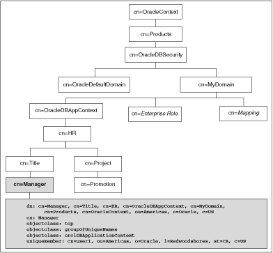

An application context stores user identification that can enable or prevent a user from accessing data in the database.

**Parent topic:** [Controlling Access to Data](part_3.md)

### 11.1 About Application Contexts

An application context provides many benefits in controlling the access that a user has to data.

- What Is an Application Context?  
	An **application context** is a set of name-value pairs that Oracle Database stores in memory.
- Components of the Application Context  
	An application context has two components, comprising a name-value pair.
- Where Are the Application Context Values Stored?  
	Oracle Database stores the application context values in a secure data cache.
- Benefits of Using Application Contexts  
	Most applications contain the kind of information that can be used for application contexts.
- How Editions Affects Application Context Values  
	Oracle Database sets the application context in all editions that are affected by the application context package.
- Application Contexts in a Multitenant Environment  
	Where you create an application in a multitenant environment determines where you must create the application context.

**Parent topic:** Using Application Contexts to Retrieve User Information

#### 11.1.1 What Is an Application Context?

An **application context** is a set of name-value pairs that Oracle Database stores in memory.

The context has a label called a **namespace** (for example, `empno_ctx` for an application context that retrieves employee IDs). This context enables Oracle Database to find information about both database and nondatabase users during authentication.

Inside the context are the name-value pairs (an associative array): the name points to a location in memory that holds the value. An application can use the application context to access session information about a user, such as the user ID or other user-specific information, or a client ID, and then securely pass this data to the database.

You can then use this information to either permit or prevent the user from accessing data through the application. You can use application contexts to authenticate both database and non-database users.

#### 11.1.2 Components of the Application Context

An application context has two components, comprising a name-value pair.

These components are as follows:

- Name. Refers to the name of the attribute set that is associated with the value. For example, if the `empno_ctx` application context retrieves an employee ID from the `HR.EMPLOYEES` table, it could have a name such as `employee_id`.
- Value. Refers to a value set by the attribute. For example, for the `empno_ctx` application context, if you wanted to retrieve an employee ID from the `HR.EMPLOYEES` table, you could create a value called `emp_id` that sets the value for this ID.

Think of an application context as a global variable that holds information that is accessed during a database session. To set the values for a secure application context, you must create a PL/SQL package procedure that uses the `DBMS_SESSION.SET_CONTEXT` procedure. In fact, this is the only way that you can set application context values if the context is not marked `INITIALIZED EXTERNALLY` or `INITIALIZED GLOBALLY`. You can assign the values to the application context attributes at run time, not when you create the application context. Because the trusted procedure, and not the user, assigns the values, it is a called secure application context. For client-session based application contexts, another way to set the application context is to use Oracle Call Interface (OCI) calls.

**Parent topic:** About Application Contexts

#### 11.1.3 Where Are the Application Context Values Stored?

Oracle Database stores the application context values in a secure data cache.

This cache is available in the User Global Area (UGA) or the System (sometimes called "Shared") Global Area (SGA). This way, the application context values are retrieved during the session. Because the application context stores the values in this data cache, it increases performance for your applications. You can use an application context by itself, with Oracle Virtual Private Databases policies, or with other fine-grained access control policies.

#### 11.1.4 Benefits of Using Application Contexts

Most applications contain the kind of information that can be used for application contexts.

For example, in an order entry application that uses a table containing the columns `ORDER_NUMBER` and `CUSTOMER_NUMBER`, you can use the values in these columns as security attributes to restrict access by a customer to his or her own orders, based on the ID of that customer.

Application contexts are useful for the following purposes:

- Enforcing fine-grained access control (for example, in Oracle Virtual Private Database polices)
- Preserving user identity across multitier environments
- Enforcing stronger security for your applications, because the application context is controlled by a trusted procedure, not the user
- Increasing performance by serving as a secure data cache for attributes needed by an application for fine-grained auditing or for use in PL/SQL conditional statements or loops
	This cache saves the repeated overhead of querying the database each time these attributes are needed. Because the application context stores session data in cache rather than forcing your applications to retrieve this data repeatedly from a table, it greatly improves the performance of your applications.
- Serving as a holding area for name-value pairs that an application can define, modify, and access

**Parent topic:** About Application Contexts

#### 11.1.5 How Editions Affects Application Context Values

Oracle Database sets the application context in all editions that are affected by the application context package.

The values the application context sets are visible in all editions the application context affects. To find all editions in your database, and whether they are usable, you can query the ALL\_EDITIONS data dictionary view.

#### 11.1.6 Application Contexts in a Multitenant Environment

Where you create an application in a multitenant environment determines where you must create the application context.

If an application is installed in the application root or CDB root, then it becomes accessible across the application container or system container and associated application PDBs. You will need to create a common application context in this root.

When you create a common application context for use with an application container, note the following:

- You can create application contexts by setting the `CONTAINER` clause in the `CREATE CONTEXT` SQL statement. For example, to create a common application context in the application root, you must execute `CREATE CONTEXT` with `CONTAINER` set to `ALL`. To create the application context in a PDB, set `CONTAINER` to `CURRENT`.
- You cannot use the same name for a local application context for a common application context. You can find the names of existing application contexts by running the following query:
	```
	SELECT OBJECT_NAME FROM DBA_OBJECTS WHERE OBJECT_TYPE ='CONTEXT';
	```
- The PL/SQL package that you create to manage a common application context must be a common PL/SQL package. That is, it must exist in the application root or CDB root. If you create the application context for a specific PDB, then you must store the associated PL/SQL package in that PDB.
- The name-value pairs that you set under a common session application context from an application container or a system container for a common application context are not accessible from other application containers or system containers when a common user accesses a different container.
- The name-value pairs that you set under a common global application context from an application container or a system container, are accessible only within the same container in the same user session.
- An application can retrieve the value of an application context whether it resides in the application root, the CDB root, or a PDB.
- During a plug-in operation of a PDB into a CDB or an application container, if the name of the common application context conflicts with a PDB’s local application context, then the PDB must open in restricted mode. A database administrator would then need to correct the conflict before opening the PDB in normal mode.
- During an unplug operation, a common application context retains its common semantics, so that later on, if the PDB is plugged into another CDB where a common application context with the same name exists, it would continue to behave like a common object. If a PDB is plugged into an application container or a system container, where the same common application context does not exist, then it behaves like a local object.

To find if an application context is a local application context or an application common application context, query the `SCOPE` column of the `DBA_CONTEXT` or `ALL_CONTEXT` data dictionary view.

**Parent topic:** About Application Contexts

### 11.2 Types of Application Contexts

There are three general categories of application contexts.

These categories are as follows:

- Database session-based application contexts. This type retrieves data that is stored in the database user session (that is, the UGA) cache. There are three categories of database session-based application contexts:
	- Initialized locally. Initializes the application context locally, to the session of the user.
		- Initialized externally. Initializes the application context from an Oracle Call Interface (OCI) application, a job queue process, or a connected user database link.
		- Initialized globally. Uses attributes and values from a centralized location, such as an LDAP directory.
- Global application contexts. This type retrieves data that is stored in the System Global Area (SGA) so that it can be used for applications that use a sessionless model, such as middle-tier applications in a three-tiered architecture. A global application context is useful if the session context must be shared across sessions, for example, through connection pool implementations.
- Client session-based application contexts. This type uses Oracle Call Interface functions on the client side to set the user session data, and then to perform the necessary security checks to restrict user access.

Table 11-1 summarizes the different types of application contexts.

Table 11-1 Types of Application Contexts

| Application Context Type | Stored in UGA | Stored in SGA | Supports Connected User Database Links | Supports Centralized Storage of Users' Application Context | Supports Sessionless Multitier Applications |
| --- | --- | --- | --- | --- | --- |
| Database session-based application context initialized locally | Yes | No | No | No | No |
| Database session-based application context initialized externally | Yes | No | Yes | No | No |
| Database session-based application context initialized globally | Yes | No | No | Yes | No |
| Global application context | No | Yes | No | No | Yes |
| Client session-based application context | Yes | No | Yes | No | Yes |

### 11.3 Using Database Session-Based Application Contexts

A database session-based application context enables you to retrieve session-based information about a user.

- About Database Session-Based Application Contexts  
	A database session-based application context retrieves session information for database users.
- Components of a Database Session-Based Application Context  
	A database session-based application context retrieves and sets data for the context and then sets this context when a user logs in.
- Creating Database Session-Based Application Contexts  
	A database session-based application context is a named object that stores the user's session information.
- Creating a Package to Set a Database Session-Based Application Context  
	A PL/SQL package can be used to retrieve the session information and set the name-value attributes of the application context.
- Logon Triggers to Run a Database Session Application Context Package  
	Users must run database session application context package after when they log in to the database instance.
- Example: Creating a Simple Logon Trigger  
	The `CREATE TRIGGER` statement can create a simple logon trigger.
- Example: Creating a Logon Trigger for a Production Environment  
	The `CREATE TRIGGER` statement can create a logon trigger for a production environment.
- Example: Creating a Logon Trigger for a Development Environment  
	The `CREATE TRIGGER` statement can create a logon trigger for a development environment.
- Tutorial: Creating and Using a Database Session-Based Application Context  
	This tutorial demonstrates how to create an application context that checks the ID of users who try to log in to the database.
- Initializing Database Session-Based Application Contexts Externally  
	Initializing database session-based application contexts externally increases performance because the application context is stored in the user global area (UGA).
- Initializing Database Session-Based Application Contexts Globally  
	When a database session-based application is stored in a centralized location, it can be used globally from an LDAP directory.
- Externalized Database Session-Based Application Contexts  
	Many applications store attributes used for fine-grained access control within a database metadata table.

**Parent topic:** Using Application Contexts to Retrieve User Information

#### 11.3.1 About Database Session-Based Application Contexts

A database session-based application context retrieves session information for database users.

This type of application context uses a PL/SQL procedure within Oracle Database to retrieve, set, and secure the data it manages.

The database session-based application context is managed entirely within Oracle Database. Oracle Database sets the values, and then when the user exits the session, automatically clears the application context values stored in cache. If the user connection ends abnormally, for example, during a power failure, then the PMON background process cleans up the application context data.You do not need to explicitly clear the application context from cache.

The advantage of having Oracle Database manage the application context is that you can centralize the application context management. Any application that accesses this database will need to use this application context to permit or prevent user access to that application. This provides benefits both in improved performance and stronger security.

Note:

If your users are application users, that is, users who are not in your database, consider using a global application context instead.

#### 11.3.2 Components of a Database Session-Based Application Context

A database session-based application context retrieves and sets data for the context and then sets this context when a user logs in.

You must use three components to create and use a database session-based application context: the application context, a procedure to retrieve the data and set the context, and a way to set the context when the user logs in.

- The application context. You use the `CREATE CONTEXT` SQL statement to create an application context. This statement names the application context (namespace) and associates it with a PL/SQL procedure that is designed to retrieve session data and set the application context.
- A PL/SQL procedure to perform the data retrieval and set the context. Ideally, create this procedure within a package, so that you can include other procedures if you want (for example, to perform error checking tasks).
- A way to set the application context when the user logs on. Users who log on to applications that use the application context must run a PL/SQL package that sets the application context. You can achieve this with either a logon trigger that fires each time the user logs on, or you can embed this functionality in your applications.

In addition, you can initialize session-based application contexts either externally or globally. Either method stores the context information in the user session.

- External initialization. This type can come from an OCI interface, a job queue process, or a connected user database link.
- Global initialization. This type uses attributes and values from a centralized location, such as an LDAP directory.

**Related Topics**

- About the Package That Manages the Database Session-Based Application Context
- Tutorial: Creating and Using a Database Session-Based Application Context
- Initializing Database Session-Based Application Contexts Externally
- Initializing a Database Session-Based Application Context Globally

**Parent topic:** Using Database Session-Based Application Contexts

#### 11.3.3 Creating Database Session-Based Application Contexts

A database session-based application context is a named object that stores the user's session information.

- About Creating Database Session-Based Application Contexts  
	A database user session (UGA) stores session-based application context, using a user-created namespace.
- Creating a Database Session-Based Application Context  
	The `CREATE` `CONTEXT` SQL statement can be used to create a database session-based application context.
- Database Session-Based Application Contexts for Multiple Applications  
	For each application, you can create an application context that has its own attributes.

**Parent topic:** Using Database Session-Based Application Contexts

##### 11.3.3.1 About Creating Database Session-Based Application Contexts

A database user session (UGA) stores session-based application context, using a user-created namespace.

Each application context must have a unique attribute and belong to a namespace. That is, context names must be unique within the database, not just within a schema.

You must have the `CREATE ANY CONTEXT` system privilege to create an application context, and the `DROP ANY CONTEXT` privilege to use the `DROP CONTEXT` statement if you want to drop the application context.

The ownership of the application context is as follows: Even though a user who has been granted the `CREATE ANY CONTEXT` and `DROP ANY CONTEXT` privileges can create and drop the application context, it is owned by the `SYS` schema. Oracle Database associates the context with the schema account that created it, but if you drop this user, the context still exists in the `SYS` schema. As user `SYS`, you can drop the application context.

You can find the names of existing application contexts by running the following query:

```
SELECT OBJECT_NAME FROM DBA_OBJECTS WHERE OBJECT_TYPE ='CONTEXT';
```

**Parent topic:** Creating Database Session-Based Application Contexts

##### 11.3.3.2 Creating a Database Session-Based Application Context

The `CREATE` `CONTEXT` SQL statement can be used to create a database session-based application context.

When you create a database session-based application context, you must create a namespace for the application context and then associate it with a PL/SQL package that manages the name-value pair that holds the session information of the user. At the time that you create the context, the PL/SQL package does not need to exist, but it must exist at run time.

- To create a database session-based application context, use the `CREATE` `CONTEXT` SQL statement.
	For example:
	```
	CREATE CONTEXT empno_ctx USING set_empno_ctx_pkg CONTAINER = CURRENT;
	```
	In this example:
	- `empno_ctx` is the context namespace.
	- `set_empno_ctx_pkg` is the package (which does not need to exist when you create the context) that sets attributes for the `empno_ctx` namespace.
	- `CONTAINER` creates the application context in the current PDB. To create the application context in the application or CDB root, you must set `CONTAINER` to `ALL`.
	Notice that when you create the context, you do not set its name-value attributes in the `CREATE CONTEXT` statement. Instead, you set these in the PL/SQL package that you associate with the application context. The reason you must do this is to prevent a malicious user from changing the context attributes without proper attribute validation. Ensure that this package is in the same container as the application context. For example, if you created the application context in a PDB, then the PL/SQL package must reside in that PDB.
	You cannot create a context called `CLIENTCONTEXT`. This word is reserved for use with client session-based application contexts.

##### 11.3.3.3 Database Session-Based Application Contexts for Multiple Applications

For each application, you can create an application context that has its own attributes.

Suppose, for example, you have three applications: General Ledger, Order Entry, and Human Resources.

You can specify different attributes for each application:

- For the order entry application context, you could specify the attribute `CUSTOMER_NUMBER.`
- For the general ledger application context, you could specify the attributes `SET_OF_BOOKS` and `TITLE.`
- For the human resources application context, you could specify the attributes `ORGANIZATION_ID`, `POSITION`, and `COUNTRY`.

The data the attributes access is stored in the tables behind the applications. For example, the order entry application uses a table called `OE.CUSTOMERS`, which contains the `CUSTOMER_NUMBER` column, which provides data for the `CUSTOMER_NUMBER` attribute. In each case, you can adapt the application context to your precise security needs.

**Parent topic:** Creating Database Session-Based Application Contexts

#### 11.3.4 Creating a Package to Set a Database Session-Based Application Context

A PL/SQL package can be used to retrieve the session information and set the name-value attributes of the application context.

- About the Package That Manages the Database Session-Based Application Context  
	This defines procedures that manage the session data represented by the application context.
- Using the SYS\_CONTEXT Function to Retrieve Session Information  
	You can retrieve session information for the application context by using the `SYS_CONTEXT` function.
- Checking the SYS\_CONTEXT Settings  
	You can check the `SYS_CONTEXT` settings, which are stored in the `DUAL` table.
- Dynamic SQL with SYS\_CONTEXT  
	During a session in which you expect a change in policy between executions of a given query, the query must use dynamic SQL.
- SYS\_CONTEXT in a Parallel Query  
	If you use `SYS_CONTEXT` inside a SQL function that is embedded in a parallel query, then the function includes the application context.
- SYS\_CONTEXT with Database Links  
	The `SYS_CONTEXT` function is compatible with the use of database links.
- DBMS\_SESSION.SET\_CONTEXT for Setting Session Information  
	After `SYS_CONTEXT` retrieves the session data of a user, you can set the application context values from the user session.
- Example: Simple Procedure to Create an Application Context Value  
	You can use the DBMS\_SESSION.SET\_CONTEXT statement in a procedure to set an application context value.

**Parent topic:** Using Database Session-Based Application Contexts

##### 11.3.4.1 About the Package That Manages the Database Session-Based Application Context

This defines procedures that manage the session data represented by the application context.

This package is usually created in the security administrator schema. The package must perform the following tasks:

- Retrieve session information. To retrieve the user session information, you can use the `SYS_CONTEXT` SQL function. The `SYS_CONTEXT` function returns the value of the parameter associated with the context namespace. You can use this function in both SQL and PL/SQL statements. Typically, you will use the built-in `USERENV` namespace to retrieve the session information of a user. You also can use the `SYS_SESSION_ROLES` namespace to indicate whether the specified role is currently enabled for the session.
- Set the name-value attributes of the application context you created with CREATE CONTEXT. You can use the `DBMS_SESSION.SET_CONTEXT` procedure to set the name-value attributes of the application context. The name-value attributes can hold information such as the user ID, IP address, authentication mode, the name of the application, and so on. The values of the attributes you set remain either until you reset them, or until the user ends the session. Note the following:
	- If the value of the parameter in the namespace already has been set, then `SET_CONTEXT` overwrites this value.
		- Be aware that any changes in the context value are reflected immediately and subsequent calls to access the value through the `SYS_CONTEXT` function will return the most recent value.
- Be executed by users. After you create the package, the user will need to execute the package when he or she logs on. You can create a logon trigger to execute the package automatically when the user logs on, or you can embed this functionality in your applications. Remember that the application context session values are cleared automatically when the user ends the session, so you do not need to manually remove the session data.

It is important to remember that the procedure is a trusted procedure: It is designed to prevent the user from setting his or her own application context attribute values. The user runs the procedure, but the procedure sets the application context values, not the user.

##### 11.3.4.2 Using the SYS\_CONTEXT Function to Retrieve Session Information

You can retrieve session information for the application context by using the `SYS_CONTEXT` function.

The `SYS_CONTEXT` function provides a default namespace, `USERENV`, which describes the current session of the user logged on. `SYS_CONTEXT` enables you to retrieve different types of session-based information about a user, such as the user host computer ID, host IP address, operating system user name, and so on. Remember that you only use `USERENV` to retrieve session data, not set it.

- To use retrieve session information, set the namespace, parameter, and optionally, the length values of the `SYS_CONTEXT` function.
	For example:
	```
	SYS_CONTEXT ('USERENV','HOST')
	```

The syntax for the PL/SQL function `SYS_CONTEXT` is as follows:

```
SYS_CONTEXT ('namespace','parameter'[,length])
```

In this specification:

- `namespace` is the name of the application context. You can specify either a string or an expression that evaluates to a string. The `SYS_CONTEXT` function returns the value of parameter associated with the context namespace at the current instant. If the value of the parameter in the namespace already has been set, then `SET_CONTEXT` overwrites this value.
- `parameter` is a parameter within the `namespace` application context. This value can be a string or an expression.
- `length` is the default maximum size of the return type, which is 256 bytes, but you can override the length by specifying a value up to 4000 bytes. Enter a value that is a `NUMBER` data type, or a value that can be can be implicitly converted to `NUMBER`. The data type of the `SYS_CONTEXT` return type is a `VARCHAR2`. This setting is optional.

Note:

The `USERENV` application context namespace replaces the `USERENV` function provided in earlier Oracle Database releases.

##### 11.3.4.3 Checking the SYS\_CONTEXT Settings

You can check the `SYS_CONTEXT` settings, which are stored in the `DUAL` table.

The `DUAL` table is a small table in the data dictionary that Oracle Database and user-written programs can reference to guarantee a known result. This table has one column called `DUMMY` and one row that contains the value `X`.

- To check the `SYS_CONTEXT` settings, issue a `SELECT` SQL statement on the `DUAL` table.

For example, to find the host computer on which you are logged, assuming that you are logged on to the `SHOBEEN_PC` host computer under `EMP_USERS`:

```
SELECT SYS_CONTEXT ('USERENV', 'HOST') FROM DUAL;

SYS_CONTEXT(USERENV,HOST)
-------------------------
EMP_USERS\SHOBEEEN_PC
```

**Parent topic:** Creating a Package to Set a Database Session-Based Application Context

##### 11.3.4.4 Dynamic SQL with SYS\_CONTEXT

During a session in which you expect a change in policy between executions of a given query, the query must use dynamic SQL.

You must use dynamic SQL because static SQL and dynamic SQL parse statements differently:

- Static SQL statements are parsed at compile time. They are not parsed again at execution time for performance reasons.
- Dynamic SQL statements are parsed every time they are executed.

Consider a situation in which Policy A is in force when you compile a SQL statement, and then you switch to Policy B and run the statement. With static SQL, Policy A remains in force. Oracle Database parses the statement at compile time, but does not parse it again upon execution. With dynamic SQL, Oracle Database parses the statement upon execution, then the switch to Policy B takes effect.

For example, consider the following policy:

```
EMPLOYEE_NAME = SYS_CONTEXT ('USERENV', 'SESSION_USER')
```

The policy `EMPLOYEE_NAME` matches the database user name. It is represented in the form of a SQL predicate in Oracle Virtual Private Database: the predicate is considered a policy. If the predicate changes, then the statement must be parsed again to produce the correct result.

##### 11.3.4.5 SYS\_CONTEXT in a Parallel Query

If you use `SYS_CONTEXT` inside a SQL function that is embedded in a parallel query, then the function includes the application context.

Consider a user-defined function within a SQL statement, which sets the user ID to 5:

```
CREATE FUNCTION set_id 
 RETURN NUMBER IS
BEGIN
 IF SYS_CONTEXT ('hr', 'id') = 5
   THEN RETURN 1; ELSE RETURN 2;
 END IF;
END;
```

Now consider the following statement:

```
SELECT * FROM emp WHERE set_id( ) = 1;
```

When this statement is run as a parallel query, the user session, which contains the application context information, is propagated to the parallel execution servers (query child processes).

**Parent topic:** Creating a Package to Set a Database Session-Based Application Context

##### 11.3.4.6 SYS\_CONTEXT with Database Links

The `SYS_CONTEXT` function is compatible with the use of database links.

When SQL statements within a user session involve database links, Oracle Database runs the `SYS_CONTEXT` function at the host computer of the database link, and then captures the context information in the host computer.

If remote PL/SQL procedure calls are run on a database link, then Oracle Database runs any `SYS_CONTEXT` function inside such a procedure at the destination database of the link.

In this case, only externally initialized application contexts are available at the database link destination site. For security reasons, Oracle Database propagates only the externally initialized application context information to the destination site from the initiating database link site.

**Parent topic:** Creating a Package to Set a Database Session-Based Application Context

##### 11.3.4.7 DBMS\_SESSION.SET\_CONTEXT for Setting Session Information

After `SYS_CONTEXT` retrieves the session data of a user, you can set the application context values from the user session.

To set the context values, you can use the `DBMS_SESSION.SET_CONTEXT` procedure. You must have the `EXECUTE` privilege for the `DBMS_SESSION` PL/SQL package.

The syntax for `DBMS_SESSION.SET_CONTEXT` is as follows:

```
DBMS_SESSION.SET_CONTEXT (
   namespace VARCHAR2,
   attribute VARCHAR2,
   value     VARCHAR2,
   username  VARCHAR2,
   client_id VARCHAR2);
```

In this specification:

- `namespace` is the namespace of the application context to be set, limited to 30 bytes. For example, if you were using a namespace called `custno_ctx`, you would specify it as follows:
	```
	namespace => 'custno_ctx',
	```
- `attribute` is the attribute of the application context to be set, limited to 30 bytes. For example, to create the `ctx_attrib` attribute for the `custno_ctx` namespace:
	```
	attribute => 'ctx_attrib',
	```
- `value` is the value of the application context to be set, limited to 4000 bytes. Typically, this is the value retrieved by the `SYS_CONTEXT` function and stored in a variable. For example:
	```
	value => ctx_value,
	```
- `username` is the database user name attribute of the application context. The default is `NULL`, which permits any user to access the session. For database session-based application contexts, omit this setting so that it uses the `NULL` default. This setting is optional.
	The `username` and `client_id` parameters are used for globally accessed application contexts.
- `client_id` is the application-specific `client_id` attribute of the application context (64-byte maximum). The default is `NULL`, which means that no client ID is specified. For database session-based application contexts, omit this setting so that it uses the `NULL` default.

##### 11.3.4.8 Example: Simple Procedure to Create an Application Context Value

You can use the DBMS\_SESSION.SET\_CONTEXT statement in a procedure to set an application context value.

Example 11-1 shows how to create a simple procedure that creates an attribute for the `empno_ctx` application context.

Example 11-1 Simple Procedure to Create an Application Context Value

```
CREATE OR REPLACE PROCEDURE set_empno_ctx_proc(
  emp_value IN VARCHAR2)
 IS   
 BEGIN
  DBMS_SESSION.SET_CONTEXT('empno_ctx', 'empno_attrib', emp_value);
 END; 
/
```

In this example:

- `emp_value IN VARCHAR2` takes `emp_value` as the input parameter. This parameter specifies the value associated with the application context attribute `empno_attrib`. The limit is 4000 bytes.
- `DBMS_SESSION.SET_CONTEXT('empno_ctx', 'empno_attrib', emp_value)` sets the value of the application context by using the `DBMS_SESSION.SET_CONTEXT` procedure as follows:
	- `'empno_ctx'` refers to the application context namespace. Enclose its name in single quotation marks.
		- `'empno_attrib'` creates the attribute associated with the application context namespace.
		- `emp_value` specifies the value for the `empno_attrib` attribute. Here, it refers to the `emp_value` parameter.

At this stage, you can run the `set_empno_ctx_proc` procedure to set the application context:

```
EXECUTE set_empno_ctx_proc ('42783');
```

(In a real world scenario, you would set the application context values in the procedure itself, so that it becomes a trusted procedure. This example is only used to show how data can be set for demonstration purposes.)

To check the application context setting, run the following `SELECT` statement:

```
SELECT SYS_CONTEXT ('empno_ctx', 'empno_attrib') empno_attrib FROM DUAL;

EMPNO_ATTRIB
--------------
42783
```

You can also query the `SESSION_CONTEXT` data dictionary view to find all the application context settings in the current session of the database instance. For example:

```
SELECT * FROM SESSION_CONTEXT;

NAMESPACE                ATTRIBUTE          VALUE
--------------------------------------------------
EMPNO_CTX                EMP_ID             42783
```

**Parent topic:** Creating a Package to Set a Database Session-Based Application Context

#### 11.3.5 Logon Triggers to Run a Database Session Application Context Package

Users must run database session application context package after when they log in to the database instance.

You can create a logon trigger that handles this automatically. You do not need to grant the user `EXECUTE` permissions to run the package.

Note the following:

- If the PL/SQL package procedure called by the logon trigger has any unhandled exceptions or raises any exceptions (because, for example, a security check failed), then the logon trigger fails. When the logon trigger fails, the logon fails, that is, the user is denied permission to log in to the database.
- Logon triggers may affect performance. In addition, test the logon trigger on a sample schema user first before creating it for the database. That way, if there is an error, you can easily correct it.
- Be aware of situations in which if you have a changing set of books, or if positions change constantly. In these cases, the new attribute values may not be picked up right away, and you must force a cursor reparse to pick them up.

Note:

A logon trigger can be used because the user context (information such as `EMPNO`, `GROUP`, `MANAGER`) should be set before the user accesses any data.

**Parent topic:** Using Database Session-Based Application Contexts

#### 11.3.6 Example: Creating a Simple Logon Trigger

The `CREATE TRIGGER` statement can create a simple logon trigger.

Example 11-2 shows a simple logon trigger that executes a PL/SQL procedure.

Example 11-2 Creating a Simple Logon Trigger

```
CREATE OR REPLACE TRIGGER set_empno_ctx_trig AFTER LOGON ON DATABASE
 BEGIN
  sec_mgr.set_empno_ctx_proc;
 END;
```

**Parent topic:** Using Database Session-Based Application Contexts

#### 11.3.7 Example: Creating a Logon Trigger for a Production Environment

The `CREATE TRIGGER` statement can create a logon trigger for a production environment.

Example 11-3 shows how to create a logon trigger that uses a `WHEN OTHERS` exception. Otherwise, if there is an error in the PL/SQL logic that creates an unhandled exception, then all connections to the database are blocked.

This example shows a `WHEN OTHERS` exception that writes errors to a table in the security administrator's schema. In a production environment, this is safer than sending the output to the user session, where it could be vulnerable to security attacks.

Example 11-3 Creating a Logon Trigger for a Production Environment

```
CREATE OR REPLACE TRIGGER set_empno_ctx_trig AFTER LOGON ON DATABASE
 BEGIN
  sec_mgr.set_empno_ctx_proc;
 EXCEPTION
  WHEN OTHERS THEN
        v_code := SQLCODE;
        v_errm := SUBSTR(SQLERRM, 1 , 64);
       -- Invoke another procedure,
       -- declared with PRAGMA AUTONOMOUS_TRANSACTION,
       -- to insert information about errors.
  INSERT INTO sec_mgr.errors VALUES (v_code, v_errm, SYSTIMESTAMP);
 END;
/
```

**Parent topic:** Using Database Session-Based Application Contexts

#### 11.3.8 Example: Creating a Logon Trigger for a Development Environment

The `CREATE TRIGGER` statement can create a logon trigger for a development environment.

Example 11-4 shows how to create the same logon trigger for a development environment, in which you may want to output errors the user session for debugging purposes.

Example 11-4 Creating a Logon Trigger for a Development Environment

```
CREATE TRIGGER set_empno_ctx_trig 
 AFTER LOGON ON DATABASE
 BEGIN
  sysadmin_ctx.set_empno_ctx_pkg.set_empno;
 EXCEPTION
  WHEN OTHERS THEN
   RAISE_APPLICATION_ERROR(
    -20000, 'Trigger sysadmin_ctx.set_empno_ctx_trig violation. Login denied.');
 END;
/
```

**Parent topic:** Using Database Session-Based Application Contexts

#### 11.3.9 Tutorial: Creating and Using a Database Session-Based Application Context

This tutorial demonstrates how to create an application context that checks the ID of users who try to log in to the database.

- Step 1: Create User Accounts and Ensure the User SCOTT Is Active  
	To begin this tutorial, you must create the necessary database accounts and endure that the `SCOTT` user account is active.
- Step 2: Create the Database Session-Based Application Context  
	As the `sysadmin_ctx` user, you are ready to create the database session-based application context.
- Step 3: Create a Package to Retrieve Session Data and Set the Application Context  
	Next, you must create a PL/SQL package that retrieves the session data and then sets the application context.
- Step 4: Create a Logon Trigger for the Package  
	The logon trigger will execute when the user logs in.
- Step 5: Test the Application Context  
	Now that the components are all in place, you are ready to test the application context.
- Step 6: Remove the Components of This Tutorial  
	If you no longer need the components of this tutorial, then you can remove them.

**Parent topic:** Using Database Session-Based Application Contexts

##### 11.3.9.1 Step 1: Create User Accounts and Ensure the User SCOTT Is Active

To begin this tutorial, you must create the necessary database accounts and endure that the `SCOTT` user account is active.

1. Log in to a PDB as user `SYS` and connect using the `SYSDBA` administrative privilege.
	```
	sqlplus sys@pdb_name as sysdba
	Enter password: password
	```
	To find the available PDBs in a CDB, log in to the CDB root container and then query the `PDB_NAME` column of the `DBA_PDBS` data dictionary view. To check the current container, run the `show con_name` command.
2. Create the local user account `sysadmin_ctx`, who will administer the database session-based application context.
	```
	CREATE USER sysadmin_ctx IDENTIFIED BY password;
	GRANT CREATE SESSION, CREATE ANY CONTEXT, CREATE PROCEDURE, CREATE TRIGGER, ADMINISTER DATABASE TRIGGER TO sysadmin_ctx;
	GRANT READ ON HR.EMPLOYEES TO sysadmin_ctx;
	GRANT EXECUTE ON DBMS_SESSION TO sysadmin_ctx;
	```
	Replace `password` with a password that is secure.
3. Create the following user account for Lisa Ozer, who is listed as having `lozer` for their email account in the `HR.EMPLOYEES` table.
	```
	GRANT CREATE SESSION TO LOZER IDENTIFIED BY password;
	```
	Replace `password` with a password that is secure.
4. The sample user `SCOTT` will also be used in this tutorial, so query the `DBA_USERS` data dictionary view to ensure that the account status for `SCOTT` is `OPEN`.
	```
	SELECT USERNAME, ACCOUNT_STATUS FROM DBA_USERS WHERE USERNAME = 'SCOTT';
	```
	If the `DBA_USERS` view lists user `SCOTT` as locked and expired, then enter the following statement to unlock the `SCOTT` account and create a new password for him:
	```
	ALTER USER SCOTT ACCOUNT UNLOCK IDENTIFIED BY password;
	```
	Enter a password that is secure. For greater security, do not give the `SCOTT` account the same password from previous releases of Oracle Database.

##### 11.3.9.2 Step 2: Create the Database Session-Based Application Context

As the `sysadmin_ctx` user, you are ready to create the database session-based application context.

1. Connect to the PDB as `sysadmin_ctx`.
	```
	CONNECT sysadmin_ctx@pdb_name
	Enter password: password
	```
2. Create the application context using the following statement:
	```
	CREATE CONTEXT empno_ctx USING set_empno_ctx_pkg;
	```
	Remember that even though user `sysadmin_ctx` has created this application context, the `SYS` schema owns the context.

**Parent topic:** Tutorial: Creating and Using a Database Session-Based Application Context

##### 11.3.9.3 Step 3: Create a Package to Retrieve Session Data and Set the Application Context

Next, you must create a PL/SQL package that retrieves the session data and then sets the application context.

- To create the package, use the `CREATE OR REPLACE PACKAGE` statement.

Example 11-5 shows how to create the package you need to retrieve the session data and set the application context. Before creating the package, ensure that you are still logged on as user `sysadmin_ctx`.

Example 11-5 Package to Retrieve Session Data and Set a Database Session Context

```
CREATE OR REPLACE PACKAGE set_empno_ctx_pkg IS 
   PROCEDURE set_empno; 
 END; 
 /
 CREATE OR REPLACE PACKAGE BODY set_empno_ctx_pkg IS
   PROCEDURE set_empno 
   IS 
    emp_id HR.EMPLOYEES.EMPLOYEE_ID%TYPE;
   BEGIN 
    SELECT EMPLOYEE_ID INTO emp_id FROM HR.EMPLOYEES 
       WHERE email = SYS_CONTEXT('USERENV', 'SESSION_USER');
    DBMS_SESSION.SET_CONTEXT('empno_ctx', 'employee_id', emp_id);
   EXCEPTION  
    WHEN NO_DATA_FOUND THEN NULL;
  END;
 END;
/
```

This package creates a procedure called `set_empno` that performs the following actions:

- `emp_id HR.EMPLOYEES.EMPLOYEE_ID%TYPE` declares a variable, `emp_id`, to store the employee ID for the user who logs on. It uses the same data type as the `EMPLOYEE_ID` column in `HR.EMPLOYEES`.
- `SELECT EMPLOYEE_ID INTO emp_id FROM HR.EMPLOYEES` performs a `SELECT` statement to copy the employee ID that is stored in the `employee_id` column data from the `HR.EMPLOYEES` table into the `emp_id` variable.
- `WHERE email = SYS_CONTEXT('USERENV', 'SESSION_USER')` uses a `WHERE` clause to find all employee IDs that match the email account for the session user. The `SYS_CONTEXT` function uses the predefined `USERENV` context to retrieve the user session ID, which is the same as the `email` column data. For example, the user ID and email address for Lisa Ozer are both the same: `lozer`.
- `DBMS_SESSION.SET_CONTEXT('empno_ctx', 'employee_id', emp_id)` uses the `DBMS_SESSION.SET_CONTEXT` procedure to set the application context:
	- `'empno_ctx'`: Calls the application context `empno_ctx`. Enclose `empno_ctx` in single quotes.
		- `'employee_id'`: Creates the attribute value of the `empno_ctx` application context name-value pair, by naming it `employee_id`. Enclose `employee_id` in single quotes.
		- `emp_id`: Sets the value for the `employee_id` attribute to the value stored in the `emp_id` variable.
	To summarize, the `set_empno_ctx_pkg.set_empno` procedure says, "Get the session ID of the user and then match it with the employee ID and email address of any user listed in the `HR.EMPLOYEES` table."
- `EXCEPTION ... WHEN_NO_DATA_FOUND` adds a `WHEN NO_DATA_FOUND` system exception to catch any `no data found` errors that may result from the `SELECT` statement. Without this exception, the package and logon trigger will work fine and set the application context as needed, but then any non-system administrator users other than the users listed in the `HR.EMPLOYEES` table will not be able to log in to the database. Other users should be able to log in to the database, assuming they are valid database users. Once the application context information is set, then you can use this session information as a way to control user access to a particular application.

**Parent topic:** Tutorial: Creating and Using a Database Session-Based Application Context

##### 11.3.9.4 Step 4: Create a Logon Trigger for the Package

The logon trigger will execute when the user logs in.

- As user `sysadmin_ctx`, create a logon trigger for `set_empno_ctx_pkg.set_empno` package procedure.
```
CREATE TRIGGER set_empno_ctx_trig AFTER LOGON ON DATABASE
 BEGIN
  sysadmin_ctx.set_empno_ctx_pkg.set_empno;
 END;
/
```

**Parent topic:** Tutorial: Creating and Using a Database Session-Based Application Context

##### 11.3.9.5 Step 5: Test the Application Context

Now that the components are all in place, you are ready to test the application context.

1. Connect as user `lozer`.
	```
	CONNECT lozer@pdb_name
	Enter password: password
	```
	When user `lozer` logs on, the `empno_ctx` application context collects their employee ID. You can check it as follows:
	```
	SELECT SYS_CONTEXT('empno_ctx', 'employee_id') emp_id FROM DUAL;
	```
	The following output should appear:
	```
	EMP_ID
	--------------------------------------------------------
	168
	```
2. Connect as user `SCOTT`.
	```
	CONNECT SCOTT@pdb_name
	Enter password: password
	```
	User `SCOTT` is not listed as an employee in the `HR.EMPLOYEES` table, so the `empno_ctx` application context cannot collect an employee ID for him.
	```
	SELECT SYS_CONTEXT('empno_ctx', 'employee_id') emp_id FROM DUAL;
	```
	The following output should appear:
	```
	EMP_ID
	--------------------------------------------------------
	```

From here, the application can use the user session information to determine how much access the user can have in the database. You can use Oracle Virtual Private Database to accomplish this..

##### 11.3.9.6 Step 6: Remove the Components of This Tutorial

If you no longer need the components of this tutorial, then you can remove them.

1. Connect as `SYS` with the `SYSDBA` administrative privilege.
	```
	CONNECT SYS@pdb_name AS SYSDBA 
	Enter password: password
	```
2. Drop the users `sysadmin_ctx` and `lozer`:
	```
	DROP USER sysadmin_ctx CASCADE;
	DROP USER lozer;
	```
3. ```
	DROP CONTEXT empno_ctx;
	```
	Remember that even though `sysadmin_ctx` created the application context, it is owned by the `SYS` schema.
4. If you want, lock and expire `SCOTT`, unless other users want to use this account:
	```
	ALTER USER SCOTT PASSWORD EXPIRE ACCOUNT LOCK;
	```

**Parent topic:** Tutorial: Creating and Using a Database Session-Based Application Context

#### 11.3.10 Initializing Database Session-Based Application Contexts Externally

Initializing database session-based application contexts externally increases performance because the application context is stored in the user global area (UGA).

- About Initializing Database Session-Based Application Contexts Externally  
	You must use a special type of namespace to initialize session-based application context externally.
- Default Values from Users  
	Oracle Database enables you to capture and use default values from users for your applications.
- Values from Other External Resources  
	An application context can accept the initialization of attributes and values through external resources.
- Example: Creating an Externalized Database Session-based Application Context  
	The `CREATE CONTEXT` SQL statement can create an externalized database session-based application context.
- Initialization of Application Context Values from a Middle-Tier Server  
	Middle-tier servers can initialize application context values on behalf of database users.

**Parent topic:** Using Database Session-Based Application Contexts

##### 11.3.10.1 About Initializing Database Session-Based Application Contexts Externally

You must use a special type of namespace to initialize session-based application context externally.

This namespace must accept the initialization of attribute values from external resources and then stores them in the local user session.

Initializing an application context externally enhances performance because it is stored in the UGA and enables the automatic propagation of attributes from one session to another. Connected user database links are supported only by application contexts initialized from OCI-based external sources.

**Parent topic:** Initializing Database Session-Based Application Contexts Externally

##### 11.3.10.2 Default Values from Users

Oracle Database enables you to capture and use default values from users for your applications.

Sometimes you need the default values from users. Initially, these default values may be hints or preferences, and then after validation, they become trusted contexts. Similarly, it may be more convenient for clients to initialize some default values, and then rely on a login event trigger or applications to validate the values.

For job queues, the job submission routine records the context being set at the time the job is submitted, and restores it when executing the batched job. To maintain the integrity of the context, job queues cannot bypass the designated PL/SQL package to set the context. Rather, the externally initialized application context accepts initialization of context values from the job queue process.

Automatic propagation of context to a remote session may create security problems. Developers or administrators can effectively handle the context that takes default values from resources other than the designated PL/SQL procedure by using logon triggers to reset the context when users log in.

**Parent topic:** Initializing Database Session-Based Application Contexts Externally

##### 11.3.10.3 Values from Other External Resources

An application context can accept the initialization of attributes and values through external resources.

Examples include an Oracle Call Interface (OCI) interface, a job queue process, or a database link.

Externally initialized application contexts provide the following features:

- For remote sessions, automatic propagation of context values that are in the externally initialized application context namespace
- For job queues, restoration of context values that are in the externally initialized application context namespace
- For OCI interfaces, a mechanism to initialize context values that are in the externally initialized application context namespace

Although any client program that is using Oracle Call Interface can initialize this type of namespace, you can use login event triggers to verify the values. It is up to the application to interpret and trust the values of the attributes.

**Parent topic:** Initializing Database Session-Based Application Contexts Externally

##### 11.3.10.4 Example: Creating an Externalized Database Session-based Application Context

The `CREATE CONTEXT` SQL statement can create an externalized database session-based application context.

Example 11-6 shows how to create a database session-based application context that obtains values from an external source.

Example 11-6 Creating an Externalized Database Session-based Application Context

```
CREATE CONTEXT ext_ctx USING ext_ctx_pkg INITIALIZED EXTERNALLY;
```

**Parent topic:** Initializing Database Session-Based Application Contexts Externally

##### 11.3.10.5 Initialization of Application Context Values from a Middle-Tier Server

Middle-tier servers can initialize application context values on behalf of database users.

In this process, context attributes are propagated for the remote session at initialization time, and the remote database accepts the values if the namespace is externally initialized.

For example, a three-tier application creating lightweight user sessions through OCI or JDBC/OCI can access the `PROXY_USER` attribute in `USERENV`. This attribute enables you to determine if the user session was created by a middle-tier application. You could allow a user to access data only for connections where the user is proxied. If users connect directly to the database, then they would not be able to access any data.

You can use the `PROXY_USER` attribute from the `USERENV` namespace within Oracle Virtual Private Database to ensure that users only access data through a particular middle-tier application. For a different approach, you can develop a secure application role to enforce your policy that users access the database only through a specific proxy.

#### 11.3.11 Initializing Database Session-Based Application Contexts Globally

When a database session-based application is stored in a centralized location, it can be used globally from an LDAP directory.

- About Initializing Database Session-Based Application Contexts Globally  
	You can use a centralized location to store the database session-based application context of the user.
- Database Session-Based Application Contexts with LDAP  
	An application context that is initialized globally uses LDAP, a standard, extensible, and efficient directory access protocol.
- How Globally Initialized Database Session-Based Application Contexts Work  
	To use a globally initialized secure application, you must first configure Enterprise User Security.
- Initializing a Database Session-Based Application Context Globally  
	You can configure and store the initial application context for a user, such as the department name and title, in the LDAP directory.

**Parent topic:** Using Database Session-Based Application Contexts

##### 11.3.11.1 About Initializing Database Session-Based Application Contexts Globally

You can use a centralized location to store the database session-based application context of the user.

A centralized location enables applications to set up a user context during initialization based upon user identity.

In particular, this feature supports Oracle Label Security labels and privileges. Initializing an application context globally makes it easier to manage contexts for large numbers of users and databases.

For example, many organizations want to manage user information centrally, in an LDAP-based directory. Enterprise User Security supports centralized user and authorization management in Oracle Internet Directory. However, there may be additional attributes an application must retrieve from Lightweight Directory Access Protocol (LDAP) to use for Oracle Virtual Private Database enforcement, such as the user title, organization, or physical location. Initializing an application context globally enables you to retrieve these types of attributes.

**Parent topic:** Initializing Database Session-Based Application Contexts Globally

##### 11.3.11.2 Database Session-Based Application Contexts with LDAP

An application context that is initialized globally uses LDAP, a standard, extensible, and efficient directory access protocol.

The LDAP directory stores a list of users to which this application is assigned. Oracle Database uses a directory service, typically Oracle Internet Directory, to authenticate and authorize enterprise users.

Note:

You can use third-party directories such as Microsoft Active Directory and Sun Microsystems SunONE as the directory service.

The `orclDBApplicationContext` LDAP object (a subclass of `groupOfUniqueNames`) stores the application context values in the directory. The location of the application context object is described in Figure 11-1, which is based on the Human Resources example.

The LDAP object `inetOrgPerson` enables multiple entries to exist for some attributes. However, be aware that when these entries are loaded into the database and accessed with the `SYS_LDAP_USER_DEFAULT` context namespace, then only the first of these entries is returned. For example, the `inetOrgPerson` object for a user allows multiple entries for `telephoneNumber` (thus allowing a user to have multiple telephone numbers stored). When you use the `SYS_LDAP_USER_DEFAULT` context namespace, only the first telephone number is retrieved. If the list of attributes and values that are provided are not sufficient for your needs, then you can use the `DBMS_LDAP` PL/SQL package to fetch additional values from the directory.

On the LDAP side, an internal C function is required to retrieve the `orclDBApplicationContext` value, which returns a list of application context values to the database. In this example, `HR` is the namespace; `Title` and `Project` are the attributes; and `Manager` and `Promotion` are the values.

Figure 11-1 Location of Application Context in LDAP Directory Information Tree



> Surrounding text describes this figure.
>
> [  
> Copyright © 1996, 2024, Oracle and/or its affiliates.](https://docs.oracle.com/en/database/oracle/oracle-database/dcommon/html/cpyr.htm)


**Parent topic:** Initializing Database Session-Based Application Contexts Globally

##### 11.3.11.3 How Globally Initialized Database Session-Based Application Contexts Work

To use a globally initialized secure application, you must first configure Enterprise User Security.

Then, you configure the application context values for the user in the database and the directory.

When a global user (enterprise user) connects to the database, Enterprise User Security verifies the identity of the user connecting to the database. After authentication, the global user roles and application context are retrieved from the directory. When the user logs on to the database, the global roles and initial application context are already set.

##### 11.3.11.4 Initializing a Database Session-Based Application Context Globally

You can configure and store the initial application context for a user, such as the department name and title, in the LDAP directory.

The values are retrieved during user login so that the context is set properly. In addition, any information related to the user is retrieved and stored in the `SYS_USER_DEFAULTS` application context namespace.

1. Create the application context in the database.
	```
	CREATE CONTEXT hr USING hrapps.hr_manage_pkg INITIALIZED GLOBALLY;
	```
2. Create and add new entries in the LDAP directory.
	An example of the entries added to the LDAP directory follows. These entries create an attribute named `Title` with the attribute value `Manager` for the application (namespace) `HR`, and assign user names `user1` and `user2`. In the following, `cn=example` refers to the name of the domain.
	```
	dn: cn=OracleDBAppContext,cn=example,cn=OracleDBSecurity,cn=Products,cn=OracleContext,ou=Americas,o=oracle,c=US
	changetype: add
	cn: OracleDBAppContext
	objectclass: top
	objectclass: orclContainer
	dn: cn=hr,cn=OracleDBAppContext,cn=example,cn=OracleDBSecurity,cn=Products,cn=OracleContext,ou=Americas,o=oracle,c=US
	changetype: add
	cn: hr
	objectclass: top
	objectclass: orclContainer
	dn: cn=Title,cn=hr, cn=OracleDBAppContext,cn=example,cn=OracleDBSecurity,cn=Products,cn=OracleContext,ou=Americas,o=oracle,c=US
	changetype: add
	cn: Title
	objectclass: top
	objectclass: orclContainer
	dn: cn=Manager,cn=Title,cn=hr, cn=OracleDBAppContext,cn=example,cn=OracleDBSecurity,cn=Products,cn=OracleContext,ou=Americas,o=oracle,c=US
	cn: Manager
	objectclass: top
	objectclass: groupofuniquenames
	objectclass: orclDBApplicationContext
	uniquemember: CN=user1,OU=Americas,O=Oracle,L=Redwoodshores,ST=CA,C=US
	uniquemember: CN=user2,OU=Americas,O=Oracle,L=Redwoodshores,ST=CA,C=US
	```
3. If an LDAP `inetOrgPerson` object entry exists for the user, then the connection retrieves the attributes from `inetOrgPerson`, and assigns them to the namespace `SYS_LDAP_USER_DEFAULT`. Note that the context is only populated with non- `NULL` values that are part of the `inetOrgPerson` object class. No other attributes will be populated.
	The following is an example of an `inetOrgPerson` entry:
	```
	dn: cn=user1,ou=Americas,O=oracle,L=redwoodshores,ST=CA,C=US
	changetype: add
	objectClass: top
	objectClass: person
	objectClass: organizationalPerson
	objectClass: inetOrgPerson
	cn: user1
	sn: One
	givenName: User
	initials: UO
	title: manager, product development
	uid: uone
	mail: uone@us.example.com
	telephoneNumber: +1 650 555 0105
	employeeNumber: 00001
	employeeType: full time
	```
4. Connect to the database.
	When `user1` connects to a database that belongs to the `example` domain, `user1` will have his `Title` set to `Manager`. Any information related to `user1` will be retrieved from the LDAP directory. The value can be obtained using the following syntax:
	```
	SYS_CONTEXT('namespace','attribute name')
	```
	For example:
	```
	DECLARE 
	 tmpstr1 VARCHAR2(30);
	 tmpstr2 VARCHAR2(30);
	BEGIN
	 tmpstr1 = SYS_CONTEXT('HR','TITLE);
	 tmpstr2 = SYS_CONTEXT('SYS_LDAP_USER_DEFAULT','telephoneNumber');
	 DBMS_OUTPUT.PUT_LINE('Title is ' || tmpstr1);
	 DBMS_OUTPUT.PUT_LINE('Telephone Number is ' || tmpstr2);
	END;
	```
	The output of this example is:
	```
	Title is Manager
	Telephone Number is +1 650 555 0105
	```

**Parent topic:** Initializing Database Session-Based Application Contexts Globally

#### 11.3.12 Externalized Database Session-Based Application Contexts

Many applications store attributes used for fine-grained access control within a database metadata table.

For example, an `employees` table could include cost center, title, signing authority, and other information useful for fine-grained access control. Organizations also centralize user information for user management and access control in LDAP-based directories, such as Oracle Internet Directory. Application context attributes can be stored in Oracle Internet Directory, and assigned to one or more enterprise users. They can also be retrieved automatically upon login for an enterprise user, and then used to initialize an application context.

### 11.4 Global Application Contexts

You can use a global application context to access application values across database sessions, including an Oracle Real Application Clusters environment.

- About Global Application Contexts  
	A global application context enables application context values to be accessible across database sessions, including Oracle RAC instances.
- Uses for Global Application Contexts  
	There are three general uses for global application contexts.
- Components of a Global Application Context  
	A global application context uses a package to manage its attributes and middle-tier application to manage the client session ID.
- Global Application Contexts in an Oracle Real Application Clusters Environment  
	In an Oracle RAC environment, whenever a global application context is loaded or changed, it is visible only to the existing active instances.
- Creating Global Application Contexts  
	The `CREATE CONTEXT` SQL statement creates the global application context, which is then located in the `SYS` schema.
- PL/SQL Package to Manage a Global Application Context  
	The `DBMS_SESSION` PL/SQL package to manages global application contexts.
- Embedding Calls in Middle-Tier Applications to Manage the Client Session ID  
	You can embed calls in middle-tier applications to manage client session IDs.
- Tutorial: Creating a Global Application Context That Uses a Client Session ID  
	This tutorial demonstrates how you can create a global application context that uses a client session ID.
- Global Application Context Processes  
	A simple global application context uses a database user account create the user session; a global application context is for lightweight users.

**Parent topic:** Using Application Contexts to Retrieve User Information

#### 11.4.1 About Global Application Contexts

A global application context enables application context values to be accessible across database sessions, including Oracle RAC instances.

Oracle Database stores the global application context information in the System (sometimes called "Shared") Global Area (SGA) so that it can be used for applications that use a sessionless model, such as middle-tier applications in a three-tiered architecture.

These applications cannot use a session-based application context because users authenticate to the application, and then it typically connects to the database as a single identity. Oracle Database initializes the global application context once, rather than for each user session. This improves performance, because connections are reused from a connection pool.

You can clear a global application context value by running the `ALTER SYSTEM FLUSH GLOBAL_CONTEXT` SQL statement.

**Parent topic:** Global Application Contexts

#### 11.4.2 Uses for Global Application Contexts

There are three general uses for global application contexts.

These uses are as follows:

- You must share application values globally for all database users. For example, you may need to disable access to an application based on a specific situation. In this case, the values the application context sets are not user-specific, nor are they based on the private data of a user. The application context defines a situation, for example, to indicate the version of application module that is running.
- You have database users who must move from one application to another. In this case, the second application the user is moving to has different access requirements from the first application.
- You must authenticate nondatabase users, that is, users who are not known to the database. This type of user, who does not have a database account, typically connects through a Web application by using a connection pool. These types of applications connect users to the database as single user, using the One Big Application User authentication model. To authenticate this type of user, you use the client session ID of the user.

**Parent topic:** Global Application Contexts

#### 11.4.3 Components of a Global Application Context

A global application context uses a package to manage its attributes and middle-tier application to manage the client session ID.

- The global application context. You use the `CREATE CONTEXT` SQL statement to create the global application context, and include the `ACCESSED GLOBALLY` clause in the statement. This statement names the application context and associates it with a PL/SQL procedure that is designed to set the application data context data. The global application context is created and stored in the database schema of the security administrator who creates it.
- A PL/SQL package to set the attributes. The package must contain a procedure that uses the `DBMS_SESSION.SET_CONTEXT` procedure to set the global application context. The `SET_CONTEXT` procedure provides parameters that enable you to create a global application context that fits any of the three user situations described in this section. You create, store, and run the PL/SQL package on the database server. Typically, it belongs in the schema of the security administrator who created it.
- A middle-tier application to get and set the client session ID. For nondatabase users, which require a client session ID to be authenticated, you can use the Oracle Call Interface (OCI) calls in the middle-tier application to retrieve and set their session data. You can also use the `DBMS_SESSION.SET_IDENTIFIER` procedure to set the client session ID. An advantage of creating a client session ID to store the nondatabase user's name is that you can query the `CLIENT_ID` column of `DBA_AUDIT_TRAIL`, `DBA_FGA_AUDIT_TRAIL`, and `DBA_COMMON_AUDIT_TRAIL` data dictionary views to audit this user's activity.
	Note:
	Be aware that the `DBMS_APPLICATION_INFO.SET_CLIENT_INFO` setting can overwrite the value.

#### 11.4.4 Global Application Contexts in an Oracle Real Application Clusters Environment

In an Oracle RAC environment, whenever a global application context is loaded or changed, it is visible only to the existing active instances.

Be aware that setting a global application context value in an Oracle RAC environment has performance overhead of propagating the context value consistently to all Oracle RAC instances.

If you flush the global application context (using the `ALTER SYSTEM FLUSH GLOBAL_CONTEXT` SQL statement) in one Oracle RAC instance, then all the global application context is flushed in all other Oracle RAC instances as well.

**Parent topic:** Global Application Contexts

#### 11.4.5 Creating Global Application Contexts

The `CREATE CONTEXT` SQL statement creates the global application context, which is then located in the `SYS` schema.

- Ownership of the Global Application Context  
	A global application context is owned by the `SYS` schema.
- Creating a Global Application Context  
	As with local application contexts, the global application context is created and stored in the security administrator’s database schema.

**Parent topic:** Global Application Contexts

##### 11.4.5.1 Ownership of the Global Application Context

A global application context is owned by the `SYS` schema.

The ownership of the global application context is as follows: Even though a user who has been granted the `CREATE ANY CONTEXT` and `DROP ANY CONTEXT` privileges can create and drop the global application context, it is owned by the `SYS` schema.

Oracle Database associates the context with the schema account that created it, but if you drop this user, the context still exists in the `SYS` schema. As user `SYS`, you can drop the application context.

**Parent topic:** Creating Global Application Contexts

##### 11.4.5.2 Creating a Global Application Context

As with local application contexts, the global application context is created and stored in the security administrator’s database schema.

You must have the `CREATE ANY CONTEXT` system privilege before you can create a global application context, and the `DROP ANY CONTEXT` privilege before you can drop the context with the `DROP CONTEXT` statement.

- To create a global application context, use the `CREATE CONTEXT` SQL statement to create the application context and include the `ACCESSED GLOBALLY` clause in the statement.

For example:

```
CREATE OR REPLACE CONTEXT global_hr_ctx USING hr_ctx_pkg ACCESSED GLOBALLY CONTAINER = ALL;
```

**Parent topic:** Creating Global Application Contexts

#### 11.4.6 PL/SQL Package to Manage a Global Application Context

The `DBMS_SESSION` PL/SQL package to manages global application contexts.

- About the Package That Manages the Global Application Context  
	The package that is associated with a global application context uses the `DBMS_SESSION` package to set and clear the global application context values.
- How Editions Affects the Results of a Global Application Context PL/SQL Package  
	Global application context packages, Oracle Virtual Private Database packages, and fine-grained audit policies can be used across multiple editions.
- DBMS\_SESSION.SET\_CONTEXT username and client\_id Parameters  
	The `DBMS_SESSION.SYS_CONTEXT` procedure provides the `client_id` and `username` parameters, to be used for global application contexts.
- Sharing Global Application Context Values for All Database Users  
	You can share global application values for all database users to give them access to data in the database.
- Example: Package to Manage Global Application Values for All Database Users  
	The `CREATE PACKAGE` statement can manage global application values for all database users.
- Global Contexts for Database Users Who Move Between Applications  
	A global application context can be used for database users who move between application, even when the applications have different access requirements.
- Global Application Context for Nondatabase Users  
	When a nondatabase user starts a client session, the application server generates a client session ID.
- Example: Package to Manage Global Application Context Values for Nondatabase Users  
	The `CREATE PACKAGE` statement can manage global application context values for nondatabase users.
- Clearing Session Data When the Session Closes  
	The application context exists within memory, so when the user exits a session, either by switching to another session or ending the current session, you must clear the `client_identifier` context value.

**Parent topic:** Global Application Contexts

##### 11.4.6.1 About the Package That Manages the Global Application Context

The package that is associated with a global application context uses the `DBMS_SESSION` package to set and clear the global application context values.

You must have the `EXECUTE` privilege for the `DBMS_SESSION` package before you use its procedures. Typically, you create and store this package in the database schema of a security administrator. The `SYS` schema owns the `DBMS_SESSION` package.

Unlike PL/SQL packages used to set a local application context, you do not include a `SYS_CONTEXT` function to get the user session data. You do not need to include this function because the owner of the session, recorded in the `USERENV` context, is the same for every user who is connecting.

You can run the procedures within the PL/SQL package for a global application context at any time. You do not need to create logon and logoff triggers to execute the package procedures associated with the global application context. A common practice is to run the package procedures from within the database application. Additionally, for nondatabase users, you use middle-tier applications to get and set client session IDs.

##### 11.4.6.2 How Editions Affects the Results of a Global Application Context PL/SQL Package

Global application context packages, Oracle Virtual Private Database packages, and fine-grained audit policies can be used across multiple editions.

Follow these guidelines:

- If you want to have the PL/SQL package results be the same across all editions. To do so, create the package in the schema of a user who has not been editions enabled. To find users who are not editions enabled, you can query the `DBA_USERS` and `USER_USERS` data dictionary views. Remember that `SYS`, `SYSTEM`, and other default Oracle Database administrative accounts that are listed in the `DBA_REGISTRY` data dictionary view are not and cannot be editions enabled.
- If you want to have the PL/SQL package results depend on the current state of the edition in which the package is run. Here, the results may be different across all editions to which the package applies. In this case, create the package in the schema of a user who has been editions enabled. If the schema is editions enabled, then it is likely that there will be different actual copies of the package in different editions, where each copy has different behavior. This is useful for the following types of scenarios:
	- The package must use a new application context.
		- The package must encode input values using a different scheme.
		- The package must apply different validation rules for users logging in to the database.
	For PL/SQL packages that set a global application context, use a single getter function to wrap the primitive `SYS_CONTEXT` calls that will read the key-value application context pairs. You can put this getter function in the same package as the application context setter procedure. This approach lets you tag the value for the application context key to reflect a relevant concept. For example, the tag can be the edition in which the setter function is actual. Or, it can be the current edition of the session that set the context, which you can find by using `SYS_CONTEXT('USERENV', 'CURRENT_EDITION_NAME')`. This tag can be any specific notion to which the setter function applies.

##### 11.4.6.3 DBMS\_SESSION.SET\_CONTEXT username and client\_id Parameters

The `DBMS_SESSION.SYS_CONTEXT` procedure provides the `client_id` and `username` parameters, to be used for global application contexts.

Table 11-2 explains how the combination of these settings controls the type of global application context you can create.

Table 11-2 Setting the DBMS\_SESSION.SET\_CONTEXT username and client\_id Parameters

| Combination Settings | Result |
| --- | --- |
| `username` set to `NULL`  `client_id` set to `NULL` | This combination enables all database users to share access to the global application context values.  These settings are also used for database session-based application contexts. |
| `username` set to a value  `client_id` set to `NULL` | This combination enables a global application context to be accessed by multiple sessions for users who must move between applications, as long as the `username` setting is the same throughout. Ensure that the user name specified is a valid database user. |
| `username` set to `NULL`  `client_id` set to a value | This combination enables an application to be accessed by multiple user sessions, as long as the `client_id` parameter is set to the same value throughout. This enables sessions of all users to see the application context values. |
| `username` set to a value  `client_id` set to a value | This combination enables the following two scenarios:  - Lightweight users. If the user does not have a database account, the username specified is a connection pool owner. The `client_id` setting is then associated with the nondatabase user who is logging in. - Database users. If the user is a database user, this combination can be used for stateless Web sessions.  Setting the `username` parameter in the `SET_CONTEXT` procedure to `USER` calls the Oracle Database-supplied `USER` function. The `USER` function specifies the session owner from the application context retrieval process and ensures that only the user who set the application context can access the context. |

**Parent topic:** PL/SQL Package to Manage a Global Application Context

##### 11.4.6.4 Sharing Global Application Context Values for All Database Users

You can share global application values for all database users to give them access to data in the database.

- To share global application values for all database users, set the `namespace`, `attribute`, and `value` parameters in the `SET_CONTEXT` procedure.

##### 11.4.6.5 Example: Package to Manage Global Application Values for All Database Users

The `CREATE PACKAGE` statement can manage global application values for all database users.

Example 11-7 shows how to create a package that sets and clears a global application context for all database users.

Example 11-7 Package to Manage Global Application Values for All Database Users

```
CREATE OR REPLACE PACKAGE hr_ctx_pkg 
   AS  
    PROCEDURE set_hr_ctx(sec_level IN VARCHAR2); 
    PROCEDURE clear_hr_context;
   END;  
  /
  CREATE OR REPLACE PACKAGE BODY hr_ctx_pkg 
   AS                                            
    PROCEDURE set_hr_ctx(sec_level IN VARCHAR2)      
    AS   
    BEGIN  
     DBMS_SESSION.SET_CONTEXT(  
      namespace  => 'global_hr_ctx', 
      attribute  => 'job_role', 
      value      => sec_level);
     END set_hr_ctx;
           
  PROCEDURE clear_hr_context  
    AS
    BEGIN  
     DBMS_SESSION.CLEAR_CONTEXT('global_hr_ctx', 'job_role'); 
    END clear_context;  
  END; 
 /
```

In this example:

- `DBMS_SESSION.SET_CONTEXT ... END set_hr_ctx` uses the `DBMS_SESSION.SET_CONTEXT` procedure to set values for the `namespace`, `attribute`, and `value` parameters. The `sec_level` value is specified when the database application runs the `hr_ctx_pkg.set_hr_ctx` procedure.
	The `username` and `client_id` values are not set, hence, they are `NULL`. This enables all users (database users) to have access to the values, which is appropriate for server-wide settings.
- `namespace  => 'global_hr_ctx'` sets the `namespace` to `global_hr_ctx`, in the `SET_CONTEXT` procedure.
- `attribute  => 'job_role'` creates the `job_role` attribute.
- `value      => sec_level` sets the value for the `job_role` attribute to `sec_level`.
- `PROCEDURE clear_hr_context` creates the `clear_hr_context` procedure to clear the context values. See Clearing Session Data When the Session Closes for more information.

Typically, you execute this procedure within a database application. For example, if all users logging in are clerks, and you want to use "clerk" as a security level, you would embed a call within a database application similar to the following:

```
BEGIN
 hr_ctx_pkg.set_hr_ctx('clerk');
END;
/
```

If the procedure successfully completes, then you can check the application context values as follows:

```
SELECT SYS_CONTEXT('global_hr_ctx', 'job_role') job_role FROM DUAL;

JOB_ROLE
-----------
clerk
```

You can clear the global application context values for all database users by running the following procedure:

```
BEGIN
 hr_ctx_pkg.clear_hr_context;
END;
/
```

To check that the global context value is really cleared, the following `SELECT` statement should return no values:

```
SELECT SYS_CONTEXT('global_hr_ctx', 'job_role') job_role FROM DUAL;

JOB_ROLE
-----------
```

If Oracle Database returns error messages saying that you have insufficient privileges, then ensure that you have correctly created the global application context. You should also query the `DBA_CONTEXT` database view to ensure that your settings are correct, for example, that you are calling the procedure from the schema in which you created it.

If `NULL` is returned, then you may have inadvertently set a client identifier. To clear the client identifier, run the following procedure:

```
EXEC DBMS_SESSION.CLEAR_IDENTIFIER;
```

**Parent topic:** PL/SQL Package to Manage a Global Application Context

##### 11.4.6.6 Global Contexts for Database Users Who Move Between Applications

A global application context can be used for database users who move between application, even when the applications have different access requirements.

To do so, you must include the `username` parameter in the `DBMS_SESSION.SET_CONTEXT` procedure.

This parameter specifies that the same schema be used for all sessions.

You can use the following `DBMS_SESSION.SET_CONTEXT` parameters:

- `namespace`
- `attribute`
- `value`
- `username`

Oracle Database matches the `username` value so that the other application can recognize the application context. This enables the user to move between applications.

By omitting the `client_id` setting, its value is `NULL`, the default. This means that values can be seen by multiple sessions if the `username` setting is the same for a database user who maintains the same context in different applications. For example, you can have a suite of applications that control user access with Oracle Virtual Private Database policies, with each user restricted to a job role.

Example 11-8 demonstrates how to set the `username` parameter so that a specific user can move between applications. The use of the `username` parameter is indicated in bold typeface.

Example 11-8 Package for Global Application Context Values for Moving Between Applications

```
CREATE OR REPLACE PACKAGE hr_ctx_pkg
  AS
    PROCEDURE set_hr_ctx(sec_level IN VARCHAR2, user_name IN VARCHAR2);
    PROCEDURE clear_hr_context;
   END;
  /
  CREATE OR REPLACE PACKAGE BODY hr_ctx_pkg
   AS
    PROCEDURE set_hr_ctx(sec_level IN VARCHAR2, user_name IN VARCHAR2)
    AS
     BEGIN
      DBMS_SESSION.SET_CONTEXT(
       namespace  => 'global_hr_ctx',
       attribute  => 'job_role',
       value      => sec_level,
       username   => user_name);
      END set_hr_ctx;
 
   PROCEDURE clear_hr_context
    AS
     BEGIN
      DBMS_SESSION.CLEAR_CONTEXT('global_hr_ctx');
     END clear_context;
  END;
 /
```

Typically, you execute this procedure within a database application by embedding a call similar to the following example. Ensure that the value for the `user_name` parameter (`scott` in this case) is a valid database user name.

```
BEGIN
 hr_ctx_pkg.set_hr_ctx('clerk', 'scott');
END;
```

A secure way to manage this type of global application context is within your applications, embed code to grant a secure application role to the user. This code should include `EXECUTE` permissions on the trusted PL/SQL package that sets the application context. In other words, the application, not the user, will set the context for the user.

**Parent topic:** PL/SQL Package to Manage a Global Application Context

##### 11.4.6.7 Global Application Context for Nondatabase Users

When a nondatabase user starts a client session, the application server generates a client session ID.

A nondatabase user is a user who is not known to the database, such as a Web application user.

Once this ID is set on the application server, it must be passed to the database server side. You can do this by using the `DBMS_SESSION.SET_IDENTIFIER` procedure to set the client session ID.

To set the context, you can set the `client_id` parameter in the `DBMS_SESSION.SET_CONTEXT` procedure, in a PL/SQL procedure on the server side. This enables you to manage the application context globally, yet each client sees only his or her assigned application context.

The `client_id` value is the key here to getting and setting the correct attributes for the global application context. Remember that the client identifier is controlled by the middle-tier application, and once set, it remains open until it is cleared.

A typical way to manage this type of application context is to place the `session_id` value (`client_identifier`) in a cookie, and send it to the end user's HTML page so that is returned on the next request. A lookup table in the application should also keep client identifiers so that they are prevented from being reused for other users and to implement an end-user session time out.

For nondatabase users, configure the following `SET_CONTEXT` parameters:

- `namespace`
- `attribute`
- `value`
- `username`
- `client_id`

**Related Topics**

- Tutorial: Creating a Global Application Context That Uses a Client Session ID
- Step 2: Set the Client Session ID Using a Middle-Tier Application
- [Using Client Identifiers to Identify Application Users Unknown to the Database](configuring-authentication.md)

**Parent topic:** PL/SQL Package to Manage a Global Application Context

##### 11.4.6.8 Example: Package to Manage Global Application Context Values for Nondatabase Users

The `CREATE PACKAGE` statement can manage global application context values for nondatabase users.

Example 11-9 shows how to create a package that manages this type of global application context.

Example 11-9 Package to Manage Global Application Context Values for Nondatabase Users

```
CREATE OR REPLACE PACKAGE hr_ctx_pkg  
  AS                         
   PROCEDURE set_session_id(session_id_p IN NUMBER); 
   PROCEDURE set_hr_ctx(sec_level_attr IN VARCHAR2,  
      sec_level_val IN VARCHAR2);    
   PROCEDURE clear_hr_session(session_id_p IN NUMBER); 
   PROCEDURE clear_hr_context;  
  END;     
/
  CREATE OR REPLACE PACKAGE BODY hr_ctx_pkg 
   AS                     
    session_id_global NUMBER;  
  PROCEDURE set_session_id(session_id_p IN NUMBER) 
   AS                     
   BEGIN   
    session_id_global := session_id_p; 
    DBMS_SESSION.SET_IDENTIFIER(session_id_p);
  END set_session_id; 
     
  PROCEDURE set_hr_ctx(sec_level_attr IN VARCHAR2,
     sec_level_val IN VARCHAR2) 
   AS     
   BEGIN      
    DBMS_SESSION.SET_CONTEXT(  
     namespace  => 'global_hr_ctx',  
     attribute  => sec_level_attr,
     value      => sec_level_val,
     username   => USER,
     client_id  => session_id_global); 
   END set_hr_ctx;  
        
  PROCEDURE clear_hr_session(session_id_p IN NUMBER)
   AS 
   BEGIN   
      DBMS_SESSION.SET_IDENTIFIER(session_id_p); 
      DBMS_SESSION.CLEAR_IDENTIFIER;  
   END clear_hr_session;   
   
  PROCEDURE clear_hr_context 
  AS       
  BEGIN            
   DBMS_SESSION.CLEAR_CONTEXT('global_hr_ctx', session_id_global);
  END clear_hr_context;  
 END;  
 /
```

In this example:

- `session_id_global NUMBER` creates the `session_id_global` variable, which will hold the client session ID. The `session_id_global` variable is referenced throughout the package definition, including the procedure that creates the global application context attributes and assigns them values. This means that the global application context values will always be associated with this particular session ID.
- `PROCEDURE set_session_id ... END set_session_id` creates the `set_session_id` procedure, which writes the client session ID to the `session_id_global` variable.
- `PROCEDURE set_hr_ctx ... END set_hr_ctx` creates the `set_hr_ctx` procedure, which creates global application context attributes and enables you to assign values to these attributes. Within this procedure:
	- `username => USER` specifies the `username` value. This example sets it by calling the Oracle Database-supplied `USER` function, which adds the session owner from the context retrieval process. The `USER` function ensures that only the user who set the application context can access the context.
		If you had specified `NULL` (the default for the `username` parameter), then any user can access the context.
		Setting both the `username` and `client_id` values enables two scenarios. For lightweight users, set the `username` parameter to a connection pool owner (for example, `APPS_USER`), and then set `client_id` to the client session ID. If you want to use a stateless Web session, set the `user_name` parameter to the same database user who has logged in, and ensure that this user keeps the same client session ID.
		- `client_id => session_id_global` specifies `client_id` value. This example sets it to the `session_id_global` variable. This associates the context settings defined here with a specific client session ID, that is, the one that is set when you run the `set_session_id` procedure. If you specify the `client_id` parameter default, `NULL`, then the global application context settings could be used by any session.
- `PROCEDURE clear_hr_session ... END clear_hr_session` creates the `clear_hr_session` procedure to clear the client session identifier. The `AS` clause sets it to ensure that you are clearing the correct session ID, that is, the one stored in variable `session_id_p` defined in the `CREATE OR REPLACE PACKAGE BODY` `hr_ctx_pkg` procedure.
- `PROCEDURE clear_hr_context ... END clear_hr_context` creates the `clear_hr_context` procedure, so that you can clear the context settings for the current user session, which were defined by the `global_hr_ctx` variable.

##### 11.4.6.9 Clearing Session Data When the Session Closes

The application context exists within memory, so when the user exits a session, either by switching to another session or ending the current session, you must clear the `client_identifier` context value.

This releases memory and prevents other users from accidentally using any left over values.

- To clear session data when a user exits a session (by switching or ending), use either of the following methods in the server-side PL/SQL package:
	- Clearing the client identifier when a user exits a session. Use the `DBMS_SESSION.CLEAR_IDENTIFIER` procedure. For example:
		```
		EXEC DBMS_SESSION.CLEAR_IDENTIFIER;
		```
		- Continuing the session but still clearing the context. If you want the session to continue, but you still need to clear the context, use one of the following procedures:
		- `DBMS_SESSION.CLEAR_CONTEXT` clears the context for the current user. For example:
			```
			EXEC DBMS_SESSION.CLEAR_CONTEXT('my_ctx', 'my_client_id', 'my_attribute');
			```
				- `DBMS_SESSION.CLEAR_ALL_CONTEXT` clears the context values for all users, for example, when you need to shut down the application server. For example:
			```
			EXEC DBMS_SESSION.CLEAR_ALL_CONTEXT('my_ctx');
			```
		Global application context values are available until they are cleared, so you should use `DBMS_SESSION.CLEAR_CONTEXT` or `DBMS_SESSION.CLEAR_ALL_CONTEXT` to ensure that other sessions do not have access to these values. Be aware that any changes in the context value are reflected immediately and subsequent calls to access the value through the `SYS_CONTEXT` function will return the most recent value.

**Parent topic:** PL/SQL Package to Manage a Global Application Context

#### 11.4.7 Embedding Calls in Middle-Tier Applications to Manage the Client Session ID

You can embed calls in middle-tier applications to manage client session IDs.

- About Managing Client Session IDs Using a Middle-Tier Application  
	The application server generates the client session ID.
- Step 1: Retrieve the Client Session ID Using a Middle-Tier Application  
	When a user starts a client session, the application server generates a client session ID.
- Step 2: Set the Client Session ID Using a Middle-Tier Application  
	Next, you are ready to set the client session ID using a middle-tier application.
- Step 3: Clear the Session Data Using a Middle-Tier Application  
	The application context exists entirely within memory.

**Parent topic:** Global Application Contexts

##### 11.4.7.1 About Managing Client Session IDs Using a Middle-Tier Application

The application server generates the client session ID.

From a middle-tier application, you can get, set, and clear the client session IDs. To do so, you can embed either Oracle Call Interface (OCI) calls or `DBMS_SESSION` PL/SQL package procedures into the middle-tier application code.

The application authenticates the user, sets the client identifier, and sets it in the current session. The PL/SQL package `SET_CONTEXT` sets the `client_identifier` value in the application context.

##### 11.4.7.2 Step 1: Retrieve the Client Session ID Using a Middle-Tier Application

When a user starts a client session, the application server generates a client session ID.

You can retrieve this ID for use in authenticating the user's access.

- To retrieve this client ID, use the `OCIStmtExecute` call with any of the following statements:
	- `SELECT SYS_CONTEXT('userenv', 'client_identifier') FROM DUAL;`
		- `SELECT CLIENT_IDENTIFIER from V$SESSION;`
		- `SELECT value FROM session_context WHERE attribute='CLIENT_IDENTIFIER';`

For example, to use the `OCIStmtExecute` call to retrieve a client session ID value:

```
oratext    clientid[31];  
 OCIDefine  *defnp1 = (OCIDefine *) 0;
 OCIStmt    *statementhndle;
 oratext    *selcid = (oratext *)"SELECT SYS_CONTEXT('userenv',
            'client_identifier') FROM  DUAL";  

OCIStmtPrepare(statementhndle, errhp, selcid,
  (ub4) strlen((char *) selcid), (ub4) OCI_NTV_SYNTAX, (ub4) OCI_DEFAULT);

OCIDefineByPos(statementhndle, &defnp1, errhp, 1, (dvoid *)clientid, 31,
  SQLT_STR, (dvoid *) 0, (ub2 *) 0, (ub2 *) 0, OCI_DEFAULT);

OCIStmtExecute(servhndle, statementhndle, errhp, (ub4) 1, (ub4) 0,
 (CONST OCISnapshot *) NULL, (OCISnapshot *) NULL, OCI_DEFAULT);

  printf("CLIENT_IDENTIFIER = %s \n", clientid);
```

In this example:

- `oratext`, `OCIDefine`, `OCIStmt`, and `oratext` create variables to store the client session ID, reference call for `OCIDefine`, the statement handle, and the `SELECT` statement to use.
- `OCIStmtPrepar` prepares the statement `selcid` for execution.
- `OCIDefineByPos` defines the output variable `clientid` for client session ID.
- `OCIStmtExecute` executes the statement in the `selcid` variable.
- `printf` prints the formatted output for the retrieved client session ID.

**Parent topic:** Embedding Calls in Middle-Tier Applications to Manage the Client Session ID

##### 11.4.7.3 Step 2: Set the Client Session ID Using a Middle-Tier Application

Next, you are ready to set the client session ID using a middle-tier application.

- About Setting the Client Session ID Using a Middle-Tier Application  
	After you use the `OCIStmtExecute` call to retrieve the client session ID, you are ready to set this ID.
- Setting the Client Session ID Using a Middle-Tier Application  
	Oracle Call Interface or the `DBMS_SESSION` PL/SQL package can set the client session ID using a middle-tier application.
- Checking the Value of the Client Identifier  
	For both `OCIAttrSet` and `DBMS_SESSION.SET_IDENTIFIER`, you can check the value of the client identifier.

**Parent topic:** Embedding Calls in Middle-Tier Applications to Manage the Client Session ID

###### 11.4.7.3.1 About Setting the Client Session ID Using a Middle-Tier Application

After you use the `OCIStmtExecute` call to retrieve the client session ID, you are ready to set this ID.

The `DBMS_SESSION.SET_CONTEXT` procedure in the server-side PL/SQL package then sets this session ID and optionally, overwrites the application context values.

You must ensure that the middle-tier application code checks that the client session ID value (for example, the value written to `user_id` in the previous examples) matches the `client_id` setting defined in the server-side `DBMS_SESSION.SET_CONTEXT` procedure. The sequence of calls on the application server side should be as follows:

1. Get the current client session ID. The session should already have this ID, but it is safer to ensure that it truly has the correct value.
2. Clear the current client session ID. This prepares the application to service a request from a different end user.
3. Set the new client session ID or the client session ID that has been assigned to the end user. This ensures that the session is using a different set of global application context values.

**Parent topic:** Step 2: Set the Client Session ID Using a Middle-Tier Application

###### 11.4.7.3.2 Setting the Client Session ID Using a Middle-Tier Application

Oracle Call Interface or the `DBMS_SESSION` PL/SQL package can set the client session ID using a middle-tier application.

- Use either of the following methods to set the client session ID on the application server side:
	- Set the `OCI_ATTR_CLIENT_IDENTIFIER` attribute in an `OCIAttrSet` OCI call. This attribute sets the client identifier in the session handle to track the end user identity.
		The following example shows how to use `OCIAttrSet` with the `ATTR_CLIENT_IDENTIFIER` parameter. The `user_id` setting refers to a variable that stores the ID of the user who is logging on.
		```
		OCIAttrSet((void *)session_handle, (ub4) OCI_HTYPE_SESSION, 
		           (void *) user_id, (ub4)strlen(user_id),
		           OCI_ATTR_CLIENT_IDENTIFIER, error_handle);
		```
		- Use the `DBMS_SESSION.SET_IDENTIFIER` procedure to set the client identifier for the global application context. For example, assuming you are storing the ID of the user logging on in a variable called `user_id`, you would enter the following line into the middle-tier application code:
		```
		DBMS_SESSION.SET_IDENTIFIER(user_id);
		```
	When the application generates a session ID for use as a `CLIENT_IDENTIFIER`, then the session ID must be suitably random and protected over the network by encryption. If the session ID is not random, then a malicious user could guess the session ID and access the data of another user. If the session ID is not encrypted over the network, then a malicious user could retrieve the session ID and access the connection.
	You can encrypt the session ID by using network data encryption and data integrity.

###### 11.4.7.3.3 Checking the Value of the Client Identifier

For both `OCIAttrSet` and `DBMS_SESSION.SET_IDENTIFIER`, you can check the value of the client identifier.

- To check the value of the client identifier, use one of the of the following approaches:
	- To check it using the `SYS_CONTEXT` function:
		```
		SELECT SYS_CONTEXT('userenv', 'client_identifier') FROM DUAL;
		```
		- To check it by querying the `V$SESSION` view:
		```
		SELECT CLIENT_IDENTIFIER from V$SESSION;
		```

**Parent topic:** Step 2: Set the Client Session ID Using a Middle-Tier Application

##### 11.4.7.4 Step 3: Clear the Session Data Using a Middle-Tier Application

The application context exists entirely within memory.

When the user exits a session, you must clear the context for the `client_identifier` value. This releases memory and prevents other users from accidentally using any left over values

- To clear session data when a user exits a session, use either of the following methods in the middle-tier application code:
	- Clearing the client identifier when a user exits a session. Use the `DBMS_SESSION.CLEAR_IDENTIFIER` procedure. For example:
		```
		DBMS_SESSION.CLEAR_IDENTIFIER;
		```
		- Continuing the session but still clearing the context. If you want the session to continue, but you still need to clear the context, use the `DBMS_SESSION.CLEAR_CONTEXT` or the `DBMS_SESSION.CLEAR_ALL_CONTEXT` procedure. For example:
		```
		DBMS_SESSION.CLEAR_CONTEXT(namespace, client_identifier, attribute);
		```
		The `CLEAR_CONTEXT` procedure clears the context for the current user. To clear the context values for all users, for example, when you need to shut down the application server, use the `CLEAR_ALL_CONTEXT` procedure.
		Global application context values are available until they are cleared, so you should use `CLEAR_CONTEXT` or `CLEAR_ALL_CONTEXT` to ensure that other sessions do not have access to these values.

**Parent topic:** Embedding Calls in Middle-Tier Applications to Manage the Client Session ID

#### 11.4.8 Tutorial: Creating a Global Application Context That Uses a Client Session ID

This tutorial demonstrates how you can create a global application context that uses a client session ID.

- About This Tutorial  
	This tutorial shows how to create a global application context that uses a client session ID for a lightweight user application.
- Step 1: Create User Accounts  
	A security administrator will manage the application context and its package, and a user account will own the connection pool.
- Step 2: Create the Global Application Context  
	Next, you are ready to create the global application context.
- Step 3: Create a Package for the Global Application Context  
	The PL/SQL package will manage the global application context that you created.
- Step 4: Test the Newly Created Global Application Context  
	At this stage, you are ready to explore how this global application context and session ID settings work.
- Step 5: Modify the Session ID and Test the Global Application Context Again  
	Next, clear and then modify the session ID and test the global application context again.
- Step 6: Remove the Components of This Tutorial  
	If you no longer need the components of this tutorial, then you can remove them.

**Parent topic:** Global Application Contexts

##### 11.4.8.1 About This Tutorial

This tutorial shows how to create a global application context that uses a client session ID for a lightweight user application.

It demonstrates how to control nondatabase user access by using a connection pool. This tutorial applies to the current PDB only.

**Parent topic:** Tutorial: Creating a Global Application Context That Uses a Client Session ID

##### 11.4.8.2 Step 1: Create User Accounts

A security administrator will manage the application context and its package, and a user account will own the connection pool.

1. Log in to a PDB as `SYS` with the `SYSDBA` administrative privilege.
	```
	sqlplus sys@pdb_name as sysdba
	Enter password: password
	```
	To find the available PDBs in a CDB, log in to the CDB root container and then query the `PDB_NAME` column of the `DBA_PDBS` data dictionary view. To check the current container, run the `show con_name` command.
2. Create the local user account `sysadmin_ctx`, who will administer the global application context.
	```
	CREATE USER sysadmin_ctx IDENTIFIED BY password CONTAINER = CURRENT;
	GRANT CREATE SESSION, CREATE ANY CONTEXT, CREATE PROCEDURE TO sysadmin_ctx;
	GRANT EXECUTE ON DBMS_SESSION TO sysadmin_ctx;
	```
	Replace `password` with a password that is secure.
3. Create the local database account `apps_user`, who will own the connection pool.
	```
	CREATE USER apps_user IDENTIFIED BY password CONTAINER = CURRENT;
	GRANT CREATE SESSION TO apps_user;
	```
	Replace `password` with a password that is secure.

##### 11.4.8.3 Step 2: Create the Global Application Context

Next, you are ready to create the global application context.

1. Connect as the security administrator `sysadmin_ctx`.
	```
	CONNECT sysadmin_ctx@pdb_name
	Enter password: password
	```
2. Create the `cust_ctx` global application context.
	```
	CREATE CONTEXT global_cust_ctx USING cust_ctx_pkg ACCESSED GLOBALLY;
	```
	The `cust_ctx` context is created and associated with the schema of the security administrator `sysadmin_ctx`. However, the `SYS` schema owns the application context.

**Parent topic:** Tutorial: Creating a Global Application Context That Uses a Client Session ID

##### 11.4.8.4 Step 3: Create a Package for the Global Application Context

The PL/SQL package will manage the global application context that you created.

1. As `sysadmin_ctx`, create the following PL/SQL package:
	```
	CREATE OR REPLACE PACKAGE cust_ctx_pkg
	  AS
	   PROCEDURE set_session_id(session_id_p IN NUMBER); 
	   PROCEDURE set_cust_ctx(sec_level_attr IN VARCHAR2, 
	     sec_level_val IN VARCHAR2);
	   PROCEDURE clear_hr_session(session_id_p IN NUMBER);
	   PROCEDURE clear_hr_context;
	  END;
	 /
	CREATE OR REPLACE PACKAGE BODY cust_ctx_pkg
	  AS
	  session_id_global NUMBER;
	 
	 PROCEDURE set_session_id(session_id_p IN NUMBER) 
	  AS
	  BEGIN
	   session_id_global := session_id_p;
	   DBMS_SESSION.SET_IDENTIFIER(session_id_p);
	 END set_session_id;
	 
	 PROCEDURE set_cust_ctx(sec_level_attr IN VARCHAR2, sec_level_val IN VARCHAR2)
	  AS
	  BEGIN
	   DBMS_SESSION.SET_CONTEXT(
	    namespace  => 'global_cust_ctx',
	    attribute  => sec_level_attr,
	    value      => sec_level_val,
	    username   => USER, -- Retrieves the session user, in this case, apps_user
	    client_id  => session_id_global);
	  END set_cust_ctx;
	 
	  PROCEDURE clear_hr_session(session_id_p IN NUMBER)
	   AS
	   BEGIN
	     DBMS_SESSION.SET_IDENTIFIER(session_id_p);
	     DBMS_SESSION.CLEAR_IDENTIFIER;
	   END clear_hr_session;
	 PROCEDURE clear_hr_context
	  AS
	  BEGIN
	   DBMS_SESSION.CLEAR_CONTEXT('global_cust_ctx', session_id_global);
	  END clear_hr_context;
	 END;
	/
	```
	For a detailed explanation of how this type of package works, see Example 11-9.
2. Grant `EXECUTE` privileges on the `cust_ctx_pkg` package to the connection pool owner, `apps_user`.
	```
	GRANT EXECUTE ON cust_ctx_pkg TO apps_user;
	```

**Parent topic:** Tutorial: Creating a Global Application Context That Uses a Client Session ID

##### 11.4.8.5 Step 4: Test the Newly Created Global Application Context

At this stage, you are ready to explore how this global application context and session ID settings work.

1. Connect as the connection pool owner, user `apps_user`.
	```
	CONNECT apps_user@pdb_name
	Enter password: password
	```
2. When the connection pool user logs on, the application sets the client session identifier as follows:
	```
	BEGIN
	 sysadmin_ctx.cust_ctx_pkg.set_session_id(34256);
	END;
	/
	```
3. Test the value of the client session identifier.
	1. Set the session ID:
		```
		EXEC sysadmin_ctx.cust_ctx_pkg.set_session_id(34256);
		```
		2. Check the session ID:
		```
		SELECT SYS_CONTEXT('userenv', 'client_identifier') FROM DUAL;
		```
		The following output should appear:
		```
		SYS_CONTEXT('USERENV','CLIENT_IDENTIFIER')
		--------------------------------------------------
		34256
		```
4. Set the global application context as follows:
	```
	EXEC sysadmin_ctx.cust_ctx_pkg.set_cust_ctx('Category', 'Gold Partner');
	EXEC sysadmin_ctx.cust_ctx_pkg.set_cust_ctx('Benefit Level', 'Highest');
	```
	(In a real-world scenario, the middle-tier application would set the global application context values, similar to how the client session identifier was set in Step 2.)
5. Enter the following `SELECT SYS_CONTEXT` statement to check that the settings were successful:
	```
	col category format a13
	col benefit_level format a14
	SELECT SYS_CONTEXT('global_cust_ctx', 'Category') category, SYS_CONTEXT('global_cust_ctx', 'Benefit Level') benefit_level FROM DUAL;
	```
	The following output should appear:
	```
	CATEGORY       BENEFIT_LEVEL
	-------------  --------------
	Gold Partner   Highest
	```

What `apps_user` has done here, within the client session 34256, is set a global application context on behalf of a nondatabase user. This context sets the `Category` and `Benefit Level` `DBMS_SESSION.SET_CONTEXT attributes` to be `Gold Partner` and `Highest`, respectively. The context exists only for user `apps_user` with client ID 34256. When a nondatabase user logs in, behind the scenes, he or she is really logging on as the connection pool user `apps_user`. Hence, the `Gold Partner` and `Highest` context values are available to the nondatabase user.

Suppose the user had been a database user and could log in without using the intended application. (For example, the user logs in using SQL\*Plus.) Because the user has not logged in through the connection pool user `apps_user`, the global application context appears empty to our errant user. This is because the context was created and set under the `apps_user` session. If the user runs the `SELECT SYS_CONTEXT` statement, then the following output appears:

```
CATEGORY       BENEFIT_LEVEL
-------------  --------------
```

**Parent topic:** Tutorial: Creating a Global Application Context That Uses a Client Session ID

##### 11.4.8.6 Step 5: Modify the Session ID and Test the Global Application Context Again

Next, clear and then modify the session ID and test the global application context again.

1. As user `apps_user`, clear the session ID.
	```
	EXEC sysadmin_ctx.cust_ctx_pkg.clear_hr_session(34256);
	```
2. Check the global application context settings again.
	```
	SELECT SYS_CONTEXT('global_cust_ctx', 'Category') category, SYS_CONTEXT('global_cust_ctx', 'Benefit Level') benefit_level FROM DUAL;
	CATEGORY       BENEFIT_LEVEL
	-------------  --------------
	```
	Because `apps_user` has cleared the session ID, the global application context settings are no longer available.
3. Restore the session ID to 34256, and then check the context values.
	```
	EXEC sysadmin_ctx.cust_ctx_pkg.set_session_id(34256);
	SELECT SYS_CONTEXT('global_cust_ctx', 'Category') category, SYS_CONTEXT('global_cust_ctx', 'Benefit Level') benefit_level FROM DUAL;
	```
	The following output should appear:
	```
	CATEGORY       BENEFIT_LEVEL
	-------------  --------------
	Gold Partner   Highest
	```
	As you can see, resetting the session ID to 34256 brings the application context values back again. To summarize, the global application context must be set only once for this user, but the client session ID must be set each time the user logs on.
4. Now try clearing and then checking the global application context values.
	```
	EXEC sysadmin_ctx.cust_ctx_pkg.clear_hr_context;
	SELECT SYS_CONTEXT('global_cust_ctx', 'Category') category, SYS_CONTEXT('global_cust_ctx', 'Benefit Level') benefit_level FROM DUAL;
	```
	The following output should appear:
	```
	CATEGORY       BENEFIT_LEVEL
	-------------  --------------
	```
	At this stage, the client session ID, 34256 is still in place, but the application context settings no longer exist. This enables you to continue the session for this user but without using the previously set application context values.

**Parent topic:** Tutorial: Creating a Global Application Context That Uses a Client Session ID

##### 11.4.8.7 Step 6: Remove the Components of This Tutorial

If you no longer need the components of this tutorial, then you can remove them.

1. Connect as `SYS` with the `SYSDBA` administrative privilege.
	```
	CONNECT SYS@pdb_name AS SYSDBA 
	Enter password: password
	```
2. ```
	DROP CONTEXT global_cust_ctx;
	```
	Remember that even though `sysadmin_ctx` created the global application context, it is owned by the `SYS` schema.
3. ```
	DROP USER sysadmin_ctx CASCADE;
	DROP USER apps_user;
	```

**Parent topic:** Tutorial: Creating a Global Application Context That Uses a Client Session ID

#### 11.4.9 Global Application Context Processes

A simple global application context uses a database user account create the user session; a global application context is for lightweight users.

- Simple Global Application Context Process  
	In a simple global application context process, the application uses a database user to create a user session.
- Global Application Context Process for Lightweight Users  
	You can set a global application contexts for lightweight users.

**Parent topic:** Global Application Contexts

##### 11.4.9.1 Simple Global Application Context Process

In a simple global application context process, the application uses a database user to create a user session.

The value for the context attribute of a simple global application context process can be retrieved from a `SELECT` statement.

Consider the application server, `AppSvr`, which has assigned the client identifier `12345` to client `SCOTT`. The `AppSvr` application uses the `SCOTT` user to create a session. (In other words, it is not a connection pool.) The value assigned to the context attribute can come from anywhere, for example, from running a `SELECT` statement on a table that holds the responsibility codes for users. When the application context is populated, it is stored in memory. As a result, any action that needs the responsibility code can access it quickly with a `SYS_CONTEXT` call, without the overhead of accessing a table. The only advantage of a global context over a local context in this case is if `SCOTT` were changing applications frequently and used the same context in each application.

The following steps show how the global application context process sets the client identifier for `SCOTT`:

1. The administrator creates a global context namespace by using the following statement:
	```
	CREATE OR REPLACE CONTEXT hr_ctx USING hr.init ACCESSED GLOBALLY;
	```
2. The administrator creates a PL/SQL package for the `hr_ctx` application context to indicate that, for this client identifier, there is an application context called `responsibility` with a value of `13` in the `HR` namespace.:
	```
	CREATE OR REPLACE PROCEDURE hr.init 
	 AS
	 BEGIN
	  DBMS_SESSION.SET_CONTEXT(
	    namespace => 'hr_ctx', 
	    attribute => 'responsibility', 
	    value     => '13', 
	    username  => 'SCOTT', 
	    client_id => '12345' );
	 END;
	/
	```
	This PL/SQL procedure is stored in the `HR` database schema, but typically it is stored in the schema of the security administrator.
3. The AppSvr application issues the following command to indicate the connecting client identity each time `scott` uses `AppSvr` to connect to the database:
	```
	EXEC DBMS_SESSION.SET_IDENTIFIER('12345');
	```
4. When there is a `SYS_CONTEXT('hr_ctx','responsibility')` call within the database session, the database matches the client identifier, `12345`, to the global context, and then returns the value `13`.
5. When exiting this database session, `AppSvr` clears the client identifier by issuing the following procedure:
	```
	EXEC DBMS_SESSION.CLEAR_IDENTIFIER( );
	```
6. To release the memory used by the application context, `AppSvr` issues the following procedure:
	```
	DBMS_SESSION.CLEAR_CONTEXT('hr_ctx', '12345');
	```
	`CLEAR_CONTEXT` is needed when the user session is no longer active, either on an explicit logout, timeout, or other conditions determined by the `AppSvr` application.

Note:

After a client identifier in a session is cleared, it becomes a `NULL` value. This implies that subsequent `SYS_CONTEXT` calls only retrieve application contexts with `NULL` client identifiers, until the client identifier is set again using the `SET_IDENTIFIER` interface.

**Parent topic:** Global Application Context Processes

##### 11.4.9.2 Global Application Context Process for Lightweight Users

You can set a global application contexts for lightweight users.

You can configure this access so that when other users log in, they cannot access the global application context.

The following steps show the global application context process for a lightweight user application. The lightweight user, `robert`, is not known to the database through the application.

1. The administrator creates the global context namespace by using the following statement:
	```
	CREATE CONTEXT hr_ctx USING hr.init ACCESSED GLOBALLY;
	```
2. The `HR` application server, `AppSvr`, starts and then establishes multiple connections to the `HR` database as the `appsmgr` user.
3. User `robert` logs in to the `HR` application server.
4. `AppSvr` authenticates `robert` to the application.
5. `AppSvr` assigns a temporary session ID (or uses the application user ID), `12345`, for this connection.
6. The session ID is returned to the Web browser used by `robert` as part of a cookie or is maintained by `AppSvr`.
7. `AppSvr` initializes the application context for this client by calling the `hr.init` package, which issues the following statements:
	```
	DBMS_SESSION.SET_CONTEXT( 'hr_ctx', 'id', 'robert', 'APPSMGR', 12345 );
	DBMS_SESSION.SET_CONTEXT( 'hr_ctx', 'dept', 'sales', 'APPSMGR', 12345 );
	```
8. `AppSvr` assigns a database connection to this session and initializes the session by issuing the following statement:
	```
	DBMS_SESSION.SET_IDENTIFIER( 12345 );
	```
9. All `SYS_CONTEXT` calls within this database session return application context values that belong only to the client session.
	For example, `SYS_CONTEXT('hr','id')` returns the value `robert`.
10. When finished with the session, `AppSvr` issues the following statement to clean up the client identity:
	```
	DBMS_SESSION.CLEAR_IDENTIFIER ( );
	```

Even if another user logged in to the database, this user cannot access the global context set by `AppSvr`, because `AppSvr` specified that only the application with user `APPSMGR` logged in can see it. If `AppSvr` used the following, then any user session with client ID set to `12345` can see the global context:

```
DBMS_SESSION.SET_CONTEXT( 'hr_ctx', 'id', 'robert', NULL , 12345 );
DBMS_SESSION.SET_CONTEXT( 'hr_ctx', 'dept', 'sales', NULL , 12345 );
```

Setting `USERNAME` to `NULL` enables different users to share the same context.

Note:

Be aware of the security implication of different settings of the global context. `NULL` in the user name means that any user can access the global context. A `NULL` client ID in the global context means that a session with an uninitialized client ID can access the global context. To ensure that only the user who has logged on can access the session, specify `USER` instead of `NULL`.

You can query the client identifier set in the session as follows:

```
SELECT SYS_CONTEXT('USERENV','CLIENT_IDENTIFIER') FROM DUAL;
```

The following output should appear:

```
SYS_CONTEXT('USERENV','CLIENT_IDENTIFIER')
-------------------------------------------------
12345
```

A security administrator can see which sessions have the client identifier set by querying the `V$SESSION` view for the `CLIENT_IDENTIFIER` and `USERNAME`, for example:

```
COL client_identifier format a18
SELECT CLIENT_IDENTIFIER, USERNAME from V$SESSION;
```

The following output should appear:

```
CLIENT_IDENTIFIER   USERNAME
------------------  --------
12345               APPSMGR
```

To check the amount of global context area (in bytes) being used, use the following query:

```
SELECT SYS_CONTEXT('USERENV','GLOBAL_CONTEXT_MEMORY') FROM DUAL;
```

The following output should appear:

```
SYS_CONTEXT('USERENV','GLOBAL_CONTEXT_MEMORY')
----------------------------------------------
584
```

### 11.5 Using Client Session-Based Application Contexts

A client session-based application context is stored in the User Global Area (UGA).

- About Client Session-Based Application Contexts  
	Oracle Call Interface (OCI) functions can set and clear the User Global Area (UGA) user session information.
- Setting a Value in the CLIENTCONTEXT Namespace  
	Oracle Call Interface (OCI) can set the `CLIENTCONTEXT` namespace.
- Retrieving the CLIENTCONTEXT Namespace  
	You can use Oracle Call Interface to retrieve the `CLIEINTCONTEXT` namespace.
- Example: Retrieving a Client Session ID Value for Client Session-Based Contexts  
	The OCI `OCIStmtExecute` call can retrieve client session ID values for client session-based contexts.
- Clearing a Setting in the CLIENTCONTEXT Namespace  
	You can use Oracle Call Interface to clear the `CLIENTCONTEXT` namespace.
- Clearing All Settings in the CLIENTCONTEXT Namespace  
	You can use Oracle Call Interface (OCI) to clear the `CLIENTCONTEXT` namespace.

**Parent topic:** Using Application Contexts to Retrieve User Information

#### 11.5.1 About Client Session-Based Application Contexts

Oracle Call Interface (OCI) functions can set and clear the User Global Area (UGA) user session information.

The advantage of this type of application context in a session-based application context is that an individual application can check for specific nondatabase user session data, rather than having the database perform this task. Another advantage is that the calls to set the application context value are included in the next call to the server, which improves performance.

However, be aware that application context security is compromised with a client session-based application context: any application user can set the client application context, and no check is performed in the database.

You configure the client session-based application context for the client application only. You do not configure any settings on the database server to which the client connects. Any application context settings in the database server do not affect the client session-based application context.

To configure a client session-based application context, use the `OCIAppCtxSet` OCI function. A client session-based application context uses the `CLIENTCONTEXT` namespace, updatable by any OCI client or by the existing `DBMS_SESSION` package for application context. Oracle Database performs no privilege or package security checks for this type.

The `CLIENTCONTEXT` namespace enables a single application transaction to both change the user context information and use the same user session handle to service the new user request. You can set or clear individual values for attributes in the `CLIENTCONTEXT` namespace, or clear all their values.

- An OCI client uses the `OCIAppCtx` function to set variable length data for the namespace, called `OCISessionHandle`. The OCI network single, round-trip transport sends all the information to the server in one round-trip. On the server side, you can query the application context information by using the `SYS_CONTEXT` SQL function on the namespace. For example:
- A JDBC client uses the `oracle.jdbc.internal.OracleConnection` function to achieve the same purposes.

Any user can set, clear, or collect the information in the `CLIENTCONTEXT` namespace, because it is not protected by package-based security.

#### 11.5.2 Setting a Value in the CLIENTCONTEXT Namespace

Oracle Call Interface (OCI) can set the `CLIENTCONTEXT` namespace.

- To set a value in the `CLIENTCONTEXT` namespace, use the `OCIAppCTXSet` command, in the following syntax:
	```
	err = OCIAppCtxSet((void *) session_handle,(dvoid *)"CLIENTCONTEXT",(ub4) 13,
	                   (dvoid *)attribute_name, length_of_attribute_name 
	                   (dvoid *)attribute_value, length_of_attribute_value, errhp,
	                   OCI_DEFAULT);
	```

In this specification:

- `session_handle` represents the `OCISessionHandle` namespace.
- `attribute_name` is the name of the attribute. For example, `responsibility`, with a length of `14`.
- `attribute_value` is the value of the attribute. For example, `manager`, with a length of `7`.

#### 11.5.3 Retrieving the CLIENTCONTEXT Namespace

You can use Oracle Call Interface to retrieve the `CLIEINTCONTEXT` namespace.

- To retrieve the `CLIENTCONTEXT` namespace, use the `OCIStmtExecute` call with either of the following statements:
	- `SELECT SYS_CONTEXT('CLIENTCONTEXT', '` `attribute-1` `') FROM DUAL;`
		- `SELECT VALUE FROM SESSION_CONTEXT WHERE NAMESPACE='CLIENTCONTEXT' AND ATTRIBUTE='` `attribute-1` `';`

The `attribute-1` value can be any attribute value that has already been set in the `CLIENTCONTEXT` namespace. Oracle Database only retrieves the set attribute; otherwise, it returns `NULL`. Typically, you set the attribute by using the `OCIAppCtxSet` call. In addition, you can embed a `DBMS_SESSION.SET_CONTEXT` call in the OCI code to set the attribute value.

**Parent topic:** Using Client Session-Based Application Contexts

#### 11.5.4 Example: Retrieving a Client Session ID Value for Client Session-Based Contexts

The OCI `OCIStmtExecute` call can retrieve client session ID values for client session-based contexts.

Example 11-10 shows how to use the `OCIStmtExecute` call to retrieve a client session ID value.

Example 11-10 Retrieving a Client Session ID Value for Client Session-Based Contexts

```
oratext    clientid[31];
OCIDefine  *defnp1 = (OCIDefine *) 0;
OCIStmt    *statementhndle;
oratext    *selcid = (oratext *)"SELECT SYS_CONTEXT('CLIENTCONTEXT',
            attribute) FROM  DUAL"; 
 
OCIStmtPrepare(statementhndle, errhp, selcid, (ub4) strlen((char *) selcid),
  (ub4) OCI_NTV_SYNTAX, (ub4) OCI_DEFAULT); 
 
OCIDefineByPos(statementhndle, &defnp1, errhp, 1, (dvoid *)clientid, 31,
  SQLT_STR, (dvoid *) 0, (ub2 *) 0, (ub2 *) 0, OCI_DEFAULT);
 
OCIStmtExecute(servhndle, statementhndle, errhp, (ub4) 1, (ub4) 0,
  (CONST OCISnapshot *) NULL, (OCISnapshot *) NULL, OCI_DEFAULT);

 printf("CLIENT_IDENTIFIER = %s \n", clientid);
```

In this example:

- `oratext`, `OCIDefine`, `OCIStmt`, and `oratext` create variables to store the client session ID, reference call for `OCIDefine`, the statement handle, and the `SELECT` statement to use.
- `OCIStmtPrepare` prepares the statement `selcid` for execution.
- `OCIDefineByPos` defines the output variable `clientid` for client session ID.
- `OCIStmtExecute` executes the statement in the `selcid` variable.
- `printf` prints the formatted output for the retrieved client session ID.

**Parent topic:** Using Client Session-Based Application Contexts

#### 11.5.5 Clearing a Setting in the CLIENTCONTEXT Namespace

You can use Oracle Call Interface to clear the `CLIENTCONTEXT` namespace.

- To clear a setting in `CLIENTCONTEXT`, set the value to `NULL` or to an empty string by using one of the following commands:
	- The following command sets the empty string to zero:
		```
		(void) OCIAppCtxSet((void *) session_handle, (dvoid *)"CLIENTCONTEXT", 13,
		                   (dvoid *)attribute_name, length_of_attribute_name, 
		                   (dvoid *)0, 0,errhp
		                   OCI_DEFAULT);
		```
		- This following command sets the empty string to a blank value:
		```
		(void) OCIAppCtxSet((void *) session_handle, (dvoid *)"CLIENTCONTEXT", 13
		                   (dvoid *)attribute_name, length_of_attribute_name, 
		                   (dvoid *)"", 0,errhp,
		                   OCI_DEFAULT);
		```

**Parent topic:** Using Client Session-Based Application Contexts

#### 11.5.6 Clearing All Settings in the CLIENTCONTEXT Namespace

You can use Oracle Call Interface (OCI) to clear the `CLIENTCONTEXT` namespace.

- To clear the namespace, use the `OCIAppCtxClearAll` command in the following form:
	```
	err = OCIAppCtxClearAll((void *) session_handle, 
	                       (dvoid *)"CLIENTCONTEXT", 13,
	                        errhp,                        OCI_DEFAULT);
	```

**Parent topic:** Using Client Session-Based Application Contexts

### 11.6 Application Context Data Dictionary Views

Oracle Database provides data dictionary views that provide information about application contexts.

Table 11-3 lists these data dictionary views.

Table 11-3 Data Dictionary Views That Display Information about Application Contexts

| View | Description |
| --- | --- |
| `ALL_CONTEXT` | Describes all context namespaces in the current session for which attributes and values were specified using the `DBMS_SESSION.SET_CONTEXT` procedure. It lists the namespace and its associated schema and PL/SQL package. |
| `ALL_POLICY_CONTEXTS` | Describes the driving contexts defined for the synonyms, tables, and views accessible to the current user. (A driving context is a context used in a Virtual Private Database policy.) |
| `DBA_CONTEXT` | Provides all context namespace information in the database. Its columns are the same as those in the `ALL_CONTEXT` view, except that it includes the `TYPE` column. The `TYPE` column describes how the application context is accessed or initialized. |
| `DBA_OBJECTS` | Provides the names of existing application contexts. Query the `OBJECT_TYPE` column of the `DBA_OBJECTS` view, as follows:  ``` SELECT OBJECT_NAME FROM DBA_OBJECTS WHERE OBJECT_TYPE ='CONTEXT'; ``` |
| `DBA_POLICY_CONTEXTS` | Describes all driving contexts in the database that were added by the `DBMS_RLS.ADD_POLICY_CONTEXT` procedure. Its columns are the same as those in `ALL_POLICY_CONTEXTS`. |
| `SESSION_CONTEXT` | Describes the context attributes and their values set for the current session. |
| `USER_POLICY_CONTEXTS` | Describes the driving contexts defined for the synonyms, tables, and views owned by the current user. Its columns (except for `OBJECT_OWNER`) are the same as those in `ALL_POLICY_CONTEXTS`. |
| `V$CONTEXT` | Lists set attributes in the current PDB session. Users do not have access to this view unless you grant the user the `SELECT` privilege on it. |
| `V$SESSION` | Lists detailed information about each current PDB session. Users do not have access to this view unless you grant the user the `SELECT` privilege on it. |

Tip:

In addition to these views, check the database trace file if you find errors when running applications that use application contexts. The `USER_DUMP_DEST` initialization parameter sets the directory location of the trace files. You can find the value of this parameter by issuing `SHOW PARAMETER USER_DUMP_DEST` in SQL\*Plus.