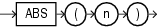

## ABS

Syntax



> ```
> ABS(n)
> ```
>
> [  
> Copyright © 1996, 2025, Oracle and/or its affiliates.](https://docs.oracle.com/en/database/oracle/oracle-database/dcommon/html/cpyr.htm)


Purpose

`ABS` returns the absolute value of `n`.

This function takes as an argument any numeric data type or any nonnumeric data type that can be implicitly converted to a numeric data type. The function returns the same data type as the numeric data type of the argument.

See Also:

[Table 2-8](Data-Type-Comparison-Rules.md) for more information on implicit conversion

Examples

The following example returns the absolute value of -15:

```
SELECT ABS(-15) "Absolute"
  FROM DUAL;

  Absolute
----------
        15
```