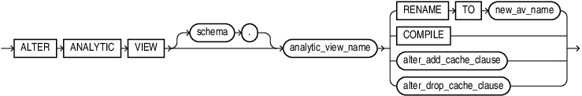
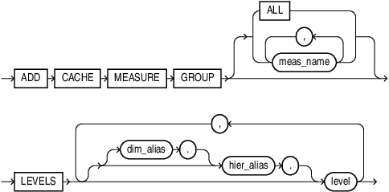
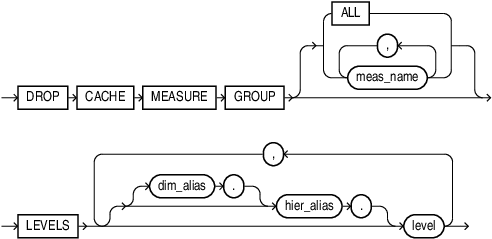

## ALTER ANALYTIC VIEW

Purpose

Use the `ALTER` `ANALYTIC` `VIEW` statement to rename or compile an analytic view. Additionally, you can modify grouping level caches by adding or dropping a new level grouping cache to a specifed analytic view.

For other alterations, use `CREATE` `OR` `REPLACE` `ANALYTIC` `VIEW`.

Prerequisites

To alter an analytic view in your own schema, you must have the `ALTER` `ANALYTIC` `VIEW` system privilege. To alter an analytic view in another user's schema, you must have the `ALTER` `ANY` `ANALYTIC` `VIEW` system privilege or `ALTER` `ANY` `TABLE` granted on the analytic view.

Syntax

alter\_analytic\_view::=



> ```
> ALTER ANALYTIC VIEW [ schema. ] analytic_view_name 
>   { RENAME TO new_av_name | COMPILE };
> ```
>
> [  
> Copyright © 1996, 2025, Oracle and/or its affiliates.](https://docs.oracle.com/en/database/oracle/oracle-database/dcommon/html/cpyr.htm)


alter\_add\_cache\_clause::=



> Enter a short description of your topic here (optional).
>
> This is the start of your topic.
>
> [  
> Copyright © 1996, 2025, Oracle and/or its affiliates.](https://docs.oracle.com/en/database/oracle/oracle-database/dcommon/html/cpyr.htm)


alter\_drop\_cache\_clause::=



> Enter a short description of your topic here (optional).
>
> This is the start of your topic.
>
> [  
> Copyright © 1996, 2025, Oracle and/or its affiliates.](https://docs.oracle.com/en/database/oracle/oracle-database/dcommon/html/cpyr.htm)


Semantics

schema

Specify the schema in which the analytic view exists. If you do not specify a schema, then Oracle Database looks for the analytic view in your own schema.

analytic\_view\_name

Specify the name of the analytic view.

RENAME TO

Specify `RENAME` `TO` to change the name of the analytic view. For `new_av_name`, specify a new name for the analytic view.

COMPILE

Specify `COMPILE` to compile the analytic view.

alter\_add\_cache\_clause

Use this clause to add a new level grouping cache to a specified analytic view like the measure group, level clause and the cache type. Before you add a new level grouping cache, you must ensure that it does not match a previously defined cache with the same measures and levels.

alter\_drop\_cache\_clause

Use this clause to drop an existent level grouping cache from an analytic view. You must specify the attributes of the level grouping you are about to drop, like the measure group and the level clause.

Example: Change the Name of an Analytic View

```
ALTER ANALYTIC VIEW sales_av RENAME TO mysales_av;
```

Example: Add a New Level Grouping Cache to an Analytic View

```
ALTER ANALYTIC VIEW TKHCSGL308_UNITS_AVIEW_CACHE ADD CACHE
    MEASURE GROUP (sales, units, cost)
    LEVELS (TIME.FISCAL.FISCAL_QUARTER, WAREHOUSE);
```