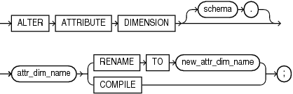

## ALTER ATTRIBUTE DIMENSION

Purpose

Use the `ALTER` `ATTRIBUTE` `DIMENSION` statement to rename or compile an attribute dimension. For other alterations, use `CREATE` `OR` `REPLACE` `ATTRIBUTE` `DIMENSION`.

Prerequisites

To alter an attribute dimension in your own schema, you must have the `ALTER` `ATTRIBUTE` `DIMENSION` system privilege. To alter an attribute dimension in another user's schema, you must have the `ALTER` `ANY` `ATTRIBUTE` `DIMENSION` system privilege or have been granted `ALTER` on the attribute dimension directly.

Syntax

alter\_attribute\_dimension::=



> ```
> ALTER ATTRIBUTE DIMENSION [ schema. ]
>   attr_dim_name { RENAME TO new_attr_dim_name | COMPILE };
> ```
>
> [  
> Copyright © 1996, 2025, Oracle and/or its affiliates.](https://docs.oracle.com/en/database/oracle/oracle-database/dcommon/html/cpyr.htm)


Semantics

schema

Specify the schema in which the attribute dimension exists. If you do not specify a schema, then Oracle Database looks for the attribute dimension in your own schema.

attr\_dim\_name

Specify the name of the attribute dimension.

RENAME TO

Specify `RENAME` `TO` to change the name of the attribute dimension. For `new_attr_dim_name`, specify a new name for the attribute dimension.

COMPILE

Specify `COMPILE` to compile the attribute dimension.

Example

The following statement changes the name of an attribute dimension:

```
ALTER ATTRIBUTE DIMENSION product_attr_dim RENAME TO my_product_attr_dim;
```