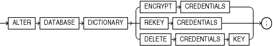

## ALTER DATABASE DICTIONARY

Purpose

To encrypt obfuscated database link passwords and use the TDE framework to manage the encryption key.

A LOB locator ( pointer to the location of a large object (LOB) value) can be assigned a signature to secure the LOB.

Prerequisites

- The TDE keystore must exist. The DDL first checks that the TDE:
	- Keystore exists.
		- Keystore is open.
		- Master Encryption Key exists in the TDE keystore.
		If any of the checks fail, the DDL fails. When this happens you must create a TDE keystore and provision a TDE Master Key. For more see the [Database Security Guide](https://docs.oracle.com/pls/topic/lookup?ctx=en/database/oracle/oracle-database/21/sqlrf&id=DBSEG).
- The instance initialization parameter `COMPATIBLE` must be set to 12.2.0.2.
- You must have `SYSKM` privileges to execute the command.

Syntax

alter\_database\_dictionary::=



> ```
> ALTER DATABASE DICTIONARY 
> {   ENCRYPT CREDENTIALS
>   | REKEY CREDENTIALS
>   | DELETE CREDENTIALS KEY 
> };
> ```
>
> [  
> Copyright © 1996, 2025, Oracle and/or its affiliates.](https://docs.oracle.com/en/database/oracle/oracle-database/dcommon/html/cpyr.htm)


Semantics

alter\_database\_dictionary\_encrypt\_credentials::=

This DDL encrypts existing and future obfuscated sensitive information in data dictionaries, for example database link passwords stored in `SYS.LINKS$`.

It performs the following actions:

- Inserts a new entry in `ENC$` corresponding to `SYS.LINK$`.
- It creates and initializes the SGA variable.
- De-obfuscates obfuscated passwords in `SYS.LINK$`.
- Encrypts the de-obfuscated passwords using the generated encryption key in `ENC$` for `SYS.LINK$`.
- Sets the flag to indicate a valid/usable dblink entry in `SYS.LINK$`.

When you use this DDL with LOB locator signature keys, they are always encrypted. A LOB locator ( pointer to the location of a large object (LOB) value) can be assigned a signature to secure the LOB.

alter\_database\_dictionary\_rekey\_credentials::=

This DDL is used to change the data encryption key. It is applied to `SYS.LINK$` and any other tables covered under the data dictionary encryption framework.

You can also use this DDL to regenerate the LOB locator signature key for LOB locators. If the database is in restricted mode, then Oracle Database regenerates a new LOB signature key and encrypts it with the new encryption key. If the database is in non-restricted mode, then a new signature key is not regenerated but instead, Oracle Database uses a new encryption key to encrypt the existing LOB signature key.

alter\_database\_dictionary\_delete\_credentials\_key::=

This DDL marks encrypted passwords unusuable. That means that current password entries in `SYS.LINK$` are marked unusable. It deletes the key in `ENC$` that was used to encrypt the credentials, and clears the SGA variable to prevent future encryption.

You can also use this DDL to delete the encrypted LOB locator signature key and then regenerate a new LOB signature key in obfuscated form.

See Also:

Managing Security for Application Developers in the [Database Security Guide](https://docs.oracle.com/pls/topic/lookup?ctx=en/database/oracle/oracle-database/21/sqlrf&id=DBSEG-GUID-8F585EBE-611D-4717-AD9F-CAC10A19B7E1)