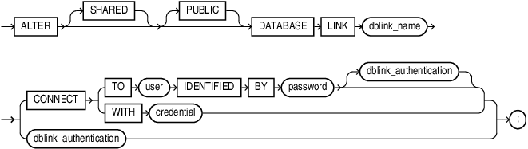
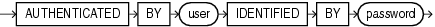

## ALTER DATABASE LINK

Purpose

Use the `ALTER` `DATABASE` `LINK` statement to modify a fixed-user database link when the password of the connection or authentication user changes.

Note:

- You cannot use this statement to change the connection or authentication user associated with the database link. To change `user`, you must re-create the database link.
- You cannot use this statement to change the password of a connection or authentication user. You must use the [ALTER USER](ALTER-USER.md) statement for this purpose, and then alter the database link with the `ALTER` `DATABASE` `LINK` statement.
- This statement is valid only for fixed-user database links, not for connected-user or current user database links. See [CREATE DATABASE LINK](CREATE-DATABASE-LINK.md) for more information on these two types of database links.

Prerequisites

To alter a private database link, you must have the `ALTER` `DATABASE` `LINK` system privilege. To alter a public database link, you must have the `ALTER` `PUBLIC` `DATABASE` `LINK` system privilege.

Syntax

alter\_database\_link::=



> ```
> ALTER [ SHARED ] [ PUBLIC ] DATABASE LINK dblink
>   { CONNECT { ( TO user IDENTIFIED BY password [ dblink_authentication ] )
>               | WITH credential }
>   | dblink_authentication
>   };
> ```
>
> [  
> Copyright © 1996, 2025, Oracle and/or its affiliates.](https://docs.oracle.com/en/database/oracle/oracle-database/dcommon/html/cpyr.htm)


dblink\_authentication



> ```
> AUTHENTICATED BY user IDENTIFIED BY password
> ```
>
> [  
> Copyright © 1996, 2025, Oracle and/or its affiliates.](https://docs.oracle.com/en/database/oracle/oracle-database/dcommon/html/cpyr.htm)


Semantics

The `ALTER` `DATABASE` `LINK` statement is intended only to update fixed-user database links with the current passwords of connection and authentication users. Therefore, any clauses valid in a `CREATE` `DATABASE` `LINK` statement that do not appear in the syntax diagram above are not valid in an `ALTER` `DATABASE` `LINK` statement. The semantics of all of the clauses permitted in this statement are the same as the semantics for those clauses in `CREATE` `DATABASE` `LINK`. Refer to [CREATE DATABASE LINK](CREATE-DATABASE-LINK.md) for this information.

Examples

The following statements show the valid variations of the `ALTER` `DATABASE` `LINK` statement:

```
ALTER DATABASE LINK private_link 
  CONNECT TO hr IDENTIFIED BY hr_new_password;

ALTER PUBLIC DATABASE LINK public_link
  CONNECT TO scott IDENTIFIED BY scott_new_password;

ALTER SHARED PUBLIC DATABASE LINK shared_pub_link
  CONNECT TO scott IDENTIFIED BY scott_new_password
  AUTHENTICATED BY hr IDENTIFIED BY hr_new_password;

ALTER SHARED DATABASE LINK shared_pub_link
  CONNECT TO scott IDENTIFIED BY scott_new_password;
```