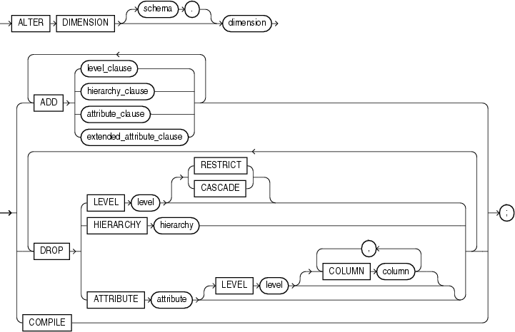
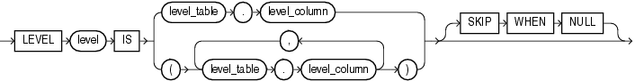
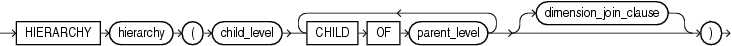
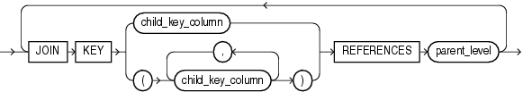
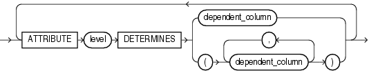
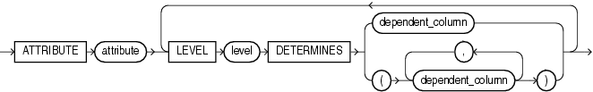

## ALTER DIMENSION

Purpose

Use the `ALTER` `DIMENSION` statement to change the hierarchical relationships or dimension attributes of a dimension.

See Also:

[CREATE DIMENSION](CREATE-DIMENSION.md) and [DROP DIMENSION](DROP-DIMENSION.md)

Prerequisites

The dimension must be in your schema or you must have the `ALTER` `ANY` `DIMENSION` system privilege to use this statement.

A dimension is always altered under the rights of the owner.

Syntax

alter\_dimension::=



> ```
> ALTER DIMENSION [ schema. ] dimension
>   { ADD { level_clause
>         | hierarchy_clause
>         | attribute_clause
>         | extended_attribute_clause
>         }
>   } ...
>   |
>   { DROP { LEVEL level [ RESTRICT | CASCADE ]
>          | HIERARCHY hierarchy
>          | ATTRIBUTE attribute [ LEVEL level [ COLUMN column ] ]...
>          }
>   } ...
>   |
>   COMPILE
>   ;
> ```


(level\_clause::=, hierarchy\_clause::=, attribute\_clause::=, extended\_attribute\_clause::=)

level\_clause::=



> ```
> LEVEL level IS
>    { level_table.level_column
>    | (level_table.level_column
>       [, level_table.level_column ]...
>      )
>    } [ SKIP WHEN NULL ]
> ```
>
> [  
> Copyright © 1996, 2025, Oracle and/or its affiliates.](https://docs.oracle.com/en/database/oracle/oracle-database/dcommon/html/cpyr.htm)


hierarchy\_clause::=



> ```
> HIERARCHY hierarchy
> (child_level { CHILD OF parent_level }...
>   [ dimension_join_clause ]
> )
> ```
>
> [  
> Copyright © 1996, 2025, Oracle and/or its affiliates.](https://docs.oracle.com/en/database/oracle/oracle-database/dcommon/html/cpyr.htm)


(dimension\_join\_clause::=)

dimension\_join\_clause::=



> ```
> { JOIN KEY
>    { child_key_column
>    | (child_key_column [, child_key_column ]...)
>    }
>   REFERENCES parent_level
> }...
> ```
>
> [  
> Copyright © 1996, 2025, Oracle and/or its affiliates.](https://docs.oracle.com/en/database/oracle/oracle-database/dcommon/html/cpyr.htm)


attribute\_clause::=



> ```
> ATTRIBUTE level DETERMINES
>    { dependent_column
>    | ( dependent_column
>        [, dependent_column ]... )
>    }
> ```
>
> [  
> Copyright © 1996, 2025, Oracle and/or its affiliates.](https://docs.oracle.com/en/database/oracle/oracle-database/dcommon/html/cpyr.htm)


extended\_attribute\_clause::=



> ```
> ATTRIBUTE attribute
>   { LEVEL level
>     DETERMINES { dependent_column
>                | (dependent_column [, dependent_column ]... )
>                }
>   }...
> ```
>
> [  
> Copyright © 1996, 2025, Oracle and/or its affiliates.](https://docs.oracle.com/en/database/oracle/oracle-database/dcommon/html/cpyr.htm)


Semantics

The following keywords, parameters, and clauses have meaning unique to `ALTER` `DIMENSION`. Keywords, parameters, and clauses that do not appear here have the same functionality that they have in the `CREATE` `DIMENSION` statement. Refer to [CREATE DIMENSION](CREATE-DIMENSION.md) for more information.

schema

Specify the schema of the dimension you want to modify. If you do not specify `schema`, then Oracle Database assumes the dimension is in your own schema.

dimension

Specify the name of the dimension. This dimension must already exist.

ADD

The `ADD` clauses let you add a level, hierarchy, or attribute to the dimension. Adding one of these elements does not invalidate any existing materialized view.

Oracle Database processes `ADD` `LEVEL` clauses prior to any other `ADD` clauses.

DROP

The `DROP` clauses let you drop a level, hierarchy, or attribute from the dimension. Any level, hierarchy, or attribute you specify must already exist.

Within one attribute, you can drop one or more level-to-column relationships associated with one level.

Restriction on DROP

If any attributes or hierarchies reference a level, then you cannot drop the level until you either drop all the referencing attributes and hierarchies or specify `CASCADE`.

CASCADE

Specify `CASCADE` if you want Oracle Database to drop any attributes or hierarchies that reference the level, along with the level itself.

RESTRICT

Specify `RESTRICT` if you want to prevent Oracle Database from dropping a level that is referenced by any attributes or hierarchies. This is the default.

COMPILE

Specify `COMPILE` to explicitly recompile an invalidated dimension. Oracle Database automatically compiles a dimension when you issue an `ADD` clause or `DROP` clause. However, if you alter an object referenced by the dimension (for example, if you drop and then re-create a table referenced in the dimension), Oracle Database invalidates, and you must recompile it explicitly.

Examples

Modifying a Dimension: Examples

The following examples modify the `customers_dim` dimension in the sample schema `sh`:

```
ALTER DIMENSION customers_dim
   DROP ATTRIBUTE country;

ALTER DIMENSION customers_dim
   ADD LEVEL zone IS customers.cust_postal_code
   ADD ATTRIBUTE zone DETERMINES (cust_city);
```