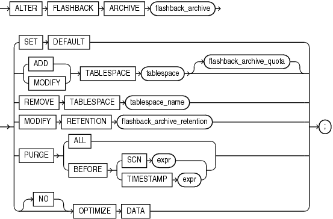

## ALTER FLASHBACK ARCHIVE

Purpose

Use the `ALTER` `FLASHBACK` `ARCHIVE` statement for these operations:

- Designate a flashback archive as the default flashback archive for the system
- Add a tablespace for use by the flashback archive
- Change the quota of a tablespace used by the flashback archive
- Remove a tablespace from use by the flashback archive
- Change the retention period of the flashback archive
- Purge the flashback archive of old data that is no longer needed

See Also:

Oracle Database Development Guide and [CREATE FLASHBACK ARCHIVE](CREATE-FLASHBACK-ARCHIVE.md) for more information on using Flashback Time Travel

Prerequisites

You must have the `FLASHBACK` `ARCHIVE` `ADMINISTER` system privilege to alter a flashback archive in any way. You must also have appropriate privileges on the affected tablespaces to add, modify, or remove a flashback archive tablespace.

Syntax

alter\_flashback\_archive::=



> ```
> ALTER FLASHBACK ARCHIVE flashback_archive
>   { SET DEFAULT
>   | { ADD | MODIFY } TABLESPACE tablespace [flashback_archive_quota]
>   | REMOVE TABLESPACE tablespace_name
>   | MODIFY RETENTION flashback_archive_retention
>   | PURGE { ALL | BEFORE { SCN expr | TIMESTAMP expr } }
>   | [NO] OPTIMIZE DATA
>   };
> ```
>
> [  
> Copyright © 1996, 2025, Oracle and/or its affiliates.](https://docs.oracle.com/en/database/oracle/oracle-database/dcommon/html/cpyr.htm)


flashback\_archive\_quota::=


> ```
> QUOTA integer { M | G | T | P | E }
> ```
>
> [  
> Copyright © 1996, 2025, Oracle and/or its affiliates.](https://docs.oracle.com/en/database/oracle/oracle-database/dcommon/html/cpyr.htm)


flashback\_archive\_retention::=


> ```
> RETENTION integer {YEAR | MONTH | DAY}
> ```
>
> [  
> Copyright © 1996, 2025, Oracle and/or its affiliates.](https://docs.oracle.com/en/database/oracle/oracle-database/dcommon/html/cpyr.htm)


Semantics

flashback\_archive

Specify the name of an existing flashback archive.

SET DEFAULT

You must be logged in as `SYSDBA` to specify this clause. Use this clause to designate this flashback archive as the default flashback archive for the system. When a `CREATE` `TABLE` or `ALTER` `TABLE` statement specifies the `flashback_archive_clause` without specifying a flashback archive name, the database uses the default flashback archive to store data from that table.

This statement overrides any previous designation of a different flashback archive as the default.

See Also:

The `CREATE` `TABLE` [flashback\_archive\_clause](CREATE-TABLE.md) for more information

ADD TABLESPACE

Use this clause to add a tablespace to the flashback archive. You can use the `flashback_archive_quota` clause to specify the amount of space that can be used by the flashback archive in the new tablespace. If you omit that clause, then the flashback archive has unlimited space in the newly added tablespace.

MODIFY TABLESPACE

Use this clause to change the tablespace quota of a tablespace already used by the flashback archive.

REMOVE TABLESPACE

Use this clause to remove a tablespace from use by the flashback archive. You cannot remove the last remaining tablespace used by the flashback archive.

If the tablespace to be removed contains any data within the retention period of the flashback archive, then that data will be dropped as well. Therefore, you should move your data to another tablespace before removing the tablespace with this clause.

MODIFY RETENTION

Use this clause to change the retention period of the flashback archive.

PURGE

Use this clause to purge data from the flashback archive.

- Specify `PURGE` `ALL` to remove all data from the flashback archive. This historical information can be retrieved using a flashback query only if the SCN or timestamp specified in the flashback query is within the undo retention duration.
- Specify `PURGE` `BEFORE` `SCN` to remove all data from the flashback archive before the specified system change number.
- Specify `PURGE` `BEFORE` `TIMESTAMP` to remove all data from the flashback archive before the specified timestamp.

\[NO\] OPTIMIZE DATA

This clause has the same semantics as the [\[NO\] OPTIMIZE DATA](https://docs.oracle.com/en/database/oracle/oracle-database/21/sqlrf/CREATE-FLASHBACK-ARCHIVE.html#GUID-9E821EC5-8350-4729-85FE-2188EBB4139B__BGEIBJJB) clause of `CREATE` `FLASHBACK` `ARCHIVE`.

See Also:

[CREATE FLASHBACK ARCHIVE](CREATE-FLASHBACK-ARCHIVE.md) for information on creating flashback archives and for some simple examples of using flashback archives