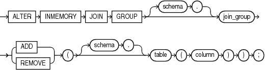

## ALTER INMEMORY JOIN GROUP

Purpose

Use the `ALTER` `INMEMORY` `JOIN` `GROUP` statement to add a table column to a join group or remove a table column from a join group.

See Also:

- [CREATE INMEMORY JOIN GROUP](CREATE-INMEMORY-JOIN-GROUP.md) and [DROP INMEMORY JOIN GROUP](DROP-INMEMORY-JOIN-GROUP.md)
- [Oracle Database In-Memory Guide](https://docs.oracle.com/pls/topic/lookup?ctx=en/database/oracle/oracle-database/21/sqlrf&id=INMEM-GUID-3E5491C4-B345-4A8E-8B1B-8DC150C8A797) for more information on join groups

Prerequisites

If the join group is not in your own schema, or if the column you want to add to or remove from the join group is in a table that is not in your own schema, then you must have the `ALTER` `ANY` `TABLE` system privilege.

Syntax

alter\_inmemory\_join\_group::=



> ```
> ALTER INMEMORY JOIN GROUP [ schema. ] join_group
>   { ADD | REMOVE } ( [ schema. ] table ( column ) ) ;
> ```
>
> [  
> Copyright © 1996, 2025, Oracle and/or its affiliates.](https://docs.oracle.com/en/database/oracle/oracle-database/dcommon/html/cpyr.htm)


Semantics

schema

Specify the schema containing the join group. If you omit `schema`, then the database assumes the join group is in your own schema.

join\_group

Specify the name of the join group to be modified.

You can view existing join groups by querying the `DBA_JOINGROUPS` or `USER_JOINGROUPS` data dictionary view. Refer to [Oracle Database Reference](https://docs.oracle.com/pls/topic/lookup?ctx=en/database/oracle/oracle-database/21/sqlrf&id=REFRN-GUID-285814BC-3BE0-47DA-8832-779229D5A93A) for more information on these views.

ADD

Specify `ADD` to add a table column to the join group. A join group can contain a maximum of 255 columns.

REMOVE

Specify `REMOVE` to remove a table column from the join group. A join group must contain at least 2 columns.

schema

Specify the schema of the table that contains the column to be added to or removed from the join group. If you omit `schema`, then Oracle Database assumes the table is in your own schema.

table

Specify the name of the table that contains the column to be added to or removed from the join group.

column

Specify the name of the column to be added to or removed from the join group.

Examples

The following example adds a column to the `prod_id1` join group created in [Examples](CREATE-INMEMORY-JOIN-GROUP.md) in the documentation on `CREATE` `INMEMORY` `JOIN` `GROUP`:

```
ALTER INMEMORY JOIN GROUP prod_id1
  ADD(product_descriptions(product_id));
```

The following example removes a column from the `prod_id1` join group:

```
ALTER INMEMORY JOIN GROUP prod_id1
  REMOVE(product_descriptions(product_id));
```