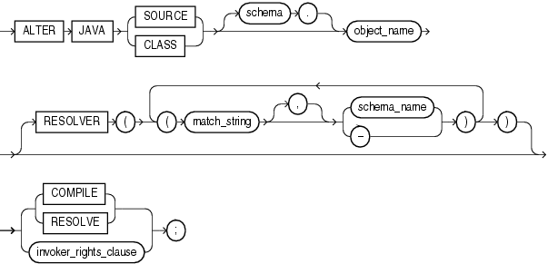

## ALTER JAVA

Purpose

Use the `ALTER` `JAVA` statement to force the resolution of a Java class schema object or compilation of a Java source schema object. (You cannot call the methods of a Java class before all its external references to Java names are associated with other classes.)

See Also:

[Oracle Database Java Developer's Guide](https://docs.oracle.com/pls/topic/lookup?ctx=en/database/oracle/oracle-database/21/sqlrf&id=JJDEV02000) for more information on resolving Java classes and compiling Java sources

Prerequisites

The Java source or class must be in your own schema, or you must have the `ALTER` `ANY` `PROCEDURE` system privilege. You must also have the `EXECUTE` object privilege on Java classes.

Syntax

alter\_java::=



> ```
> ALTER JAVA
>   { SOURCE | CLASS } [ schema. ]object_name 
>   [ RESOLVER 
>       ( ( match_string [, ] { schema_name | - } )... )
>   ]
>   { { COMPILE | RESOLVE }
>   | invoker_rights_clause
>   } ;
> ```
>
> [  
> Copyright © 1996, 2025, Oracle and/or its affiliates.](https://docs.oracle.com/en/database/oracle/oracle-database/dcommon/html/cpyr.htm)


(invoker\_rights\_clause::=)

invoker\_rights\_clause::=


> ```
> AUTHID { CURRENT_USER | DEFINER }
> ```
>
> [  
> Copyright © 1996, 2025, Oracle and/or its affiliates.](https://docs.oracle.com/en/database/oracle/oracle-database/dcommon/html/cpyr.htm)


Semantics

JAVA SOURCE

Use `ALTER` `JAVA` `SOURCE` to compile a Java source schema object.

JAVA CLASS

Use `ALTER` `JAVA` `CLASS` to resolve a Java class schema object.

object\_name

Specify a previously created Java class or source schema object. Use double quotation marks to preserve lower- or mixed-case names.

RESOLVER

The `RESOLVER` clause lets you specify how schemas are searched for referenced fully specified Java names, using the mapping pairs specified when the Java class or source was created.

See Also:

[CREATE JAVA](CREATE-JAVA.md) and " Resolving a Java Class: Example "

RESOLVE | COMPILE

`RESOLVE` and `COMPILE` are synonymous keywords. They let you specify that Oracle Database should attempt to resolve the primary Java class schema object.

- When applied to a class, resolution of referenced names to other class schema objects occurs.
- When applied to a source, source compilation occurs.

invoker\_rights\_clause

The `invoker_rights_clause` lets you specify whether the methods of the class execute with the privileges and in the schema of the user who defined it or with the privileges and in the schema of `CURRENT_USER`.

This clause also determines how Oracle Database resolves external names in queries, DML operations, and dynamic SQL statements in the member functions and procedures of the type.

AUTHID CURRENT\_USER

Specify `CURRENT_USER` if you want the methods of the class to execute with the privileges of `CURRENT_USER`. This clause is the default and creates an invoker-rights class.

This clause also specifies that external names in queries, DML operations, and dynamic SQL statements resolve in the schema of `CURRENT_USER`. External names in all other statements resolve in the schema in which the methods reside.

AUTHID DEFINER

Specify `DEFINER` if you want the methods of the class to execute with the privileges of the user who defined the class.

This clause also specifies that external names resolve in the schema where the methods reside.

See Also:

[Oracle Database PL/SQL Language Reference](https://docs.oracle.com/pls/topic/lookup?ctx=en/database/oracle/oracle-database/21/sqlrf&id=LNPLS008) for information on how `CURRENT_USER` is determined

Examples

Resolving a Java Class: Example

The following statement forces the resolution of a Java class:

```
ALTER JAVA CLASS "Agent"
   RESOLVER (("/usr/bin/bfile_dir/*" pm)(* public))
   RESOLVE;
```