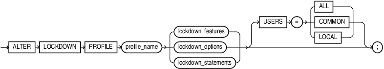
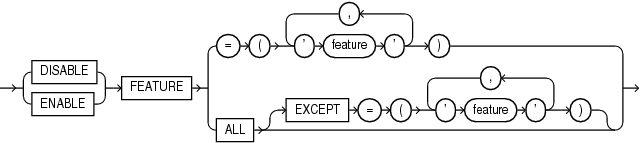
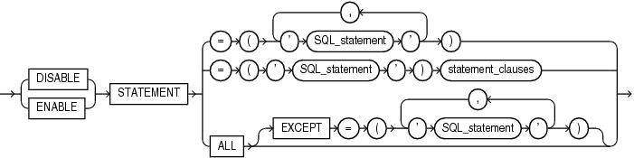
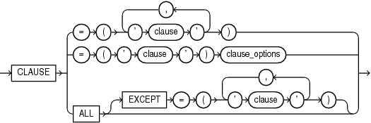
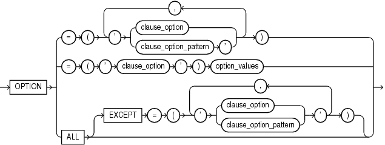
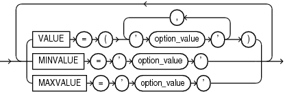

## ALTER LOCKDOWN PROFILE

Purpose

Use the `ALTER` `LOCKDOWN` `PROFILE` statement to alter a PDB lockdown profile. You can use PDB lockdown profiles in a multitenant environment to restrict user operations in pluggable databases (PDBs).

Immediately after you create a lockdown profile with the `CREATE` `LOCKDOWN` `PROFILE` statement, all user operations are enabled for the profile. You can then use the `ALTER` `LOCKDOWN` `PROFILE` statement to disable certain user operations for the profile. When a lockdown profile is applied to a CDB, application container, or PDB, users cannot perform the operations that are the disabled for the profile. If you later would like to reenable some of the disabled user operations, you can use the `ALTER` `LOCKDOWN` `PROFILE` statement to do so.

The `ALTER` `LOCKDOWN` `PROFILE` statement allows you to disable or enable:

- User operations associated with certain database features (using the `lockdown_features` clause)
- User operations associated with certain database options (using the `lockdown_options` clause)
- The issuance of certain SQL statements (using the `lockdown_statements` clause)

See Also:

- [CREATE LOCKDOWN PROFILE](CREATE-LOCKDOWN-PROFILE.md) and [DROP LOCKDOWN PROFILE](DROP-LOCKDOWN-PROFILE.md)
- [Oracle Database Security Guide](https://docs.oracle.com/pls/topic/lookup?ctx=en/database/oracle/oracle-database/21/sqlrf&id=DBSEG-GUID-AB5E62DB-7E2A-4B5A-BA96-A2BD2DF15275) for more information on PDB lockdown profiles

Prerequisites

- You must issue the `ALTER` `LOCKDOWN` `PROFILE` statement from the CDB Root or Application Root.
- You must have the `ALTER` `LOCKDOWN` `PROFILE` system privilege in the container in which you issue the statement.

Syntax

alter\_lockdown\_profile::=



> ```
> ALTER LOCKDOWN PROFILE profile_name
>   { lockdown_features
>   | lockdown_options
>   | lockdown_statements
>   } [ USERS = { ALL | COMMON | LOCAL } ];
> ```
>
> [  
> Copyright © 1996, 2025, Oracle and/or its affiliates.](https://docs.oracle.com/en/database/oracle/oracle-database/dcommon/html/cpyr.htm)


lockdown\_features::=



> ```
> { DISABLE | ENABLE } FEATURE
> { { = ( 'feature' [, 'feature' ]... ) }
> | { ALL [ EXCEPT = ( 'feature' [, 'feature' ]... ) ] }
> }
> ```
>
> [  
> Copyright © 1996, 2025, Oracle and/or its affiliates.](https://docs.oracle.com/en/database/oracle/oracle-database/dcommon/html/cpyr.htm)


lockdown\_options::=


> ```
> { DISABLE | ENABLE } OPTION
> { { = ( 'option' [, 'option' ]... ) }
> | { ALL [ EXCEPT = ( 'option' [, 'option' ]... ) ] }
> }
> ```
>
> [  
> Copyright © 1996, 2025, Oracle and/or its affiliates.](https://docs.oracle.com/en/database/oracle/oracle-database/dcommon/html/cpyr.htm)


lockdown\_statements::=



> ```
> { DISABLE | ENABLE } STATEMENT
> { { = ( 'SQL_statement' [, 'SQL_statement' ]... ) }
> | { = ( 'SQL_statement' ) statement_clauses }
> | { ALL [ EXCEPT = ( 'SQL_statement' [, 'SQL_statement' ]... ) ] }
> }
> ```
>
> [  
> Copyright © 1996, 2025, Oracle and/or its affiliates.](https://docs.oracle.com/en/database/oracle/oracle-database/dcommon/html/cpyr.htm)


statement\_clauses::=



> ```
> CLAUSE
> { { = ( 'clause' [, 'clause' ]... ) }
> | { = ( 'clause' ) clause_options }
> | { ALL [ EXCEPT = ( 'clause' [, 'clause' ]... ) ] }
> }
> ```
>
> [  
> Copyright © 1996, 2025, Oracle and/or its affiliates.](https://docs.oracle.com/en/database/oracle/oracle-database/dcommon/html/cpyr.htm)


clause\_options::=



> ```
> OPTION
> { { = ( 'clause_option' | 'clause_option_pattern'
>         [, 'clause_option' | 'clause_option_pattern' ]... ) }
> | { = ( 'clause_option' ) option_values }
> | { ALL [ EXCEPT = ( 'clause_option' | 'clause_option_pattern'
>                      [, 'clause_option' | 'clause_option_pattern' ]... ) ] }
> }
> ```
>
> [  
> Copyright © 1996, 2025, Oracle and/or its affiliates.](https://docs.oracle.com/en/database/oracle/oracle-database/dcommon/html/cpyr.htm)


option\_values::=



> ```
> { { VALUE = ( 'option_value' [, 'option_value' ]... ) }
>   |
>   { MINVALUE = 'option_value' }
>   |
>   { MAXVALUE = 'option_value' }
> }...
> ```
>
> [  
> Copyright © 1996, 2025, Oracle and/or its affiliates.](https://docs.oracle.com/en/database/oracle/oracle-database/dcommon/html/cpyr.htm)


Semantics

profile\_name

Specify the name of the PDB lockdown profile to be altered.

You can find the names of existing PDB lockdown profiles by querying the `DBA_LOCKDOWN_PROFILES` data dictionary view.

lockdown\_features

This clause lets you disable or enable user operations associated with certain database features.

- Specify `DISABLE` to add a restriction for the specified features. Users will be restricted from performing these operations in any PDB to which the profile applies.
- Specify `ENABLE` to remove a restriction for the specified features. Users will be allowed to perform these operations in any PDB to which the profile applies.
- Use `feature` to specify the features whose operations you want to disable or enable. Table 11-1 lists the features you can specify and describes the operations associated with each feature. The table also indicates a feature bundle for each feature. For `feature`, you can specify a feature bundle name to disable or enable user operations for all features in that bundle, or you can specify an individual feature name. You can specify feature bundle names and feature names in any combination of uppercase and lowercase letters.
- Use `ALL` to specify all features listed in the table.
- Use `ALL` `EXCEPT` to specify all features listed in the table except the specified features.

If you omit this clause, then the default is `ENABLE` `ALL`.

Note:

- The Oracle Text type `FILE_DATASTORE` is deprecated. Oracle recommends that you replace `FILE_DATASTORE` indexes with the `DIRECTORY_DATASTORE` index type for greater security as it enables file access to be based on directory objects.
- The Oracle Text type `URL_DATASTORE` is deprecated. Oracle recommeds that you replace `URL_DATASTORE` with `NETWORK_DATASTORE`, which uses ACLs to control access to specific servers.

lockdown\_options

This clause lets you disable or enable user operations associate with certain database options.

- Specify `DISABLE` to disable user operations for the specified options. Users will be restricted from performing these operations in any PDB to which the profile applies.
- Specify `ENABLE` to enable user operations for the specified options. Users will be allowed to perform these operations in any PDB to which the profile applies.
- For `option`, you can specify the following database options in any combination of uppercase and lowercase letters:
	- `DATABASE` `QUEUING` – Represents user operations associated with the Oracle Database Advanced Queuing option
		- `PARTITIONING` – Represents user operations associated with the Oracle Partitioning option
- Use `ALL` to specify all options in the preceding list.
- Use `ALL` `EXCEPT` to specify all options in the preceding list except the specified options.

If you omit this clause, then the default is `ENABLE` `OPTION` `ALL`.

lockdown\_statements

This clause lets you disable or enable the issuance of certain SQL statements.

- Specify `DISABLE` to disable the issuance of the specified SQL statements. Users will be restricted from issuing these statements in any PDB to which the profile applies.
- Specify `ENABLE` to enable the issuance of the specified SQL statements. Users will be allowed to issue these statements in any PDB to which the profile applies.
- For `SQL_statement`, you can specify the following statements in any combination of uppercase and lowercase letters:
	- `ADMINISTER` `KEY MANAGEMENT`
		- `ALTER` `DATABASE`
		- `ALTER` `PLUGGABLE` `DATABASE`
		- `ALTER` `SESSION`
		- `ALTER` `SYSTEM`
		- `ALTER` `TABLE`
		- `ALTER` `INDEX`
		- `ALTER` `TABLESPACE`
		- `ALTER` `PROFILE`
		- `CREATE` `TABLE`
		- `CREATE` `INDEX`
		- `CREATE` `TABLESPACE`
		- `CREATE` `PROFILE`
		- `CREATE` `DATABASE LINK`
		- `DROP` `TABLE`
		- `DROP` `INDEX`
		- `DROP` `TABLESPACE`
		- `DROP` `PROFILE`
- Use `ALL` to specify all statements in the preceding list.
- Use `ALL` `EXCEPT` to specify all statements in the preceding list except the specified statements.

If you omit this clause, then the default is `ENABLE` `STATEMENT` `ALL`.

statement\_clauses

This clause lets you disable or enable specific clauses of the specified SQL statement.

- Use `clause` to specify the SQL keywords that form the clause you want to disable or enable. You can specify a clause in any combination of uppercase and lowercase letters.
- Use `ALL` to specify all clauses for the SQL statement.
- Use `ALL` `EXCEPT` to specify all clauses for the SQL statement except the specified clauses.

For `clause`, you must specify at least enough keywords to unambiguously identify a single clause for the SQL statement. The following are some examples of how to specify `clause` for the `ALTER` `SYSTEM` statement:

- To specify the [archive\_log\_clause::=](ALTER-SYSTEM.md), specify `ARCHIVE`. This is sufficient because no other `ALTER` `SYSTEM` clause begins with the keyword `ARCHIVE`. Alternatively, you can specify `ARCHIVE` `LOG` for semantic clarity, but the `LOG` keyword is unnecessary.
- To specify either of the [rolling\_migration\_clauses::=](ALTER-SYSTEM.md), you must specify `START` `ROLLING` `MIGRATION` or `STOP` `ROLLING` `MIGRATION` in order to distinguish these clauses from the similarly named [rolling\_patch\_clauses::=](ALTER-SYSTEM.md) `START` `ROLLING` `PATCH` and `STOP` `ROLLING` `PATCH`.
- You cannot specify the single keyword `FLUSH`, because several `ALTER` `SYSTEM` clauses begin with this keyword. You must instead specify each clause separately, such as `FLUSH` `SHARED_POOL` or `FLUSH` `GLOBAL` `CONTEXT`.

There is no need to specify optional keywords within a clause, because they have no effect. For example:

- The [archive\_log\_clause::=](ALTER-SYSTEM.md) has an optional `INSTANCE` keyword. However, you cannot enable or disable only `ARCHIVE` `LOG` clauses that contain the `INSTANCE` keyword. Specifying `ARCHIVE` `LOG` `INSTANCE` is equivalent to specifying `ARCHIVE` or `ARCHIVE` `LOG`.

There is no need to specify parameter values within a clause, because they have no effect. For example:

- The [shutdown\_dispatcher\_clause::=](ALTER-SYSTEM.md) requires you to specify a `dispatcher_name`. However, you cannot enable or disable `SHUTDOWN` clauses that contain a specific dispatcher name. Specifying `SHUTDOWN` `dispatcher1` is equivalent to specifying `SHUTDOWN`.

See Also:

[ALTER DATABASE](ALTER-DATABASE.md), [ALTER PLUGGABLE DATABASE](ALTER-PLUGGABLE-DATABASE.md), [ALTER SESSION](ALTER-SESSION.md), and [ALTER SYSTEM](ALTER-SYSTEM.md) for complete information on the clauses for these statements

clause\_options

This clause is valid only when you specify one of the following for `lockdown_statements` and `statement_clauses`:

```
{ DISABLE | ENABLE } STATEMENT = ('ALTER SESSION') CLAUSE = ('SET')
{ DISABLE | ENABLE } STATEMENT = ('ALTER SYSTEM') CLAUSE = ('SET')
```

This clause lets you disable or enable the setting or modification of specific options with the `ALTER` `SESSION` `SET` or `ALTER` `SYSTEM` `SET` statements.

- Use `clause_option` to specify the option you want to disable or enable.
- Use `clause_option_pattern` to specify a pattern that matches multiple options. Within the pattern, specify a percent sign (%) to match zero or more characters in an option name. For example, specifying `'QUERY_REWRITE_%'` is equivalent to specifying both the `QUERY_REWRITE_ENABLED` and `QUERY_REWRITE_INTEGRITY` options.
- You can specify `clause_option` and `clause_option_pattern` in any combination of uppercase and lowercase letters.
- Use `ALL` to specify all options.
- Use `ALL` `EXCEPT` to specify all options except the specified options.

See Also:

The [alter\_session\_set\_clause](ALTER-SESSION.md) clause of `ALTER` `SESSION` and the [alter\_system\_set\_clause](ALTER-SYSTEM.md) clause of `ALTER` `SYSTEM` for complete information on the options you can specify for these statements

option\_values

This clause is valid only when you specify one of the following for `lockdown_statements`, `statement_clauses`, and `clause_options`:

```
DISABLE STATEMENT = ('ALTER SESSION') CLAUSE = ('SET') OPTION = clause_option
DISABLE STATEMENT = ('ALTER SYSTEM') CLAUSE = ('SET') OPTION = clause_option
```

This clause lets you specify a default value for an option when disabling the setting of that option. For options that take numeric values, this clause also lets you restrict users from setting an option to certain values.

- The `VALUE` clause lets you specify a default `option_value` for `clause_option`, which will go into effect for any PDB to which the profile applies after you close and reopen the PDB. If `clause_option` accepts multiple default values, then you can specify more than one `option_value` in a comma-separated list. The purpose of using this clause is to simultaneously set a default value for an option and restrict users from setting or modifying the value.
- The `MINVALUE` clause lets you restricts users from setting the value of `clause_option` to a value less than `option_value`. You can specify this clause only for options that take a numeric value.
- The `MAXVALUE` clause lets you restricts users from setting the value of `clause_option` to a value greater than `option_value`. You can specify this clause only for options that take a numeric value.
- You can specify both the `MINVALUE` and `MAXVALUE` clauses together to restrict users from setting the value of `clause_options` to any value less than `MINVALUE` or greater than `MAXVALUE`.
- `MINVALUE` and `MAXVALUE` settings take effect immediately when the lockdown profile is assigned to a PDB; you need not close and reopen the PDB.

See Also:

[Oracle Database Reference](https://docs.oracle.com/pls/topic/lookup?ctx=en/database/oracle/oracle-database/21/sqlrf&id=REFRN-GUID-FD266F6F-D047-4EBB-8D96-B51B1DCA2D61) for complete information on the values allowed for the various options

USERS Clause

As a CDB administrator or an Application administrator you can use the `USERS` clause to configure lockdown rules for a specific set of users.

The values for `USERS` in a `CDB$ROOT` lockdown profile are as follows:

- `USERS = ALL` means that the lockdown rule applies to all users in the PDB.
- `USERS = COMMON` means that the lockdown rule applies only to CDB `COMMON` users in the PDB.
- `USERS = LOCAL` means that the lockdown rule applies only to local users in the PDB. Application common users are considered local users at the CDB level.

The values for `USERS` in an Application `ROOT` lockdown profile are as follows:

- `USERS = ALL` means that the lockdown rule applies to all users in the PDB.
- `USERS = COMMON` means that the lockdown rule applies only to Application `COMMON` users in the PDB.
- `USERS = LOCAL` means that the lockdown rule applies only to local users in the PDB.

Note that the Application lockdown profile rules should not affect CDB common users.

- `ALL` users means Application common users and local users in the PDB.
- `COMMON` users means Application common users in the PDB.

Examples

The following statement creates PDB lockdown profile `hr_prof`:

```
CREATE LOCKDOWN PROFILE hr_prof;
```

The remaining examples in this section alter `hr_prof`.

Disabling Features for PDB Lockdown Profiles: Examples

The following statement disables all features in the feature bundle `NETWORK_ACCESS`:

```
ALTER LOCKDOWN PROFILE hr_prof
  DISABLE FEATURE = ('NETWORK_ACCESS');
```

The following statement disables the `LOB_FILE_ACCESS` and `TRACE_VIEW ACCESS` features:

```
ALTER LOCKDOWN PROFILE hr_prof
  DISABLE FEATURE = ('LOB_FILE_ACCESS', 'TRACE_VIEW_ACCESS');
```

The following statement disables all features except the `COMMON_USER_LOCAL_SCHEMA_ACCESS` and `LOCAL_USER_COMMON_SCHEMA_ACCESS` features:

```
ALTER LOCKDOWN PROFILE hr_prof
  DISABLE FEATURE ALL EXCEPT = ('COMMON_USER_LOCAL_SCHEMA_ACCESS', 'LOCAL_USER_COMMON_SCHEMA_ACCESS');
```

The following statement disables all features:

```
ALTER LOCKDOWN PROFILE hr_prof
  DISABLE FEATURE ALL;
```

Enabling Features for PDB Lockdown Profiles: Examples

The following statement enables the `UTL_HTTP` and `UTL_SMTP` features, as well as all features in the feature bundle `OS_ACCESS`:

```
ALTER LOCKDOWN PROFILE hr_prof
  ENABLE FEATURE = ('UTL_HTTP', 'UTL_SMTP', 'OS_ACCESS');
```

The following statement enables all features except the `AQ_PROTOCOLS` and `CTX_PROTOCOLS` features:

```
ALTER LOCKDOWN PROFILE hr_prof
  ENABLE FEATURE ALL EXCEPT = ('AQ_PROTOCOLS', 'CTX_PROTOCOLS');
```

The following statement enables all features:

```
ALTER LOCKDOWN PROFILE hr_prof
  ENABLE FEATURE ALL;
```

Disabling Options for PDB Lockdown Profiles: Examples

The following statement disables user operations associated with the Oracle Database Advanced Queuing option:

```
ALTER LOCKDOWN PROFILE hr_prof
  DISABLE OPTION = ('DATABASE QUEUING');
```

The following statement disables user operations associated with the Oracle Partitioning option:

```
ALTER LOCKDOWN PROFILE hr_prof
  DISABLE OPTION = ('PARTITIONING');
```

Enabling Options for PDB Lockdown Profiles: Examples

The following statement enables user operations associated with the Oracle Database Advanced Queuing option:

```
ALTER LOCKDOWN PROFILE hr_prof
  ENABLE OPTION = ('DATABASE QUEUING');
```

The following statement enables user operations associated both with the Oracle Database Advanced Queuing option and the Oracle Partitioning option:

```
ALTER LOCKDOWN PROFILE hr_prof
  ENABLE OPTION ALL;
```

Disabling SQL Statements for PBB Lockdown Profiles: Examples

The following statement disables the `ALTER` `DATABASE` statement:

```
ALTER LOCKDOWN PROFILE hr_prof
  DISABLE STATEMENT = ('ALTER DATABASE');
```

The following statement disables the `ALTER` `SYSTEM` `SUSPEND` and `ALTER` `SYSTEM` `RESUME` statements:

```
ALTER LOCKDOWN PROFILE hr_prof
  DISABLE STATEMENT = ('ALTER SYSTEM')
          CLAUSE = ('SUSPEND', 'RESUME');
```

The following statement disables all clauses of the `ALTER` `PLUGGABLE` `DATABASE` statement, except `DEFAULT` `TABLESPACE` and `DEFAULT` `TEMPORARY` `TABLESPACE`:

```
ALTER LOCKDOWN PROFILE hr_prof
  DISABLE STATEMENT = ('ALTER PLUGGABLE DATABASE')
          CLAUSE ALL EXCEPT = ('DEFAULT TABLESPACE', 'DEFAULT TEMPORARY TABLESPACE');
```

The following statement disables using the `ALTER` `SESSION` statement to set or modify `COMMIT_WAIT` or `CURSOR_SHARING`:

```
ALTER LOCKDOWN PROFILE hr_prof
  DISABLE STATEMENT = ('ALTER SESSION')
          CLAUSE = ('SET')
          OPTION = ('COMMIT_WAIT', 'CURSOR_SHARING');
```

The following statement disables using the `ALTER` `SYSTEM` statement to set or modify the value of `PDB_FILE_NAME_CONVERT`. It also sets the default value for `PDB_FILE_NAME_CONVERT` to `'cdb1_pdb0', 'cdb1_pdb1'`. This default value will take effect the next time the PDB is closed and reopened.

```
ALTER LOCKDOWN PROFILE hr_prof
  DISABLE STATEMENT = ('ALTER SYSTEM')
          CLAUSE = ('SET')
          OPTION = ('PDB_FILE_NAME_CONVERT')
          VALUE = ('cdb1_pdb0', 'cdb1_pdb1');
```

The following statement disables using the `ALTER` `SYSTEM` statement to set or modify the value of `CPU_COUNT` to a value less than `8`:

```
ALTER LOCKDOWN PROFILE hr_prof
  DISABLE STATEMENT = ('ALTER SYSTEM')
          CLAUSE = ('SET')
          OPTION = ('CPU_COUNT')
          MINVALUE = '8';
```

The following statement disables using the `ALTER` `SYSTEM` statement to set or modify the value of `CPU_COUNT` to a value greater than `2`:

```
ALTER LOCKDOWN PROFILE hr_prof
  DISABLE STATEMENT = ('ALTER SYSTEM')
          CLAUSE = ('SET')
          OPTION = ('CPU_COUNT')
          MAXVALUE = '2';
```

The following statement disables using the `ALTER` `SYSTEM` statement to set or modify the value of `CPU_COUNT` to a value less than `2` or greater than `6`:

```
ALTER LOCKDOWN PROFILE hr_prof
  DISABLE STATEMENT = ('ALTER SYSTEM')
          CLAUSE = ('SET')
          OPTION = ('CPU_COUNT')
          MINVALUE = '2'
          MAXVALUE = '6';
```

Enabling SQL Statements for PBB Lockdown Profiles: Examples

The following statement enables all statements except `ALTER` `DATABASE`:

```
ALTER LOCKDOWN PROFILE hr_prof
  ENABLE STATEMENT ALL EXCEPT = ('ALTER DATABASE');
```

The following statement enables the `ALTER` `DATABASE` `MOUNT` and `ALTER` `DATABASE` `OPEN` statements:

```
ALTER LOCKDOWN PROFILE hr_prof
  ENABLE STATEMENT = ('ALTER DATABASE')
          CLAUSE = ('MOUNT', 'OPEN');
```

The following statement enables all clauses of the `ALTER` `PLUGGABLE` `DATABASE` statement, except `DEFAULT` `TABLESPACE` and `DEFAULT` `TEMPORARY` `TABLESPACE`:

```
ALTER LOCKDOWN PROFILE hr_prof
  ENABLE STATEMENT = ('ALTER PLUGGABLE DATABASE')
         CLAUSE ALL EXCEPT = ('DEFAULT TABLESPACE', 'DEFAULT TEMPORARY TABLESPACE');
```

The following statement enables using the `ALTER` `SESSION` statement to set or modify `COMMIT_WAIT` or `CURSOR_SHARING`:

```
ALTER LOCKDOWN PROFILE hr_prof
  ENABLE STATEMENT = ('ALTER SESSION')
         CLAUSE = ('SET')
         OPTION = ('COMMIT_WAIT', 'CURSOR_SHARING');
```