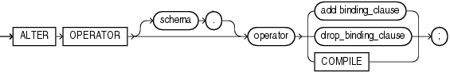
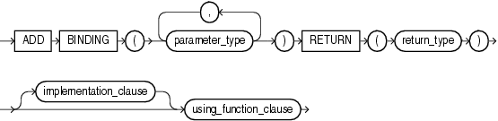
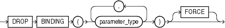

## ALTER OPERATOR

Purpose

Use the `ALTER` `OPERATOR` statement to add bindings to, drop bindings from, or compile an existing operator.

See Also:

[CREATE OPERATOR](CREATE-OPERATOR.md)

Prerequisites

The operator must already have been created by a previous `CREATE` `OPERATOR` statement. The operator must be in your own schema or you must have the `ALTER` `ANY` `OPERATOR` system privilege. You must have the `EXECUTE` object privilege on the operators and functions referenced in the `ALTER` `OPERATOR` statement.

Syntax

alter\_operator::=



> ```
> ALTER OPERATOR [ schema. ] operator
>   { add_binding_clause
>   | drop_binding_clause
>   | COMPILE
>   } ;
> ```
>
> [  
> Copyright © 1996, 2025, Oracle and/or its affiliates.](https://docs.oracle.com/en/database/oracle/oracle-database/dcommon/html/cpyr.htm)


(add\_binding\_clause::=, drop\_binding\_clause::=)

add\_binding\_clause::=



> ```
> ADD BINDING
>   (parameter_type [, parameter_type ]...)
>   RETURN (return_type)
>   [ implementation_clause ]
>   using_function_clause
> ```
>
> [  
> Copyright © 1996, 2025, Oracle and/or its affiliates.](https://docs.oracle.com/en/database/oracle/oracle-database/dcommon/html/cpyr.htm)


(implementation\_clause::=, using\_function\_clause::=)

implementation\_clause::=


> ```
> { ANCILLARY TO primary_operator
>     ( parameter_type [, parameter_type ]...)
>       [, primary_operator
>          ( parameter_type [, parameter_type ]...)
>       ]...
> | context_clause
> }
> ```
>
> [  
> Copyright © 1996, 2025, Oracle and/or its affiliates.](https://docs.oracle.com/en/database/oracle/oracle-database/dcommon/html/cpyr.htm)


(context\_clause::=)

context\_clause::=


> ```
> [ WITH INDEX CONTEXT,
>   SCAN CONTEXT implementation_type
>   [ COMPUTE ANCILLARY DATA ]
> ]
> [ WITH COLUMN CONTEXT ]
> ```
>
> [  
> Copyright © 1996, 2025, Oracle and/or its affiliates.](https://docs.oracle.com/en/database/oracle/oracle-database/dcommon/html/cpyr.htm)


using\_function\_clause::=


> ```
> USING [ schema. ] [ package. | type. ] function_name
> ```
>
> [  
> Copyright © 1996, 2025, Oracle and/or its affiliates.](https://docs.oracle.com/en/database/oracle/oracle-database/dcommon/html/cpyr.htm)


drop\_binding\_clause::=



> ```
> DROP BINDING (parameter_type [, parameter_type ]...)
>   [ FORCE ]
> ```
>
> [  
> Copyright © 1996, 2025, Oracle and/or its affiliates.](https://docs.oracle.com/en/database/oracle/oracle-database/dcommon/html/cpyr.htm)


Semantics

schema

Specify the schema containing the operator. If you omit this clause, then Oracle Database assumes the operator is in your own schema.

operator

Specify the name of the operator to be altered.

add\_binding\_clause

Use this clause to add an operator binding and specify its parameter data types and return type. The signature must be different from the signature of any existing binding for this operator.

If a binding of an operator is associated with an indextype and you add another binding to the operator, then Oracle Database does not automatically associate the new binding with the indextype. If you want to make such an association, then you must issue an explicit `ALTER` `INDEXTYPE`... `ADD` `OPERATOR` statement.

implementation\_clause

This clause has the same semantics in `CREATE` `OPERATOR` and `ALTER` `OPERATOR` statements. For full information, refer to [implementation\_clause](CREATE-OPERATOR.md) in the documentation on `CREATE` `OPERATOR`.

context\_clause

This clause has the same semantics in `CREATE` `OPERATOR` and `ALTER` `OPERATOR` statements. For full information, refer to [context\_clause](CREATE-OPERATOR.md) in the documentation on `CREATE` `OPERATOR`.

using\_function\_clause

This clause has the same semantics in `CREATE` `OPERATOR` and `ALTER` `OPERATOR` statements. For full information, refer to [using\_function\_clause](CREATE-OPERATOR.md) in the documentation on `CREATE` `OPERATOR`.

drop\_binding\_clause

Use this clause to specify the list of parameter data types of the binding you want to drop from the operator. You must specify `FORCE` if the binding has any dependent objects, such as an indextype or an ancillary operator binding. If you specify `FORCE`, then Oracle Database marks `INVALID` all objects that are dependent on the binding. The dependent objects are revalidated the next time they are referenced in a DDL or DML statement or a query.

You cannot use this clause to drop the only binding associated with this operator. Instead you must use the `DROP` `OPERATOR` statement. Refer to [DROP OPERATOR](DROP-OPERATOR.md) for more information.

COMPILE

Specify `COMPILE` to cause Oracle Database to recompile the operator.

Examples

Compiling a User-defined Operator: Example

The following example compiles the operator `eq_op` (which was created in " [Creating User-Defined Operators: Example](CREATE-OPERATOR.md) "):

```
ALTER OPERATOR eq_op COMPILE;
```